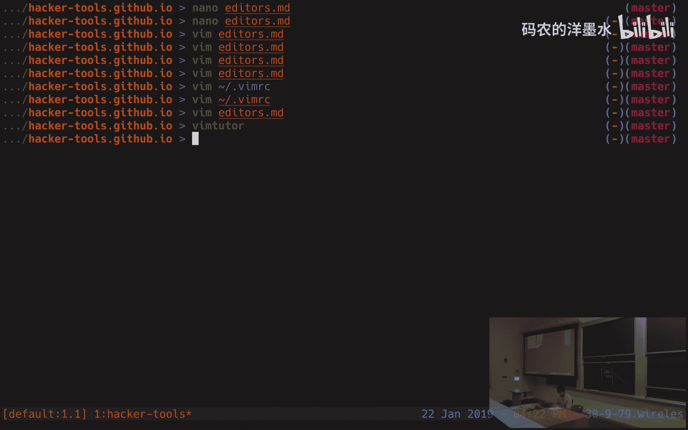
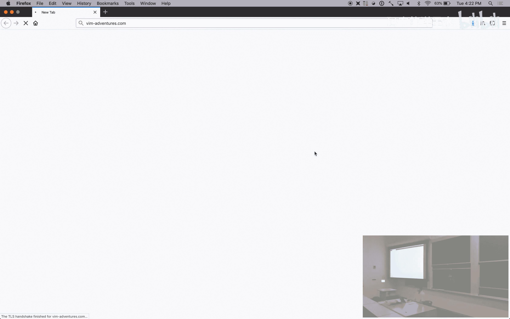
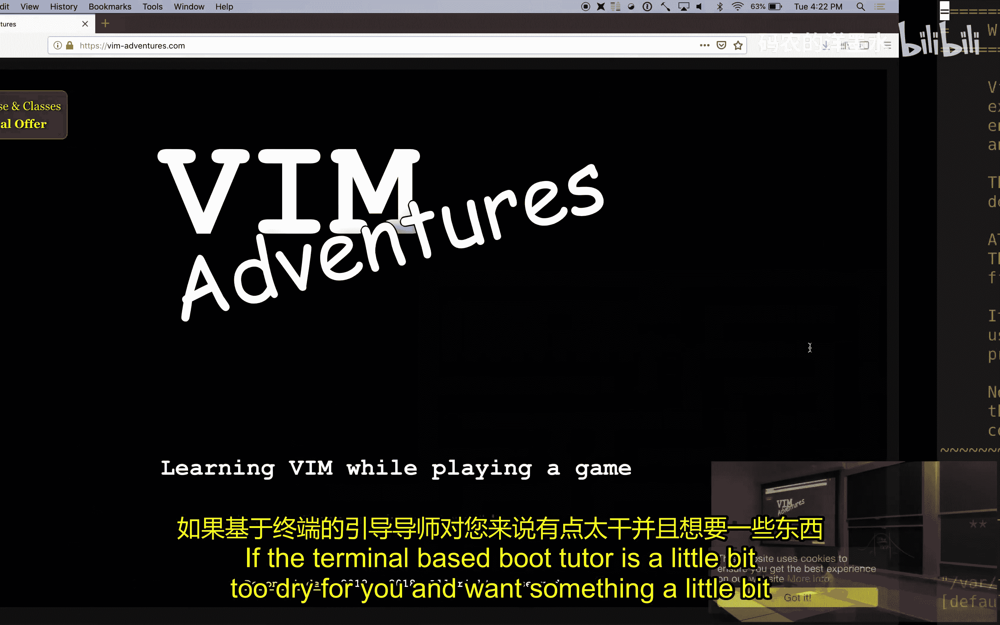
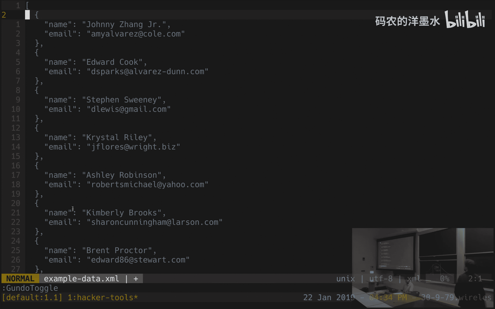

# 【全集】MIT麻省理工 黑客工具 中英字幕 1080P Hacker Tools p05 Lecture 5 - 文本编辑器 -BV1jcPTz6EE2_p5-

Hello everybody， welcome to Agrito Le number three。

 today we will be covering text editors and version control。

 I think two really important and exciting topics。As for tech editors， I think as programmers。

 we end up spending most of our time interacting with plain text files。

 look of all the different tools you'll learn to use in this class。

Use outside of this class on programming related things。

 you're going to spend most of your time in your text editor。

shell not delerating on other tools and so for that reason I think it's really worth investing time to figuring out what text editor works best for you。

People have lots of different opinions on this。嗯。And so it's worth finding an editor that fits your needs。

 really putting the time into learning the tool really well and putting the time to customize the tool to make it do exactly what you want it to do。

And I think the way you've learned a new editor is you just force yourselfel to use that editor for whatever you do。

A couple weeks， so like you're taking a class or whatever you need to programs as well。

 if you want to learn VIM， force yourself to use VIM for month。

 and maybe initially you'll be slightly less productive than you were with whatever tool you were using previously。

 but really it's the only way to become really good at using some new editor。

If you switch to a new editor that has a kind of difficult learning curve。

 maybe it will be slightly less productive for a couple of weeks。

 but it'll begin to pay off starting maybe two or three weeks in。嗯の。

So in this class we're going to teach you kind of the basics of VIM which is one powerful commonly used text editor。

 but we encourage you to experiment with other options。

 we're teaching VIM because John and Jose and I all use VIM and so that's the only tool we really know super well。

Different people have different opinions， we even have some links in the course notes。

On linking to the editor Awards。People have really strong opinions on VM versus Ems。

Had many flame war on usingad and stuff based on。CompPing these two editors。所之系别。

So in this 50 minute we're going to introduce you to the basics of them。

 we can't really teach you how to use this powerful editor in just 50 minutes and so the focus is more on teaching you the basics and them showing you what other more advanced functionality looks like。

嗯。Teaching me some of the philosophy behind the tool and then giving you links to resources so you can master the tool in your own time。

 it's really to inspire you to put in the effort children's tool well。啊。

And a lot of the lessons we're going to teach you are going to be in the context with them。

The idea should translate to any other tool you want to use， even if the exact sequences of commands。

あんでせん。Get started。We have a couple， if you look at the course notes there are a couple links in there that you might find interesting looking at surveys for which editors are popular among many different programmers like stack overflow around this。

Surveyed just last year。And。The results are kind of interesting。

 you can get some inspiration from there if you want to figure out which tools you might want to experiment with。

And so there are two main classes of text editors， they're ones with graphical interfaces。

Things like Adam or sublime text， and then there are tools that we're going to spend our time talking about here。

 which are command line text editors。This is the command line。

 you learned how to use the shell last week when John taught you how to use the shell。

Even if you eventually decide on using an editor with a graphicable interface， it's worth。

Learning some command line under， at least knowing the basics。

 because it's really useful when editing files on remote machines so like say for a class you need to log into Athena and run some code there。

 well it's really convenient if you can just SSH in and then run a text editor in your terminal on that remote machine rather than having to deal with copying files back and forth or using some of the more complicated techniques we'll cover slightly later in today's lecture。

So before we get into ViIM， I'm actually going to show you a different text editor。

 there's a text editor called Nano。And so the way you invoke it is just like any other shell type nano。

 and then it takes an argument， the name of the file you want to edit。So in this lecture。

 we're actually going to be editing the portions for the lecture。

This is a good text editor to be aware of because if you eventually end up settling on using something with a graphical interface like say。

 Adam。If you ask this agent to a machine。Log in remotely to a different machine and want you to be able to edit a text there if you're going to need to be able to use something like this。

 and this is one that's really simple to use。So this is what the interface looks like。

They're basically instructions always visible at the bottom of the screen and you can move around using the arrow keys。

 so there you see the cursor moving。And I can just go。Had a text directly。最近我は。

And it works more or less as you expect it to。Basically。

 the only key combinations you're going to really need to use。Among these options up here。

This one here。Does anybody remember what that notation means？

Talked about it a little bit during Michelle lecture。

That means so that charactert is referring to the control key， so if I type control O。

That invokes that write out command and his editor ask me， okay。

 what file name do I want to write it to and it's prepopulated with the name that I open the file with I don' intervenening in the file。

Flow and press enter and it saves the file so pretty straightforward。

And if I want to close the editor， I can just press C X， that's also given down here in the bottom。

And there we go， I modify that file if I open it up again。

I can see that I deleted that word and that change is persistent。

So very simple text editor will be preinstalled on all the systems you use。

 and so it's just convenient to know that this is a thing and you can use it if you need to。

Any questions sir？So this is a text editor that's great to use when you don't know how to use anything else and you're logging to a remote machine that has no other editors installed and need to make a small change to a file。

This is not the thing you want to use to write complicated programs because it doesn't really have super great support for doing anything fancy that you would want to do。

Is it your text editor？So instead of what should you do， well。

 we're going to teach you how to use VIm， which is one powerful text editor。Thenim is called theIM。

You can launch it just like you want the other editor， so Vi and then you can give it the new file。

You will see this interface。Okay， so。To tell you a little bit about the philosophy behind them。

 this is actually like a pretty complicated tool with a lot of neat ideas behind it so before actually go and teach you how to use different key commands for me to do things。

 I'll tell you a little bit about the philosophy behind the tool。嗯。So。

One idea that the parameters behind this tool behind the earlier version of this tool had was that when you're programming。

 like we're not using this to write essays or something， we're using this edit of code。

 edit of plain text files and so when you're doing that。

 you actually don't spend most of your time writing characters。

 you spend most of your time moving around the file reading the text and manipulating the text in different ways。

You don't just kind of like put your cursor somewhere and then just go write a bunch of text。

 you go and find a function somewhere and edit some text there and go jump somewhere else in the file。

 edit some text there。And so if we want a tool of design for doing that sort of thing。

 maybe it shouldn't behave like other text editors like say Microsoft Word。And so。

There's this idea in the them。callled modes， like themm is a modal editor。

 the entire tool can be in one of different modes designed for doing these different kinds of things。

And so there's a mode for inserting text， like when you want to go and type in a bunch of characters。

 but there's also a different mode for moving around the file or manipulating the file in different ways。

That's called normal mode。Since in programming， you actually spend most of your time reading or manipulating code rather than just inserting code。

He spent most of her time in V in what's called normal mode。

We'll talk a little bit about how to switch between modes。How to know which mode you're in。

Another powerful idea behind this tool is that VIM is programmable。

This tool comes with this programminging language called BImcr。

And you can customize a lot of aspects of this tool by writing configuration or even more complex programs or plugins in Vimscript。

And it's also programmable using binding for different languages of Qite code and Python or Ruy or whatever。

 they're probably binding for whatever language you want to use。

 and so this editor is really heavily customizable through that。

Another thing is that even the interface of the tool is kind of like a programming language。

 like the way you move your cursor around and make changes to the file is through a sequence of commands。

 these are usually single keystrokes， these commands have mneonic names。

 so we'll talk about the details in a moment。When'm normal mode and I want to go to insert mode。

 I can。Or if my cursor somewhere， and I want to substitute the character。Under my cursor， I press us。

 or I want to， if I want to put my cursor somewhere and replace a single character with some other character。

 I can type R and then the character I want to replace it with。Remember for those specific comments？

More about those in a moment， but it's this underlying idea that the interface is like a programming language。

keyeysstres with pnemonic names and the commands are composable so you can learn different movement commands and different editing commands and then kind of combine them in any way you want to make these compound commands and that's what makes this tool so powerful。

So for example， there's a command to move forward by a word if you just type a command by itself。

 but there's also a command to change something。So if you combine the command to like。

 change something with the command to move forward by word， then you can change the word。

 which means it'll replace the word that's currently highlighted or where your cursor is and then put you an insert mode where you can type in a new word。

There's also a command to move to the end of a line。So it's a movement command。

But if you combine the change command with the command so moves to the end of the line。

 what will happen is you'll delete everything from where your cursor is to the end of the line and go into insert mode where you can change that content。

啊。So this general idea is super powerful and we'll go through the details of different movement commands and different manipulation commands and see how they can be put together。

Any questions about that general idea？This is probably really different from tools you've been using so far。

 actually quick survey like what kinds of editors do people use？Oh yeah， so you do these问。

How many people use graphical？T based on。Pretty annoying kind。No。 good dear。嗯。O， yeah。

 so those are some of的。Underline ideas behind this tool。Some other things that are kind of。

Important ideas too， one is that we don't want to use the mouse for navigating a file because it's like a kind of crappy input device that's。

Not super precise and it's very slow。Instead we won't use the keyboard like we use all 10 fingers and once we know the commands and pen of have some muscle memory。

 you can move around a file and manipulate a file really fast using the keyboard。

 so when using this tool， even though it does have mouse support。

I text and move my first around and say， you really shouldn't be using mouse。

Really the editor should work at the speed you think。

 like you should be able to think like I want my cursor to be over there and then a moment later your cursor should just be there。

And using the mouse， I can't really do that， but maybe using the keyboard and knowing the proper way to talk to my editor。

 I can make that actually happen。My tool should just get out of my way and let me manipulate the file in the way I want kind of at the speed。

 I think。Okay， so now we're going to get into some of the details。

 any questions about philosophy or ideas far？Cool， okay。

 feel free to follow along like I'm sure you just by default。

 have them install on your computer if you don't， if you're running Linux like App install them。

 if you're running Mac OS， through installs them。Haveapp不错。Of a plain text file on play long。

Or just watch me type things into tonight。Okay， so the first thing we need to know about VIM is the different modes。

 so remember I said BIm is a modal editor， kind of behaves in a mode that's designed for inserting text versus a different mode that's designed for moving around the file or manipulating the text。

And so the way you know which mode you're in is that it's shown the bottom left of your editor。

 so see here this says insert， that means I'm in insert mode。There are different modes。

 here's visual line mode， visual block mode。Just visual mode。Replace mode。

 we'll talk about what the different modes are in a moment。

 but the way you tell which mode here is just shown to you on the bottom left。

And if it doesn't say anything， that means you're normal mode。

Now the way you switch between modes is if you're a normal mode。

 there's a key combination to take you into any of these modes。

 so if I'm a normal mode and I press lowercase I， it puts me to insert mode after which I can type in text。

嗯。And then the different key combinations for。What are called visual modes。

 which are for selecting blocks of text。Pdre V。Then I go into visual mode where I can move the cursor around and select the block of text。

Linearly。There's also a visual line mode， if I do capital V， I can select a block of text by lines。

And there's a visual block mode where how to control V I can select a block of tab。And so。

Seleions are useful for different things which we'll talk about in a moment。So normal mode。

 press I go to insert mode， normal mode， press V capital via control via I can go into different types of selection modes。

And the way to get back from one of these special modes， back to normal mode is by pressing escape。

And so small side note here， on your keyboard， the escape key is probably this tiny key in the top left and it's kind of inconvenient to read with your Mky。

The keyboard， that the programmer of EI used。Was designed such that the escape key is basically where the caps lock key is on your keyboard。

 so it was a much more accessible key that's easy to press and Vim you're always going to be switching back and forth between insert mode or visual modes and normal mode。

AndMost of your time， and so it's convenient to have an escape key that's not the slight a ob nooxious thing in the corner。

And so one thing you can do is you can remap your capslo heat escape because capslog isn't really useful unless you want。

嗯。And so I think in a later lecture， we'll talk about how you can do this on different systems。

 but as a quick thing to show you how easy this is on Mac of OS， like going to system preferences。

 keyboard。Modifier keys。Here， I can just remap caps lock to escape kind a zero effort required。

Get rid of a useless key and have a very usefulcyclic escape key that's easy to press。Or to control。

Better control。Yeah， different people map their keys in different ways， so I think for example。

 EMS users are more likely to map their caps lock key to control or something else。

 whereas for themIM I think escape is a very popular way of mapping that otherwise useless key。

John has strong opinions about mappingping into the control key， I guess which you can talk about。

So the reason I map it into control is because it's a key that's useful outside of VIM。

 and then I have control J in VIMS set to escape。And control J is on your home row。

 so it's very quick to type， but then the control key is still useful in other places。

 the escape key not so much。Okay， so any question about modes or how to switch between them or kind of the generality of what the modes are meant for？

So you can see in normal mode， if I start typing text on my keyboard。

 it actually won't do the right things as I'm giving commands to the editor。

 that's what normal mode is designed for， but if I press I to go into insert mode and then start typing text it just goes into。

That fine。I do going to insert mode， which is。Doing for the most part today and then escape to go back to normal。

WellOkay， so now we know what modes are let's talk。

Basic VM commands next I don't know if any of you have heard the joke of like。

 I've been using good for 10 years now mainly because I don't know how to quit the thing。

IfYou notice if you press control C， it doesn't quit。

The way you quit BIM and the way you do a lot of things is by issuing what are called X command。

X is a different editor， like different component to the editor。

 basically if you're in normal mode and you press colon。

 you'll see that the cursor jumps down to the bottom left。

Like colon and then I have my cursor and I can give the editor a command and so there are lots of different X commands that do different useful things。

 some basics are if I do colon Q，Which is short for quit。And press enterer， it'll put the editor。

 so that's actually how you get out of the software。Other useful things I do colon W。

 which I think is short for。That no see it says。Finile written， that's how save file。啊。

Sometimes there are nice combinations of these things， so like there's a colon and WQ。

 whether way we can everybody read that text or do I need to make it larger？

I make get Lo for the video。OhExcus great。嗯。So they're， for example， a combination W and Q。

 which saves and quits。Other useful things， if I do colon in E。

 this is for edit and this one is a command that takes an argument so I can give it the name of a different file。

 for example， and go to edit that file then can have multiple buffer open so this is。

Showing a different file open I colon LS。It will show me a list of the different buffers that are open。

嗯。Colon BN switches to the next buffer。And the list of buffers。

You don't need to remember all these commands because we'll give you resources to learn all these different things。

 but this is just to show you。If you think about using whatever editor you were using before。

 say Adam。The visualual Studio code or whatever， these kinds of things like opening files or saving files。

 you probably did through the menus right like you took the mouse。

 you had moved the mess to the top left and clicked through a bunch of menus to do things。

And so for this software you issue commands test。Once you memorize this commands。

 mosts become muscle memory super fast。So another really useful X command is the command calledHe。

 this editor actually has a ton of built in documentation and then we access it through this help command and so if you do colon help you can give the name of a topic so I can do help。

 right？And it will open up this thing telling me about the right command that I showed you a moment earlier。

So Col Q is actually not exactly equipped， it's more like closed window and so you'll notice why it didn't help。

Right to look at this documentation， I did Col Q to go back from looking at that documentation to。

file open。So these are some very basic x commands， this is basically telling you the equivalent of what was in your menu bar at the top of your editorer previously。

Also beyond looking up。Help for commands like this right command。You can look up commands for。

The different keystrs that are part of ViMS programming language that we'll look at in a moment。

 it's like how do you actually move the cursor around the file。

 you don't want to use the arrow keys even though they do work。

 there' are better ways of navigating a file， things like I press the W key。

 my cursor moves forward by an entire word at a time。

How do I know what the W key does if I look at help W？See this documentation says， okay。

 this moves by word forward。That's the health command。

 and that's a quick overview of some basic X commands to quit to save a file。

colon and WQ to say and quit LS to look at a list of buffers。Help to learn more about the editor。

A ton of these commands and they're useful for different things。

 and we will give you resources to learn more about those。questions about asking。Okay， so I a call。

 you can save yourself one character of typing by writing colon X instead of colon WQ。

It saves you so much time Yeah， so Col X is the shortcut for WQ。

There are lots of things in VIM like this where so VIM is kind of like a programming language right。

 and so there'll be a combination of keys that can accomplish a certain thing and then oftentimes there might be a pur combination of keys that accomplishes the same thing。

Well， I think we have some of those examples in here too。嗯。X versus CL。S versus CL。CQる well。Okay。

 so the next thing we want to talk about is how do we actually move around this file？Well。

 there's insert mode where if I press I can actually type in text and it just goes into the file。

 but for the most part when I'm programming I'm like moving around the file and manipulating it。

 so how do I move well one way I can do it is with the arrow key is just like a nano。

Ps and hold the down mar key。Scroll down。But this is a really inefficient way to do things。

 they're much better movement commands。And so。I actually recommend that you disable your arrow key when you're learning just to avoid getting into these bad habits。

You can do that by。Putting a bunch of。Commands into your VMRC file。

 so we can actually do that very now。Let's open up， I'll just quit the editor and do tilda/。viMRC。

 we'll talk more about what these dot files are in the dot files lecture， which I think is next week。

But basically， VimMS configured through this plain text file called dot VmRC。

 where you write a sequence of VIMS scripts。Com。These are the settings for your editor。

The editor are super heavily customizable and you can remap keys and do all sorts of other fancy things。

And so one thing you can do is you can even remap the arrow keys， so I can say。

Don't worry about what exactly this command。What exactly this Ven script means？

You can learn more about themscript。So this line of code says when I press。

I want to remap the left key to instead be the command this。

So it'll just give me a message instead of actually doing whatever movement it was supposed to do。

 and so now for example， if I close an open my editor and I go to reload this file。

 which it loads by default， now if I press the left key。

You'll see that doesn't actually move left I'm pressing left， it's a use H at the bottom。

So ViIm actually in sort of using the up down left right arrow keys on your keyboard。

For those motions， you use the HJK L keys， and so H moves left， L moves right。

 and J& K move up and down。And so。Like we could go and remount。All our hiarchs。

So they don't actually do anything except complain at us and tell us to use。

So I'm going to call in W to save this file， pull in Q to quit。Go back to my peters。

And now if I put my mouse somewhere。probably using the updoal break keys， it'll instead tell me。

Our office is， oh， use K and stuff。So okay， so the most basic movement of the up down left current is done with the HKL key。

 and there's some historical reason for that。Today like this is useful because you don't need to move your fingers from the home row。

 you don't need to look anywhere， you can just move around with thing too much。But in general。

 you don't want to be making these really inefficient notions like if you want to go down a0 lines。

 you don't want to press some hold day and wait for half an hour。Rdiverse scrolls down。

So there are a bunch of other movement commands of them that all work in this normal mode。

So we can move by words， so if thatW moves to the next word， see statement forward word by word。

In fact， there's B， it goes backward by。the start of the word come in the middle of the word it goes to the beginning of the word。

That's another command because the end of the current word jumps to the next word if it's already at the end of the。

So like if my cursor is here I want to go to the y in productivity， I can press E to go to the n。

If I'm Karen， I want to go all the go back to the beginning to the P productivity A press B。

If I want to go back by another word， I can press be again itll go to the Y and your。

So that's how you move forward and backward by words。

Now there are other useful commands to do kind of similar things in different scope。

 so their commands to move。To different parts of the lines。

The zero key moves to the beginning of the line。Dollar sign moves to the end of the line。

And then the carrot key moves the first。Non white space character。

So I in uped this line a little bit just to demonstrate if I'm here and I press zero。

 I go at the beginning of a line， dollar sign end of line and carrot this。

The symbol shift sets on your keyboard， moves to the first non white space character。啊。

Any questions so far？Now don't be worried about memorizing these things。

 they'll become muscle memory soon enough and they'll give you tools to learn these things。

There's a program called BIm Tutor thatll walk you through this kind of stuff。

 and they're also like interactive games and things that people put online。変こ。

And now there are lots of other movement commands， demonstration of some other ones。

 H goes to the top of the screen。M sorry， capital H goes to the top of the screen。

 capital N goes to the middle of the screen， capital L goes to the bottom of the screen。

If you want to move by entire pages， control D goes down by page， control E goes up by a page。

And so that's how you can scroll around in a file。嗯。If you want to move by the entire file。

 if I do lowercase GG that moves all the way to the beginning of the file。

 capital G moves all the way to the end of the file。

I can go to specific line numbers in the file by typing colon and then the line number where I can type the line number like1。

 two，3， capital G， and it goes to that specific line。

I'm just like overwhelming you with movement commands， but we'll see。

What these are useful for in a moment just besides moving around a file。

 and then you can learn these over time。Some other kind of useful things。

There's a command a movement command percent which is move to the corresponding item This is another kind of neat and useful thing If my cursor is inside here。

 well this is inside a parenthesized block and if I press percent my cursor jumps to。

Jumps to one of these parentheses and highlights the other， and if I press percent again。

 it jumps to the matching print and then highlights the other matching。

So if I'm inside here and I press percent， now my cursor is right here。And if I press person again。

 now my cursor jumps to the closing parentheses on the right and highlights the one on the left。啊。

Other kind of useful things to navigate around lines。

 if I press lowercase F and then a particular character。

 that means find the first occurrence of that character on。And so if I press F and single quote。

 for example。My cursor jumps to the first single quote here， if I press happens zero。

 my cursor jumps here。There's also capital F which is searched backwards for the first sance of the thing so my cursor is here and I a capital F single quote and cursor jumps back here。

And there's another variation of。fine。T which stands for two。

 so instead of finding a thing can jump to a thing which is jumping right before the first occurrence of a thing。

 so if request t0， it jumps to the zero， but not on top of it。

Capital T does the same thing but backwards， so like if I was here and a capital T single quote。

 I jumped all the way back here right before his single quote。Okay， so that's。

Some movement commands in them， and there are a ton more。

 they're all useful for different purposes and you'll learn them over time。嗯。Now。

 one kind of interesting thing is that。I tell you not just the underlying thing。

 but the interface is really a programming language。And so if I want to say move down three times。

 I could press J J J to move down， down， down， but I can also do。

I can press the number three and then I can press J。Three times do whatever I do next。

And so3J is moved down three lines。If I'm ultimately let move somewhere else in my file。

 if I'm here and I want to move forward by five words。

 I can press 5 W and it moves forward by five words， 3 P backwards by three words。

And so this is the first exposure again to seeing how these different commands can be composed together to kind of make more powerful editing mode。

And one more thing I'll show you right here before we move on to the next type of thing。

 which we'll talk about is searching。If you're somewhere in a file and you want to move somewhere else。

 one really fast way of moving there is by searching for that text。😔。

And so the way you do that is in normal mode， you press the slash forward slash and your cursor will jump out。

And you can type in。Rex that you want to search for， so remember my cursor was up here。

Sarah want to jump down to this capital E editor， if I press slash and type an editor and press En。

 my cursor just dumps down to the next occurrence of this。There's a really fast way of moving around。

And I want to I'm in the search mode if I press N。It'll jump to the next occurrence of whatever I just searched for。

 so here's the next occurrence of capital the editor and I'm hear its down there and again it jumps to the next occurrence。

C and it moves backwards in this。In this list。AndMo me down here， capital N。

 capital N moves me back here。There are escapegg to move all the way back to the top of the file。

Okay， so that's some of the movement commands in them。

 these will eventually become from muscle memory if you use this thing for a couple weeks。嗯。

So that's some of the stuff you can do in normal mode。嗯。

And another thing you can do is once you actually find where you want the cursor to be。

 say right here， I can press I to to insert mode。start typing in。an underscore there。

And I want to put an underscore at the end of the line press dollar sign。A for a lowercase， A for。

Aend。Type in my underscore4 press escape to adoption normal。Usually all editing women will be like。

Our normal mode， you move your cursor somewhere， you go into insert mode。

 you make whatever change you want to make and you go back into normal。

That's what the regular editing workflow looks like。Now if there are mode。

 besides just normal mode and insert mode， remember I talked about doing different kinds of selection and so there's。

Visual mode by press B。再见。Use HJKL or thearrow keys to move this cursor around and select a block of text。

嗯。You can also use all the regular movement commands from earlier。

 so again you see how these things compose， so if I'm in this selection button in FW this jumps a word at a time。

s10 J will jump 10 lines down。呃但 so。The first escape cancels。And goes back to normal load。

 gets through my selection。Itme B for Vi Mo。How do capital be it select by lines rather than selecting from one character to some other character？

嗯。Again， I can use all the same motions I had learned earlier。3J jumps down by three lines。

 3K moves up by three lines， and so on。And there's also something visual block mode which I enter by pressing C B and selects a rectangular chunk of text。

And we'll see what selections are useful for。Any questions so far？Are any comments from？

Are you covering marks later， or we were skip marks？This is such a complicated tool。

 we're not even going to cover like 1% of this functionality today。

 but hopefully I will inspire you to learn more about it on your own。Okay。

 so now we know how to move around a file someone comfortably。

 we know how to open and close files and save files， how do we actually manipulate text？Well。

I think the way should think about it is like this before with your old editor。

 everything you were doing with the mouse， you're now doing with the keyboard。

 like any kind of moving around， like selecting and dragging things around。

You're doing with the mouse， there are commands for doing that that are way more efficient。

So the most basic thing is you get your cursor somewhere， and you press I to enter insert mode。

 you can start typing characters。啊。There's a different way to enter insert mode。

Which is pressing A and it's like jump forward by character and then it enter insert mode and I can。

Typing characters presses escape to go back to normal mode。Just。

Using Vis motion commands and then using insert mode to edit my text is' not going to be super efficient like say I want to go and change the word productivity to the word high。

 but one way I could do that using the commands I've learned so far is like okay。

 I pressed E to go to the end of the word。Press A and move my cursor one to the right。

 if and enter insert mode， I can actually edit the text， and then press backspace a bunch of times。

To delete this word。And that's not going to be super efficient。Instead。

 there are commands for doing different kinds of manipulations。

That you can kind of stack or combine with the different motion commands we learned。So。

Before we talk about combining commands， one other kind of useful thing is if you're in normal mode。

 you press lowercase O。Inserts a line below and puts you in insert mode so I can start typing text here。

If I press capital O it inserts the line above。Let me start inserting text there。嗯。Okay。

 so now for actual tax manipulation commands， so the D command for delete is a command that takes a motion and then applies deletion to that motion。

So if I'm here in I press E， I go to the end of the word， right， if I'm here in I press D。

Delete to the end of the word。嗯。If I'm here and I press D does't anybody remember the command for end of line？

Yeah， dollar sign， so that press D dollar sign， it's delete to the end of the line。

I'm here I press D0s delete to the start of the line。If I'm here and I press D Cart。

 it's delete until the first non white space character of the line。I'm here I press D3 J。

 let's delete three lines down。So you can combine the sophisticated ways。

 combine the manipulation command with a number of command for repetition and on the actual movement command。

 right？If I'm here and I want to delete these three words。I can do D3，W to delete three words。

RightThe way you probably do this with your old text editor is you move your hands from the keyboard。

And you go and you select the text that you want to delete and press backspace。

 it's way slower than D3w。Especially once it becomes muscle memory。

 which it well if you use this tool for any amount of time。

Some of the kind of useful things that are variations of say the delete command。

 here we deleted three words by doing D3W， and then we could press say I to go into insert mode。

Tech in whatever new tech you want。But instead of doing D and then the motion。

 if you press C and then do motion， C is for change， so if I do change words CW。

 it'll delete the word and then put me an insert mode I and type in the U word as a replacement。

So if I'm here and I do C3W。It changes the next three words。

 delete the next three words and put me insert mode so I can type in something different。

And now here you're starting to see how there's some overlap between these commands。😔。

D3W followed by I to put be an insert over and type in U text。Is the same as C3W。

You stay with piece trip by doing the。More specific committee。

I'll tell you about a couple more manipulation commands that are kind of useful there's another command called X which is deletete the character underneath the cursor so if I want to go and like delete this period I can go over and press that。

I just got through of that period。Now again， there's some overlap here。

There is a motion to move right， remember HJKL is up down month， right？

So L is the key that moves you to the right by one if I'm here and I do DL。

 that actually ends the same thing as x like delete one thing to the right is the same thing as doing thing underneath the orer。

But you save a character by pressing X so the commands are going to useful。嗯。There。

whichch is substitute character。So， S。Delete the character under the page it put you in insert mode so you can start typing a new things。

So that's the same as DL to delete a character。I to go into insert mode。嗯。Its。

Similar to x followed by I to go into insert mode， but if I just press S。

 that's a single keytrooke that does the same thing as those other things。

So that's a couple of these tax manipulation commands。

You can also apply all these commands like change or delete to selections。

So say for example I go into visual line modes and I'm pressing shift V and then JJ to go down by two lines to select this chunk of text。

 if I press C， it'll delete this chunk of text and put me in insert mode where I can type in something new。

Or if I just select capital B for visual line， JJ to select two lines down and press D。

 it'll delete that block of text that was selected and keep me in normal mode。So again。

 here you see how all these different things can be combining whatever way you want。

 like here we're combining。Well， we're using visual mode。

 then we're using motion commands to select blocks of text that across 5 J。

 it goes down by five lines， and then we're using a manipulation command to actually apply that operation。

To the block of the selected。啊。Another couple keys that'll be kind of useful as we play around with this stuff。

If you make a change and you want to get rid of it， you can press use on Do。

That's how I was undoing all these random deletions I was making。

And you can press control R to redo a change。That's another example of operations that were previously in the menus or maybe the interprets from like control Z and control I。

Now we have really efficient key combinations for doing all of these different things rather than like edit。

 redo or something。My name is。There are lots more exotic manipulation commands to learn。

 and actually they're kind of useful。If you're using this tool for months。

You'll probably end up learning all these different combinations and you will make use of that sometimes like theres here's an example of one kind of exotic thing if you press the Tilde key。

 which is like the key to the left of your one key， you press shift and press that key。い。

A like that on your keyboard。Through life。What that does is it flips the case of the character that's under the cursor。

So like if I want to remove the capitalization of the W， I can press Tilda。And it uncapitalized this。

It's like a kind of exotic thing you probably don't really need it。

 but if you know the commander can。Save you a couple of keystrs。

 like how would I do this otherwise I might impressed？

S to substitute and then lower hisW and then escape to go back to normal mode。

That's a little bit more accurate than a single key row。Another related。

Command that's kind of useful is if you press lowercase R followed by a key。

 it's replace what's underneath the cursor by something else。

C changes to C R capital W changes this to W， and keeps you in normal mode。So again。

 there are lots of these different manipulation commands that can be combined with selection and with movement commands。

Using numbers for repetition。That kind of make up the programming language of the interface for this editor。

啊。And so。How do you actually learn all these different things。

 like you're probably going to forget whatever I showed you right there with ajillion commands and they're maybe not so hard to remember because they're kind of mnemonic like Ds delete C has change as a substitute and so on。

But there are lots of nice resources out there for learning these commands。

 So one thing that's probably pre installedstalled on your computer already is something called the Vm tutor。

If you enter a B tutor， ideally do this in an 80 by 24 terminal。呃。Basically。

 V Tutor opens up a special text file， which is a eventm tutorial。

And it will walk you through basic movement commands all the way up to doing pretty advanced things。

 like I think if you spend the time to go through this tutorial that you do by using Boo Tutor。

 like you will know the tool well enough that you can immediately start using it as a replacement for whatever you were using before without having too much of a hidden productivity。

And then as you learn more things。That you can do with the tool。

ill end up getting even faster and faster than your previous editor。

There's another kind of cool thing， something called Bm Adventures。D。En。

The terminal based Zoo tutor is a little bit too dry for you and wants to be a little bit more entertaining。

 there's this online game。

teaches you how to use。movement commands and manipulation demands and so on。

 it's actually kind of fun to play through。I can try to use thearrow keys。

I think it'll just something similar to what I recommended for you。

 which is like complaining you and telling you not to use arrow keys across the arrow keys like， oh。

 don't use the arrow keys， use HJKL instead。And个。It's a kind of neat thing to explore around your own。

As an alternative or supplement to using something like a good tutor。Any questions over？Time flies。

There's so much more we wanted to cover basically I'm going to try to zip through this material to kind of show you some of the more advanced functionality of this tool。

 just kind of inspire you to put the time to learning it。

One thing that we touched on briefly earlier was that VM is configured through this plain test configuration file that lives in your home folder in a file called dotVRC。

 and again we'll talk more about dot files later， but some useful things you can put in there。

I got rid of my like I have a pretty heavily customized VRC and I got rid of it for showing you。

VIm basics in a VImMS setup that looks similar to how it'll look like。On your machine。

You can get a lot of things。嗯。By putting a bunch of little basic settings in here。

 you can get a lot of nice things in your editor that are not there by default， so like for example。

 you can see here out have line numbers on the lefts。A couple of settings that give you line numbers。

 you can give a setting that highlights text as you search for it。By setting a couple settings。

You can have syntax highlighting by just turning it on。Setting syntax on command。

One thing you'll notice if youve tried playing out of the default bi configuration。

 it actually doesn't let you backspace over certain kinds of text。

 like if you're at the beginning of a line for example， you going to insert mode and press backspace。

 nothing happens。And so's a you can change that behavior as well and like this is another same thing that you might want to your Ed configuration。

啊。And so there are tons of different things you can customize and there's no way even if we wanted to like have a two hour long class and all the ways you could customize them there's no way we could cover that all and so some techniquess you could use people all these nice write-ups on the internet talking about like VIM configuration tips and so you can look at those。

Another really useful thing to look at is that people have their doct files on GitHub。

 we'll link to some of these in our dot files lecture and you can basically take a look at how other people configure their editor。

 like for example， my configurations all online you can look at it if you want。

Some people actually take the time to document their configuration， and so you can look at these。

 try out these settings yourself， and see if you find them helpful。

And so it's definitely worth putting time into customizing your editor。

Do you mind if I cut into your table a little bit to show some fancy okay， just be efficient？

Minimize keystrokes。Yeahや。嗯Okay so。What to do before John teaches it about version control is showing you some fancy functionality。

We've talked about so far you can already do using this tool used before。

I want to share some kind of cool stuff。So let's go back to editing this。

The lecture notes for this lecture， now we have my configurations。

 so it looks slightly and nicer than it did before。One thing you can do。

 which you probably could do in your auditor is search and replace。

 so the way you do that is go into X mode percent S。They can replace the whole and I can do some。

Fru slash bar slash。This looks very similar to the set。Substitution。

That John talked about during his data run life。This is basically rightex search for this replaced with this globally in the file。

嗯。So if I apply this。Replace food with bar。We replaced that text here。

And so that makes no sense anymore。You can even have it show the replacement live during a substitution Yeah so if I do that I can do the replaced food with bar and I can see it as I type。

And so this this is really useful when doing fancier substitutions。

 like say I want to take all these things which are。

like named mark downlings and I want to get rid of the name link and just keep the like actual URL instead well I can do that by say replacing。

 okay， I want to like look for an open bracket followed by some。Followed by a closed bracket。

 followed by open parentheses， followed by some text that I want to capture。

And then replace that with the text I capture globally。

 and so here I can actually preview that change and if I press enter， it'll take effect。

And I've replaced all the named links in my markdown document with just the raw。

First of you to undo that change。So that's some fancy circuit replace。

Another kind of useful thing is split windows。So。I think some editors let you open up multiple files。

 but does your editor let you have multiple views of the same file like what if I want to see the bottom 20 lines of text here and the top 20 lines of text here in the same file well you can do that with this tool so like right now split。

Winows and two， and I've loaded the same file in both books。

So that's another kind of neat functionality。VI does have much support。

 which I recommend you don't use， but it's there if you want to go and enable it。

AndOne final thing to show you what I think is a really cool piece of functionality in them。

Let me open up。Specific file。Okay， so say I have a task where I have this XML file which has。

The list of people and each people， each thing and the people list is a person with a name and female address。

 like say this piece of data， and I want to convert this to JSON， like a different data format。Well。

 one way I could do is I could just go ahead and write like a Python program that loads the XML and pares it using whatever XML parsing library and then writes it out as JSON。

 but maybe for a one- off thing or maybe if it wasn't exactly XML that some custom。

I don't want to write a parser。Right like a full Python program or something to actually do that。

So what else could I do？Well， maybe one way I could do it is with these rag search replaces like I could search and replace。

 say like I could search for。Like open。Like angle bracket name。

 close angle bracket stuff followed by this and replace it with。

That stuff surrounded by quotes and so on apply a bunch of these ra substitutions。

But that can actually get really complicated and sometimes it's hard to think about these really fancy rugexes。

Another cool piece of functionality in then is something called macros。

 you can tell them to record a sequence of commands。

 and then you can have it replay that sequence of commands。

And you can take a sequence of commands and store it and register and then record another sequence of commands and use a save macro in a recording of another macro and so on。

Kind of interactively build these pieces of functionality。implement small functions that you just。

Implement by demoing it to them。And it's actually super powerful。

And so here I'll show you an example of how I can convert this XML file into a JSON file just using them。

So the the key。doing macros if you press Q and then a letter。

 it a macro in the bottom recording at W， it records a macro in the register W and then to replay that macro。

 I can do the App sign followed by the name of the key and so say I go here and I do QW recording。

Register W press of JJJ， Q to end the recording， not compress press@ W replays JJJ。

Okay so that's how macros work now how can I use that to convert this XML file into JSON Well let's work piece by piece。

First， let's just manually delete the first and last lines of this file。

 so capital G goes G end of the file， DD deletes the line。Lowercase DG goes to the start of the file。

 DD deletes the line。And I just this inner data， let me first write a macro to format like a single line changes XML is looking thing into something it's more Json looking。

 so let me do like QE for element。Red in the Reg E。If I press the carrot key it goes to the first。

Non white space element on the line。Now you can do our single quote to replace this with the quote。F。

Clos angle bracket to find the next closing angle bracket as to go to substitution mode。

 quote colon space。Escape to go back into normal mode。

Open angle bracket to jump to this first open angle bracket that's found。嗯。

Capital C to delete from that point to the end of a line going into insert mode。一こ。

This game huge to stop reporting。Now if we go to this slide and do app E。

This applies all those changes to this line too。Okay。

 so now I have a macro that will nicely format a single line for me。

 let me just go and undo those changes I can work in a clean document again。

 now let me implement a macro to format like one of these elements。

So if I go onto the line that has person on it and do Q， say P to format person。

 capital S to substitute that line， open race because it's going to be adjacent object。

 escape to go back into normal mode， J to go into the next line at E to replay the macroI stored in E。

Capital A to go to the end of the line in a pen， go into insert mode comma because I'm inserting comma there。

 escape to go back into normal mode J to go to the next line at E to replay that macro again。Jane。

 to go to the next line， capital S a substitute， closed brace， comma。I'm tapping it。

 escape Q stop reporting the macro。Obviously so now I have a macro that should format an entire person for me。

 and I can try that out I do add P。Okay， so those four months。A person。

Now all I need to do is apply this to every person in here and so I can record yet another macro record this in the Reg queue。

 so I press QQ to register record a macro。For the register Q F to apply the macro to format of person。

 J to go down by line。And then Q to start reporting。I can use。

I just replay this macro again again at Q at Q at Q， and if I just do 100 at Q。

 it's like apply this macro 100 times。You to quite a bunch more。0 times。I was type 1。

000 atQ and it replays this macro until it fails silly。When I got to the bottom of the file。

 when I tried to go down further， there's no more file。The macrotops playing。And I'm basically done。

 I can just clean this up a little bit， I have this extra comment at the end I can add。

Close square bracket to end the JSON array and insert an open square bracket here and move this forward and here we go like this is a valid JSON file。

I that I convert it from XMl to JSsonN using Be。And so this is just a。

 like I didn't really expect you to follow all the details there。

 but this is to show you that this editor is capable of doing some pretty sophisticated and powerful things。

We have a little bit more in the lecture notes in terms of resources。

 like some cool things are in the business plugins and they do lots of really fancy things and you should look into those like here's an example of seeing the undue history visualizes the tree of changes。

You can navigate that super easily。Tonss of good points out there that do coolに forます。

So you should look into those and those are on the left。So any questions about text editors？い。

I convinced you all to learn a text editor。Oh， okay， so let's take a 10 minute break。

We will resume with version control。

