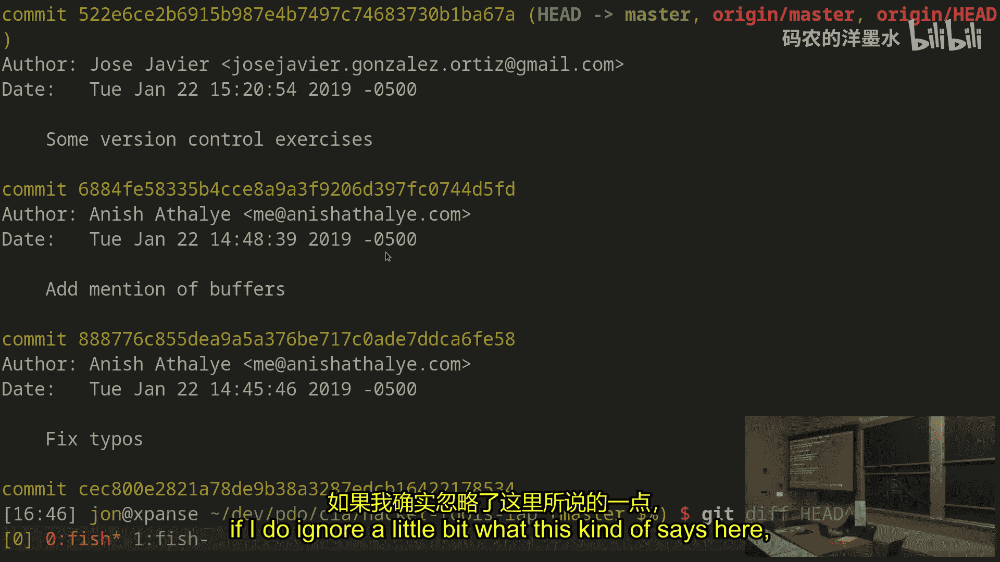
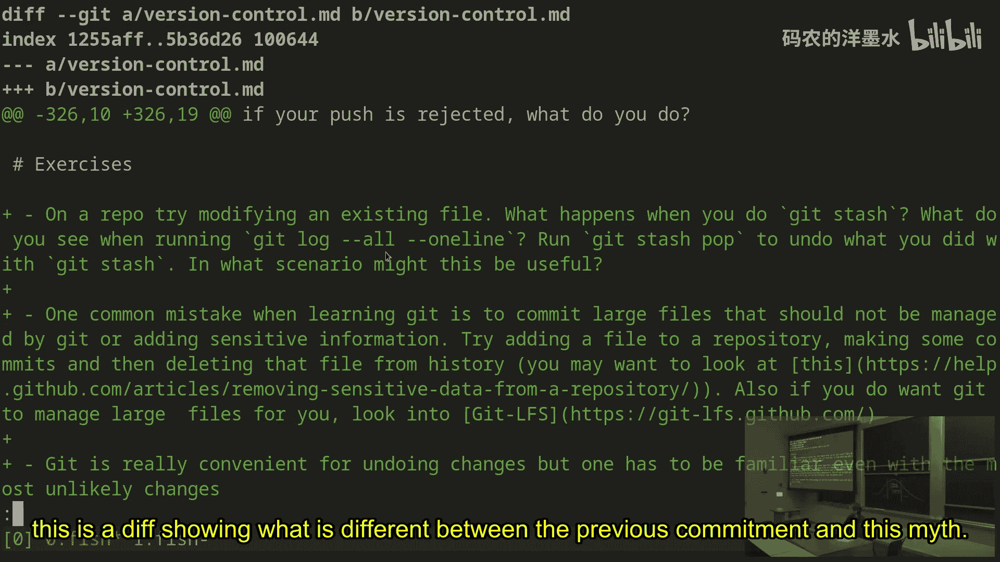
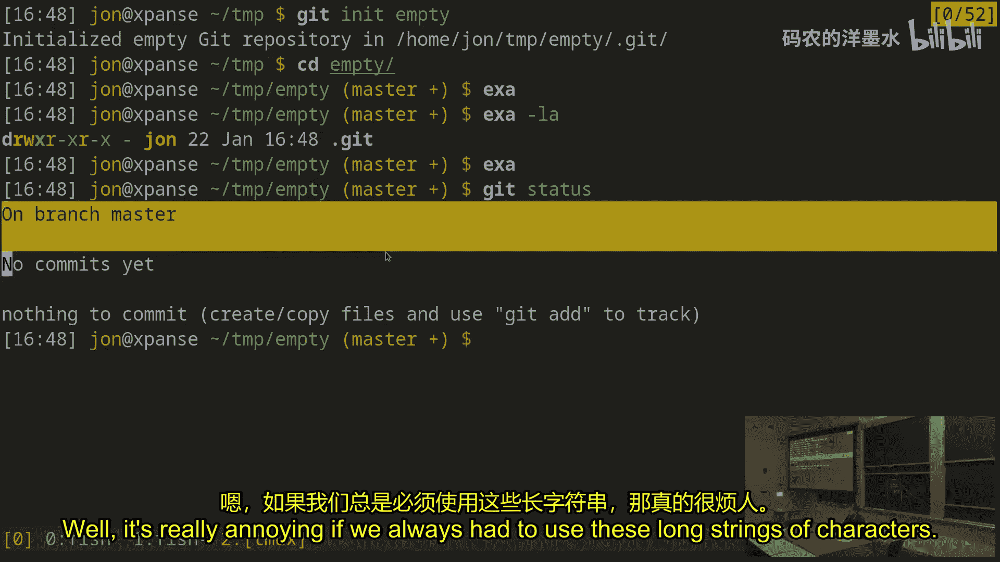
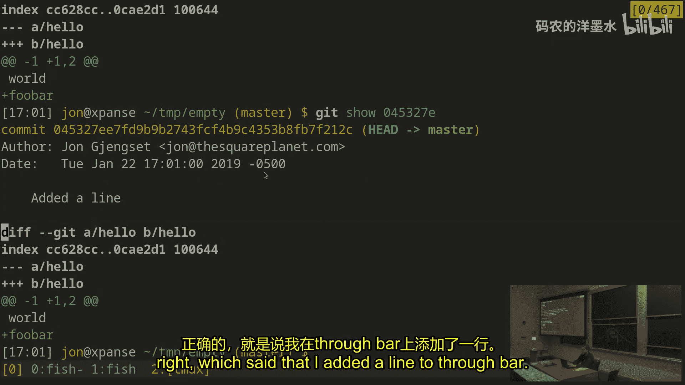
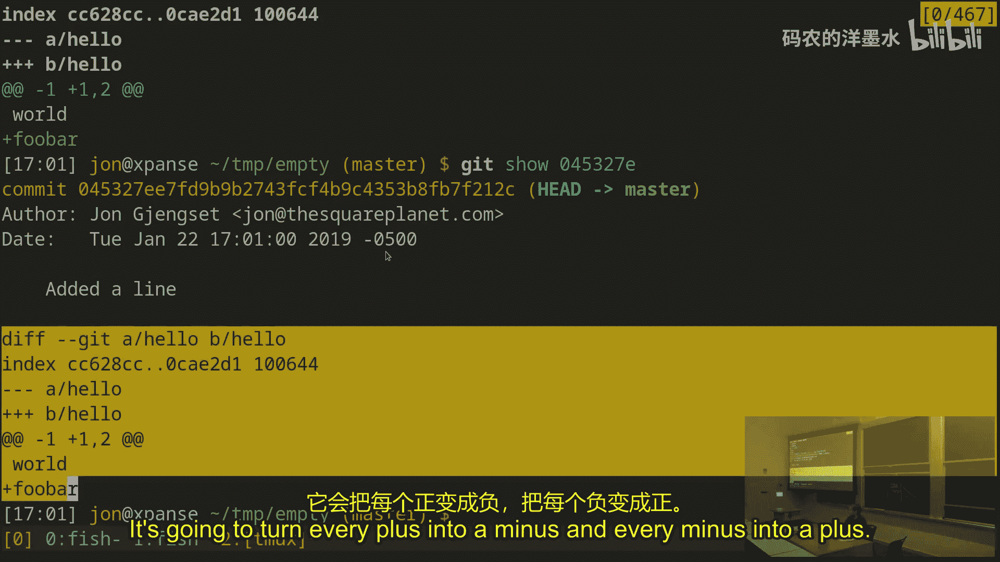
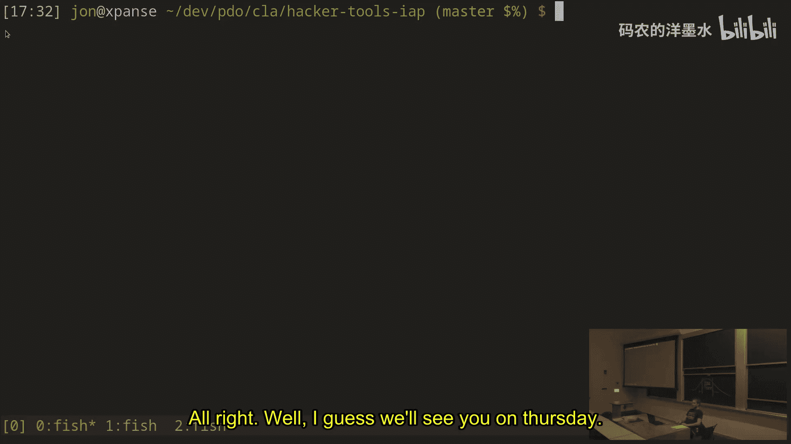

# 【全集】MIT麻省理工 黑客工具 中英字幕 1080P Hacker Tools p06 Lecture 6 - 版本控制 -BV1jcPTz6EE2_p6-

Okay， so you may have noticed that sometimes we make mistakes and we want to undo them。

 whether that's in life or in files server， and in the case of files in your computer system。

 it turns out that there are some really good ways of undo things in particular a version control system is a tool that you can use and manage your source code。

 your text files， your configuration files， whatever you want really。

 so that you can maintain a persistent history of the changes to those files。

So whenever you want to track changes over time， a version control system is probably the place you want to start。

In addition， version control system you can use the share changes between different users so if you make some changes to a file over time and an niche make some changes to a similar set of files。

 you might want to be able to combine those changes so that the two of you can work on the same project and you can see what each other has done。

There are a ton of version control systems that's out there that work differently that give you different features that are harder or easier to use that are different assumptions about what kind of calls you're working on in this particular lecture I'll focus on a tool called GiIt which is one of the more commonversion control systems that also supports things like。

Working with multiple users， multiple machines。And it's also one that's very well supported with by online platforms。

Sharing source code and those kinds of things， but you will probably find that some of the concepts carry over to other systems as well in particular I' recommend you take a look at a tool called Maial which many people tell to sort of get without all the weird parts whether or not you agree with that is for you to decide by looking at it but in general we're going to be using Gi in this。

In knowで。Whether you want explore other things you do that you。嗯。

For those of you who may have heard of G from before， actually， how many of you have heard of G？Nice。

 so many of you have used it。How many of you think to get the stark magic？还大す。

That's not right so there's this homodidage on the internet that nobody understands here it's really just about typing random command that you find on the internet interior terminal。

 which we all know is a great idea and then they sort of maybe do the right thing。

So the goal of this lecture is going to be to teach you a little bit more about how that works。

 why those commands do what they do。The mental model that you should come in mind when working with version control system。

At the very very sort of basic level， the thing to learn about it is its data model。

 how it thinks about the files that you're storing and the history that you're storing。

 once you understand the data model， a lot more of the commands that you operate on the history of versions。

Is going to become a lot clearer， like what's going on behind the scenes。

The core thing in Gi is something known as a commit。

 so a commit is basically a snapshot point in time of the current state of whatever folder you're looking at。

 so whenever you are using a version control system it's usually based on some folder and everything underneath it。

 and it's sort of a snapshot of that folder sort of frozen in time version of all the files there are in that folder。

And every commit and gift has a unique name， it's known as a hash。So it looks a bit like this。

So this thing right here is a commit has。Every single snapshot that you capture。

 every commit has one of these hashes， and they are guaranteed to be unique in the con's any given given repository。

Commits also have a bunch of other information it records things like who authored that commit so who made the snapshot。

 it usually includes some kind of message that describes that snapshot。

 like why did I choose to take a snapshot right now？It also has the hash of the previous commit。

 so you sort of get a timeline and these are the changes that have happened over time and which changes depend on other changes that have happened before。

RightAnd the commit also represents basically the difference from the previous commit that you made in particular here。

 so if I typeD log， it shows me the log of changes that have happened to this directory and you'll see who made each change。

 what the name of each change is and when that change was made and the commit message and in addition。

 if I do ignore a little bit what this commit says here。

 this is a di showing what is different between the previous commit from this commit。

So you can think of these snapshots as basically capturing which things changed from one point in time to another right so these green lines are lights that were at。

The red lines are lights and were removed。嗯。In reality。

 Gi actually source the full S snapshot does not just store these differences。

 but you can think of each commit as sort of applying a difference to the thing that came before。

 and that's why it least to remember what came before。So initially， whenever you start out with it。

 this is the reposulsory we used in the shallow scripting lecture so it just has a bunch of random files in there with nothing particularly interesting in there whenever you want to start tracking something we get you create a repository。

repository is basically where Git keeps all the information about the folders it's managing and you start one with Git in it。

 you give it then a folder if it doesn't exist it's going to be created in this case I already have a folder which is this spbar folder that I'm currently in so I'm going to say to get start a new repository in this folder。

And what that does is it creates in this directory a dot Gi folder that has a bunch of hidden information that Gi uses to track here。

 history and those kinds of things， and you'll notice that my prompt。

 which I've configured like we talked about in the command life environment。

To show me information about current version control status。

 what exactly is shown is in this prompt you will hopefully understand by the end of this lecture。

 you should not expect to understand it now， but just notice something appeared that made it recognize that this folder is now a version controlled。

So now that I have actually， let's start with an empty one。😊。

So I'm going to see the empty so this is now a directory that only has the there are no files in here。

 the only thing that's in there is the sort of hidden Git directory right there's nothing else in there and let's see what Git thinks about this directory so there's a command so all the Git command starts with Git and then a subcomd in this case status is a command you're going to be using a lot it tells you what Git thinks is the state of the current directory。

So in this case， it just actually tells us a lot of things that are going to teach us what Gi is doing。

 it says we're on the branch master， it says there are no commits yet and it says that there's nothing to commit let's walk through each of those in order first on branch master。

Well， it's really annoying if we always had to use these long strings of characters。

 if I had to tell you like I'm currently on 522 E6， et cetera， it'll be really。

 really annoying so instead Git has a way of naming these。

And so a branch is a name， the default branch is master。

 what a branch is is really just sort of a name that points to a given point。

Initially it points to the empty commitment because initially your repulsitory is empty and then every time you make a change。

 a new commit is made， it has its new sort of cache to itss unit and then master is updated to point to that updated。

Commit N and so as you go along， where master points is going to change。

 master is always going to be the latest change on the branch called master and you can have multiple branches if you want。

诶。Theres also a special name called head， so if you notice over here I said ignore what Re parse does。

 you said I can see I wrote head here， head is always the current commit。

Whatever the current commit is， that's what happenss。😔，嗯。You can also make your own names。

 so if I do get branch， I can name a new branch called Foodbar and I could give it something like this thing。

To point the name fubar at this。If I then made additional changes to the underlying repository。

 then the food bar branch would not be changed and would still be pointed as I commit unless I chose to updated it to point to something else。

By default， you're on the master branch， what being on a branch means is that whenever you make a new commit。

 that branch name is updated to point to the latest commit。

So if I were to make a commitment to this directory， master would be up to point to that。

 but any other brancheses would not be changed。They would retain whatever they were previously point to。

No commits yet there sort of celticplanory， we created a new repository and there are no commits in there and we have taken no snapshots and therefore there are no commits。

And this third line listen nothing commit commit actually it is really。

 really interesting as I mentioned every commit sort of contains the difference that you made right it sort of contains all the changes you made since the last time you took a snapshot but how do you construct one of these differences in the first place like how do you say what it is you want to include in a commit of course you could assume that if I have a bunch of changes in the current folder。

 I always want to commit the current snapshot of all the files I want to take a snapshot of everything that's there？

You could do that but sometimes there might be some things you don't want to include in the commit right I might have some files in there that are there sort of temporary I might have made some changes in a file that aren't really ready to be committed yet I just want to commit other parts of that file or sometimes I might have made multiple different changes and I want to break them up into different commits maybe with different messages doesnt explain why I made each change and so that it's easier for someone else to it looks at my change instead of seeing just one large change they can limit multiple smaller ones so it makes sense that sometimes I only want to make a commit of parts of the changes I've made and so this last。

This last line is basically telling us about that feature。

 you have a way in it to say that I want to stage this change for the upcoming commit basically I want to say that this change should be included in the next commit to give you an example of this。

😔，Let's see， so i'm gonna。First， make a commit with the message。This is the first one。So。

 this is just。The sort of first commit and the repository contains nothing in it。

 I'm just saying this repository starts out empty。So I've created a commit down that。は美。没 need。あの。

Close your eyes and ignore this for a second。Great。😊。

So the directory is empty and Gi status now says I'm on branch NA， there's nothing human me。Now。

 because I made a commit that you can sort of ignore。

 it doesn't say no commits yet because there're arguments。So in this repulsory now。

 let's say that I want to add a new file， right， so I'm going to use in and I'm going to create a file called No。

And in that problem， I'm going to say world。So now gets data says untracked files。Hello。

Nothing has been added to commit， but there are on track files。😡，So in this case， I can use Git add。

To add a particular file to the commit that I'm about to make。

 this is saying take all the changes I've made to the file below and sort of stage them to be included in the commit I'm about to make。

Similarly。Let's say that I now make a change to the I say food bar down here。

And then I look at good savings。What's say tell me， does changes to be committed， new file hello。

 changes not staged for commit， modified。So I added hello to the sort of stage。

 the stage set of changes for the upcoming commit， but the line where I added fubar。

 that line was not part of what I added。So what it's telling me is that it has included part of the file。

 but there are also changes that it will not include in the upcoming commit。😔。

And I can look at those by saying get depth。So Git diff tells me are the things that have not yet these are differences that have not yet been staged for the grid。

 I can also look at which changes I have staged by saying get di staged。Theyll say that。

It's created the hell file out of the language。嗯。I can also then do something like。Had another far。

And then there。And now I'll say it data says new file bar new file hello and hello is still bit modified because there's a line in there that I haven't said I want to include and at this point I can。

At this point， I can create a commit by saying get commit。

 and that takes all of the changes that I've staked and creates a commit now creates a snapshot。

It's then going to open an editor and says， please send her a commit message for this change。

 so this is basically how do I describe this change to someone else who's looking at the list of changes that I've made。

Or even just for my own records， like why did I make this change， wanted to show Ia that。喂。

And so now it says， great， I created a commit on master。

 this is sort of the first few characters of its hash。This is the title of that commit。

 two files were changed， to there were two inserted lines and it created these two files and if I now look at Get status。

 it now just says that hell has been modified because that difference is still there but the files that I added that has now been included with a committee。

嗯。Similarly， if I wanted to remove a file， I could do Gi RM。

And that removes the file from the current directory and also stages the removal of that file so that if I make a commit。

 that file will be removed in that community。喂。As if I now do get commit。Removed bar because it was。

なくのでき。That's great， so now we have a bunch to commence， why are those helpful at all？

Why do we want commits Well， it turns out you can do a lot of useful things with commit， for example。

 I can run Git log and Git log shows me all the changes that I've made。

I could run Gilog one line if I wanted a slightly shorter summary。

 which shows me the start of the revision hash， the sort of unique name for each commit。

 with the description of each one。So this might be useful if I want to track what changes I've made in the past。

 or if other people have made changes， then I can see what changes they made and why。Similarly。

 I can even look at the exact chink that was made with the dash pe flag。

 which is the same as a dash dash pad。So it shows me what the change was in that commit。

 so here for example， you'll see that the commit 2244。😔。

where I removed bar because it was unnecessary， removed this line from bar。

 there bar removing the file， this commit where I wanted to show Jose that I know G。

 added the file bar with the content Jose and added the line world to hello and here you can also see the other changes that I made earlier that we just sort of ignored。

And if I make more changes， they will also be shown in this。I can also show a particular change。

 so show shows you the commit that you name and remember master is just a name that points to a commit particular commit master is the current commit on this branch。

 so by you get show master， it shows me information about the last commit。

And you'll notice at the top here， it says that head is pointing to master。So you remember。

 head is the current？So Gi showhead gives me the exact same information。

 they both just show me the latest commitment to。But in the log， if I say copy this revision。

I could do Gi show that one。And then we'll show me what that can make。嗯。Here， similarly。

 I can also use the P flag to show what the actual contents of the change was to the patch。

And we can go back to a previous commit。So。Did say this there's nothing here。

 I got rid of the one line that added because it wasn't important now let's say that I look at the log。

And I want to basically， I want to go back to what the repossitory looked like back here。

back at this point， before I wanted to show him to say that I know it。So I copy this hash。

 sort of name snapshot in my history， and I say get check out。

So it is telling me a lot of things now， but if I do about less， there are no final。

Because at that point in history， the snapshot was that there were no files in that directory。😔。

So it's showing me the state of everything in this folder as of document。

Notice that it's telling me you are in detached head state。

 what that means is pretty much that there's no name that refers to where I currently am so if I make more commits from here。

 no name is going to be pointing to those commits。So I don't really have a good way of getting back to them。

 I can't say like log your master or whatever， I have to remember the commitment。😔。

So it's telling me like， you can make commits here， but if you do。

 they'll sort of just be out there floating in free space with no easy name to remember them why。

I can then also get checkout master to go back to where I was。嗯。And I can， in fact， undo a change。

 too。So。This remove bar。Actually， let's make a new change， Hello， is that food bar？

So now div is Kubbar， commit A， so A means add all the changes that files article。

 it's sort of the same as just add in， get add all the changes separately。

 commit D A just add to all of women ones。This is saying I want to include all changes in the current directory in this scenario。

And I say I a no line。Great， so it made a new commit。

 and now I decide that I didn't want food bar there after all。So then I can type Giverert。

And the name of that commit， which get told me here。

So I'm going to revert that change and what that's going to do is that Gi is going to look up the change that I made in that commit and do the inverse of it and apply it to the current head。

So if I show the the di for this change。That means or actually。So it's going to take this then。

W said that I added a line to fubar， and it's going to turn every plus into a minus and every minus into a。

So every removed light is going to be an added line and every added line is going to be removed light。

And then's going。So if I do get rebert this。It's going to create the new commit that undoes the previous commit。

So you'll notice it dropped me directly to my editor with a message thats already been filled out saying revert to this commit with including the hush of the commit I'm reverting。

And now if I look at the log， you'll see that the audit line commit is still there in the history that is followed by a commit that reverts that change。

Now， if I look at the cs below， you'll notice that there's overrum bargain。

Because that change has been worth。あ。😊，I can also look at the changes that have been made over a period of time。

😔，So let's say， for example， that I want to look at all the changes that have been made since this node commit。

 but I can do get di that dot dot， so what that means， so dotdot gives a commit range。

And if you have， say A dot dot B， what that means is select all the commits from A to B if you leave either of the mouth。

 what that means is head。So this here is the same as。And head， as we remember is the current commit。

 so what this will actually do is show me all the differences between what was in the repository at the time of this first commit。

And what is in the repossitory now？And that is only that file， but if I now。この。Add a food bar。

Committed that with a message。 so notice that I can use the dash M flight to add a commit message without being dropped into my editor just a shorthand way that saves some time。

So now if I ask for the dip， it'll show me that hello has。These lines both have。喂。In fact。

 I could also do。So remember this is the change we reverted。

 so we would expect that a dip from this point removed that line because that was the change that we reverted later and so indeed if I do this。

I the same light didn't I。ああじう。So if I now do get from that。

 it'll tell me that sinces that point of my history， so since where we were when we were here。

 the changes that have been made is that fubar has been turned to Zubas。If I went back to nope。

The changes are that I've just added those lines。Because the comparison points are different。诶。

In addition， you'll notice that now I have a bunch of weird comments in this history。

What if all of this like addd back business like all of this was not really important。

 the only thing that really mattered was that I wanted to show up was say that I know again so really all that matters to me is that master points to this commit all the other stuff in between I can just get rid of I just want master to start pointing here。

Well I can do that with Gi resetse。So get reset is saying take the current name， the current branch。

 which in this case is master， and set it to point to this commit instead of whatever it's currently pointed to。

 so if I do this，Now， what is's telling me is。If I look at the log。We're now like master。

 head is pointed to master， master is pointed to this commit。

 and these are the only commits I've seen so far。Because Masterll points to that commitment。

 believes that the current state of the world is this。

RightAnd therefore all of those other changes that I've made are now in depth they're unst changes so it hasn't gotten rid of anything from my working directory at all。

 it will generally not do that unless you like unless you pass there a command like flight called heart if you pass that it might change your current working directory but in general it will not so here when I did get reset it didn't like change the comp zone my files it just changed where in the history get things I am and so any difference will be compared to that as opposed to where I previously was。

啊。Great， so now these are the changes。Yeah， so let's say that I decide that I want to add hello。

 I want to add the change from Hello， right， so hello currently has a change which is add this line Zubas。

If I am low， then now。This change has been staged to be included in the next commit right。

 so Gi diF will no longer show that change， it only shows the deletion of bar。In fact， sure。

 that's our Mbar as well。So now I'm about to make a commitment that deletes bar and that side line to the lowbe。

Let's say that I actually just wanted to remove bar， I didn't want to make that change below。

 get reset hello， will unstage a change that I have staged。So reset has two meetings。

Change where the current branch points and remove this stage change。

It's kind of stupid that has been overloaded to me two things it just so happens to do。

 so if I do get reset hello and get status it will now tell me that bar is stage to be deleted。

 but the change to a low is still not stage。So if I make a commit， barb will be removed。

 but that's the only change that'll be included。So clearly， as we've sort of seen so far。

Names are really important make it， like being able to name things， whether that's through a branch。

 whether that's through head through like dot dot or using hashes directly。

 there are a bunch of different ways of naming things and it turns out that this is pretty handy sometimes you want to log say the last three commits or so the difference in the last two commits。

revert the previous commit， there are a bunch of these kind of things that would be handy with we didn't have to go through the log all the time what call taste revision hass and so Git has a really handy way of talking about commits。

So for example， I mentioned how you can make your own French。So I can do get branch B。

 this create creates a branch called B that points to the current commit。

 so currently master whatever the current commit is。The current commitment was this hash。

So now both master and B point to that hash。If I now make a commit here， so if I do Gi show B。

 it'll show this commit， if I do Gi show master， it will show that same commit。It was that in， right？

So B and master are the same currently。If why not make a change to master。So I do a bar。そrryでね。

And I make you commit on master， that says。Then now if I Gi show master， then master。

 the latest commit on master is that commit， the last latest commit on B is still the one that master was pointing to because B is still pointing to the old commit right so in the log you'll notice that B is pointing to this commit。

 master is pointing to this commit。Because it's only the branch you're currently on that gets updated when you make a command。

嗯。You can switch to an existing branch by doing get checkout and then the name of the brands。

So you'll notice here if I now cut Ho， it if I now cut bar。It still says Jose。

If I check out Me and count Bar。It now includes up I can switch。There's also a name called justsh。

So D means go to the previous name on was that。Or。So in this case， switches to B。

 then switches to master， B， master， etc cea， this is a convenient way if you're switching back and forth。

嗯。And ignore tags， tags are handy， but they're basically read only branches。

 or you make them once and then you can't change them。

 theyre just sort of think of something like you're making a version release。

Like I want to release version 3。0 my software， I would tag that commitment with 3。0。

That tag will never change， it will never point to anything else， it always point to anything。😡。

So tag is like a right one street many times。😔，Let type name。嗯。There's also。So we have this log。

Let's say that I want to see the difference。Between B and master， I can do that that way。

Right so this was dot do to show the difference between commits。

 I could also look at let's say I want to look at the last change that happened on master。

 but I do get the master that doesn't show me anything because what this is really saying is the difference between master and head。

I'm all master， so head this master， so this is the difference between your master and master。

That's not particularly useful。Instead， what I can do is I can add a carrot。If I add a carrot。

 what that means is the commit before this one。So this means the commit before master。

And remember if I don't put anything installed on head。

 so this is saying the commit before master to head and head is master。

 so the commit before master to master。😔，And that will indeed show me the latest event。

I can go further back two， but then I have to switch from， then I can just add more of these。

So this is the change from the commit before the commit before master to head。And similarly。

 I can keep adding them， if I use Tilde， which basically means the same as carrot。

 then I can even do things like Tilde three， which is go three commits back。

F five commits back or six commits back。So I could keep moving back this faright wall。In general。

 commits will operate on head unless you give another command。

 so why you get di and what that really means is get di head。Similarly， if I do Git show。

 that means Git show head， which is the current commit， so it will show me the current。So over time。

 you might notice that we get to a point where。weird history。Down here， so here I had a long。

 ugly history。So I'm going to make messer。Makey master point back to here。Give visa hard is saying。

Remove any local changes I have and just make the current directly look like the current image。

So now I have this hell file， but I have a log that has a bunch of weird stuff in it。

 as much unnecessary changes that I don't really care about。😔。

It turns out that very often this ends up happening when you're doing development right you'll have some commit that you wrote up very nicely where you added a feature and then it turns out there was a typo in that feature and then it turns out there was a bug in that feature and then it turns out that you have to make another change in that feature and then you have to back out that previous change and then you have to make the test pass as you end up with this long list of commits that are getting shorter and shorter and shorter in your description because at the end you just type the commit message is tyypo or X。

Or fixed， this very easily ends up happening， but it's not really very useful when you come back to the same folder like a year later and want to figure out what change you made and why。

And so GiIt provides you tools for basically editing your history for saying all of these changes。

 I can really express in a better way。There is， first of all， if I want to make a change。

I can do something like， let's say that I made a typo somewhere。Let's say that in hello。

 this shouldn't have said Zubas， it should have said Zubas Z because of course。

 that was the title clearly。Now I don't really want to make a new commit with this because the previous commit。

 the one I'm currently on， that's what changed from Fubbart to Zubas。

 so that commit maybe was sensible those。In this case。

 I can do Gi command A right so commit A is going to include all of the current differences in the commit that I'm about to make and I can sayend。

 which is instead of creating a new commit， amend the current commit with this change。

So basically undo the current commit and then redo it， but including this change。So right。

 so the current commit add back Zubas adds Zubas here。

If I wanted this difference that I've made previously。Actually。

 maybe it's easier to show this in a real。Here。Okay， so this is the。

Stuff for the hacker toolsol lecture。So let's see， I probably made a typo somewhere in version control。

So if we look at the log here。It's like a bunch of stuff here。

 and the last thing I did did was add some virtual control exercise。すごくて。The bottom， let's say that。

This should say rep'ository。So the diff now is that that line changed from saying repo to repository。

But I can do color words if I want to do， and it will show me just that difference。

But I don't really want to make a new commit just for this one change。

 I sort of want to just include that with the previous change that I made if I do give commit a。

 what that's going to do is it's going to change the previous commit to also include this change it's as if there was no commit that introduced the word repo into there was only the commit that introduced the full word repository。

I can go even further than that by rewriting entire segments of history。So this command， Git rebase。

 lets you take some segment of knits。Undo all of them and redo them in a different way。

D I is saying interactive， like ask me what to do with every step。

 and I'm saying do that for all the commits head from six commits previous to head to head。

Or just this ways the same way， so the past six commits we're going to reb。呃。Sure。

So this shows me a history of the last six commits to the current branch。

And then asks me what I want to do about each one。😔，And you'll notice at the bottom here。

 it gives you a bunch of options。So pick is the default， pick means leave this commit the way it is。

 don't do anything weird with it， just leave it away once。But I have a couple of options。

 I can say R or reword。What that will do is it will reapply that commit where it was in the history。

 but let me edit the commit message。I could also do edit， which is when you get to this commit。

 when you're like replayclaiming this commit， then stop before continuing and let me make edits。

I can also say fix up。So fix up is saying holdold this commit into the previous one。

 it's basically pretend that when I made this commit I passed Damed。

Just' going to get rid of this commit， this commit is no longer going to be in the version history。

Instead， there's just going to be this commit， which is also going to include the changes from this。

I can also say squash， which is a little bit like fix up。

 except that it keeps the commit messages from both。But theres still only be won't commit at the end。

I can also reorder it。So now so for example， here I have added line and reversevert added line。

I don't really need those two componentss， those are sort of unnecessary because they cancel each other up so I can just remove both of them。

Now， when is replay in the history， it will just never apply those changes will be as though they never existed。

Similarly， this add back food bar， so let's see， this adding Y was a P。This we're going to reword。

And added Za Z。Right。And maybe this line doos show what Ed does。

So now the new added of history is going to be this commit。

 then this commit after we make some minutes， then this commit with a change commit message。

And then this commit is going to be folded into document。When I exit this。

 reb is going to start doing that。It says， okay， I started doing it。 I stopped at this commit。

 This is the one we said we wanted to。To edit。 and then it says you can amend this commitment now right so I can change it if I want to So here let's say I actually meant to also。

えと？不了。And we did。Me。To edit that commitment， I'm currently at in the rebascing。

And then I'm going to continue reessing。Here I asked it to be able to change the commit message。

 so it's telling me here you can edit the commit message。AndNow if I look at the log。

 notice that the log looks a lot cleaner， now there's none of this added and reverted that has gone away。

😔，This removed bar because it was the necessary still there。This commit now adds back Zuba Z。

 so Ive edited the word and there's no commit following it。

So I've basically rewritten my history into one that's easier to gralate， right if I wanted to。

 I could rebase all of these commits into a single one。

It's like saying all the details of what I did in between here don't really matter all the matters is the overall change so very often if you make a contribution to some open source project you may want to clean up your history before submitting it to them because the fact that you like introduce the bug and then fix the bug is probably not relevant to those maintainers when you're trying to figure out what change you make instead you're going to squash your commits or into some smaller logical commits before you send it to them so they can review the commits individually。

诶。So a common use case for Russian control is to allow other people to also make changes to the same things that you're working on right so for example。

 for the lecture notes for this class， Anish Jose and I are all working on the same repulsitory。

And in order to let you do that， Git has the notion of remotes。tree。嗯。

A remote is basically a copy of the same giftth repository that lives somewhere else。

 it has all the same commit caches， it has all the same names potentially in general。

 it's just you tell get the existing copy of this somewhere else。So for example。

 if I do get remote B， you'll see that I have remote called origin。

 so origin is the default remote name that points to this URL。

which you'll notice is a GiHub URL that's because we happen to have a copy of the repository on Github and what that means is that I can do say branch that lists all of my branches。

 but I can also do Git branch A， which shows me branches that exist elsewhere。

 basically names that exist elsewhere， so you'll notice that under the remote origin。

 there is also a name called master。So you'll see the origin head points to origin master。

And origin master is a thing that Re parisan shows me which commit something is pointing to。

So remotes origin。Master。So that is pointed to the document。Similarly， if I look at my master。

That is what the same。So currently， the latest commit on the repositorory is the same as the latest commit on Master and my repository。

If say Anish made some changes and pushed them to that repository， what a push does。

 so you may have seen the command get pushed。Wush does is really this。It's saying push to the。

Remote origin。And change the name master there to point to whatever the current commitment。

So it's basically this。And what this mapping does is it will。せ？Remotes origin mass to point to head。

That's what a push does。So it means that it sort of sends all the commit I have locally。

 sends them to GitHub so they're available for other people to download。

 and then it changes the name master on Gitthub to point to the latest commitment。

And so it's really just another set of names that just happened to live on someone else's feet。

Similarly， you may have seen Git pull， so what Git pull does is it first does a git fetch origin。

Get fetch is just get me what the latest。Would all the remote branches at this origin or at this remote give me what commit they point to？

So if I run Git fetchch origin， notice nothing happens， that's because there are no commits。

 there are no changes on origin that I have not seen， if someone were to make a change on origin。

 so if someone were to push their change to GitHub。

 fetchtch would say the remote name master now points to this commit。

So if I then did this get revpars。To the master at Or。

 I would get a different commit hash from the one I have。Specifically。

 if Anish made some commit on his computer that would get some nameFo。

 and he would set his master to point toF and then he would set the master name on GitHub to point toF and when I hit fetchch origin。

 it's going to tell me remotes origin master now points to food。

And then I have to choose how to fold those changes into my。

So my master currently points to this commit。Whereas if the master that's on Gitth pointed to a different committee。

 I have to find a way to reconcile these two。Of course。

 what I could do is just reset my master to point to whatever this is。Right？

So I could set my master to just point to whatever commit is on GitHub if I wanted。But of course。

 that means that if I have some commits that I've made locally， then those would just be lost。

Because they have changed my master to point to something else。

So you can see a similar example of this is。Let's say that here I made this repo change。😔。

So I make a branch called。And then so that points to the current commit。

 then I make a commit to master saying fix typo。Then I check out that it won。😔，And I change。We。バちゃん。

So now there's one commit on the editit one branch and one commit on Ma。They're different。

 like the two measures are diverging。And so if I now look at master。😔。

I'll see that the latest commit is this one。If I look at edit one。

 I'll see that the latest commit is this one and they're different。So the question is。

 let's say that I now want to bring the changes from edit one into my master。

 you can think of this as this is just the same as trying to do a poll。

 right there's some name elsewhere that I want to adopt into my current。😔。

And the way you do that is using the merge tool， so Gi merge is saying。

Take all the changes from this other name compared to where they diveered。You can look at this， like。

So this D is just a handy way to。I know zoom here。I don't know if you can see this。

 but you'll see that here， this point is where master and edit one diverged。

 as you can see from the graph。😔，So this is the shared committee they both branch from。

This has one change and this is another change。What Git Murch will do if I'm into master and say gett mech edit one is it will look for the shared commonman ancestor。

Take all the changes from that ancestor to the other bench and try to apply those to my bench。

Or shown in commence。The di from this is the share commit， right。

 because I only made one commit on master two added one。

It will take that difference and apply it to my current brand。😔。

And then will create a commit on my current。They includes all of。So if I know you get mergech。

Get more at one。It creates a new commit for me， the message is mergech branchted one。

And you'll see that the merge made that change to read me that I made on edge one。

So now if I look at the log。The logs are， I fix the typo。

And then I merged the branch and notice that the history of Edwar has also been merged into my history。

😔，But now this history isn't really linear anymore。

It's sort of branching and forkating right so it splits at some point and then you merge it back together whenever you create a merge commit。

And that mergech commit basically says that my previous commit is actually two commits。

 it is this commit from master and this commit from Ed one。

And this would be the same if someone made a change on GiHub， then I would get fetchch origin。

And then I would get merge remote's origin master。Here it's telling me already up to date because there are no changes on Gitthub that I have have made locally that would create a new local commit for me that includes all the changes that have been made。

 and if I then do Git pushush， what that would mean is the merge that I made so all the changes I add plus all the remote changes are going be bundled up into one commit and then the remote master。

 the name on GitHub will be set to point to that merge commit。

 so that's then going include all of the changes that have been made in between。

Gt pull you may have seen， is really just a shortcut for get fetch origin and get mergech nothing。

They're really just doing the same operation。There are other ways to merge changes too。

Pull and then do a rebase， so for example， let's say that An niche made a change to some Bible。

 instead of me creating a single commit that has all of his changes and all of mine。

 I could just sort of undo rewind all of my changes。

 apply his changes and then try to apply my changes on top of that again。

It's basically as if all of his commits were like spliced in before mine。

So if he adds the line nightlight at a line， it would be he added a line first and then I have a。

Sometimes though， imagine that。We both may change it to the same file。

 so you have two commit that you're trying to merge and they both try to change the same thing。

 then you end up with what's known as a merge combination。

So a merge conflict basically tells you that Git doesn't know how to reconcile。

If we go back to our edit example， if I make a change to version control where I change。T to fold。诶。

感でいうこと。And on that other thing， I changed try to be food。

If I now I'll go back to master and try to merge with edit1。😔。

It's telling me that it couldn't merge these changes。😡，Specifically。

 there's a conflict of brush control。And automatic mergerch fail。If I look at this file now。

 it's going to give me this kind of information， it's telling me that this line on head so on my current branch looks like this。

 but on the other branch looks like this and it doesn't know how to reconcile those changes it's telling me I have to choose what this segment of my file should look like。

And so here I might say that， oh， I wanted to actually say on a repository food。

Once I've made that change， so now there are no other changes in this file， now I can add that file。

And then say now commit that result， that's what I want the end result of merging these two to look like。

And now it's going the log。It now has a mergech commit that includes the x from the end of one branch and the x that I'm made on that。

So it's now reconciled those changes。When you're run to mergech Com。

 sometimes you can just open it with the editor， you can also use Git mergech toolol。

 which will open sort a three way view of all the changes and let you select between them。

We can not talk about force bushes because we don't have time。嗯。Okay， so I think that's sort of the。

Overview I wanted to give you if you probably get the sense that there's just a lot of stuff going on with game。

And this is why people think that it's sort of black object。

Because there are so many commands that do so many weird things and you end up in weird corner cases where it's telling you that there merge conflicts and you don't quite know what to do there are a lot of good tutorials that I linked through in the lecture notes as well that take you through basically interactive tutorials on how would you deal with the situation。

 what commands would you do and shows you the commit graphs。

And how different commits are associated with another。

The basic thing I hope you take away from this is that Git lets you keep track of changes over time。

 including from multiple users。Icognize whenever changes would conflate and overlap and lets you resolve those without losing any changes and it lets you look back at changes you made in the past and basically keep a record for your own and for other people's sake about what changed and why。

Hopefully this notion of sort of names and hasshes is a good way to think about that because that is the way it manages things internally。

And thinking about names and hashes as completely independent entities in GiI is really。

 really helpful because if you try to， basically any other model it going to be wrong and so you're going to run some command and not understand what it does because you have them mixed up in your head。

This is partially because in other version control systems。

 there's a much closer association between， say branches and commits。Like in subversion or CVS。

 which are other somewhat older version control tools。

 you basically couldn't play these tricks like rebasing。

Because the names and the commits were tight circles。

It' a lot of content in very little time I hope some of it was useful check out the lecture notes they have a bunch more details that we didn't have time to go through about how these commands work I also recommend you look at the further reading links because they have some of these interactive tutorials and hopefully some of the exercises should be in slightly more expensive shape by the time you get to look at them。

平려大送。No。All right， well， I guess we'll see you on Thursday。

