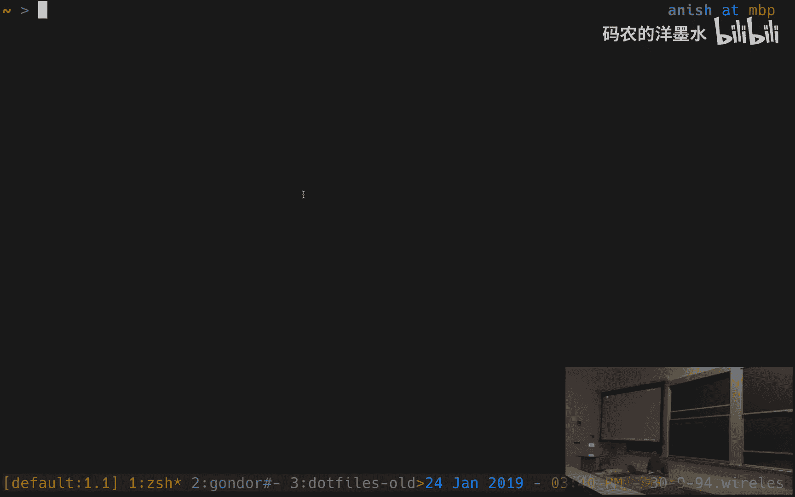
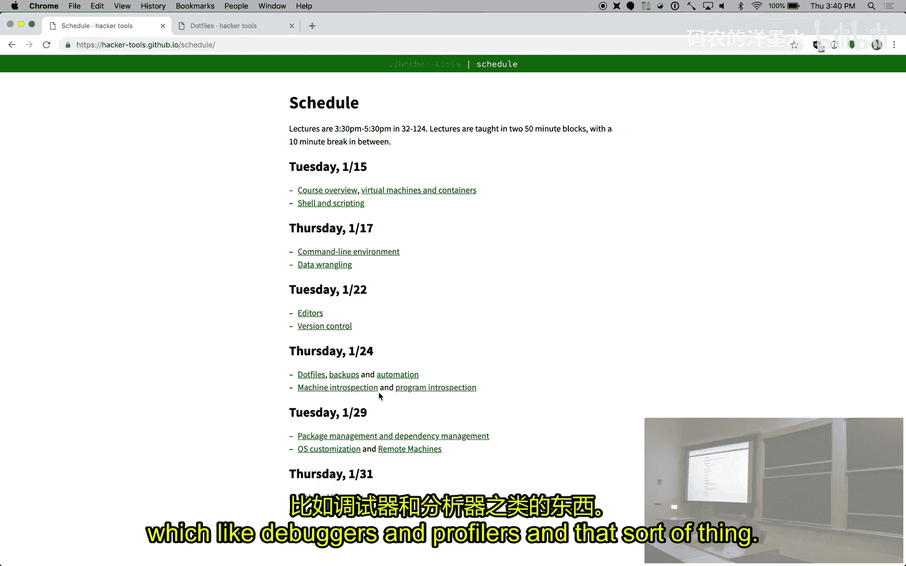
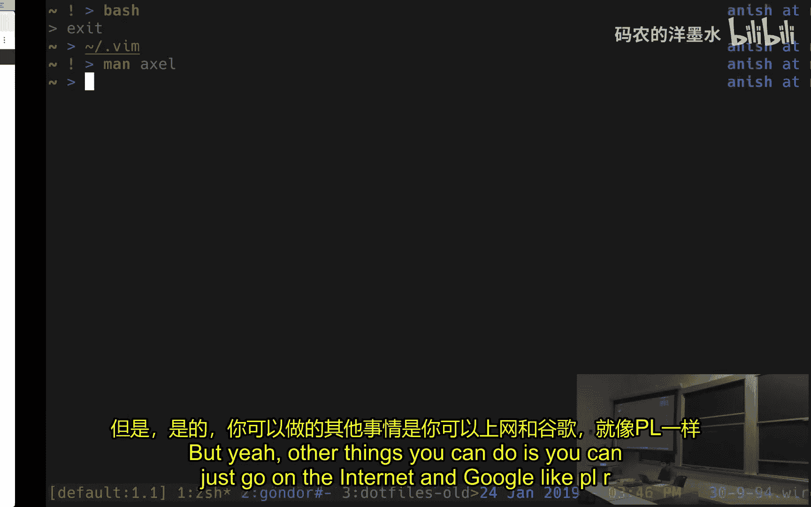
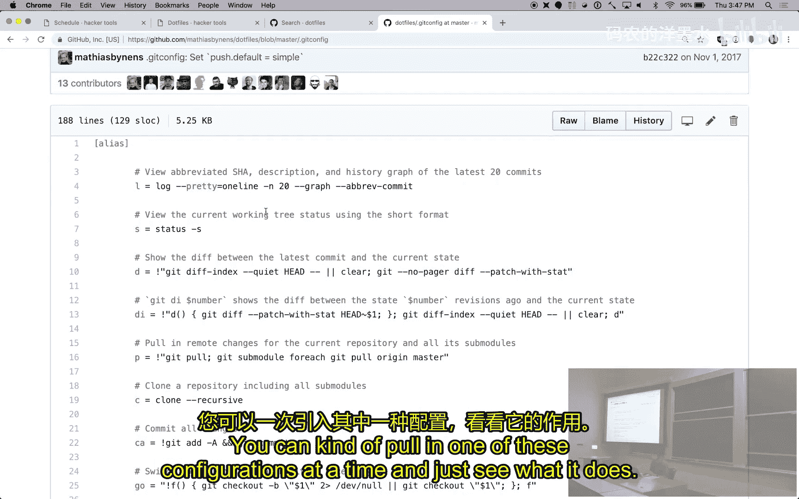
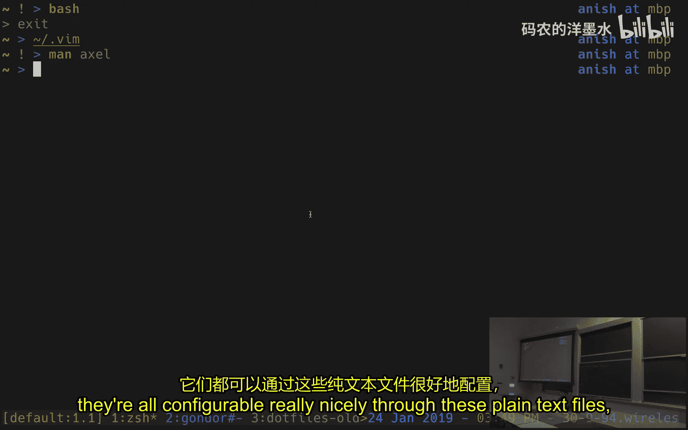
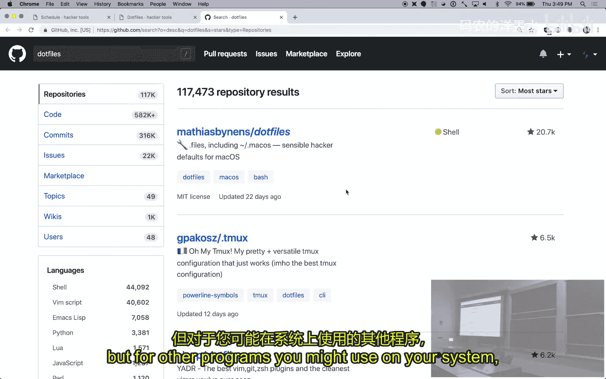
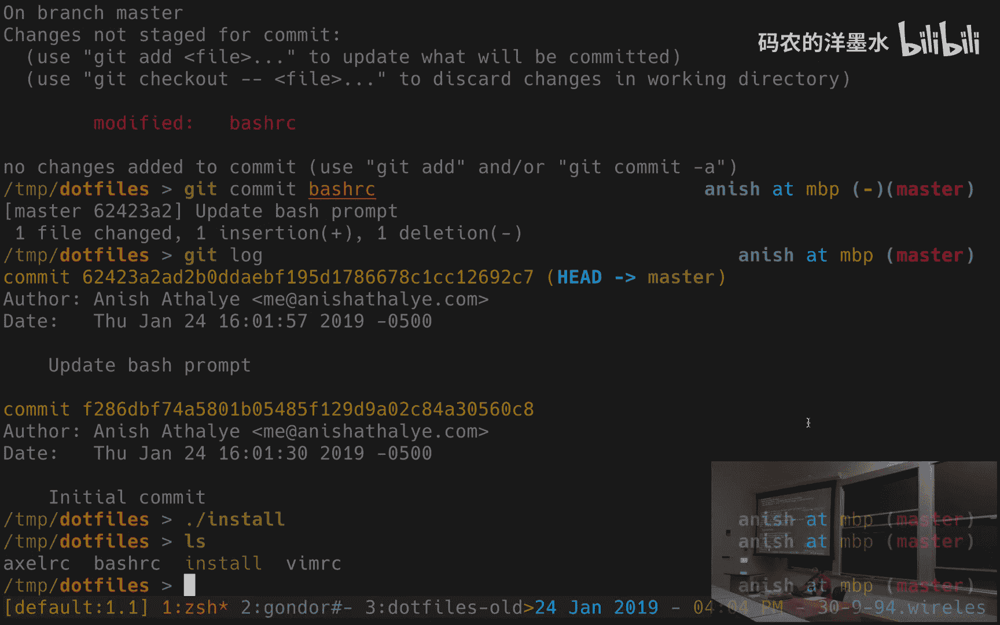
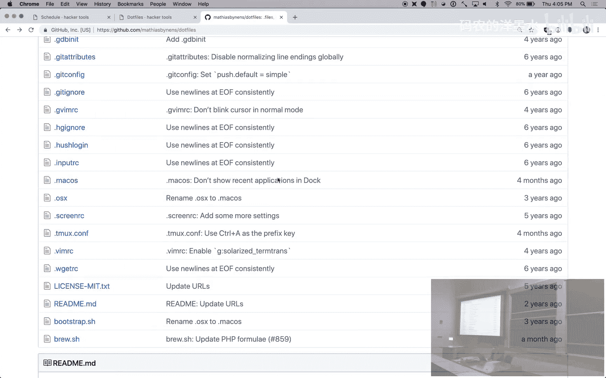
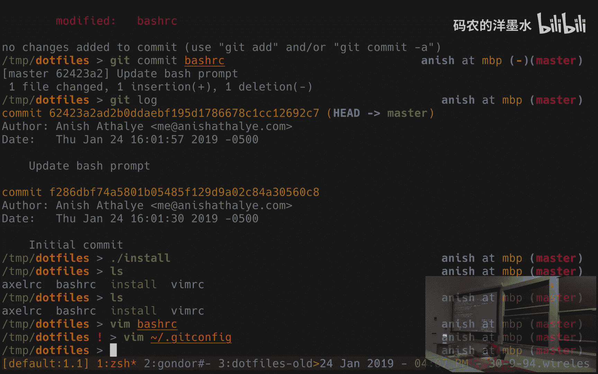

# 【全集】MIT麻省理工 黑客工具 中英字幕 1080P Hacker Tools p07 Lecture 7 - 配置文件 -BV1jcPTz6EE2_p7-

Cool， let's get started we're going to talk about。Several smaller topics。😔。

So I'm going to talk about。Dot files then because's going to talk about backups and the OS automation。

Then John's going to talk about machine introspection。

OS monitoring kind of single machine that ops and then I'll talk about program inspection。

 which like debuggers and profiles and that sort of thing。

So for our first topic， we're going to talk about dot files。

Which is a topic we actually touched on briefly in the last classum editors when we looked at our VRC files。

You'refiuring this subject。是吧。A lot of these can programs。

Are pretty configurable using plain text files called dot files。

The reason we' call dot files is because theyre。Names literally begin with a dot。

 like this VRC file is the file of period VRC in the home directory。

And the reason it's like that there's a kind of interesting history behind it。

 so if you notice if I go to my home director，L。I don't see that file。

 even though it does exist like if I do head until the slide。

There's some content there so why can't I see in the directory listing well the file is hidden by default。

 if I do LS A a for call， it shows me all the files in this directory。

 including all the things that start with the dot。And so this is a kind of useful thing because you put stuff that you don't want to see in direct your listings all the time in files that start with a dot and they don't bother you。

 but you can find them if you need to。The reason this is implemented like this is almost like a historical accident。

 you can read more about it if you're interested， but what happened was that early versions of the LS tool。

Had a thing where they hit the directory entry for the current directory。

 so if you do a directory listing with A， you'll see that every directory has dot and dot dot in there and what those represent is that dot is the current directory and dot dot is the parent directory。

And when we normally look at directory listings， we know that there is a directory that we're in。

 just having a dot there doesn't really help us。If we look at P do GaL。

 gives you some additional information。If I want to get this additional information about this directory diet。

Well， it can be kind of useful to have there。And so there was this line of code in the C code for the LS school where it compared the first character of each director that it was about to print or each file that it was about to print。

 and if the first character was a dot， it skipped it unless you had the dashier option。

 and so this had the side effect that any file that had a file in that happened to start with dot。

 even though it wasn't dot。director or parent directory， it was still skipped。

 and so people started abusing this feature or this kind of like implementation bug in LS in order to use it to implement hidden files。

嗯。So that's why doc files are called doc files。And so all these different command line tools have configuration files that often live in the home directory。

 things like that dovRC or files like say do Gitconfig。

 so we also looked at the Gi version control system last lecture John talked about that。

 that tool is configurable through this file that lives in the home directory called GitConfig。

And you can pretty heavily customize it by writinging a lot of stuff in there。啊。

So different tools are configured in different ways。

So learn about how to configure any particular tool you'll have to read that particular tools documentation。

 sometimes it's through the programming language for the tool so if you want to configure your shell。

 well your shell just reads a bunch of files on your disk and interpret them a shell scripts on startup。

Similarly like for VIm， VIm is programmable through a language called VIm script。

 and so the VIm configuration file is just a VIm script file that's loaded on startup。

So sometimes these are full programming language that you can use。

To set the different settings through your program。

Other times like for files like the Git configuration file。

 this isn't exactly a program just a particular file format， and you just set a bunch of。

Settings to different values。And so we think that customizing and adapting your tools to behave exactly the way you want to is totally worth investing time in。

And。One thing that some people do is they go。Confirations that other people used to to and just kind of download them and use them as it。

 and we recommend against doing that because you。Really should figure out。

What do you want your tool to do？Customize so it best fits your needs because your needs may not be the same as somebody else's。

But it can be helpful to figure out how other people have customized their tools just to see what kinds of options are available。

And so you probably have some doc files set up already。

 so like some places you could look like you can go on your own local machine and look at the file dotRC in your home folder。

Does everybody understand what these GenX styles path mean？order to。So you could look at this file。

 you probably have something there， maybe some minimal configuration where you say setting your。

To something。We looked at these in the shell lecture。パァが。We'll interpret that Goshhar sea。

This thing that I just changed it to。Other places to look are the file like T/。

 ems for your configuration for ems。Tilda s。 bin for settings for bin and so on。嗯。So yeah。

 the different ways you can learn to customize your tools are。

You can go online and slowly up tutorials that people have written。

 so oftentimes these tools are really heavily customizable。

 you can look at the manual pages for them to see all the different options like doMM and then the name of the tool。

 sometimes it'll list out all the different configuration options that can go in the configuration file。

There's one particular programming is called Axel， which downloads files from the internet。And。

Like total slash AlLRC is a file it uses for configuration。And for this particular tool。

 it says that。They're not documented in the main page， but it tells you where to find this setting。

But yeah， other things you can do is you can just go on the internet and Google like Axel RC。

And then。You'll find different people。Configured that are programs to behave in certain ways and oftentimes have written sum of documentation for what these different configuration options do。

Another thing you can do is just directly go and scan through browse through people's。t files。所以。

If you go on Github， you can。Go to the search of our type in dot files and a bunch of people have repositories on Gitthub containing other configurations。

And then you can just go look at them really。Let's see what this guy did。

 looks like he had a pretty popular repository。And you can go and see like， oh。

What are different ways you can configure Gi quotes in the Gi configure file？This is all documented。

 you can kind of pull in one of these configurations at a time and just see what it does。

So it's a good way of exploring things。Okay， so that's the very basic but what is a do file？

Why you should bother to。biggerig your tools。But now we want to talk a little bit more about how you should organize these files kind of different things you can do to。

Keep your settings consistent across different machines you might use。

You put a lot of effort into customizing your setup on your local machine。Say at your laptop。

 and then youre go and work on a different desktop computer somewhere or you work on a theaterna or something。

 you don't want all your software to suddenly behave really differently。

Once you get used to your super customized setup， say customized key bonding for your editors and lots of nice shortcuts for your shell and so on。

 you want that configuration to be kind easy to replicate across different machines and easy to keep them safe。

And so yeah， next， we're going to talk a little bit about how you should organize your do files。

But before we do that， are there any questions about the basics like what is a do final or why you should bother？

So there were like。それろんな。啊，那。That particular。And can you there。So we。There's some things that like。

They don't have filess like ST。不er。Yeah， so the Ss tools usually the configuration is compiled into the program so you actually the way you configure it is by editing the source code of the terminal and then changing the settings you want it's extremely painful but it doesn't mean that you have a。

It doesn't mean that you can change whatever you want。

So the idea of the soccer tools is basically that they're all just a single file。

So they should be relatively easy for you to maintain， but in terms of configuration。

 they're pretty big。Another related issue， like for these command line tools。

 they're all configurable really nicely through these plain text files。

 but for other programs you might use on your system like S web browserrow or something。

Doesn't really use a。Filed for configurations， so it's a little bit harder to replicate configurations across machines。

でもう一す。そ的ですから。R browserrow。Sign in to my Google account and use that to synchronize。And。

Was there another question？Although to touch on that。

 there are like some like you can find like some tools like for example， like I think of MB。

 like to play videos that do use like dotpis instead of just having like a settings window when you're still like clicking text boxs。

Does it pretty convenient。コンバイ like user。Okay， so next let's talk about how we can organize our job files。

 so hopefully by now you're convinced that。It's worth customizing your tools。

 but now yeah you might use multiple machines or even if you're using a single machine。

 it's really nice to keep track of all your settings in some principled way。

So what are some goals you might have in organizing your dot files well one thing we should do is we should make it really easy to install it like if I go to a new machine say one that I've never used before。

 all of a sudden all the tools work differently than I'm used to because Ive customize my stuff very heavily Well it should be the case then that I can very easily install my own personalization on that machine。

And so maybe a goal we might have is like we keep a bunch of stuff under version control and then to install it。

 we should just be able to clone a repository and run a single script that way everythings set up the way we want。

 so easy installation is one goal。Another goal we should have is portability。

 so you want your configuration to be the same everywhere it should be easy to synchronize back and forth between your configurations on different machines。

 so could I use my local machine and then I say ask decision decision to at the owner。意是一そ。

machinesachine。Everything behaves the same way on this machine as it does on my local machine。

And if I make a change in my local machine， it's easy to synchronize over to this room machine。

And then the final thing is， I think it's really important that you track your changes in your configuration if you think about it。

Configuration of your machine in a way is like the longest project you'll ever work on。

For your entire programming for you're going be using these different tools。

 and you'll probably be fiddling with the configuration as you go。

Its just really nice to have all that under version control so you can see what you changed at a certain points or why you change it or things like that。

If I go into my own Dot files repository， for example， and look at any particular file in there。

 I can go and figure out like， okay， when did I add this particular alias？

Forget anything go and say I go， like back in 2013。

 I made this particular change where I added a bunch of stuff。Like here's why I changed it。

It's just really nice to have that history， sometimes you make a configuration change。

 you realize you don't like it you want to go back to an old version。

 having all this history there is super useful。And so how do we achieve these different things。

One nice way to organize things is have a single folder that contains lot integration。

Have that folder under version control。Maybe put it on GitHub as a public or private repository。

 depending on how you feel about what you put in there。

And then have a single script setup so that when you run that script is like typing name script press enter。

 and it configures everything。And if you make that installer script， item quote。

if you run it multiple times doesn't do anything bad Well then synchronizing your dot files across machines is really easy。

 I kind of make a change on my local machine， I add the change and then push it into the Git remote and then on my other machine I go into my dot files folder。

 do a Git pull and just run the installer script and it will set everything。

So just to show you a little more details of how we can go about setting something like this up。

 I can just demonstrate it in front of you。And this is all in the lecture notes。

 so you don't need to remember the exact commands I type in。Illtrated how might want to organize。

So first， I went to go ahead and make a directory。Called block files。

 where I'm going to keep all my settings。I'm putting it in a location where I'm going to get rid of it later。

Have all the stuff set up。And then， okay， so all my settings are going to go in here。

 and I want to keep this entire directory under version。

So we talked a little bit about Gi last lecture。Tool of choice so you get in it and that' just set up as a hip proposal。

No commits yet。And now I can start migrating over my configurations I've already set up on my machine。

 but now for now let's pretend that I have no settings。So I'll just start creating some settings。

So I want to configure my shell， so I'll create the BRC file。

And I can start putting my settings in there like say I want to customize my prompt。

 so remember from our shell lecture， Bch looks at the PS1 variable and that kind of tells us how to draw the prompt。

And so I might want it to show like the current directory I'm in and。Dollar sign and a space。

 and that'll be my problem。Pking up bash。タ分ですか。So again。

 I am this directory and it has a file in it called DashRC。

This is not where ba reads its configuration from， right bash reads its configuration。

From the file Ti the/。/RC。So how do I reconcile that？

Like one thing I could do is instead of keeping this dot files director under version control。

 maybe I could just go to my home folderer and then set up my entire home folder as a Git repository。

And then track these specific files in there。ItTurns out that's actually a bad idea。

 does anybody even know why？So if I want to be tracking to specific files like just my program configuration like dot file。

 if I give my entire home direct render version。Well， there's a bunch of other stuff in there。

 right my photos are in there。I have other Git repositories within there for all my programs and stuff。

 and so I can set up like this top level Git repository to like ignore all the other stuff underneath it。

 but it's kind of easy to use the wrong Git command and accidentally delete stuff inside a Git repository。

So it turns out that's not a super great approach， so instead what we think is a better way to do things is to in a sense like have a folder where you have all your configurations and then copy all these files into the right place so like if I copy this batch RRC until is launchedched out FRC。

And then。Ish， I see my。Shell prompt that configured in this baRC file because it's reading it from this copy。

But there's a problem when you use copies， what it's kind of annoying about it is that well now you have two copies of the same thing and now you have to worry about keeping them in。

 right？If you just directly go and make changes to this version， well。

 it's not going to update this version， which is the thing that's actually inside your Git repository and is you're tracking what different versions of。

 right？So there's actually a nice solution to this， it's something called symbolic links。

And basically， what you do is your file system has support for a kind of thing where you have a file。

 it's just a pointer to another file。shorthortcut hergaius。

So I'm going to delete my copy of BRC and instead use the LN command。

 this says createre a symbolic link。嗯。And I'm going to create a symbolic link to。です。Like actual data。

 that's in my good repository。And give it the name total slashharRC。

And so if I look at a directory list。My phone directory。I'll see the。Bashhar Sea now points to。

The actual content that's tracked in my dot calls repository。And so now I'll see if I load up cash。

If I look at that。It does read from this configuration file。

 even though the file is not actually here， because there's a symbolic link。

 so when batch tries to open this file。Just kind of transparently end up reading from here instead stuff。

So now we kind of know like we have a single folder where all our settings are。

 and then these settings files need to end up in different places。

We create these symbolic links to make pointers in the right places。

 to point to this underlying content that's in our dot files direct。

But having to do this on every machine is kind of painful right。

 like we might have a bunch of different configuration in here。

I might have a file bimeracy for my VIM settings。I might have a fileaxxle Rrc from my axle side and so on。

And if I say copy the doc files folder online my settings to a different machine。

 and then I want to apply all these settings well that involves copying or meeting symbol links to these files。

And so what we should do is we should create an install script。Does this linking for it。

And so that's actually really easy to do， I'll make a file called install and make it executable。

Remember， we saw a little bit of a Strrick and shellll lecture。And I can start editing this inscript。

And。It's actually pretty simple。So。So。I'll explain what this does in a second。Okay。

 so this is all the script used to do， used to have lines like this。So first。

 it figures out what directory the script is in and then changes the current directory to that directory。

And then one by one the script just calls the LN command to set up all the symbolic links。

 so what this line says， okay， look look at the current directory。

 intake the BshharRC file that's in the current directory and set up a symbolic link until the s BshRC。

And then I'll do something similar for all my other files， so I have a file in here called VIMRC。

 and I want to sendlink it to the file tillilda s VRC。And once I had the script。Setup is really easy。

Run these scripts。And it will create the symbolic links for。

What's kind of knowing about this particular setup is that you can try to run the script again and again。

 well， if the files already existed。And so now you can go back。

Write a slightly more sophisticated scripts。But for now， we're just going to ignore the errors。いき能する？

The output of this thing。Ts away。Whatever error message is printing。

now we have something that kind of looks like it works。Now。

This isn't actually the ideal approach to use， and there's some slightly more sophisticated tools you can use instead of writing your own script to do this whole linking business and we've linked to those in the lecture notes。

At a high level， that's how these things work， they just take files that you give them and slink them into the right thing。

And I remember， I've set up this whole thing as a Gi repository， so I can。Start actually。

Commmiting to this repository。I have。History of my changes。

I made my first change to my adult files and I can go in。Fillddle with my setting some more。

So I want to change my batch prompt to say something slightly different。

 maybe I don't like the dollar sign or I want to change that to like。Angle bracket。

I can go make that change if I go here and to get status， I'll see， okay， I've' modified some file。

And can go。And this way， I have a history of all my changes。We can now upload these on Github I can。

Set GitHub up as a Git remote and then just do a Gi push to synchronizeize my changes on my local machine to GitHub and then if I'm on a different machine。

 I can just do Gi pull and then，The URL for my dot files。And then to set it up。

 I can just go into the directory and run the installscript。And as it kind of like。

To set up a new machine， I just do a Git clone， CDd into the directory， dot flush install。

 and then it's done。And so this is how you can have your configuration replicated across。体政宣。

Track all the version。And so everything we've showed you here with the exception of this install scripts is I think the right way to do it。

In sort of writing a hack install script， there's some slightly nicer programs that people have written。

We've given you links to those。And so it's totally worth setting up in the right way。

It be your longest load to suffer。To share that thenie is being really than one。

Any other creative do thoughtt which does exactly this it's on GitHub。

He's like one of the creators of。Yeah， so there are lots of tools that like similar your files into the right place。

 I wrote one of these because I didn't like what was already out there。

 but there are lots of different tools that have slightly different ways you use them。

We've also linked to like me， John and Jose all have lots of configuration files we've written and our reserve are pretty reasonably well documented。

 so we've links to these in the course notes if you're interested in seeing like。

How this setup has been set up like whatever the shop prompt and having like。

The Gi status and the aside and like whatnot， that's all available。やしてさ。借外。

Re example like whats these going their virtual。It's not all usた。T are set up once。

Fininess has been up at the end。It like give ground the script and save everything。Yeah。

 did you your。I think you can install Mac OS in a B。But also like， okay。

 so I think I don't really bother to do that。And I do clear on my configuration sometimes I'm just somewhat careful with what I test out to try not to break things so much that I have to reads on my OM。

I think for most things， like。You can probably just do them on your current setup and it's fine。

And then especially when things are under version control。Pretty easily。

I think river changes if you don't want them anymore。Good questions， any other questions？

Yeah， if you go look at like people's projects。So we linked to these you can find lots of dot files online。

 you'll do a find。对。Tons of configuration files from many different tools and every tool is really heavily customizable。

Well for a lot of people I've been working on this product for many many years。

 it's kind of cool to look through。Different people have different。W they。

One quick way of installing your do files。So， here's a kind of。

Innaloggue to the install script that we were at， except this one actually does a lot of things better than our。

Like， we'll be careful about override。あ警さ。So it's totally worth taking a look at these things and setting them up。

I'll briefly talk about。One more topic that's kind of。

worth knowing about one thing you might want to do once you start using multiple machines is I have slightly different configuration for a machine like for example。

 I use kind of overall the same configuration on here。

 but also on Athena and also on some machines I have in my room something have，Different hardware。

 different settings for that hardware。And some my dot files are like 99% the same between all these machines。

 but there's some tiny changes， and so how do you deal with that？

Where you want to have a give a poitory account？N track changes and so we've written a bunch of details on this in the notes so you can find those online。

 but I'll just briefly mention some of them now。Something you can do are。

With these configuration files for a lot of them， they're not just slight。

Configuration just data but it's actually programs you're writing like for your batch IRC file it's just a batch script and so you can have conditionals in here it' like one thing you could do is like here I'm not writing actual。

I can do something like， oh， if this code is running on like my laptop， then do something else。

Like GPU machine， do something else， and so on。So。You can set up conditionals in your settings to do different things based on the environment。

Some other approaches you can use， a lot of these tools support。哦。

Reading and executing code from yet another file so one thing you can do or like one thing I've done for example is in my Gi config I have all these settings that are common between machines and then at the bottom of my configuration I've written this include command and so what this does is it says like okay look at this other file and process the content from there too and so I can have this file be common between all my machines and I can have small machine specific tweaks if I need them in this particular file。

So those are two approaches you can use to deal with different integrations on different files。Yeah。

 so lots more links to resources in the course notes。

 and of course feel free to post on Piazza if you have any questions。

I'm happy to take any questions now。Okay， so next。Jose is going to talk about some things and then we will have a break。

