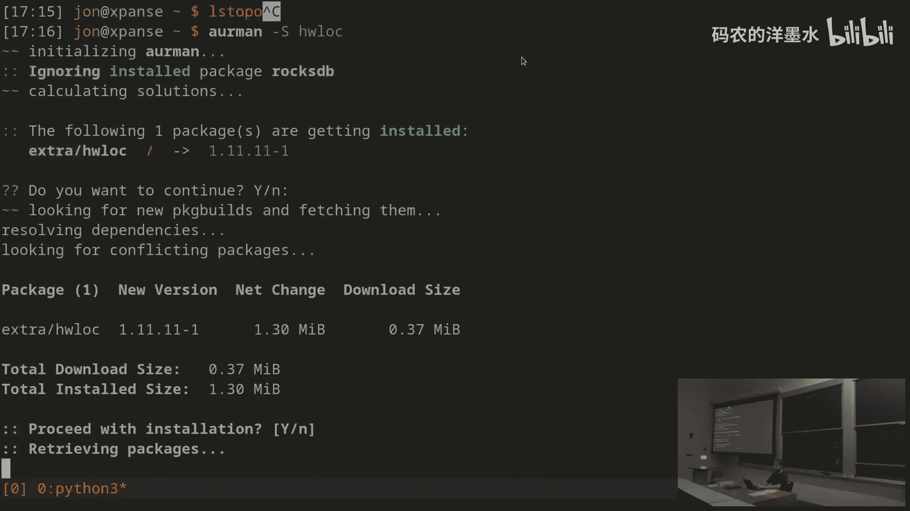
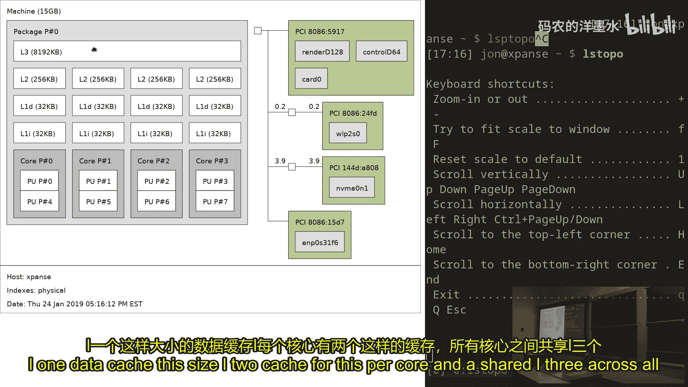
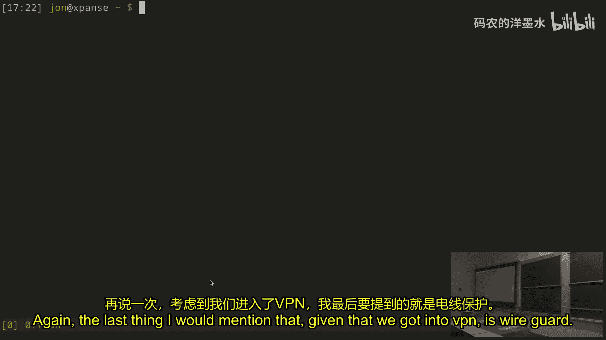
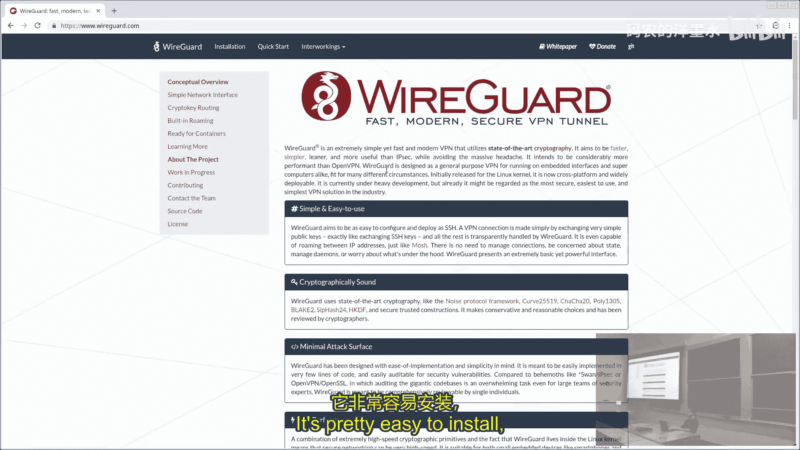
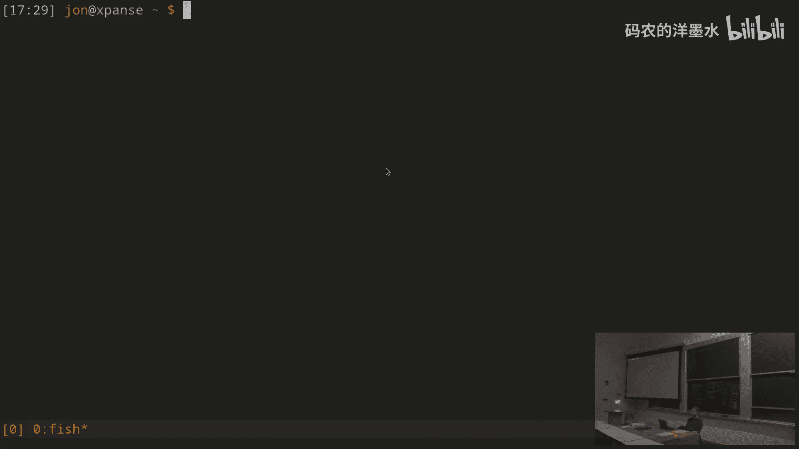

# 【全集】MIT麻省理工 黑客工具 中英字幕 1080P Hacker Tools p10 Lecture 10 - 机器探查 系统自检 -BV1jcPTz6EE2_p10-

sBeauti let's do machine introspec so sometimes your computers mis be sometimes something goes wrong and very often you kind of want to know why and so what we're going to do is we're going to look at a bunch of tools that let you figure out what went wrong what is currently going wrong and how you can prevent it from going as wrong in the future。

So。Generally， whatever you want to do computer introspection， you're going to need privileges。

 so in general， the kernel will not let you look at arbitrary state and so very often you need either to be part of a particular group。

 usually wheel， which is the。You can act as root group， there are other groups like power， audio。

 video， optical with this， et cetera， that are used for various more special purposes。

Probably just add yourself to be a little will be fine， but if you're paranoid about security。

 you might want to add yourself only through your CV。In particular。

 we're going to be using the pseudo command。So the pseudo command is basically a prefix you out to whatever command you want to run。

Then it will run it as if you are the root user， so as if you have all privileges that are possible to have on the machine mostly。

So for example， I can run date as myself or I can run whoitz， I guess。大前？So it says I'm John。

 and then if I own pseudo， who am I？And it'll ask for my password。

 which I can then type and now it'll say that I notice that it prompted me from my password。

 you can change that setting if you want to。い終了？あ終了いす了。Fine， I think you move that。

V pseudoud lets you edit the pseudo file and it will check that it is soon tactically correct after you save it before applying it this is very nice so you don't accidentally mock yourself out of。

Notice here this a line that saysRoot is allowed to run things root in addition。

 wheel so people of the group wheelhe are allowed to run any command as any user is what this line means。

 you can also disable the password check if you want。

 otherwise it's going to prompt you for a password and it does so again every so often。

 but if I run pseudo a couple of commands in a row itll sort of remember my password in some sense。

 remember my authorization from the first time I read it， but after a while it times out。

 whereas if I comment it out this line instead of that one that now it would no longer prompt for passwords。

All when he wants go， assuming you're in the right group。But I would like it to。

Notice what I did here with pseudoo Sue， so Su gives basically let you start a terminal as a different user and by default it's root。

 so Su meanspre that I'm root and that I'm starting a new terminal as myself。

 so it gives me a prompt that is me as root。And he argument whatever I think I want。

 he did this work。Okay， so the first thing that you want to do when something goes wrong is you want to figure out what happened and usually the way you do that is by looking at logs there are a lot of log files in your machine。

 most lu in bar log， at least traditionally that's where things were so bar log as you see contains this logs from all sorts of different things usually the file is indexed by name there are a couple wants to be aware of in particular xoric dot log is handy for when X fails they're usually folders for specific subsystemence like cups and normally if you're in a web server for example the logs will also be here there's also a kernel log。

 the kernel log used to be in bar log and now is sort of encoded in stupid ways so there's a command called D message which gives you all the messages that the kernel is printed since boot so if you a D message it will show you all those messages。

Since last movement， of course， from the data wrangling lecture。

 you'll remember that we can gr through these logs if you want from you look for particular patterns。

嗯。Finally， there's a system logging and this is basically where everything is de log nowadays。

 some programs will also log elsewhere like to bar log。

 but in general the system log is where you want to look。

 most systems today the system services are managed by system D， which has its own journal demon。

 the way you look at the journal for your program or for your system is by running the journal CTL command。

 which gives you the log since the lastB， gives you by default you can scroll around。

Which is kind of nice， but you can also force pipe。And do data rightgling on that too。

There are a couple of things to be aware of with journal CTL， so first of all。

 if you run journal CTL without nothing and gives you all the messages since the last boot。

 you can do dash you and then give it a unit like。我 in啲。Great， no idea the law need。Great。😊。

So this gives me all messages made by system D login D since the beginning of time。

Wwhichch might not be what you want you might want only the messages from this particular unit since you started your machine。

 there's the dash B flag which has only the last boot。

 you can also say only the previous to last boot or the third from last boot or the first boot you know about and so this flag you can use to try to debug what happened in previous reboots like let's say you already your kernel you tried rebooting now there the new log start and you want to check the previous boot log。

 you would use this flag。Gnal SeL also has this annoying property that if you try to pipe it through things sometimes。

Look if I do dash B。it doesn't do okay， so sometimes journal CTL for various stupid reasons decides to crop your log messages and just show that dot dot dot so you sometimes don to give full if it starts to do that there's also a dash in 100 which is or whatever number you want。

 which is show only the last in lines this is similar to journal CTL time through tail。

Those are basically the same。All right， let's see that something is wrong and you want to figure out what is going on in your system。

 the first thing to start with is the top command， so top shows you all the processes that are running on your machine。

 how much CPUU they're using， how much memory they're using and a bunch of statistics about your system。

 most people don't really run top anymore but it is nice to know that it exists instead most people run each top which is basically the same thing but with a nicer interface like it shows you how much load there is on each core sort of more graphical representations of things in addition you can do things like here you'll notice that it shows you all the threads of all the programs you can press teas to switch to a tree model where it shows which things are certain processes of what which is really handy to figure out like if there's some particular thing that's messing up what started that program。

which you can look at through this， or if that's all you really care about， you can use PS3。

 which shows you the same thing sort of the tree of all processes and where they stem from if you want to know the process IDs of them。

 you can do PS3P and it we willll print the processing。

This is handy just figuring out like what's going on and why is it running？嗯。Oh yeah。

 the tree mode image H off which is press teeth forrcury。The turn on。

Sometimes if you want to know what those programs are doing。

 like I see a bunch of weird programs here and I have no idea what they're really doing。

 one thing you can do of course is look at theirre standard out if you have them open a terminal。

 but if they're running as a service in the background。

 you might actually want to check the logs and then it's useful to know about journalceLF。

whichch will follow the log， so it will print only the last few messages and then it will keep your terminal open as new things are logged。

 it will print those new log messages。TheThe equivalent thing for D message isW。

 which says we're weight， so this is wait for more messages to be printed and just keep printing them as they come and similarly if there's a particular file like。

In our log， let's say that I want to see new Xor log messages tail as a dash F。保。

Which will print the file and then watch that file for additional changes and if they come。

 then print them。We can also do less。You can less。ます。思います。都是这个。I don't like things taking over。嗯。

Right， the other tool that's really handy if you're looking for resource usage is's a tool called VAT。

We再改啲。宇宙の。So DAT is a program that monitors all sorts of different subsystems on your machine and then just prints out information about them。

 these can be things like network traffic， disk traffic， the number interrupts your CPUs handling。

 context switches， the number of processes， the CPU utilization。

 it has a vjillion flags for monitoring different things。So you can watch only certain CPUs。

 watch this， watch paging。Swaamp space， all sorts of stuff， so look， I think there's D all。

 East stuff dash A。But this is really handy for just like seeing a real time snapshot of how busy your computer is and what it's busy doing。

 like if you're running a program and it seems like it's all in progress。

 open DSAT and see if anything is going on if all the numbers are zero， the program is the problem。嗯。

There are also more specialized tools for things like looking at disk space。

 so for disk space DF is the most common utility， DF shows you for all the final systems you have in your machine。

 how much space is used， how much space is available， and where is it mounted。By default。

 it prints the number of bytes， which is a little annoying so if you do H。

 it will show you that in normal numbers， so in this case you'll see that slush is actually this partition almost this。

It's total size use space and。If you want to know what in a particular directory is taking out the lot space。

 there's the DU command， so DU stands for diskus， but it does not show you diskus。

 it shows you the diskus of particular files， so for example in my home directory I to run DU star and it actually。

What。都系 callな。ああ、そりし。どルす。Okay， there are two directories here。

 but let's say I wanted to figure out how large and were in which were more important。

 I can run DU start。😊，And it will show you how large each of those frequencies is in terms of all of the files below it as well。

 H gets you a human read symbol of it， and you can also do S to get a summary， so if I do。Yeah。

 so the summary will not show you the things underneath you。

 it will just show you a summary of the arguments you give。There's also a tool called dust。

 which does all the same things， but you in it much nicer。Much nicer interface also is the。

Weird how works， if you're looking at network connections， there's a tool called SS。

So SS is fantastic to looking at what is connected to your machine by defaulting SSS shows you all connections on your machine in all protocols that the network stack supports。

 so basically all open sourceck。Normally you're able to do something like dash T。

 so dash T shows you all open PCP connections， you'll notice that currently have no open PCP connections you this might not like our laptop。

But if I did something like。😔，Download a。There be an image？

It will now show you that there's one PCB connection that's been established， Q size。

 which IP connected to which port。And then when it goes away， now there's no longer ortho the。

I can also look for listening port， so if I give TL it will show me basically all the server reports in my machine。

 hopefully there should be none， but if I start additional programs like for example。

 if you're running a Dbox or something on your machine。

 that's going to start up a service or if I run。返し。いい。Very。you want。よしました。

Netchat is a really handy tool for just piping data， Market between machines。

 it's mostly used by hackers。It happens sometimes actually useful。あ。こ。30。And now there's itll。Right。

 so now it'll show me that there's one port listening on my main machine， if I doP。

 it will show me which program is doing that listening。

 if I put n it will not show me that this is the X11 port。

 but instead show me the actual port number and so this is saying the program at C with this PID is currently listening one port6 out of1 so this is handy you' just like figuring out what is running on your machine and if you're like me then you want the list always be empty。

If you start a browser， you'll probably be listening。嗯。Okay。That is network game。

So let's go briefly over configuration。There are a lot of ways to configure your machine we'll focus on two primary tools that you end up using all the time the first one is when it comes to networking。

 the IP command is just really handy， the IP command lets to configure pretty much everything that has to do with networking on your machine。

It comes。Installed with most modern diss， the basic command we want to use is I adder。

So IP addresser shows you all the interfaces you have， what IPM they're bound to。

 so in this case LO is the loopback interface， it's the interface you can use to talk to your own machine without going over the network。

Things that start with E are usually ethernet ports。

 one way or another so they're wired connections and things that start with W are usually wired connections。

 so in this case you'll see that my Ethernet cable is stated down which means that it's not currently connected whereas my wireless port is up。

And it has the following IPB address and also the following IPD system。If I should care。

You can also change all these， so IP is actually a really powerful tool for changing the network settings。

It's basically what is used under the wood to set up your network in the first place。

The IP command is notoriously hard to use， in general you want to do things like IP help and then command。

 and it will you basically will tell you the grammar it uses to parse the command。

is not the best form of documentation， but you can do things like IP。I think you need to help add。好。

Great， so this is how the grammarite uses the parse I adder。It's awful and the help comes less。First。

 sometimes I think it's like this。It's all sorts of stupid， but if you look at the MA pages。

 those are a little bit more helpful because they if I remember it correctly。

 they have some examples， not that the examples are particularly useful。

 but it gives you some flavor of what the command that you do。

 it normally lets you do things like bring into places oh down， change EI addresses， change。

 broadcast addresses， those kind of things。In addition。

 the one thing you should know about is IP route。So IP route tells you if you're trying to basically how your computer is going to communicate with other machines。

So if I send out a packet that's going to go to anything on this subnet。

 so this specifies a range of IP addresses， then it says that anything that I send to any of those IP addresses is going to go to this IP address。

And anything else， so default， anything else goes to this of us。

So this is basically the way the network is configured that any host that's all the same network as you connected to like the same switch or router。

Is going to be connected through。Just directly， you can just send packet to them directly。

 anything else you have to go through basically your router。

 so in this case my router is this idea for us。So anything that is not going into something that's on the local network goes to the router。

 and then it fers it out。Often if your network is。If you end up in a weird network situation。

 I feel well tell you what to do。or how you might fix it， there's also the ping tool。

 which is really handy way for figuring out what's wrong。

 usually the order of operations says first you try to ping a host，In this case， that worked。

So Ping basically sends small packets to that server and sees whether you get the replies here it says that I got a reply。

 if you don't get a reply， then try an P address。If you if you。

Do get a reply from a address but not from a name， it means your DNS resolution is working。

 so translating domains into ID address is not working if you don't get an answer from either of these。

 it means that your local network isn't working and then you might want to try to remember here。

 this is my router。You might want to try to ping your router。In this case that worked。

 so my connection to the router is operational， and so if something was broken it would be broken on my logo。

Or sorry， we we broken on the router because I could talk with the router。

 but if I couldn't talk to an external L， the issue is somewhere in between is a really nice way to sort of bisect your way down to where the problem。

And if you have IP issues at sereolve。com is the thing that defines switch。

Ne server you're using so this is a hand file to like configure if you want some other settings than the people。

And finally， for symptom communication， if you have services do you want to run in the background？

Crad we talked about already if you want to run。So I've got a web server or an SSH demon or any kind of service you want to run into the background of your computer。

 those are managed by system D so system D is the system demon and it manages，Your system。

 it just keeps growing and water encompasses， but the basic idea is that for every service on your machine。

There is a service file， so for example， there's a service file for。V boxway。

So the service files basically define a unit， which is a service。

 so we look at those with journal CDL，P dashU and then a unit to limit log messages to only that。

And it basically describes how you run that service and how you shut it down later。

You you control them through system CTL， system CTL status showed you all the servicess that are currently running。

And what IP services they have and which services depend on what。You can use System CTL， stop。

 start and restart。Followed by a unit to stop a particular service。we start a particular service。

 if it produces errors and just use journal CDL to figure out why。

 you can also set services to either。Run a boot or not so if you type Enable and in the name of the service。

 it will be started on boot， if you type disable in a ser， it will no longer be started at boot。

And you can even write your own system D units， it's not terribly hard， and then they go in et ceter。

 a system D system。They're pretty easy to write， but you need to look up what unit filess are like。

 they're not terribly thankful， it might be worthwhile to figure out out the right one if there's something you would like to own。

嗯。Oh yeah， one last thing， if your boot feels slow， system deanalyze。

Shows you how long your boot took， if you give it the blame option。

 it'll tell you how long which thing took in starting off your machine。The handy connect。All right。

 I think that's all we if we're going to do program introspec as well。

 I think we're going to leave it there， actually why don't we move for introspec to one next。

If you have more to say， you can keep going where we can。I have lots of other tools I can talk about。

 I don't have anything else I can skip。question。There's a program called console。やし。

So if you just open bunch the spotlight and search for consoles， you'll see it。

 and that's where you can see all the system log。It's probablyYeah， and if you want the。

 there's like I think instead of a system CL a half program like launch。But。名前。

I there's a lunch week， I'm， I'm sure it's things。诶这么过。あボンボンあマケスも。

Wdow is actually getting better for a G CT。With Power。You can do a lot of this。

TheS tax is pretty annoying。い。I just want everything like I don't want to have to open a program like ever。

😔，The only program I ever to open is my browser， everything else the terminal is。All right。

So if I'm going to keep talking。😔，I have plenty of things。But I have to install the program。Here。So。

M locatecate is a package you can install in most systems and what it basically does is that if you run update DB。

 it will scan your entire file system and create an efficient search index so I can do something like locate。

6，8，58。And itll show me all the files in my machine that are related to 65。

They contain the string of 6858 and of course， given FCF like we talked about before。

 I can use thisuzzy search directly onto the list of ball files in my system that containing 685A and I can do so very efficiently。

 so for example I want ball。觉です。It they're really handy like locate。

 this is really hand for finding things quickly because it doesn't actually have to， if you use fine。

 for example， that has to walk your entire file system every time。

 whereas locate is just string search on some precomp indexs。

The other program that's useful to know about is DMMID code。So DMMIDcode。

DMIDcode basically pares all of the firmware on your machine and tells you what different things are。

 like what hardware you're running and all the capabilities that they support。

 this is probably not useful unless you're doing like firmware upgrades or you're curious about what exact CPU model you're running。

 but it is kind of handy for those kind of things。Like if。Yeah， so for example。

 here it says my CPUU is an I7， specifically it is this I7。It has all of these features supported。

 what its clock speed is。Like cash license and everything。

This is a program called Els Topo。Which will show you the entire physical layout of your CPU。

 including all caches。It was pretty handy for。Doing performance debugging。

 so this is telling me that I have a single CPU package that contains four different cores。

 each one with two CPUU2 logical cores， so this is hyperread and is's showing me that I have an L1 cache instruction cache of this size。

 L data cache of this size， L2 cache that is per core and a shared L3 across all the。

And also the layout of my PCI。It was pretty handy， you can also get it for like you can get it to print out。

Text only version， it also lets you so it comes with something called HW log bind。

 which let you run the program on only certain course or only certain CPUs or only certain hyperthreads。

 which is very hand if you're running benchmarking stuff。嗯。

You might have noticed that when I ran DMMIDcode without pseudo it tells me something about slash cis permission tonight。

 so slash cis is something that's worth knowing about slashss and/lashpro are special parts of your file system that are managed by the kernel。

 none of them are real files， they're just sort of meta information that the kernel exposes and sometimes that you set properties of the kernel wouldn't otherwise have you set so for example if we go into cis。

えさて。Actually。证系。啊。Yeah，Cl generally the place you want to go if you don't know where you're going because it shows you things by classes supposed to vendor。

 so here， for example， Intel backlight。Here I can cut out the max brightness of my screen background。

 I can count out the actual brightness， but also I can do things like echo 500 into actual brightness。

、それを。And now， the。Oh， sorry。And now you can't see this but my screen is it。

And so this is a way to basically cause the kernel to do things by changing parameters。

 there are lots of cool things to be doing like change， queuing behavior in the kernel。

 disable various safety features like ACLR， you can turn on additional safety features。

You can break your system entirely so be careful about what you do here。

 but it is worthwhile to know about it sproc contains information about all the processes that are running。

 so let's take some arbitrary process like this at the very which is 6905。

If I CV into that directory， so this is slash proC slash the ID of a particular process。

 and if I LS you see there are a bunch of different things that show me information like I could catch CW。

By Els LAA， this will show me that the current working directory of that process is home John by CA command line。

 it shows me this is the command line this program was run with。

 and so this is basically the files that HTal and top par to produce the information that they have and you can do all sorts of things here like mount the entire memory space of this process。

But it's all very unsafe。嗯。It's also worth knowing about slash2。

So s boot is the where all the files that are run when you boot your computer go。

 it's also usually where the configuration of your boot goes。So for me。So for me。

 this configuration file here I can set basically with options I get when I boot my machine and what each of them do in bootot。

 there are two primary files you need to know about， it's the VM Linux D Linux file。

 which is basically a boot image of Linux that's small enough to fit boot that then boost up the rest of your Linux inflation。

And there's inad drama of vest which。Itスベス。It's not the same thing， they're two different stages。

For all intent purposes， you can think of these two files as like the boot image for Linux。

 so they are the things that set up all the hardware your machine and then when the hardware has been set up。

 these are the files then start your actual Linux for all users。

These things matter if you're like running a custom hurdle。I it useful to know that。です。呃。我てど어。

IP tables is a。Apparentlyre pretty much built in firewall that uses kernel rules to filter internet traffic I'm not going to go through all of how I tables work because it is a bit of a paine。

 it lets you set rules for packets that look a certain way then are for a given port that are from a given IP from a given range to a given range by a program and sort of basically manipulate them in however you might see them so for example it lets you drop one normal things to do with this basically set up a firewall drop all packets that are for any port that's local to me unless I specifically allow that port you can have it rewrite packets if you want。

 you can have it redirect packets if you set up an VPN for example。

 it will often use either IP tables or IP routing or both to ensure that all of your packets go through the VPN and no packets can lead the VPN。

So it's a useful thing to know about， but hopefully not something you'll interact with too much directly in person。

I think the last thing I would mention given that we got into Vs is wireguard。

So wire guard。Sure。So wireguard is basically an entirely new VPN implementation that is like implemented from scratch and works as a very small。

Opinionated piece of DPM software it does not allow a lot of like configuration or anything it just is supposed to just work and be secure and be fast and in my experience it has been it's pretty easy to install。

 pretty easy to set up and just words beautifully the way you start using this is。

This can starts my the。And this stops Lib。And that's all the command need。

 all the key handling is using like private public key pairs。

 and so it's just so much nicer that I'm going to deal with like MIT CPN or basically any other VPN solution。

 which is often a pain disciple Linux。W groupss。But you do have to set up this over yourself。

But I think that's all I wanted to say about machine introspection， although。

I can probably say more unless you have more questions。

Anything you wonder about how you might figure out about your computer？

There are also nice tools like。I didn see。It is not interesting。Acros the three。

 I'm not sure if each what shell you use。I use the show。Yeah， and and I just wondering if。A you in。

Because I would like to switch， I just use Zche tries to be like bash。And that's the drawback for。

The advantage is that it's an advantage in the sense that more things that run under baash run underziish。

 but it means that Zche doesn't have quite the same flexibility as Fish does to do things a different way。

Whereas fish is sort of saying we're not going to care about compatibility with ussh。

We're just going to do things in a more sane way， more human friendly way that said。

 you wouldn't really write scripts in fish， although you can。

 it's more written for like humans writing commands or more loops or if statements are what。

Whereas I think these is slightly nicer to write strips for in part because it's closer to ba。衛成？

I mentally think。Th is like a lot of like primmats I have like I use it。

 but like I think the my is primmat I don't go to face。

 its like is this prim like like a lot of the things that like face introduced were copied into like modules that like nowadays you can have like email bass。

Like I run fish without any flavors。😔，Because I don't really mean any。

Whereas I think you probably wouldn't do that position。

So it means this cannot be like a least like my， my recommendation is。

Just like choose one and look into like all the features that you can be using liket don't stretch to Matt and kind of what said and just like figure out using things like synax highlighting and like history sub search。

 like things that there's like quality of live stuff。

So I really like the fish sort of statement of purpose。

 which is finally a command line shelf for the90s。It was released in like 2000 some。

But it's like catching us up to the 90s。Should think a good。Oh， where's it。这人。So， it's pretty neat。

Fish just commands as you type based on history of completions just like a web browser。

 watch out Netscape Navigator 4。0 Glor VGA color。Yeah， I think for like given。

you're going to put some effort into configuring your shell。

 you can probably have a Z shellll and fish to behave more or less the same。

Except Z shell is like almost PosOSic shell and fish is ditching boOSaics for trying to be slightly in more human。

One of the things there might be an equivalent for the sensation， I'm not sure。

 so fish has this thing called。So they basically have an expansion to aliases where aliaaseses are not just one tremendousus equivalent to something else。

 but something expands to something。Yeah， that's the okay。你落你 think你佢落啦你少少 something。Yeah。

 so and then happens it expands while I type， so for example you'll notice if I type Ls and then space。

 it turns into Excel。Because I' aliaed asa Na。But it will actually show me the true command。

 like if I take print， which is as early as I am， it expands into the full command。

And then lets me go back and edit arguments to that thing。

And I found that really useful video and shows you the command your lecture。As suppose to hideるてる。

You can also do things like say that a command wraps another command。AUR Man。

 which is a package man is a wrappper I use for arch。

 it takes basically all the same arguments as Pan plus a bunch of other ones。

 so I can tell fish that any argument that works on PACM also works on AUR。any oneな。In my efficiency。

I have this thing。And this basically improves the auto completion。

 so it understands that these commands are the same for anything that exists。有有个 question。

Is there a reason why you still use it？え全然すか？我啲。嗯Our man is。No longer publicly developed。

 but the maintainer is still using it， he was just sick and tired of all the criticism he got for it by people who didn't know what theR was around。

だけです。Arch is in this unfortunate position where。You can find a package for pretty much everything。

 but it's in the AUR and people are writing tools to make it easy to install from the AUR。

 but part of the point of the AUR is those packages are not entirely safe to install so you shouldn't trust the stuff that。

And so he got a lot of flack from especially new users who didn't know what was going on。

 saying like your tool doesn't work。But so it is still being updated it's still being kept up to date so that it works when new releases come。

 but he's just not taking like public feature request。

It also has a bunch of nice features like if you do a system upgrade and there's been a posting to the Arch Linux use feed since last time you ran an update。

 it will show you that news update。I think that's all。

Right。