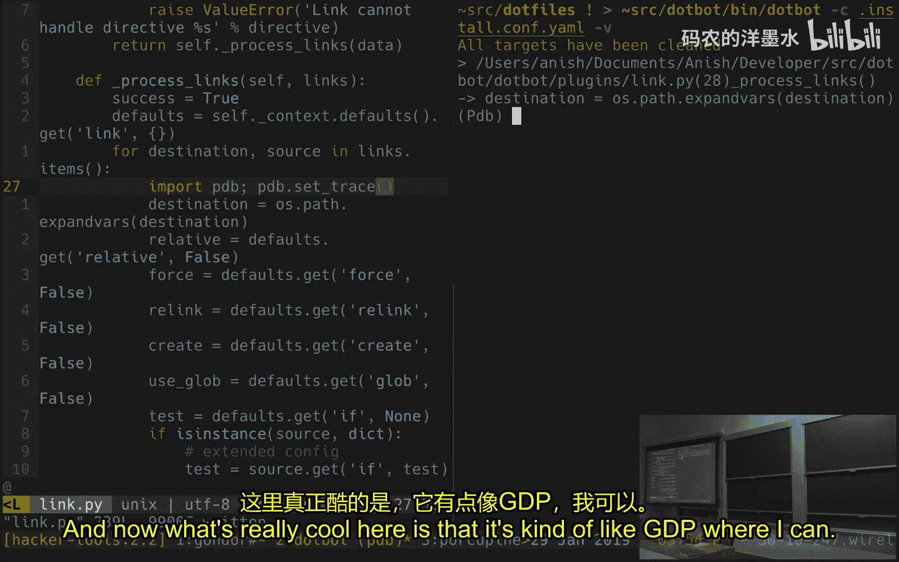
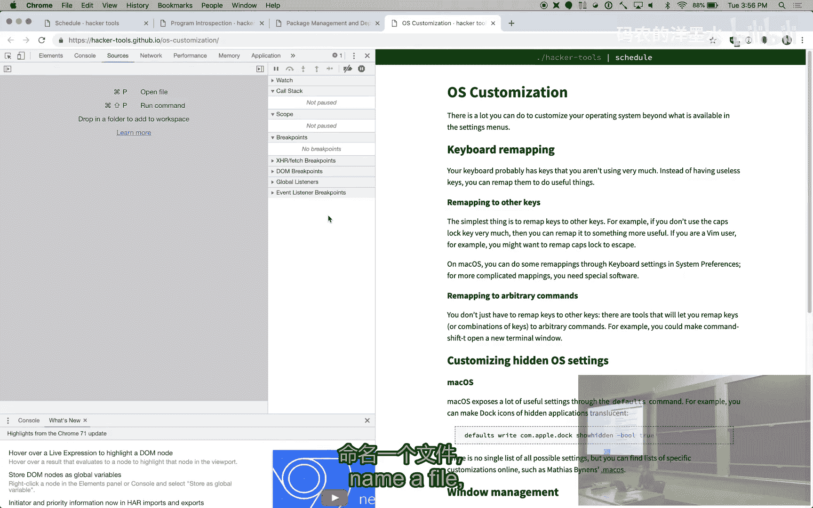
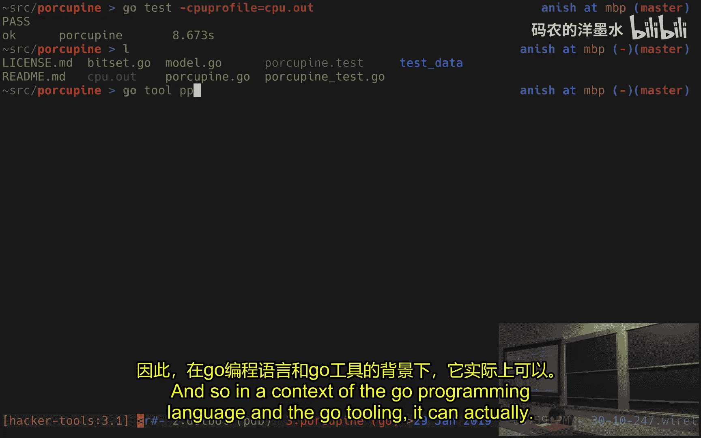
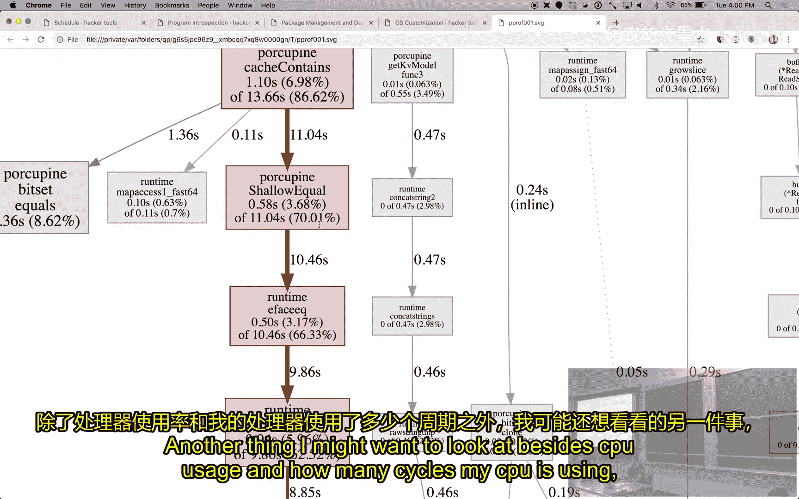
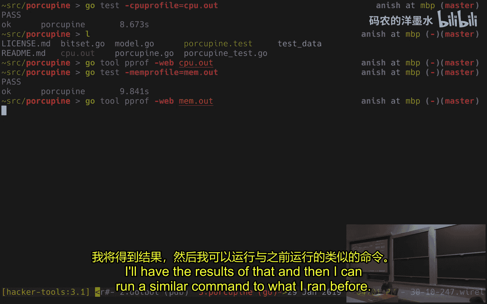
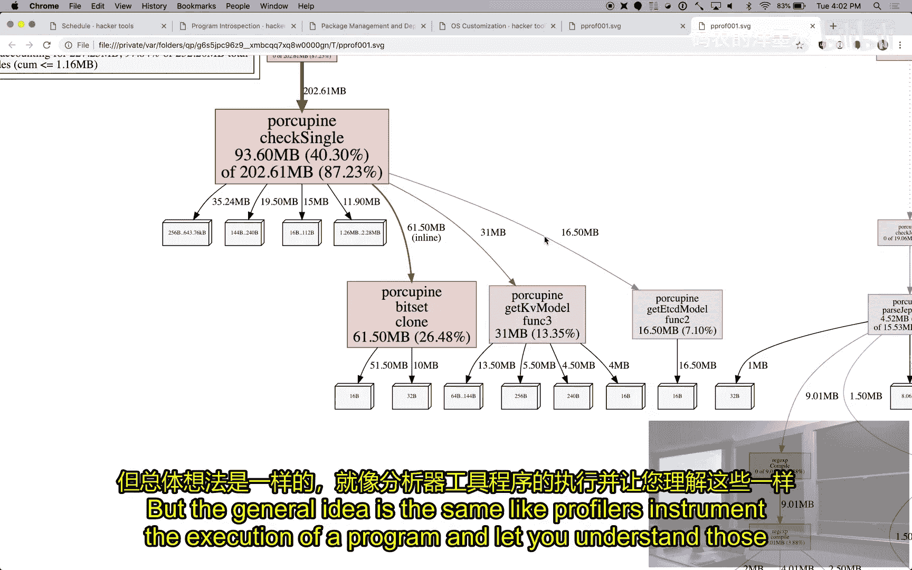
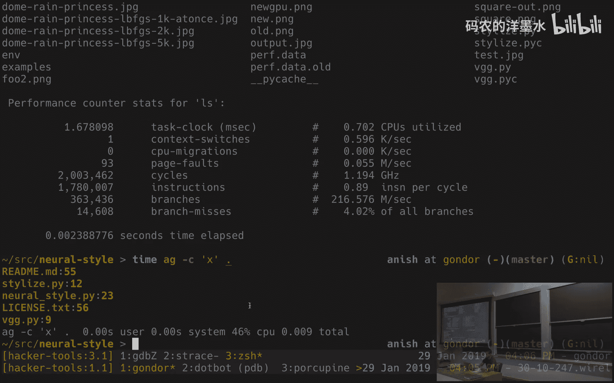

# 【全集】MIT麻省理工 黑客工具 中英字幕 1080P Hacker Tools p11 Lecture 11 - 程序自省 程序探查 -BV1jcPTz6EE2_p11-

就这次我去吃里嗯。Welcome to lectureure Foger tools Today we're going to talk about program introspection followed by package management and after a brief。

 we'll talk about OS customization followed by。Remote machines like SSations and things like。So yeah。

 to start up with program introspection， the kind of aaque title。

 but what we're talking about here is understanding a program and like debugging a program。So。

One technique you can use for debugging programs is print de debugging。

Something's going wrong somewhere， and so we stick a bunch of print statements all over the place。

Like you print out values of variable， things like that and that's actually an excellent debugging technique but sometimes it isn't quite good enough and that's when you bring out more powerful tools like debuggers so debuggers let them interact with the execution of a program don't worry about reading this code for。

But this is the program we the debugging。So debugers let you do things like let a program run and then halt the execution of a program when it reaches a certain line in the code。

 and at that point you can once the program's frozen， poke around it， what's in memory。

 print out values of variables and things like that。You can even do other sophisticated things。

 like execute the program one line of code at a time。

 getting it to stop after every line of execution so you can poke out。

Memory and things like that to to inspect the state of the program。

You can inspect values of variables and there are all of these other advanced features that debuggs offer。

And so basically we're going to go through a demo of G， the Gnu debugger。

 which is a debugger that support many C like languages and this is just to show you what kinds of things the debugger is used for and then after that I'll briefly show you some other debuggs one for Python and then show you。

Graphical debugs in the context of debugging JavaScriptscript programs in the web browser。Okay， yeah。

 so to start off with， we're going to be looking at this program over here on the left。

 now you may be familiar with C， you may be not familiar with C， it doesn't really matter。

 this is a really simple program that upon execution runs main and what this does is it loops through the integers I equals 1 to 10 and calls this function save。

With the integer eyes in argument。And I've compiled this program already， and if I run this。

 it will just。Priinnt out integers one to 10。Just technical。It's kind of。口ちいた。Those have。

We're going to demonstrate debugger features in the context of this program。

So that we use GDP with C programs is when you compile。

 you give a special flag to the compiler to include extra information in the binary that the debuer will use to present you well more information as it's。

As it's running and so that's done with the dashG flag for GCC for example and depending on your environment depending on what comp file're using and stuff this might be slightly different。

 but the general idea is the same like when producing the final binary。

 the executable code normally you want to strip out all this extra information like what line number corresponds to what instruction of the code or things like that its just extra stuff that makes the binary larger but when you debuggging the program you want all that stuff there so the debugger can make use of it and so here we pass the dashG flag and you say okay you want to output to。

The file example， and then compile example that Z， and we'll。AndOkay， now we have a binary。Example。

 that we're going to develop better。So the way we invoke the debugger is。

It's called GDP with the name of that file and it prints out a bunch of stuff。

 but basically we got a GDP prompt and now we can do some things like just run the program。なプなる。

And we see like， okay。The thing print out what we expect。

So I'm now to show you some of the more advanced functionality of the debugger that gets you a little bit more than just print desktop style debugging。

So one thing you can do is you can get execution to halt when it reachess a certain line。And。

You can do that in terms of line numbers or you can even do it in terms of specifying names and functions。

 so I can say， okay， when I run this program， I want it to start running。

 and as soon as it hits main， I want it to stop so I can do B for breakpoint main。

And now you see like， okay， I've set a break point。

 this is the address of the function in the file example dot C on line 24。

And now if I run this program what will happen， it'll start running and then as soon' execution reaches the point where I set a break point。

 the program holds execution and the debugger returns me to this debugger prompt where I can now interact with the program so like now I can do things like。

Print out states of variables and things like that so you can try to print I and it's like I is0 right now because it's actually。

In this case， referring to a location on the staff has' not been set to one yet。

I'll show you a little bit more about printing in a moment。

I'll show you one other type of breakpoint， so here we did a breakpoint based on Nemo function。

 we can also say that when we reach a certain line number in the code we want to stop execution and give us our debugger prompt。

So we can say breakpoint example。c， and this is line 18， so I can say， okay， line 18 start running？

And' going to show you another debugger command if I type at C for continued。AndThe whole thing。

This means resume execution when I've stopped。Pause execution。

So now the program keeps running till it gets any brief point upset。If I do。

Info grade pointss it'll list all the different grade pointss I've set。

So here I have one break point， the first one I set。In Maine。

That's not the one that triggered this time， this time what triggered is the break point I set and say and that one I set by。

Giving a line number， example that C by 18。And so now my programs run until this point at the first time I tip that line in the program now was halted。

 and I got this debuer crunch again。And now we can do things like inspect the arguments to say I can do print I。

 and since this is the first time it's called， it'll say， okay， like I is equal to one。At this point。

 I can do stuff beyond just inspecting values and variables like this I could have done by sticking actual print dev statements in here。

 right I could have put in print f I equals something。Right， thank。

I compile that and run my program and it gives me some information about the values of theory。

But here I can do other stuff too， I can actually step through execution line by line。So I can do。

There's a couple different commanders step to continue execution by single line of C code。

There's the command next to go to the next line of C code and this kind of skipps function calls。

 so if I was on this line of code for example， and I don't want to go into the code of printup but I kind of want to skip over that and keep going through lines of my program。

I can use the command next。And then there's finish， which is to step out of the curve。I sorry。

 step out of function， like if I've called a function and I'm going through line by line and I don't care about this function anymore。

 but I want to go back to the collar and start stepping through line by line。I need finished。

So like in this context， for example， if I type in step。You'll say， okay， now it's on this line。

If I do step， it'll go。It doesn't have the source good for this。

But it would have been showing you the code 4 print out。嗯。

But I don't really want to do go print depth as part of the library and code is probably correct。

And I want to go back to my code so like here I can use a finished command。

And it goes back to the calling cream。Back to debugging， say。啊。

And second for keep typing next again and again ago。If I just press enter my debugger。

 it does the same thing as repeating the last Q， and you can see it just prints out which line of the program I want。

So like， okay， my forlo， I'm back to Paulse。Here I inside say。

Thanks area and so on just go through this program on button。And at any point。

 I can inspect the value of these different variables。Like now I'm on the fourth iteration。Okay。

 so that's some debugger basics。Some other neat things that you can do with debuggers。

You can set up this tool to basically。Like look at a variable and stop execution when the value of that variable changes。

So like I can say。Okay， I want you to run this program and whenever like eye changes， for example。

 stop execution。Another thing you can do is you can set it up so that whenever you read from a certain memory location。

 the execution halts， so let me quit this de Margaretgar just to get rid of the break pointss I've said。

Other ways of doing that and start evolving again。Here I can use the command say our watch that says。

Stop execution whenever I read from this value and I can say it like。

Say the third element of this numbers array。And now I can run my program。

And it will run to the point where I print eye。So'm inside say the argument to say is for and I'm about to do this memory access。

So this is pretty powerful stuff that you can't do just with print desktop debugging。And。

So I could probably give you like a many hour long tutorial on GDP commands。

But we don't really have time to go through all of that。

 this is just to show you that debuggs are a thing and they can do a lot more sophisticated stuff than print that style at debugging。

And just one last thing I'll show you with GDP。GDP has this kind of command line interface that I've been working with right here where I can do a single command at a time。

 print values is a variable。But it also has a slightly nicer user interface。

 so there's the layout command， which can take a couple different arguments and you can look at the documentation to see what exactly it can do。

You put G into this text user interface mode。K of has a split window thing and it can show you different things of these different panes。

 so you can， for example， get it to show you C code in one window。

 the assembly code corresponds to another window and then has this prompt in the through window and we maximize this so it's a little bit easier to see。

And here I can instead of stepping through this program。With step going one line of C code at a time。

See here's even highlighting which line of C code I'm on and what assembly that respond to。

I can do things like step by individual instructions of the assembly。So if I do SiI， for example。

 that's for step instruction。Go through this one line of assembly at a time。

 This still corresponds to this。F loop here， but I can see that I'm going through this assembly line back。

And。Other types of。Layouts here that I can look at if I want to see what's in the registers。

 for example， while this program' is executing， I can switch to a different layout that shows me that。

 So here I can to like what's in。Some of the general purpose registers and so on。

We just figured I'll see even more registers。So basically。

 it's a pretty powerful interface that will let you inspect a lot of things as the program's running。

 this will even highlight。Whenever value and a register changes。

 just so it's a little bit easier to tell what's going on。Like here'm about to。

Subtractive value from， yeah。R the instruction， I can see。

My X Reg value has been documented by one and GDP highlights。Just so I can see it going。

So any questions so far？A rapid fire introduction to what a debugger is and what kinds of things it can do beyond maybe whatever you were using for debugging before this。

What other languages does GDP support？It's mostly sea style languages。Sorry。佢最高。I'm sorryrry。

 I could you an example。Oh， so like go， for example， for C++ or objective C。

SupportedD so technically it supports anything that is assembly， which is all binaries。

 but to get the mapping to source code lines， you basically need a language to produce a binary that has that mapping。

So that tells you for basically what the Dbo symbols tell you is for any given address in the memory space。

 in the binary， what is the corresponding source？File and line。

And as long as you can produce that file， the language will be supported by GDP。

 of course GDP has a particular good notion of variables and functions where if you have a language that's very different like HaSco for example。

 then GDP will not work very well because the。It doesn't have the same concept of how a program is running。

😔，But if you're using C S plus， go Ru。Not quite Java either。

 basically anything that doesn't have a very heavy runtime with the exception of go will work very well with GDP。

Any other。为绕。Does it scatter through the poll？Like you're asking about the argument to the Rwa B。

It's in the current store。😔，So it understands the C basically it looks at the scope in that C pipe or in whatever function you're in。

Using the deote symbol。Also a random cool side note。

 you might wonder how is something like Rwach implemented？

Interpret the see program and go through instruction by instruction。

 checking for access to that memory location， things like that would be very slow and there's actually hardware support in your processor for watching specific memory addresses。

there's specific support for this kind of debugging。

There's also a lay lens version a watch called Dis， which if you set a display。

 then every time you step to another instruction， it will print whatever you've set to display。

So that way you can monitor whether something changes over time。

This would be a handy for monitoring registers， for example， like for every instruction I execute。

 display the following register to。Are you going to mention RR？

I was not going to but you can then I will mention our pretty briefly notice that here the command you have where things like you can do next and you can do step Rrr is a really really cool debugging tool that lets you step backwards through the execution of your program so it gives you the operations are step and previous and it does this by basically keeping track of all the system called and memory operations that you do and then giving you a way to set backwards to your execution so for example。

 you can set a breakpoint for what a particular value reaches something or what a particular bug triggers let your program run however long it takes until it hits that and then set backwards to the execution but figure out why a particular value became that value so you can do an inverse watchpoint for example。

 saying give me the last point at which a variable change before you hit this bug。Its a very handy。

Because it's especially useful for programs where you have nondeminism。

 so you have a multi threaded program and there's a race condition that triggers very rarely。Well。

 it's really nice be to let your programmers run， run multiple times until that race condition hits。

 and then go backwards and figure out exactly why that happens。Well， any more questions about GDP？

So I also want to show some other debuggers that offer slightly different。sly different interfaces。

 so GDPs spur these programs of high to binary is a sequence of assembly instructions like C like languageists。

 but what about say interpretive programs like Python programs？Well， so。

P my language is have pretty decent debuggers and they kind of more or less work like GDP。

Just to give you a little bit of a demonstration of highths debugger， which is called PDB。

 this is in the context of some random program and you don't really need to worry about the surrounding program。

 but I just want to show you what you can do with this tool you can't exactly do with GDP。So here。

 the way you use the Python debugger is you。Import PDB。Which is the debugger。

 and then you call PDB up trace。So you can basically stick this line anywhere in a Python program。

 and then whenever execution gets to that point， it'll give you a GDP light prompt。

So don't worry about all the surrounding stuff， but anyway， I run this program。

And once the execution reaches that point， I get this promise。

And now what's really cool here is that it's kind of like GDP where I can。

Step through execution of my pipeline program。But also lets me do other things。

 like this is basically a hybrid of this debugger。command line and a pylon shell so I can kind of like。

Right， Python curve。And it just runs in this context。

 and I can go and manipulate values of variables in my Python program， things like that。

In addition to doing the usual things like printing value is a variable。

So this can you a really powerful way of debugging。

 which is really nice for these dynamic interpretive languages。Yeah。

 I basically just wanted to mention this tool and say that it's of。

More than GDP it's the hybrid of it。Interpreter for the language and then also a debugger。

I'm not going to go into the details of PDV， but any questions about this？

This concept of this exists。quick mention， if you like interactive Pyth。

There's also like an IPVV but this is the IPs。It is really convenient because like auto completions。

 nose， a lot like the dog strings and pine。Yeah， so basically every language will have some debugger and it will give you this pretty sophisticated way of understanding what's going on with the person。

And up beyond these command line interfaces， you also have graphical debuggs and one really common one to look at is the web browser。

So。If you go into your web browser， I think this will be covered more in Thursday's lecture。

 so I'm not actually going to go through the details of how to use this。

But basically here I have a graphical tool that let me do more or less the same set of things。嗯。

Maybe it's a little bit nicer to use in some ways。So using this tool。

 like I was looking at a piece of JavaScriptscript， it's a JavaScript code here。

 and then there are buttons for say halting execution or。

I'm you to worry about what exactly these on screen but their buttons for doing the problemss of next and step and finish。

 and there are these panes which will show the values of lots of different variables so I don't have to type out the print command and things like that。

So if you prefer graphical user interfaces， there are goUI debuggers too for a lot of language。

Your IDE might have a building debugger that'll let you set breakpoints on lines with coaches just by like double clicking on the side。

放なほ。We to type like break point， name a file， call and line number。

So that's what a graphical debuggger is。So that's all we have to say about debugggers。

And I'm going to mention a couple other useful things。

Next thing is particularly useful if you're doing any kind of systems programming。

So this is a command called S trace。And what this will do is it'll run a program。

while the program is running for every system call that that program makes。

 it'll print out what system call was made and what arguments were passed to that system call。

 and so this is another kind of tool that can be useful for debugging。So for example。

 what happens if I just run the echo command？You don't echo high well at a high level。

Like the real guts of this is a single system called that called right with an argument to。

With an argument that's like the string， that's just the word pie。And if I run this with S tracece。

 you can see all the other stuff that happens when Michel executes this program。

It gets set up and eventually it gets around to issuing that single system called right system call to file descriptor one。

 which is standard out， which contains the actual contents of what I want to。

Just wanted to point out this tool is like something that can we use to debg system calls。

Programs that do assist people。And after that quick mention。

 I think the next main topic we want to cover is something called Profi。So GDP。

 like debuggers are useful for。Well， debugging a program， if something goes wrong。

It's producing the wrong out。And I understand why you're doing that。

Another way a program can be wrong is it could be too slow or use too many resources or something like that。

 right？These kinds of debuggers aren't really good for understanding that right here I'm stepping through my code line by line。

 but it's not going to say like oh， this piece of your program should be optimized， it's really slow。

And so that's what profilers are for。And so again， this is a general kind of tool that can be applied to any language and you'll find specific programs that are used for profil like code written specific languages。

But this stuff we're going to demonstrate to you in the context of go programs。The government。

And a couple types of profiling we'll show you our CPU profiling and memory profile。

So one thing I might want to know is， the code' running for a long time。

 what is it spending most of its time doing？K， this is just some of the random program you don't need to worry about what's being profiled here。

But。I can instruct my tool to record a CPU profile and itll basically instrument the process that's running and figure out where it's spending all of his time。

And so okay， this runs for some time。It produces some output that contains the CPU profile or information。

And then there'll be some other program that'll be used to visualize or analyze。

The output of my profiler， and so in the context of the go programming language and the go tooling。

You can actually。Produce kind of like this interactive web page where it can see a call graph along with annotations for where it's spending most of its time。

So like here I ranom program。And he said，Okay。Here's a function that took a bunch of time it highlights it in red。

 it actually took up the majority of CPU time I spent running my program。

And I can see the breakdown okay this calls this function， this calls a bunch of different functions。

 and some of them actually don't end up taking too much time in terms of total program execution time。

 but this。functionunction， for example， here。Use up a lot of the execution time and so on。

 I can follow this call graph down and figure out。which is my code， which is runtime code and so on。

 and based on this， I can go and read my source code and try to understand why it's slow and basically this will tell me what to focus on when I'm trying。

嗯。Another thing I might want to look at besides CPU usage in kind of cycles my CPU is using is how much memory my program' is using。

 like maybe my program is super bloated in terms of memory usage and I want to optimize that。

 well then I should note where I do a lot of allocations or what kinds of objects take up a lot of memory and so the tool you use there's a memory profile。

For go。This is one way I can do it， so I am running all my test code。

 but also recording memory profile。And then a couple seconds later， I'll have the results of that。

And then I can run a similar commo what I ran before。

Except analyze that memory profile。And here it'll show you。Okay。

 here's the function that allocates a whole bunch of memory。

 and this is actually a breakdown of where in that function is allocating a memory。

And okay here I'm copying a bunch of objects and that's actually the majority of memory usage in my program and so again。

 a similar thing to the CPU profile by looking at the breakdown of where I'm allocating memory。

 it'll basically help me figure out where I just spend my time reading and understanding my code I'm trying to optimize。

And again， for every programming language， the exact commands you use and the exact way the interface looks will be a little bit different。

 but the general idea is the same， like profilers instrument the execution of a program and then let you understand those results in some useful way。

And one last thing we'll show you just。Showing that you can do this。Of course。

 for' different programming languages。Using a different tool， something called PE。

To do a CPU profile of a different program called AG。

 this searches files in the current directory for files that contain the character X and will produce account of them and whatever the program produces them out。

But this tool has。Instrument at the run of this program。

And now I can go and analyze this and here I can see a list of。

Where I spent most of my time and what exactly was the function being run where I spent that much time。

And I can go into here and look at more details and so on。

 just just show you like there are different tools for doing these sorts of things。

You can also get just high- levelvel summary information if that's all you want。

 like the PEf sta command， for example， can tell you oh I spent these many cycles running this program or how many instructions I executed in the run of this program or things like that。

 and that can also help you understand the behavior of your program and figure out where you should spend your effort in terms of optimism。

And also， one thing I forgot to mention is kind of the simplest profiler there is。

This is a program that's already installed on your machine to something called time。

And it will give you basic information about the execution of a certain program， so I go back。

This program I recorded earlier and instead due time。

It'll tell me how many seconds I spent running this program and how much of that time was spent running put in user space versus how much time was spent running system calls。

F tool kind of useful for debugging insert。So，That is a very quick introduction to what profile does look like。

Any questions about that？If you're curious about learning more about profiling。

 there are a lot of good guides and tools online， I also recently did a so I ported one a tool called Flame graphra that shows you really nice performance profiling graphs。

To rust， and in that video we also do a lot of just discussing how profiling works。

So if you just like search on YouTube for my name， then。

It's on the website it's easier than spelling it out if you search one in there you'll find the video and then you could have a look through that if you're interested。

That is in a lot more detail than this， which may or may not be what you want。

 but there are really cool things you do in Per and it really is useful to figure out what is worth optimizing in your program and what is not。

And we can also add a link to that in the resources section at PhC。Okay。

 so that's what we have for program introspection， so hopefully it's a quick introduction to how you can understand more about what's going on with the programs you've bring。

 so any questions about debugggerers or profiling or anything else in general in this area？

