# 【全集】MIT麻省理工 黑客工具 中英字幕 1080P Hacker Tools p13 Lecture 13 - 操作系统自定义 -BV1jcPTz6EE2_p13-

I'm going to talk about OS customization pretty briefly because it's very operating system specific。

We're going to talk about the most customization very briefly。Very operating system specific。

 and so if we show you a bunch of stuff about how to customize Mac OSOS。

 it would be useful for a Linux user。V versa， so we're going to talk about a couple of concepts if you think are useful and we'll link to a bunch of resources in the course notes。

So the first thing we want to talk about is keyboard remaning。

 we talked about this briefly during the FIM lecture last week。

 but basically your keyboard probably has keys that you don't use very much。

And so instead of having useless keys on your keyboard。

 you should remount them to make them do useful things。

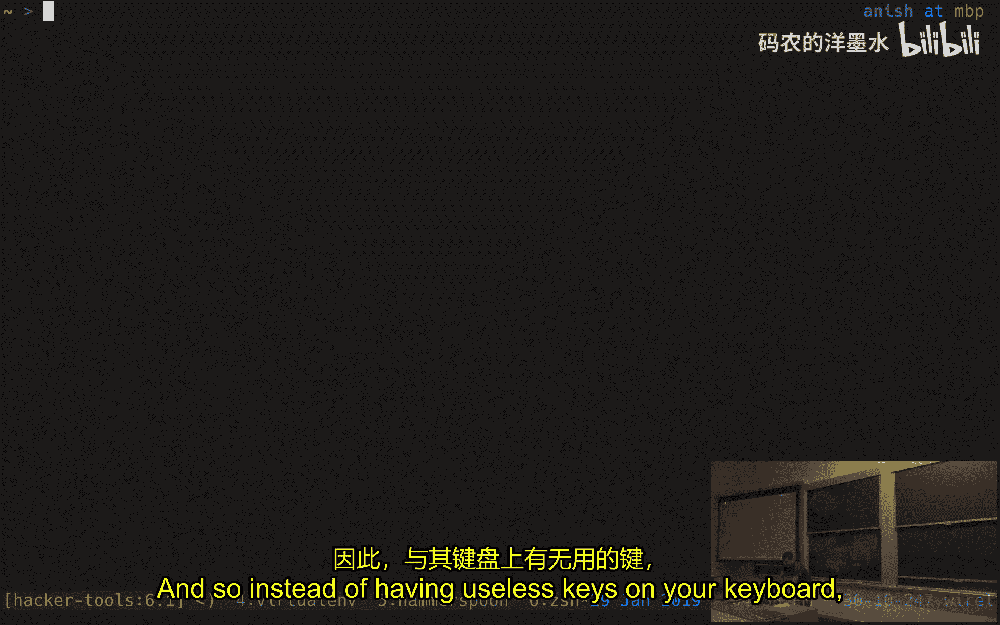

The keyboard is a much more high bandwidth with and useful way of interacting with your computer than your mouse。

 and so if you try to make that tool。How much as is possible。And so for MacOS， for example。

 you can go into system Prefers keyboard and you can do some customization in here。

 like if we go to modifier keys， you can remap your modifier keys to make them do different things。

One key that I don't use on my computer for example。

 is the caps lock key because like I don't need to shout a people that often and when I do I can hold down the shift key and so I reamped it to escape because I'm a VImM user and in VIm escape puts you back into normal modes I pressing this key all the time and if I need to press the escape key in the top left corner of my keyboard well it's like a kind of awkward motion to do whereas the caps lock key is right there。

So that's one example of very simple keyboard customization that's pretty useful。

Or like MacOS by defaultpot will let you remap any modifier key to any other modifier key or just disable it。

 but is not useful to you。

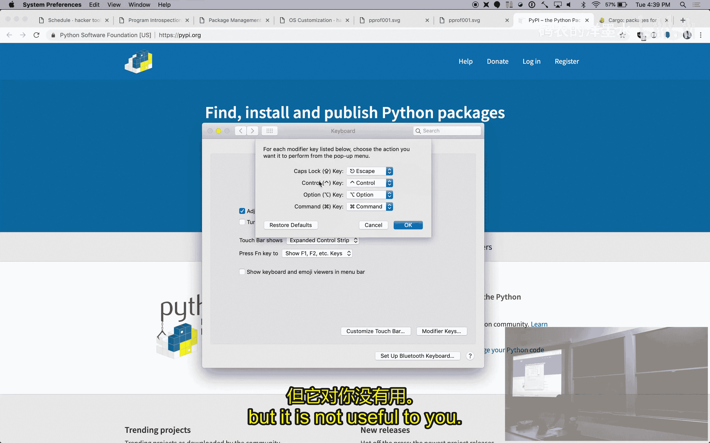

But if you want to do more complicated things like you can really remap any key to any other key。

 and so there's some third party software to let you do this and we've linked to it。its。嗯。

You can also not just map keys or key combinations to other keys。

 you can remap key combinations to arbitrary commands right， so you can say like okay。

 when I do control alt T， it should launch terminal。Or things like that， you can even do programming。

Things like if this program is running。this key combination， like then click this thing in the menus。

And you can optimize your workflow pretty heavily through keyword customization。So。Yes。

 put in the effort to make your keyboard as useful as possible。

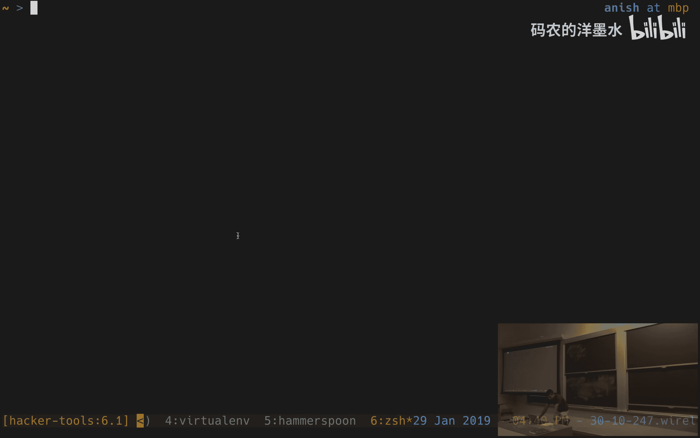

Next what we're going to talk about is hidden operating system settings。

 so no matter which operating system you're on， you probably have something like this。

Underund yours software like system settings or something like that。

 which will let you go and configure a bunch of things in the way you like。

This will expose a bunch of settings， but usually your operating system lets you customize even more things it's just not exposed through this graphical interface。

 so for example， for Mac OSOS， there's the default command that'll let you change a bunch of kind hidden settings。

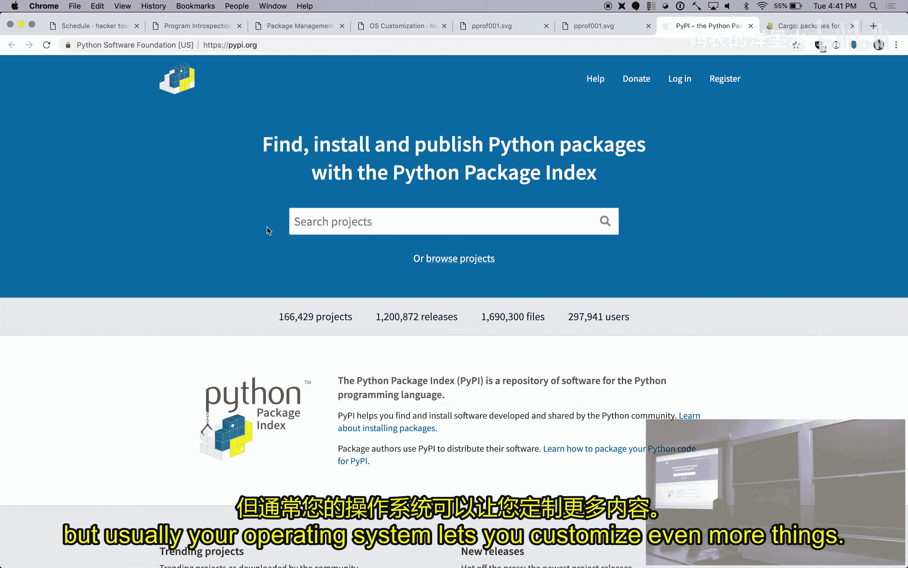

And there's a lot of stuff in there that's pretty useful， so like for example。

 if you do like defaults right？あポ座。そ辺。Te， you can find these comms online。

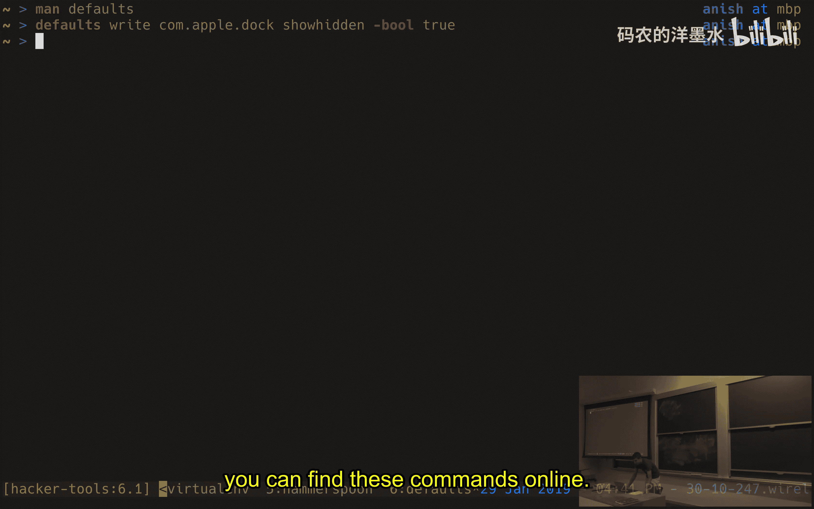

But this thing， for example， will make it so if I hide a program。LikeSo I pressing command H。

 this program is now hidden， it will actually make it translucent in the dock and so it's just like a kind of helpful thing right if I have a bunch of programs running in summer hidden if I won't see which ones are hidden which ones they're not。

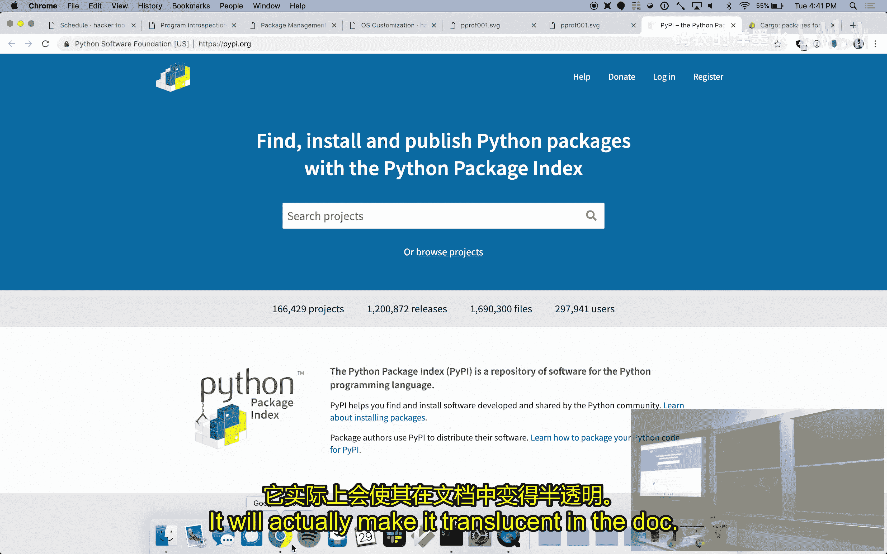

This is a kind of nice way of distinguishing them， and this is something that's not exposed through the user interface。

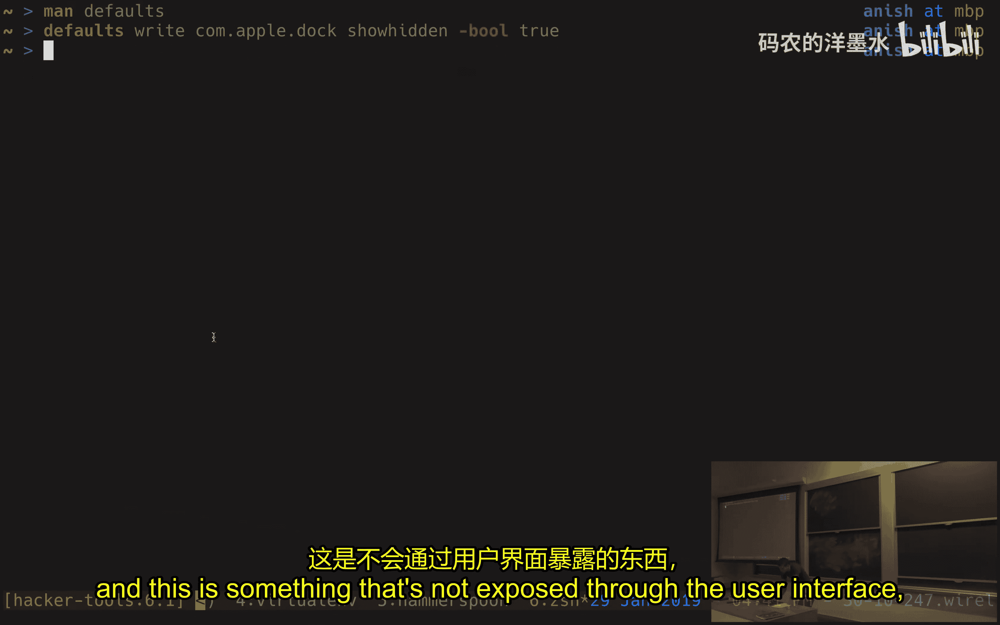

But it's a setting that you can change。There are tons of these things online they're actually pretty useful。

And unfortunately。There's not really a list of all possible things you can change。

But one thing you can do is you can look through how other people have configured their systems。

 so like for example we've linked to this one file online。

 a lot of people use this particular configuration。But here。

 you can see lots of things like Mac the OS by default hide the scroll bar。

 you can see the scroll bar briefly on the right and it stop showing as soon as I stop scrolling。

 well， if that's something that bothers you， well， you can go disable that。

And there's tons of stuff that you can configure。This particular file has a lot of these useful configurations along with some explanation of what they do。

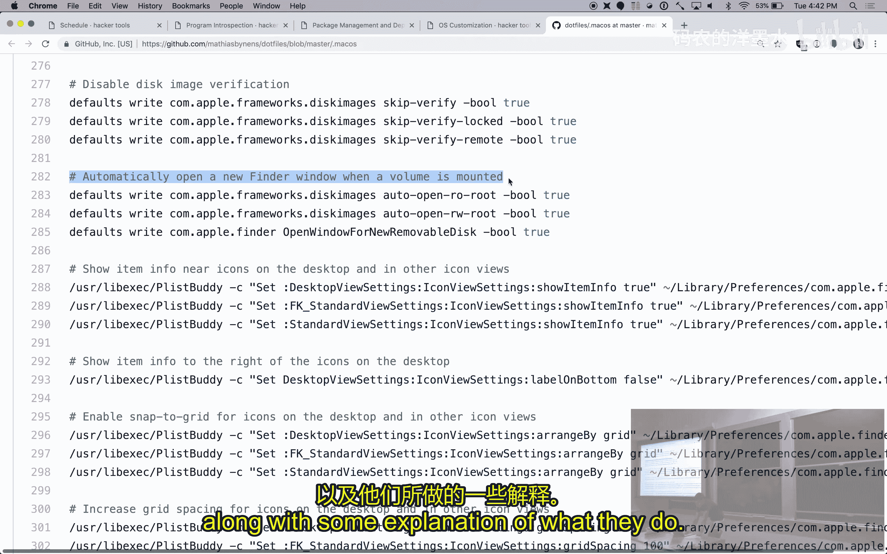

And so this is something that's totally worth doing。

And this general idea of hidden settings that are actually quite useful to tune if you care about making your setup super optimized。

Exist in different and up in all the operating systems。

 you just need to look at different blog postss or articles or things like people's dot files online to see exactly how they've configured their stuff。

And we won't get into the details of particular configurations。

Kn on your own and see which one's applied to you。And then the last general idea I want to talk about is window management。

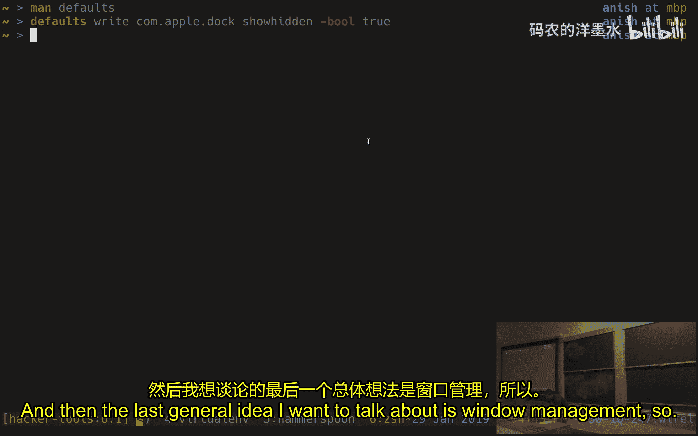

It's probably the case that。You guys are using。Graphical interfaces。

 right even if you spend most of your time in the terminal。

 you' probably do some web browsing and see how something that looks like a browser window or something else。

How do use windows？Like how are they manipulated， how are they managed， well。

 most of us use window managers that look like this like we have rectangles that can be overlaid on top of each other in any way we want。

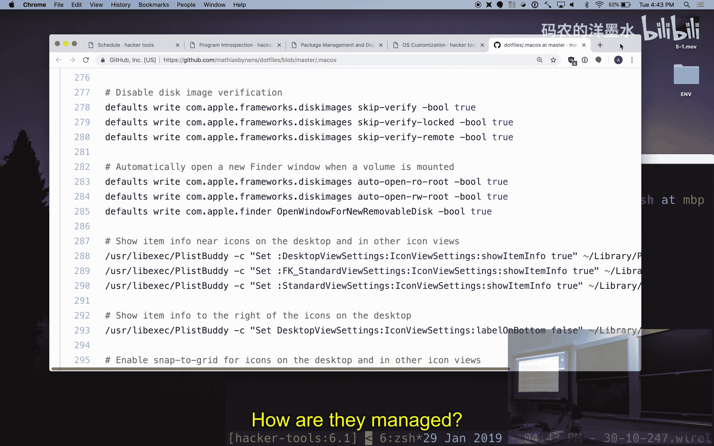

But it's actually kind of annoying to get this to do。Sophisticated things that could be useful。

 like say I'm programming and I want to see。' on one side and my terminal along the other I want some ratio of size between them。

Kind of a lot of effort to do that if I go。Set this to the right size and I go click on my terminal and move it over here。

Click and drag things around until they look right。This is a ton of effort。是。

What you should do is configure keyboard shortcuts and other things to help you manipulate windows。

One particular style of window management is something called tiling window management。

Instead of having windows that overlap each other in kind of weird ways， well， for the most part。

 you probably want to see 100% of every window you have open on your machine。

 and so you should organize things into non overlapping frames and there are tools that can help you do that really efficiently。

If you're using a Linux based operating system， you can actually find tiling window amenities that will kind of always enforce this。

And do very efficient ways of manipulating it。And if you're using something like Windows or Mac OS。

 you can install third party applications that'll kind of let you approximate that behavior。

 so like with keyboard shortcuts I can efficiently do things like split my Windows vertically or horizontally。

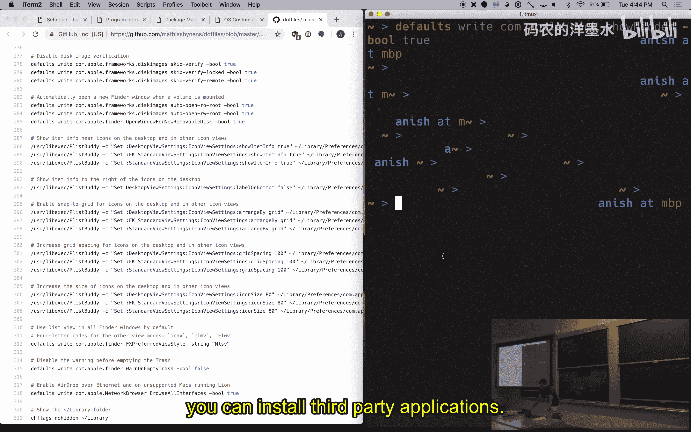

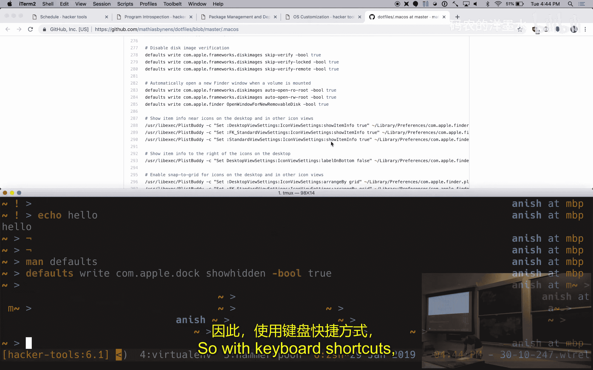

However I want in three complicated ways and let me move windows between different monitors and things like that。

嗯。And there are also other things to besides just。Having windows take up portions of screens。

You can get things that'll show you some prompt， which will say， okay。

 there's a grid overlay on your screen and I want you to take this current window and have it go through。

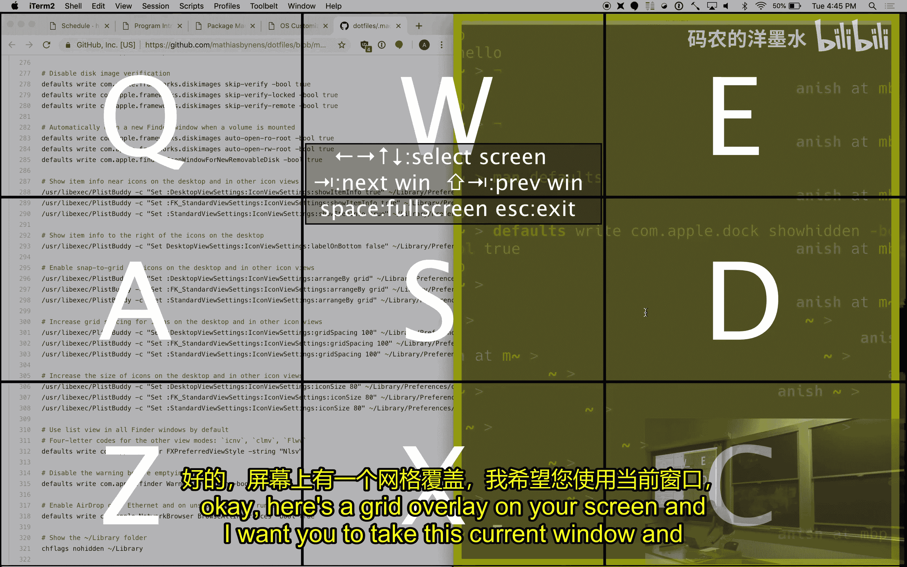

This grid section to that section and take up this part of the screen。

And so we've linked to a couple different tools that can help you do this sort of thing。

The one I'm using， for example， is that。Operating system automation tool called Cams Food for MacVt。

Which lets you bind。Different commands are different key combinations。

 and what I've done is I've taken。Pick whichever key combinations I want and then there's a bunch of built in functions for window manipulation is I can say okay I want to be able to move windows they take up some half of a screen or some quarter of a screen and so on and I want some key binding for having a grid system overla on my screen and being able to specify exactly which portions of a grid a window should take up。

All of these things are super customizable。even the thing like the grid system。

 if I have different monitors of different sizes， say have a gigantic monitor。

 then I probably want like a very fine grid， like lots of grid cells， but on my laptop。

 it wouldn't really make sense if I had 100 by 100 grid because I' never going to make windows like super packed together。

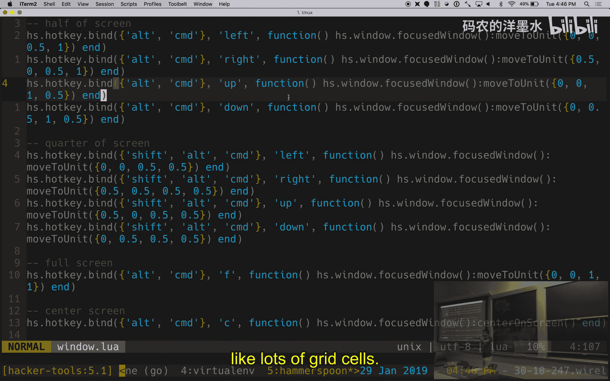

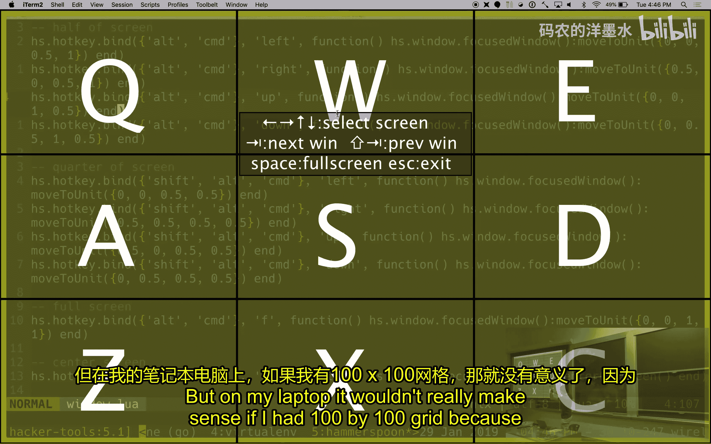

And you can customize all that sort of stuff。In really straightforward ways。

And then the last thing I want to talk about is something called。Encoding layouts and code。

And so it's probably the case that when you're working， you have。

Standard where you arrange your different windows， right， you might have multiple monitors。

 you might say， okay， on this big vertical monitor I have。

 I keep my terminal up so I can look at my code in this nice vertical。

And then I had a southern monitor where like in half of the screen I had。

And then the other half of this free slide open so I can talk to you about。

But then whenever I go home， I move my windows around。And like every morning when I come to work。

 I spend the first five minutes kind of putting everything exactly where I want。

So like of course you shouldn't spend your time doing that and a general theme in this class anything that's repeated you should just automate away and of course there' are tools to help you with this sort of thing。

 so like for example， link to the specific tools in the course notes for Macs hammer screens are a really nice way of doing this。

You can kind of encode different ways you want to lay things out。

 give them names and like bind them to keys or stick them in a menu or something it's just with a small amount of code I have like I've encoded a bunch of layouts for when I'm。

In my lab here or when I'm at my house where I have a slightly a different monitor configuration for things like that and just a single click of a button I can get all my windows to be the right shave and in the right place and hidden or not hidden or whatever。

 it's like every morning when I go into work across the button and everything is just the way it's supposed to be。

And so thiss just like a general tool you can set up for Mac OSascer referring the system。

And it'll save you a bunch of time。呃。And yeah， so this is all we have for OS customization because if we wanted to go into a lot more detail it to be OS specific and then people who are。

I do a lot of macro stuff and don't spend too much time on Linux desktoptop。

 so I wouldn't talk too much about that。And it would be fair for the people who are not using the same operating system as me。

 but we have links to more resources in the course days。

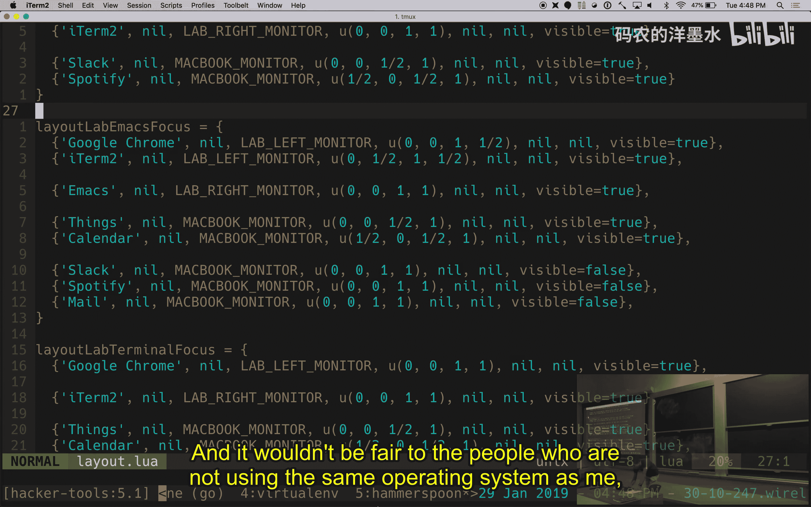

One thing in particular that I think you should look at。

 I think it's really cool is there's the subre that the student's length at the bottom。

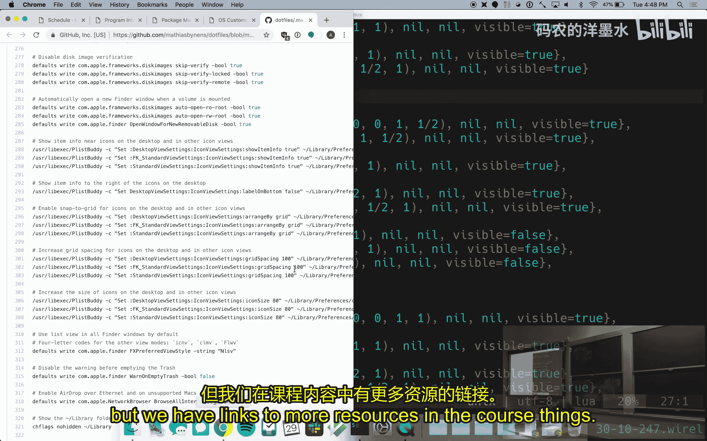

There a list of resources called UniX porn and basically it's people showing screenshots of their like really heavily modified configurations that do lots of really cool things and usually along with the screenshots people have explanations of exactly how they've set this stuff。

So let'll show what's on the screen and like what programs they're using and oftentimes they'll even link to the specific configuration files that they're using so it's kind of cool to just browse through this and see like what people have done for their super optimized workflows and they can copy the parts of it which are relevant to you。

Okay， so any questions about your questions？Okay， great。

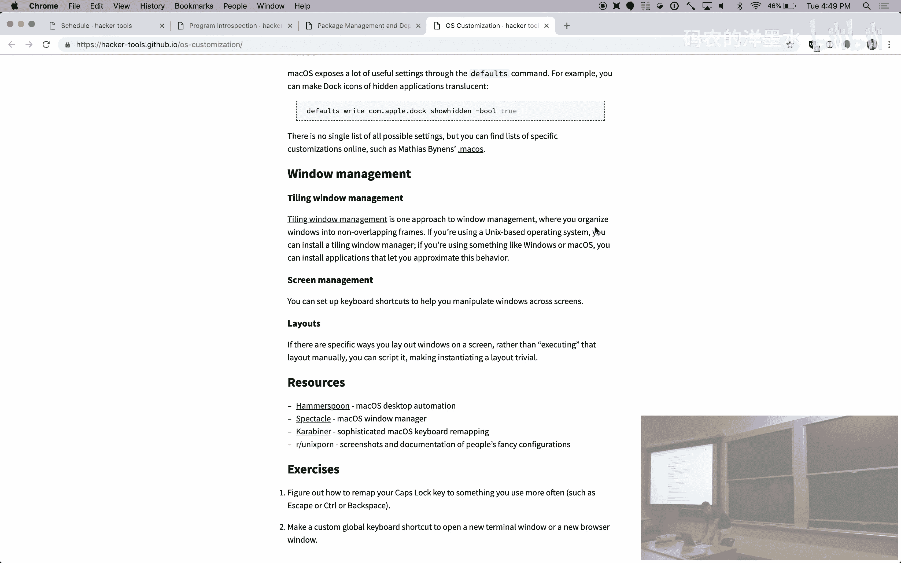