# 【全集】MIT麻省理工 黑客工具 中英字幕 1080P Hacker Tools p14 Lecture 14 - 远程机器 -BV1jcPTz6EE2_p14-

月後のととはリモームしす。Beings that you know of them？First thing， just to visualize what this is from me before。

InYou cannot really get one。My， but they like some approximation in this school。

So like you can say like I'm creating new windows and like it's really ringing everything。

 So I can see like 100%。お myが。Like you can。amazedazze of what。It's really convenient。

The focus right now is going to be。Thinking about remote。So if you have a developed software。

 like this is like a high time like at some point， either for your homework or case you were working in a company。

 you end up not using radio computer because you're very。

 really great I code but its not probably the best thing if you want to have like a website it needs to run like 24 seconds it's not only it's closed because you're sleeping or if you need a computer thatt have like 100 CPUs so you can。

Your simulation know fluid dynamics so a lot of the time you can like customize a lot of work you are doing with your machine。

 but then you have two SSs into this machine and it's。

few year a old and you don't know how to kind of set up stop so it works so I' justre going to go with like work were like some really common thing but we can pay off nominal。

So the first thing you need to know is the thing you really need to be using this SS statess。

What I'm going to be using for the。G is not the。Is not like。WeMo good server。

And so like one thing is like if you don't have access to a web server。

 it can be like how to kind of be back with this stuff。A really cool things。

 you can create a computer within your computer， we cover this in the reverse class。

 you can have like AVM and theVM will have like its own like ID address， you can SSH into that。

 the only thing you need to do is you need to you need to have like some demos on like SSA server that will be listening for like the clients。

SS 18 by default。Like Li doesn't come with these， but you just install it thats。

We exercises like this process here called SSHD， that is running and is listening by default on the port to each。

So now when we have that， we can yes。Figured out what is the IP address of this machine。

This is a look back that I John talking another another lecture。Here is can the interface to my。

 so I can just go ahead and say。I mean SS18 to the machine as me for my password so I can of authenticate。

I'm in and I have like these completely different and I'm like weak machine。And here were Ar。

We can just take comments and go for。However， SSAD。Tably more powerful than that。

 You don't really need a lot of time to just like SA type a comment。

 You won't maybe only care about the output。So one thing that you can do is you can specify what you want。

When you do that， so here that request work。And what this is doing is like this SSA team is executing the command。

 is getting the output of that command， and is getting it back to the standard output。

Means that SSA is not this kind of like really interactive tool like you can place like SSA within like bias。

 like for example， let's say we're here and we can。Then we want to grab the apple。

 so we get like those things that start with。どそ辺。And it will go through like this is like like this listing the remote folder and then it's brokening locally。

 you can also do the image like we can like list the contents there。咪香er。

And then five dots into estates。AndG cannot be sink like we're going to group。こパイス。

So what this is doing is。Ling me my local folderers。のかを見けさ。必。反正呢。

So what this is doing is the output is the same， but it's copy a completely different thing。

 this is doing is listing the homeers in my computer， then getting all that output。

Sping it through SSA and then running red the SS in the machine。

 this can so you can pipe things in amount of SSAAs。As you have already seen。

 it's asking me from my bad every single。And not getting he gets like really， really old。

kind the way programs have to solve this issue is using SSH keys。

hiIf you have a re of set on Github accounts or you'll have to。

Enter your user password we you plug post and pull。

 you probably have Ro song the way these are plays are like within this hidden folder called do SSAs。

For demonstration purposes， have remove mine， probably you maybe only have like known cost if you have SSA in machine and do any machine。

 yes。Using your puzzle， but no posts。Yes， for example， right now。What that file contains。

Is that we just SS it team to。BeM on house。All these things that specifies that we have a great SSA there and we have authenticated and we know that。

 so even if someone tries to faith in this person like SSA2 will tell like sometimes if you have green store a new server。

P has pptographic ge has changed as the will tell， something has changed be aware of。

You may see that。Reinst a and you see。Another thing is the S conflict that we will get at the end。

So let's say you want to create that for you。The first piece will be what we want to do is do something like SSA。

For example， this is specific I want RSA fees you can also apply。

Ttic quirks and second values cannot be size。这咁觉个。自な？You can debate。我 to say。People volume。

 then you're going to be asking me for a。And this is important because it's really easy to just like go through or like notice。

问单。But like right now。That anyone gets a out of it， It that person。

As the password for any server will you copy your keys over。

So' depending on where all that will be final but will be enough fight because like someone but has the value that has the key。

 we have access to like any server to to association。

You can specify a pass phrase for your key doesn't mean that like every time you want to use your key。

 the key needs to be decpted。So it can be used so that we effectively be asking due to user request。

But we're back to the media Gro。Good keys， which are convenient for some reason to not get to but you still have to。

The proper solution， I'm not going to configure now over here this。Including hearing。

 because I very hands on previous setup is using SSA to80。

As6 agent well ask you for your puzzle once。And he wouldn't remember anything I said。

And to kind of give a very kind of example so you can relate to it， think about sooner。

you want to use student and like it as you from the puzzle War one。

And then remember for some time and I up。This will do the same for now。Not a specified password。

 which means that if I copy my file it over。De survey， I will be able to visit。

Anding my puzzle because I would copy my phone key， I would keep my private。And that way。

 I will be able to authentic machine machine that I'm with the person that copy key。こ。So youが。

You can do something we human， You can do something like。家掂。And they want to assist。コピビー？こ快な。The。

And then we as as。イングリジし。As some user， because depending in which language which user you choose。

You will be go the。The key for that user。And then here we can do something。

So you can do something like out key is what the error is going to be looking when you give your key and you improve that one it's going to be looking。

This is。there's a really neat tool called SSH copyB that will kind of do the things you override instead of a。

 you might override and the server just lost all the history。Non service SH will do that for you。

リン key toリとo。So we do that。おパのは？Now has other key， and now I can try to SSH。特に？

I got really with a private equipment。And since I been aquis fire puzzle for the key。The brave。

Any any questions什吧？Another thing that you will find yourself like green。All again like if you have。

On server， you're probably hitting thes， maybe you are8 defines there。

 but maybe you have to transfer your data or your code already you have。

So you need to know how to copy files over SSA。You can do these like what you throughary you can remember。

agree for example。one thing we could do is just like， oh， we can cut。This方。It's the States there。

AndIts there。And then there we can yes。So what this is doing is guide in the file。

 then open a SS connection， and then D， if you remember from the data random lecture。

 is both outputing to the STDR and also。So there was activity to the So you do something like this。

诶个方你唔要。But you are copy and large amount the cloud gets。

Really bad because then suddenly you have to find all those files and copy all of them。

They are very tools for， so in the same way in your computer， you will do CP from。Foldder 1。

2 folder 2。In when you have an SH connection， you can do secure copy， which is just is SCP。

Thanks for I you will do something like older one to。And then specified like the user， the server。

 and then it。You go your files over。And you will have to specify seeing a block like if you want to copy。

Yes has a fun and you want to do look things forcuribly is a。

One thing about the CP is that doesn the same way that CP doesn't know about like p there。

 I think well recover this in to。If you're copying a lot on the files。

 only a few of them have changed。S b。But you will just start from the beginning start hoping on。

Over the wire and yes override by。And that's maybe what you want do。

 but a lot of the time if you're kind of。To mean a lot of files over at the network。

 you want to probably use aing that knows like A has a very understanding of it。If you want to like。

 copy siblings。We know price that are already there and not copy them。

 It would also be able to resume if have like。for say 100 giggaytes。

And like that really did not files。It's interrupted how our thing will be able to figure out what are the tanks that happen。

嘅舒徒。I we have。Oh， another week goal scenario。For example， I can SSH into the BN。

 and maybe for example， I want to leave。Really long process， right。And I could running。

 but assuming I close the assuming I execute this and assume soon as I close the connection it going to die and depending on how the server is set up。

你边。How this area is specified， even if you kind of background it when the parent process。

 which is the。It can take away like sometimes it the process itself or sometimes the permission to access files that the pi process have permissions to。

So you can do things like background it and then like this。

And things like that there's like a really simple solution， which is doing that like know。

It kind of takes care of doing all this for you。Remove the dependency from final process to child process。

And it will park properly。え感じやつ。For 100， we can close the connection。Do worry we want。

Get back in again。And when。we search。Process。え。And then though， you are using own interactive group。

え？That is displaying you all the values。And if you chose your connection and then resume maybe you compute your way of having thought like executing the body。

Or it this seems like a problem has like a behavior like， oh， but like it's going to be trickyy。

 you kind of real art。The output of that program you can prove to a whole， but again。

 if you have something like an anchor base， there is red in the entire。

The entire moment like every second or so， is going to be really。Or the thing where you can use。

called terminal multipleers， terminal multiplex it kind of creates a window with no window。

 and then you have， for example， screen。It looked like nothing has。But going now， we're in the。

Inner like an execute top here for example。And I can。D dot here， you have like D dots nowhere。

The P said we can。Close the connection。Here the sink again。And say a screen minus R are some。

Resumed the connection。And dog is be。So you have like some long grind yield and something that better interact with。

 it can be fully convenient and also you have probably seen all us at some point like using something slightly more language which just demons。

Spcrring are really basic kind of spliting abilities。It whats pretty more powerful allows you to。跟到。

ピさ。根据。尿担。We like bulk one here too。あメいか。Dタ。Will you get out。げ？

Pmat A for attach and I get the same layout I have before and I can easily navigate right。

For example， for my recent， I ended up having like emtuism in the remote。

The EU that you would use for 20 models。And it becomes much because otherwise。

 you just go and say like they're opening a lot of connections。

Just trying to have our way or even if you lose connection and everything now it keeps over。

Any questions toか？Next thing， the next thing is sometimes you may have a program。

People in the opinion on somewhere you you can have， like some programs we attach themselves。

So for example， like a web server probably attached to the port a， which is the default。

In HP or you have like a necessary like a to or 22。Sometimes the thing you're running is。

In the removal server。You're not going to be able to navigate like if I have like a remote server。

 like a web server， if you seen， I can just go do you can just well。ここ。Aing and like that will work。

 but if you are doing that in a remote machine another remote machine is not wholy available to work through the internet。

This is the case for most because？Nowhere you can need your phone light if you scene being just like out the lot。

Figure out to properly do that， well probably have blocked a lot of reports port to go through like open if you think。

The thing you want to do in that case is to do portfolio。Thisステに。

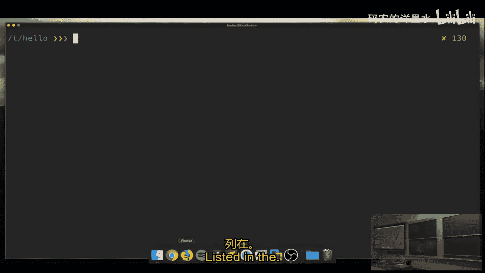

In the Cors website。

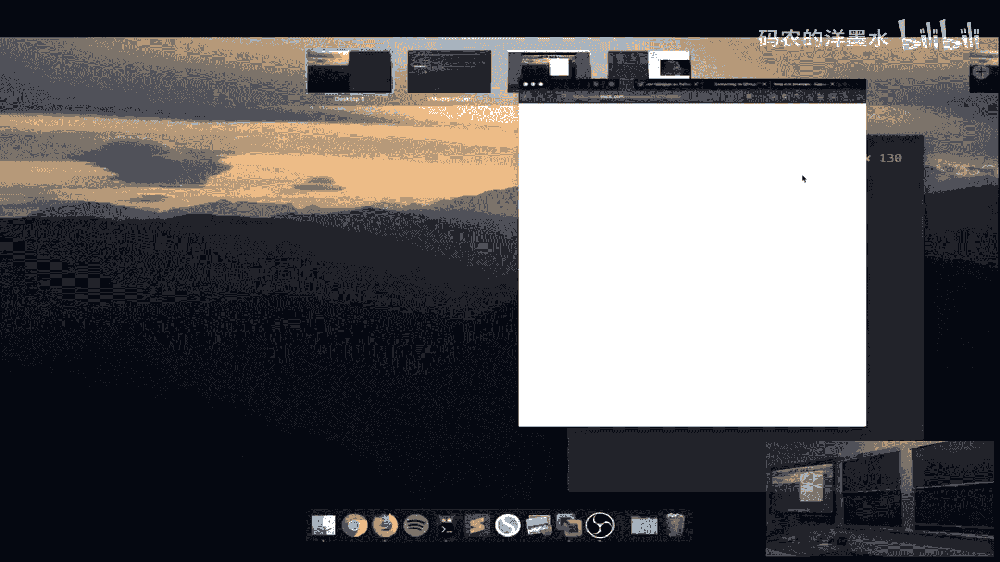

really good graphic that kind of explains the things that you can do with them。

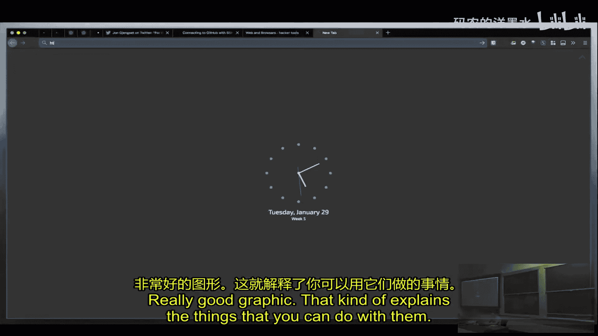

Because can get like this lady here。So they like both local portfolioing。

 what you're saying is when they try to go to a local。返身？Forward that traffic to the remote machine。

And you have the inverse， which is remote for forwarding。

 which says when the remote scene tries to go to some local forward。So and just forward up to minus。

And now I'm going to give like a sort example of， for example， really。

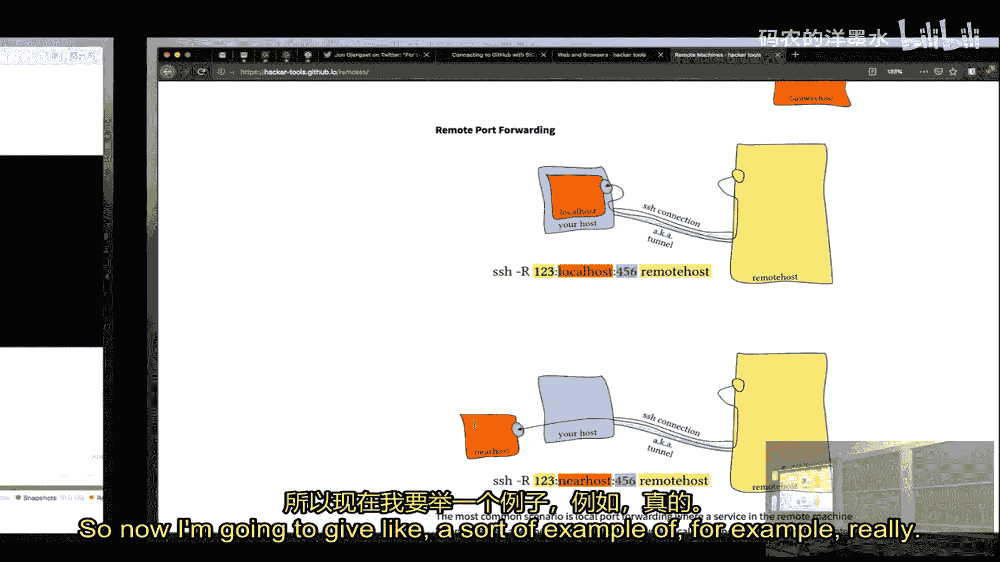

go on thingけ。Scientific computing is you maybe want to do like geo。

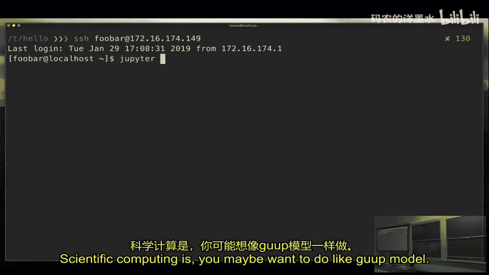

And you get the notebook we by equal attached to board8。can easily this machine。

So what we need to do is we can start。And what we need to do is when we are SS。

 we are going to specify that we want to forward。你你呢。And94。えミし。

To the A day they report in the language remote machine。And now， if we do that。い本。No。

We still get these。If we navigate to our browser， if I tried to type this here。

 it doesn't really all right， because this is the8 data and I'm forwarding to the 999。

And if I do that， and right now getting this browser。

 this is going through SSH and accessing the A day part of the remote machine。

You can look even more forward for stuff I'm going to get into because you have to edit somewhere。

Finally， for example， say your work is bloggingging great。こさ。You can specify。

 you can create like an SS tunnel and a specify in your。

AndHo computer files that every time you try to go to creditit dot com。That tro。

 instead of going directly from your computer， gets forwarded through that SS tunnel and goes from like the server。

And the im for an example for somebody have has something like sublime。And you won。ly。

chaiographical to edit remote files。You can do remote port wording， which will mean that the。

The remote server will try to access a port， a local port。

 and that will get forwarded to your computer where do we say which changes are being made through。

SoYou cannot have local and remote are useful in different。

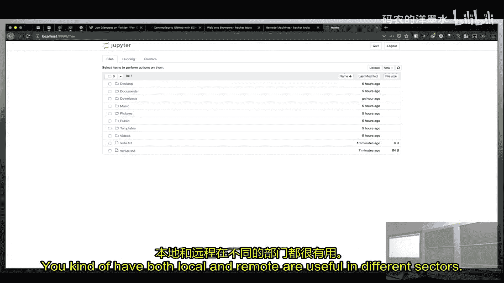

Is there any permanent waves forward where to work？I that bizarre？啲翻翻到得得噶。

Instead of assess aging through。To the remote machine every time。

By specify the reports they want to4。Is there any way to keep that configuration in a remote machine？

The thing is if you keep this connected。Like that connecting is going to interrupt。

number what So like you get them have like something。

I' not going that I think like it's only like auto SSs that would keep like reconnecting every that dude like disconnect and can have like some background process。

I haven't gone into that scenario。 I mean， it really depends on what you mean by all ways。

The port foring happens over your SS connections it's basically multiple like saying stuff on your single connection right so if your connection goes away。

 all the forwarded connections are also going to go。

There are ways you can say that whenever I SSH to this machine， I want to also forward for it。

And so if you look at your SSHfi from memory， I think you can configure it there to say that always forward and falling forward。

And so that might be what you want， I don't think there's anything that will'll like。😔。

Ensure that you reestablish those connections。The sort of this permanent portfolio。

means sometimes you run into like some software that is not brilliant to be kind of easily interacted through。

Theこ前 or。Like to realize for some reason in some。AGal user interface。

One thing that you can always do is do this just you probably have seen these tools where you're doing like some。

De like DR like police。Happenings。Realter。Cing the entire desktop environment and sending it back to you like the data。

 and you already the local software is capturing all your actions and sending all that。

But maybe you don't even want your like multi。Like ahead there this looking environment。

So one really thing that you can do is that like you can。

Buildll the SSH to do what is called demographics for。Linuxux the going。Smal， which is like X limit。

手の足品スと。Allow you to get up。Maybe remoteter。I all the graphics through the SSH connection and for that to be rendering your ro team。

 So for example， if I specify here the minus x2，And I guess it safe。And we try to do。

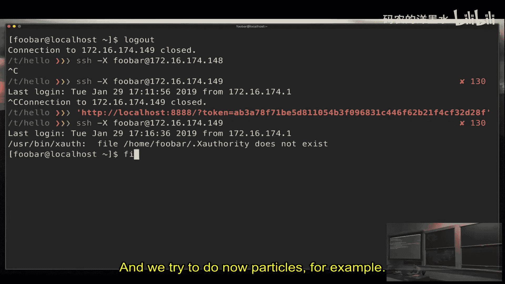

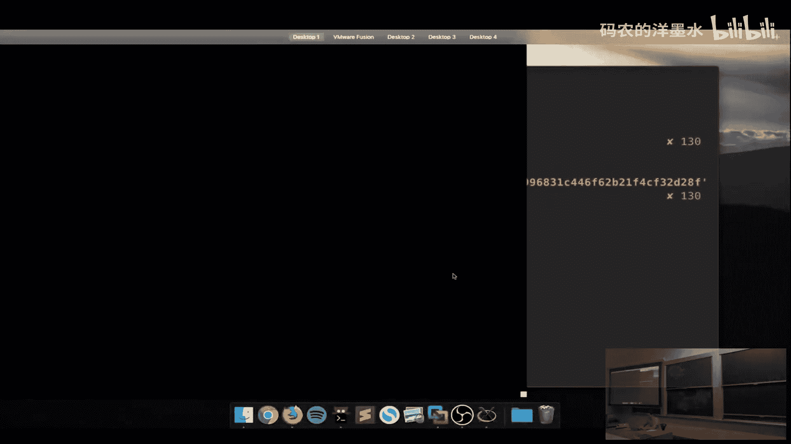

It's going to open here。And that Firepoox is not imox。And entirely。

 mean forward through the SSs experience。I mean like I'm doing it。Move it around again。

things in the so end up。It can be convenient on like if you have some software that doesn't really place nicelyly。

Becom aly or working entire thing。诶。Of and for that to work the SSA area。

although I think by default most institutions that like support my SSA area。

 will' have that enabled by。ほっとか。Like some like。This out means my disabled for。G back to your point。

 there's not be a really a really good way to have like a bombing or forwarding。

 but there is a really good way having。ホingエテー。So there is this improvement on top of as which is called。

M white sell。And Mo is slightly more intelligent and willll be able to figure out when you have this method so say you close your laptop and go home and open your laptop again。

A， your connecting to the server has interrupted and B， you maybe have to change a number。

But like most will be able to figure that out， so I have algorithms installed in machine。诶。Here。

It also one of the nice things of like theT is now I'm missing more sweets。

Very different from SSAT well we often those SSHPs。

 and I will't have to advisor is using the same SSATP。So it're going be running here。

 something in really simple。Now I can phone here to my yeah。Maybe他们讲他。What can they work on？

Like the number years is dropping。やもう。Should tell me that like the was like。そ管大投。

It tells me there and kind of Greece what he's doing right now and now like SSA by now we just have closed the connection。

Now if the server phone look out or like the network have。These years， most continue looking。

And again， if you kind of move all your environment。Your editor。I management to become on my。事ジです。

very connect。Service， it doesn't worry。Currently， Moes and involving like for forward or roughly。

And the last thing I want to。C is the SSA。The SSH from you touch upon it， but like， as you have seen。

 you can end up having like a really crazy thing when you can say， oh， maybe you want to do a man。

USA and you start getting。Here maybe you even want to specify which SSA ski you want to be using。诶。

And then what user here you having in the remote team。And maybe what the others ofities。

Don't want to be typing this thing over and。One idea is maybe a good deal。

Molly has decent entire thing。So like instead to again just like up the。is using SSAs。今回？

There's like this file here， which is the complete file。

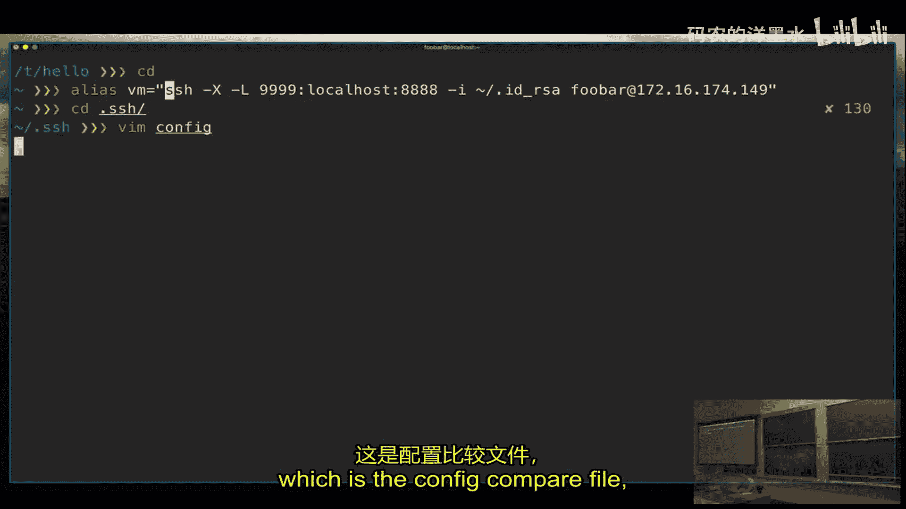

あっきやす。え他で。あ公。Will be explain forwarding， but we can just repack the land in in。Hos specifications。

 for example， we can say， oh， the user I won' to is to say to。And你。Was name is。

The part I went to SSA school is 22 in case this like a different one。你。系呢啲啲。Theyもで use。第。

And people stage on even you can specify the remote forward。いパイ。四个。You can also。

 as you' see have like an asterisk on top， but like you can' even pattern maps。

To like domains you can say， oh， I want save like every time I assess into any M T host。

 I want to be using a different user because I want to use。

which is some like this is 61p we figure all that out and now instead of typing a lot thing just like SSHBM and even in the VM and the remote power is done and everything is worked。

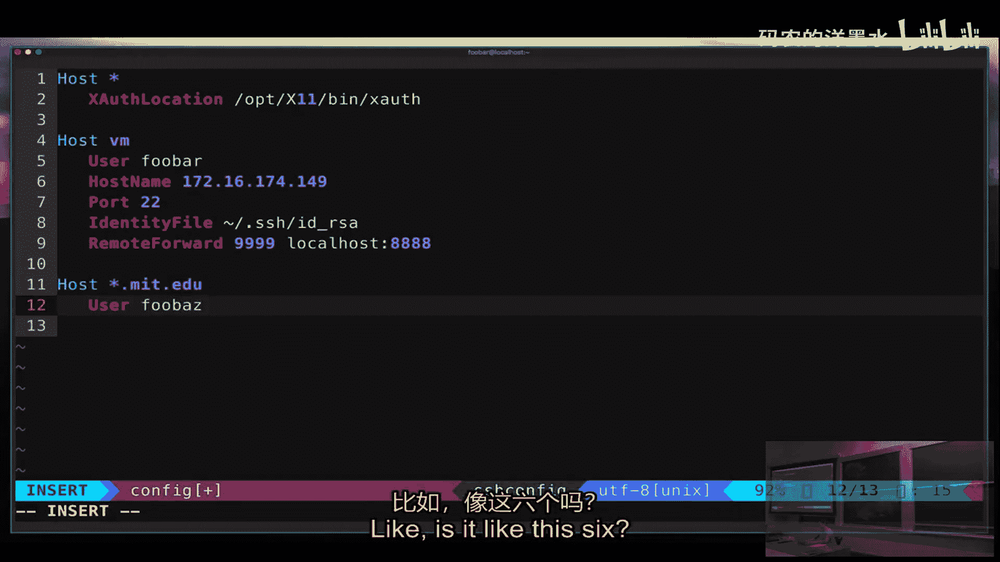

Another great feature of having like a proper contributor like SSH2 is not only SSA institution。

 like all all other programs。I think SCP and most we know how about this。跟 e c零 say oh i want do。

冇线 do v m。He yes， few years some to go to the file。Do thatら。

And then you want to be careful the user it complete in a way it's a lot file。

And depending on how partner you are， you may be fine doing that because like no。

Ex but maybe you don't want really people to know the service you are assess。

 So bear that in mind when youre like including it or not including it。诶咁系嘅都。Last thing I want to go。

Is。And next for corner days is that sometimes you have like some software。

 they want to be running local。But doesn't mean playing athlete with SSX and one you have like some playing hire wants the things to be as files in your folderers。

 in your local file system， or you can do for that is using seeing something like SSA device。

Where you can say， oh， let's。え？Anything mean。And I can do something like go， I want to mine。

What this is saying is I want to mount the remote folder of downloads that is placing the VM host to the logo downloads folder。

嗯喺度呢。嗯。I can just go into there。Is empty and the can。I a simple file， and now if I go into DBM。

fun exploreer。And I go into downloads， this is the poly。

And like if some softwareboard doesn't really play nicelyly like all the SSA。

 a lot of software will do， like if not， youre going steal mount the entire hierarchy。IfYou int here。

We can see the file as a local file。那你啊。You just among it， like any。

Would you don month any month drive in I'm sorry。こしく。

There's one more thing that's handy to know about that is something called proxy dumping。

 so very often if you're sching to a machine， it's like behind a firewall so you need to this happens a lot at MID for example。

 where you can only access this machine if you're on the internal network。

You could set up a VPN of course， but setting up an VPN can be its own kind of painful and so often there will be what's known as a ba in hos so this is basically an SSH host that you are allowed to SSH into from any external service for MIT this is like login C cell。

 miTu or dial miTDu， these are externally visible SH machines and once you have SSH to those you can then SSH from those to whatever machine you want to go to So of course for these cases you can SSH to that machine and then type SSH again。

 but now it becomes really awkward to do like to either type in your password on this remote machine or you have to do agent forwarding which basically gives the other machine access to your private key neither which you might be okay with so the more recent versions of S have support for something called proxy jump where you can say I want S to this remote machine。

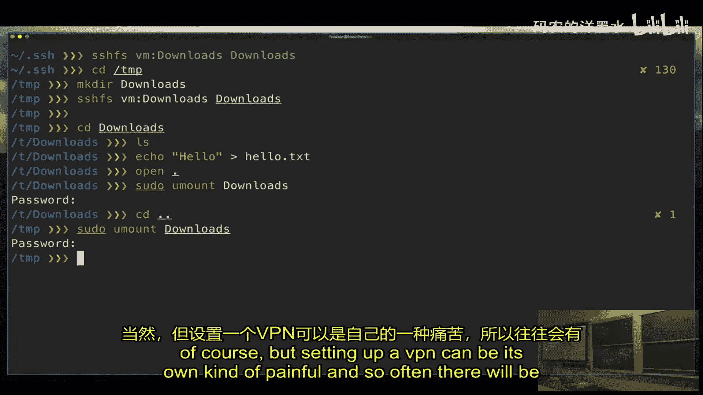

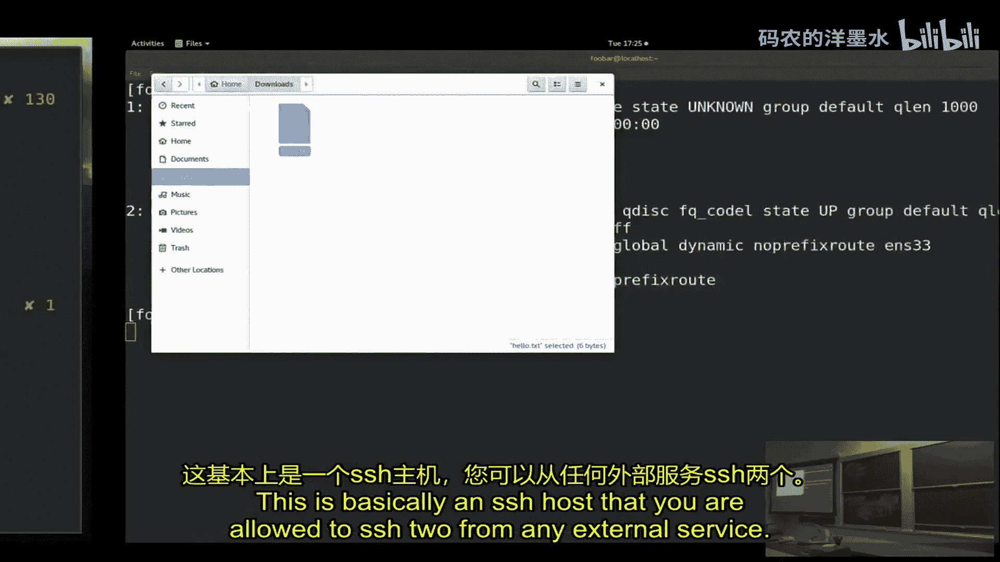

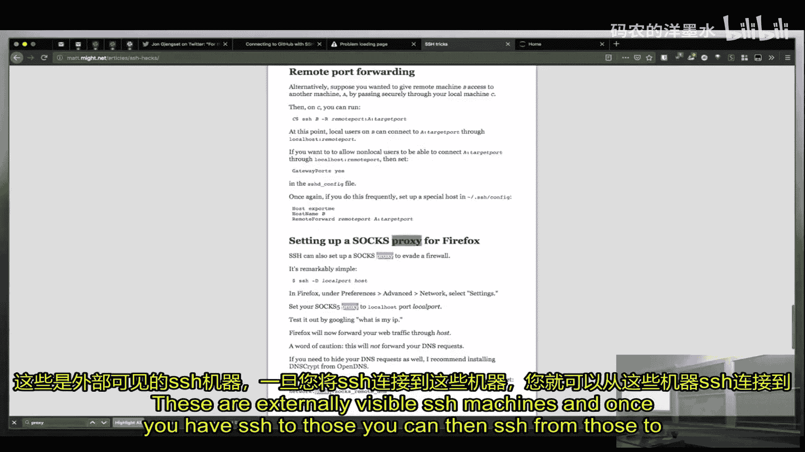

Through this machine and it will never show your T material to the machine in between and in fact it means that let's say that I have host A and B and I have to SH through A to get to B。

 I can set up a proxy jump and then on my machine I will just type SHB and it will do the right thing。

You do this by in your SH config file， you declare a host called A， you declare a host called B。

 whatever settings you want for use and As and identity files， imports and that kind of stuff。

 and then on B you would add the line proxy jump A。

 and now all you have to do is type SHB and it will do directly。三点两百。いのさし。

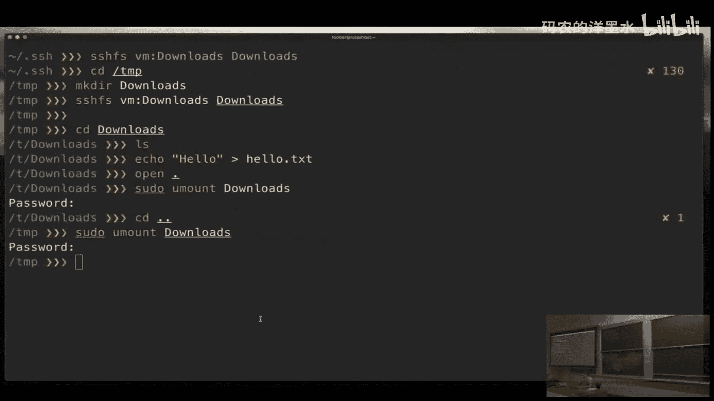