# 【全集】MIT麻省理工 黑客工具 中英字幕 1080P Hacker Tools p15 Lecture 15 - 网页与浏览器 -BV1jcPTz6EE2_p15-

えと平本バ。They picture her。には？Today you're going to eat Koreans。More like oh high little topicss。

 the first one is going to be get on browsers。Also。

 like all the capabilities on your web browser now。

Maybe you are more familiar with and then joining have。え。

So the many idea is not I gonna be about this more。I'Find two different stuff， so at any point。

 you know helps。That be correct。It can also like slow down like I'm gonna be kind of jump from one topic to the other because there is like a lot of mis stuff like。

In other topics like Ed a little bit more structure I think。

HereWe're going to just course up that you might benefit like using and your day。え予ブで。サイズに。But in。

We be brother。And first thing I want to go with wheel browser really like stupid people like I've been surprised by the amount of people that I not aware of this。

And with any tool that like you will be using a long time， it's really worth knowing all the like。

If you are kind of going and taking for getting and new that that's probably like so often of very easy ways。

 some like control come with create a new one。

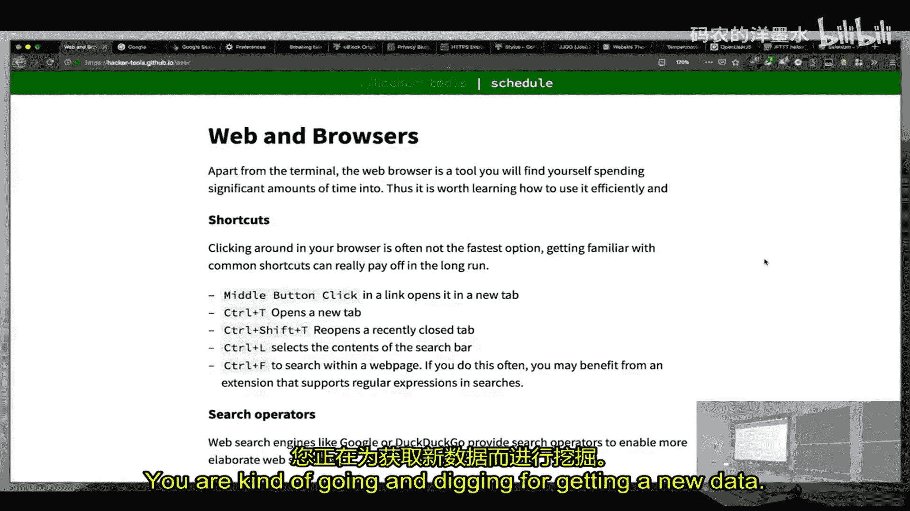

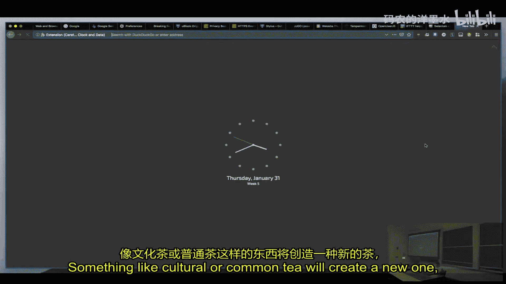

Go somewhere and you close that and you want to reopen that common safety with that with for you。

 there are some more convenient ones， like if you want to open a new tab without having to grow like right。

 cooking in a new tab。

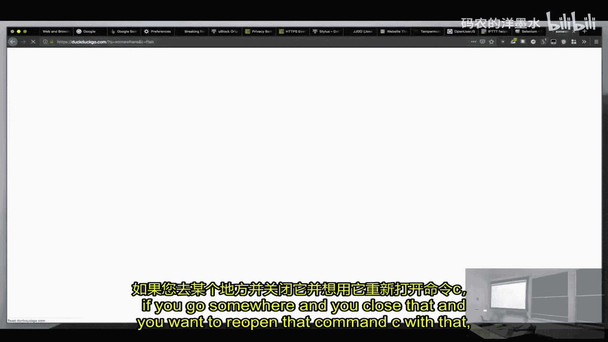

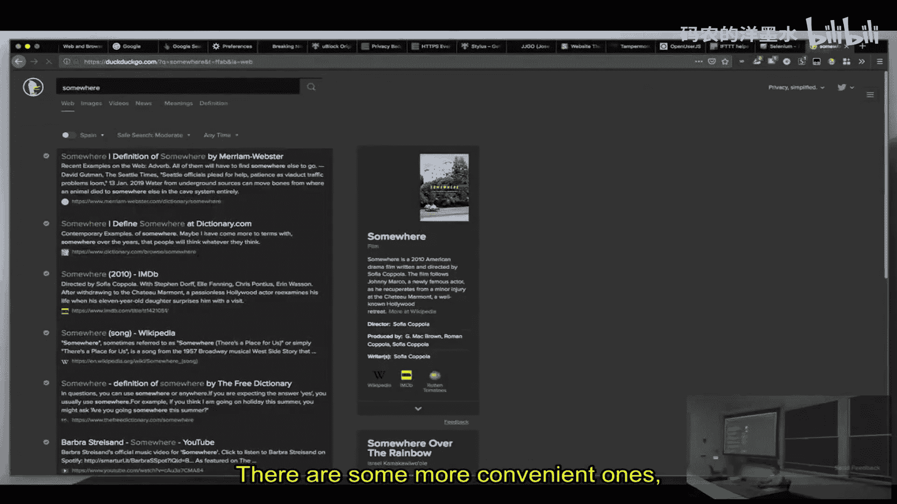

You can do either with the middle mount panel you're using。活力咁问啲。Another handy one is controlt L。

 we can on L， kind of place and focus the searchwa so you can automatically type here anything that you want。

And finally， prettyt common one， but like again， like being surprised like one of times。

There wasn't nowhere。You use control head， common head， you will be able to like。

Ses quickly within the。Within the。Website also you like green searches， a lot of lines。

 they're like some handy extensions that allow you to do regular expression searches。

 if you're kind of searching some website has like a lot of data instead of download。

 you may be able to like。でごでた。Just two other things that are handy。

 control or command W will close the current time。あ、。

So if you don't want to just keep stimulating them， also if you middle click a tab。

 it will close that tab。😊，And。The next thing is search playerss when you're kind using pretty much any modern certain thing Google use but most people do。

 but like that are low， I believe also supports most of us。

' not familiar with bin or the other options。Ting like how like some examples going to go one by one。

 They're like what pages isn and have link to one how like。

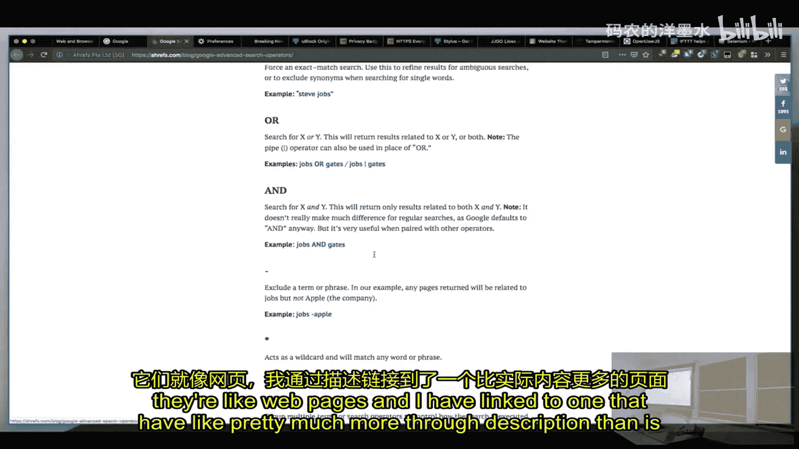

Through description， finish worth knowing some of them， for example， if you want to have。で。エクさま。

I say I want to search for this phrase， but I want to make sure that this entire expression appears to get like by default。

 Google or like all these world certains will search format matches where like can all this words out there somewhere maybe in order。

 maybe like one after the other， but you can enforce let all this team be treated as。

It's a single unit， and then when you search。You can see that this entire phrase has being much exactly ams to kind of honey the other parts。

Somewhere else。Another appropriate， you can say， maybe you want to。

Search within some website so you can say， oh， like side。

 I want the site to be searching to be stack over。So you can tell Google only to search within that。

 and you can see that like all the。All the web pages that is returning like within this domain。

Now can be re useful because sometimes like web pages are in depth， but Google。

 but we don't provide maybe they provide a Cer engine， but maybe it's not that good。家力辛活俾，你。

free of is spread。Ha some certain name， but it doesn't work as well。

 as is like searching willingness specifying that the site to be S。comg。Another one。

 sometimes you want to kind of have like a negative map。

 like for example I want to search for something that's in Cambridge。

 but there's two cameras and maybe I don't want the ones that in the UK so by doing that like in no matter what you do if kind the map has like UK somewhere like Google or the search you will try to like down thear and have like the other results for so sometimes you' are getting like results and you cannot know that you don't want those results you can use kind of the negative to avoid those。

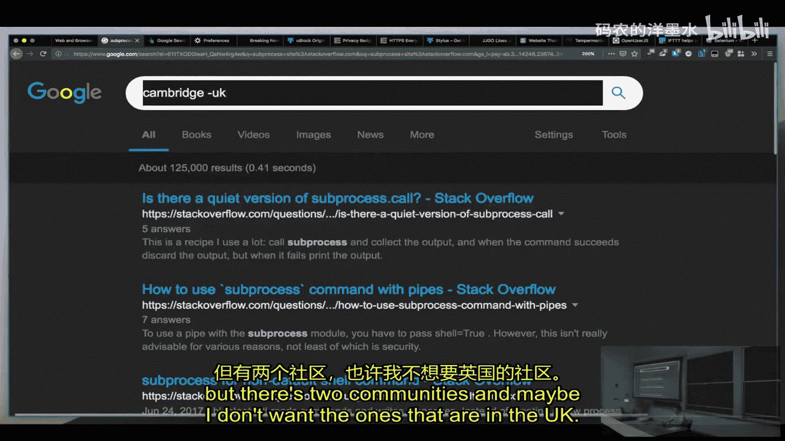

え。Another cool one is you can do。The same as。With rex， you can say， oh。

 like mats either or electronics or circuits。

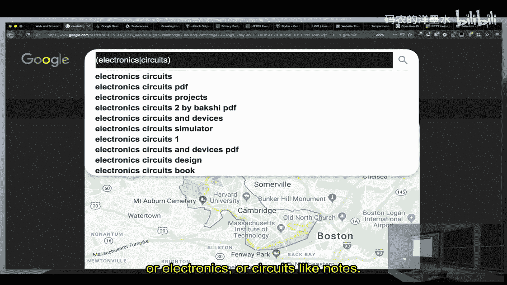

Like no。And by doing that， you can the n will be matchinging like one or the other。

 and you can service。AndAnother thing that you can do is you can also specify instead of web pages。

 because for example， here it' returning both like web pages and also like files。

Say that only gay about getting like PDFI like what' I like。Electronic receiver notes。

 maybe again I want to get more specific， you can just say like。

 oh if find that of thing I want to be returning PDF。L andhold。

 all the results that we are getting are PDF。There are many， many more， again， like the link here。

 like you can specify all like there are like。

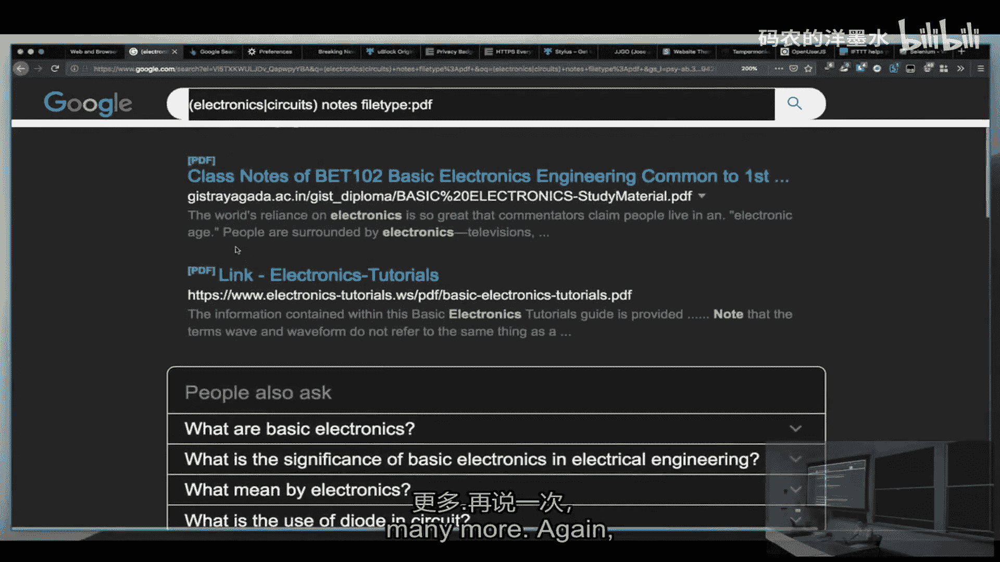

That you can use。The ones that have covered like the most the one。系 you more。Its like the white card。

 you don't have like some welfare so something can be months even if。

You don't get like the specific of getting one or the other。え。Next thing I want to cover is the sex。

 so very example like extremely useful tool， and thing like one really common。

Thing that many people do is you oh I want to go I want to search something on YouTube like I want to search something on Wikipedia something like that and what you do is you search for Wikipedia or like you that Wikipedia you go there and then you go and search with。

Thing is most mobile browsers， at least and over like both Chrome and fiveworks。

 are aware of kind of different search engines and will allow you to search directly within those searchs。

So for example， what I have set up right now is that if I do like why is still like so？

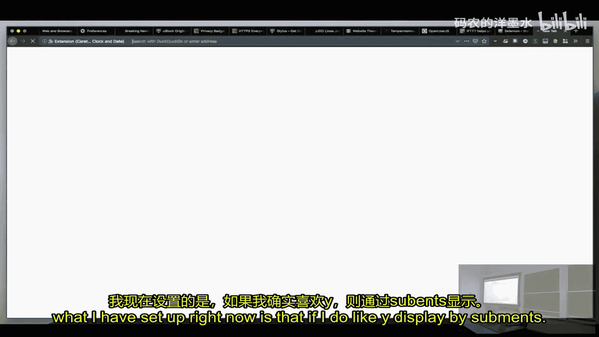

This will search directlying to you I don't have to searching directly that and the way to set that up is different for different web browsers。

 but the main idea is that the web browser will be indexing all these different menus and here you can say oh for Amazon I want that like if I I type8 before I want to be searching amount。

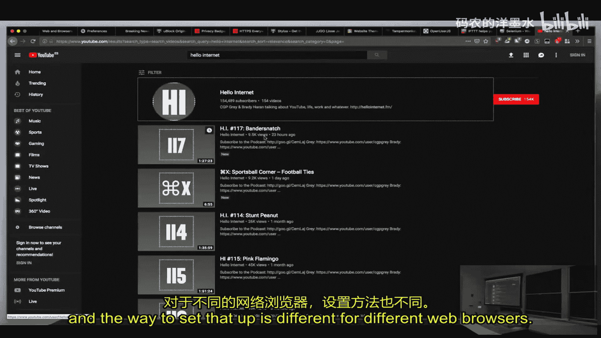

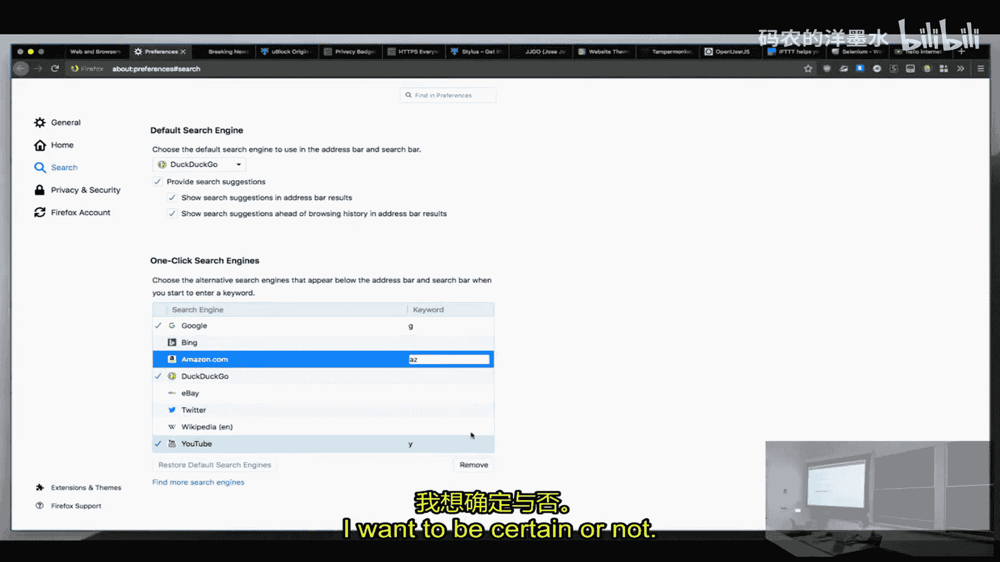

And now if I go on that。え？Eco will go and search the in Amazon。

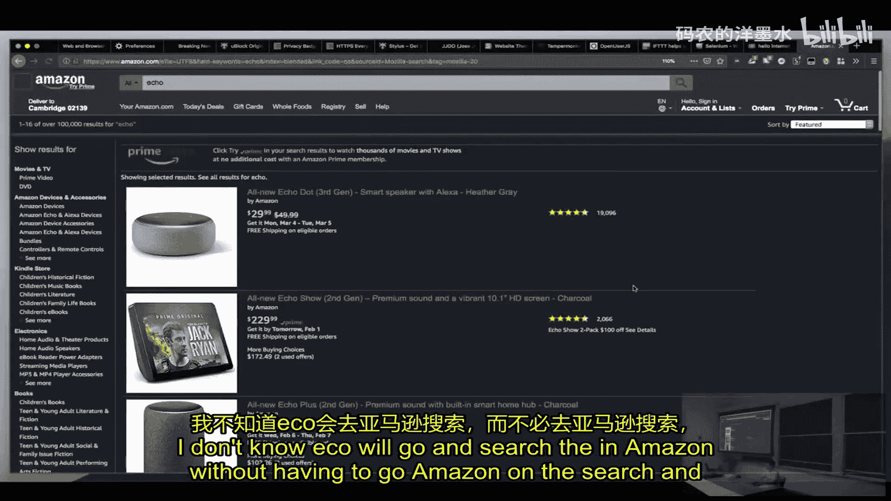

The go Amazon Amazon on the search and that can be really fancy in you're like certain in the kind of。

Similar would be off。anAnother thing that's kind of related to kind of being efficient in the research where one thing that I have used and is really handy。

 the only thing has like a requirement you have to have like a domain like associated shared your own。

 but like since，It's pretty easy to just like type here。

 one thing that I do are like sub domainomain layer。So what is happening here you can see it。

And they've been。That's if like I tap in that and just like my main， my like if you go to www。

 you will be going to my website， however you type that into the web browser is reacting directly to the class。

And it was really hand because specifically how like some MIT class has like this really obscure and long。

URL， you can just compute like all these sub domainomains and it we have it because then I just type like H I like it。

auto completes and it green hand to jump to some specific bucket。Unlike like the regular bookmarks。

 this will work in any device， or even in your own devices。

 like you can tell someone else to just type that and Google work。

The only thing do we need like a domain。You cannot be able to establish that。诶。Any questions？

Next thing I'm going to cover are kind of the privacy like per and all useful extensions to have。

Many， many different extensions that you can install on a web browser thing one like three good default like。

Extension are slow pretty much。All the machines like browser that figure is a an out blocker。

 and my choice is you log in， all people use different ones that I have found this one to work pretty well for where my needs。

 have them know，本パ国。Think out blockers are nice， not because like you're block nuts。

 it's also because a lot of time the out blocker is working by having some blacklist。

like a series of blacklist factor or filters that because call it that they go through to say when like the web browser is requesting page from different sites and it's also really good as a mean of like malware prevention。

Like most of the time， a lot of like smallerware sites have already been included in network sites。

 I think it's a better choice to even if you care like supporting some website with like add revenue。

 it's a better policy to have like。These owned by default and dis in a specific case， which here。

 for example， I don't know why。Something I can go and disable and like this will remember that I want be like the Outlooker disabled in this specific。

And one thing you can more only like install it than like leave it on by default。

 it's really cool that like you can go to the。like the settings and like you can see all the filter place that it has and like I have now like a bunch of them it also like has different filter for different regions。

 you don't want all of them on by default because every time you're making a request or a URL it has to kind of go through month。

But like if you are in a specific place， you maybe， like I say。

 like I want to enable the ones for when I'm in Spain visiting back home because those like the a links there might be different that's also having to use。

 you can also define your own， so for example。In the website that we think this banner。へ？Is an ad。

 you can enable that to disappear， also although I think that's easier to do with a tool and I'm going to be discussing later。

诶。The next thing is not normally only they are like as they're just like showing you like some funding that you may not care about and also if you have some an ander。

 sometimes depending on how the page is，The load time will be reduced because you're not making all these requests。

To the website。The other thing is be of all kind of structures。And the tool of choice。

 I think it's also recommended by electronic contributionification is privacy value。

 like although a lot of companies that are not only using ads。

To try to sell your stuff is also kind of to track where it your kind of be fingerprint through the wet like you they are seeing like all these different places you' point and maybe identifying you with some sort of like tracking or some way and again this extension ya kind prevents that from happening by just not making the request and just going in the middle and if you go to some popular website that' like New York Times。

 you can see that both of them or。Getting a balance of request blog because of these filter。

The last thing， this is not really blogging match its just a good default and like John will be explaining why HPS is better than HP when available and what this extension does。

 which is called HTTP everywhere it just is there is an secure version。

 Ch just redirects you to that one instead of going to。Also pretty useful。え。

if you're into this kind of a， I think there's like a section dedicated in this website that I'm linking and you can get like more giving harsh and harsh like。

The automatically leading cookies and like avoiding DNS tracking and even disabling jascript。

 which can be essentially sometimes， although requires more effort on your side because you really't have to figure out when something are working because you don't have like almost。

of the yellow。But depending it not be how paralleloid you are。

 like how in control of these things you want to be here， like the choices that you can go。え。

I think that pretty much scores that。Any questions。まだ。The next thing is。诶。It's really good。

Really easy to forget that when you're kind of using a web browser。

 like when using an editor using the command line， you kind of feel in control of kind of everything that is going into a point and you can modify。

's all how you're seeing， you kind of how like the last say on how something is presented。

 you can kind of change the course scheme， you can change the phone。

 you're like you can editance of stuff。But when you're in the web browser。

 you' you just be presented with things and you just take it as they are， but again。

browserrowser is just like a piece of software that's running on your computer。 and again。

 you pretty much have the last say of how things will be displayed or how things will be So that' one I'm going to get into now which is kind of。

St customization like。しの上。First， I'm going to briefly the form of like what is going on when you kind of get like a website or when you can kind of get our website。

 you can of there only three things you're going me。HtMl， which is kind of just saying。

Things like where we content。bsAnd you can see here that like these different blocks correspond to like these different blocks。

Gold the public some data。Do you have like a really complex website thats between your times。

It's green sand， but like you know like our website， it's big。Simpple to see what is。

And you can see that here， for example， we have the text。嗯。So this is just detailing of the contents。

Then you can have the styles。In the different account CSS。

Go as is specifying oh this will be this font， this size with this amount of padding this here and finally when you have something there's more interactive。

 you probably have like some sort of like JavaScriptscript thats going to be running block。

Running in this sunboxed environment。You can do a lot of things and a lot time when you're seeing things like a lot。

P or making requests without reallying your base。Happening。

The first thing in is kind of to be aware that。You can change the content of a website like I can go here interview。

えリシさ。啊，好。And well like it does not what the server return to me， but that's what I'm saying here。

 and this is one reason why you should never trust like any sort of screen that you get from like a website because it's not even you't even need photosol like it's extremely easy to tam with the contents of like pretty much any website。

嗯。In the same way we have done that， we can go ahead and say， oh。

 I don't like this thing in this color I wanted。Fund to be read for some reason。

 And you can just go ahead and take that。And the thing is now this is because we not lost the price。

And whereas this is extremely useful when York。Bebugging our website。

 in the sense of just cannot bebugging the。how this new website is displayed and how these styles are compiled。

 this is not as useful if I always wanted the font to be played if I even wanted these to be permanent。

の味。still， we like we can just go ahead and install one extension。A bunch of websites。

 which is called Stylus and Stylus will allow you to define the styles from from websites and like。

I don't have like another ride CSs after all the CSS have been applied。So as an example。

 we can go to the website。

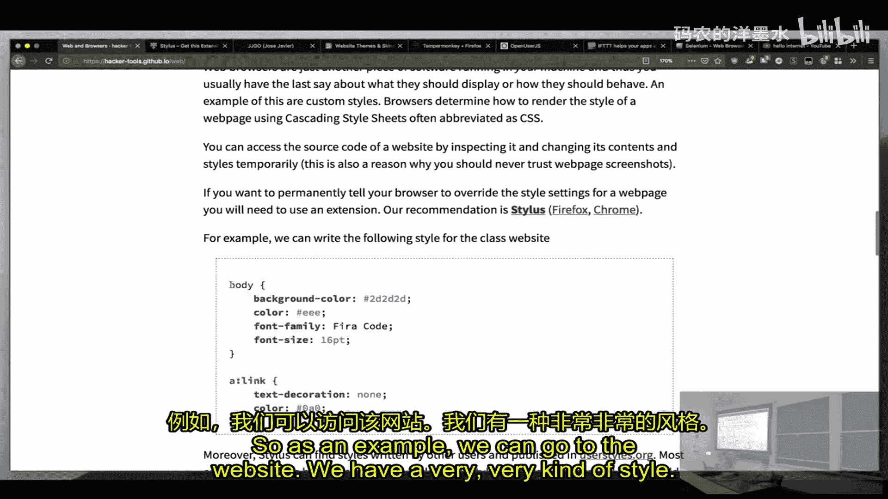

但 we can要死哦。Rightriful the audience。We know and we can say here， we can see。はいなで。

to give is like matching into。To speak the main because we just okay to you want to。

And then we can just start saying no， let's。For these。It's a that this is extremely useful for。

You are in。Thees。えなは。So right now， yes， I have like and now if I reallyload this web page。

 this style is know。Keep being alive and we can just go。全てあ。过来条意啦，等你你到嚟电。帮第王哋。

Larer and like you can just like keep going on。any aspect？Of the唔 how the。

And of the look and feel of the website。We've going to have like a bunch of different stuff and again。

 like now we load the our CSS is running on list at the very end of the CSA has been applied。

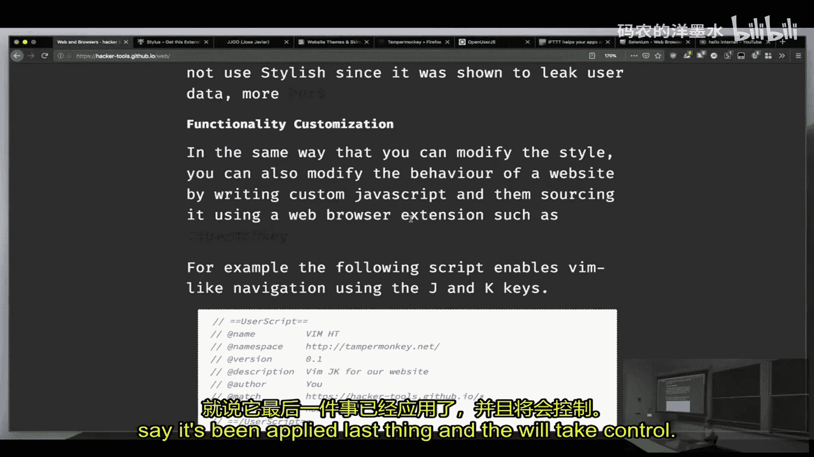

Last thing and you will take control also purely good thing is that there is this kind of a website called user styles drawer。

Where like people have range so have band of different。How they have the piece bunch of。

different styles from your own websites， for example， so that allows you to if you， for example。

 how to start the workload。

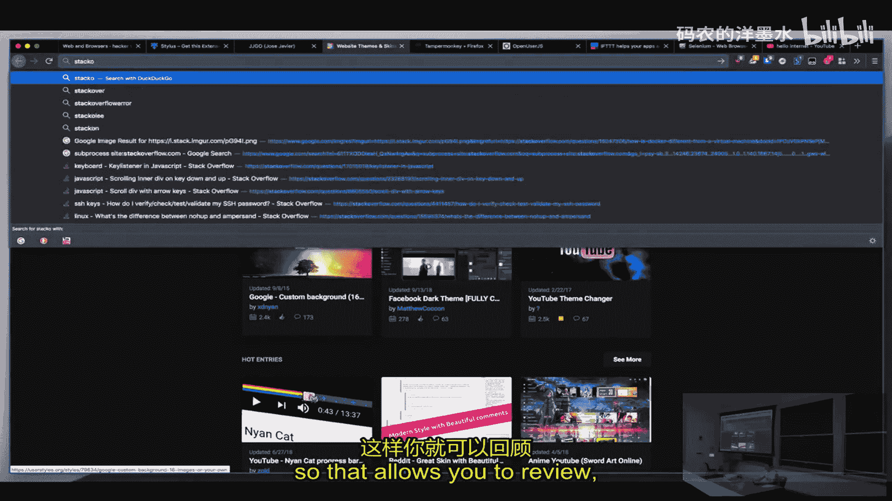

like had like a read and I didn't have to write this assignment I kind of read to say that it wasn't like hiding anything important。

 but like you can like say fine styles。And like evening。S at that website about repository of。

And look for the ones。The robot have like an stream mappingtting to be in the main。

And same way theyre available for a GithHub。

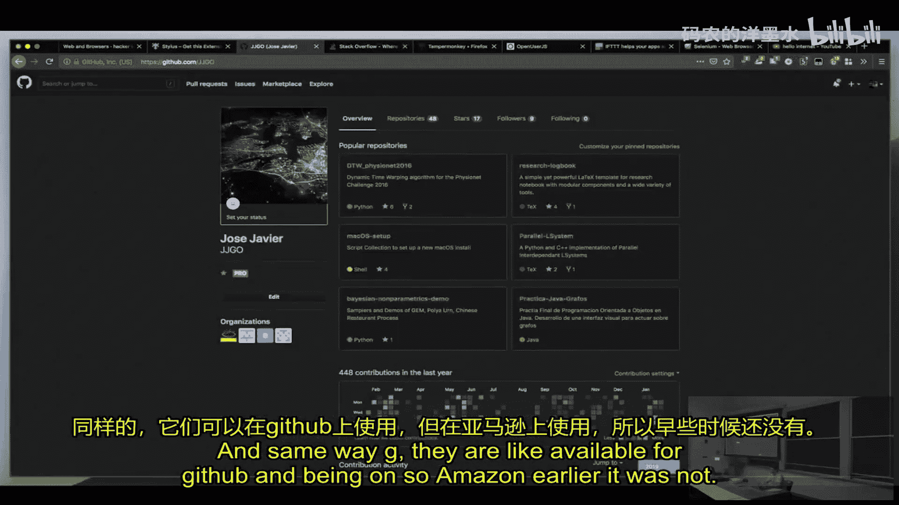

I mean so comments on earlier。He was？

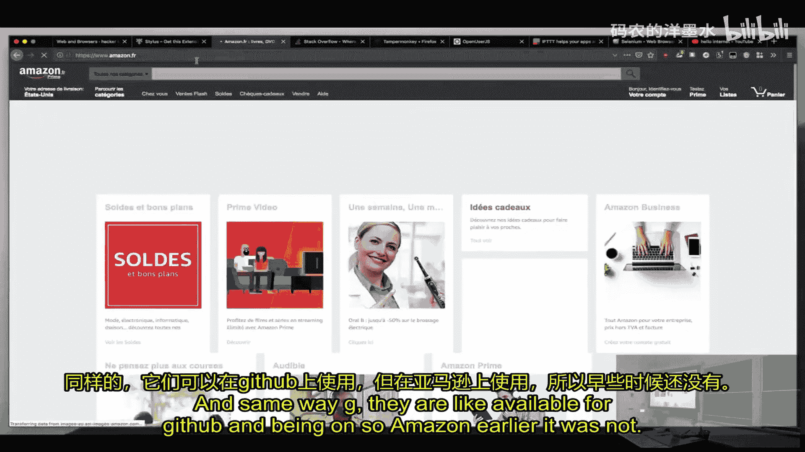

A lot of them， however， can be modified to work。it's also not that how they have green styles for。

For example， the non Pyth documentation or the Python documentation。

 it's fairly easy to kind of really work just kind， you can see vertical styles。

 see what they're doing to for example， get the syntax cataloging working。

I believe we go to Gitthub and we go to some people。嗯。y。

 like for example change also again these centre highlight诶 along with the。

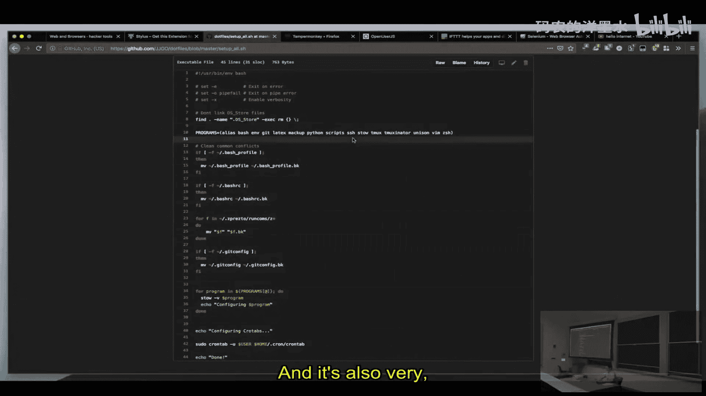

I also think we interesting how CSS is。経気し。So that's for start。

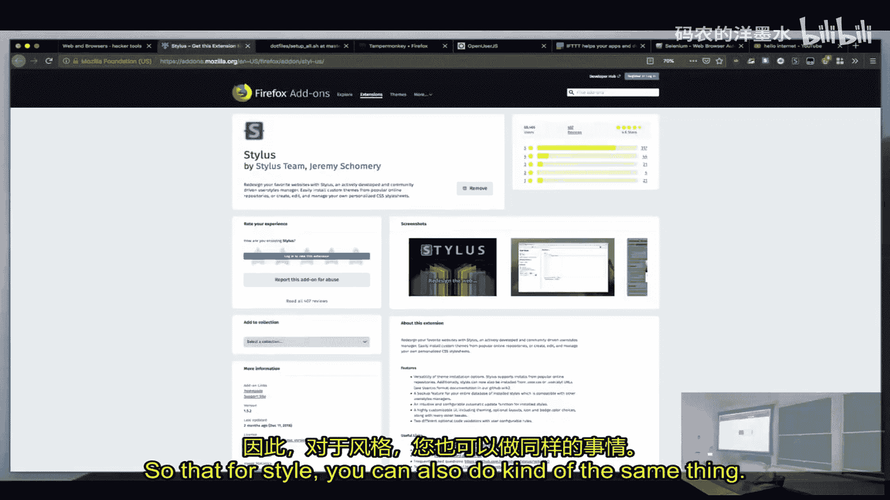

You can also do kind of the same thing。

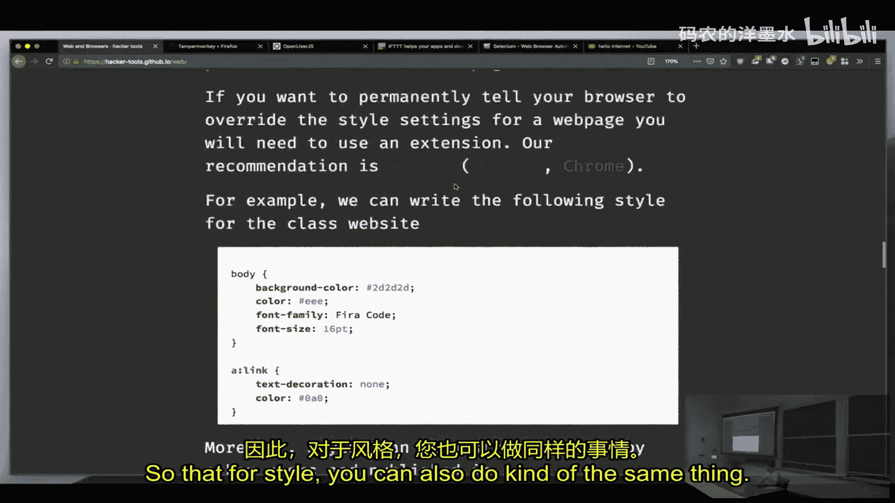

But I mean， you can pretty much do the same thing。For behavior。

 like you can also overload Javavascript although it gets slightly more。Dngerous like in a sense。

 like you can do a lot of things with Javava descriptionure。

 you need to be extremely careful like the same way there's like styles and a style pretty harmless。

你。Gning some run demonstrate that some has written on the Internet。

Exremely that the good be to your paper details。Again。

 like never like import any script that anyone has like reading。Without drinking because。跟必须。

But let's say we want to kind of modify the behavior of the class website so like a beam like behavior。

 like we want to enable like the JK keys to go to scroll up。ろな。

We can just write a simple user script that says， oh。

 like can match the class website and all all the sub pages of the website and run this。

It's fairly simple function there is just making， oh， if the J key is reallyim。

Then it scrolled down by a。pixels and if the k is if the the k is key。诶连人力度。Like。后位。

This open extension， developed several ones， and the one I'm using here is called Ter Monkey and you as well as a great news script。

嗯。We basically this global code that we can understand everything that is going on here。Yes， save。

Previous one the it。And now if I go to the class website。Like， I can use the。To navigate。

Everything I like you can。You can use these。In many， many， many different ways。

 like you can like change how things are displayed if like CSS is not good enough。

 you can kind of write scripts to kind of modify the content of a website or of。

Click like some places on our website， again， be careful for exactly what you're doing。And again。

 like there are like grouposorors of people that we have like。For common thing that they do。

Any questions so far with everything It's pretty cool actually so I know you can do this in Firefox I think you can also do it in Chrome you can also write JavaScript for your browser UI this is basically how modern extensions are written so you write JavaScript that modifies what happens in the UI of the browser itself so for example I've written different key findings for my browser that run programs in the browser such as reorganizing my tabs when I press certain key。

That extension has access to all your tabs and you can like shift them around。

 read their titles in one time。Similarly， in Firefox I don't think this is the case in Chrome。

 you can actually change like the entire browser UI is styled using CSS so you can write custom CSS for your browser UI so I've done this to move my tab bar to be an entirely different place in the UI so these are the kind of things you can do once you start going down this route of like writing and injecting CSS and JavaScriptscript。

今さ。诶。The next thing I'm going to be putting in a bond， which is kind of。

I'm going from out excited the browser to more of like the web。So it it has become like。

Makere easy say， if I want to know my。Like some of information to just go on our website and take that out。

However， if I want to do that as a part of like cell command， like as a part。都。

becomes something tricky like you don't want to be can download it in HTML， you can par it。

 like you can do it and it's like。The solution of something but it has become more and more easy because there's a thing called a Web API so a Web APIP is just like an application interface that using the web and what you do is you make an ACPP request and you get something back so for example。

 let's say I want to get make an example which pretty green things here I just make a request to this website。

And I get this back， this is a dayison object， which is just like a key value store and can you make it larger。

 oh yes。So and what I'm getting is like， oh， like this website is seeing the request and making income is returning to me this low formation。

 that doesn't mean what is my current AP as getting this Wifi。

 like based on what CDM base and even like the kind of organization due to the I frame。

This can be extremely useful， this can be extremely useful。

Pide your reasons one is like say you want to like get the weather from somewhere you can you can even get something that' is fairly cool like you can get。

Let's see this global code here。🤢，You can make a request to Google。It specifies on values。

And if we do that， that we can get the auto completion that Google does based on those files。

 so let's say I want to have a program that the same autocomp that Google will be giving to the users and I can just。

You can do that by just making HTP request to Google to select。On the。す明？系咪。对。

And what I'm getting is awful。This is an object finished by default this is kind of Minified。

 so let's use the tool we saw in the data wrangling lecture and。

Parts it better and even like some said， to remove。try without this。

So if I do that I'm getting kind of the top recommendations that Google will give based on this Steve query and it's also giving this like some HTML indicatingic kind of the emphasis of。

 for example， here how like in universe like the ends out。That like department。You all be。

But we can like just go and also remove that。And we can place that within like any basket like this is just like a like fighting prevental basket。

 but the interesting parts we are liketieving from the way these。Information。You get all paper。

And our thing is like these are not only good as a read only mechanism。

 like right now there are like many， many modern。Web Services offer WebPs also for interactiveing purposes。

坐到。I think pretty much and I will get to the that in like later but like for example。

 say you want to ride like a bar like ghost and send you something through slack。

You could write that by somehow hacking through the entire web browser and kind of clicking。

 but the Slack offers you an API where just by making a simple post request。

 you can just send a message so for example I have。Allor is here。And if I write。This request。

And see that this request contains the slack token， that's because if I saw that there。

 you could be all of this tools like at me here， so I'm just like half that is variable。

 you can think of the kind of the password。The thing that you need to use to authenticdicate and if I type that。

 you can see immediately I'm getting like identification notification and I just got like a message from this laptop again。

 it's just like basic like scroll pulse to request。And if I。Anything here that like。だけど。He's okay。

Is really because with really， really real amount of code， you can like。

Anto functionality with all these web services。And whats even cooler is that since many。

 many of these services already offer like this cool API。

 they are like services like I if this and that， that kind of have already home the piping for you and even provide kind of the server side。

 so maybe you don't have a server to be running all these scripts all the time。

 they do that for you and they provide you like bunch of recipes withs see。So they can get you like。

 oh， get me from like me weather underground the weather and send me through a message or every time I take a selfie。

 upload that automatically to Instagram or like every time I change my Facebook profile picture also change my Twitter profile picture。

Or you can even make。You can even make if someones based on your location， first of all。

 you can pull like a the offense around your house and say， oh。

 every time I enter the theoff of my house， automatically send an request to my smart light bulbs and turn them on。

You can get really powerful and like again， the offer you can have some more high level programs。

Of like， yeah， like this value from this API and that axi from that API。But sometimes is。

Extremely easy and extremely convenient because you don't have to go through and figure out the。

In Dビア。There's also severe， which is like no more。Extensive in some of the integrations that they support。

ButI think I give this in that。P good great。And。And that's pretty much for wav PIs。Yeah。

 what does it command JQ does？Oh Ya is thing we call the that wronging its kind of like。Selector。

Jason data，So if you are doing some better rendering with Jason data。Yeah。So what it does。

 it just interpret some like select fields from like。Del pie， instead of。T to have that。

you try to hardle with buzz， you can say oh like the second field and then from that like every other and then select that the ones that have this name and it's pretty convenient also there's like an E connecting for team and hopeful。

They' also that that way and they all get me all the like blocks of HTML that like power。

W is like a bee or again me all the day stuff like this。

So like you couldn't be doing all of this maybe with projects。

 but it's not like you like the language is already kind of established is you probably have like some of these pars and can get really easy to kind of parse them through and like get familiar with them。

I I'm writing， I don't know， like a Python script， who go。アスれてばれてわ。Yeah， sure。诶。K of the last thing。

お腹が？Before the break is I know like web optimism is like sometimes like。Wib be are not good enough。

In that case， in case you want to get information， you can always do the thing or you can。げ the。大会升。

Get the entire thing or like parse it and interact as wherever。

 but if you want to be interacting with the website， that can be extremely tricky。

 especially because a lot of modern websites rely on significant amounts of JavaScriptscript。Per。

asynchronous queries or things like that， in that case。

 if you kind of want to try to simulate being a human。

 either for unit testing purposes or just to kind of automate something that you know。

 like if you find yourself using your browser you just just find your rub like clicking the same thing thing bank or like clicking the same field and typeping thing and then another one。

And you find it' like， oh， they click it。This is a computer， I know how to program a computer。

 why I'm doing something at well this come up like a solution。So thing。

all of web browsers have some interface right now through web drivers and what WebDriver allows you to do is the same way like JavaScriptscript kind of allows you to select things within the web browser and you can just interact and directly to instead of just a single web page to just the entire web browser so you can say。

 oh， I want to go here， find this element， then click。

And then wait some time and then input this thing and then click again。A things， So for example。

 this。Re simple example in just saying， oh， get the fire from the driver。

Get the work archive website。Find the element in that website that has that value。Firstly。え。

So we can kind of see why are we searching that？え。For example， if I wanted to go to this website。

 like by default the。archiverivesor has like an availability API so I can easily see if something has a hidden saved。

 but doesn't really allow me to save thing if I cannot want to save up life and I will have to go here。

 type a website and then enter way and do that a00 times if I have like  a00 website that I want to save for some reason。

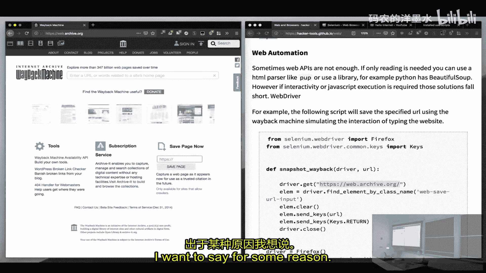

However， you can just Alex， let's see what is the value of the field。Here you can say， oh。

 this thing like the glass， like web， we in。I can just sit for。So youre welcome。

 and then I can clear whatever there is。Like tell the browser to type the values into the browser field and then just like enter return and then close。

So for example， if we run this as a pyth script。え？嗯。What is going to happen is that now。

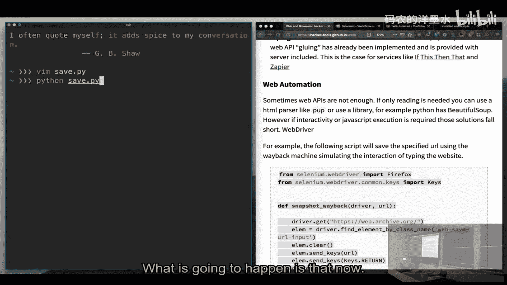

哦。

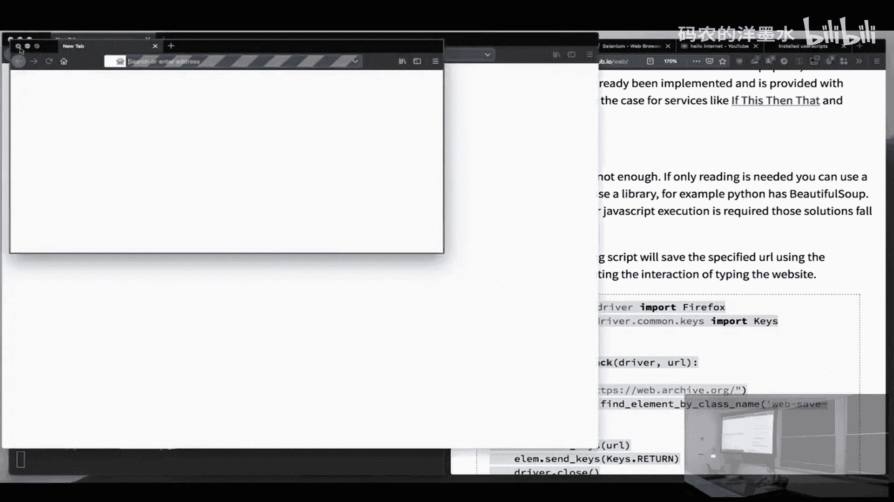

So it green。For a new kind of fiber of instance like this little road here is retrieving this website and many went so far within anCA。

Let's edit that so we can。シーズです。です。Here。不。跟你会。ミタフに見。

I this will be getting the website typing our class website there。

 it was so public kind of the museum is typing all of that。You waiting for 15 seconds series。

我 to do so。And then it will be kind of。Entering our key kind of triggers the webback machine。

 And now the web machine is saving the beds。 and it will wait for like like 20 more seconds。

Where we can see that thing has properly worked and now we want to do this。of websites we can just。

I've brought this entire thing in the whole I like very run， like every we making all this well。

AndAnd you find yourself kind kind to auto this。ピ。web browser automation。

 like think the selenium is like the most developed project right now。

 I think like you you have really important interest。嗯。

They kind of have pretty much all the same API， like 1 certain elements。

 entering some values or like digging through things。Yeah，' three months。Only wanted to prepare for。

I can be web browsers， there any wisdom？

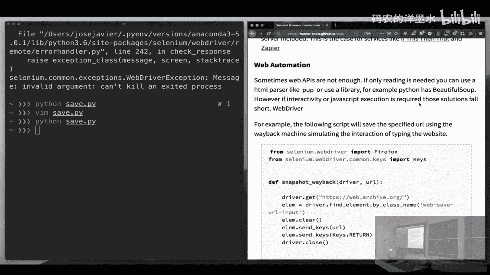

So let's take a like 10 minute break and then we'll do all the security that's going to make you paranoid。

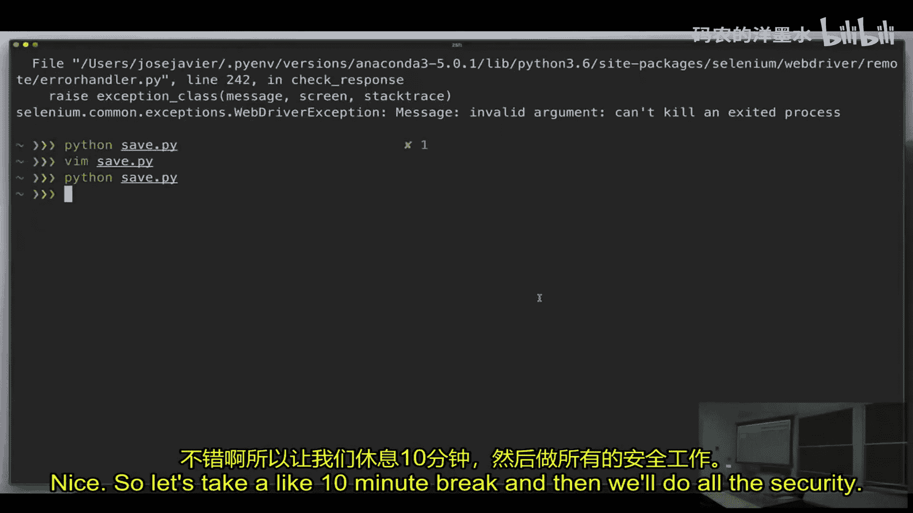

And in the meantime， I can show you some really cool retroro。

