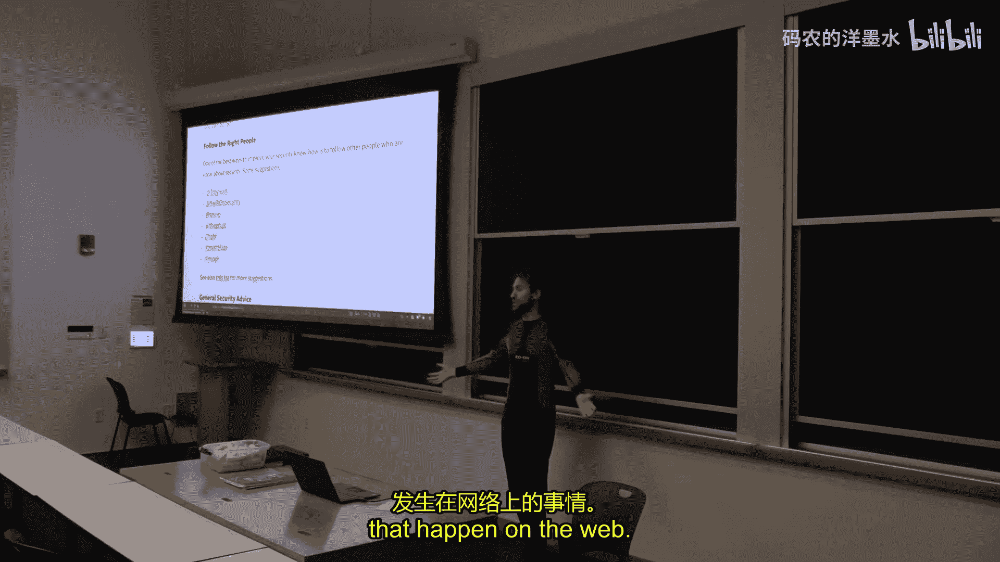

# 【全集】MIT麻省理工 黑客工具 中英字幕 1080P Hacker Tools p16 Lecture 16 - 安全与隐私 -BV1jcPTz6EE2_p16-

should start so this is the very last lecture of the class sadly。

 but we're going to end in a terrible place which is the sorry state of computer security and my goal is to make you all。

 if you' not paranoid but at least aware of your own footprint when it comes to security and privacy the world as the first line says the world is a scary place and everyone is out to get you it's not a paranoia if they're actually coming after you remember that always。

Now it's not actually that bad in general， the first thing you should do when trying to figure out what to do about security and privacy in your life is to figure out what trade off is worth it for you。

 like figure out what your threat model is because that is the only thing that matters in terms of figuring out what is worth doing and what iss not worth。

Generally you're going to be paying for security， whether that's in terms of usability， flexibility。

 the ability to recover when things fail it might even be in terms of like monetary value。

 you will be paying for it one way or another and there's going to come a point where you have to balance these you have to figure out how much am I willing to pay in terms of my own time in terms of usability compared to the security that advises me for example。

 if your threat model is like someone steals your laptop while it's off that's pretty easy to defend against and you don't have to do all that much to protect against it if your model is like the NSA or mo then you have a problem like this is going to be very expensive to be depending against it might not even be possible。

The other thing to be aware of is that security is an ongoing process if you configured your computer to be secure 10 years ago it will no longer be secure today and so you actually need to stay updated on these security topics and thats one the very first things in in the lecture notes is a list of people that it's worthwhile to follow if you are interested in security so these people are various kinds of people interested or working on or researching security these are the printer profiles many of them have websites as well or blogs and those kinds of things following them is something I recommend because they will often just keep you a price of the things that are happening in the security world Troy hunt was listed at the top there also has a website called have I been pawned which is basically a giant database of all the data breaches that are happening in both emails and passwords that lets you basically get an email alert whenever your email appears in any of the breaches that happen。

What。Moxie at the bottom of the list is one of the eventventors of signal。

 which is something more might do。嗯。Those's are a lot of these people I recommend following them highly。

Personal like general security advice。There are a lot of good articles and there are a lot of really bad articles out there on how to do security and how not to do security。

 I've listed to a write up by tech solidarity that's pretty good that's on sort of the do's and don's for journalists online and if it's secure for journalists it will probably work well for you as well because you are probably less of a target than journalism。

There's also some really good travel and security advice there。

 I'll get back to some of it later on in the lecture。But I recommend that you read through these。

 just to put you in the right mindset， what kind of security issues do you have to keep in mind and what is that security？

One thing I will say that comes up in some of these is do not trust USB cables if you ever plug your device like your phone or your laptop or anything into like a USB socket。

 it's a terrible idea， takeovers over US are surprisingly simple， you should buy one of these things。

 this is a USB data blocker， it's just a USB plug on both sides。

 you plug it in you plug your cable in here and now you find because the only pins that it lets through are the power pin。

So nothing else can exploit your advice。They're ahead if to use the superhe。

It's worthwhile to get one if you trouble a lot。The first thing we're going to talk about is authentication。

 so very often whether you're on the web or in person or whatever usually on the web。

 you're going to have to authenticate one way or another。

 and the very first step to like massively improve your security is get a password manager if you don't already have one。

 you should not be making up your own passwords， you should not be remembering your passwords and you should certainly not be writing down to your passwords。

Passwords， so there are lots of password managers out there， some are good， some are bad。

 one password or the Linux standard password manager pass are both really good options。

 one password is a lot easier to use across many devices。

Because it's sort of built to do sync and all of that passes very simple and straightforward and works with and encrypted files。

 but also works these。You should use these applications to generate power。

For all of the sites that you care about， and you should probably change all those passwords today。

If you have not been using once so far， if there's any service you can log into that you care about where you know the password in your head。

 that is a problem。And you should fix that。There's， so the I mentioned in pond。

 there's also a website called the。Has my password been planned。

 which is a similar website to the other one where you can type in your password and it will tell you whether that password has appeared in any of the data breach or like the past。

Chances are that it has， certainly if that website says yes。

 you should definitely change your password。But even if it doesn't use a generatorative password。

 use one that's like 32 characters log or something。

 there is no reason for you to be remembering your password anymore。

The second thing you can do that also massively improves your security is to enable able to type something。

200 authentication is basically the idea that。In addition to logging in with your password。

 you have to provide some other thing， usually the way to think about this is something you know and something you have so your password is something you know and your second factor authentication is something you have like a phone or a USB dongle or something like that。

There are a lot of schemes for this， the most common one you see is S authentication where they will send you an S message with like some kind of text code。

 that works at a pinch， but it's a terrible security mechanism。

It turns out that these kind of mechanisms are really easy to subvert if someone actually wanted to attack you。

 mobile device based things like，Basically Google authenticicator， Duo。

 many of these kinds of things that where you have an app or a little device that gives you a code。

 all of those things are better than S， but they're still not great because they're still vulnerable to what's known as phishing attacks so in phishing attack that's basically many of you may know this already。

There is like a real website that's like your bank and then someone sets up。

Another website that looks just like your bank。But actually it's not your bike。

 it's actually a malicious attacker， and somehow they make you visit this page。

And you think you're on your bank website， you input like your logging credentials and whatnot。

 and behind the scenes the attacker just sends those logging credentials to the real bank and now they're logged in as evil if you add a two factor authentication mechanism that uses some kind of code。

 then the attacker can do the exact same attack right they show you this bank website。

You put in your user password， they send into to the bank the bank says we send you an SMS message right this website tells you。

 I sent you an SMSMS message， you get a code， it's actually from your bank。

 you put that code into this website， the attacker puts it to the bank now they're log。

So these mechanisms do not provide any sort of serious defense against phishing attacks。

 What you really want is something called U2F or Fido。

 This is a relatively new twofactoral authentic standard that basically。

It's sort of the best practices we know of in terms of how to use a true factor authentication scheme correctly。

 it will protect against phishing attacks like this， it's basically a little dongle。敵です。

You stick into your UB port， it has a little button on it。

 you stick it into your US port when the website asks you to log in。

 and at that point the button will start flashing， you press the button and now you're going in。

It turns out this can be done extremely securely and without the website knowing anything about you。

 without knowing anything about being able to correlate these keys， if someone steals the team。

 they would still need your password， hence the two factor。

mAnd basically what it does is that this device in my pocket does a cryptographic handshake with the web server。

And in that process it also checks that the web server knows some secret that it knew the first time I authenticated with it。

 so it is both the server authenticating my device and my device authenticated in the web server。

And so this prevents fishing utilities。Yep also MIT I&T gives away free UB keys so there's no reason to not use one and should you want so happen I have bought one and the reason is because I wanted one that also works with my phone so this supports NFC the like near field communication so I can use it with my phone like this and therefore get25 authentication of my phone as well and they have like 20% doctor students so they're pretty cheap to get。

嗯。Whenever you enable to， yes， sorry go， is there anything to do yet with Windows， Bluetooth。

 so in other words the phone would authenticate your login and Blueooth。

 they've been waiting for that for a long time？I don't know that you can use your phone as a second factor dongle I think in theory your phone could implement U2F。

 but they don't generally part of the reason you want a device like this like you don't want a general comm device is because with this the key can sort of be burned into the firmware of the device so like this is not running an operating system of any like meaningful capacity。

 it's a tiny device but that's very specialized and so it's very hard to get the key out of this if you're trying to stick the key into a regular phone like if the phone got compromised in some way like the operating system of the phone got compromised。

 you may be able to get the key material are you aware of any USV doggles for the laptop that kind of sit flush against the laptop that would give you the NFCC reader capability that phones are giving you in other words could you move the sometimes insert it and it would be nice to be able to just so you don't want it to always be in。

No， I know that I'm saying put a generic NFC reader in a USB plug up a USB port permanently your quasi permanently with an NFC reader and then be able to authenticate using that NFC capability so it might be that you can get an NFC reader for your laptop and that way you never have to plug it in you just hold it underneath I don't know。

So usually when you set up two factor authentication。

 the website will give you some kind of recovery code。

 is usually some like sequence of numbers that usually give you more than one。

 and they said if you forget your second factor authentication。

 here are some paper codes or backup codes。The reason you have these is in case you lose your second factor。

 you should generally have more than one of them and like keep one in a secure place in case you lose the other。

 but should you， for some reason not have access to your second factor。

 like all of them burn down in a house fire or something。

 then you want some weight to recover your account because generally once you turn on to factor your authentication。

 there's like no more recovering your account， there's no other way to get it back except by having the second factor。

If the website allows you to recover your account without that。

 I would consider that a bug of the website。嗯。So these paper codes。

 they're intended to actually be paper codes， they're intended to never be stored on a computer。

 be printed out and like put in a safe seminar because you should generally never have to use them if you have to use them it's an exceptional case。

This is one of those cases where you get to a tradeoff of what your threat model is like。

 so I actually keep my backup codes in my password manager。

 this is a weaker form of defense because it means that if my password story gets compromised they also get my second factor codes and so that is a compromise that I've chosen that I'm willing to make because it means that if I lose my two factor off but I have my laptop I can use that to get a recovery code。

The reason I believe that this is okay is because in general， if someone gets my password。

 it's not because they've like hacked my password manager。

 it's because like the website has been compromised or someone is looking at the link between me and the website like there's some kind of malware in the browser like that's where the leak would happen or like a password database gets compromised or something getses my password。

 it will not be that they've like decoded my password database， it could be。

 but that is an attack that I'm willing to be subject to because of the convenience that gives me。

But this is what I mean by set up a credit model and stick to it because that way you can analyze whether you're willing or not to make these kind of compromises。

For private communication， the answer is basically you signal if you want to have something that gives you secure and private communication。

 signal is a really well developed piece of software， it is also like the protocol has been，Well。

 then it is also what is used by WhatsApp。not for group chats， I think， but for one to one chats。

 wire is fine too you if you've heard about it， in general I would say stick to one of those two there is one called Telegram that is pretty popular Telegram。

Spotty track record， when it comes to cryptography， so I would recommend staying away from that。

Most of these also have a desktop version like you can install like signal for desktop or wired for desktop or whatnot I would recommend that you don't do that。

 the reason is because your laptop is much easier to compromise than a phone。

 generally embedded devices or phones or tablets， things that have constrained from computing environments are a lot more secure than your laptop is。

But once you install one of these desktop passengers。

 they also have access to your key material or indirectly to your messages。

 and so if they get compromised your host and often the way that these services are implemented。

 the desktop applications is through some like embedded browser like E or something like that。

 which also then expands the trust base you have for that software a lot。

So I would recommend staying away from that email is particularly problematic if you're dealing with sensitive content。

 I would say don't use it if you have something that actually needs to be secure and private。

You can encrypt email it is possible to encrypt and email the technology works just fine it's pretty awkward to set up it has some problems like not generally being forward secure so if someone compromises your email later is there a your。

Your key material， like your GPG keys or something later， they can then decrypt emails。

 they have seen you send them the past。And so there are some of these problems。

 key distribution is also really hard like learning someone else's key in the first place if you're using。

Public。Private。Keep bears。Keybase thoughtIO is a pretty good initiative to try to verify online identities and their associations with keys。

 so I recommend you take a look at that if you haven't heard about it before。

 but generally like try to stick the signal or something like wire if you actually want secure communication。

While we're on the topic of laptop sort of being a relatively insecure computing environment。

 I recommend that if you really care about security and privacy。

 you should get something like a Chromebook， which does not give you， in general。

 at least low levell access to the hardware and the operating system。

 the more locked the way you are from the underlying stuff of the device。

 the more the attacker is also wanted。So you want something where it's harder for the attacker to attack the underlying public。

Fio security， so file security is really hard， and this is a well known XKCD about this problem。

You can have the most secure encryption of the world on your file if there's a password that you know and the person in addition to have the encrypted files also has you。

 they can probably get the stuff。😔，All they have to do is hit you over the head until you give them the password and now they have the contents of your files。

It costs them like five dollars， and so this is another place where the threat model is really important。

If all you're trying to defend against is offline attacks like someone steals your laptop and runs away with it while it's off。

 that is pretty easy to defend against， you turn on full discurion。

 there's like cr setup up and locks on Linux， there's a bit locker on Windows and there's fileva on Mac。

 just turn it on now your files are encrypted， there's going to be some like password you need to give when you' boot up or it's tied to your user password。

And this works perfectly fine， but the problem is what if your laptop is on？

If someone actually is out to get you， which is sort of the threat model space we're in and someone like steals your laptop whiles on or you walk away and they walk up to your laptop then now you have a bigger problem or there's malware in your machine because now the disc is now decrypted and they can do whatever they want with the file。

Your disconion does not help you at all。For online attacks you generally want to use file encryption and there are two ways you can do online file encryption。

 one of them is to have an encrypted volume， so an encrypted volume is basically。

The encrypt volume is basically。You create a file under your hard drive。

t of on your regular file system。So I would have something like in my home directory。

I would have a folder called or sorry， a file called like。Secure。That is a file called secure。

 but it's like 10 meabytes large。And this file is actually an encrypted file system。

So I use a tool like there's a bunch of those like Eryptive vests or infeors on the most wellknow for Linux。

 you pointed at this file and say hey， this is an encrypted file。

 thiss an encrypted file system contained within a file and it will mount this file as a directory somewhere that you can then like it's going to ask you for the password that it's going to decrypt this encrypted volume and it's going to let you browse the files and then when you unmount this file again when you like say I no longer want these files then this file is sort of encrypted again or it's encrypted on the fly。

 and now you no longer have access to the file。And so at that point。

 you can sort of unlock a directory， if you will， whenever you need the stuff inside of it and then lock it again when you're done。

 that protects to some extent against online and taxbook of course。

 if the directory is unlocked when someone gets your laptop， you're still kind ofposed。有。

How would you suggest backing that up because if you want to back it up on cloud services。

 presumably it's important data you want to back it up？

The whole file could sometimes change with some cryptographic algorithms could change in ways that general。

When it comes to backing up an encryption。It is very hard to combine incremental backups with encryption because if you're leaking information about the contents of your backup。

 if you're allowing it to be incremental， ideally， like the entire file should change no matter what you change inside of it。

So I would say that if you were using something like this and wanted to do the backup of it。

 you would just be back here the entire file H there is a software called duplicate tries to solve that problem so we'll get to encrypted backup the other approach you have so instead of using the sort of encrypted volume is you can have individually encrypted files So for example。

 the standard Linux file the standard Linux password manager the one called pass basically creates in your home directory it creates a directory called dot password store。

And this is a Git repository and inside of here you have files for like。Facebook。For example。

And it what we call something like dog GPG。This is an encrypted file that contains my password to Facebookbook。

So it like generates some long password encrypt that's usually with some randomly generated key or with my public key in such a way that only I can read this file back later。

And so now this file will basically only be decrypted when I need its columns。

 apart from that it will always stay encrypted。Now the question of course is do I have to type my password to unlock it every time now I probably have like some session manager that remembers my password for a short amount of time and like now you run into the issue of what if someone get like you type the password to decrypt this file and then like move later the attackor snatches the laptop away from you。

 can they now like read？The value of this password or the password for decrypting all of these filess。

 if they all share the same sort of master password。

Can they extract that from the memory of the machine？

so now the question is how what's your time up for remembering these classrooms too， but in general。

 storing files that are encrypted is just a matter if you encrypt them usually using a program like GPG。

GPG has two different modes so you can operate in sort of private public key pair encryption mode。

 so asynchronous encryption， asynchronous， as symmetrical encryption。

 or you can run it with dash C to encrypt the file just with a regular pass phrase so then we'll use symmetric encryption and that way there are no other files involved。

 it's just the one file that you choose to encrypt or decry and then you will have to get the password every time to encrypt your dec。

嗯。One of the reasons that people often do encryption is because they want they sort of don't want other people to see their files。

 but sometimes you want to go even further than that， you want like if you're doing。

 you're like crossing the US border with your device and you don't want them to know that there even is anything encrypted on it because if there is。

 they might take you aside and be like，What is this stuff。

 like give us the password phrase and like unb it so we can see they're not carrying my government secrets or something。

 right in that case。Once they see the Uhasa they encrypted。

 they sort of have the grounds potentially to basically tell you to give them the password and have you un unlock it。

 you might refuse and there are also sort of legal questions around that。

 but they at least know that they should be asking you for a password。

So some software tries to give you what's known as plausible deniability。

 so the idea of plausible deniability is that if someone looks at like the bits on your heart drive or they like look through your file system。

 they won't see anything weird。Anything weird that they see can easily be explained by other things。

And so they have no reason to suspect that anything is off。

Possible deniability is really hard to provide。If I have a hard drive that's like a terabyte large and I have a partition that's 500 gigabytes and then there no partition for the rest of the drive。

 it could be that I legitimately don't have anything there。

 but it seems might be suspicious and so possibleusible deniability gets into weird legal territory as well。

 but in general there are tools to try to provide this usually through some kind of stganography。

 so they try to hide things inside of other files so you can't tell that they're there。

 but then now you have like a Jpeg that looks like a cat but it's like 10 gigabytes large that's not right either。

There are also usually other costs like lower performance。

 it's easier to lose data because smaller corruptions can basically damage the entire file system。

 there are tools to try to give this such as very encryptpt or which is a successor to true crypt it tries to give you basically an encrypted partition on your machine that also provides plausible deniability。

 how well it works I'll let you decide on your own this a discussion that's linked there from Stacoflow that has some pretty good reasons for why plausible divniability even with this kind of software is pretty。

Probably still relevant to some Lafia guy who maybe threatens to hitro in the head of if you don't get the passal。

 but there was a Supreme Court ruling recently that said law enforcement cannot force you to。

So I read that as well， so the comment for just for audio。

 the comment was that there was recently a Supreme Court decision that the basically US border control law enforcement in general。

 I think cannot require you to give over your password because it's basically like。

Like the right to not self incriminate， I think was what it was based on。

 and this applies also to like if you have a phone， they can't ask you to unlock it for them。

I would say that if you can provide， if you can ensure your security。

In a way that's not tied to whether they're allowed to do it or not， that is better。😡。

So it definitely comes down to your threat model again， right， if I have a system that is secure。

 even if they make me do something。And that is better than a one that relies on the fact that they cant tell me to do something。

But again， it Coastal you， whether you think your hypothetical attacker will coerce you or not。诶。

The other thing is if you want to do encrypted backups。

 so your backups basically contained a lot of sensitive material。

 there are tools that let you do this like duplicity。

 you might try to grow something yourself with like tarR and R Sync and GPG don't do it if you want encrypted backups there's a website and a tool called TSNap has。

Been there for a long time and they've really done the work to make sure that it gives good encrypted backups with support for incremental to the point where it's okay cryedographically to do so it is a great service。

 I recommend you use that and don't try to make up your own thing。

Are they using our sink or the back end， no？I don't actually know what Rot does under the hood。

They have a description of their protocol online， but in general。

 they pretty much try to chunk up your backup and then do deduupplication of the encrypted blobs。

 so as long as you try to cut your backup in the same place each time。

 those blobs will be uploaded but then the deduplicate is you don't pay for the story。

So the optimal for what I understand the state of the art right there is Duplicacy。

 I mean he actually compares his algorithms to all the competition out there。

And presumably he so Anrohiino has pronounced duplicacy to becauseicas。which was the first attempt。

 then so there are a bunch of for using a word that's too close to the in general。That。

I used that tool in the past as well， and it seems nice， I would recommend that you use Smart snap。

Okay， the reason for this is because。It means that you are not rolling anything yourself。

 you're not relying on your own configuration anywhere， like because， for example。

 there are a bunch of configuration parameters you can set for， for example。

 how to encrypt the files， you should not be making those decisions。And I think of Dlicosy does。

 it does work with the standard cloud providers with TSnap， you've got to essentially use their yep。

 storage if you rely on these。就嗯。It is true that it is a little it's attractive to be able to use whatever club provider you want。

 within Ki tobeca， it should not matter。Because your backup is encrypted。Soょとなる。

In case a provider of order to go down， if you're doing it to two different cloud providers and so get。

 so Ttop already does distribute it back on their backend。

Maybe to pitching the alternative that I use， the things。I don't remember the exact heat of all。

 but feel like the state of the app for now， if you want to ro your own solution it's called Bar with threemat does does what all like Dap is doing in the lighting pretty doesn't do this DVD you have I need something Windows only Windows and due Ca actually is kind of in the same class as for。

ButI know what you're talking about， for work does deduplication， it's actually able to work across。

What they call law boundaries，Yeah。I guess what I would say is。

You can choose whatever provider you want， whatever software you use。

 just the less configuration you have to do the better because configuration of cryptography and any kind of scheme that involves cryptography。

 you can very easily shoot yourself in the foot without realizing it。Also。

 one thing that I think is important when it comes to security and backups sort of separately through the old encryption issue is that you really want to think about how your backups are stored。

 because， for example， if your backup is set up in such a way that if someone gets access to your laptop or your desktop or whatever machine you're using to backup。

 and from there they can delete all your backups， that is a major problem。

For most software that you install today for backups。

 this is trivially true if they get your machine， then they can either log into the service or use the UI to delete all the old backups。

 or if you have something where like the last enter backed up。

 they just like empty whatever folders being backed up and then run 100 backups of that folder and now the other things have just been run off stuff。

So you really want to think through what is your mechanism for dealing with a malicious person getting access to the source of your backup？

And that is also something that Tznap has a story for and generally the way that you do this if you were to roll your own is。

You give your machines append only support， so they have cryptographic keys that can only append to the data sort。

 they cannot remove any。So if someone gets hold of my laptop。

 all they have is the ability to create more batteriess， they can autoate old ones。

And then there's a separate key that you can like print out and put on paper that lets you delete backups should you need。

You could also like give a particular machine delete only access and have that machine like only be on every now and again to delete all backups or something like that。

 but you really want to think through what's steam you're using to ensure that someone can't just wipe your back。

If you choose to also go on the internet， then there's a bunch of other things that are also insecure。

 it turns out the internet is also a really scary place。

 there's a bunch of links in this text that I recommend you go read if you sort of look through this later that have really interesting description of the kind of attacks that。

You can see on the web is not about this is not web specific but about the internet in general first of all。

 open Wifi networks are really scary， this is for a number of reasons it's not just because you don't trust the underlying network but it's because when you connect to an open Wifi network so one without encryption when you later disconnect from that network and go somewhere else your phone is constantly broadcasting the name of that network looking for it again。

And whenever it finds it， it's going to auto connect to it。This applies to your laptop as well。

 so there are devices out there， this one called the Wifi Papple。Whi you can set up。

 you basically plug it in and it will look for any device that's asking whether a Wi-F network exists and reply。

 yep， that's me and just give itself that name and that the device is going to connect to it and there's no password so it can trivially just pretend to be that network and now you get lots of people just auto connecting to this thing and all of their traffic goes through you。

This is Gary。The other thing is in general， open Wifi networks do no encryption of the wireless traffic and this also means that people can just sniffn whatever is like going over the wireless signals to just trivially s that using a laptop so if you ever want to have some fun。

 go to an airport terminal sniffing mode for your WiF card and just look at all the stuff that you can see a surprising amount of it is planned。

So therefore， for open WiF networks， if you do have to connect to them。

 make sure you delete them from your list of like known WiF networks afterwards。

 so your phone will not try to auto it。Save for your laptop as well。

 like go through save networks and delete anything that doesn't have a password。

IfIf you're ever on a network that you don't trust。

 whether that be an open WiF network or even a network that has a key， but it's like a hotel network。

 an airport network， like a conference network， a Starbucks network， whatever。

 and you don't trust the underlying network then，AVPN may be what you want。

I want to be really hesitant or I want， I am really hesitant about recommending using a VPM because。

You're just shifting who you trust。If you're using a VPN。

 that means you trust the VPN provider more than whatever your Internet service provider。

So if you use a free BBN you found online， that means you're trusting this free company more than Starbucks。

Maybe that's reasonable or the Starbucks employees in that store for that matter。

 so like maybe that's reasonable， maybe it's not。But this is really a trade off you have to decide of who do you trust more。

 certainly if you find like a free VPN provider， it is very。

 very unlikely that they are more trustworthy than like Comcast when it comes to your traffic。

When it comes to handling your traffic and not storing that traffic for later， for example。嗯。

What you can do if you sort of trust yourself is you could set up your own VPN by starting a server somewhere。

 whether it's like an MIT server park on EC2 or some other cloud provider， you could totally do that。

This comes back to the configuration issue of whenever there's anything that's involved in security。

 if you are told that you have to configure things yourself。

 you will probably get it on unless you do a lot of research and understand beyond the line protocol。

VPSo openVPN， which is one of the most common use services for this。It was like a server claim pair。

Has a lot of configuration and I don't know how good the default configuration is。

 but getting it wrong is problematic。And keep in mind， even there。

 you're now trusting whoever's hosting that server more than your ISB。

Which may or may not be what you want to do If you do want to run this。

 I recommend you take a look at wireguard， which is a new sort of VPN。

Implementation that is really good it has almost no configuration and works exclusively with like modern cryptographic primitives and a very easy key setup it just sort of works very easily out of the box on Linux and Mac OS well。

 you need a kernelronological。There's also if you're configuring your own servers or your own clients for most servers and clients you configure there are various settings you can change。

 if you do have to set these settings， there's a website called Cypherless that has recommended secure configurations for a bunch of software。

 basically which。typepes of key exchanges and hashing mechanisms the server and client should use。

 for example they have a configuration for your SSH client to block cphers that are insecure。

 key exchanges that are insecure， that kind of stuff。If you're very privacy oriented。

 then there's a website called Privacy Tools that I O。

 which gives you both the lists of browser extensions that we talked about earlier。

 it gives you configuration settings， programs you might want to install。

 inventions like VPN providers。It mentions ToR， which we'll get back to in a second。

So that's a good resource if you just want to see what kind of tools are out there。

And so I mentioned tourr， tour is a little weird because tour。Caads to a very particular use case。

 a particular threat model， it turns out the tour is not particularly resistant to powerful global attackers。

 like if the government is out to get you To is unlikely to really save you all that much it's pretty weak against things like traffic analysis attacks it's mostly useful for hiding traffic on the small scale and hiding who you are from the server。

Or hiding the server from you commercially， this is what onion services are。

 but in general it's useful for hiding your identity from the server， but that is just about it。

 it is not hiding your identity from anyone else。The other thing that's worthwhile to know is that even when trying to hide from the server all tour really does that obscures your IP address right。

 but one of the problems is that there's a lot of。There's a lot of sensitive material that your browser sends on every request that might make it easier to figure out who you are。

If there's a server over here。And then your machine over here。

What Tor does is basically route your traffic through a bunch of intermediate notes before it gets to the server。

 and so what the server sees as the source IP is just whatever this machine is。

 it does not see your opinions。But included in the request that you sent along here。

 if this is a request for a website， for example。😔。

It might include things like which fonts are installed on your machine well this might be something the server can put up on their website right they run some JavaScript here that your browser is going execute and they can send requests back and that might like query for what fonts you have installed。

 might query for the size of your browser window， it might query for your operating system version。

 your exact browser version， what cookies are installed locally for that website。The like。

The size of your caches， they might profile your browser to see fast into certain tasks and take it together all of these things basically almost uniquely identify who you are like your browser will have a fingerprint that's almost unique and so if you then later on connect your tour to the same website through a different path。

Then they might still recognize that you're the same person who logged in over from over there because your browsers of fingerprints is the same。

嗯。The tourOR project does distribute this thing called the ToOR browser。

 that tries to sort of mask as many of these signals as it can， but it is not perfect。

 and so this is why tourR，It's only useful guarding it against very particular types of setups。

Sot of almost like accidental sniffing from the server， but that is just about it。

 so it is not sort of a magic ball that solves all your issues。嗯。

So you want to actually access the internet and access websites。

 and then that makes things a lot worse than what we just talked about。

 so what we talked about so far was general internet traffic。

The web is a pain because everything also goes through your browser。

 and your browser is basically an operating system that like。

 well randomly exclude whatever program on the other side tends it。

There are a couple of ways that we talked about that Jose also talked about earlier like plugins that could help deal with this the first one is HDPS everywhere what it does is it enables basically goes to the TLS or SSL enabled version of a website first and then only if that is not available does it go to the nonHDPS version this is only a very weak defense it only protectingsing a very specific types of tax but in general though you really want TLS to be enabled on the TLS as the underlying security mechanism being HDPS you want to enable everything and that is not just to encrypt your traffic right so it's not just。

Ignore tour for a second， I have a connection directly to the server。And like in the middle。

 since my ISP or my VPN provider or what Starbucks like whatever。

 if I send information plain text over here， that includes like my usernames， my passwords。

 then if an attacker is sitting here instead sort of observing the middle， then what they can do。

 wow Sha， that's an eye， if the attacker sits in the middle there， they can just observe here。

 you' sit in the password， so that's not okay。So what TLS does first and foremost is it adds。

Encryption on that connection so that anything you send and receive cannot be observed by someone in the middle。

 right？If all they can do is observed， they cannot look inside this channel。

 they can only see the bites on the outside。The problem is encryption on its own is not sufficient because if I'm the attacker and if I'm like。

😔，Someone working at the coffee shop you're at。Then what I can do is I can just like。

 I control the access point you're talking to。So I'll just pretending to be the server and when you connect to me。

 you're actually establishing a secure connection。To me and then I established a secure connection to the server。

But that means that in the middle here， I get to observe everything in plain text。

And so the other mechanism and arguably one of the more。

mechanismschanisms of PLs is that it also has these certificates that the server has to present ass basically sort of you can think of it as a signed document that has like a stamp on it。

つせ。ICould't tell that says like I represent Google the call and it's been stamped by someone that your browser trusts。

So your browser has a list。What are known as certificate authorities。

 is basically a list of companies that。And and their keys where if the server presents one of these forms that's stamped by something that's in your list。

 then the browser will trust that。Whoever sent that thing is actually Google L help。喂。

The attacker can no longer do this attack because I connected to Google。com。

 so I expect to get back a signed document for Google。com。The attacker， they can produce a document。

They might even be able to stamp in with some stamp they made up。

 the when my browser gets it and checks this against the list。

 it does not match and therefore this connection the browser can tell me this is not Google all all。

And this is where you might see in your brow of this like little red square that that's not secure or this website is malicious or it's like trying to steal all your stuff。

 that is because it detected that something like this happened。It might not be an attacker。

 it might be the Web administrator forgot to get their things stamped or it's like the stamp has expired or something like that。

 but in general that's what it protects against。And this is one of the ways that we can start dealing with fishing。

Of course， the other thing that might happen。And the other thing that modern TLS implementations do is。

Imagine that I'm at some coffee shop and I connected the network and I asked for Google。

com and I asked for like the TLS support。I'm the attacker， I just say couldn't connect。

Couldn't connect to port 443， there's nothing running on the HtTPSS。My browser was going to go well。

 I better try port 80 than regular GDP and your browser goes， oh， that worked。

 and now the attacker course sees everything PlayFs。

 they just downgraded your connection so there's no longer TLS。

So the way to defeat this is included in this site statement。

 the website can also say like they can do what's known as pin。

So if you have a TLS pinning turned on， then if the browser ever gets a signed statement like this that includes a pin from a website。

 it will refuse to connect to that website in the future unless that is over TLS。

And so that way this downgrade attack will not work。

 but it does assume that you have in some point in the past connected to the website with TLS and the first time you connect to it is not。

 then like all bets are off。And it turns that this protocol is all over many， many。

 many years to try to get it to this point and it's still not perfect。

 there are still ways in which you can exploit the system。

 but slowly but surely you can get better if you are really paranoid then you might even walk through this list of what stamps your browser trust and sort of remove any that you don't need by default your machine or your browser comes with about like 200 of these be installed and many of them have slightly shady track records and so one thing you can do is just like empty this list and then start browsing the internet and your browser will say none of these websites are trustworthy and just whitelist the ones you see that you need。

So that's what I do at my laptop， you should only do this if you're truly paranoid。

 or if you just want to figure out how this works， but then you can go through and like I need this one because Google uses that one。

 I need this one because GitHub uses that one， I use this one because like Twitter and Facebook use that one。

But these like 197 others， they aren't responsible for the stamps for any websites I care about。

 and so therefore I'm just not going to trust them。And now this does mean that every now and again。

 if you go to like some random event booking site or like you're trying to buy a movie ticket or something。

 your browser is going to say not secure and you have to go through this process and like checkmark that thing again。

 but it does mean that it severely limits the kind of attacks that can be done against you。

 just in terms of certificates。嗯。The other extension that was mentioned was UBlock originig。

 so UBlock origin in addition to being an ad blocker。

 is actually what's known as a wide spectrum blocker， it lets you block pretty much everything。

 it uses a technology that was originally invented it for websites to say to the user to the browser don't allow anyone to execute JavaScript on my site or only allow scripts from this URL to execute JavaScript。

And what you can do。can it basically has a bunch of modes for how paranoid you want it to be。

 so I recommend that if you just want to be a little bit more secure。

 then just turn it on and everything will be fine and use the default block lists。

There's also a link here to medium mode and hard mode if you go to medium mode if we'll basically block all third party JavaScript this saves you from a bunch of attacks it also happens to also reduce a bunch of。

A bunch of ads that would ads in tracking code that would otherwise be let through。

But once you enable a medium or hard mode， a bunch of websites are going to stop working。

Because they rely on some third party JavaScript or CSS or like frames from some other site。

 and so these modes will require you to do a little bit more engineering yourself， so for example。

 so I have hard mode turned on and here you can see that。In my scripts， on websites。

 I don't think I can make this larger。Oh， I can。You know drum。嗯。I guess actually I can do。有。Great。

So for this URL， it's telling me that inline scripts， I've disabled globally。Third party scripts。

 so scripts that are loaded from domain that is not the same as this one， blocked globally。

 frames from any website that is not this one， blocked globally。

And then it says I loaded something from hacker toolsols like KTo。io。

 which is fine because is the same domain， I loaded something from fonts@googleagdis。

com that happens to be on one of my whitelists。So that's why I allowed that。

 I've blocked something from GoogleTmanr。com， that's some kind of like。Some kind of tracking script。

 and I allow them an image from XKc。com and that's because I haven't disabled third party images。

I can then go through and override and say for this website。

 I want to allow it to load something from Google T Manager。

 I want for this website only I want to allow inline scripts because it happens to need it。

This does mean that you have to do a bunch more stuff yourself。

 like you actually have to like websites will not work。

 flight bookings are the worst because you'll like go through the process and you click next and then nothing happens because you block the script and then you go back and the form is clear。

 you have to do it all again。诶上 absolutely送会。But it does really increase your security， so again。

 this is where that balance comes of， are you willing to incur this cost to increase your security？

And so hard mode is even worse than media mode because it blocks even more things。

The other thing I recommend that you look into is。So in Firefox。

 it's called multi account containers and Chrome is called like。Chrome profiles。

It's basically a way to create multiple copies of your browser that are sort of independent so cookies。

 state caches， everything is just kept separated so for example I have one container that is for all my banking related sites and I have one container that's for my work related sites。

 one that throw social networking for like sensitive stuff like encrypted backups and those are all entirely separated。

 this means that if there's some malicious script that runs on Facebook or something。

 it cannot get my bank login details， cannot get my cookies from my bank because as far as that version of my browser is concerned I'm not logged into my bank。

Or similarly， if I， so most tabs are open in this extra container that has no name and that is just separate from everything else。

So if this site， for example， tried to authenticate me through Google。😡。

It would see that Im not loggged in， but if I open a new tab and I go to Googlecom。

 you'll see that the tab gives me at the bottom here has like a pink tin to it。

And it says personal here， so that tab is associated with the personal profile of the personal account。

 and so within this tab I am logged into Google and I've set them whenever I open Google I want that tab to open in this。

But if。This page， which is not in the personal container， tries to check with our log into Google。

 it will get up。And this lets you very nicely segregate your web experiences so that it's much harder to get the sort of cross contamination or cross database and in Google Chrome you can use Chrome profiles to sort of get the same thing。

 although I think they need to be different browser windows， I don't think they can be per town。

 I'm not sure。Trying like song。 I think like you kind have like the log out or Yeah。

 like easier from memory in Chrome， it's basically you choose which profile you have open。

 So if you switch profiles like。The window will be replaced by a window from that profile with the tabs from that profile。

As opposed to hear， we're like I can have multiple tabs open that are all in different containers。

That said， like Chrome is。Generally a more secure browser than Firefoxes。

 sort of from a historical perspective， that has been true。Don't know which one to recommend。

I've been using fire folkss some been decent something。嗯。

I think that's all I've wanted to cover when it comes to security。😔。

I think the takeaway should be figure out what kind of things you're worried about when it comes to security and then figure out what you have to do to defend against those things。

 what you should definitely do though is install a password manager。

 make sure all your passwords are like random and generated by the password manager and enable to product authenticification。

And with that I think we're done with hacker tools for IV thanks for all of you who sort of showed up and thanks for the people who are not here it's been fun we will probably do this again sometime Anishia is currently compiling or rather。

Compressing and transcoding all the video material。

 so we'll have that up on the website or on YouTube as soon as we can。

 the initial few lectures have already been posted on Piazza so feel free to ask more questions there if you think of something later and sort of watch that space or the YouTube channel for。

The videos from the upcoming lectures or upcoming lectures from the ones that we've already posted。

 which are now in the past。Zah， thanks for coming， hope you learned something。I didn't record。

 but I have the window open。对 it。Although I guess for this， there is talk。

I didn't type anything in my camera。適田さん。Except the， which is unimportant。Also。

 if you're interested in security 6858 is running the semester， you can also take 685。你会。

