# 002：命令行环境核心概念与远程操作


在本节课中，我们将深入学习命令行环境的核心概念，包括程序输入输出的多种方式、环境变量、信号处理，以及如何高效地在远程服务器上工作。我们还将探讨如何定制你的Shell环境，使其更符合你的使用习惯。

上一讲我们介绍了Shell的基本用法和一些常用程序。本节中，我们来看看Shell环境中更深层的概念和约定。

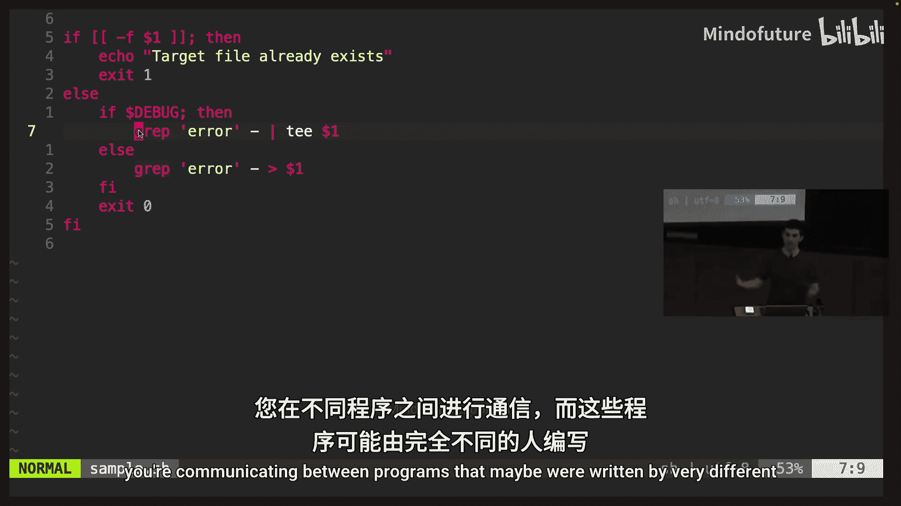

## 程序输入与输出

在编程中，程序的输入和输出通常很明确。但在Shell脚本中，输入和输出的来源可能变得复杂。Shell程序遵循一些约定，以便不同程序之间能够通信。

### 参数与标志

最简单的输入形式是参数。当我们运行 `ls -l project1` 时，`-l` 和 `project1` 就是传递给 `ls` 的参数。

**代码示例：**
```bash
ls -l project1
```

在Python中，可以通过 `sys.argv` 获取这些参数：
```python
import sys
print(sys.argv)
```

参数中的 `-` 或 `--` 前缀表示“标志”，用于改变程序的默认行为。例如，`-a` 标志让 `ls` 显示隐藏文件（以 `.` 开头的文件）。

**代码示例：**
```bash
touch .a_file
ls          # .a_file 不会显示
ls -a       # .a_file 会显示
```

单字符标志通常可以组合使用，顺序无关紧要：
```bash
ls -la project1
```

许多程序接受任意数量的参数，并对每个参数执行相同操作：
```bash
mkdir project3 project4
```

### 通配符

通配符（Globbing）是一种简单的模式匹配语言。当使用 `*.py` 时，Shell会将其扩展为匹配该模式的所有文件。

**代码示例：**
```bash
touch {foo,bar,baz}.{py,sh}
ls *.py *.sh
```

一些Shell支持更复杂的通配模式，例如 `**` 可以匹配嵌套目录：
```bash
ls **/*.py
```

### 标准流与管道

程序通过标准输入（stdin）、标准输出（stdout）和标准错误（stderr）进行通信。管道 `|` 可以将一个程序的输出连接到另一个程序的输入。

**代码示例：**
```bash
# 生成数字并过滤奇数
python -c "import time; [print(i) for i in range(10)]" | grep "[13579]"
```

管道中的程序是并行运行的，数据流实时传递。标准错误流用于输出错误信息，与标准输出分开。

**代码示例：**
```bash
ls non_existent_dir          # 错误信息输出到 stderr
ls non_existent_dir 2> error.txt  # 将 stderr 重定向到文件
ls . > output.txt 2>&1       # 将 stdout 和 stderr 都重定向到文件
ls . &> all_output.txt       # 另一种合并重定向的语法
```

`/dev/null` 是一个特殊文件，写入它的任何内容都会被丢弃：
```bash
ls . > /dev/null  # 丢弃输出
```

## 环境变量

环境变量是存储在Shell会话中的键值对，可以影响程序的行为。

**代码示例：**
```bash
FOO=bar        # 定义变量
echo $FOO      # 使用变量
```

变量赋值时不能有空格。你可以将命令的输出捕获到变量中：
```bash
files=$(ls)
echo "$files"
```

默认情况下，变量只在当前Shell会话中有效。使用 `export` 命令可以使变量被其子进程继承。

**代码示例：**
```bash
DEBUG=1
bash -c 'echo $DEBUG'        # 输出为空
export DEBUG=1
bash -c 'echo $DEBUG'        # 输出 1
```

一些环境变量是约定俗成的，例如 `HOME` 表示用户主目录，`TZ` 可以设置时区：
```bash
TZ=Asia/Tokyo date
```

## 退出码与信号

程序执行后会返回一个退出码（Return Code），用于表示执行状态。按照惯例，`0` 表示成功，非零值表示错误。


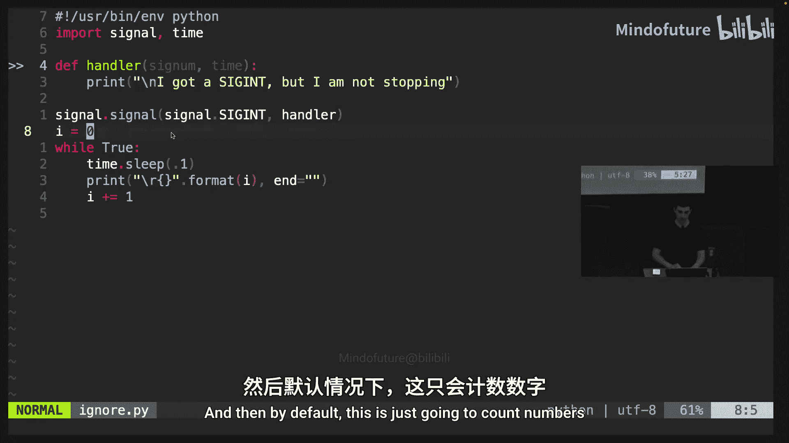

**代码示例：**
```bash
ls .
echo $?  # 输出 0
ls non_existent_dir
echo $?  # 输出非零值（例如 2）
```

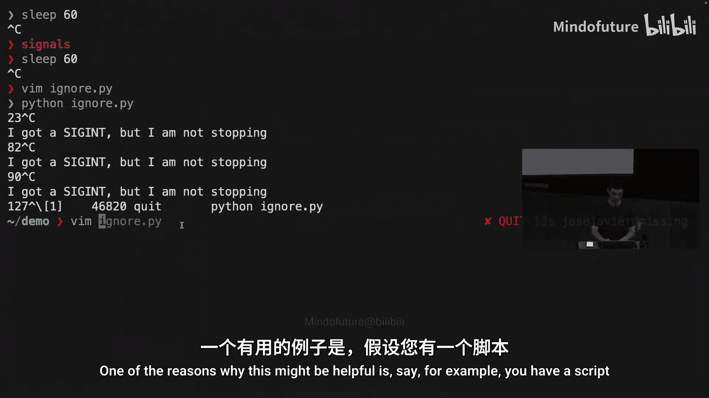

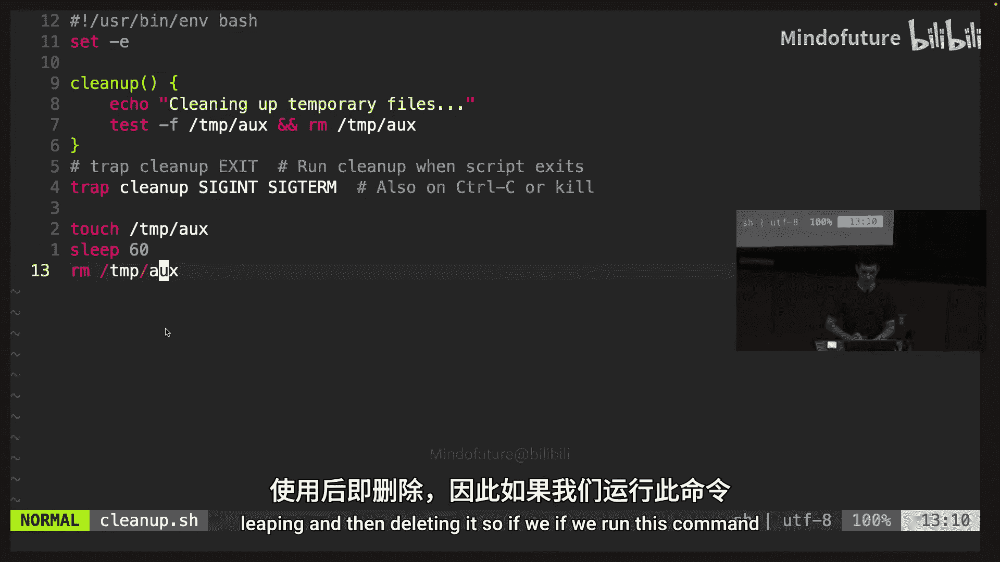

Shell的控制流结构（如 `&&` 和 `||`）会检查退出码：
```bash
# 仅当前一个命令成功时，才运行下一个命令
ls . && echo "Success"
# 仅当第一个命令失败时，才运行第二个命令
ls non_existent_dir || echo "Failed"
```

`grep -q` 命令在找到匹配时返回0，未找到时返回非零值，常用于条件判断。

信号（Signals）是发送给进程的软件中断。例如，按下 `Ctrl+C` 会发送 `SIGINT` 信号，通常导致程序终止。

**代码示例：**
```python
# Python 程序处理 SIGINT 信号
import signal, time

def handler(signum, frame):
    print("Ignoring signal!")

signal.signal(signal.SIGINT, handler)
while True:
    print("Running...")
    time.sleep(1)
```

`Ctrl+Z` 会发送 `SIGTSTP` 信号，挂起进程。可以使用 `fg` 命令恢复进程，或使用 `kill` 命令发送其他信号。

**代码示例：**
```bash
# 启动一个睡眠进程
sleep 100
# 按下 Ctrl+Z 挂起它
# 查看作业
jobs
# 恢复进程（在前台运行）
fg
# 或者发送 SIGCONT 信号使其在后台继续
kill -CONT %1
```

## 远程服务器操作

SSH（Secure Shell）是连接和操作远程服务器的标准工具。

**基本语法：**
```bash
ssh user@hostname
```

### SSH密钥认证

为了避免每次连接都输入密码，可以使用SSH密钥对进行认证。永远不要分享你的私钥。

**生成密钥对：**
```bash
ssh-keygen -t ed25519
```

**将公钥复制到远程服务器：**
```bash
ssh-copy-id user@hostname
```

### 远程执行命令与文件传输

SSH不仅可以用于交互式会话，还可以直接执行命令。

**代码示例：**
```bash
# 在远程服务器上执行 ls 命令
ssh user@hostname ls
# 将远程命令的输出通过管道在本地处理
ssh user@hostname ls | wc -l
# 整个管道在远程服务器执行
ssh user@hostname "ls | wc -l"
```

使用 `scp` 命令在本地和远程服务器之间复制文件：
```bash
# 复制本地文件到远程服务器
scp local_file.txt user@hostname:/remote/path/
# 从远程服务器复制文件到本地
scp user@hostname:/remote/path/remote_file.txt .
```

### 终端复用器

当与远程服务器的连接断开时，其中运行的程序通常会终止。终端复用器（如 `tmux`）可以解决这个问题，它允许你在一个会话中运行多个程序，并且会话与连接无关。

**基本 `tmux` 命令：**
- `tmux`： 启动新会话。
- `Ctrl+b c`： 创建新窗口。
- `Ctrl+b 0`： 切换到0号窗口。
- `Ctrl+b d`： 分离当前会话。
- `tmux attach`： 重新连接到之前的会话。

使用 `tmux`，即使SSH连接断开，你的程序也会继续在服务器上运行。

## 定制Shell环境

你可以通过修改配置文件和安装插件来定制你的Shell环境，使其更高效、更美观。

### 修改PATH环境变量

`PATH` 变量定义了Shell查找可执行程序的目录列表。你可以添加自定义目录。

**代码示例：**
```bash
# 临时添加目录到 PATH
export PATH="$PATH:/my/custom/bin"
# 永久生效，需要将上述行添加到 Shell 配置文件中（如 ~/.bashrc）
```

### Shell配置文件

不同的Shell读取不同的配置文件。例如，Bash在交互式登录时会读取 `~/.bash_profile` 或 `~/.profile`，而交互式非登录Shell会读取 `~/.bashrc`。

你可以修改提示符 `PS1` 环境变量：
```bash
PS1="\u@\h \w\$ "  # 设置提示符格式
```

### 插件与框架

有许多插件可以增强Shell的功能，例如：
- **fzf**: 模糊查找命令历史。
- **zsh-autosuggestions**: 根据历史自动建议命令。
- **powerlevel10k**: 高度可定制的提示符主题。

建议一次只安装一个插件，确认有用后再保留，避免Shell启动过慢。

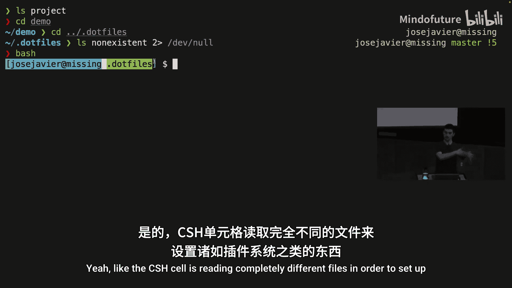

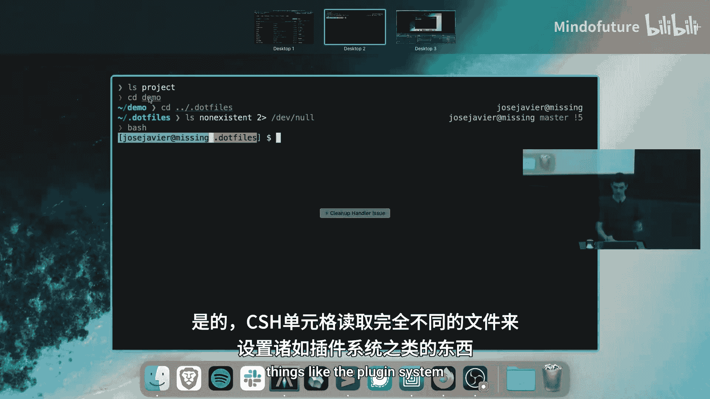

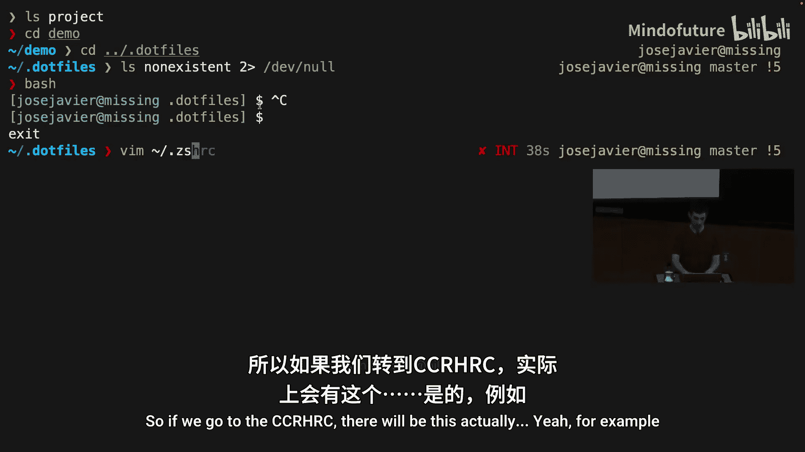

### 点文件管理

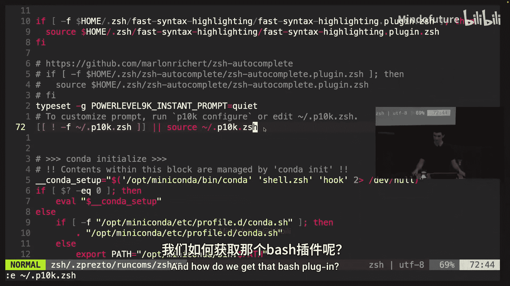


配置文件通常以 `.` 开头（如 `.bashrc`），称为“点文件”。许多人将他们的点文件存储在Git仓库中，并使用符号链接来管理。

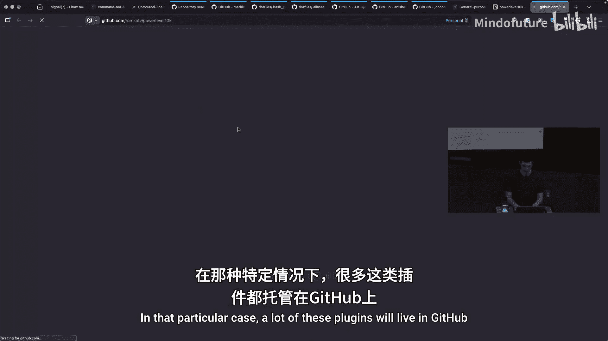

**代码示例：**
```bash
# 创建符号链接
ln -s ~/dotfiles/.bashrc ~/.bashrc
```

### AI工具集成

你可以在命令行中使用AI工具来辅助完成复杂任务。

**使用 `llm` 工具：**
```bash
# 询问如何查找最近一天修改的Python文件
llm "find Python files modified in the last day"
```

**使用 `claude` 工具执行复杂操作：**
```bash
# 让AI生成并执行命令
claude "find the most recently modified shell script and change its shebang to use zsh"
```

### 终端模拟器

终端模拟器（如 Alacritty, iTerm2, GNOME Terminal）是运行Shell的GUI程序。你也可以配置它们的字体、颜色方案等选项。

## 总结

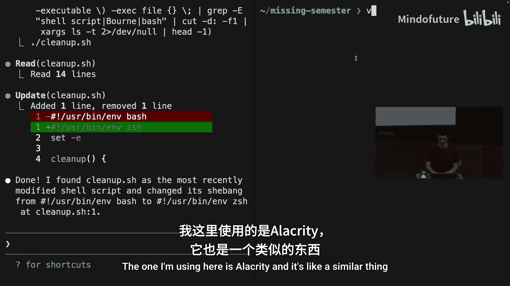

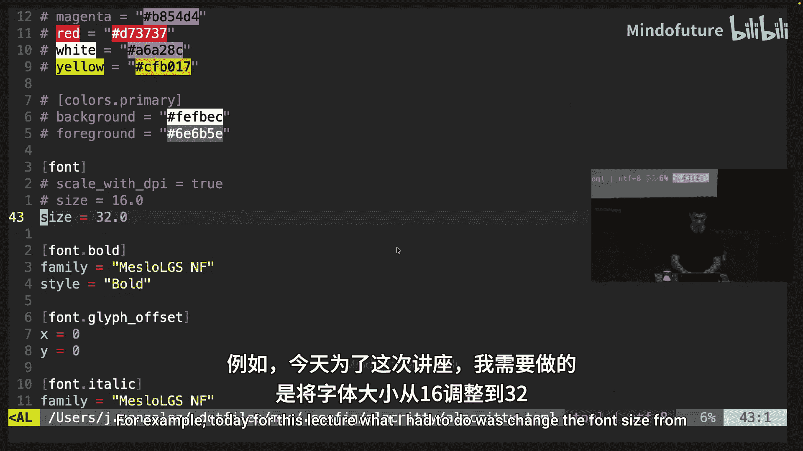

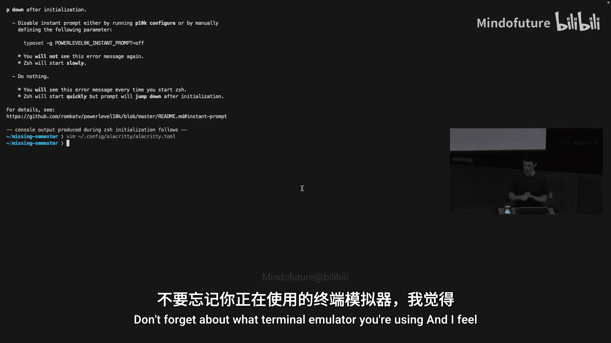

本节课我们一起深入学习了命令行环境的核心机制。我们了解了程序如何通过参数、标志、标准流和环境变量进行输入输出通信，掌握了退出码和信号的控制流程。我们还学习了如何使用SSH安全地连接和操作远程服务器，并利用 `tmux` 来维持会话。最后，我们探讨了如何通过配置文件、插件和AI工具来定制和增强你的Shell环境，使其成为一个更加强大和个性化的工具。掌握这些概念将帮助你更高效、更自信地使用命令行。