# 003：开发环境与工具

在本节课中，我们将要学习开发环境与工具。我们将涵盖文本编辑、代码智能、AI辅助开发等核心主题，帮助你构建高效的工作流。

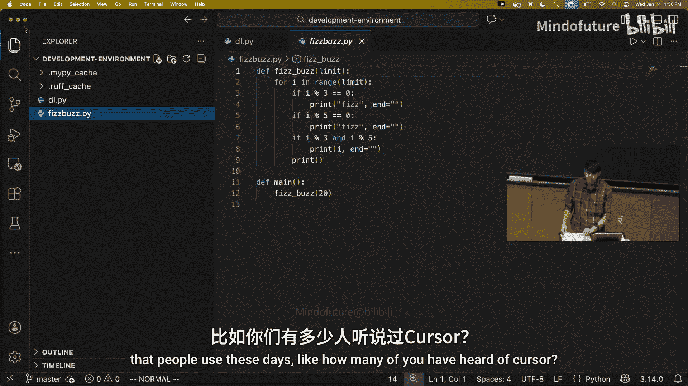

## 开发环境概述

开发环境是一套用于开发软件的工具集合。它有许多不同的形式和配置。

上一节我们介绍了开发环境的概念，本节中我们来看看两种主要的开发环境类型。

**终端基础开发环境**：这种配置通常在终端中运行，例如使用Tmux进行窗格分割，结合Shell和文本编辑器（如Vim）。它适用于远程服务器或需要轻量级、可脚本化环境的场景。

**图形化集成开发环境**：例如Visual Studio Code，它将文本编辑、代码提示、自动格式化等功能集成在一个应用程序中。它通常能更好地集成AI功能，适合初学者或需要一体化工具的场景。

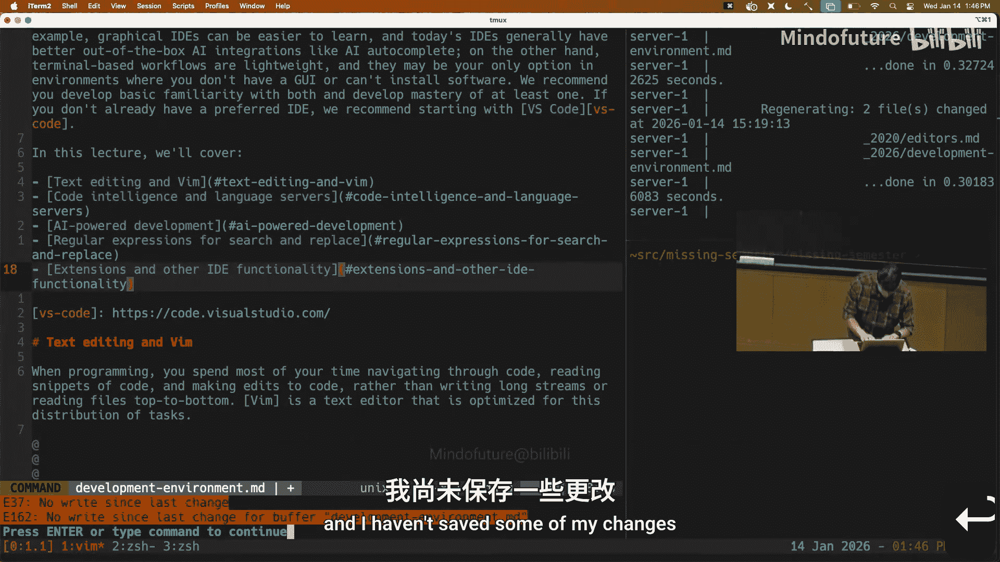

## 文本编辑与Vim

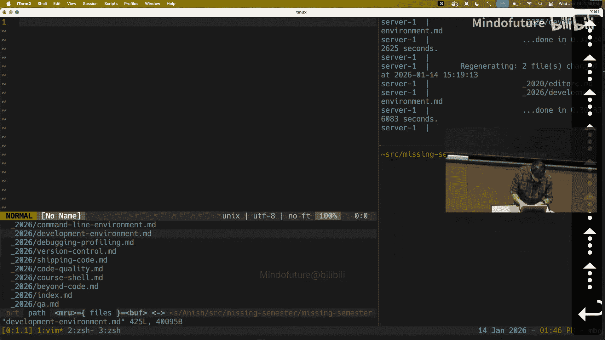

文本编辑是IDE的核心功能。在编写程序时，你需要编辑代码库中的文件。Vim是一个强大的文本编辑器，其交互方式针对代码编辑进行了优化。

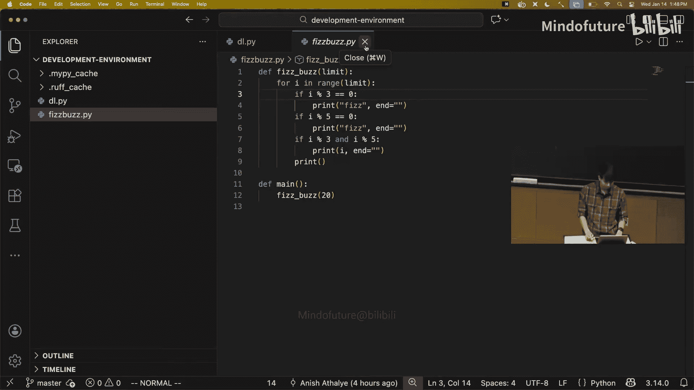

### Vim的核心思想

Vim的核心思想是将其界面视为一种编程语言。它包含一系列基本操作（原语），你可以组合这些原语来完成强大的编辑任务。其目标是让你无需频繁在键盘和鼠标之间切换，从而保持高效。

Vim是一个**模态编辑器**，这意味着它有不同的操作模式来执行不同类型的任务。

以下是Vim的主要模式：
*   **正常模式**：默认模式，用于移动光标和执行命令。
*   **插入模式**：用于插入和添加文本。
*   **替换模式**：用于覆盖现有文本。
*   **可视模式**：用于选择文本块、行或矩形区域。
*   **命令模式**：用于运行保存、退出等命令。

### Vim的基本操作

在正常模式下，你可以使用各种键绑定来移动和编辑文本。这些绑定通常具有助记性，便于记忆。

以下是Vim中一些基本的移动命令：
*   `h`、`j`、`k`、`l`：分别向左、下、上、右移动光标。
*   `w`：向前移动一个单词。
*   `b`：向后移动一个单词。
*   `0`：移动到行首。
*   `$`：移动到行尾。
*   `gg`：移动到文件顶部。
*   `G`：移动到文件底部。
*   `:123`：跳转到第123行。

编辑命令可以与移动命令组合使用，形成强大的编辑操作。

以下是Vim中一些基本的编辑命令：
*   `i`：进入插入模式。
*   `a`：在光标后进入插入模式。
*   `o`：在下方新建一行并进入插入模式。
*   `O`：在上方新建一行并进入插入模式。
*   `d{motion}`：删除移动命令覆盖的文本（例如，`dw`删除一个单词）。
*   `c{motion}`：删除移动命令覆盖的文本并进入插入模式（例如，`ci(` 删除括号内的内容并进入插入模式）。
*   `u`：撤销操作。

你还可以使用计数来重复操作，例如 `5j` 向下移动5行，`3dw` 删除3个单词。

Vim的理念是，通过练习将这些移动和编辑命令组合成肌肉记忆，你可以达到“思考即编辑”的速度。许多其他软件（如VS Code、Zsh）也支持Vim键绑定，因此学习Vim的思维方式具有广泛的适用性。

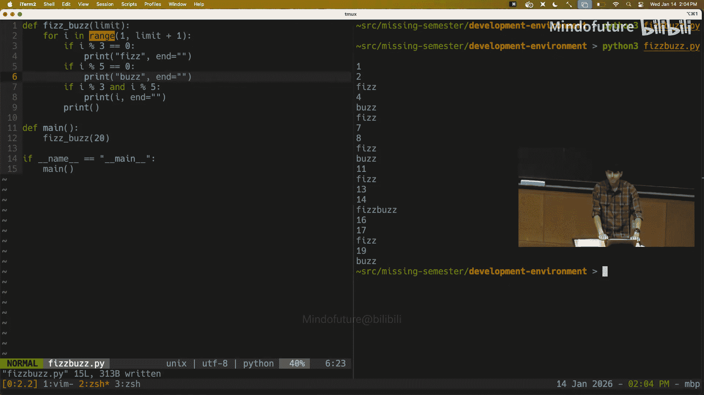

## 代码智能与语言服务器

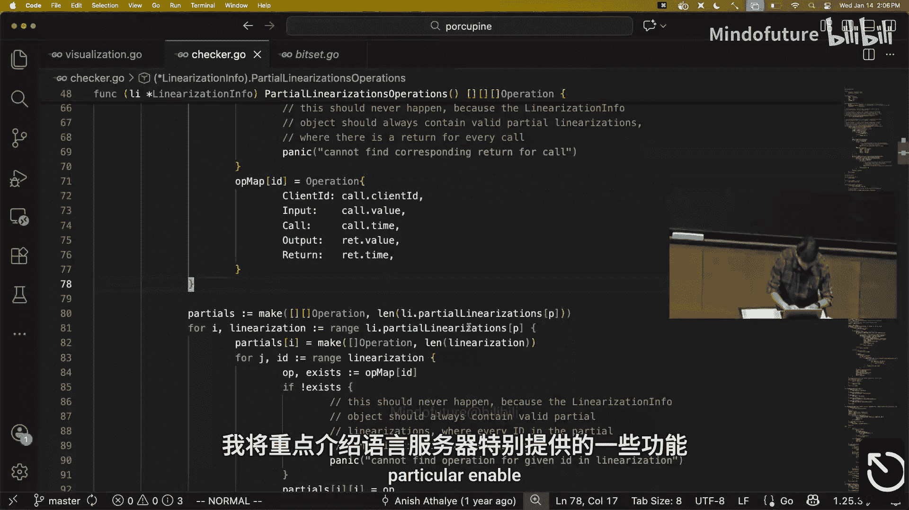

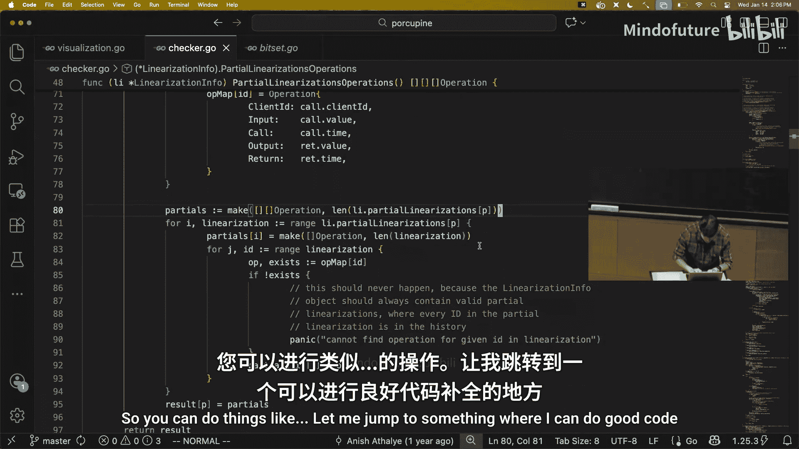

现代IDE提供了许多编程语言特定的支持，如自动格式化、错误检查和代码补全。这些功能通常通过**语言服务器协议**实现。

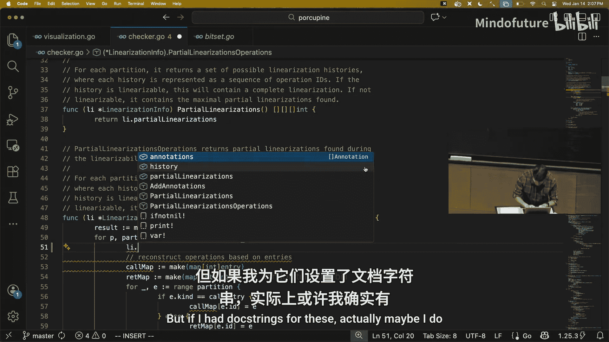

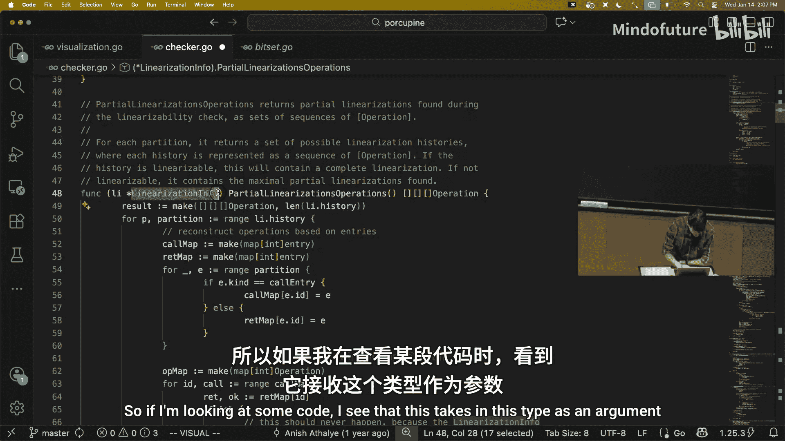

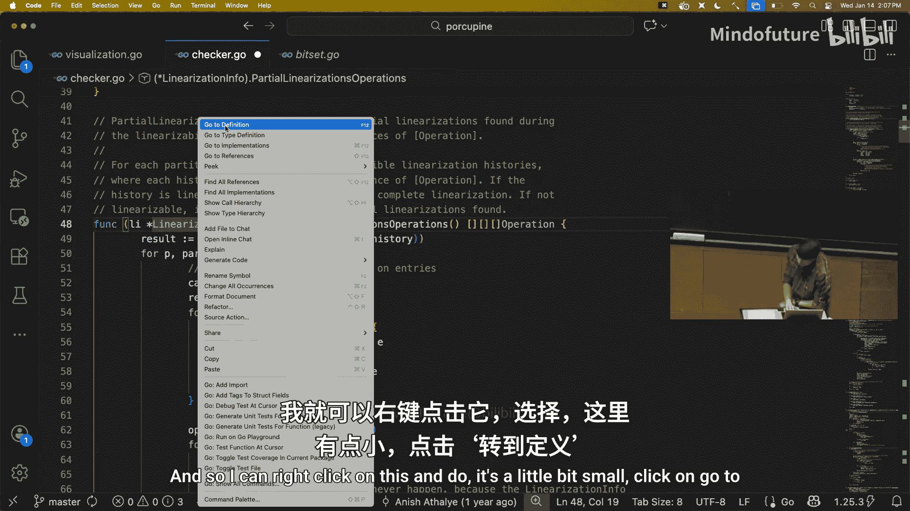

语言服务器是一个独立的进程，它理解特定编程语言的语义。IDE通过LSP与语言服务器通信，从而获得代码智能功能。这种架构将M个IDE支持N种语言的问题，简化为实现M个LSP客户端和N个语言服务器的问题。

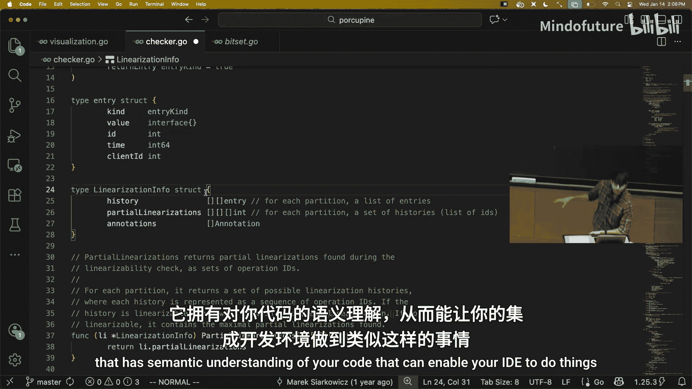

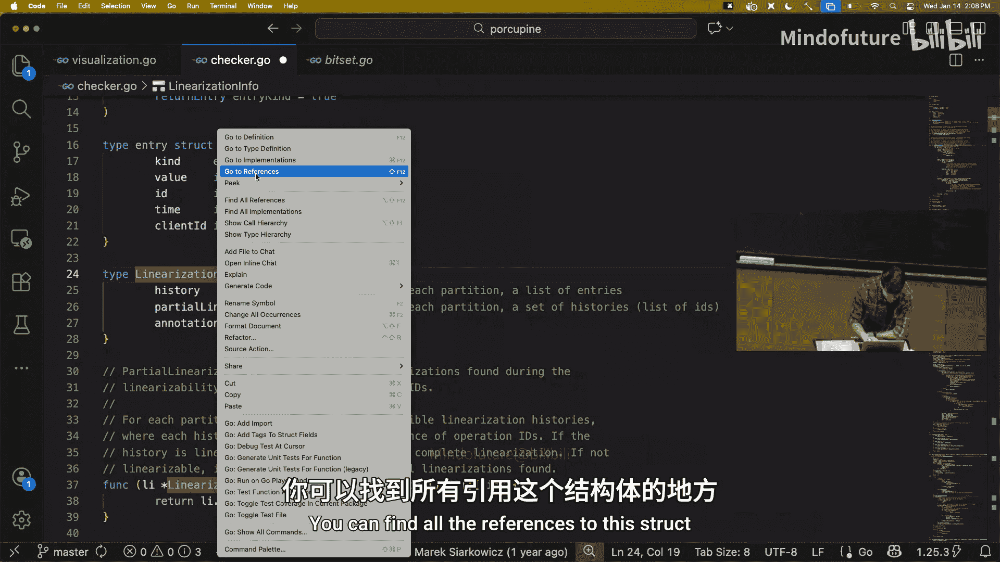

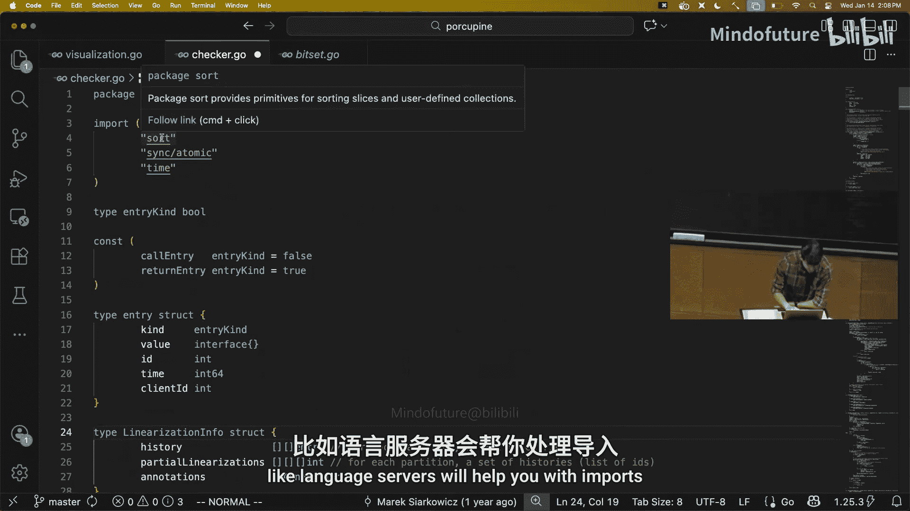

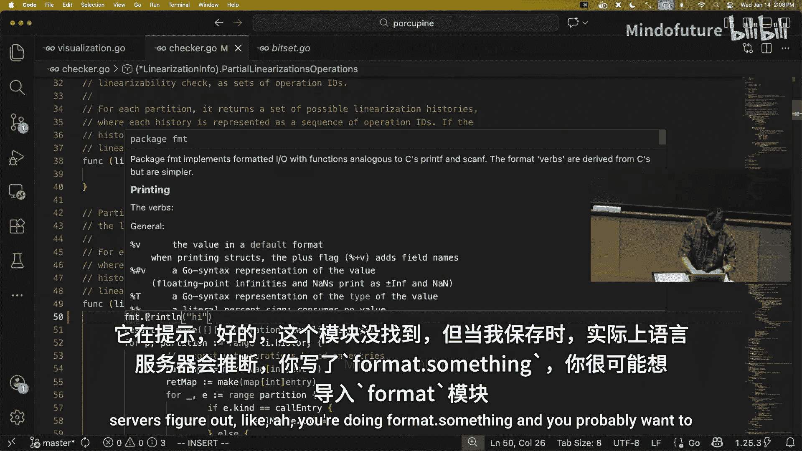

语言服务器支持的功能极大地提升了开发体验。

以下是语言服务器提供的一些关键功能：
*   **代码补全**：输入时自动提示变量、函数或方法名。
*   **跳转到定义**：快速导航到变量、函数或类型的定义处。
*   **查找引用**：查找代码库中所有使用某个符号的地方。
*   **错误检查**：在输入时实时标记语法或类型错误。
*   **自动导入**：自动添加缺失的模块或包导入语句。

为你的编程语言设置好语言服务器，可以显著提高代码理解和导航的效率。

## AI辅助开发

自GitHub Copilot等工具出现以来，大型语言模型在辅助代码编写方面变得越来越强大。目前主要有三种使用AI模型编写代码的交互形式。

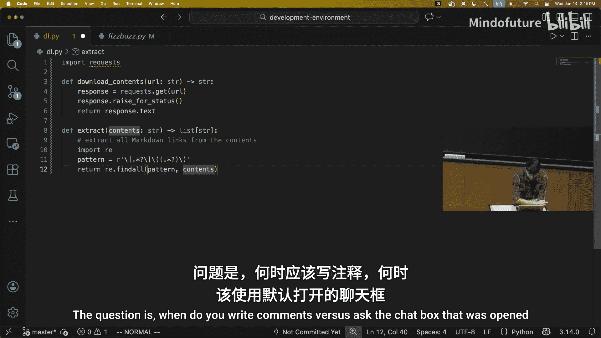

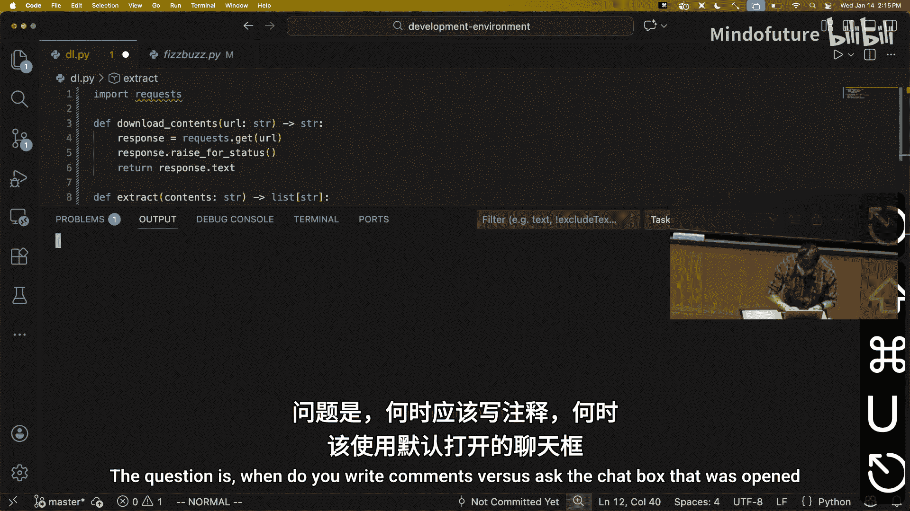

### AI自动补全

这是最基本的交互形式。当你开始输入代码时，AI模型会预测并建议接下来的代码片段。你可以按Tab键接受建议。通过编写描述性的注释或文档字符串，可以更好地引导AI生成符合你意图的代码。

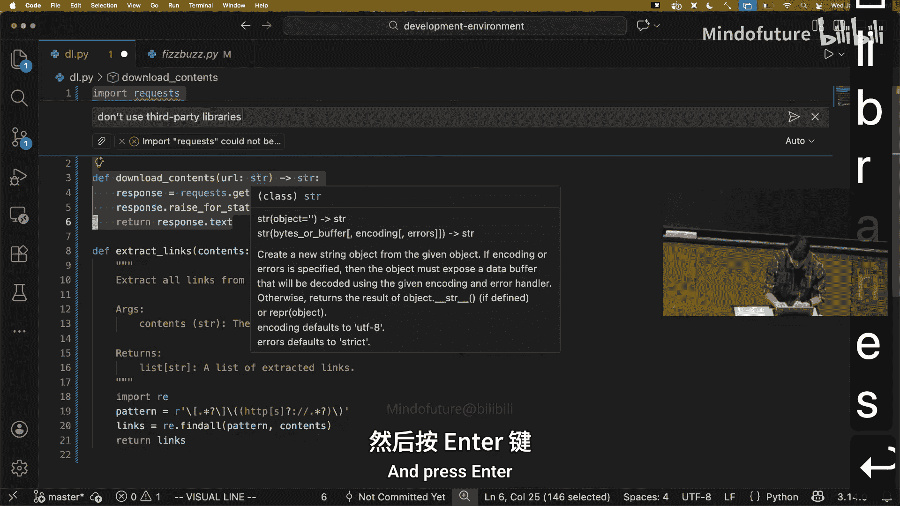

### 内联聊天

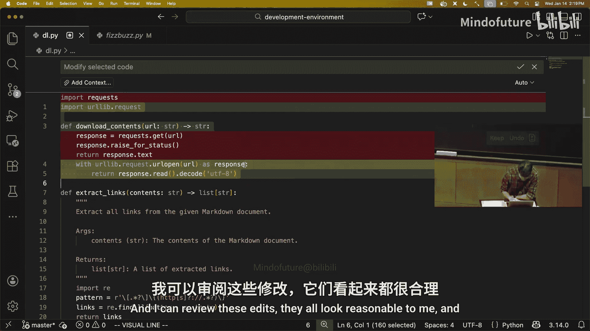

这种模式允许你选择一段代码或指定一个光标位置，然后直接向AI发出指令，让它修改选中的代码。例如，你可以选中一个使用第三方库的函数，然后要求AI“不要使用第三方库”来重写它。AI会生成修改建议（通常用红绿颜色标出增删），你可以审查并接受这些更改。

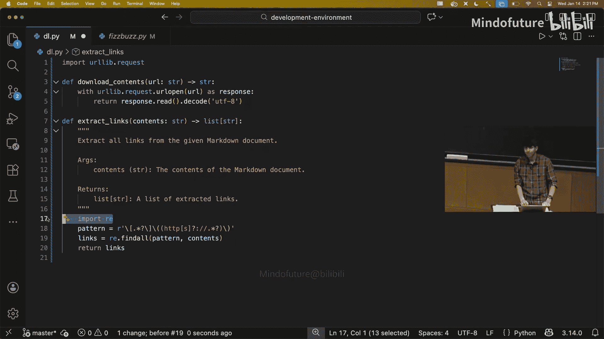

### 编码代理

编码代理是更高级的、对话式的工具。你可以与它进行多轮对话，要求它解释代码、询问问题，或者委托它完成更复杂的任务。它就像一个集成在你代码环境中的ChatGPT。需要注意的是，LLM是基于概率的模型，有时会产生看似合理但实际错误的输出，因此需要仔细审查。

关于AI工具的隐私和资源消耗：大多数工具需要联网，因为模型运行在云端。一些工具提供隐私设置选项，但完全隐私通常需要本地运行模型，这可能会消耗大量电力和计算资源。

## 总结

本节课中我们一起学习了开发环境与工具的核心内容。我们首先了解了终端环境和图形化IDE的区别。然后深入探讨了Vim的模态编辑哲学及其高效的键绑定组合。接着，我们介绍了语言服务器如何为IDE提供代码智能功能。最后，我们概述了AI辅助开发的三种主要形式：自动补全、内联聊天和编码代理，并讨论了它们的使用场景和注意事项。

掌握这些工具和概念，将帮助你构建个性化、高效的工作流，从而更专注于解决实际的编程问题。