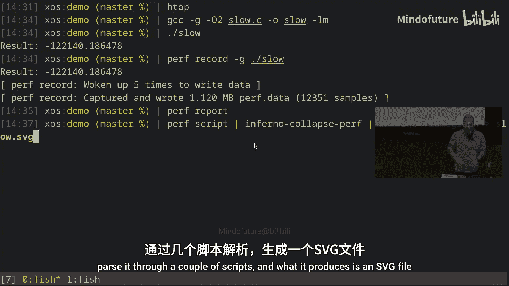
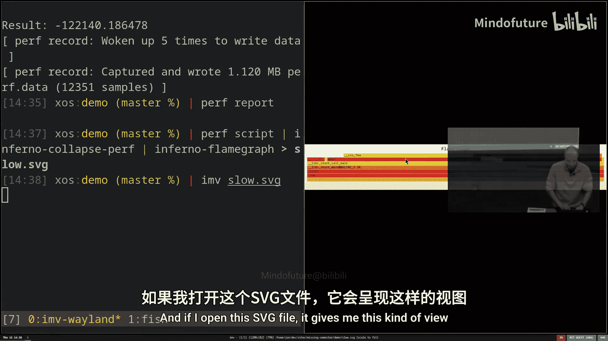
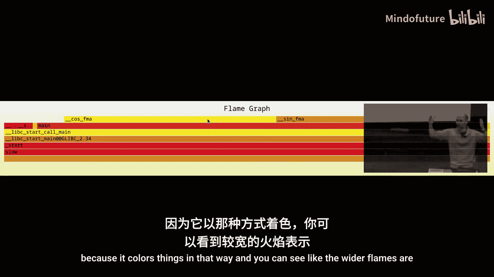
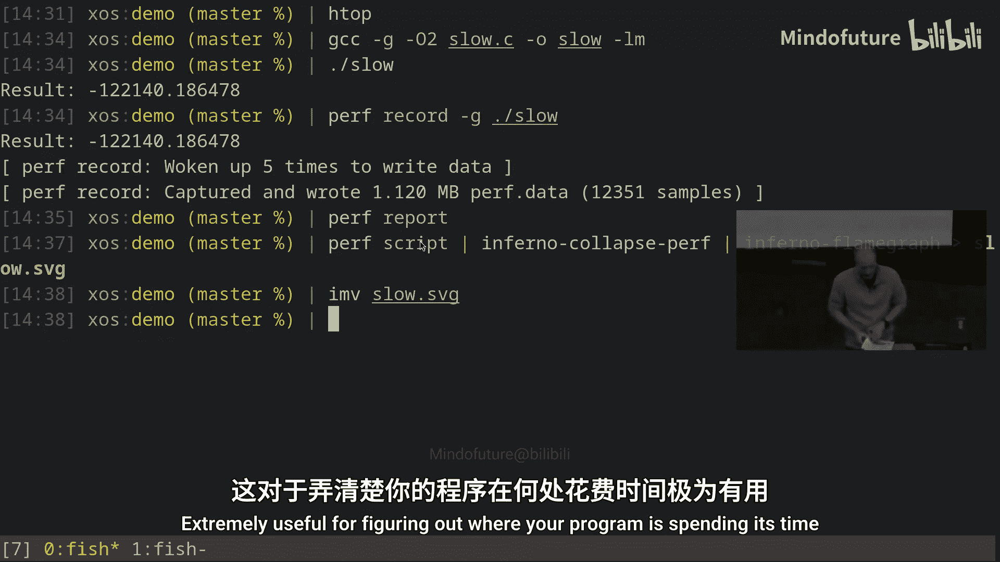

# 004：调试与性能分析 🐛⚡

在本节课中，我们将学习调试与性能分析的核心概念和实用工具。调试帮助我们找出程序行为与预期不符的原因，而性能分析则帮助我们理解程序如何运行以及如何使其运行得更快。

## 调试基础：从打印到日志

上一节我们介绍了课程概述，本节中我们来看看调试的基础方法。计算机只会严格地执行我们告诉它的指令，但这不一定是我们的本意。调试就是探索我们想让计算机做什么和它实际做了什么之间的差异。

C语言先驱Brian Kernighan曾说过：“最有效的调试工具仍然是仔细的思考，加上明智放置的打印语句。” 这至今仍然适用。很多调试工作最终都归结为“打印调试”，即在代码中插入一系列打印语句，输出有助于你思考程序正在做什么的信息，并与你认为它应该做什么进行比较。

打印调试有时被视为一种原始的工具，但在很多情况下它确实非常有效。其最大的问题是，每次程序运行时你几乎都从零开始，需要逐步缩小问题可能出现的范围。这就是日志记录发挥作用的地方。日志记录本质上是打印语句的一种更有原则的使用方式，这些语句会长期保留在你的代码中。它们不是仅为某次调试会话而插入的，而是更持久的记录，在你需要调试软件的任何时候（无论是程序崩溃、理解性能还是实现新功能）都可能有用。

在大型代码库，尤其是生产代码库中，你会看到大量的日志记录。日志可以是**非结构化**的（例如纯文本），也可以是**结构化**的（例如指标或JSON对象）。结构化的日志更容易在事后使用Shell工具进行解析和提取信息。

以下是关于日志记录的一些常见约定：

*   **日志级别**：通常包括 `TRACE`、`DEBUG`、`INFO`、`WARN`、`ERROR`、`CRITICAL`，用于指示日志的重要性。应用程序或库通常允许你设置一个阈值，只输出该级别及以上的日志。
*   **按模块配置**：更复杂的日志框架允许你按模块或文件指定日志级别，以便对特定部分进行更详细的记录。
*   **主动记录**：日志语句通常是你在编写代码时主动添加的，认为这些信息在调试时会有用。打印调试可以被看作是在说“这里本应该被记录下来”。

许多第三方程序也内置了日志功能。对于命令行工具，通常可以传递 `-v` 或 `--verbose` 标志来获取更多输出。对于系统服务（例如Linux上的 `sshd`），可以使用像 `journalctl` 这样的工具来查看其日志。

## 使用调试器：GDB与RR

当打印调试不够用时，例如重新编译和部署程序变得繁琐，或者你需要观察程序执行过程来决定提取哪些信息时，就需要使用调试器。

最常见的通用调试器是 **GDB** 和 **LLDB**。它们可以附加到一个正在运行的进程，并允许你控制其执行，例如在特定代码行暂停、在程序暂停时检查内存、继续执行直到当前函数结束等。它们主要适用于编译型语言（如C、C++、Rust）生成的二进制文件。对于Python、JavaScript、Java等运行时语言，通常有语言特定的调试器（如Python的 `pdb`）。

调试器的一个常见痛点是：你让程序运行，发现了一个错误，但你想回溯到导致这个错误发生的操作序列。此时程序已经执行过了错误点。**反向调试** 或 **记录回放调试** 可以解决这个问题。一个主要的工具是 **RR**。RR会记录程序的所有操作（与操作系统的交互、内存访问等），然后允许你反向执行程序。当你在一个断点处停止时，可以执行“反向步进”，撤销当前行的执行，回到上一行代码的状态。这对于追踪棘手的错误非常强大。

然而，调试也存在“海森堡bug”（以不确定性原理命名），即当你试图观察一个bug时，它却消失了。这在打印调试中很常见，因为打印会减慢程序速度，可能改变并发程序的行为顺序。RR使用确定性调度器来记录线程执行顺序，这也可能导致某些bug在记录模式下无法复现。

让我们通过一个示例程序 `corruption.c` 来演示RR的使用。该程序有一个结构体数组，在更新某个账户的名字后，意外地改变了另一个账户的ID。通过RR记录、设置断点、设置观察点（`watch`）并使用 `reverse-continue` 命令，我们可以回溯到ID被修改的确切时刻和函数调用栈，最终发现是 `strcpy` 操作导致了缓冲区溢出，覆盖了相邻的 `id` 字段。

RR功能强大，尤其适用于难以复现的崩溃或“不稳定”的测试。但它需要硬件支持，且目前仅适用于Linux。如果修改了程序代码，则需要重新编译并重新记录。

## 系统调用追踪：strace与eBPF

有时，你不需要关心代码本身，只想了解程序在做什么，例如程序卡住时它在等待什么。这时可以使用**追踪**工具。

一个常见的工具是 **strace**，它可以追踪一个进程进行的**系统调用**（程序与操作系统内核的交互，如打开文件、读写网络等）。你可以用 `strace` 启动一个程序，或者用 `strace -p PID` 附加到一个已运行的进程。`strace` 的输出可能非常冗长，但你可以使用过滤器，例如 `-e trace=%file` 只显示文件相关操作，或者 `-e trace=openat` 只显示特定的系统调用。使用 `-f` 标志可以追踪由原始进程派生的子进程。

`strace` 功能有限，例如它无法统计系统调用的延迟分布。更强大的基础设施是 **eBPF**，它允许你将小程序注入到Linux内核中，以内核权限检查和测量各种内部状态。

例如，`bpftrace` 工具使用一种特殊的过滤语言。一个简单的命令 `bpftrace -e ‘tracepoint:syscalls:sys_enter_* { @[probe] = count(); }’` 可以统计所有系统调用的调用次数。另一个命令 `bpftrace -e ‘tracepoint:syscalls:sys_enter_openat { printf(“%s %s\n”, comm, str(args->filename)); }’` 可以打印出每个打开文件的进程名和文件名。你还可以通过条件过滤，只追踪特定进程。

基于eBPF，人们构建了许多有用的工具，例如：
*   **biolatency**：测量磁盘I/O操作的延迟分布。
*   **opensnoop**：实时显示哪些进程打开了哪些文件。

对于网络调试，**tcpdump** 可以抓取和分析网络接口上的数据包。更高级的工具如 **Wireshark** 提供了GUI界面，并能解析多种高层协议（如HTTP、MySQL）。对于加密流量（如HTTPS），可以使用 **mitmproxy** 这类中间人代理进行解密和检查。

## 自动化检查：消毒器与Valgrind

并非所有调试都需要手动进行。**消毒器** 是编译器的扩展，它会在编译时向程序中插入额外的指令，用于在运行时检查程序是否在做“坏事”。

例如，**AddressSanitizer** 可以检测内存错误。对于一个存在堆缓冲区溢出但未立即崩溃的程序，使用 `-fsanitize=address` 标志重新编译后运行，它会清晰地报告出堆缓冲区溢出错误、发生位置、调用栈以及内存被覆盖的详细信息。

还有其他消毒器，如用于检测数据竞争的 **ThreadSanitizer**。消毒器要求你重新编译程序。如果你无法重新编译（例如程序是别人构建的），可以使用 **Valgrind**。Valgrind是一个程序解释器，它模拟CPU来执行你的程序，虽然速度很慢，但可以检查每一次内存操作，给出深入的分析报告。它也可用于提供精确到指令级别的性能分析。

人工智能（如大语言模型）在某些调试场景中也极为有用，特别是在解释晦涩的错误信息、或追踪跨语言（如Python调用Rust再调用C）的复杂调用链中的问题时，LLM可以帮助定位问题根源，尽管它们可能不擅长直接修复。

## 性能分析入门：计时与监控

性能分析与调试密切相关，因为理解代码在做什么通常也能帮助你理解它的性能。我们首先需要讨论如何测量时间。

最基本的工具是Shell内置的 **time** 命令。它运行一个命令并报告三个时间：
*   **real**：实际流逝的“墙钟时间”。
*   **user**：程序在用户态消耗的CPU时间。
*   **sys**：程序在内核态消耗的CPU时间。

由于可能存在多核并行，CPU时间可能大于实际时间。`time` 命令简单，但多次运行结果会有波动。**hyperfine** 工具通过多次运行命令并进行统计分析，可以更可靠地比较两个程序的性能，并给出置信区间。

有时，仅仅监控系统资源使用情况就能发现瓶颈。**htop** 是一个交互式进程查看器，可以显示CPU、内存使用率、负载平均值以及每个进程的详细信息。还有更专业的工具，如 **iotop**（磁盘I/O）、**iftop**（网络流量）、**btop**（功能更丰富的系统监控）等。

## 代码级性能剖析：perf与火焰图

当你需要深入代码内部，了解时间具体花在哪里时，需要使用剖析器。**perf** 是一个强大的Linux采样剖析器。它周期性地中断程序，记录当时CPU正在执行的函数，从而统计出各函数的“热度”。

使用 `perf record -g ./slow_program` 记录性能数据，然后使用 `perf report` 查看报告。报告会显示调用关系，以及每个函数自身（不包括其调用的子函数）消耗的时间百分比。你可以展开函数，甚至注解汇编代码，查看具体哪条指令耗时最多。

对于复杂的性能数据，人类难以解析。**火焰图** 提供了出色的可视化。通过 `perf script` 等命令生成数据，并用工具（如 `inferno`）处理，可以得到一个SVG格式的火焰图。图中，每个函数表示为一个横向的条，宽度代表消耗的时间，纵向表示调用栈。宽的“火焰”就是性能热点。火焰图是交互式的，可以在浏览器中点击缩放，非常适合定位性能瓶颈。

`perf` 是采样剖析器，信息可能不完整。如果需要极其精确的指令级计数，可以使用 **Valgrind** 的 `callgrind` 工具，但它会显著降低程序运行速度。

## 可视化与总结

性能分析不仅仅是测量运行时间，还包括理解程序输出或行为如何随输入变化。例如，你可能想了解一个字符串搜索程序的耗时如何随输入文件大小和模式长度变化。

将原始数据表格可视化至关重要。在终端中，**gnuplot** 可以快速绘制简单的图表。对于更复杂的分析，可以使用Python的 **matplotlib** 或R语言的 **ggplot2**。`ggplot2` 的“分面”功能尤其强大，可以轻松地根据数据的多个维度生成并排的图表网格，帮助可视化高维数据集。

最后要强调的是，性能分析的需求常常会回溯到日志记录。如果你在编写代码时就有远见地进行**结构化日志记录**，并记录下诸如输入大小、内部数据结构规模等关键信息，那么当你后续需要分析性能时，这些现成的日志就是宝贵的数据源，可以方便地提取并绘制成各种图表，从而揭示性能问题或扩展性瓶颈。

本节课中我们一起学习了调试与性能分析的核心思想与工具链：从基础的打印和日志，到交互式调试器（GDB/RR），再到系统级追踪（strace/eBPF）和自动化检查（消毒器/Valgrind）；从简单的计时和资源监控，到深入的代码剖析（perf）和结果可视化。掌握这些技能将帮助你更高效地发现并解决程序中的问题，并构建出性能更优的软件。