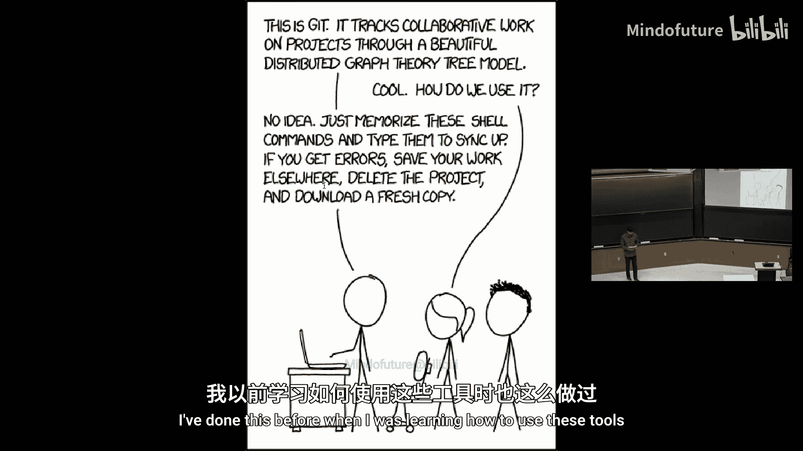
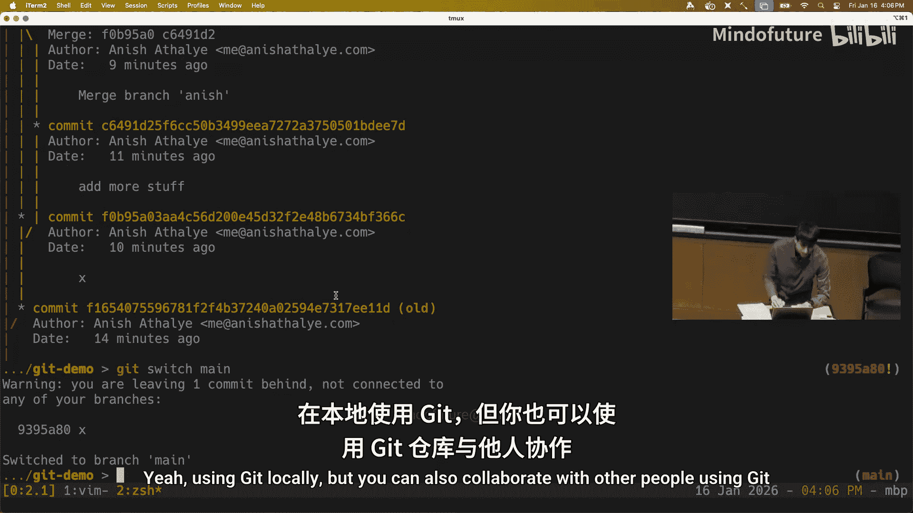
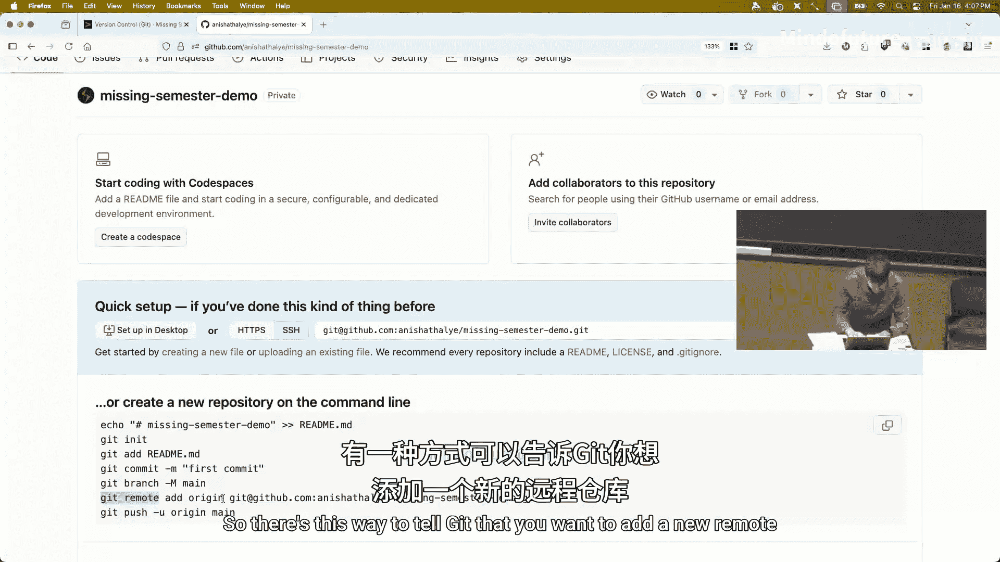
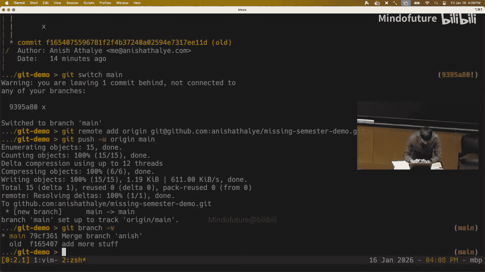
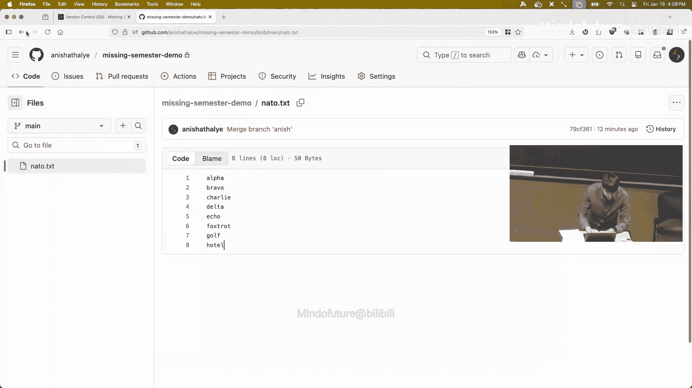
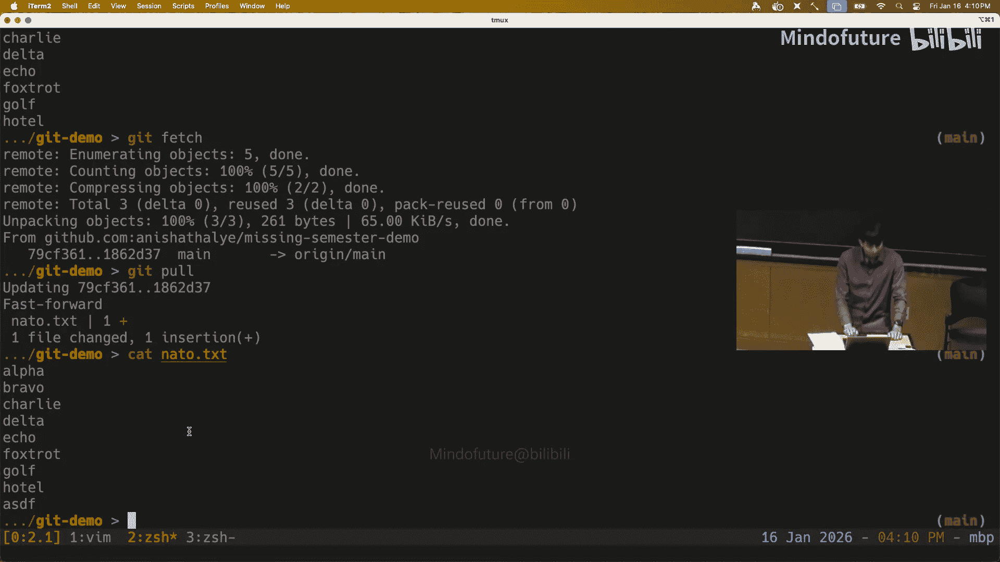
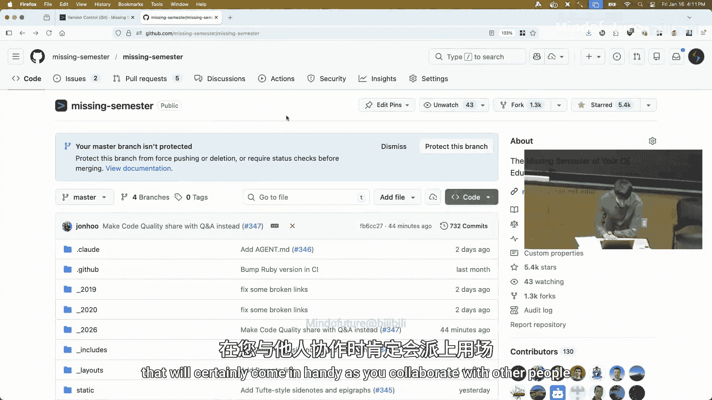
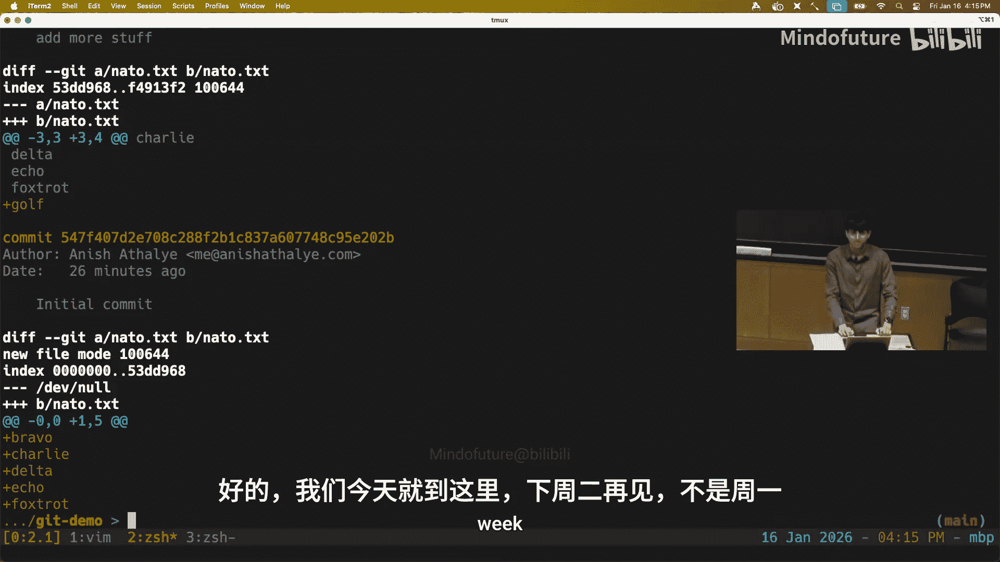

# 005：核心概念与基础操作

在本节课中，我们将要学习版本控制系统，特别是Git。我们将从底层的数据模型开始，理解其核心思想，然后学习如何使用基本的Git命令来管理代码历史。这将帮助你摆脱对Git命令的盲目记忆，真正理解其工作原理。

## 什么是版本控制系统？

版本控制系统是一种用于跟踪源代码或其他任何文件及文件夹变更的软件。顾名思义，这些工具帮助你维护对软件所做更改的历史记录。此外，它们还促进了协作。例如，如果你使用像GitHub这样的开发平台，你将使用Git版本控制系统与该服务以及其他在同一代码库上工作的开发者进行交互。

从逻辑上讲，版本控制系统所做的是跟踪一个包含代码等文件的文件夹的变更。它将文件夹中的所有内容记录在一系列快照中。每个快照都封装了你正在跟踪的目录内文件或文件夹的完整状态。版本控制系统还维护元数据，例如谁创建了每个快照，以及你可能希望与代码更改相关联的任何消息，或许是为了解释你为何进行某些更改。

## 为什么版本控制有用？

即使你不与其他开发者协作，即使你只是在处理一个个人项目或实验作业，版本控制也能让你查看项目的旧快照，基本上是在你随时间更改代码时跟踪它。它还能启用其他功能，例如让你在并行的开发分支上工作。因此，如果你想拥有底层代码库，并先处理功能一，然后在功能一完成之前切换到处理功能二，也许注意到代码中的一个错误并想修复它，你可以在版本控制系统的帮助下完成所有这些，而无需在你完成之前让所有更改相互干扰。

这些工具提供了很多价值，即使你只是独自工作。如果你与其他开发者一起工作，版本控制系统基本上是必须使用的，除非你想通过来回发送压缩文件等方式，但这很快就会变得非常混乱。它是软件开发中与他人协作的标准工具。

现代版本控制系统让你可以做各种方便的事情，并回答那些原本难以回答的问题。例如，你可以查看特定的代码片段或模块，并询问“谁写了这个？”如果你想和他们谈谈。你可以查看特定的代码行，并询问“谁是最后一个修改这段代码的人？”“它是什么时候被更改的？”“为什么被更改？”你甚至可以用版本控制系统做更高级的事情。假设你一直在开发某个特定的软件数月之久，有一天你注意到软件有一个特定的错误，而且看起来这个错误最初并不存在，比如一年前你的软件能很好地完成这个特定的事情，然后在过去一年的某个时刻，你在代码中引入了一个错误。你会怎么做来试图找出这个错误是何时引入的，以及是哪个更改引入了它？版本控制系统可以为你自动化这个过程。你可以做一件非常酷的事情：编写一个测试，如果错误存在则测试失败，然后你的版本控制系统可以自动对你的整个版本历史进行二分搜索，以精确定位错误被引入的确切位置。

这些都是非常强大的工具，值得学习。在本讲座中，我们将教你版本控制系统的基本概念，特别是Git版本控制系统，因为它是当今事实上的版本控制系统。

## Git的数据模型

现在，让我们深入探讨Git的数据模型。Git的巧妙之处在于它设计了一个经过深思熟虑的数据模型，该模型支持版本历史的所有这些优良特性，包括我们之前谈到的一些基础功能，如查看谁进行了特定更改、跟踪你的更改，以及我提到的一些高级功能。你可以维护历史、支持不同的开发分支、与其他开发者协作。

作为数据模型的起点，让我们谈谈快照。我使用这个术语来指代一个目录及其内部所有内容的状态，因此它是你计算机上文件和文件夹的层次结构。Git将历史中的特定时间点建模为文件和文件夹的集合，我称之为快照。在Git术语中，文件被称为“blob”，文件夹被称为“tree”。

一个快照的示例状态可能看起来像这样：你可能有一个快照的根目录，它是一个“tree”。在这个文件夹内部，我们可能有另一个“tree”，比如一个名为“foo”的“tree”。这个内部的“tree”可能包含一个文件，比如这里有一个名为“bar.txt”的文件。这是一个“blob”。这是一个“tree”，这是一个“tree”，然后也许这个顶层的“tree”内部有另一个文件，所以这个文件在顶层，而不是在内部。这大致封装了一个文件夹及其内部所有内容的状态，这就是我们在Git中建模的方式。

现在，在我们的版本控制系统中，我们如何将这些快照相互关联起来？这是一种在某个时间点的状态，现在我们想要维护历史。你可能会想到的一种方法是存储一系列快照，比如你可能拥有版本1、版本2、版本3等等，每个都是一个快照，你可以通过查看不同的快照来了解事物如何随时间变化。

出于一些原因，Git并不这样建模历史。相反，在Git中，历史是快照的有向无环图。如果你没有上过数据结构和算法课，别担心，我们会给你足够好的直觉，这并不复杂。这意味着在Git中，每个快照都引用一组父节点（即它之前的事物），我们将通过一个例子来讨论为什么是一组父节点而不是单个父节点。

假设我们在某个时间点拥有仓库状态的单个快照。我将画一个图，用圆圈表示快照。这就像一个包含一堆文件的文件夹及其状态，包括文件内容、文件夹名称等，在某个特定时间点。

假设我从那个状态开始，然后也许我对我的代码做了一些更改，我可能添加了一个功能，所以我有了一个新的快照，我的代码库的一个新状态，然后这个新快照实际上会指回先前的快照。也许我实现了一个错误修复，所以我创建了一个新的快照，它也会指回先前的快照。

然后假设在这一点上，我确定我想实现一个功能，但还有一个我想修复的错误，你可以想象基于同一个快照独立地做这两件事。所以也许我从这里分支出一个分支来修复一个错误并创建一个新的快照。但我从同一个起点开始，也许我在实现一个功能方面取得了一些进展，但还没有完全完成。也许我取得了更多进展，所以我拍摄了另一个快照，创建了另一个历史元素，它指回它来自的父节点。

到目前为止，我们已经展示了分支，但我们也可以讨论一个场景，即我们可能有一个具有多个父节点的快照。我们可能有这个错误修复分支，我在那里做了一个错误修复；还有这个功能分支，我最终完成了功能的实现；然后我想将这两组更改合并到一个统一的代码库中。所以我最终可能会创建一个单独的提交，它包含了来自这两个分支的更改，并引用它们两者作为父节点，因为它是从两者派生而来的。然后我在这里创建了一个所谓的“合并提交”。

因此，从逻辑上讲，这就是Git表示历史的方式：只是一堆通过这种父节点关系相关联的快照。

关于这一点，可能还需要知道的一个细节是，在Git的历史模型中，快照以及这些提交和它们之间的关系，所有这些都是一个不可变的数据结构。你可以添加内容，你可以创建一个提交并让它指向更早的东西，但你实际上不能修改这里面的东西。比如我切换到这里的这个提交，你实际上不能做那样的更改。也许思考这个的一个好方法是就像在现实生活中，你不能回到过去改变事物的历史。同样地，Git希望按原样记录历史，你实际上不能回去修改这个图中的东西，你只能添加内容。有一些方法可以处理各种类型的错误，比如如果你不小心在这里的代码中引入了一个错误，你想修复它，或者你做了一个后来实际上想撤销的提交，有一些方法可以实现相同的效果，而不会真正干扰这个不可变的或类似追加的历史模型。

## 深入数据模型：对象与引用

让我们再深入一层。看看当我们用更接近代码的形式写下这些概念时是什么样子，可能会很有启发性。让我们写下一些伪代码。让我们写下Git中的一些类型定义。

在Git中，文件（或Git术语中的“blob”）是什么？它只是一堆数据，是一个字节序列。我会写成类似“array of bytes”的形式。在你的计算机上，文件就是这样的，只是一些二进制数据。

然后我们有“tree”或目录。目录是什么？它们是将其内容名称映射到实际内容的数据结构。这里我说目录映射字符串。例如，在上面的顶层“tree”中，它将“foo”映射到包含在其中的“tree”，也将“bar.txt”映射到包含在其中的“blob”。因此，“tree”内部可以包含“tree”或“blob”作为元素，由这里的文件名标识。所以这是文件名。或者也许“name”更好，因为它也可以是“tree”。

现在我们有文件和文件夹，现在我们想要为我们的历史建模。为了更精确一点，当我说“blob”或“tree”时，我指的是这个递归数据结构中的元素类型。当我说“snapshot”（快照）时，我认为这不是标准的Git术语，我指的是对应于整个目录的顶层“tree”，我们想要跟踪该目录的历史。当我说“commit”（提交）时，我指的是该历史图中的节点。因此，图（即历史）由一堆通过这种父节点关系相关联的提交组成。

那么，什么是提交？它是一个包含几个不同元素的数据结构。继续我的伪代码，提交内部包含快照。这个的类型是什么？这是一个“tree”。然后提交还有父节点。这是一个列表……呃……提交的列表。所以这也是递归数据结构，指回其他提交。然后这里还有一些其他东西，比如你可能想要有一个作者姓名，你可能想要一个提交消息，你可以在其中放入诸如你在历史图中引入的特定提交中更改了什么内容。

到目前为止有问题吗？继续思考Git历史和所有内容，在伪代码层面的抽象中，Git引入了一个称为“object”（对象）的概念，它统一了“blob”、“tree”和“commit”。因此，“object”是“blob”、“tree”或“commit”。现在我们可以用一种统一的语言来指代所有这些不同类型的元素。然后，在Git中，Git将你的数据存储在一个对象存储中，其中数据通过其SHA-1哈希进行内容寻址。现在我们将使用我们刚刚在这里定义的类型，并说Git在一个从SHA-1哈希到对象实际内容的映射中跟踪你的对象。

那么，在Git中，东西实际上是如何从这个对象存储中存储和加载的呢？在伪代码中，如果我们想要存储一个对象，我们将首先将其ID计算为对象的SHA-1哈希。然后，将其存储到这个逻辑映射中。然后，如果我们想通过ID从这个对象存储中加载某些东西，我们只需查看对象存储并通过其ID获取它。

这里还有一个细节：“blob”、“tree”和“commit”以这种方式统一。它们都存储在这个内容寻址的对象存储中。在内存表示中，这些东西实际上并不包含其他东西。并不是说提交内部包含所有先前的提交，或者“tree”内部包含所有内部的“tree”。这里通过对象存储有一层间接性，所以你可以将这些视为指针。在这个图中，我会画一个星号，所以这是一个指向提交的指针，这是一个指向“tree”的指针，这是一个指向“tree”的指针，这是一个指向“blob”的指针。但从逻辑上讲，你不需要太担心这个。

现在我们已经介绍了这些概念，包括对象存储和Git中所有内容（从提交到“tree”到“blob”）都可以通过其SHA-1哈希来标识的想法，我们可以稍微充实一下这里的图片。我不会到处画哈希，但例如，这里的这个提交可能由一个提交对象标识，其哈希可能类似于十六进制……是的，通常在Git中，你将哈希写为40个字符长的十六进制字符串。所以这可能像“0fc2……37”这样。这是这个对象的哈希，然后它内部有内容，包括一个父指针。所以这里的这个提交可能将其内容的哈希作为……再次强调，哈希是对这些内容的哈希，对象的内容。所以也许这个以“2”开头，以“7”结尾。因此，这里的这个父指针实际上将是这个哈希值，所以这将是那个值。然后这个将有自己的数据。

现在我们有了我们的历史模型，包括文件系统内容的模型，并且我们有一种通过这些非常不方便的40个字符长的字符串来命名事物的方法。因此，Git引入的下一个概念帮助我们命名事物。40个字符长的十六进制字符串不是非常人类可读的，你也不想记住它们。所以Git引入了一个称为“references”（引用）的概念，它将人类可读的名称映射到SHA-1哈希。

问题是，什么是SHA-1？SHA-1是一种哈希函数，我今天无法详细讲解哈希函数是什么，但你可以将其视为……输入随机数据，但它是……坚持这一点。是的，所以SHA-1哈希接收一些数据（一个字节数组），并返回类似160位的数据。你可以将其视为一种确定性地将任意长度的数据映射到固定长度表示的方法，有点像随机但确定性的映射。也许稍微深入一点密码学理论，如果这有任何帮助的话，你可以将其视为存在一个称为随机预言机模型的东西，你可以将其视为假设有一个全局的对象及其哈希注册表，每当你计算SHA-1哈希时，你就在这个全局注册表中查找是否有人之前尝试过注册这个东西。如果没有人注册过它，那么它会被添加到注册表中，并与某个随机的160位值相关联。然后将来，任何人在这个全局共享的注册表中查找同一个对象时，都会得到相同的值。但在高层次上，它是一种以确定性的方式将任意大小的东西压缩成一个小表示的方法，使其有点随机性，并且碰撞有限。因此，如果你哈希两个不同的东西，你不太可能从哈希函数得到相同的输出。

回到引用，回想一下Git历史是不可变的，我们不能改变那个东西的任何内容，我们只能添加新东西。但与引用相关的是，你可以将对象存储视为你应该放入新东西，但你不去删除东西。另外，如果你考虑我对SHA-1的解释，即它如何确定性地将这些数据映射到短字符串或短字节数组，如果你考虑如果你要修改那个提交图中间的东西会发生什么，那么所有这些后面的节点都通过引用其内容的哈希来指向更早的节点。所以你改变了图中更早的东西，它的哈希也会改变，然后这些东西都不会起作用。

无论如何，这些东西都是不可变的，并且是追加的，或者这是一种很好的思考方式。而引用是你引入可变性的地方。因此，你可能想要有人类可读的名称，比如你可能想用“main”或“master”这样的名称来引用你正在处理的代码库的最新版本，这在Git术语中可能是一个标签或分支，它指向你的提交图中的特定提交。因为Git中的这个引用映射是可变的，你可以在继续开发软件时保持其更新。

在这个图中，我正在引入一种新类型的东西。这些是提交，这些是父节点关系，我在这里矩形中写的是一个指向这个提交的引用。这个想法是，当你开发软件时，也许你会添加一个新功能，现在你引入了一个新的提交。那个提交指回这个先前的提交，你可以更新“master”以指向你刚刚创建的这个最新提交。

当你使用Git时，有更高级的命令会为你处理很多这些事情，你不是像我在这里黑板上画的那样手动执行各个步骤。所以提交列表是不可变的，但指向这些提交的引用是可变的。是的，没错。将历史（即提交和父节点关系）视为不可变的，而你用来指代特定事物的名称（存储在引用数据结构中）是可变的。

## 暂存区：控制快照内容

在进入实际演示之前，我想解释另一个与这个核心数据模型正交但属于Git创建提交接口一部分的概念。到目前为止，我们还没有讨论如何实际创建这些东西，如何描述快照中包含什么。

因此，你可能会想象设计版本控制系统的一种方式是，你正在跟踪计算机上特定文件夹的更改，然后版本控制系统可能有一个命令来提交最新的更改，它只是获取当前状态的所有内容，然后说：“好的，我要拍一张照片，那就是我的新快照。”有一些版本控制系统是这样工作的，但Git不是。原因是，你可能有一个存放代码的文件夹，也许你进去添加了一个功能，然后在提交更改之前，你又进去添加了另一个功能，然后也许你修复了一个错误，然后也许你开始了一个新功能，然后你想：“哦，等等，我还没有提交任何更改。”如果你只是将事物的当前状态作为快照，那会有点混乱。所以Git让你对制作这些快照有更多的控制，因此它有一个称为“staging area”（暂存区）的概念，用于帮助向Git描述你想要包含在你创建的下一个提交中的内容。

我们将通过演示结合其他Git命令来查看暂存区的实际作用。

## 基础命令实战

现在，让我们开始在终端中输入一些代码。不出所料，如果你输入`git`，那就是Git命令行程序的接口。一个可能有用的命令是`git help`。Git的所有功能都是作为Git下的子命令实现的，比如`git status`、`git init`、`git commit`等等，我们稍后会详细讨论这些。还有一个`git help`，你可以通过这个界面获取Git子命令的帮助，它只是打开相应命令的手册页（man pages），我们在第一讲中介绍过。所以，如果你做`git help help`，例如，你会得到帮助命令的帮助页面；如果你做`git help commit`，你会得到提交命令的帮助页面。所以，如果你不想去谷歌或ChatGPT之类的地方，这真的很有用，是内联帮助。

好的，这里我有一个空目录，我称之为`git-demo`。空目录，里面什么都没有。如果我输入`git init`，我会看到它在这个目录中创建了一个空的Git仓库。所以如果我做另一个目录列表，我会看到有一个新的隐藏文件，一个以点开头的文件，叫做`.git`。因此，与此Git仓库对应的所有数据都存储在那里。如果我们稍微查看一下那里，如果我们做`ls .git`，我们会看到`objects`和`refs`文件夹，所以这实际上就是磁盘上的对象存储数据结构和引用。

一个有用的命令是`git status`，它告诉你发生了什么。我们在这里看到的是我们在`master`分支上，还没有任何提交。所以，就这个历史的图形视图而言，什么都没有，是一个空的世界。也没有什么可以提交的，我们还没有在这个目录中添加任何东西，什么都没有被暂存。然后我们看到“On branch master”。这是我的Git设置为将默认分支称为`master`。所以你可以大致认为有一个名称还没有指向任何东西，因为还没有任何历史。

让我们在这里创建一些内容，然后展示我们如何实际开始创建一些Git历史。我们没有任何内容，我们想创建一些内容，以便我们可以在历史中跟踪它。我不会在你面前现场编写一些随机代码，我只是要写一个带有某种填充文本的文本文件。我们将输入北约音标字母。

我有一个名为`nato.txt`的文件，里面有一些文本。如果我做`git status`，我会看到有东西改变了。现在我看到了未跟踪的文件。Git在说：“嘿，这个文件没有包含在上一个快照中。”在这种情况下，只是没有快照，但这个文件没有包含在上一个快照中，但嘿，我只是让你知道它是未跟踪的，所以你可以做点什么。我可以做`git add nato.txt`。这个命令的作用是暂存文件以准备提交。所以它说“Changes to be committed”。我的Git仓库历史（如图形视图）仍然是空的。有零个提交，但现在我已经说了：“好的，无论我什么时候进行下一次提交，我都想包含这个。”然后Git有一个叫做`git commit`的命令，它创建一个新的提交，它会弹出这个编辑器，并包含一些与提交一起的元数据，包括提交消息。所以你想输入好的提交消息。在这种情况下，我将其称为“initial commit”。我保存这个文件，然后Git查看该文件的内容并创建一个名为“initial commit”的新提交。

现在，我想我不会在今天的讲座中讨论如何编写好的提交消息，但我认为这是一个非常重要的话题，所以我们在今天的讲义中包括了一些资源的链接，也许约翰下周会谈到它。好的，我已经创建了我的第一个提交，现在我想看看这里发生了什么。我可以做`git status`，它会说一些稍微不同的东西：“nothing to commit, working directory clean”。但我们注意到“No commits yet”消息消失了。

有几个命令可以用来检查你的历史状态，这些命令非常方便。有一个叫做`git log`的命令，它给你一个历史的扁平化视图，大致上是将其线性化并按线性顺序打印出来。这个命令有几个选项，比如`--graph`选项，它显示一个图，当我只有一个提交时看起来不那么有趣，但我们稍后再看这个，会看到一个稍微高级一点的图。

我们甚至可以稍微查看一下数据模型的底层，如果我们想将其与数据模型联系起来，查看`git cat-file`命令可能会有所帮助。我认为在常规使用中，你不太可能使用这个命令，但这让你可以稍微深入Git的底层。这个命令让你可以按名称查看对象存储中的对象（它会为你进行引用查找），或者你可以直接输入SHA-1哈希。它有几个标志，`-t`和`-p`，用于查看类型或漂亮地打印文件。所以我可以问`master`引用的对象类型是什么，我说好的，这是一个提交，它指的是上面这个相同的提交。如果我做`git cat-file -p`，这次我直接输入提交哈希（再次回想，Git中的所有对象都由其对象哈希标识），我可以看到与提交对应的数据。所以我在那里高亮显示的内容对应于这里的数据结构。所以我们可以在这里看到它有一个指向“tree”的指针，那是这个快照的内容，以及一些元数据和我的提交消息。这里没有父节点，因为这是第一个提交。但如果我对这个东西做`git cat-file -t`，我会看到一个“tree”。`git cat-file -p`这个东西，我会看到有一个包含单个条目的“tree”，那个从字符串到东西的映射，那个条目是这个名称和这个哈希。而且方便的是，Git告诉我它所指的东西是一个“blob”。如果我做`git cat-file -p`这个哈希，我会看到那个快照中文件的内容，在这种情况下，实际上与我工作目录中`nato.txt`的内容相同。

那么，人们看到我如何将这些Git命令与底层数据模型联系起来了吗？是的，问题？你能定义一下什么是分支吗？是的，所以分支是一种特殊类型的引用，你可以附加到它上面，并且当你进行提交时，它会随着你移动。所以在这里，如果我们查看`git log`，我们有一个单独的提交，我们有指向这个提交的`master`分支。如果我对我的文件做一些更改……不要写像这样的糟糕提交消息。这里我添加了我的更改内容，`-m`让你在命令行上提供提交消息。现在如果我查看`git log`，我有我原始的提交，那个初始提交，然后是我刚刚添加了一行文本的新提交。我看到`master`更新了。所以我附加到了这个`master`分支，我在`git status`中看到它说“On branch master”，然后当我做`git commit`时，它会为我更新那个引用。所以回想一下我之前在谈论如何从底层数据模型的操作角度思考事物，但通常我们不会对这个东西进行原子更改。Git会为我们组合这些东西。你可以使用`git commit`命令在这个图中创建一个新节点并移动这个引用。

是的，直观上，感觉分支应该指的是……嗯……历史中的一系列节点，就像你可以放置的线性窗口。但是，是的，所以你指出，直观上你可能认为分支指的是整个谱系之类的，但在Git中，分支实际上只是一个指向提交的指针，这是对的。有一些其他版本控制系统具有分支的概念，其工作方式略有不同，更接近你对实际跟踪谱系的直觉，但Git不是这样工作的。所以分支只是指向提交的指针，你可以随意移动它们。如果你这里有一个分支，你只是想把它移到这里，你完全可以在Git中做到。所以它们并不真正特殊，除了指向提交之外，它们不跟踪谱系，而提交跟踪谱系。

目前还有其他问题吗？`master`总是自动更新指向最新的提交吗？不，不是的。`master`是或曾经是当你创建新的Git仓库时默认分支的默认名称。基本上所有分支都以这种方式工作：如果你附加到一个分支并进行提交，无论你在哪个分支上，那个分支都会被更新。所以如果我在这里创建一个新的分支，如果我做`git branch anish`，那会在我所在的位置创建一个新的分支。然后我做`git switch anish`，我做`git status`，它会说“On branch anish”。然后假设我修改这个文件以添加一个新行。我查看我的Git历史。在这个`--graph`视图中，它也显示了一些分支的位置。`master`仍然在它之前的位置，因为我切换到了`anish`分支，然后进行了最新的提交。所以这个分支更新到了新的提交，但`master`停留在原地，因为我在进行提交时不在`master`上。

如果你在`master`上……是的，所以问题是如果你在`master`分支上，那么`master`会……让我`git switch master`。顺便说一下，这会改变我的工作目录内容，所以如果我输入`nato.txt`，“hotel”现在不见了，因为我移回了这里。所以快照是它自己的东西，但这个`git switch`命令将工作目录更改为匹配我刚切换到的这个分支。所以绝对正确，如果我修改这个东西，让我修改这个以在这里添加“alpha”。然后做`git commit`。`-a`标志提交所有东西。我将开始给出越来越差的提交消息以加快速度。现在如果我查看Git历史，我也可以添加`--all`标志。如果我们不添加`--all`，它只显示你所在分支的递归历史，所以它不显示当前不可达的节点。但如果你做`--all`，它会显示所有分支可达的所有东西。是的，所以现在你看到我在这里。你问如果我切换到`master`并进行提交会发生什么。所以我做了这个新的提交，`master`更新了，但这个提交指回这个作为它的父节点。所以这是没有“hotel”或“alpha”的那个，这是我添加了“hotel”的那个，这是我添加了“alpha”的那个。所以现在如果我查看我的文件，在这个中我有“alpha”到“golf”。如果我做`git switch anish`，我查看这个，我有“bravo”到“hotel”。

现在，既然我们已经进入了一个分叉历史的情况，我们有两个不同的分支或两个不同的提交，其中任何一个都不是另一个的父节点，我们可以讨论合并。所以如果我们，假设我们切换到`master`分支，我们可以做`git merge anish`。它会进入一个状态，创建一个新的提交，弹出这个东西，要求我写提交消息。在这种情况下，我会保存并退出。在这种情况下，我们看到它说“Auto-merging nato.txt”。所以在这种情况下，因为我做了一个更改，在顶部添加了“alpha”，另一个更改在底部添加了“hotel”，并且中间的内容相同，差异和合并算法足够聪明，能够弄清楚我们实际上想要合并这些东西，我们没有遇到合并冲突。所以现在如果我查看历史，我应该看到我的前三个提交1、2、3，然后是这个提交。或者抱歉，前两个提交1、2，然后是这个提交，这个有更早的那个作为父节点的另一个提交，最后是我刚刚创建的这个新的合并提交，它将`anish`分支合并到`master`中。现在如果我查看`nato.txt`的内容，我有在一个分支中添加的“alpha”和在另一个分支中添加的“hotel”。

然后，既然……哎呀……既然`master`包含了所有历史，包括这个东西，这个东西已经被合并进来了，我不再需要这个名字了。所以我可以继续做`git branch -d anish`。让我做`git branch`，它会显示列表……哎呀，`git branch`。好的，第三次了。我会看到我有两个分支。我在`master`分支上，这就是为什么它有这个星号和绿色。我可以做`git branch -d anish`，它说删除了这个分支。所以现在如果我查看版本历史，图看起来是一样的，因为所有这些都是从这个`master`东西可达的。但是与这个提交相关联的这个名称消失了，因为我不再需要这个名字了。

所以再次强调，这传达了我可以删除一个分支，而历史仍然在那里。分支和跟踪谱系在Git中是不同的概念。是的，问题？一个提交就像我们花了很多时间讨论的那个数据结构，而一个分支是一个引用。它是一个提交的名称或SHA-1哈希的名称。提交是不可变的，分支是可变的。

问题？与其`git switch master`然后`git merge anish`，是否可能……是的，所以问题是，与其将`anish`合并到`master`，我们是否可以将`master`合并到`anish`？是的，当然可以。`master`并不特殊，它只是一个名称与另一个名称的区别。

问题？让我们试试。所以`master`分支正在使用中，那是我当前签出的那个，这就是这个“HEAD pointing to master”的意思，是的，这就是我在当前目录中签出的内容。但如果我做一些像`git branch main`然后`git switch main`的事情，我可以做`git branch -d master`，现在我没有`master`了。

目前还有其他问题吗？是的，问题是：我能恢复它吗？好的，这就像相当高级的Git，如果你一切都做对了，你永远不需要这个工具。但有一个叫做`git reflog`的工具。基本上，Git维护了一堆额外的状态，包括你的引用历史。所以引用是可变的，因此维护它们发生了什么的历史通常很有帮助。比如，如果你将一个分支从指向一个东西移动到指向另一个东西，然后你想：“哎呀，我不想那样做。”你怎么回去？你只需更改那个东西。这就是为什么Git维护一个历史。所以`reflog`就像引用日志。然后Git中的另一个东西……再次强调，Git只有两样东西：引用和对象。对象是不可变的。那么，当你创建越来越多的历史并移动分支时，Git如何决定保留什么？将活动历史视为从所有引用的并集可达的图。所以如果我创建，比如说，实际上已经在这个图中，这个节点不可达任何引用。所以当你最终在对象存储中有类似孤儿的东西时，Git会自动垃圾回收它。如果你说，比如我创建了一个提交，我删除了分支或什么，我可以查看我的`reflog`并找到那个提交，那个提交仍然会在我的对象存储中。但如果我使用Git很长时间，然后一年后我想：“哎呀，我实际上想要那个很久以前删除的旧东西”，它可能已经消失了。

问题：当你分支`main`时，你如何指定`main`应该指向什么？这是一个好问题。当我做`git branch main`时，我如何指定`main`应该指向什么？所以没有任何额外参数，`main`指向我当前所在的位置，也就是`HEAD`，在这种情况下也与`master`相同。你也可以为分支指定一个引用或SHA-1哈希。所以，如果我再看看我的图……这里是我最初添加更多东西的地方，所以如果我做`git branch old`这个……这会做什么？这将创建一个名为`old`的新分支，最初指向这里。所以如果我查看这个图，我看到这个`old`已经被创建了。

有一个`main`或`master`分支是约定吗？是的，所以问题是，有一个`main`或`master`分支是约定吗？是的，答案是肯定的。比如，通常你希望人们拥有他们代码的最新版本是`main`或`master`。在旧版本的Git中，它曾经是`master`，现在我认为默认是`un`或`main`，我不完全确定，我认为GitHub现在使用`main`作为默认值。但是，是的，比如你希望`main`在某种程度上是特殊的，所以你可能有那个作为你的代码的主要版本。然后当你实现功能时，你可能会创建所谓的功能分支，在这些功能分支中进行更改，然后将它们合并回`main`。还有其他更复杂的工作流程，比如你可能在维护一个网站，你有网站的生产版本（真实用户使用的主要实时版本），然后你可能有一个用于测试的暂存版本。所以你可能有用于生产的`main`分支，用于暂存的`staging`分支，然后你可能有一堆用于其他正在开发的功能和错误修复的功能分支和错误修复分支。也许你会先将这些东西合并到`staging`，测试它们，如果`staging`看起来状态良好，你可能会将其合并到`main`。所以有一些相当复杂的分支和合并工作流程，我认为我们在讲义中链接了其中一些。我们对待`main`的方式只是约定。是的，没错，我们对待`main`的方式只是约定，如果我们愿意，我们可以称它为`issue`或`two`。

## Git远程仓库与协作

如果你想再待五分钟左右，我可以向你展示如何使用Git远程仓库，然后我们可以在那里结束。如果你必须离开，请随意离开，但我认为这可能是一个很好的结束话题。到目前为止，我们已经讨论了如何自己使用Git进行软件开发，介绍了一些基本概念，如创建版本历史和来回切换。我认为我们没有展示的一件事是`git checkout`。所以，如果你想将工作目录的内容更改为较旧的提交，你可以做类似`git checkout old`或`git switch old`的事情。在这种情况下，`git switch old`，它会切换到那个分支并检出那里的内容。所以我`cat nato.txt`，它是在我添加了所有后来添加的新东西之前。由于这里有这个`main`，我仍然有后来的历史。我甚至可以检出特定的提交，比如我可以做`git checkout`，然后输入提交哈希，甚至是提交哈希的前缀，只要它是明确的。现在我有我的非常短的`nato.txt`内容，我回到了这里。如果我查看图，我看到这个大写的`HEAD`（Git用蓝色渲染的特殊引用）指回这里。然后我有所有更新的历史在上面。如果我做`git status`，我会看到Git处于这种分离的HEAD状态。这意味着当前没有活动分支。所以如果我进行新的提交，我不再有这个很好的属性，即我有一个命名的分支随着我更改代码而前进。

因此，长时间保持在这种分离的HEAD状态相对不常见。通常你在某个分支上进行……哎呀……对你的代码进行更改。好的，所以Git远程仓库。到目前为止，我们讨论了如何自己使用Git。你可以用Git做的一件非常强大的事情是与其他人员一起工作。是的，问题？`main`直接指向一个提交而不是一个分支？是的，这是一种很好的思考方式。分离的HEAD意味着`HEAD`直接指向一个提交而不是一个分支。如果你处于分离的HEAD状态，所以我会做`git`……我不知道`git switch`是否适用于这个……是的，`git checkout`这个。所以我处于分离的HEAD状态，我可以修改这个`nato.txt`，创建一个提交。它实际上会创建提交，但这个提交有点像这个孤儿的东西，只有`HEAD`指向这个提交，没有分支。所以如果我切换回`main`，例如，看到它说警告你留下了一个提交，它没有连接到任何分支。所以这实际上此刻仍然在我的对象存储中，但它最终会垃圾回收它，因为没有分支指向它或它的任何后继。

好的，所以Git远程仓库，我们讨论过……是的，本地使用Git，但你也可以使用Git仓库与其他人员协作。一种常见的方法是使用GitHub。所以现在我在展示……登录到我的GitHub账户，你可以将GitHub仓库视为……GitHub仓库并不真正特殊。Git是一个分布式版本控制系统，你拥有Git仓库的副本，它可以连接到任意数量的其他Git仓库（称为远程仓库），然后你可以在它们之间双向交换信息。所以你可以本地向历史添加内容并将其推送到某个远程，其他人可以对远程进行更改，你可以将其拉入你自己的本地仓库。所以我可以……在GitHub上创建一个新的仓库。让它空白，等等，也许我应该将其设为私有。

所以我在GitHub上创建了一个空仓库。这有点像其他人……GitHub刚刚做了一个`git init`，他们没有历史，但我有我的仓库并在上面工作，我有一堆历史，现在我可以将它们连接起来。有一种方法可以告诉Git你想添加一个新的远程。你可以从GitHub复制粘贴这个，或者你可以学习如何使用这个`git remote`命令。所以有一个`git remote`子命令，它有一个`add`子命令，你可以命名每个远程，因为你可以有多个。然后我认为我们没有时间深入了解与GitHub身份验证的具体工作原理，但如果你感兴趣，可以阅读他们的文档或讲义。但一旦我们这样做，我们就可以开始向这个远程发送和接收数据。有一个`git push`命令，可以将我的本地更改发送到远程。所以我可以做`git push -u main`。我会解释`-u`的含义。这个命令的作用是推送到远程`origin`，我的`main`分支的内容。如果远程上不存在`main`分支，它会创建一个，并设置它使其匹配我的本地`main`。`-u`使其成为一个跟踪分支，所以当我在本地进行提交时，我可以只做另一个`git push`而不需要任何额外参数，它会知道我在的当前分支`main`对应于另一端的`origin/main`。在另一端，这里的`origin/main`是什么？是的。

所以现在我已经做了这个`git push`，如果我转到GitHub的Web界面，我可以看到我的`nato.txt`在这里，带有所有最新的内容。

然后，为了演示其他几件事，假设我是其他人，我将在同一台计算机上演示，当然，比如转到我的桌面文件夹，其他人可以获取Git仓库并克隆它。`git clone`命令获取一个现有的远程并给你一个本地副本。我可以进入这个并在这里做一些更改。所以我只是非常快速地添加一些内容，做一些虚拟提交。现在如果我做`git status`，我会看到“On branch main, your branch is ahead of origin/main by 1 commit”。记住我现在就像玩家二，在我的桌面上。如果我在这里做一个`git push`而不带任何额外参数，它会将我的本地更改发送到远程。

如果我回到我之前打开的窗口，我在这里做`git status`，我`cat nato.txt`，什么都没有改变，因为我还没有从这台计算机上的远程拉取任何内容。但如果我在这里做`git pull`，或者实际上也许我可以先做`git fetch`。有一些密切相关的命令。`git fetch`从远程接收数据，但实际上不更改你的任何本地引用。如果你做`git pull`，它实际上会更新你的本地引用。由于这个分支正在跟踪`origin/main`，并且`origin/main`已经更新，`git pull`会执行所谓的……在这种情况下是快进。现在如果我查看`nato.txt`，我看到我刚添加的“ASDF”。所以我已经展示了端到端：好的，我是一个人，我对代码做了一些更改；我是另一个人，我可以拉入那些更改。这些只是基础，但你可以在脑海中想象这些东西如何映射到底层数据模型的更改。基本上每个人都有不同的视图，这个历史的不同切片，你正在共享更改或对这个历史的更新，这以一种非常清晰的方式实现了协作。

然后，也许展示提交历史也在GitHub上会很有用。哦，是的，约翰指出展示提交历史也在GitHub上可能会很有帮助。是的，这是一个相当高级、相当复杂的产品。它拥有的一个不错的功能是让你可视化提交历史。所以我们也可以去……不同的仓库，比如Missing Semester仓库。是的，顺便说一下，所有讲义和本课程网站的所有内容都在一个开源脚本仓库中，所以如果你感兴趣，你可以去那里看看。如果我们查看那里的提交历史，比如我们可以看到约翰今天在讲座期间刚刚做了一些更改，我今天早些时候做了一些更改，等等。所以，当你与他人协作时，这里有一个非常强大的Web界面，肯定会派上用场。

是的，问题？当你将`main`推送到`origin`时，`main`是只包括它指向的提交还是包括所有东西？这是一个很好的问题。所以就像当你将`main`推送到远程`origin`时，它是只包括`main`指向的提交，比如只包括这个，还是包括整个历史？答案是后者。当你共享东西时，它总是包括导致该点的所有历史。Git确实有一些特殊的命令，如果你想要截断这些东西并只