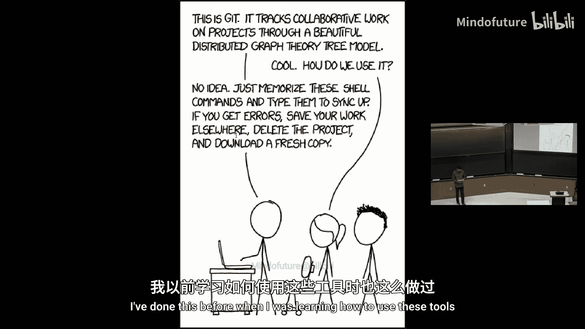
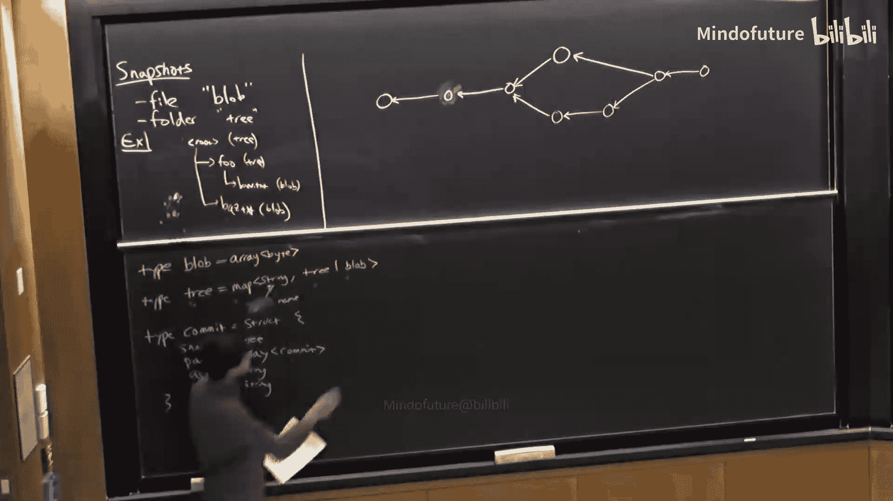
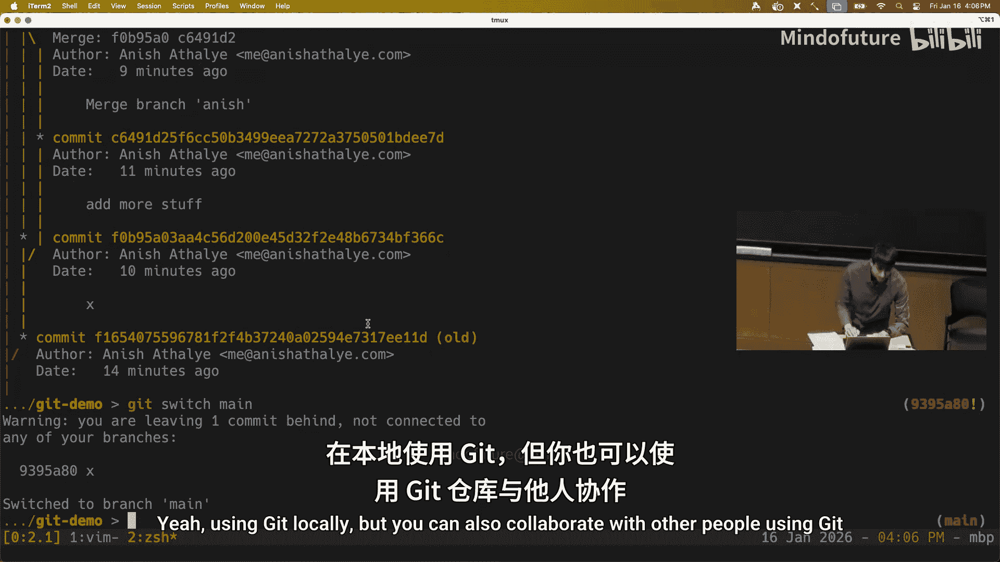
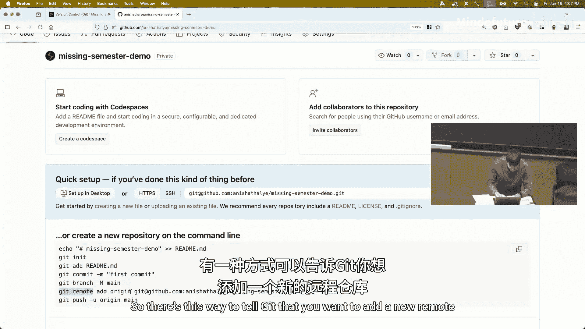
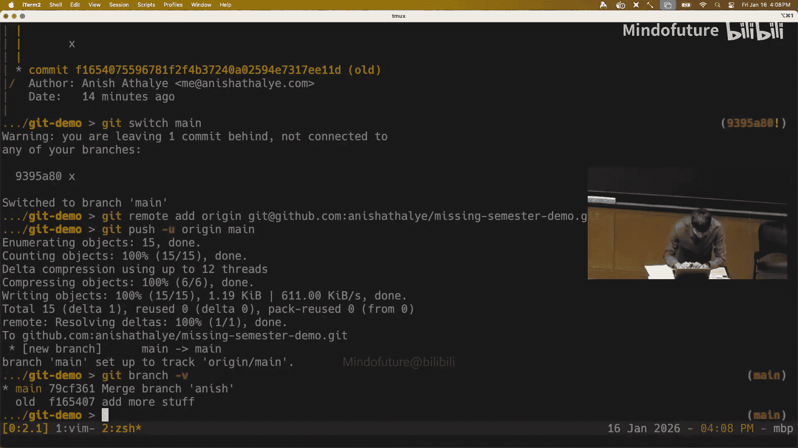
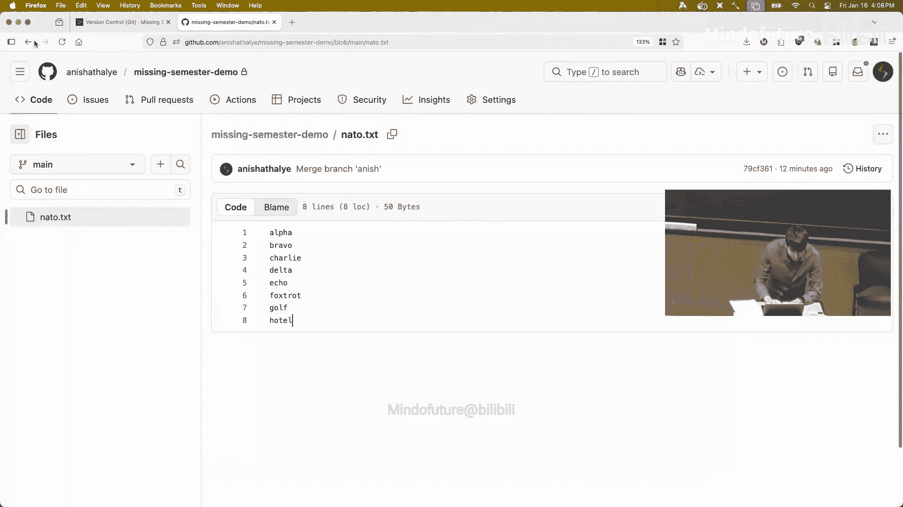
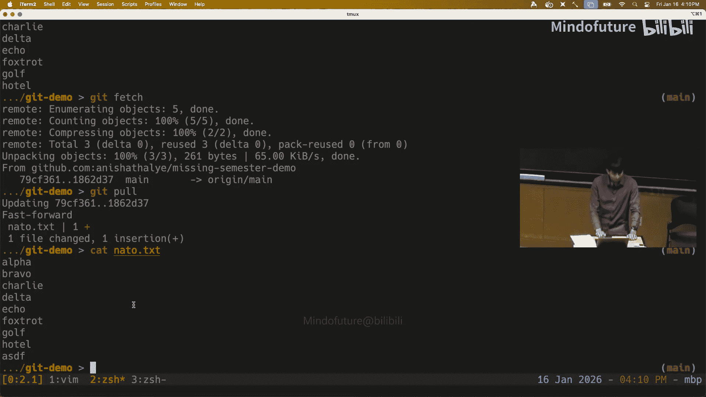
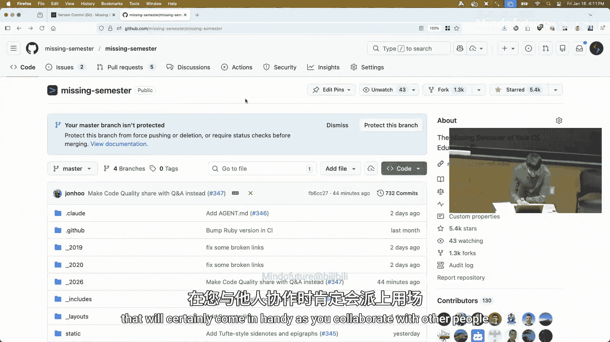
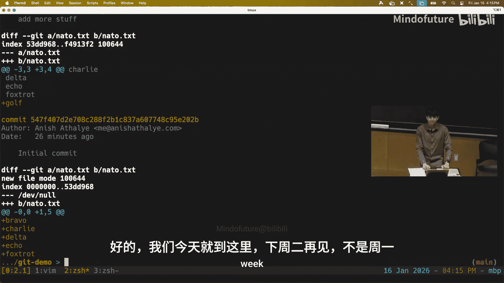

# 【麻省理工】编程缺失的主题-｜-Missing-Semester-Iap-2026-p05-P05_第五讲_版本控制与Git--BV11QASzrEDy_p5-

Co let's get started today we're going to talk about version control systems and in particular Git because that's a really popular version control system these days。

So what is a version control system， well it's a piece of software that's used to track changes to your source code or any other files and folders that you want to track changes to。

 and as the name version control implies， these tools help maintain a history of changes you make to the software you're writing and furthermore they facilitate collaboration so if you're using a development platform like GitHub。

 for example， you will use the Git version control system to interface with that service and with other developers working on the same codebase。

So logically， what version control systems do is they track changes to a folder containing files like code and so on。

And all the contents in that folder in a series of snapshots。

 and every snapshot encapsulates the entire state of files or folders within that directory that you are tracking。

And version control systems also maintain metadata like who created each snapshot and maybe any messages you want to associate with changes you make to your code。

 perhaps explaining why you're making certain changes and so on。So why is version control useful？

Well even if you're not collaborating with other developers。

 even if you're just working on a Pet or lab assignment。

 version control can let you look at old snapshots of a project。

 basically keep track of your code as you're changing it over time。

 and it can enable other features like letting you work on parallel branches of development so if you want to have your underlying codebase and work on feature one and then switch from that to working on feature two before you're finished with feature one and maybe notice a bug in your code and you want to work on fixing that bug。

 you can do all that with the help of a version control system without having all of your changes kind of interfere with each other before they're finished。

So these tools provide a lot of value， even if you're just working by yourself。

And if you're working with other developers， version control systems are basically necessary to use like unless this you want to be emailing back and forth zip files or something which really quickly gets super chaotic。

 it's just the standard tool for collaborating with other people when doing software development。

And modern version control systems let you do all sorts of handy things and answer questions that might otherwise be hard to answer things like you can look at a particular piece of code or a module and ask who wrote this。

 if you want to go talk to them， you can look at a particular line of code and ask who was the last person to modify this code。

 when was it changed， why was it changed？😊，You can even do fancy things with version control systems like suppose you've been working on a particular piece of software for months and months and one day you notice。

 oh hey the software has a particular bug and it looks like this bug wasn't originally there like one year ago your software did this particular thing fine and then at some point in the last year you introduced a bug into your code like what would you do to try to figure out when that bug was introduced what was the change that introduced it version control systems can automate this for you you can do something really cool where you write a test that fails if your bug is present and then your version control system can automatically binary search your entire version history in order to pinpoint exactly where that bug was introduced。

So really powerful tools that are worth learning。And in this lecture。

 we're going to teach you about concepts， underlying version control systems。

 and we're going to teach you about the Git version control system in particular。

 because it's just the de facto version control system of today。😊。

Now unfortunately Git has a kind of complicated reputation and you can take a look at the XKCD comic I've put up there and we'll read through it。

 this is Git， it tracks collaborative work on projects through a beautiful distributed graph theory tree model。

Cool， how do we use it？No idea， just memorize these shell commands and type them to sync up and if you get errors。

 save your work elsewhere， delete the project and download a fresh copy。😊。

So no shame who has done this before。All right， a number of hands go off， including mine。

 I've done this before when I was learning how to use these tools。

And so in this lecture， we're going to try to get you from being that guy over there to not being that guy over there。

😊，And so why does this happen， like why does Git have this kind of a reputation？

I think it's because Gits interface， like the commands you use to work with it。

 it's a leaky abstraction。And if you learn， gi top down。

 like if you learn like the commands and what they do， and that's your starting point。

 it can lead to a lot of confusion， especially if you don't understand the underlying ideas。

 You can memorize a bunch of commands and know when to use them and how things generally work and roughly treat them as magic incantations and then do this when anything goes wrong like delete your repo and start over。

 But obviously， if you do that， you're not using the tool effectively。

So I think Git does have not the cleanest interface。

 but I think the ideas underlying the version control system。

 its design and those underlying ideas are really beautiful。

 and the ugly interface has to be memorized， but the underlying ideas I think can be deeply understood。

And so for this reason， in today's lecture， we're going to give you a bottom up explanation of Git starting with the underlying ideas and things like the data model。

 and later we'll cover the command line interface at a high level and then give you pointers to let you learn more and kind of memorize all the commands you need to memorize。

😊，And we think this is the right way to learn Git and the reason we're taking the time to teach it to you this way today is because I think most of the resources available online for learning this tool don't approach the learning process in this way。

any questions before we start diving into the material on version control systems or the motivation for approaching learning this way？

Great， so let's talk a little bit about Git' data model。

And don't worry about this like complicated distributed graph3 tree model stuff。

 it's not that complicated。So I think Gi ingenuity is an it really well thought out data model that enables all these nice features of version history。

 including some of the basics we talked about earlier。

 like seeing who made a particular changes is keeping track of your changes。

 as well as some of the fancy stuff I mentioned。You can maintain history。

 support different branches of development， collaborate with other developers。

And so as the starting point in the data model。Let's talk about snapshots。

So I'm using this term to refer to the state of a directory and everything inside of it。

 so it's this hierarchy of files and folders near your computer。😊。

So Git models like a particular point in time in the history as collection of file and folders。

 which I'm referring to as a snapshot， and in Git terminology， a file。It's called a blob。

It's a helpful term to know and a folder。Its called a tree。

And then you might have a particular example state your of a snapshot that might look something like this so you might have。

The root directory of your snapshot， which is a tree。

And then so this is like a folder inside this folder， we might have another tree。

 so I say we have a tree called foo， so this is another tree。And this tree inside might have a file。

 so say there's a file called bar dot textex in here。So this is a blob。This is a tree。

 this is a tree， and then maybe this top level tree has inside of it， another file。

 so this is at the top level instead of inside。All right， so。

This kind of encapsulates the state of a folder and everything inside of it。

 that's how we're going to model it and Gi。So now in our version control system。

 how do we want to relate these snapshots to each other。

 This is kind of the state of things at a point in time and now we want to maintain history。

 so one way you might imagine doing this is by distortoring a sequence of snapshots like you might have version one of your repository than version 2 then version 3 and so on and everyone is a snapshot and you can see how things change over time by looking at different snapshots。

And for a number of reasons， Git doesn't model history like this。

 and instead it's a little bit fancier in Git。And in Git。

 a history is a directed acyclic graph of snapshots。

 And if you haven't taken the data structures and algorithms class， don't worry。

 we'll give you good enough intuition for that。 And it's not that complicated。

So all this means is that in Git， each snapshot refers to a set of parents。

 the things that came before it， and we'll go through an example and talk about why it's a set of parents rather than just a single parent。

So suppose we have the state of our repository in a single snapshot at a particular point in time。

 I'm going to draw a diagram and use circles to indicate snapshots。

 so this is like a folder with a bunch of files in it and its state including the contents of the files and the names of the folders and all that at a particular point in time。

So suppose I start off with that state and then maybe I make some changes to my code I might add a feature。

 so I have a new snapshot， a new state of my code base。

 and then this will actually refer back to the earlier snapshot。And maybe I implement a bug fix。

 so I create a new snapshot and that'll refer back to the earlier snapshot。

And then suppose at this point， I identify that I want to implement a feature。

 but there's also a bug I want to fix， and you could imagine doing those two things independently based off the same snapshot。

 so maybe I branch off of here and fix a bug and create a new snapshot。😊。

But I start from the same starting point and maybe I make some progress towards implementing a feature。

 It's not quite done。 Maybe I make some more progress。

 So I take another snapshot that creates another history element that points back to the parent where it came from。

So so far we've shown branching， but we can also talk about a scenario where we might have a snapshot with multiple parents。

 we might have this bug fix branch where I made a bug fix。

 this feature branch where I finally finished implementing a feature and then I want to combine together these sets of changes into a single unified codeb。

 so I might eventually create a single commit that includes changes from both of these refers to both of these as parents because it was derived from both。

And then I create what's called a merge commit here。And so logically。

 this is how Git represents history is just a bunch of snapshots that are related through this parent relationship。

Any questions about this， we're still talking about things in the abstract right now。

 we'll get more concrete later in the lecture。Great。

 and one other detail that might be good to know is that in Gis model of history。

 snapshots and also these commits and the relationships between them。

 all of this is an immutable data structure， you can add on it。

 you can create a you commit and have it point to the earlier thing but you can't actually take something in here and modify it。

 say I switched to like this commit prime thing here， you can't actually make changes like that。😊。

Maybe a good way to think about this might be like just like in real life。

 you can't go back in time and change the history of things and in the same way Git wants to record history as it happened and you can't actually go back and like mutate things in this graph you can only add onto it and there are ways to handle various types of mistakes like if you accidentally introduce a bug in your code here and you want to fix it or you may a commit that you actually want to undo later。

 there are ways to do things thatll achieve that same effect without actually messing with this immutable or kind of like appendon model of history。

All right， so let's go one level deeper。 It might be instructive to see what it looks like when we。

Write down some of these concepts and something that looks a little bit more like code。

 So there you go。Let's write down a little bit of pseudocode。

WellLet's write down some type definitions in Git， what is a file or in Git terminology blog。

 is's just a bunch of data。 It's a sequence of bytes。 and I'll write down like array of byte。

Like on your computer， that's what a file is right， just some binary data。

And then we have trees or directories， and what are directories， their data structures， that map？

The name of their contents to the actual contents。So here I'm saying that directories map strings。

 like in the case of above the top level tree， maps food to the tree that's contained inside of it and also maps baths dot text to the blog that's contained inside of it。

 so trees can have inside of them as elements either trees or blogs identified by the file names here。

So this is the file name。Or maybe just name is better because it can be a tree too。All right。

 so now we have。Fileles and Fs， and now we want to model our history。

And just to be a little bit more precise， when I say blob or tree。

 I'm referring to elements types of things in this recursive data structure。

 what I'm saying snapnapshot， I think this is not quite standard Gi terminology。

 I'm referring to the top level tree corresponding to the entire directory whose history when we want to track。

And then when I say commit I'm talking about nodes in that history graph。

 so graph is like the history is made up of a bunch of commits related by this parent relationship。

So what is a commit， it's a data structure with a couple of different elements。

Continuing along in my pseudocode。😊，Commits have inside of them， they have snapshots。

And what is the type of this， this is a tree。And then commits also have parents。

And this is a list of。呃。Commence。So this is also recursive data structures refer back to other commits。

And then there's some other stuff that goes inside of here。

 handy things like maybe you want to have an author name。You might want a commit message。

Where you might put in things like what changed in a particular commit that you're introducing in the history graph？

Any questions so far？So continuing along in terms of thinking about getting history and all that in terms of question。

In terms of pseudocode level abstraction， Gi introduces a notion of something called an object which unifies blobs。

 trees and commits。So object is a blog or a tree or a commit so now we can refer to all of these different types of things in the kind of unified language and then in Git Git stores your data in an object store where the data is content addressed by its Shaon hash so now we're going to use this type we just defined here。

And say that get tracks your objects in a。Map from。

Shahow on hashes to the actual contents of the object。

And so like how is stuff actually stored and loaded from this object store inside of Git in pseudocode？

If we want to store an object， we will first compute its ID as the Shaw1 hash。Of the object。And then。

Store it into this logical map。And then I'm sure you can fill this one in yourself if we want to load something by ID from this object store。

We just look at。The object store and grab it by its ID。I'll good so far。And then one detail here。

Blobs， trees， and commits are unified in this way。They're all stored in this object store that's content addressed。

And。In the onisrepresentation， these things don't actually like contain the other thing。

 it's not like the commit contains inside of it， all the previous commits or the tree contains inside of it。

 all the trees that are inside， there's a level of indirection here through the object store so you can think of these as pointer。

 new draw this in this diagram is like an asterisk so this is a pointer to a commit。

 this is a pointer to a tree， this is a pointer to a tree， this is a pointer to a b。But logically。

 you don't need to worry too much about that。Can you repeat the question？At。收到で。That's just how。Oh。

 I see。 you mean an object array， I see。Yes， like here I'm defining the type of objects。

 but then you can think of this as like a global variable in your Git repository。

 it stores the set of objects identified by their someone hassh。

And then this is the object data itself。So for example。

 a tree in git like that tree I've drawn up there will be an object in the object store and the contents of that object will have。

 since this is a tree it'll have two entries， it'll have the entry for F。

 which will be the hash like basically a pointer to that inner tree。

 and then it'll have Baaz dot text， that name with the hash of the blobs so a pointer to the blob object。

Yeah。And so let me swap these around。So now that we've introduced these concepts。

 including the object store and this idea that everything in Gi。

From commits to trees to blobs it can be identified by their Sha one hash。

 we can flush out this picture here a little bit， I won't draw hashes everywhere。

 but for example this commit here might be identified by， so this is a commit object。

And its hash might be something like the hexadeadecial。 Yeah。

 oftentimes in get you write down the hashes as 40 character long hexadeadeimmal strings。

 So this might be like0， Fc2， something， something， something 3，7。 That's the hash of this object。

 and then it has。Contents inside of it， including a parent pointer。And so this commit here。

Might have as the hash of its contents。 And again， the contents are sorry。

 the hash is the hash over these contents， the contents of the object。

 So maybe this has some other Shaan hash。 Maybe this starts with two and ends with 7。 So this。

Parent pointer here will actually be the value of this hash here， so this will be that。Value。

 and then this will have its own data。So now we have our model of history。

 including a model of contents of the file system， and we have a way to name things by these really inconvenient 4 long 40 character long strings。

 so the next concept that Gi introduceds，Helps us with naming things。

So 40 character long hexadeimmal strings are not very human readable and you don't want to have to remember them。

 so Git introduces a concept called references。That maps human readable names。To Sean one Hahes。

So the question is what's Shaan。 Sha one is a hash function I don't think I can cover in detail today what hash functions are。

 but you can think of them as。Into random data， but it's。Stick to that。That's that。Yes， so Sha1 hash。

Takes in some data。That's an array of fights。And returns like 160 bytes。Of data。

And you can think of this as kind of like randomly but deterministically mapping arbitrary length data to a fixed length representation。

Maybe getting a tiny bit more into like crypto theory here and if this is helpful at all。

 you can think of this as there's something called the random oracle model and you can think of it as like suppose there's this global registry of objects in their hashes and whenever you compute the Sha1 hash。

 you look up in this global registry has anybody tried to register this thing before or not。

 if they haven't registered it， then it's added to the registry and it's associated with some random 160 byte value and then in the future whenever anybody looks up that same object in this globally shared registry they'll get back that same value。

But really at a high level， it's a way to take some arbitrary size thing and compress it to a small representation in a deterministic way。

 such that it's kind of like randomish and there's limited collisions。

 so if you hash two different things it's very unlikely that you will end up with the same output from the hash function。

Question。レストラ。But some。Oh so the question is why hash stored as strings instead of some numerical data type。

 yeah， they're actually stored as like arrays of bytes。

 I just decided to use this notation talking about them as strings。😊。

if we're actually talking about like the actual actual on discrepresentation that Git uses。

 it's like slightly fancier than this， but this is a good logical model。Yeah。All right。

 so back to references， so recall that Gi history is immutable right we can't change any of the contents of that thing we can only add new things to it。

 but reference so related to that you can think of the object story like you should like put new stuff in it but you don't go and like delete things and also if you think about my explanation of Shaan how this like deterministically maps this data to us。

Short， short string or short array of bytes。 if you think about like what would happen if you were to like modify something in the middle of that commit graph。

 Well all of these later nodes point to earlier nodes by referring to them by the hash of their contents。

 So you change something earlier in the graph。 its hash would also change。

 And like none of this stuff would work。So anyways。

 that stuff is all immutable aendon linear or that's a good way to think about it and references are where you introduce mutation。

 so you might want to have human readable names like maybe you want to refer to like the latest version of the code base you're working on with the name main or master。

 and that might be kind of a tag or branch and Git terminology that refers to a particular commit in your commit graph。

😊，And because this references mapping in Git is mutable， you can keep this up to date。

As you continue to develop your software， so in this diagram I'm introducing a new type of thing。

 these are commits， these are parent relationships。

 and what I'm writing in this rectangle here is a reference that's pointing to this commit。

And so the idea is that as you develop your software， maybe you will add a new feature。

 and now you introduce a new commit。😊，That commit points back to this previous commit。

 and you can update master。To point to this latest commit that you just created。

And when you're working with get their higher level commands that'll take care of a lot of the stuff for。

 you're not manually doing individual steps as I'm drawing on the board here。Wai， so does that。

so so the list of commits is immutable but the。To those commits。Yes， that's right。

 think of the history and the sense of the commits and the parent relationships as being immutable and the names that you're using to refer to particular things。

Not stored in the references， data structure are mutable， yeah question。Let's say you notice that。

mutes later。You realize that。You accidentally。API。If you absolutely have。私し？How do you。

Yeah that's a great question so the question is suppose you realize that maybe over here you did something very bad like you accidentally committed an API key。

 what do you do if the history is immutable so there are a couple it's a kind of complicated topic。😊。

When you're collaborating with other people using Git what's effectively happening is you're sharing the same view of different slices of a growing data structure like you might make some of these commits a different developer might make these commits。

 then you'll share them with each other and things like that and so if you've shared this with other people and then you realize that there was an API key in there the way I would recommend approaching it is you need to work to invalidate that API key。

 so generally when you get an API key from some API there'll be a button there to delete that API key or to regenerate the API key and invalidate the old one。

If you haven't yet shared this commit with other people Git actually has some commands to basically rewrite history like again this stuff is all immutable but Gi can basically recreate。

 say you want to make this like commit prime you can do that for you and also like recreate everything that comes after it to take account for this so you'll end up with a modified version of your entire history there's a command called Git rebase and some other commands related to that that will do this I think we have an exercise in today's lecture notes that will give you additional pointers on how to do things related to this so that's one way to deal with it and other ways if you've invalidated the API key which you should generally do anyways' you can just leave it in your version of history is not a big deal for other classes of changes like suppose you added a feature here and then later realize that your implementation of that feature is buggy and you don't have time to fix it you just want to undo that change and maybe you'll deal with it later and you don't want to go back and rewrite history Git has a command。

That introduces a new commit on top of everything you've done that basically undoes the effect of a previous commit。

 So roughly what it does is it computes the delta between this and this and replays like the inverse of that delta here to undo that change。

That's a command called gett revert。Yes， sort of related to that and also related to any note that。

当年まで。Multiple possible changes。figure you up。Puttting multiple setsy changes together。In a way that。

Yeah， that's a great question so the question is if youve forked your history and then you want to merge it together like when you're creating this commit。

 how does Git know how you want to combine the stuff between these two things and the answer is Git has a number of heuristics for doing so intelligently。

 for example， if you're working on a large code base and you modify one file in one commit。

 modify a different file and the other commit and merge together those changes。

 Git will just take the most updated versions of those two files。😊。

When you're editing in the same file， even then it's kind of smart like if you modify different chunks of the file that are far enough away from each other。

 it'll just work out and if you don't， if you're modifying state like the same function。

 then like at some point Git can't really tell what you want so it'll give up and ask you to help it so you'll get what's called a merge conflict and then Git has certain tools that will help you to deal with those merge conflicts and this is something that does come up if you're doing any real- worldorld software development working with other people on the same Git repository。

 you will at some point end up having to deal with that concept。Cool。

So I wrote out pseudocode for storing and loading from the object store。

 I unless people really want me to， I'm going to skip doing that for the references。

 you can kind of figure it out yourself or refer to the lecture notes。

 but just recall that remember that the references are mutable so you can read a reference so given a Sha given name。

 get the Shaon hash， you can store a reference so given a name in Shawa hassh you can put it into this data structure and you can also update existing things which is yet a little bit different than what we supported in our object store。

One other of little detail that might be helpful to mention。But right。Sorry， what？

It's called a merge option for us。Yes， the question is is it called merge conflict and that's right。

 when you have different branches that you want to merge together and something goes wrong。

 that concept is called a conflict and then Git has something called Git merge tool that can help you deal with that。

 you'll end up with conflict markers in your files where Gi can't figure out what to do and then there are a variety of tools that you can use to use your own brain to help get out。

So we have references， we can have names for commits in our commit graph。

 and one of the little detail that might be helpful to mention is that Git has a special reference or a special named reference called head。

嗯。Which you can roughly think of it as referring to like the thing you're currently looking at。

 and maybe this will become a little bit more clearer through the examples I'm going to show in a moment and you might see this in documentation that you read later。

All right， so we've actually covered all the core concepts that are part of GitS data model。

 so we can now finally define what is a git repository and all it is is it's the set of objects and references and that is it。

So I think if you look at this like in terms of as far as data structures go。

 like these are all really simple concepts right， so some pretty beautiful ideas at the core of Gi。😊。

And so on disk， all Gi stores for your repository roughly are just objects and references。

 and it's really helpful to think about as you're learning get the different commands that you will learn in terms of how they manipulate objects in kind of at the level of the underlying data model。

 So when you learn about commands like Git commitit or Git reset or things like that。

 like think about how they modify things in this picture。😊，Do you have a question？

GitHub is a website， right？Yeah so the question is what is GitHub and yeah so Git is a free and open source distributed version control tool GitHub is a software as a service provider that lets you host Git repositories it's a popular place for people to host their open source software and to collaborate with other people so like once narrow that might come up if you're a student is your professor might put up lab assignment in a GitRepo and you will clone that GitRepo and maybe work on the lab assignment and they might update the lab assignment and you can use Git to。

 for example， pull the latest changes from GitHub， which is a website that hosts a copy of that professors Git repository into your own local copy and this version control tool will let you do things like have your own local version that you've modified and kind of cleanly sync in the changes from the upstream GitHub without having to do something clluji like if you weren't using a version control system and your professor published an updated version of the lab you might like download a zip file unzip it and then like copy over all of your changes。

Or like manually figure out how to merge the changes you made in your local copy with the updated lab handout from the professor。

But GitHub is not the only Git hostst， they also kind of have nothing to do with each other in some sense that they're like one is a company that's now owned by Microsoft。

 the other is open source software， there are other Git hoststs out there。

That you can Google if you want to find alternatives。Don't need that comic anymore。

 hopefully we've demystified Gi so you are no longer that person in the comic。Okay。

 actually a moment before I get to practical demos。

 I want to explain one other concept that's orthogonal to this core data model。

 but it's part of Gits interface to create commits so so far we haven't talked about like how do you actually create these things here。

 how do you actually describe what goes in the snapshots。

And so one way you might imagine designing a version control system is like you're tracking changes to a particular folder on your computer and then the version control system might have a command to commit the latest changes and it just takes everything that's in its current state and says like。

 okay， I'm going to take that I'm going to take a picture of it and that is my new snapshot。

there are some version control systems that work like that but not Git and the reason is that you might have your folder where your code exists and maybe you went in an added one feature and then before committing your changes you went in and added another feature and then maybe you fixed a bug and then maybe you like started on a new feature and then you're like。

 oh wait I didn't commit any of my changes and if you were to just take the current state of things as a snapshot that would be a little bit messy and so Git gives you a little bit more control over crafting these snapshots and so it has this concept called a staging area which is used to help describe to Git what you want to be included in the next commit that you create。

And we will see the staging area in action through demos。In conjunction with other get commands。

any questions so far before we start typing some code into the terminal？Fantastic。Qu show of hence。

 who here has used Git before？嗯。Decent number of people who here wants me to talk about the fundamentals like going through the different commands like Get in it。

 Get a， Gett branch， Get merged and so on and relate it back to the data model versus talk a little bit more about slightly more advanced functionality like Git remotes like how to collaborate with people versus even more advanced functionality like Git bisect or gett rebase or things like that or gett Workree so option one fundamentals。

A number of hands， option two， like remotes， intermediate stuff， and then option three， fancy things。

Okay， it's like roughly an even split perfect。Oh。Let's see if we can go through all of it and see what happens So I think what I really want to make sure I cover is the fundamentals right like if you're at the point where you understand all the fundamentals and your comfortable using git remotes and stuff like that then for the fancier features all you really need is someone to tell you like hey。

 this thing exists and then you can go and figure out how to use it and for that we've described it in the lecture notess we mentioned a bunch of tools that we like using and we've linked to I think progit is probably my favorite resource and there's yeah links in the lecture notess so you can explore on your own go through the exercises which also talk about some of these advanced concepts and we can also help you out on the Discord forum。

😊，All right。Unsurprisingly， if you type in Git， that is the interface to the Git command line program。

One helpful command to know might be Gi help all of Gi commands。

 all of its functionality are implemented as sub commands below Gis。

 there's like Git status and gett in it and get commitit and so on and we'll talk about these in detail in a moment and there's also a Git help and you can get help on Gis subcommans through this interface it just opens up the man page for the appropriate command called man pages we covered in the lecture one So if you do get help help for example。

 you'll get the help page for the help command if you do get help commit you'll get the help page on the commit command and so this is really useful just inline help if you don't want to go to Google or chatTT or something。

All right， so here I have an empty directory I called Git demo。

 there's empty directory's nothing in it， nothing of my sleeves， if I type in git in it。

 I'll see that it creates an empty git repository in this directory and so if I do another directory listing。

 I'll see that there's this new hidden file， a file that starts with a dot called dot Git and so all the data corresponding to this Git repository is stored in there。

😊，If we poke around in there a little bit， if we do an LS。git。

 we'll see this objects and refs folder， so that actually gets object storage just an on disk data structure and with the references。

And if you want to see exactly how this looks under the hood。

 you can go create a git repository poker around yourself， but I will skip doing that for now。

So one helpful command to know is get status it tells you what's going on so what we see here is that we're on the branch master。

 there are no commits yet， so in terms of like this graphical view of history there's just nothing it's an empty world and there's also nothing to commit we've not added anything into this directory there's nothing in the nothing been staged and then we see this on branch master。

This is my get is set up to called the default branch master。

 and so theres you can roughly think it like there's a name that doesn't point to anything yet because there isn't any history。

So let's create some contents here and then show how we actually start creating some Git history。

Mhmm。😊，Only have one Gi proit and。Yeah， so the question is can you have only one repository in a given directory。

 given that the file name is fixed。git and like yes。

 asterisk I can't like I've been writing software for a while。

 I haven't have too many cases where I wanted to get repositories in the exact same directory。

 there are ways to do it if you really want to but。sorry。slide。Yeah。

 so if you want the other questions if you want multiple repositories do you want to create separate files or folders for each one of them and yeah the answer is yes。

 like a lot of us will just have like a source directory and then inside there we have a bunch of directories that are all themselves gi repositories。

 get also has some fancier concepts like subreositories and stuff like that。

 but we won't get into those today。嗯。Go。Where are we okay so we have no contents here。

 we want to create some content so we can then track it in our history and so I'm not actually going like live code something random in front of you I'm just going to write a text file with some kind of filler text so we're going to type in the NATO phonetic alphabet。

Does anybody remember the native phonetic alphabet？All right， this is enough。

So I have this file called NATO。ttext that has some text in it。😊，If I do a gi status， I'll see that。

Something has changed。 Now I see I've untraracked files。 So gets saying， hey。

 like this file was not included in the last snapshot。 in the case， there's just no snapshot。

 but this file was not included in the last snapshot， but hey。

 I'm just letting you know that it's untracked so you can do something about it so I can do get add NATO dot text。

 And what this does is it stages the file to be committed。 So it says changes to be committed。

 So my get repository history like graph view is still empty。 There are zero commits。

 but now I've said okay。😊，I want to include this whenever I make the next commit and then Git has a command called Git commitit。

That creates a new commit and it pops up with this editor here and includes a couple pieces of metadata along with commits。

 including a commit message， so you want to type in good commit messages in this case I'm just going to call this initial commit。

I save this file and then get looks at the contents of that file and creates a new commit called In commit。

Now I think I'm not going to talk about how to write good commit messages in today's lecture。

 but I think it's a really important topic and so we have included some links to resources in today's lecture notes and maybe John's going to talk about it next week。

 potentially we're going to talk about it next week。😊，All right。

 so I've created my first commit now I want to see what's going on here I can do gi status and it says something a little bit different。

 it says nothing to commit working directory clean。

 but we notice that this no commits yet message is gone。

And there are a couple of commands you can use to inspect the state of your history that are pretty handy。

So there's a command called Git log， which gives you a flattened version。

 a flattened view of your history， so it's roughly as like linearizing it and printing it out in a linear order。

And this command has a couple options like there's a sta dash graph option which shows a graph。

 doesn't look that interesting when I have a single commit。

 but we'll look at this again later and see a slightly fancier graph。嗯。

We can even look a little bit under the hood at the data model if we want to connect this back to the data model。

 it might be helpful to look at the Git cat file command now I think in regular usage you're very unlikely to use this command but this let you kind of go under the hood a little bit and Git so this lets you look at objects in the object store either by their name so it'll do the reference look up for you or you can type in the Shaun hash directly and this has a couple flags dash T and dashP to look at the type or to pretty print the file so I can say what is the type of the object that the master refers to and I say okay this is a commit it's referring to this same commit up here。

And if I do gi CA fileP and this time I'll just type in the commit hash。

 again recall that all the objects in gi are identified by their object hash。

 I can see the data corresponding to the commit， so what I've highlighted there corresponds to this data structure up here。

So we can see here it has a pointer to a tree that's the contents of this snapshot along with some metadata and my commit message。

 there are no parents here because this is the first commit but if I do get cat file dash T。

 this thing I'll see a tree， get cat fileP， this thing and I'll see that there's a tree with a single entry in it and that map from strings to stuff and that entry is this name with this hash and also conveniently get tells me that the thing is referring to is a blob。

And if I do get cat file dash P this hash， I will see the contents of。The file in that snapshot。

 which in this case is actually the same as the contents of NATO dot text in my working directory。

So do people see how I'm connecting these Git commands back to the underlying data model。

 yeah question？Can you define what a brand。Is。那查考。Yeah。

 so a branch is a special type of reference that you can kind of attach to and it moves along with you as you make commits。

 so here if we look at the git log， we have a single commit and we have the master branch which points to this commit and if I make some changes to my file。

Don't write bad commit messages like this。here I added the contents of my change M lets you supply commit message on the command line Now if I look at the Git log。

 I have my original commit， that initial commit and then this new commit I just made where I added a line of text and I see that masters updated so I was attached to this master branch which I saw in Git status it said on branch master and then when I do Git commit it updates that ref for me so recall earlier I was talking about how we can think of things in terms of manipulations to this underlying data model but usually we don't make like atomic changes to this thing Git will combine together these things for us you can create a new note in this graph and move this ref over。

Using the gett commit command。 any questions at this point？Yeah， look intuitively。

 it feels like rash should refer to like。这。Minine of。Nos。Like。

 like the line windows that you can place。The history， but。Yes。

 so you pointed out that intuitively you might think that a branch refers to an entire lineage or something。

 but in Git a branch is really just a pointer to a commit and that is right。

 there are some other version control systems that have a concept of branches that work a little bit differently and closer to I guess your intuition of actually tracking the lineage but Git does not work like that so branches are just pointers to commits。

 you can move them around however you like， if you have a branch here and you just want to move it over here。

 you can totally do that in Gi。And so they aren't really special。

 they don't track lineage aside from pointing to a commit where commits track lineage。个。

Any other questions at the moment？Is faster always auto upgrade。我就。

Yeah so the question is is master always auto updated to point to the most recent commit no it is not master is the or used to be the default name for the default branch when you create a new git repository basically all branches work this way where if you're attached to a branch and you make a commit whichever branch you're on that branch will be updated so if I make a new branch here if I do gi branch an niche that creates a new branch right where I am and I do get switch an niche and I do gi status it'll say on branch an niche and then suppose I modify this file。

To add a new line。And I look at my gi history。In this dash dash graph view it also shows me where some of the branches are。

 master is still where it was before because I switched to the Anche branch and then made the latest commit。

 so this one branch got updated to the new commit， but master stayed where it was because I wasn't on master at the time I made the commit。

If you're on。Like if you're on master， Like if if you're on the master。啊你为个可能。That master rest。

beYeah， so the question is if you're on the master branch， so let me get switchma。

 this will even so by the way， this will change the contents of my working directory so if I tap NATO。

tex， hotel's gone now because I've moved back here。So the snapshot is its own thing。

 but it also this Gi switch command changes the column the working directory to match this branch I just switched to。

So it's absolutely right that if I go modify this thing， let me modify this to add alpha here。

And do get commit So the dash a flag commits all the things I'm gonna start giving worse and worse commit messages to move faster。

 Now if I look at the Gi history， I can also add the all flag if we don't add all it just shows you the recursive history from the branch you're on so it doesn't show unreachable nodes from the current but if you do dash all it shows you all the things reachable from all the branches Yeah so now you see that I was here you are asking what happens if I switch to master and make a commit so I have made this new commit masters updated but this commit points back to this as its parent。

So this was the one without hotel or alpha， this is the one where I added hotel。

 this is the one where I added alpha， and so now if I look at。my file。

 I have alpha through golf in this one if I do get switch an niche。And I look at this。

 I have Bravo through hotel。Now， since we've gotten into a situation where we've forked our history and we have。

Two different branches or two different commits where neither is a parent of the other。

 we can talk about merging。 So if we， let's say we switch to the master branch， we can do get merge。

Anishish。And it will get into a state where it's creating a new commit pop up with this thing where it asks me to write the commit message I'll do save and quit in this case we see it says autoemnaTto dot text so in this case because I made one change where I added off to the top and a different change where I added hotel to the bottom and the middle of contents were the same the di and merge algorithm is smart enough to figure out that actually we want to combine the things and we didn't get merge conflict and so now if I look at the history I should see my first three commits 1。

2，3， then this commit。Or sorry， the first two commits1 two， then this commit。

 this other commit that has this earlier one as a parent。

 and then finally this new merge commit that I just created which merges this branch an niche into master and if I look at the contents of NATO dot text now I have the alpha that I added in one branch and the hotel that I added in the other branch。

And then since。Oops。Since master includes all the history， including this thing。

 this thing has been merged in， I don't need this name anymore so I can go ahead and do like Git branch D Anish here let me do Git branch。

 it'll show you me the list of whoops Git branch。Good branch there we go， third times the term。

 I'll see that I have two branches here。 I'm on the master branch。

 that's why it has this asterisk and green and I can do get branch dash D and niche and it says deleted this branch。

 So now if I look at the version history， the graph looks the same。

Because all this is reachable from this master thing。

 but does this name associated with this commit is gone because I don't need the name anymore。

And so again， that conveys that I can just delete a branch and like the history is still there。

 branches and tracking line to different concepts and get yeah question。いや。Yeah。

 so a commit is like that data structure we spent a bunch of time talking about and a branch is a reference。

 It's a name for a。Commit or name for Seanlin hassh。Commits are immutable， branches are mutable。嗯。

 question。Instead of give switch faster。Get merge a niche。 Would it be possible to。Yeah。

 so the question is instead of merging Anetian to master。

 could we have merged master into Anit and yeah， absolutely， master isn't special。

 it's just one name versus another。Yeah， question。Let's try。So the master branch is in use。

 that's the one I have checked out currently， that's what this like head pointing to master means and yeah that's what I've checked out in this current directory but if I do something like Git branch main and then get switchitch main I can do Git branch dashD master and now I have no more master。

Cool， any other questions at the moment？Yeah， the question is can I recover it All right so this is like pretty advanced Git and if you do everything correctly you will never need this tool but there's this tool called Git Reflog basically Git maintains a bunch of like extra state including history of your references so references are mutable and so it's oftentimes helpful to maintain a history of what's happened with them like if you move a branch from pointing to one thing to pointing to another and you're like oops。

 I didn't want to do that like how would you go back you just change the thing so that's why Gi maintains a history and so like reflog is like reference log and then the other thing in gi like again Git just has two things that was references and objects objects are immutable And so how does Git decide what to keep as you create more and more history and move branches around and stuff well think of like the active history as the graph that's reachable from the union of all the references So if I create say actually already in this picture like this node is not。

able any reference And so as you end up with kind of like orphan stuff in your object store。

 Git will automatically garbage collect it。If you say like I created a commit。

 I deleted the branch or something， I can look at my Ref log and find the commit that commit will still be there in my object store。

 but if I like use Git for a long time and then like one year later I was like oops。

 I actually wanted that old thing I deleted a very long time ago， it might be gone。Yeah。

 question when you branch main how did you。Spify what age。

That's a good question when I did branch Ma how do I specify what main should be pointing to so without any additional arguments Ma points to where I am currently which is head and which is also the same as master in this case。

 you can also specify a RA for a Sha one hassh so like if I look at my graph again。

Here was my like at first add more stuff， so if I do get branch old。This。

What will this do this will create a new branch called Old that'll point here initially。

 and so if I look at this graph， I see that this old has been created。嗯。

Is it convention to have like me or master？Brush。No what to always have a we that。Yeah。

 so the question is， is it convention to have a main or master branch and yeah， the answer is yes。

 like oftentimes you want like say people have the most up to dateate version of their code being main or master。

 it used to be master in older versions of Git now I think the default is either it's un or it's main I'm not 100% sure I think GitHub uses main as the default now。

But yeah like you want main is special in some way so you might have that be like the main version of your code and then when you are implementing features you might create what's called feature branches。

 make changes in those feature branches and then merge them back into main there are other more sophisticated workflows out there like maybe you're maintaining a website and you have the production version of your website like the main live one that real people use and then you might have a staging version which is used for testing or something so you might have a main branch for production。

 you might have a staging branch for staging and then you might have a bunch of feature branches and bugfi branches for other stuff that's in development and maybe you'll merge those things into staging first test them out and if staging looks like it's in good shape you might merge that into main so there's some pretty sophisticated branching and meing workflows and I think we link to some of them in the lecture notess。

This。The way we treat mean is just convention though，嗯。Yeah， that's right。

 the way mean is just a convention we could have called it an issue if we wanted or to。

If you want to stick around for like five more minutes。

 I could show you how to use Git remotes and then we can wrap up there if you have to go feel free to leave but I think this might be a nice topic to end on so we've so far talked about how you can use Git just yourself for software development introduce this to some of the basic concepts like creating a version history and going back and forth I think one thing we didn't show is get check out So if you want to change the contents of your working directory to an older commit you can do something like get check out old or get switch old in this case get switch old and it'll switch to this branch and check out the contents here So I cat NATO dot text it's before I added all the new stuff I added later。

I still have the later history thanks to having this main here。

 I can even check out particular commits like I can do get checkout and then type in the commit hash or even a prefix of the commit hash as long as it's unambiguous and now I have my very short contents of NaTO。

t text I head way back here and if I look at the graph I see that this all caps head the special reference that get renders in blue pointing back here。

And then I have all the newer history up top and if I do get status I'll see that Git is in this detached head state and what that means is that there's no active branch currently。

 and so if I'm making new commits， I no longer have this nice property where I have this named branch that advances along with me as I change my code。

So it's relatively uncommon to stay in this detached head state for long。

 normally you're on some branch making whoops。Making changes to your code。Okay。

 so Git remotes so far we've talked about how you just use Git by yourself。

 one of the really powerful things you can do with get is work with other people。 Yeah questionched。

😊，Mean points directly to a commit rather than to a branch Yes。

 that's a good way to think about it detached head means that head points directly to a commit rather than to a branch。

And if you're in detached head state， so I'll do get I don't know if get switch works with this yeah。

 get check out this， so I'm in detached head state here， I can modify this native dot text。

Create a commit。And it'll actually create the commit。

 but this commit is kind of this like orphaned thing， only head points to this commit right now。

 no branch， and so if I switch back to Maine for example。

 see it says warning you're leaving this one commit behind it's not connected to any branch and so this is actually still in my object store at the moment but it will eventually garbage collect it because there's no branch that points to it or any of its successors。

All right， so get remotes， we talked about。Yeah， using Git locally。

 but you can also collaborate with other people using Git repositories and one common way to do so is using GitHub。

 so now I'm showing。

Be logged into my GitHub account and you can think of GitHub repositories as just like GitHub repositories aren't really special Git has this it's a distributed version control system where you have a copy of your Git repository and it can be connected to any number of other Git repositories called remotes and then you can exchange information between them in both directions so you can。

Add stuff to your history locally and push it to somebody some remote and somebody else can make changes to a remote and you can pull it into your own local repository so I can。

Create a new repository on GitHub。All that to be blank， blah， blah， maybe I should make this private。

So I've created an empty repository on GitHub， so this is kind of like somebody else like GitHub has just done a Git in it。

 they have no history， but I have my repository and working on where I have a bunch of history and now I can connect these together so there's this way to tell Git that you want to add a new remote。

You can copy paste this from GitHub or you can learn how to use this Git remote command so there's a Git remote subcomd。

 there's an ad subcomd for that you can name every remote since you can have multiple and then I think we don't have time to get into the details of exactly how the authentication with GitHub works but you can read their documentation or lecture notes for that if you're interested but once we do that we can start sending and receiving data to and from this remote so there's this Git push command that can take my local changes and send them to the remote so I can do Git push you I'll explain dashU in a moment main。

And what this does is it pushes to the remote origin， the contents of my branch main。

 it'll create if it doesn't exist a branch main on the remote and set it up so it matches my local main and the dash U makes this a tracking branch so as I make commits locally I can just do another get push without any additional arguments and it'll know that my current branch that I'm on main corresponds to origin slash master on the other end。

 on the other end， what origin slash main here。Yes。嗯。

So now that I've done this Git pushush， if I go over to GitHub's web interface。

 I can see that I have my NaTO。t text here with all the latest contents。

And then just to demonstrate I'm a couple other things。

 suppose I'm somebody else I'm just going to demonstrate on the same computer， of course。

 like go to my desktop folder， somebody else can take the Git repository and clone it so。哦。

The get clone command takes an existing remote and gives you a copy of it locally。

 and I can go into this and make some changes in here。哦。

So I'm just like very quickly adding some content making some dummy commit now if I do a gi status I'll see on branch main your branch is ahead of origin slash main by one commit remember I'm like player two right now on my desktop if I do a get push here without any additional arguments it'll send my local changes to the remote。

And if I go back to this earlier window I had open and I do I get status here and I do a catnato dot text。

 nothing has changed because I haven't pulled any contents from the remote on this computer。

But if I do a git pull here， or actually maybe I can do a git fetchch first。

 there are these close to related commands， Git fetchch receives data from the remote but doesn't actually change any of your local references and if you do git pull。

It will actually update your local references since this branch was tracking originig/lash main and Or/ main has been updated。

 the Git pull does what's called a here in this case a fast forwardward and now if I look at NATO。

t text I see this ASDF I just added so I've shown like end to end okay I'm one person I make some changes to code。

 I'm a different person I can pull in those changes。And these are just the fundamentals。

 but you can in your head like figure out how these things map to changes to the underlying data model。

 basically everybody has like different views， different slices of this history and you're sharing changes or updates to this history。

 and that enables collaboration in a very clean way。

And then maybe be useful to show that commit history is also on Github。 Oh， yes。

 John points out it might be helpful to show that the commit history is also on Github。 Yeah。

 this is a pretty fancy， pretty sophisticated product。

 One of the nice features it has is it lets you visualize commit history so we can also go to。😊。

Different repository like the missing semester repository so yeah side note all the lecture notes and everything in this class website is in an open source skipt repository so you can go and poke around in that if you're interested And if we look at the commit history there like we can see that John was just making some changes during lecture today I was making some changes earlier today and so on so。

😊，Really powerful web interface here that will certainly come in handy as you collaborate with other people。

Yeah， question。When you push name to origin。 does made include just the coming at points too or anything。

Yeah that's a great question so it's like when you push Ma to the remote origin。

 does it include just the commit that Ma is pointing to like would it include just this or the entire history and the answer is the latter so when you share stuff it always includes all the history that leads up to that point Git does have some special commands if you kind of want to like truncate this stuff and only like receive part of the history but that's pretty advanced stuff and I think it's not that commonly needed。

But in general， you share the entire version history and a lot of Gi commands like make use of that history。

One other command that I'll show you before we do final questions and wrap up is the Git diff command。

 So I think one really important concept to understand is that in Git's model of history。

 every single commit has corresponding to it。 a snapshot。

 which is kind of an entire picture of a file a folder and all the files in it and all the contents in there。

 That's the logical model。 Git does not model deltas like that is not the model。

 It's not like this is what changed in this commit。 Its just here's the new state。

 that is what is in a commit。But it's very handy to be able to look at what's changed。

 but what's nice is that that can just be computed so you can ask it like what is the difference between the snapshot here and the snapshot here and it can render it nicely for you。

So for example， I can do a git log here thes here like I can do a git log of the last two commits and I can do a git diff against this commit and it can show me。

This is the diF output， the line ASDF was added here。And the GitDff command is very powerful。

 you can also do things like GitDff head Tilde， and there are different ways to refer to the thing you want to do a diff against。

 you can do a di against like two named things， you can do a diff just for a particular file。

 not going to get into all the details of this command。

 but a very handy command to look at what has changed between different commits in your Git history。

も。Yeah that too there's also Git log dash P that John points out that's a handy command that shows your git log with inline dis for every single command so I can scroll through this I see my latest commit adds the ASDF I'll scroll down。

 I see this commit that adds the alpha and here I've added a hotel and so on。And Gis interface。

 which is also called the porcelain， the kind of high levelvel commands that sit on top of the core data model is pretty sophisticated it's like we're not going to be able to cover it even in two hours of lecture。

 look at the lecture notes and references in there if you want to learn the advanced stuff。

 but I think it all builds on top of these fundamentals and it's really easy to learn all that advanced stuff once you understand this well。

😊，Oh， any final questions？Yeah。我一会都底查。That was like nonsense。It possible to wait。The output is like。

Where， is it。算了。Is it possible to like make a knee ra？呃不。Yes， yeah。

 so the question is if you're in detached head state and you make a new commit。

 it'll point out like yeah， this is this orphan thing， there's no branch there。

 can you just use the commit hash that it prints out and create a new branch I to get branch and then name the branch and then give it the Sha one and it will create a new branch at that location。

no other questions all right， let's end here and we will see you not on Monday。

 but on Tuesday next week。

