# 【麻省理工】编程缺失的主题-｜-Missing-Semester-Iap-2026-p06-P06_第六讲_代码打包与分发--BV11QASzrEDy_p6-

Okay， hello and welcome back to another lecture of the Miss semesterme， 2026。

Today we are going to cover the topic of packaging and shipping code and what that refers to is the idea that while you might get code to work in your own computer。

 it might not be trivial to run the same code you're running in your computer into a different computer。

And。While in theory this sound simple， just like copy whatever code files you grow in your computer。

 copy somewhere else and try to run the exact same thing， this actually can be quite hard。

 the code you write not only rely on that but there's an entire set of dependencies that you implicitly have。

 so things from the programming language runtime or even features about your operating system might prevent the code that you scroll to running in a different machine。

This will depend quite greatly from language to language and also will depend on the type of program or application that you are developing。

 it's not the same to just write like a simple Python library then say build like a CLI tool or in a full flat web service all those things will require different dependencies and environment。

But there is like one common theme across all those things is at the end of the day you're producing an object that someone else can download and we usually refer to that object as an artifact and with that artifact and the assumptions that artifact makes about its environment。

 we should be able to run it and get the same results。So。

The first thing that we're going to cover is the notion of dependencies。In to see an example。

If we have this code， this is like a very， very small。😊。

Python program where we're importing the request library which allows us to make HTTP requests and we're trying to download the course website and as we try to do that。

We can find that it actually doesn't work。And the reason why it doesn't work is actually told to us by the programming language fronttime。

 the request module doesn't exist， the request model is not part of the default installation in Python it was implemented by someone else and we need to get that code into computer in order to use it。

In Python， the tool to do this， but default the one that sips with the programming language fronttime is Pip。

And we can do peep install。Requests to tell that we want to download this dependency。

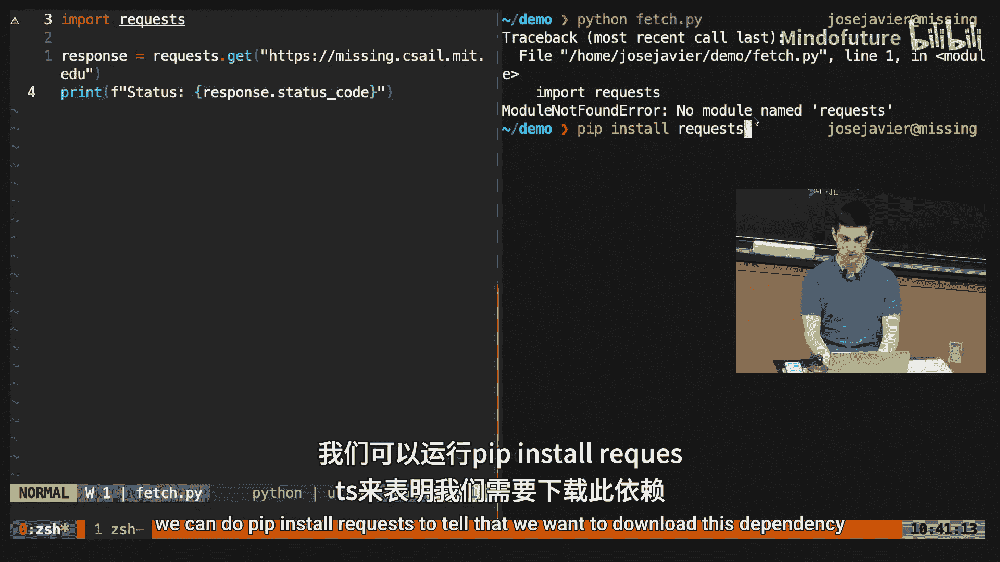

If you look here， there's a lot of things that just printed in or command line and what is going on is that when we ask to get the request packet。

 we went to the Python package index and ask like is there like a request package there can this be installed and we can see here that this request is here and the Python package index like stores all the information so that you can install it？

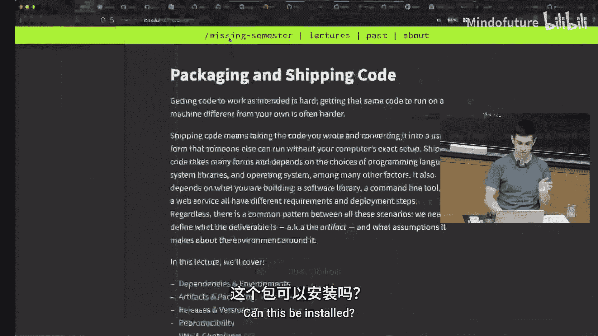

But before you can install the request packets， you can see that we're downloading other。

Libraries as well those are the dependencies of requests before we can pull requests and install it。

 we have to recursively go through all the dependencies of requests and the dependencies of the dependencies of request we have to like navigate this entire tree and install them in order in our file system。

Now， we can take that the program。Ps because now it has the dependency and it was able to execute that code and download the website correctly。

 200 here is like HCDP code for everything went well。And if we say you know is request installed yet。

 we got request， we got the latest version of request， which is the one listed in the packet index。

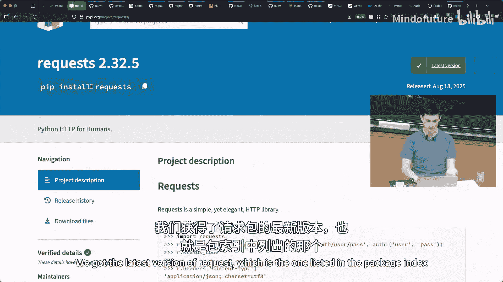

We can actually also check where request is in in our environment。

 if we if Python you can actually check where this is。

 and we can see that this got installed in my default Python installation and that's kind of where all those files that we downloaded from the Python packet ins were unpacked。

Now this process is like this for Python but will change from language to language and from environment to environment and not just in the exact program that you will be running like in trust language you might be using cargo it's not just a change of program but also different programming languages come with different approaches and different philosophies so for instance in trust we have cargo and cargo is like a unified tool you will do pretty much everything it will do the compilation。

 it will do the packaging， it will do the publishing is like a preunified tool chain whereas in Python actually the unification happens at a specification level the Python languages is like these are the rules and is up to you to write like any tools so we will see that PEP is one tool that can do this job but there are other competing tools that just speak the same rules。

And there are even more extreme cases， like if you've ever installed LEEC in your own computer。

 you will find that there are installations of lateEEC that come with actually thousands and thousands of packages。

 it's really rare for you to have to install a latex packets because all of them just come bundle with the language because that's a reasonable model for lateEC to assume。

😊，Now as we。Start requiring more dependencies， the challenges we might run into。Depenency conflicts。

 So， for instance， we can say that we want to。Install。诶。

These two libraries and want we can we can constrain the di versions and we can say like okay。

 we want the NI version to be created on 2。0 and then we actually have like a sibling library of Nai and going to be less than 2。

0。And if we tried to execute this， we had a lot of information。

 but the summary here is there is no set of versions here that is compatible with one another because kind of the type in one it requires the NI one to be less than 2。

0 and as you start adding more packages this is more like a。😊，Pathological example。

 but you start adding more packages where you might run into this situation of having it been impossible to harmonize all the python packages in your operating system。

😊，The solution to this is dealing with environments， the way we can create an environment。

Inbyython is the syntax。By executing this command， what Python is doing is creating a replica of the language runtime that is completely kind of brand new。

 isolated and if we activate，😊，The runtime， then。Or kind of we can take what our executable Python is and now it points to a different place now it points to this brand new folder that we created that is called mym。

And that also applies for other binaries related to the Python runtime， say， for example， P。

If we take whether we have that request package that we recently install is not here because we install that at the default installation。

 now this is an isolated one。We can still install it can。Instal requests。Here。

And it did prettymat the same process of solving all the dependencies。And if we pay list。

 now we can see that along with the default setup tools and PaP。

 we have now all those dependencies as well。And going back to where request is installed now is installed its own isolated environment。

And in general， it is really good practice to have like a fair project environment for you to put your dependencies in as like you start working on more projects。

 it will be easier to keep track of like the exact dependencies and not run into what we usually call dependency hell。

 which is where you start getting lots of different dependency conflicts and they're like really hard to resolve。

😊，Now， as I said earlier the。The Python packaging landscape is quite elaborate。

 it has evolved over the years and there are multiple tools that implement kind of the same packaging logic。

At this day， the easiest one to work with is U。It's。

Kind of like a holistic replacement of not just PP， but like a few different tools。

 And we will use it in the examples going forward is。

Much more user friendly and a thing like the most remarkable feature that people usually highlight is that is way。

 way faster than like Pa in many instances， not just installing but doing dependency resolution and other things it can also handle creating virtual environments so we can create。

😊，Another virtual environment。And here oh， I think we did in。Delete this one， we can delete it。

 we can create a virtual environment now again a virtual environment is nothing magical。

 just another folder that has a bunch of files that correspond to a Python installation。😊。

When we do this source command， we're just changing our path and other environment variables in our so Python can actually resolve to this other option。

And here we can take that there are no packages and if we install requests。We can see that。And。

UV does exactly the same job， but it's actually much faster and as you start getting into bigger and bigger packages。

 it can go actually from minutes to seconds that like how fast it can get。😊。

Beyond isolating dependencies， another common pattern， that you will see not only in Python。

 but in other programming languages is the idea of isolating。Language run by versions。

So in this computer， we have。3。11 and when we're creating this environment， we're also getting the 3。

11 version。But if we need a different one， because maybe the project that we're working on uses 3。12。

Then this can be done， you can create like a virtual environment with a different Python version。

And if we now。え。Activated， we can that effectively the version has changed to 3。12。

So it's another part of like the dependency isolation story。Any questions so far about packaging， No。

 you're good okay。Yeah， so so far we've seen how other people create packages and how we can like include those packages。

 Now the question becomes， if I have some Python code， how can I make that。😊。

Possible to install by other people。The default pattern that you might have seen is if I have file like green Py。

 it's nothing crazy， just the most simple hello world command。😊，If we within the same folder， we say。

诶。From greeting。And then I think we can。诶。We do this， we haven't quote it。

It works and that's because Python by default it tries to look for like any mat green Py in the folder we're running things into。

But if I now change folders and I try to do the exact same thing。Then it doesn't work。

 Python doesn't have a way of finding this greeting package。

 It's not part of the installation that we have in order to make the package installable。

 we need to follow the rules in Python， so。We had an example of how to do this。

So here on the right is premats。 the same code， except we've added a way of also running it with a command line tool。

 So the the idea with Ter is it allows us to do。诶。This and it works。

 so like it's similar to the default library art bars。

And it's just useful for us to introduce the notion of a dependency。

And here on the right it's the Pyproject。commo， this is of the rules of the game。

 this is how Python tells you if you want to create a packet that people can install。

 you have to create a file with this specific schema。😊。

There are kind of more there are other ways of doing this that you have seen like requirements dxt setup dotpyy those also work。

 but the going forward the recommended way is this way so here we have say what is the name of the packet like when we install it how Python will be able to find it。

 what the version it is this is useful for kind of constraining versions。

Some description here we saying we're declaring or dependencies。

 we're saying this library cannot be installed if you have an installed typer with greater or equal than 0。

9 before。This just specifies the build system that is used to create the artifact and then this tellss Python。

 when you install this on top of that also create like a grid program that can be resolved and that calls this CLI function in the greeting file。

So now with all of that， we can。Actually， U P installed。

This folder and it kind of resolve the the entire thing and it built it and now if we go here and we try to do that same idea of trying to import。

That so how are we are。P good。Surs。一定。Yeah， okay。 I had not activated the environment。

 So now I have activity the environment that actually has made it installed， not just all packet。

 but also all the dependencies。 And now。If we go anywhere。And we try to import now Gr results。

 Gring is a package。 We can actually list the packages， and。Search for。Greeting。In。Yeah。Yeah。

 like green packets has been installed with 2。1。 and on top of that。

 now we have the grid command available。And that's because we have now built this packet from like the source file that we had in this folder。

This is great， but this will mean that if someone wants to install this packets。

 they will need all the files that we have in practice when we're dealing with software packaging。

 there is usually a difference between source code and kind of like prebuilt artifact or prebuilt binaries kind of source code is just like kind of like the broad instructions of how to kind of build everything。

 but you in order to use that you need probably an entire like tool chain of。

Depenencies unlike like their prior libraries， but in practice in order to run that program。

 you might not need match code。😊。

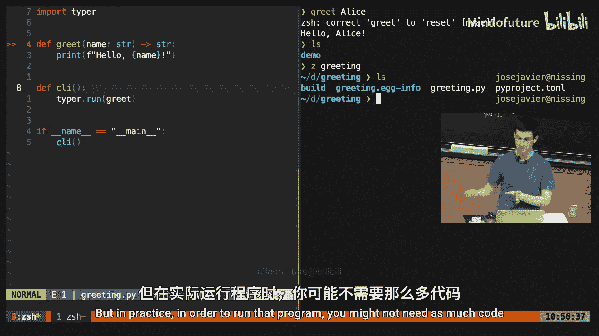

A good example of this is if we go to the gripC tool that we saw in an earlier lecture。

We can see that they have like a releases page and in this releases page。

They actually have a lot of prebu binaries for you to download。

 like if you just download this program， this is a program that you should be able to execute in your computer。

The caveat being here that when you prebu the software。

 now there might be limitations on what platforms can run that software。

The two most common aspects that you will see are the operating system that is running under and the。

CPU architecture so that's why there are instead of being just one file here that's where you're seeing a lot of different files so it's not the same running this for like a Windows PC that it is for like a MacOS running an Apple silicon or even like Linux with a Raspberry pad it's one of those will need like a specific binary for their architecture。

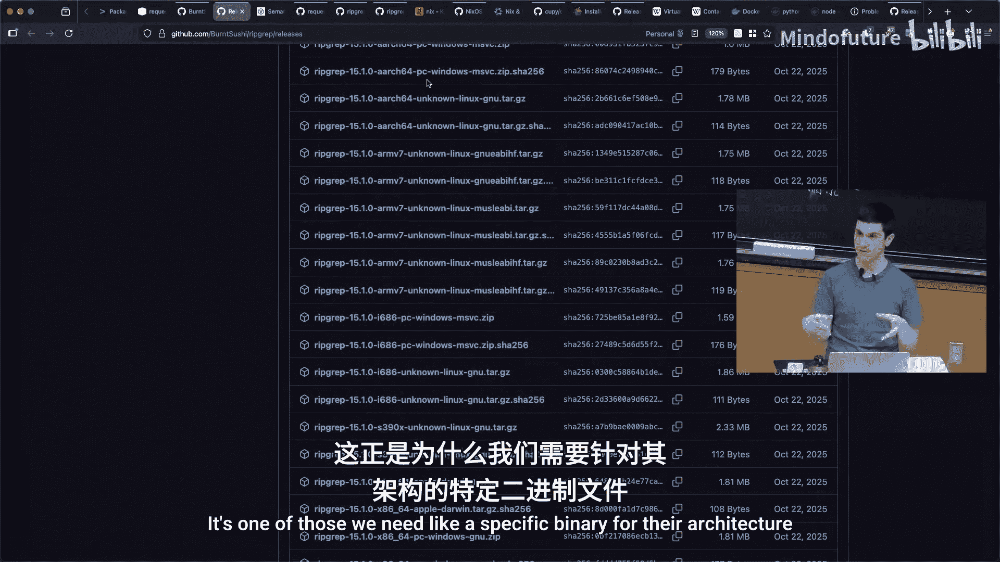

Going back to the Python story， the way we build an artifact that people can use is creating a wheel wheel is just the kind of format and the when we do you be built。

A lot of things going produce， but Python is packaging or application in a standardized way so that like PP and UV and all these tools can actually manage it and install it correctly。

😊，You have they has created two files， the first one has the source code and the second one is this wheel file that if we give to someone this individual file。

 they can run UPP。And that。哦，被宾扫出来。And if you do this， we have now installed the same library。

 but from that single file。嗯。yeah， and one thing to note is this wheel file is not magical in the case of Python is just a C folder and this because we have a pre minimal package。

 this C folder just contains the greet file that we created along with some metadata files that the package manager requires。

Yeah。Okay。Now as you start building your libraries you start adding more and more dependencies。

 so one challenge is as you in order to specify your dependencies。

 you need to know that they' are going to work with your code。

The way we do this in software packaging is by specifying different kind version ranges of what works and what doesn't。

There are again， the syntax will maybe vary slightly from language to language。

 but we can say things like we want this exact version or we can say things like we want a version that is at least this or even more constrain one we can say like。

😊，Great or equal to this， but never get to 2。0。

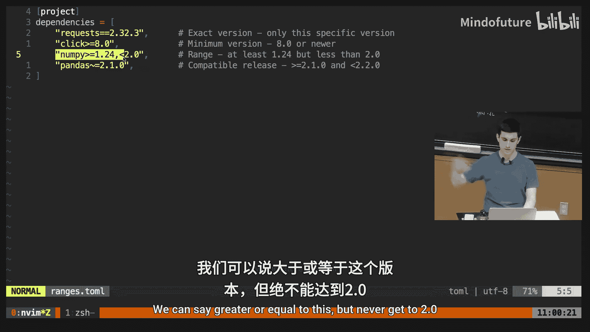

And。People when they release new versions right like you're not installing from the latest。

 you're usually installing from something that is kind of known and stable。

 if we go back to that drip example， they release this like 15。0 E。1。0。

And the they're saying what change and they're saying there's like a bug fix and there was like some new feature announced this is called a change log that's like how people report what has changed from the previous version so you know that it's fine to upgrade or not and in principle you could just look at the change logs of all the dependencies that youre working with。

The challenge is。Again， it's not just about your dependencies。

 It's about the dependencies of your dependencies of your dependencies。

 So even in our minimal example， we can use Uv3 to see what is the tree of dependencies that we created by just adding type like if we。

Get track of Tper。might think it's fine， but it's actually depending on a lot of other libraries。

So what software developers do is create conventions about what happens when you increase a version in one way or another。

 the most popular convention is called semantic version and they're semantic version in versions have three numbers。

 they are all just natural numbers or like positive natural numbers。

 and the idea is you have a major a minor and a patch versions。

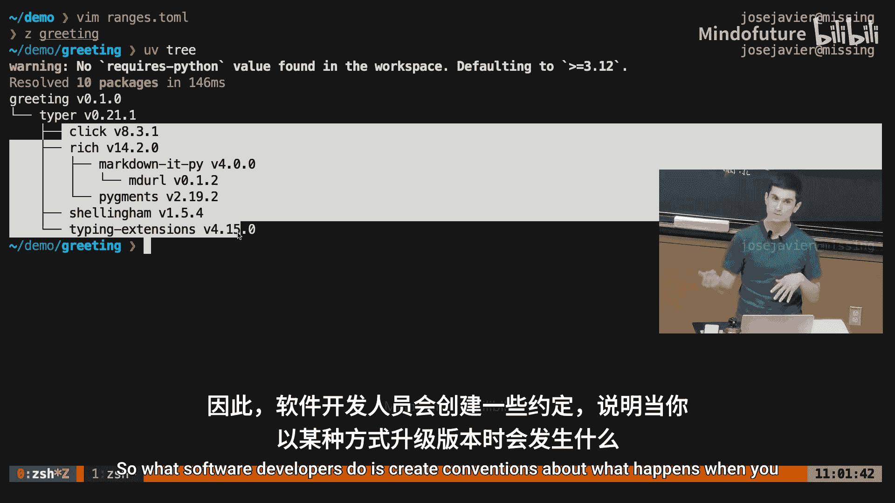

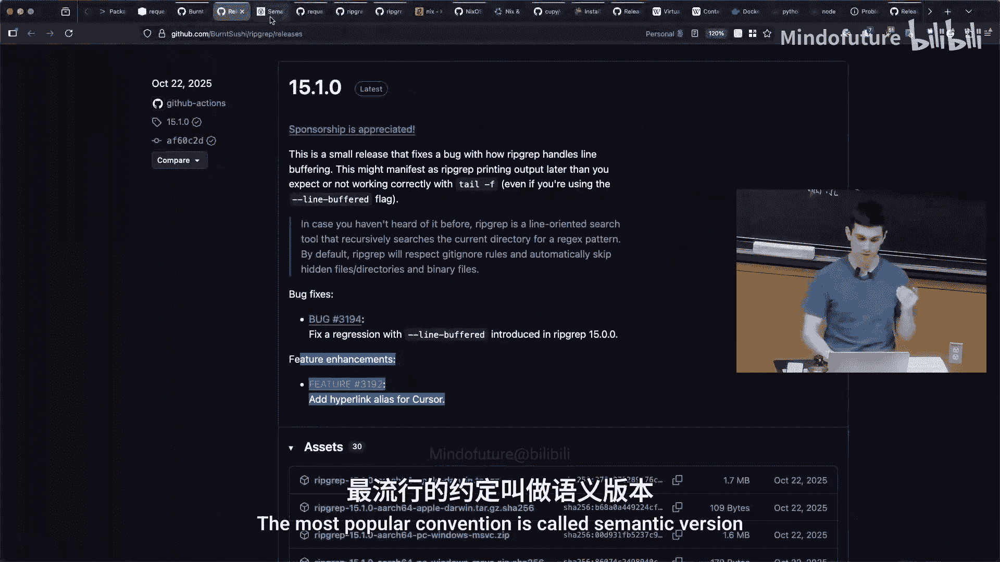

And they define what has changed from the previous version whenever you upgrade the major。

 you pretty much provide no guarantees， like something that was working before if we upgrade major my break and that's why you might see those examples where like you prevent the major version from changing。

If we upgrade the manual version we're saying oh there are new features。

 but everything that was working before through it still work now it just this these new features are only available in this version。

And what is just back fixes and maybe documentation changes， you usually just do like a patch。

 its just like everything is exactly as before for like the users of this library。😊。

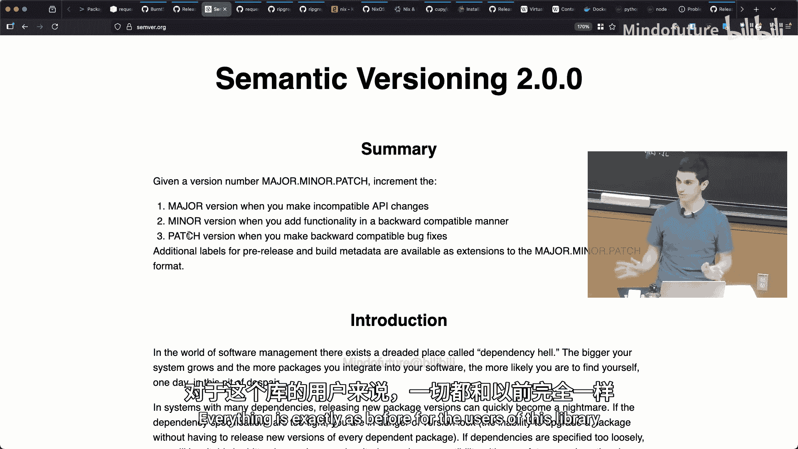

And if we go back to this dripC example， we see that dripC actually like a lot of libraries follows the semantic version。

And。They went from 1500 to 1510 because they added this new feature。

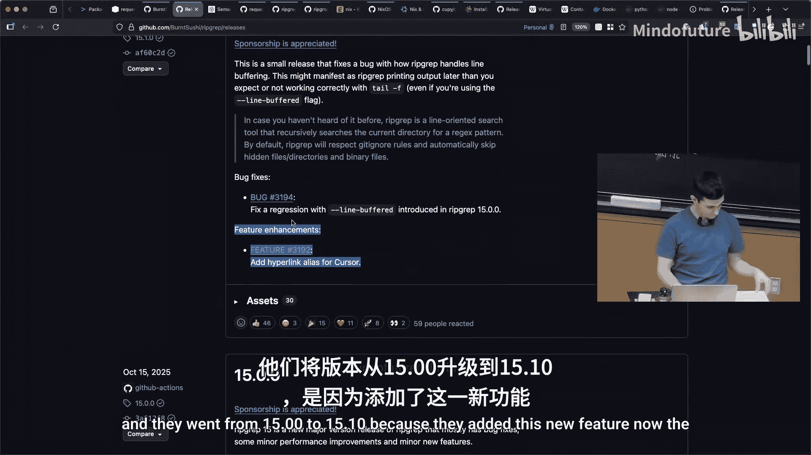

Now， the。Follow up to version in is。When you're building an application。

 there is attention between specifying all the versions。

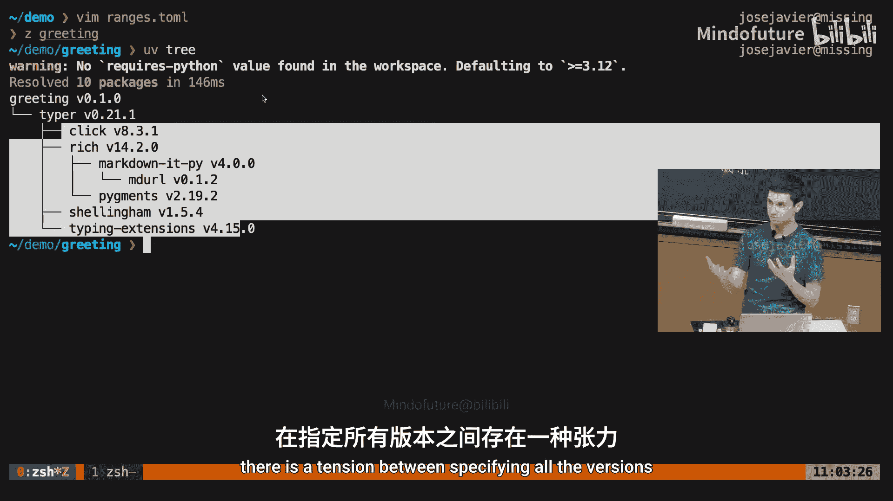

Yeah。There is a tension between specifying all the versions exactly that means that now。

Someone will install exactly the same version that you use and there won't be any issues and just providing in brain you say like。

 okay， hopefully it works with all these different versions。

There is like an important distinction here it depends on the type of program that you're building if you're building a library。

 say for example we're building the requests library in Python we actually want to follow this approach of having like a wide range of values and that's because people are going to install requests along with many other libraries so if we put really strict requirements that will probably run people into dependency conflicts and they won't be able to install all library with other libraries。

😊。

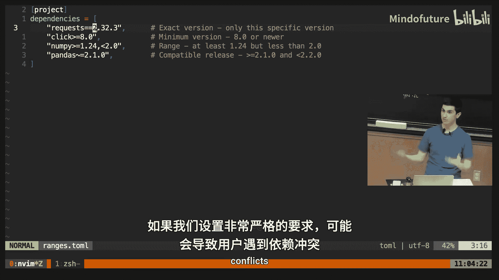

And we can see this in action if we just look at how request specifies its dependencies。

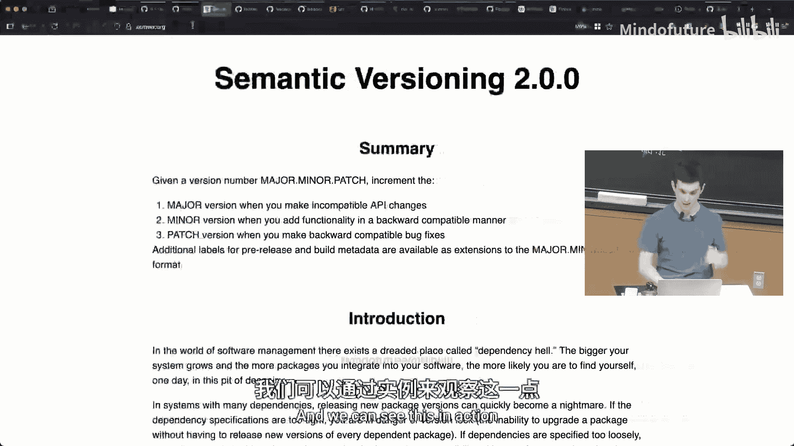

There's actually three wide ranges that they specify， and for the most part。

 they just constrained on major just in case。That's not the same if we're say building an application that people are going to use。

 there is no advantage of just providing these wide ranges。

 we want to pin everything so that we know that whoever uses or final。

Product just gets like a reproducible experience。 So if we look at the dependencies of rip rep。

We can see that gripC provides no ranges like exactly each version of the dripC dependencies has to be used to build the tool because they have tested that these versions work。

😊，Yeah。And the follow up to this is as you start trying to make your packaging more reproducible。

 you will see that people not just specify the kind the diversions but they try to provide a more for approach on specifying pretty much everything so here we can look at a file that was generated by the Cargo package manager that not only resolve the kind of dependencies。

 but also the dependencies of the dependencies and it has the exact versions for each one of them along with like a texton。

Of this library。 So it's not only like， okay， this version is like when we downloaded it。

 this file had this exc has。And we can do the same thing in Python。

 so if we go to our greet packet and we do U log， this will create a log file。And there log file。

We contained a lot of metadata is intended for machines， not really for humans。

 but we can inspect it。 We can see， for example， that the typeer dependency we。

Said that had to be greater than 0。9。But when we created thisproducible setting of our packet。

 he used the latest one。 it used like。0。21。1。 and not only that。

 it actually downloaded both the kind of source and the wheel。 and it here we have information。

About where it was downloaded from and what was the exact has that the file that was downloaded use so now if anyone uses this uses UB syncync。

 they will get the exact same versions like they were using Pi project do Tmo。

 maybe now there's like a newer version of Ter， they will get that one， but if they use UB syncnc。

 they're guaranteed to get the same set of versions that we call when we were testing the application。

There are limitations to this， obviously， so far like as with most things in packaging。

 the moment you leave the boundary of your programming language environment。

 you have to start using tools that are intended for kind of wider dependency management。

For more complex management there。pe they are package managers like Nix that not only handle。

 say Python， but they actually handle all the packages that you could install and they provide like a reproducible way of doing everything in your apps and that's because you might think that it's fine to just build Python 3。

12 as long as is 3。12。But Python requires a C compiler and the version of the C compiler can be different。

 so this is a way of just managing like every single bit of variability in your computer。😊。

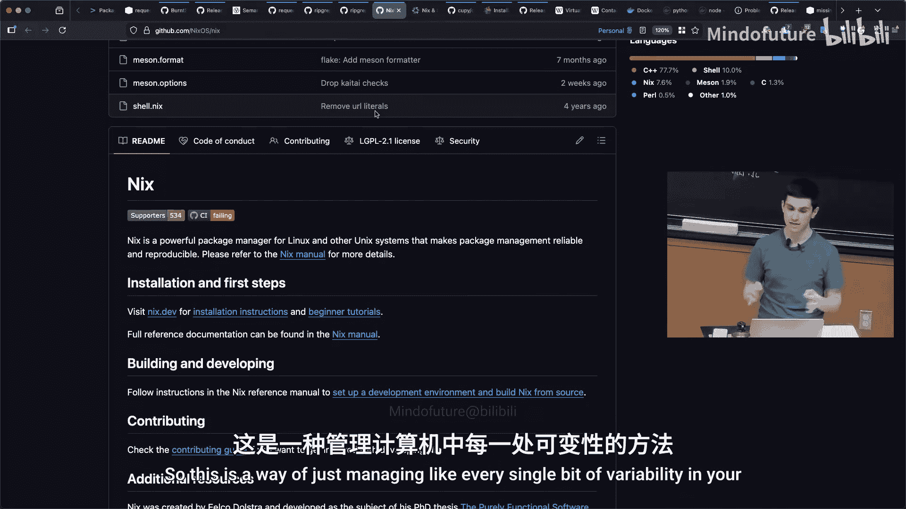

And it's actually like an operating system that is based on this idea as well that。

Where you will trade like flexibility for complexity。

 but it's good to know that in cases where repproducibility matters that much。

 there are tools that you can leverage。Now getting into this topic， the of the follow up is。

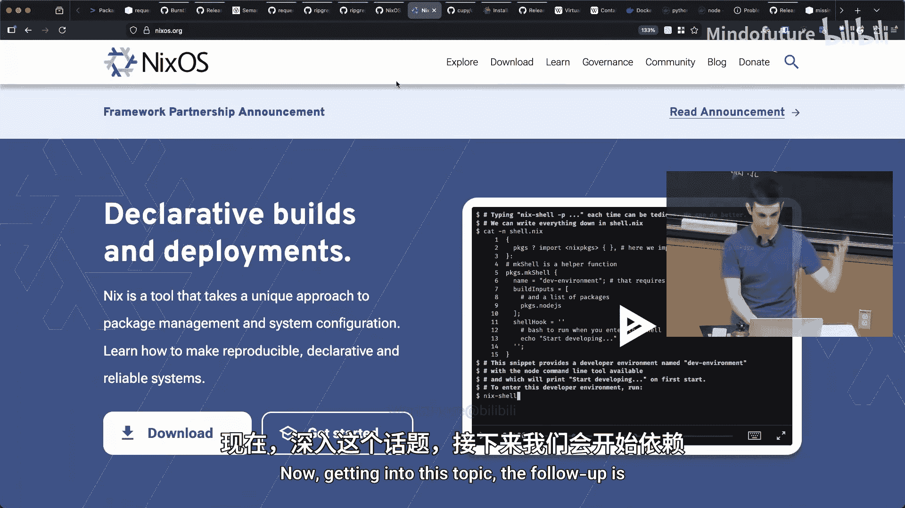

As we start depending on things are outside of like our programming language runtime。

 say like for example， in Python， if we want to start using。嗯。Depenenceencies like say。

 like a GPU driver， like here in this case there's like this CI library and QI is like a python layer to like a Python cropper to call a bunch of hda like NV instructions that Python cannot really manage。

And actually， if we go to the installation instructions of CI。

 instead of saying just like we install this， they're going to say， oh。

 you have to have like a compatible to a cool targetr。

And now it's impossible for us to just specify this as part of our Python packaging。

 we have to go kind of one level above and if we look at how they package their python wheels。

 we see the same pattern that we were seeing with rip grip before where with R grip。

 we just had the operating and the。CPU architecture。

 we still have those so we have like say for example Windows and MD64。

 but now Qpi because it's tied to a lot of the features of Python and Kuda。

 they have to compile separate version for say different ka runtime they have to do for different versions of the Python so for example Python 3。

12， Python 3。10。And you need to find the right artifact in order to install this library。

To avoid a lot of that complexity。What we really want is to sit with our artifact pretty much everything that the user could ever need。

The challenge is that might mean sipping the entire computer。

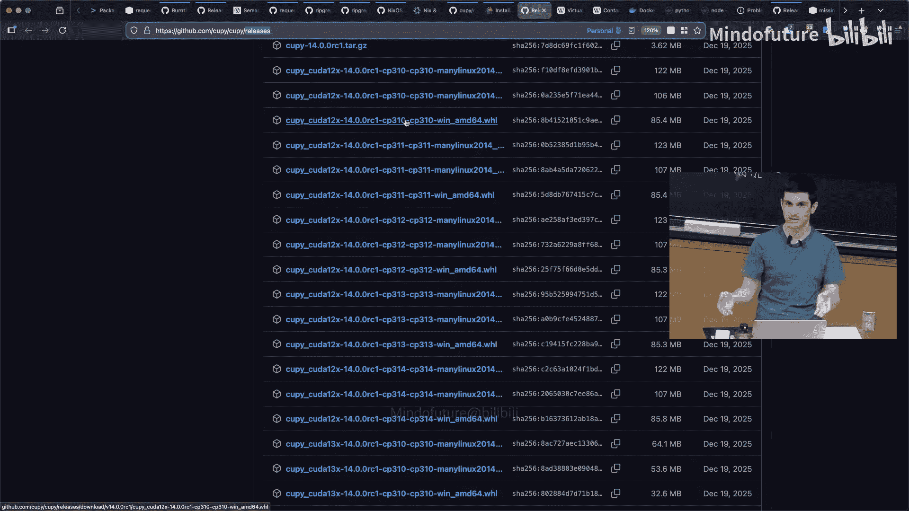

And how do you sip like an entire computer？Well， traditionally that's kind of what people started doing。

 they virtualized computer， they created this idea of just running computers within computers with some constraints。

 but for the most part you could just do it， you could run Linux within Windows and vice vera。

And that meant that if I gave you like a virtual machine image。

 you could just execute it and you will have all the dependencies that。😊，Your program will require。

The downside of virtual machines is there's a lot of overhead。

 like you're running an entire operating system within your machine order just to get an application running。

So。To try to trade off that complexity， what developers realizes， for the most part。

 applications only care about。They kind of user level dependencies。

 they're going to need to modify the operating system itself。

So what you can do is you can reuse a lot of the core components of the operating system。

And then have the application layer be actually what is isolated。

 And this is the idea between between behind containers there。

They're only supported in some operating systems， so Linux and BSD actually supported that you don't have really this notion in say Windows。

And when you want to run containers in Windows or Mac。

 what actually happens is you run a Linux virtual machine。And then you run containers within it。诶。

But that's fine because actually when you go to a lot of kind know。

Applications are deployed in production， they're just using Linux。

 the different flavors with st Linux， and more and more we are seeing this container pattern。

There are different containers implementations。With more the tooling changes from one to the other one。

 the most popular at this point in time is Docker and。

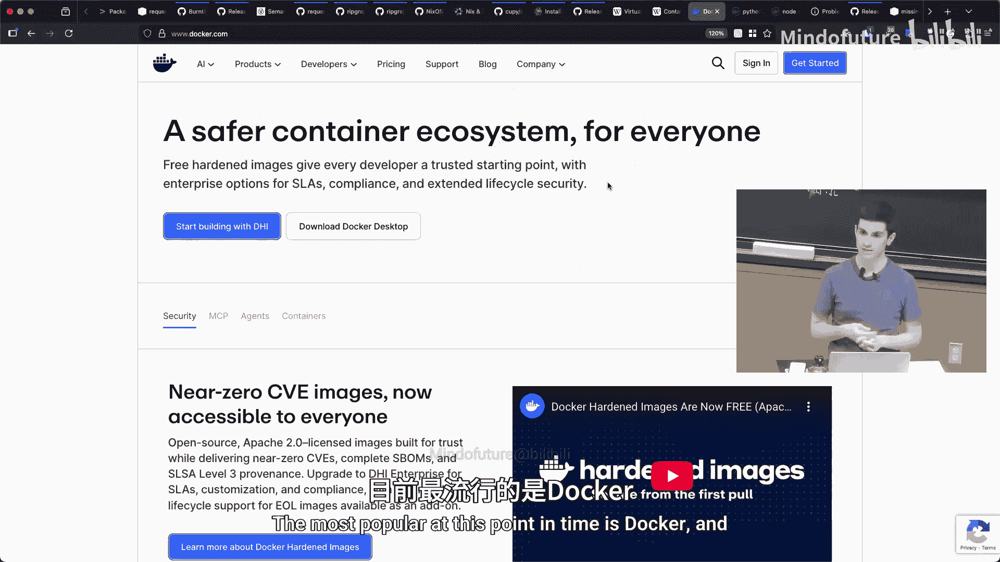

Docker relies on a container runtime called container D than other tools are compatible with。

 So if you've ever heard about Kubernetes， Kubernetes speaks the same。

Language of how a machine is defined and that's useful because Kubernetes has a lot more features like fault tolerance。

 but we can reduce the same images。So。There's a lot of talking very abstract concepts what does this actually look in practice well in practice you install Docker and that spawns a process that allows you to reuse this part of your operating system for other containers。

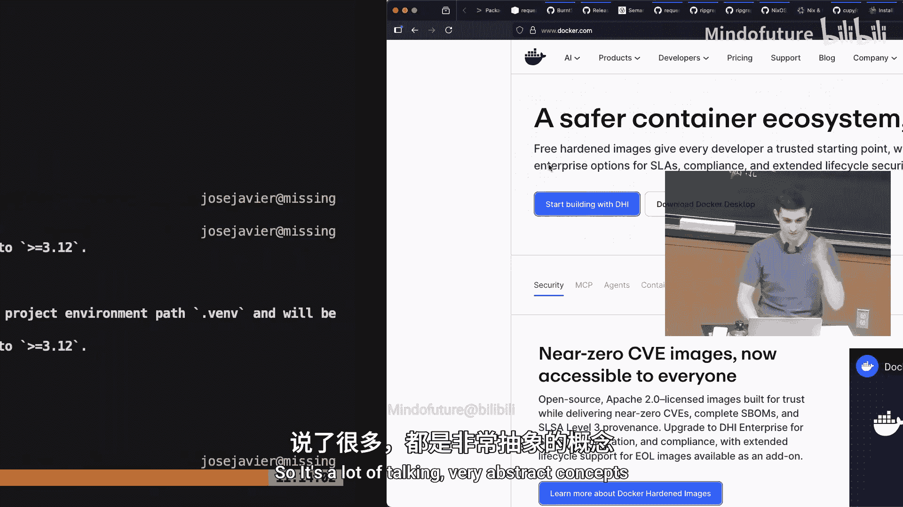

And if we do container， we do docker run。And we do Python。We do this。

 we're saying this has to be interactive。Now this looks like we're just running byython。

 This is like I can do。Whatever I'm used to doing。But it's actually different。 This 3。

14 python is running within an isolated container in my machine。 It's not an environment。

 It's like an entire machine that is been。Isolated here。instead of Python。

 we can actually look at bars and if we look at bars， we can inspect the file system。

We can also check what processes are running and because the containers don't have all that overhead of doing all the operating system bookkeeping here。

 there are no processes just like PSB， which is whatever processes use phone or the ones are actually running。

And Python 314 is a valid container image because if we go to Docker H。

Someone has built these like official limits that is some Linux we can verify which Linux actually we can you say。

Oh， it's a Devian installation， it's a Devian the is like a Linux distribution and they have installed a valid python runtime on top。

😊，If we needed say a different toolt we say needed node， then same idea。

 you download the all like you tell Docker to download the images and here I have already downloaded these images not to slow down the lecture but we can check what images we have and we have like a few images all of these where download it from the Docker servers and I only have to download those files in order to be able to run this like virtual computers within my own computer。

The question is now， okay， but how do I build my own image， like it's fine having Python image。

 but that's not that useful because I want to package my entire greeting library。So for that。

 we use a specials index。That is the Docker files index。This might look like bass， but it'。And。

Every command kind of looks like that。 but in practice is a different language that is designated to create docker images。

 So here， for example， we are saying。Start from the Python 3。

14 image so like this is the starting file system that we are going to have as a starting point and then we install Uv we maybe need the C compiler for in order to build some things。

 then we copy。The files that we need for our library and we actually at the end we have to install it because otherwise we won't have the packet won't be installed within that virtual computer。

And if in order to produce a valid image。We use a syntax like this。

 were pointing it to the folder that contains the Docker file and we're saying we need to give it a name。

 we have to say， okay， this is the grid image so then later we can refer to it。And。

Here it's actually reducingus a lot of the steps， but youll see that there are like these numbers that are being created and that's because every single of those commands is getting tracked by Docker and it's creating like layers of like changes to the file system so that then they can be reduced and if different。

Images reduce the same layers， it can actually deupate the work。Now， if we。Brun。

So by default is getting tagged latest thus the U we always need to give it a tag。

 we didn't give it a tag so it just latest because that's the convention。

And since we installed all packets that define the grid tool and the grid tool is findable because we told Python where to find it。

 then now what we did is very quickly like we spawned this virtual container。

That has this file system including or packet， and then we executed this tiny greeting program that we created。

Now。It might be tempting to just use as syntax like what you're used to doing in cell scripts。

But Docker filess have some caveats， there's like a learning curve to them。And in practice。

 they end up looking a bit more like the thing on the right and that's because here every single step is creating one of these intermediate layers and we want to reduce as much as possible this layer。

😊，We have this like AP update to just download the latest versions for the system package manager。

 but here we combine these operations and we also give some special flags like don't keep extra bookkeeping stuff like we don't need it we're not going to install anything else this is a final product and the same for U like don't try to say save any caches here the cas are not going to useful because this is like a final image for people to use。

But the same thing applies， we can。Build that optimized image。And because I did this earlier。

 everything has already been cast by Docker。And now， if we。Brn it。等住你。So' be able to fly。There we go。

Same sameme thing works。The difference though is that if we list the images and we compare the grid versus the group optimize the first one because we were just downloading all the files not trying to save any space we produce an artifact of close to two gigs in size。

 whereas the optimize one following those patterns that youll encounter in the while。

 that one had like I just have a gift of size and I'm sure there are more things like could have done to make it even smaller and easier for people to run and deploy。

嗯。Any questions so far？How do you know what are like all the green。

You need to put your when you show us that。确的是。啊是。Yeah， the Docker filess are。

Oh sorry so the question is， how do you know what to put in your Docker file。

 like is that created by you or is that created automatically？😊。

Using the simple one just for simplicity， Docker files are not created automatically。

 like in the large majorityry of cases， you write them by hand and the process you have to figure out what your program or your application needs in order to function。

😊，In here， we actually probably didn't need the C compiler。

 like we could have simplified this to copy the source code of the app that we were deploying and then installing。

 I just was adding that as an extract so that they're like。

Some conventions on how to do Docker files when you're installing things and cleaning them in practice if our application。

 for example， had sorry if our Python package had C extensions and we had to compile those C extensions。

Then that will be part of the。Require that we need it and then in that case we will have to use GCC。

It will be pretty obvious to some extent why you need to put in your Docker file。

 like as you start like using your application and figuring out like your dependencies。

 you will quickly realize like oh my application cannot function without this thing or that other thing going back to the QI example。

 we know that QI requires QUuda， so either we start with an image that gives a kuda or then we need in our Docker file to install it somehow because we know that our application requires it to function。

Now， the。Drying containers is good， but then at some point you will start fighting like another layer of abstraction and the following layer of abstraction is instead of relying on dependencies that are just like regular packages that you can say like import requests and use it。

 you might start depending on entire services and those services。Have their own separate container。

So as an example， this could be a database like maybe you're using an entire Postgres SQL database and now you have to decide like you have the option of trying to install Postgres within your Doggcker file and hoping that the dependencies that Postgres has and the dependencies that your program has don't conflict with one another。

Or you have to just separate them into different containers and make them communicate with each other。

And because goes。Dependency hell is a very real thing and kind of harmonizing versions can be quite complicated。

 that second pattern appears substantially more often。😊，So， if we want to。

Say create like a web application， really simple one。Where。We every time someone visits。

 we're going to say， okay， this page has been visited this many times。

We could of course save this to some file or wherever。

 but it's more fun if we actually put like a real database that we are deploying and especially one that gives us some good properties so in this case we're going to use ETCD which is。

😊，Fall tolerant and like pretty robust database choice that we can use。

Since there has like some requirements， it will be difficult to install along or application。

So instead what we are going to do is we are going to communicate with it through requests。

 so here whenever anyone visits our website， we are calling this helper function of increasing the visit counter。

And if we go to see what that does， we're saying， okay。

 there's some overhead because we have to encode and decode。

 but the important thing is we're making requests to this URL with a specific payload。

 we're saying okay。Give me the key value， then we increase the key value。And then。

Update the like put that key with that new value。This is just like most simple database operation we can do just like read and cry increasing one。

But now we have problem now we have to deploy these two containers and make them talk to each other。

We could do this by just doing a bunch of Docker run commands。

 we will have to also learn about Docker networks and how to make them be in the same network。

But in practice， what you will see is。Some way of having another programming like a dedicated programming language just for specifying how services have to be deployed and connectedor to one another。

 so Docker composeose is an extension of Docker that does this very same thing like it takes in a configuration file and it translates it into a series of Docker commands to deploy the containers that you need to run。

In this case， we're deploying two services， so we're deploying our web service。

 and then we're deploying our database。And we're here saying， okay。

 this is the image for the database for our application， we have like a Docker file here。

 so we use this different syntax。😊，But one thing I want to highlight is for example。

 we can specify a dependency like we should not start the web service before the database is running so。

That will be quite tricky we were to do this manually here we do it in a declarative way and it's fairly easy for us to say don't start this until this one here is running Also we need to give some configuration。

Beyond。Kind of like packaging the code you also have to think about how people are going to brand the code and how they're going to modify its behavior a good mental model is the same application should be able to get deployed in two different machines only changing configuration parts。

 never the source code the source code should not be modified if you're just changing for example what port you are going to listener。

So。Spifying configuration comes in different ways， we already saw this in the scripting lecture and a few of the patterns that we were seeing there reappear here so our program for example。

😊，Expects the URL of the database under this environment variable ETCD URL。

 whereas for ETCD it's easier to pass the options as just like CLI flags and that's how we are specifying them here。

Now， if we do。Docker composeose app。That spawn in both containers and we can see this in the logs where we have the ETCD container and we have our web app container and it says that it's running under this URL。

And if we query that URL， we get that this page has been visited one time if we visit it again， two。

 three and so forth， but like every time we're making a request to the web application。

 the web application is communicating with the database application in order to update discounts。

And we。Have now solved the problem of how to kind of deploy these more complex multi service applications。

 We still have the problem of who starts this。 Like， I cannot just。

Hope that like every time this machine gets restarted， someone SSH in and does Docker compose up。

 So another kind of。The pattern that we'll see is like ways of orchestrating services are starting。

In Linux， the most popular one is system D and system D has a way of defining services。

 we can register through a new one by just creating a file under ETC system D system。And。

This is a bitorium， but like system D has its own syntax for the things and this is where LLMs can be super useful。

 like just learning about what are the options you can ask them they will give you like they will teach you about this dedicated syntax but kind the TLDR here is we are telling or host Linux operating system okay whenever you start there is this application and please don't run it before the Docker service because it requires Docker so the Docker service has to be running and go into this folder and do Docker composeor。

😊，The minus d is just so it like detaches， like it doesn't hang on the common line and whenever someone wants to stop it。

 just do Docker composeos down。We。Start this service by just using the system CTL command tool that uses this file in order to operate so we can start the application。

 looks like nothing happens， but if we look at this status。

We can see that the same thing that we did before of doing Docker composeos app has been done。

 but now is the operating system that it's managing this and we were to restart the machine。

 this will start automatically。And if we p that same website。

 it's now back again running and it' tells us that it has been visited four times。And if we want to。

Let's stop it we。Just stop the service。Okay， the last topic I want to cover today is how you not only create these artifacts。

 but get people to access them like so far， everything is like you create this file。

 but where do you put this file Well you could put it in。😊。

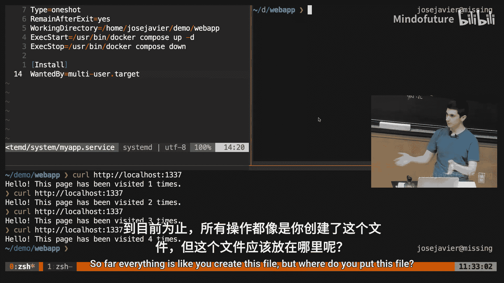

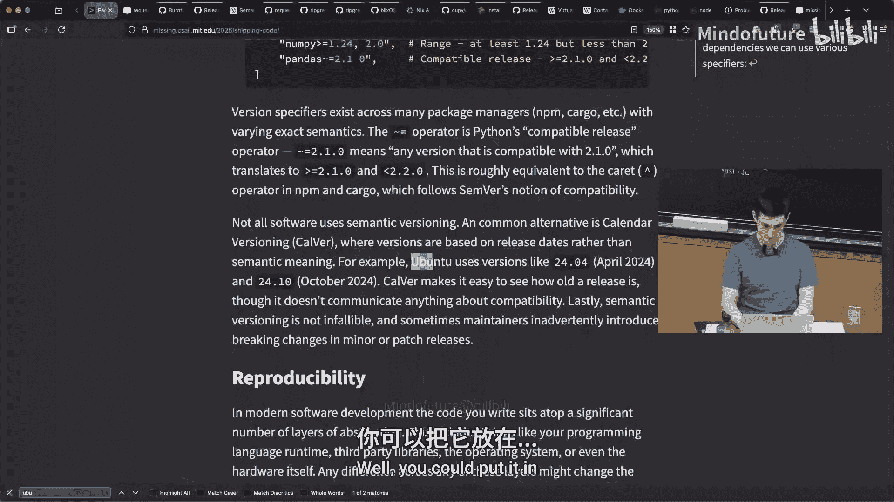

You could put it in a website and just have people download it and this for example what you know the Ubutu people do。

 this is just like you can download the files from here。

 but in practice the common way of doing this is through as we have been seen is putting them on GiHub so the。

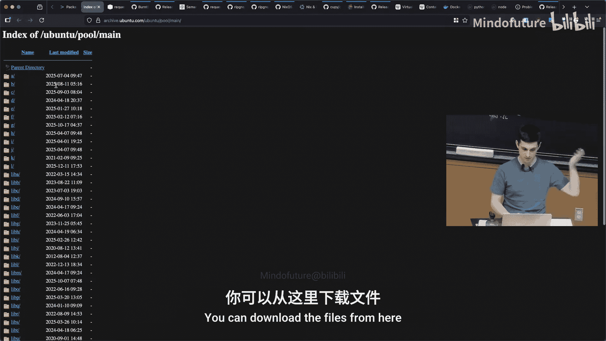

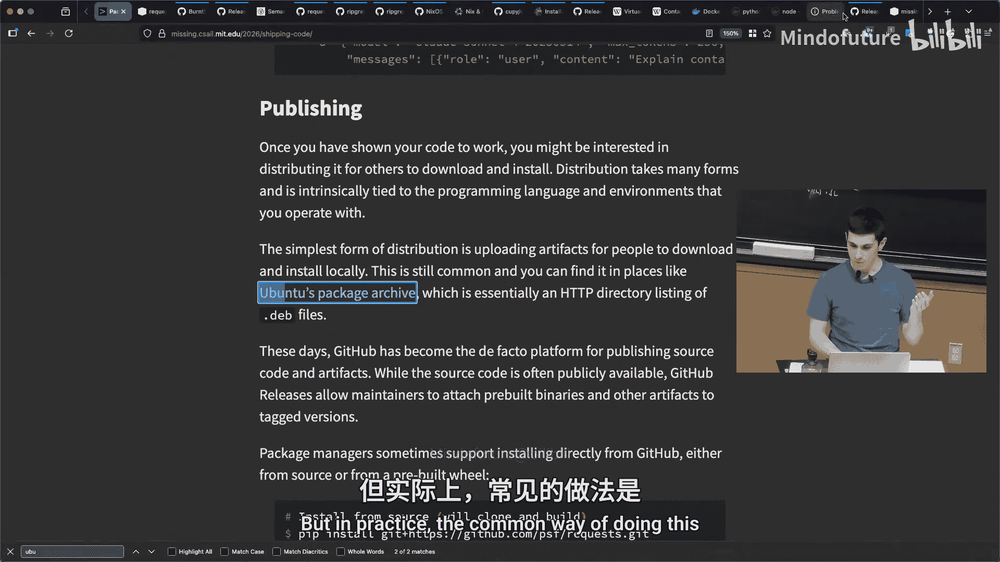

A lot of packages will just put the code on GitHub and give you instructions on how to install it。

In fact， package managers can install directly from Gitthub like if we go。we can go。Yeah。

So before we saw that we could do peep install。request and that will go to the Python package index。

 but we will also have just say， okay， installed from the latest version of the source code and this instead just downloads the source code and we'll build a wheel from that and then install the wheel。

We could also see whether request policies wheels request does in the indeed policies wills so we can。

Grab this URL and do the same thing。In here we're now installing instead of from the latest。

 we're installing from this specific release， but it's just a file as long as we can get it。😊。

We will be able to install it。Yeah。😊，You probably are wondering is this where where Pip is going。

 Pip is not going here whether Pip？Yeah， where Pip is going。

 we can actually find by making it give us all the output and then filter for the wheel。

And I think we have to unall it first。Yeah。So we uninstall it and then we install it again and here we can see the exact URL that was used to get the metadata and then the URL that was used to get the package itself and now the question becomes well how do I put my package in Pipei so other people cant find it？

😊，Where while Pip cannot help us with that， UV can and if we go to greeting。

We make sure that it's actually not green。Greding is taken so we can go into missing semester just for demonstration purposes and we can build the packet。

Now we have this wheel and if we say you be published。And when here we' given this extra command。

 I'll explain it in a minute why we're doing that， we have now uploaded our wheel into the package index for other people to use。

It will be waste this kind of polluting pipe so the Python developers came up with test Pi which is a replicgraph Pi that you can use to just test that you know how to publish this packages so here I think this was the previous version that I was testing and what we just ran upgraded it to the next patch version and since。

We。Give some instructions on how this is published。

 there's actually a rhythmmi and people can use it。And if we go back。Did we do UBPP install。From。

Test bye bye and the missing semester packet。 We're downloading。 I think it's using the。 yeah。

 it's downloading the packet and unpacking into your virtual environment。

The story is really similar for premats any packet and even for other things like Docker。

 like if we want to。We want to release that creating a Docker image for people to use。

we first have to build it in a specific way。Docker will only let us post images that you have permission servers。

 I will only have permission over images that start with my username。

 so we have to build it with that detail in mind。

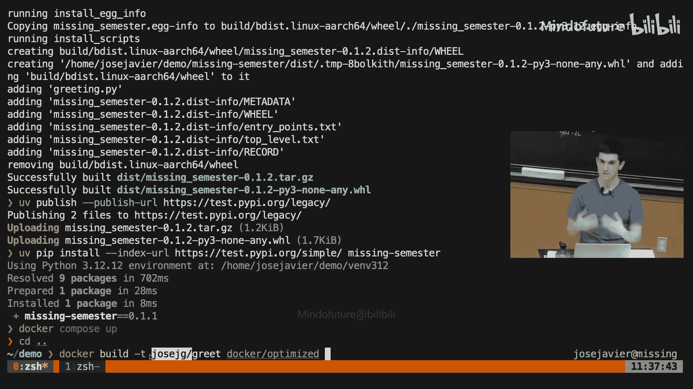

It's exactly the same image we built before， so there's pretty much a op。

 we're just tagging it as so。And if we now was。This image。Docker。

 it's fine that all of this has already been post。

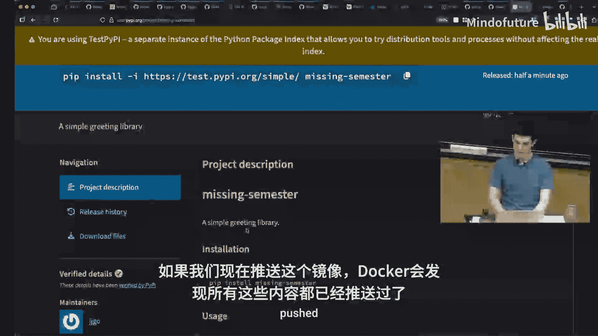

But if we go into Docker H and we。T。Anyone can now go in and download this image and they have like an entire file system to run this green up。

Y， and the。The exercises cover a lot of these patterns and I think it's。

Kin of a lot of information to go through a lot of this you will learn by doing and like kind of building your own pProject domal and your own like Docker file and like pushing and installing。

 but hopefully everything that we have coveredID today gives you like a good mental framework of how dependencies and how kind of modern software applications are like built and distributed online。

😊，Andm happy to take any questions。Oh。Okay。嗯。Yeah呀。什。Yeah， yeah， I know。I a simple question。

 If I'm collaborating with somebody and I created a virtual world container and。

 how does he get access to my。Yeah。So you have to use a container resry， reistry。

 so the same way I push this onto Docker H， their Docker Hb is not the only container rery that it's online。

 but as long as both you and him have access to the same point。

 then you will like be able to Docker Po and Docker push and that will have all the dependencies。And。

You will have to authenticate you have to prove to Docker H or like the GitHub container registry or like whatever container restry that you're using。

 you have to prove that you are you and that you have access to like grid the contents of that container but then it will allow you to download the entire image and then run the application and the same kind of the same idea supplies to prettymatch any framework like with pipepepi。

 there are public。Places and you could put them on GitHub and as we saw。

 you can install them directly from here。But yeah， as long as you have like a common kind of like repository to post code or artifacts。

 then it's very easy to collaborate with one another。Even yeah。Okay。Oh。オケ。No worries， thank you。

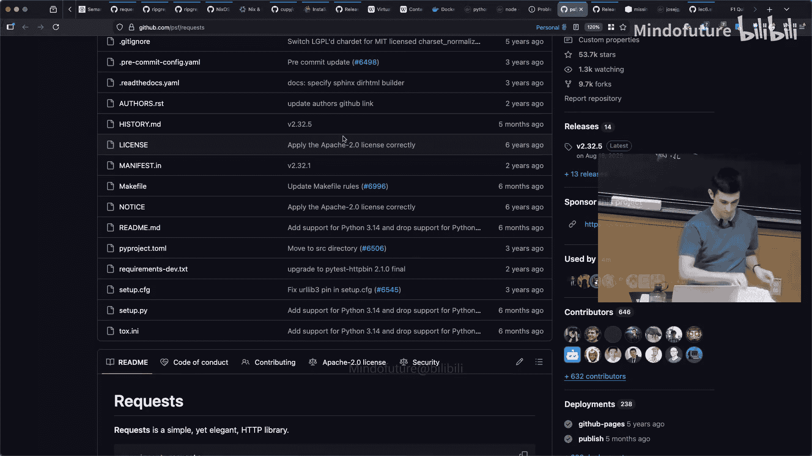