# 编程缺失的主题：P06：代码打包与分发 🚢

在本节课中，我们将要学习如何将代码打包并分发给他人使用。这不仅仅是复制文件那么简单，因为代码的运行依赖于编程语言运行时、操作系统特性以及其他库。我们将探讨如何管理这些依赖、创建可复制的环境、构建可分发的软件包，以及使用容器技术来封装整个应用。

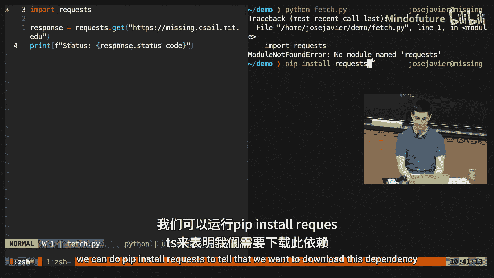

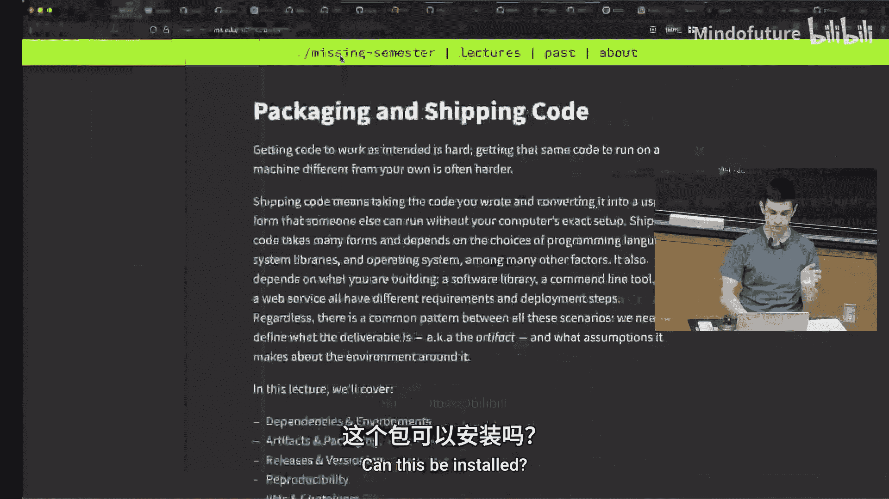

## 理解依赖关系

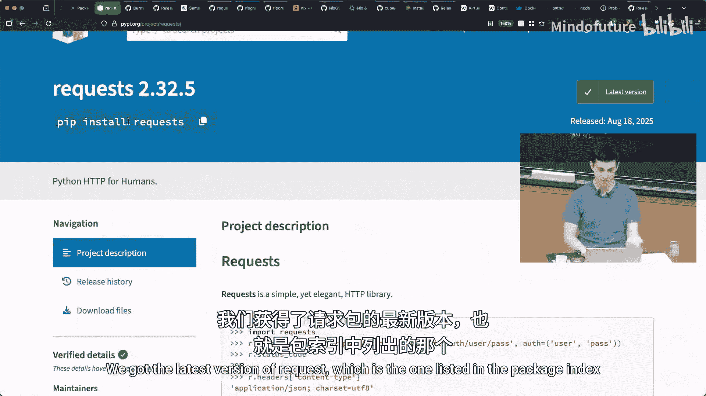

上一节我们介绍了打包的基本概念，本节中我们来看看代码运行的基础：依赖关系。你的代码通常不仅依赖于你编写的文件，还隐式地依赖于许多外部库和系统组件。

例如，考虑以下简单的 Python 程序：
```python
import requests
response = requests.get("https://missing.csail.mit.edu")
print(response.status_code)
```
如果你尝试运行它，可能会遇到错误，因为 `requests` 库不是 Python 默认安装的一部分。你需要先安装它。

在 Python 中，默认的包管理工具是 `pip`。你可以使用以下命令安装 `requests`：
```bash
pip install requests
```
这个过程会从 Python 包索引（PyPI）下载 `requests` 及其所有依赖项，并将它们安装到你的文件系统中。之后，程序就能成功运行了。

不同的编程语言有不同的包管理工具和哲学。例如，Rust 使用 `cargo`，它是一个统一的工具链，负责编译、打包和发布。而 LaTeX 则通常将所有包与语言运行时捆绑在一起分发。

## 管理依赖冲突与环境隔离

随着项目依赖的增加，你可能会遇到**依赖冲突**。例如，两个库可能要求同一个依赖的不同、不兼容的版本。

以下是解决依赖冲突的方法：
*   **创建虚拟环境**：虚拟环境为每个项目提供了一个独立的 Python 运行时副本，隔离了依赖。

在 Python 中，你可以这样创建和激活虚拟环境：
```bash
python -m venv myenv
source myenv/bin/activate  # 在 Linux/macOS 上
# 或
myenv\Scripts\activate     # 在 Windows 上
```
激活后，`pip` 安装的包将只存在于这个独立环境中，不会影响系统全局或其他项目。这是一种避免“依赖地狱”的好实践。

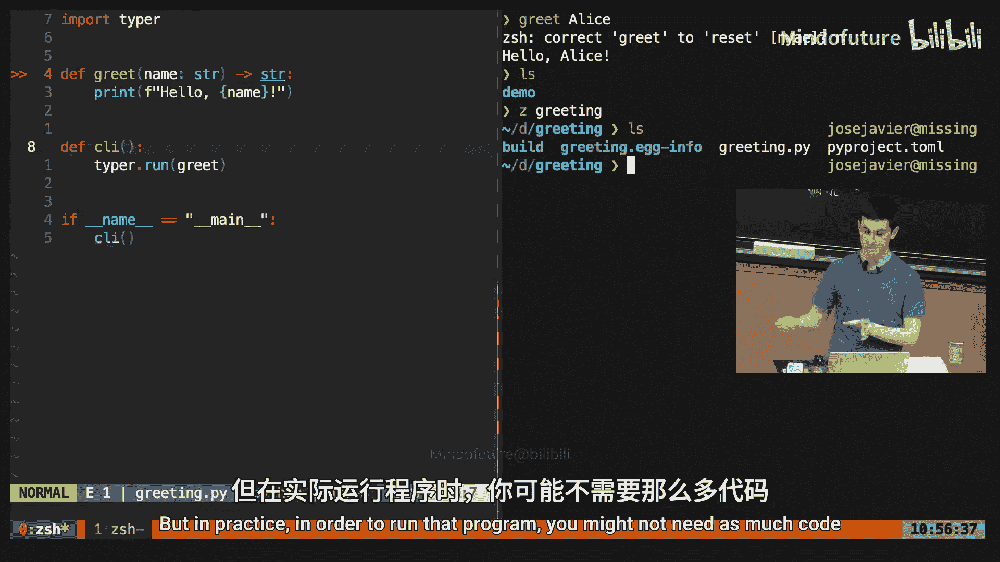

除了 `pip`，还有更现代、更快的工具如 `uv`。`uv` 不仅能更快地安装包和解析依赖，还能方便地创建和管理虚拟环境：
```bash
uv venv myenv
source myenv/bin/activate
uv pip install requests
```

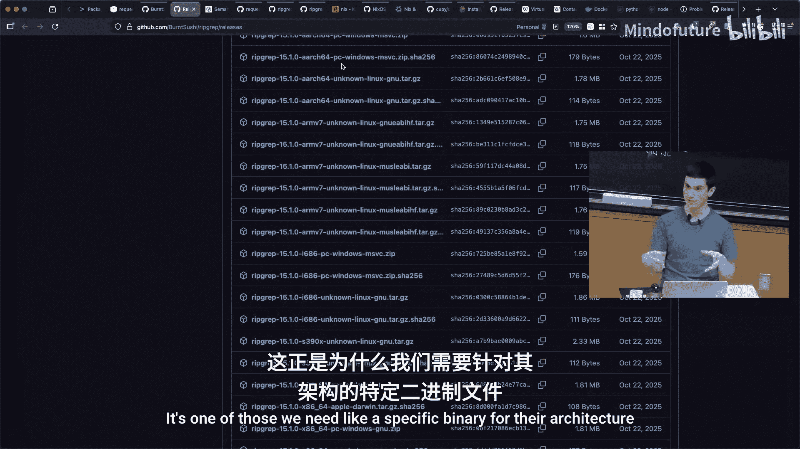

另一个常见需求是隔离**编程语言本身的版本**。例如，你的项目可能需要 Python 3.12，而系统默认是 3.11。使用 `uv` 可以轻松指定版本：
```bash
uv venv --python 3.12 myenv-3.12
```

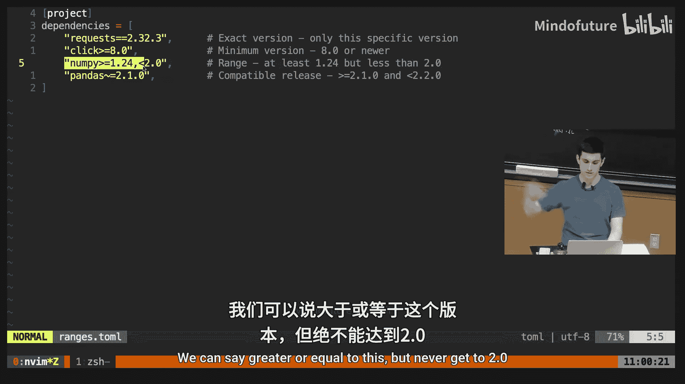

## 打包自己的代码

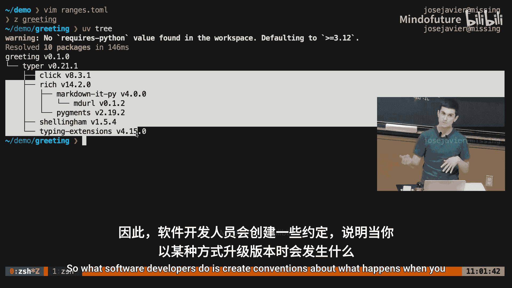

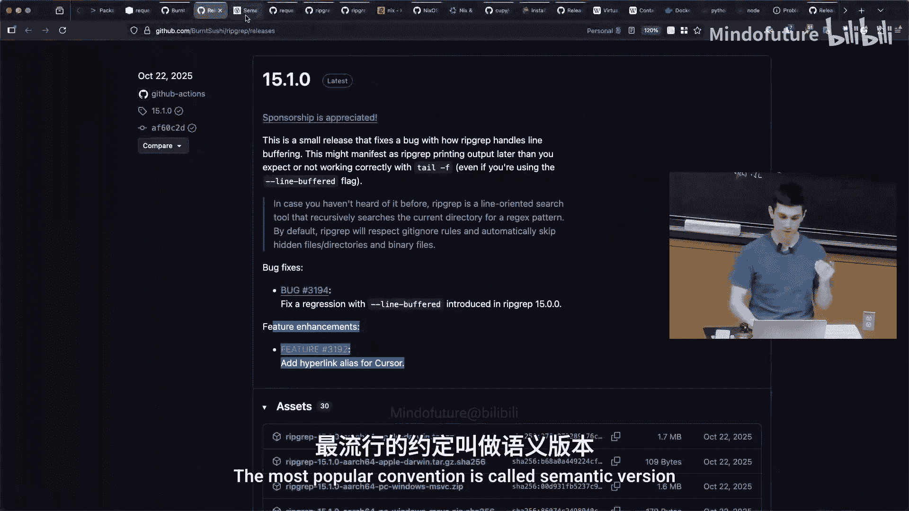

上一节我们学习了如何安装他人的包，本节中我们来看看如何将自己的代码打包，让他人能够安装。

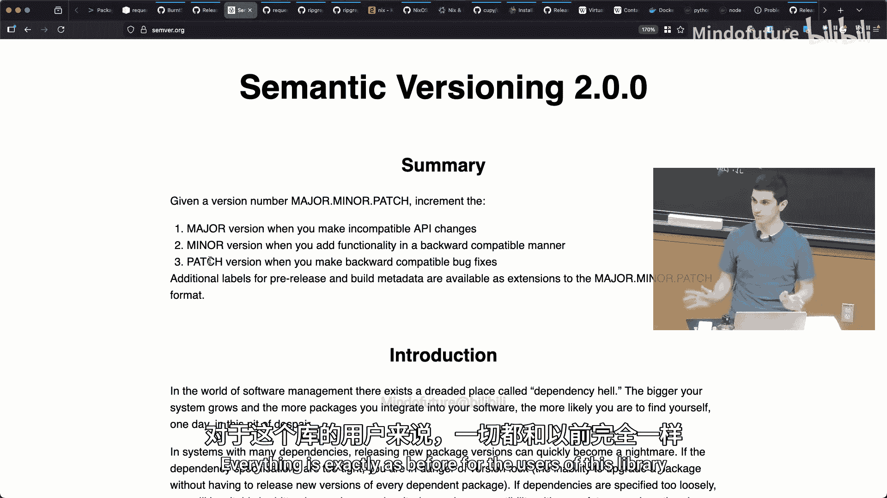

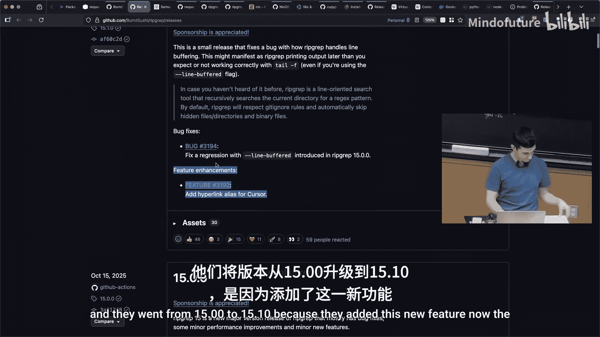

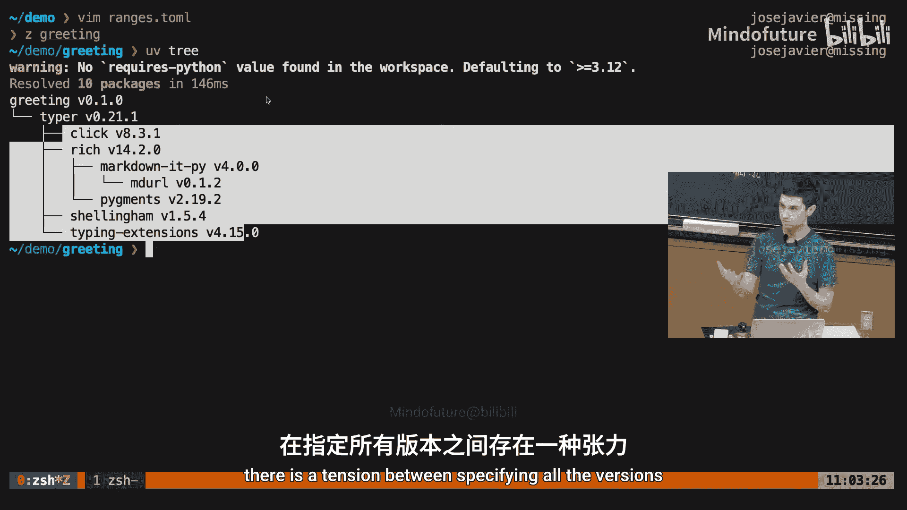

假设你有一个简单的 Python 文件 `greeting.py`：
```python
def hello():
    print("Hello, world!")
```
在同一个目录下，你可以通过 `from greeting import hello` 来使用它。但如果你切换到其他目录，Python 就找不到这个模块了。为了让代码可安装，你需要遵循 Python 的打包规则。

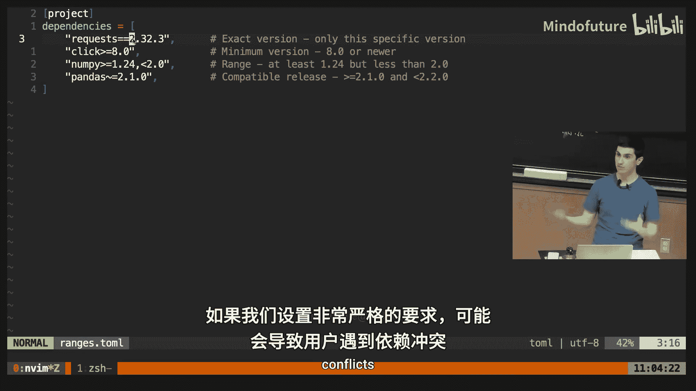

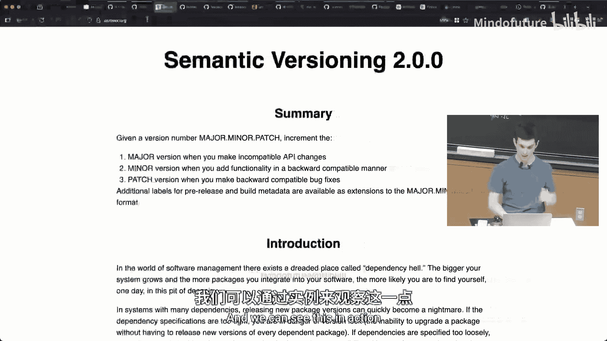

以下是创建一个可安装包所需的核心文件：

**1. 项目代码 (`greeting.py`)**:
```python
import typer
app = typer.Typer()
@app.command()
def hello():
    print("Hello, world!")
if __name__ == "__main__":
    app()
```

**2. 项目配置文件 (`pyproject.toml`)**:
```toml
[project]
name = "greeting"
version = "2.1.0"
dependencies = ["typer>=0.9.0"]
[build-system]
requires = ["hatchling"]
build-backend = "hatchling.build"
[project.scripts]
greet = "greeting:app"
```
这个文件定义了包的元数据、依赖项、构建系统，并声明了一个名为 `greet` 的命令行工具入口点。

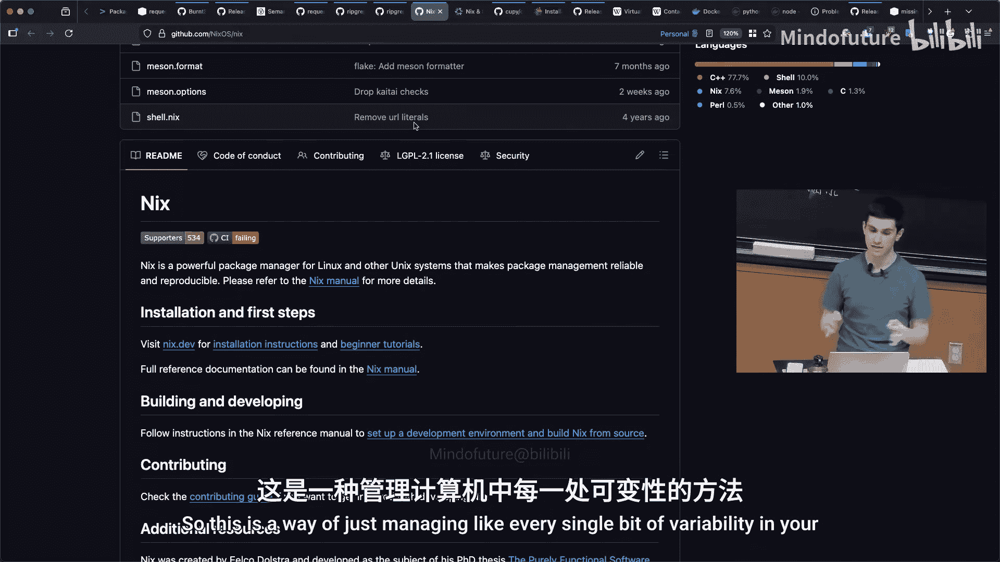

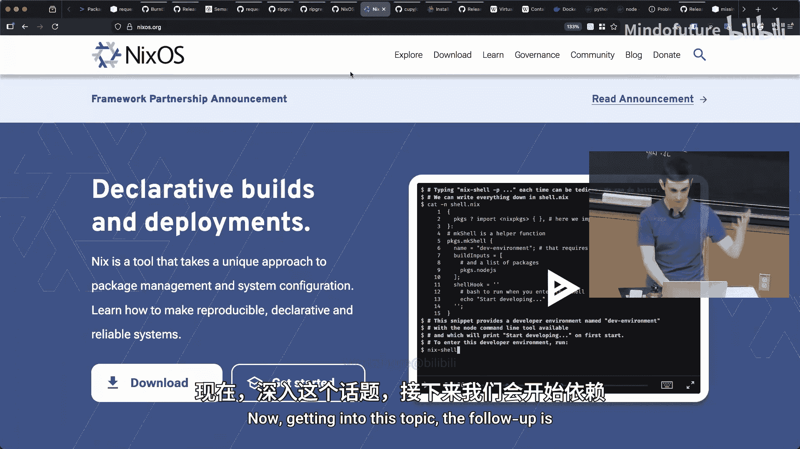

配置完成后，你可以在项目目录下使用 `uv pip install .` 进行本地安装。安装后，不仅可以在任何地方通过 `import greeting` 使用该库，还可以直接在命令行运行 `greet` 命令。

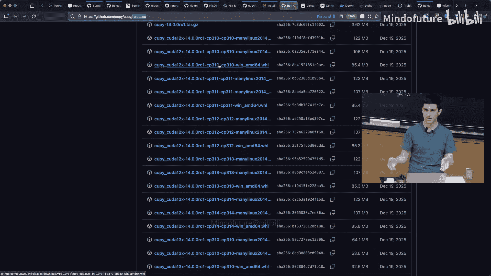

## 构建可分发的制品

直接从源代码安装要求用户拥有完整的构建工具链。更常见的分发方式是提供预构建的**制品**，例如二进制文件或打包好的归档。

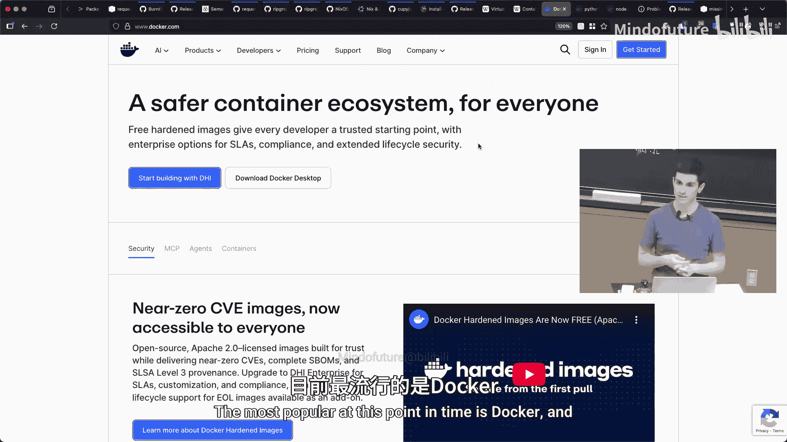

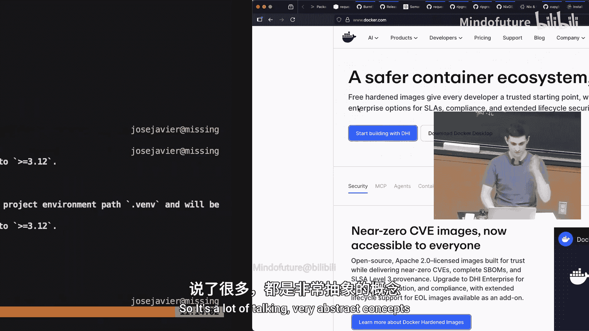

对于 Python，标准的预构建格式是 **wheel** 文件（.whl）。你可以使用构建工具来生成它：
```bash
uv build
```
这个命令会生成一个 `.whl` 文件。这个文件本质上是一个包含你的代码和元数据的 ZIP 归档。其他人只需这一个文件，就可以用 `uv pip install greeting-2.1.0-py3-none-any.whl` 来安装你的包，无需访问源代码。

对于其他语言（如 Go），你通常会为不同操作系统（Windows、macOS、Linux）和 CPU 架构（x86-64、ARM）编译多个独立的二进制文件，用户直接下载对应版本即可运行。

## 版本管理与语义化版本

管理依赖时，你需要指定它们兼容的版本范围。常见的做法是遵循**语义化版本**规范。

语义化版本号格式为：**主版本号.次版本号.修订号**
*   **主版本号**：做了不兼容的 API 修改。
*   **次版本号**：做了向下兼容的功能性新增。
*   **修订号**：做了向下兼容的问题修正。

在 `pyproject.toml` 中，你可以这样指定依赖版本：
```toml
dependencies = [
    "typer>=0.9.0, <2.0.0",  # 大于等于0.9.0，但小于2.0.0
    "requests==2.31.0",       # 严格等于2.31.0
]
```
对于**库**项目，通常指定较宽的版本范围（如 `typer>=0.9.0`），以避免给下游用户带来不必要的依赖冲突。对于**应用**项目，则倾向于锁定所有依赖的确切版本（使用 `uv pip compile` 生成 `requirements.txt` 或 `uv.lock` 文件），以确保部署环境完全一致、可重现。

## 使用容器封装应用

当你的应用依赖扩展到编程语言环境之外（如特定的系统库、编译器、GPU驱动）时，环境管理变得异常复杂。**容器**技术（如 Docker）通过封装整个应用及其运行环境（文件系统、库、配置）来解决这个问题。

容器与虚拟机的区别在于，容器共享主机操作系统的内核，只隔离用户空间，因此更加轻量高效。

**创建 Docker 镜像**
你需要编写一个 `Dockerfile` 来定义如何构建镜像：
```dockerfile
# 使用官方 Python 镜像作为基础
FROM python:3.14
# 安装构建工具和包管理器
RUN apt-get update && apt-get install -y gcc && rm -rf /var/lib/apt/lists/*
RUN pip install uv
# 将应用代码复制到容器中
COPY . /app
WORKDIR /app
# 安装应用依赖
RUN uv pip install .
# 定义容器启动时执行的命令
CMD ["greet"]
```
然后，使用以下命令构建并运行镜像：
```bash
docker build -t greeting:latest .
docker run greeting:latest
```
优化后的 `Dockerfile` 会合并命令、清理缓存，以生成更小的镜像。

**管理多服务应用**
现代应用通常由多个服务组成（如 Web 应用和数据库）。`Docker Compose` 允许你使用一个 `docker-compose.yml` 文件来定义和运行多个容器：
```yaml
services:
  web:
    build: .
    ports:
      - "8000:8000"
    environment:
      - DATABASE_URL=postgres://db:5432
    depends_on:
      - db
  db:
    image: postgres:15
    environment:
      - POSTGRES_PASSWORD=secret
```
运行 `docker compose up` 即可启动所有定义的服务。

为了让容器化应用随系统启动，你可以将其配置为系统服务（例如，在 Linux 上使用 `systemd`）。

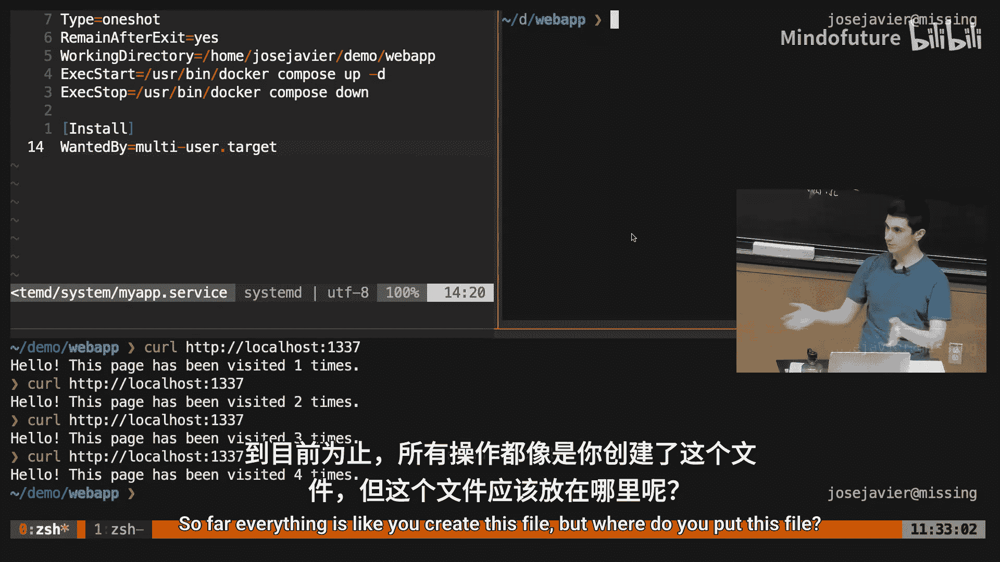

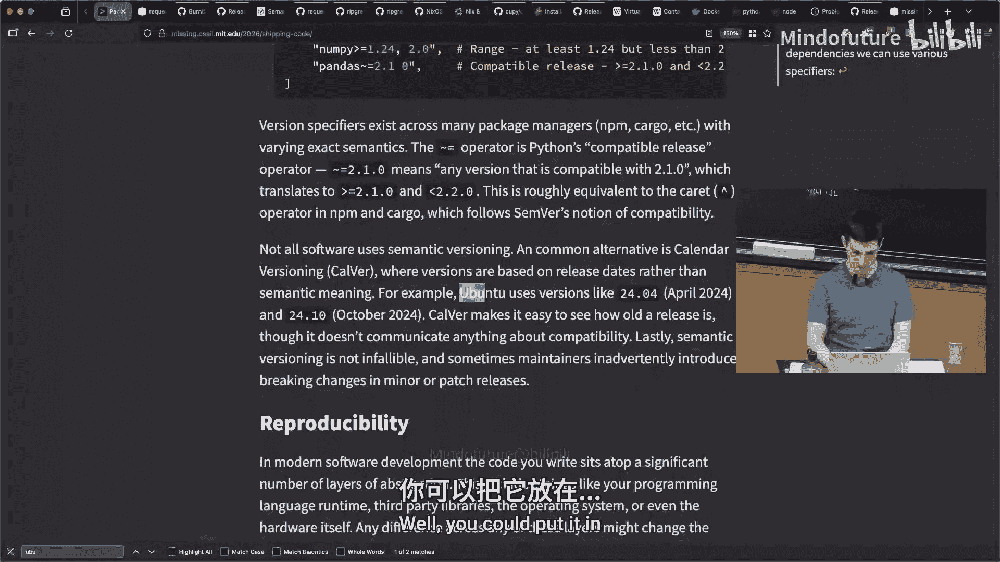

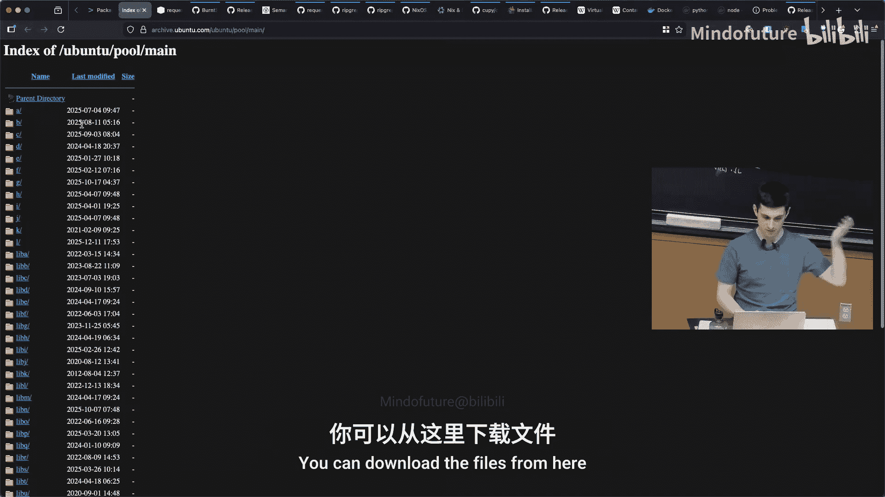

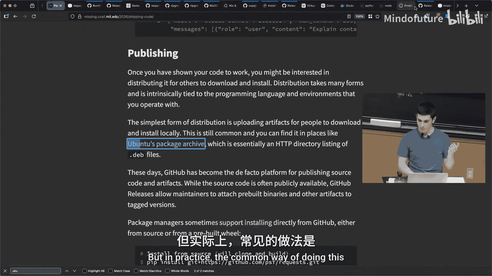

## 发布你的制品

最后，你需要将打包好的制品发布到公共或私有的仓库，以便他人获取。

*   **Python 包**：可以使用 `uv publish` 将 wheel 文件发布到 PyPI（或其测试环境 TestPyPI）。
*   **Docker 镜像**：需要先使用你的用户名标记镜像，然后推送到 Docker Hub 或其他容器仓库：
    ```bash
    docker build -t yourusername/greeting:latest .
    docker push yourusername/greeting:latest
    ```
    之后，任何人都可以通过 `docker pull yourusername/greeting` 来获取并运行你的应用。

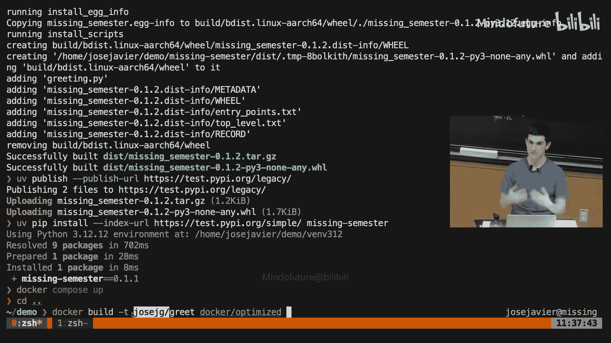

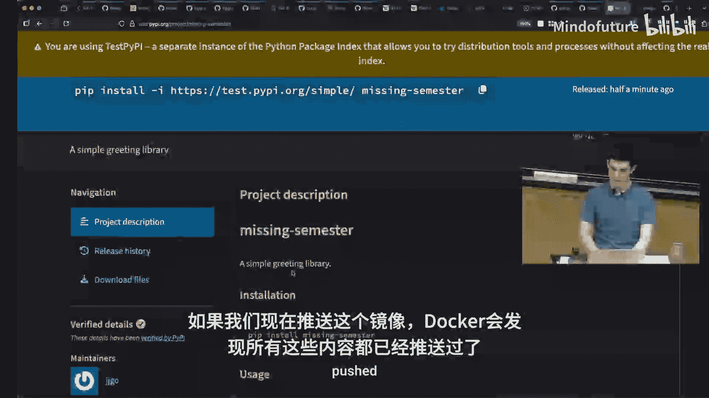

---

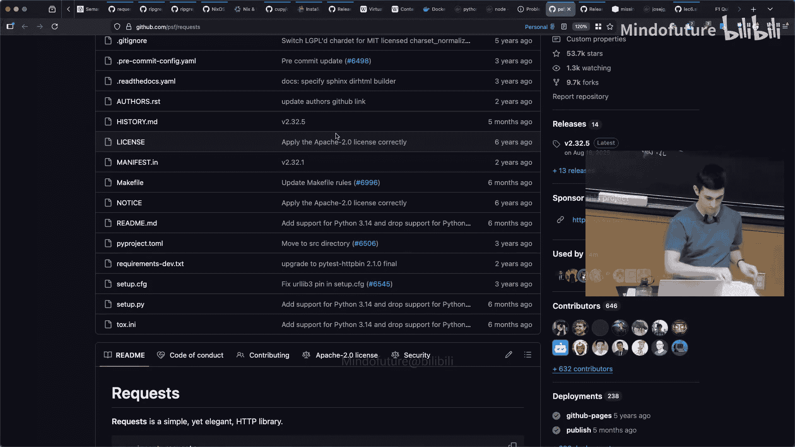

本节课中我们一起学习了软件打包与分发的核心概念。我们从理解依赖关系开始，探讨了如何通过虚拟环境隔离依赖、如何将自己的代码打包成可安装的库或应用、如何使用语义化版本管理依赖兼容性，最后深入了解了如何使用 Docker 容器技术来封装复杂的应用环境以实现一致的分发和部署。掌握这些技能，将使你能够更可靠地构建、分享和运行软件。