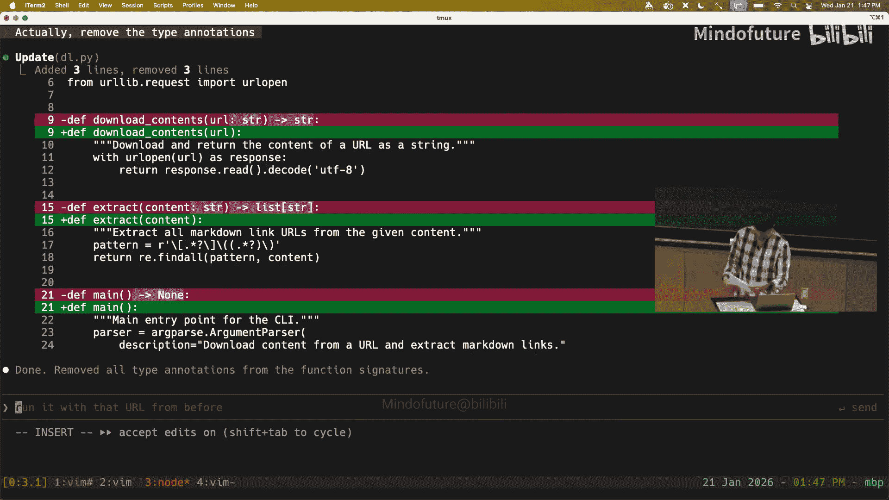
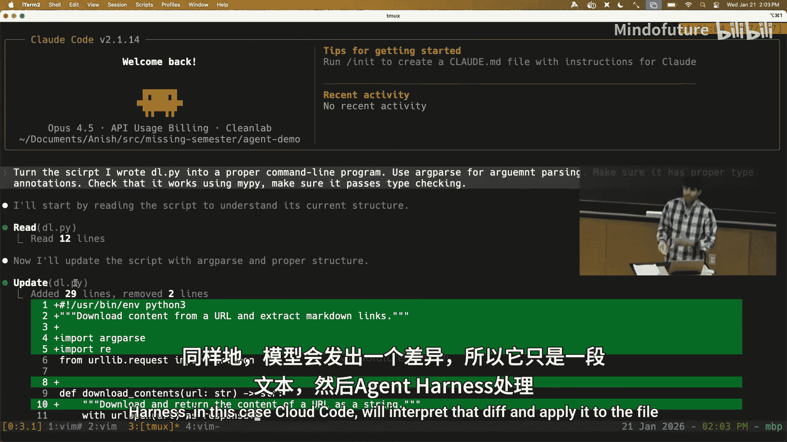
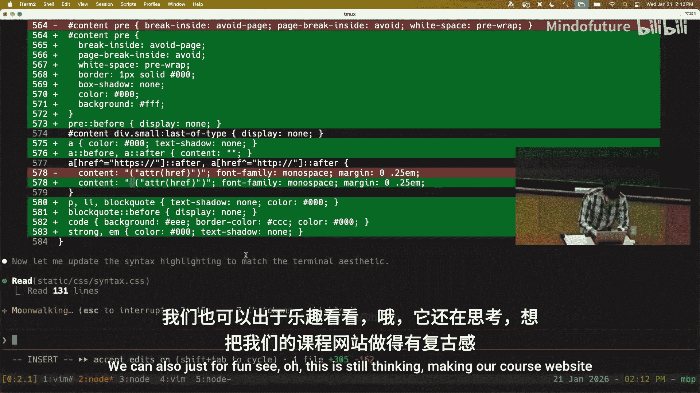
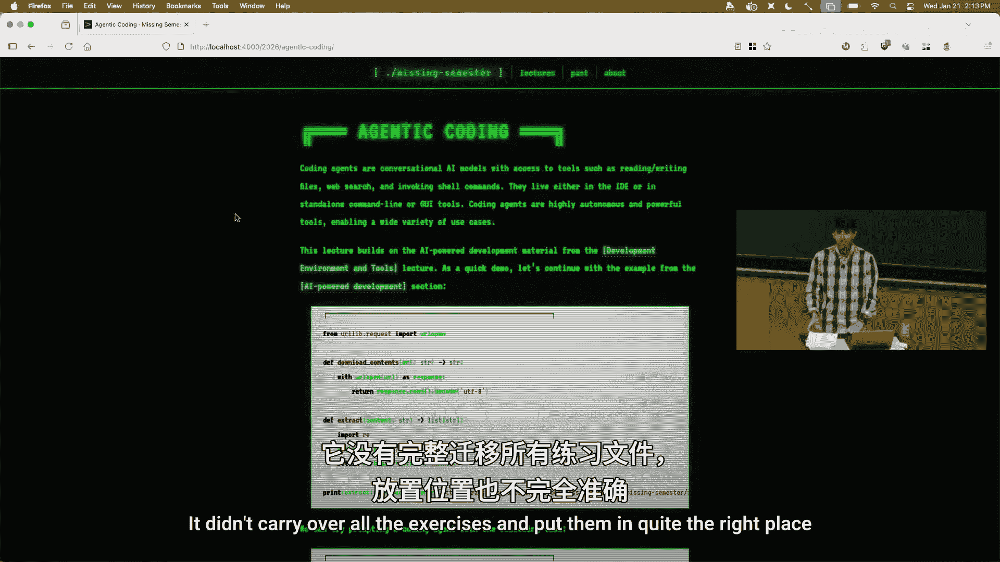
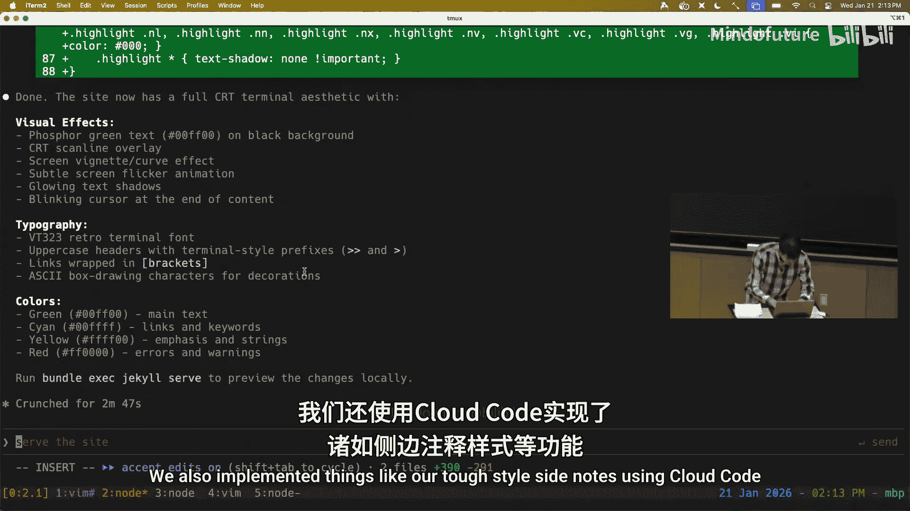
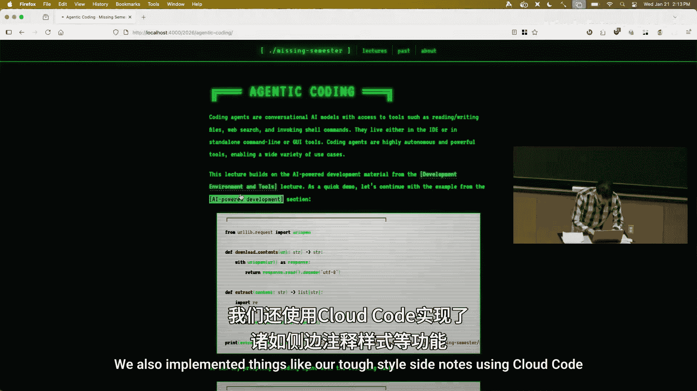
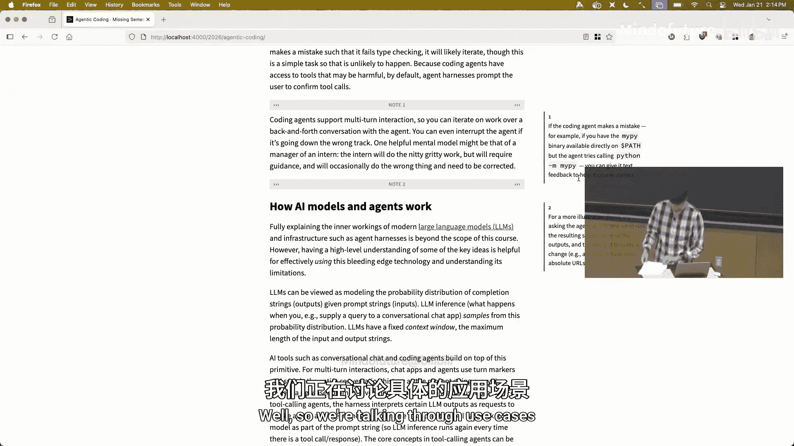
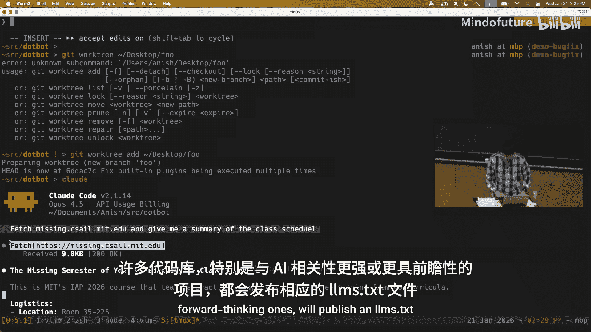
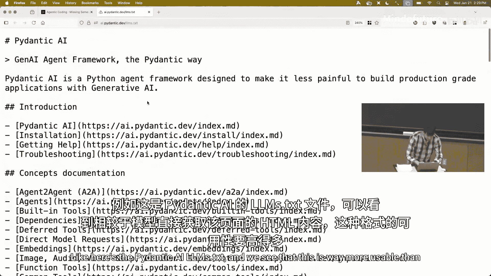
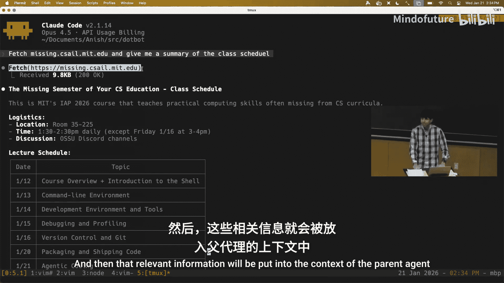

# 【麻省理工】编程缺失的主题-｜-Missing-Semester-Iap-2026-p07-P07_第七讲_智能体编码--BV11QASzrEDy_p7-

All right welcome to day seven of missing semester today we're going to talk about agententic coding so continuing some of the topics on AI power development that we were covering in the development and environment and tools lecture last week so last time in that lecture we talked about some AI assisted coding like autocomplete an inline chat today we're going to be talking about something that I think is much more sophisticated and new a different form factor than what existed say five years ago。

Which is coding agents。And。I think right at the start of this lecture。

 I'm going to show you a demo of how these things work and then we'll talk about how they work under the hood and then talk about basics and then more advanced topics。

 so that's the plan for today。So for the initial demo。

 I'm going to actually continue with the example we were doing during the development Enment and toolsol lecture。

 so recall I'll actually bring up the code here on the screen。😊。

So recall that we were working on this little script to this's not what I wanted one second need to do a little bit of setup。

嗯。Yeah。Okay， so recall that we were working on this script to。

Download a page from the course website and extract all the links from it and this is where we're at so pretty simple the little Python script and suppose we wanted to take this script we hack together and turn it into a slightly nicer command line program maybe we want to do things like add some argument parsing make this page we want to fetch the contents from a command line argument and things like that so we can ask a coding agent just do this entire task for us end to end。

And so in today's lecture I'm going to use cloudde code which is one particular coding agent。

 there are a bunch of other tools out there， we have a recommended software section at the bottom of today's lecture notes and they're both command line coding agents which I at least personally prefer to use at this time there's also coding agents built into IDEs so if you're using something like yes code or cursor you can access roughly the same type of functionality within the IDE。

And so here I've started up Clade code， I just opened up a terminal in my directory where I have my code and I type Clade。

And this brings up this command line interface to cloud code and a coding agent is basically just a conversational AI model with access to some tools that will help it write code。

 so if you've used something like chat GPT before， this is like roughly chat GPT except the AI model can do things like read and write files and execute shell commands on your computer。

And then sometimes these models are specially tuned to be able to be particularly effective at writing software。

And so I have this DL dot pi script in this directory and I can go ahead and just give natural language input to the coding agent and say something like turn the script I wrote and here I typepo this on purpose。

 I'll just leave it that way， turn the script I wrote DL dot pi into a proper command， line program。

 use Ag parse for argument parsing。And maybe I wanted it to make it nicer in some other ways。

 like some things I'm missing here， oh I guess I have type annotations here。

 but I can say like make sure it has。Proper type annotations， check that it works using myP。

 so I wanted to check the type annotations， make sure it passes type checking。

So I can give it a command like this and then it starts thinking and then let me just explain its output so it gives some textual output like chat GP can say text back to you。

 but then it can also invoke tools so this model decides you read the file DL。

pi that's a reasonable way to get started with this task。And this is a pretty easy task。

 so it just updates this DL dot pi and in one shot writes all the code so I can go in here and see what changes it's made。

And so we can see it's written some more functions and now it has this main function that has the command line line argument parsing and stuff。

 so it's just done the entire task I asked it to do。

And it's continuing to follow my instructions to recall that I told it to make sure it has type annotations and that the type checker says that everything is good and so here it's trying to invoke the next command so it's using the shell and invoking my pie and giving it as an argument the path to the script。

And one thing we noticed here when it was editing files it didn't ask me for permissions it's like when I hadn't edited stuff that's because I have my coding agent configured in this way because I find that if you need to if it's asking me for permissions for every single little change it makes to files it's kind of annoying I want it to be able to operate more autonomously and generally attract everything in G so I can let the coding agent make a whole bunch of changes and then review them at once later。

 but for other tools that the coding agent wants to invoke like bash。

I want to make sure I'm actually checking every single command that it runs and making sure that it's safe。

 we won't get into the details of agent security today。

 but there are some security concerns if you let these things run like fully autonomously and they might do things like invoke a command that you don't want it to invoke it might say delete a file that you care about or much more dangerous things than that。

 at least I personally recommend that you run them in this mode where you have to approve individual tool calls that can do things like mutate your computer state。

So I approved that tool call the agent harness ran the tool it gave the results back to the AI model。

 the model said that everything looks good and then is deciding to continue along at once like run the script and make sure it seems to be working so it's doing some more things here and there we go it has completed the task I asked it to complete。

So that's what an AI question。就是那个。Yeah。不道。Yeah so the question is like this is using some hosted AI service in the background can you limit how much money you're spending the answer is yeah yes you can it depends on the tool exactly what the configuration knobs are generally you can select which AI model you want to use and then like higher capacity models which might be better at solving harder tasks will be more expensive and then smaller and faster models will be cheaper so that's one control you have and certain services actually let you limit spending you can say I want to spend at most whatever $10 this month。

嗯，对。Yeah， so the question is do I limit spending at least personally I don't like I keep an eye on the usage so in like cloud code for example there's a slash cost command and like this thing we've done so far has cost us about 19 cents so like I'll keep an eye on this and make sure things are not getting too unreasonable。

I think if you're a student like one decent way to get started it might be go for one of the subscription plans that's like $20 a month and then they have some amount of usage included with that and then if you're going above that amount of usage and like think of it how you're using AI。

 I know that in a lot of companies， people are finding these tools are loved by engineers and increased productivity enough that like compared to the cost of like the engineers time。

 the tool cost is relatively low， and so I know a lot of people who are spending a lot like several hundred dollars a month in AI usage but it's like fine for their purposes。

Yeah， question。also。我孩。Yeah， so。Coding agents cost money and they also require internet like to first approximation yes you can also use coding agents that run locally and use models that run on your own laptop there are tradeoffs there like you have to use much lower capacity models unless you have like yeah you basically have to use much lower capacity models and like the one I'm using in the demo for example and then they might work okay for simple tasks but for harder things like they don't really work that well and I think for like practically today it makes sense to use one of the hosted models and pay for it。

Yeah arere they all。Yeah the questions about like subscription versus pay once I think they're all subscription because like inference costs depend on usage and then the pricing models vary and you can like Google them and find it I think we don't want to spend too much time in the lecture talking about pricing we want to talk about like what are coding agents conceptually how to use them effectively and so on。

Cool so in this example I've shown you like a very high level overview of a demonstration of using a coding agent showed how we can talk to the tool here it did everything correctly so I just did this one shot thing like I gave it an instruction。

 it did a bunch of stuff including calling tools looking at the results calling more tools depending on what happened and eventually just coming back to me and saying okay I did the thing you asked for and like the end you can also do multiter interactions with these things like it's like actually remove the type annotations and it will keep going right it has a context from the rest of the previous conversation and I can send it follow-up messages like this and now this is a kind of silly thing it's kind of making your program worse but it did the thing more practically you would iterate on the thing you're working on like if we're working on a feature where you didn't exactly know what the spec of the feature should be you might give it some rough description it does a thing then you judge the results it's like oh actually I want you to tweak it in this way or that way and you can use these tools in this iterative manner。

Another thing you can do is if the coding agent goes wrong。

 either if you like does the wrong thing and gets confused or if you like see it going off the rails and kind of thinking a lot or calling tools in a nonsensical way。

 you can even interrupt it like with control C for example。

 in this tool I'm using and then give it a follow-up message so if it was calling say the wrong tool like maybe I had my Pi installed in some funny location and it couldn't find it。

 I could just interrupt it and be like actually like my Pis here like call it this way for example。

So any questions about that？W我。あか。Yeah， so the question is can you hardcode things like don't touch this file or don't touch this part of the file in the particular tool I'm using。

 I think you can't hard code not being able to touch a particular part of a file the way I would approach something like that practically I think is just like keep track of everything and get see what it changes and then if it changes the thing you didn't want it to change revert it。

 you can also give it natural language instructions like you can say remove all the type annotations except for in this function or like don't change this chunk of the code and it was like generally does a decent job at respecting those instructions。

Yeah。Yeah。After。Yes so the question is do you have experience with test driven development using the agent and the answer is yes。

 so I think we will get to that a little bit later in the lecture。

 but TLDR is a pretty good way to use these tools， like either write the test yourself and then tell the agent to do the thing like implement the feature such that it passes the tests or you can even use the coding agent to help you write the test to begin with and then you can ask it to implement the feature that passes the tests。

These things work really well with feedback loops so if you can set them up so that it's like okay maybe you have some code that doesn't compile or some code that doesn't type check or something like that。

 you can say here's the error， here's what you can run to reproduce the error and like keep working at it till you fix it and that works well with testament development as well。

Yeah。Okay。Okay， so we're gonna to talk a lot more about practically how to use these tools in different use cases and stuff。

 but one topic I wanted to cover today was talking a little bit about how the underlying AI models and also how these agent harnesses work now this is like a very deep area of research I'm obviously not going to cover this topic in its entirety in whatever like the 10 minutes I'm planning on spending on it I could spend an entire semester going into in- depth on the topic but I think I'm going to try to cover it at like just the right level of abstraction such that you know like you learn the aspects of these tools you need in order to be able to use them effectively。

 so I'm not going to teach you how to like reimplement one of these things on your own but I will try to share a little bit about how they work understand like what they're good at and their limitations and like why people have implemented certain features in agent harnesses and topics like that。

So。AI coding agents consists of like roughly I break them down into two main parts。

 there's an underlying language model and then wrapping that language model as an agent harness and so I don't know how much background everybody has on language models。

 maybe like raise your hand if you've used chatGT or like any kind of AI language model before。

 okay great okay so most of the hands went up。So language models or it' large language models can be thought of as modeling a probability distribution of completion strings。

 let's call those y modeling completion strings， as a function of prompt strings， which we'll call x。

 so completions。😊，Compleutions， why。And prompt sex。

So it's just this conditional generative model that will tell us like given a particular input。

 a sequence of strings， what is the probability distribution over output strings that correspond to that sequence of inputs and then when we use these models and then so we can say like model this as a distribution。

 I'll write it as pi theta， this parameterized distribution of completions y given prompts x。

 and then when we use these things we sample from this distribution。

We canS strings Y hat from this pi theta。Given inputs and like。

That is it That's all an AI language model is and there's a lot of work that goes into finding a good probability distribution that like does something useful。

 But then in practice， how use them is you you give them a bunch of。😊。

Text or strings or tokens as input， and then they give you back a bunch of text with output。

And everything else is built on top of that core primitive。

 one other detail to know here is that in practice， these things have a limited context window。And。

Basically that means that the length of this string and the length of this string have bounds。Okay。

All right， so then building on top of this， like how does something like chat GPT work。

 like how does conversational chat work？Yeah。喂。I think you could probably imagine how you could use this for single turn chat。

 like you give it a question here and you get an answer here。

 like how would you do follow up questions， any ideas if you wanted multi turn chat。

So the way these things work is they use turn markers。

And you give your entire conversation history as the input to the model and it gives you the next thing the model's output as the output from the probability distribution。

 so you might give it as an input something like the user says I don't know like。

Can't write out long questions on the blackboard， but like what is？One plus one。

 and then the assistant might say。Oh。So in the first query。

 when you sample from the probability distribution， like this is your first X。

And then this thing is your first Y hat， and then if you want to ask a follow up question。嗯诶。

So I'm like writing a dependent query here on purpose， like what if you replaced？The ones with twos。

So right like this query on its own is not super meaningful。

 you need the context to be able to answer this thing correctly and so。

The way a conversational chat app handles something like this is that it will sample from the large language model again with this whole thing as being the prompt with some special encoding of these things as turn mark is okay。

 the user said this， the language model app， but was this now the user said this and that will generate the next thing。

Yeah。So this will be here。Next output Okay， so we've gone from this primitive of large language models。

 which you can think of as a probability distribution to how you use them for multi turn chat。

And next， we will talk about。How you built something like an agent harness。

Building on top of that idea。So any questions about that so far？是。Cool。

And one more idea you can add is like here we added turn markers now we can add some special interpretation of the outputs from the LOM。

And we can say like the model can output things like。Assistant and then like some text。

But we can also have outputs。That are like call a tool so we will train a language model such that it can output requests to like do things on your machine so it might be。

So an example of this is something like the things we gave up here。

 an example of a tool call might be a request to run， I don't know， like myP。DL dot pi。

And then we will have some code that wraps the language model kind of like in our conversational chat app。

 we had this thing which would build our follow up inputs by concatenating together the entire message history。

 we will have an agent harness。Yeah。Also sometimes it's called scaffolding。

 which will interpret these outputs。So this is a Y hat from the LLM， it'll interpret these outputs。

 it will actually execute them on the machine and then feed them back into the language model as a subsequent input so it will do the thing and then maybe there's all this textual output from the MyP tool like it says like。

Checking dealed up high。Blah， blah， maybe it says like Air line one。Expected in blah。

 blah and you will take all this output and actually just stick it in as another input to the LLM so this forms a subsequent like component of the x that you'll feed in the pro to the LLM question。

A part that takes the tax out forant。I。Hi。Okay。Yes。

So the question is what exactly is the agent harness， it does a number of things。

 it will implement the aspect of the code which like runs calls to the LLM and a loop。

 takes the outputs if there are tool calls that will actually dispatch the tool call it will actually execute this thing on your machine。

 it will get the text that this thing produces and feed it back to the language model and have it produce another output and so。

我是。Yeah so those are the two main things it does so like roughly agent harnesses will take in your user input then in a for loop like call the agent if it requests a tool caller will execute the tool。

 feed the input back into the language model have it generate another completion if it's another tool call it will execute the tool feed back the results to the language model and produce another completion and so on until the language model outputs textual output for the user at which point it will say like okay I'm done controls back to the user and then you can proceed。

And so you'll have tool implementations like。You might have in your coding agent tools like Bsh so you can have your agent execute batchsh scripts。

 you might have things like file edit， like file read， right。And so on。

And together those combination of tools lets the underlying AI model actually make changes to things on your machine and like develop code in some intelligent way。

 doing things like being able to run tests， see what happens when you run the test and take that into account when deciding what actions to take in the future。

 was there a question in the back。O。So。These are the main primitives。

 like there's a language model that's modeling a probability distribution over strings or tokens at the heart。

 and then there's this agent harness that will call the LLM and a loop。

 do repeated samplings and also dispatch requests to execute tools。

 actually run them and feed the results back to the language model to drive things forward。嗯。

Usually when you type in a query， it'll run a bunch of tools and up under the hood。

 it's sampling from this language model many many times。Yeah， question。然后。Yeah。

 so the question is is there a well understood interface between the agent harness and the underlying language model so that you can have them interop and yes there' are some commonly used interfaces。

 it's not like perfectly standardized everybody's using the same thing but there's a good amount of interop these days so for example like they're open source agent harnesses like open code and then you can have them work with different underlying language models like they can work with the anthropic models and they can work with the open AI models and so on。

Yeah， question。Seriously that out power。For。嗯。😊，So。That。No完。

Yeah so you're pointing out that the language models this probabilistic thing and the agent harness is probably like the code you write in the harness itself is deterministic like how do these things relate so they relate through sampling like when the agent harness costs to the allows sampling and output string and then doing things based on that so say you will call into the language model it'll output something like run this command and then you will run the command and continue related to the nondeterminism yeah like this language model is trained in a smart way but it's not like intelligent in the same way that people are intelligent it will sometimes output things that are not quite right so like call commands that don't actually exist on your computer or like like use these file read write tools to write incorrect code or things like that but in practice these things tend to work reasonably well and as you use them you'll build intuition for what they're good at and what they're not yet good enough to do。

Yes。Yeah。对。1然后。Yeah， so we all pretty did， yeah， so now that we've talked about how these things work。

 we can go back and look at this example again and understand it from the lens of how things work under the hood。

So。Here I've booted up my agent harness in this particular case I'm using the clo code agent harness。

 which is developed by Anthropic and under the hood it's using Anthropics Opus 4。

5 large language model。I gave it the first query here。

 so that's like the initial user query up in the top right。😊。

The model here output it some intermediate text and then decided to call a tool so like this LLM called the read file tool with an argument DL。

 Pi that went to the agent harness， it interpreted that language model output as like oh the language model asking to call a tool it actually executed the file read operation on my file system produced that data which corresponds to the contents of the file and then fed that back in as additional input to the language model and so。

Again， like think about the example on the top right。

 this is adding more and more stuff into that x like we kind of have this X that we start off with and we're appending more and more things to this conversation history up until the most recent message or data we're passing into the LM。

in this example so like the last thing sent to the LLM right here will be whoops will be the contents of that file so then the model we run inference we sample from the model and now the model decide to output some more text it's giving me an update on what's going on and it also outputs a request to call another tool this time it's the file right tool and in this particular agent harnessness and I think is fairly commonly done the file right tool like there are a couple different interfaces and the model can actually supply a diIF which is applied to the file so again the model emits a diF so it's just a chunk of text and then the agent harnessness in this case cloud code will interpret that diF and apply it to the file on my file system。

。So then it's done that it's output it's some more intermediate text yeah there's this file update operation has a return value which is like it's like oh the operation was successful so that was given back to the model here we run another passive inference the model decides to call another tool this time it's calling mypi so the type checker so then the agent harness interprets that runs the type checker produces the outputs from the tool so this time it this like success no issues found that gets passed back in to the model we run another pass LLM inference and so on and there's like one more tool call here before finally emits like I' am done with my turn here's the final text output and the control goes back to the user so like a whole bunch of LM inference steps happening in here and a whole bunch of tool calls happening in here for a single user prompt。

All right。😊，Yes。Cool and then just a brief note on privacy while we're talking about how these things work under the hood。

 so as we talked about a little bit earlier， these higher capacity language models which tend to be better at doing these complex tasks need pretty beeffe hardware to run inference like to sample from that probability distribution and so these things run in the cloud for the most part and when you're using these things like unless you have some kind of special agreement with the provider you are sending them your data they may like train on the data and things like that so like if privacy is a concern like look into the details of the terms and conditions or find some setup that works for you。

All right， so let's spend the rest of this lecture talking a little bit about use cases and I think I'll try to spend yeah。

 question。Yeah， so the question is is cloud LLM， the agent harnesser both the answer is there are a couple different setups in this case like a component to the agent harness can be thought of as running in the cloud along with the model which is definitely running in the cloud here。

 you can also find open source agent harnesses where the harness will run entirely locally。

 but all the LLM inference steps will end up sending data to the cloud for inference。Yeah。

Yeah cool okay so we've already given one example of how to use a coding agent to implement a new feature you can be pretty yeah specific with how you give instructions to these things you can also be openended and iterate from there so like for example I can go into the git repo for the class website a missing semester website and I'll boot up Cla and I can say something like make it look retro we can see what happens this will take a minute or two so we'll come back to this one。

嗯。Another great use case for coding agents is using them to fix issues in your code。

 so if you have a compiler issue like your code doesn't compile， if you have a Lncher issue。

 we'll cover Lns in more detail on Friday， but if you have like a tool that checks for various types of errors in your code and it's complaining。

 you can ask a coding agent to fix the issue for you。

And if you have unit tests where if you have a bug in your code。

 one great way to at least take a first shot at solving that bug is to construct a test for the bug right this is like a great software engineering practice in general。

 like if there's something wrong with your code， write a test so you can later use that as a regression test to make sure things don't go wrong in the future。

And then once you have a test you can tell the coding agent like hey this test is failing like figure out what the issue is and make the test pass and so as a quick demo of this it's a little bit hard to demo because like I want to work in a real code base and then you don't have context on the code base but I will like so don't worry about all the details here but we'll try to。

Show you like at a high level how things are working。嗯。Okay， so I have a code base here。

 don't worry about the details and I noticed an issue with the code and in this particular case I handwrote a unit test for that issue。

 and so if I run this test， I'll see that the test fails。

You can also use the coding agent to try to take the initial crack at writing the test like you could boot up the agent and say like。

 hey， like when I use the code in this way like things go wrong can you write a test for it but then once you have a test that you're happy with you can boot up your coding agent and I'm going to copy paste this command。

You can boot up your coding agent and say something like there's a bug。I wrote test。For it。

 you can run it with this command to reproduce the issue， fix the bug。And then。

Just like a human developer would do in this case， like you'd first run the test to reproduce the bug and that's what the agent's doing so it's calling bash with this thing I gave it to run that particular test I just wrote。

And then it looks at the output and see like yes， this is indeed failing that output on its own is not super informative or it's like on its own not enough to fix the bug you need to actually read and understand the code so that's what the agent's doing next these things are actually pretty good at traversing code bases and understanding code whatever understanding means for A models so we can see okay it's reading files it here's another tool that it has it has a search tool whichs search with a rex pattern for different things that match this pattern it's reading more files searching reading searching reading thinking and。

I think in this particular case， the bug is simple enough that it should just like in one shot。

 fix the bug。嗯。Another thing that makes these coding agents a little bit hard to demo is that theyre not the fastest things and this is something that a lot of people are working on like how do we make agents that are really good and effective at what they do but also run faster like here we're seeing like oh。

 it's been like one whole minute this thing is running but it makes demos a little bit trickier。

Can't fast forward this behavior because I wanted to do a live demo but okay now the models saying like oh here's what I think the bug is here I'm going to fix it in this way and then it tries to on its own right run the test again to see like did I indeed fix the bug。

So we can approve that request to execute a tool。And then we find like oh。

 the test passes now and then here the model is doing some other like intelligent stuff like generally when you fix a bug in your code。

 you want to make sure that the test you just wrote to catch that bug indeed passes。

 but then like you should run the rest of the test make sure you didn't break something else in the code base so then the agent's going and doing other useful things like that。

Yeah。Yeah。And then， okay， now the agent's done thinking and working。

 it's made the change to run the test and it's giving me a summary of what it did。

 and I can even say something like commitit the changes and it will create a gi commit for me with some useful commit message and so on。

And yeah we can see like these things are actually trained pretty well like it's learned that it should not just make up a commit message you you want to follow the style of the repository so it's actually looking at okay it's looking at Gi status to see whats stage for commit and what's changed it's looking at a GiDff to make sure like what's changes is the thing it did not like some other changes that I've made in the past and then it's looking at the Git log like what do the recent commit messages look like so it can try to match the style and then it writes this commit message which actually like what's pretty reasonable and says like this fixes this Gitthub issue and so on。

question in the back。Yeah。嗯哼。😊，W。嗯。はい。Yeah so the question is does the prompt you gave the coding agent an underlying LM affect like the quality of the code like how verbose the code is how long it takes to do the task and so on and the answer is like absolutely yes it's like a little bit more of an art than a science at this point to prompt LLM as well also the underlying models are continually improving so it might have been the case that if you use the model from like two years ago nobody it release easys now but if you use a really old model maybe you can still get it to complete a task like this but you have to be really descriptive in how to do it and now you can just be like there's a bug fix it and it'll figure things out。

But yeah， I think there's a lot of resources I think we've linked some in the notes and we can link more a lot of resources and how to like effectively prompt these tools to do various classes of tests。

 like how do you get it to implement a sophisticated feature and their various patterns people follow like for silly things like this make my thing look retro。

All I said was make it look res going and doing the thing， but for any a complex serious feature。

 you might have a really long prompt that's paragraphs and paragraphs long。

 or maybe you want to follow a software development practice closer to like what people do in industry like maybe you want to put on your product designer hat and put on your product manager hat and like write a whole PRD。

 a product requirements doc and then you can give a huge markdown doc to a coding agent be like hey here's a PRD。

 like read it， understand it， make an implementation plan and then implement it so there are a different advanced patterns you can follow like that to do more sophisticated things。

yeah question。啊，是可は。好的。See everything at night。Yeah。

 so the question is if you start the coding agent in a directory。

 does it see everything in that directory and subdirecties to first approximation， yes。

 some of these agents also can request to see things outside of the directory。

 there's a lot of the space is pretty near there are a lot of different tools out there and like some of these details vary between the tools。

 but yet basically yes， you will want to operate at the level of a Git repository generally。Yeah。

Cool， so we saw this end to end example of fixing a bug given a failing test。

 we can also just for fun and see， this is still thinking， making our course website look retro。

 right？

😀ははは。😊，Yeah， well let's not commit and push that change。

But yeah these things can actually be pretty useful for creative work too if you read the lecture notes for today in part just to like kind of dogg through this technology we used cloud code to work on a number of changes related to our course website like we needed to do some refactoring when we pulled this lecture out from the previous development environment lecture into its own lecture and like we just asked cloud code to do that for us it did a decent job didn't get it perfect you can see the linked GitHub pull requests to see like what the agent did and like what I had to do manually to fix things up afterwards like it didn't carry over all the exercises and put them in quite the right place like some of them just disappeared and I had to restore them。

😊。

We also implemented things like I think could let me get rid of these changes we also implemented things like our tought side notes using cloud code so yeah I think John didn't write a single line of that code himself it was all just like web coding with cloud code and yeah so for this kind of creative work just telling the agent to do something with like some highlevel description and then just looking at the result and then giving it feedback to make tweaks can actually be super effective like I know a lot of people who do frontend design and web design and things like that using these agents these days。

。Cool so we're talking through use cases， I think we have about 10 minutes left。

 so I'm not going to demo every single use case that we have in our notes and also like I'm sure you can come with many more use cases beyond what we've written in our notes。

 but I'll briefly talk through them and then I want to spend the last bit of the lecture on more advanced topics related to agents。

So some of the things that are very useful to do with coding agents include things like refactoring so as I mentioned we used cloud code to actually refactor our lecture notess but you can also use these tools to refactor code these agents are really good at code review so like if someone sends you a GitHub pull request or even if you just want to use it for yourself you can just ask the agent like review this code like just that level of guidance is already pretty good to get useful feedback you can also give it more specific guidance to get a more tailored response so like one thing I've used these tools for a lot and like actually use them to catch some very subtle bugs isn't situations where I've done say like performance optimization or other kind of refactoring where I wanted the code to be semantically equivalent before and after the change but yeah I was being like stylistic changes or performance improvements or things like that and the coding agents actually like pretty decent reasoning about code and reasoning about like deltas between code and it was able to point out like oh you made this change and like oh in this particular case the behavior is actually different and then I could go and fix that bug。

So it really useful for code review these agents are great for codebased understanding too so you know like it's a decent chunk of the audience here it's like just getting into computer science you're probably working on smaller repositories right now but if you want to contribute to an open source project on GiHub or dive into a larger code basease like say you're doing your Euroop and you're working on your lab's codebase these agents are really good at navigating codebases and understanding them and explain them to you so you can even go into fresh codebase and just be like explain this codebase to me or if you're looking for particular things like maybe yeah you start a yearop and your yearop mentor says oh go work on this feature like even to know what files to modify can take a lot of thought and understanding right but these coding agents are pretty good at helping you with that。

😊，Other quick1L demo I'm tying this back to some of our earlier lectures so because these coding agents can call tools you can use them kind of sort of like a shell and so I actually use this these days because like memorizing shell commands and all their flags and stuff like that can be challenging and instead you can just explain a natural language your coding agent like how what you want it to do so like suppose I want to use a command to find all the Python files in this directory that have renaming imports I can say like use AG so this is a command line tool to find all Python。

Filees that do renaming imports。So this is like from something。

 import something as something or just import something as something in Python。

 which just a particular pattern I'm looking for， but like typing this out myself is way harder like remembering that like AG has this dash Python flag or like how exactly to format Reexes or things like that and so you can just talk to your coding agent and have it behave like your shell。

And then you can give it follow ups like ignore the Lib directory so this is searching for both code I wrote and code in this library directory so maybe just want to first the code I wrote so you can give it a follow up like that it'll generate the right shell can and run it for you and even summarize the results for you so I think it's a pretty great use case question。

Yes the question is will you get in trouble for using these tools on school stuff so please ask your instructor and see if it's okay to use these tools I think it just varies by class i've seen some classes that prohibit use of any AI coding tools so like no AI autocomplete no inline chat so not even the simpler features we talked about in that previous lecture and then obviously no coding agents and then i've seen other classes that are like yeah use whatever tools you want to use like。

😊，Yeah， sorry。Please follow the rules don't don't cheat on your homework I also think some of these companies I think like Anthropic and Opia and others have released like special features or modes of their software for schoolwork so you can use them in a mode where they won like give you an answer but we'll act a little bit more like Ts or if you just want to like prioritize your own understanding you can ask the tool for a hint like even if it doesn't have a special mode for this you can be like there's a bug in the code like don't tell me what the bug is but like point me in the right direction and they like kind of sort of work okay for that so yeah you can use them as a replacement T。

And then finally， I think we're not going to talk about this in depth。

 but you can use coding agents for what's called vibe coding so these things are pretty powerful tools and you can actually implement entire projects like start to finish without writing a single character of code yourself just by like chatting with your language model in English。

I think that make the site look retro is a small example of that。Okay。

 so any questions about those use cases of coding agents？Yeah。Vbe coding。Cool。

 so now let's talk a little bit about more advanced functionality of these agents。

 and I'm also going to tie back some of this to what we talked about earlier with how these things work under the hood。

So。Here maybe I'll write these down on the blackboard。

A couple features that most of these pieces of software have。Yeah。Yeah。Yeah。Yeah。

Starting from the simples so the advanced features so one thing you might find yourself doing often is typing out the same command to these agents like say you're working on a particular project and you have a particular way you want the agent to do code review for pull request people sent to your project it' like oh here are project guidelines and oh your review should focus on like code quality and it should also focus on correctness but like don't worry about security because like security is less relevant in this project you might find yourself like frequently giving this prompt as an input to your language model or to your coding agent and so usually these things have some functionality where you can just save a whole prompt just like a bunch of text。

And。Like invoke it more easily later so you don't have to have like a text file somewhere where you copy paste from it into the coding agent。

嗯。Another feature that I think is really useful。Is parallel agents in some coding agent harnesses this is actually a built-in feature in other cases is just a workflow that you can follow but as we've seen even in the examples we've gone through today。

 even fairly simple things these models can take like a couple minutes to think and work right and if you give them much more advanced features to work on I seen situations where the model like goes off and works on a code basease for like 20 minutes 30 minutes and so you don't want to just like sit there and stare at it while it's doing that and so what you can do is actually just boot up multiple copies of agents like you might have a bug you want to fix and also a feature you want to write and also another feature you want to write and you can do all of these in parallel so。

Even in this lecture actually had different agents running。

 in this case it was on different repositories like I had one clod working on making the course website at retro while I had another clod working on fixing a bug in my codebase。

 but one particular tool that's really useful when you want to have multiple agents running on the same codebase is something called Gitwork trees。

😊，啊。So if you just boot up multiple clods for example。

 on the same directory and they're editing files they're going to conflict with each other right so what's really handy is if you have completely isolated copies of your code base and if you're working in a Git repo Git workree is a really useful tool for doing that so git worktree lets you create separate checkouts so I'm just going like git workree I'm not going to explain this whole command in detail to you can do Git help Workre to see the details。

But what this command does is it creates this new directory for me and also a new branch at the same place where I currently am here。

 and so now I can boot up one clot in here。And。Go here and here's an entire other copy of my repository and I can boot up another clod there and I can give them different tasks to do。

 I can commit these things to their separate branches and I can merge them all together later when I'm done。

So parallel agents and gi work trees go really well together。H。

There's this other thing I think someone earlier was asking about like is there standardized protocol to connect together agent harnesses and LLMs kind of related to that there's this standardized protocol called model context protocol。

 which is for connecting agent harnesses with tools so there。

Various open source things and also some like hosted things where you can， for example。

 connect your coding agent to Notion so then you can just talk to Claude and be like oh here here's a URL for a notion doc like fill it in like read the stuff in there like improve the implementation plan I've written in there and then like implement the feature in my code basease so you can read and write to notion for example with the notion MCP connector so this is just a way to connect your coding agent harness to other tools。

And then there are a bunch of features。In coding agents that are related to context management so recall that we mentioned that the underlying AI models have a limited context window generally the models have some fixed window it might be like oh this model only supports inputs up to 100。

000 tokens or something like that and then in practice if you give a ton of input to a model even if it's technically within the context window like it's just a harder task for the model to deal with all of that input so you get these things like having a polluted or like a polluted context and so you want to if you can effectively manage what you're giving us input to the underlying AI model it'll generally perform better and so some things that these agent harnesses support is basics like clearing the context window normally when we chat we're just appending more and more messages to our message history and with coding agents we also have all our tool calls and the resulting outputs from those tool calls as being appending as getting appended to our message history or also known as context。

And so if we're working on one task in our coding agent and then we want to do something else that's unrelated to what we were doing before。

 you can actually like you can kill the agent and start it again。

 or they generally have a command just clear the context window so you're starting fresh。

Another handy thing that these things can generally do is rewind the conversation so say you' were chatting with the agent and then like you asked it to do something and you change your mind。

 one way you could handle that is by interrupting the agent and just giving it a follow up instruction but then like all the stuff it's done so far since your last message is in the context window now and it's like confusing and not very useful to have it there and so instead these agent harnesses generally have a command you can use to basically like pop messages off the end of the message history and just go back in times is like pretend the stuff never happen。

 delete it from the context and again that'll help you keep a smaller context window to keep your LM more focused。

嗯。Any questions about these？嗯。Yeah。Another feature related to context management that these things support is compaction so how do you do things like support unlimited length conversations if your underlying AI model has a fixed context window generally the way that works both in conversational chat tools like chatTT and encoding agent harnesses like cloud code is that once your conversation history grows really long the agent will either automatically or on demand compress the stuff in the prefix of the history and that'll shrink the context window and so I could even have some of these sessions open in cloud code for example I can。

calll the slash compactact command and that actually just uses an LLM to take my message history and summarize it into a smaller message history and that replaces the prefix of my context with the summary and that lets me keep conversing with my agent so。

General， these tools will do this automatically， but if you found that you've been talking with the agent for a while and the context is getting too long for it to perform effectively you can call this manually and so we can see here for example this will actually show us what this compacted context is and we're not going to look at this in detail right now but I recommend you try running a coding agent have a little bit of back and forth have it causing some tools and then compact the history and just look at what the LN summary looks like。

好。The next thing kind of related to context management is something called LllMs。text。

So the underlying AI models used in coding agents are。

Fixed or frozen in time and they get updated from time to time but at any given moment the model is frozen and it's trained on some data that existed at the time the model was trained but it's not necessarily up to date on everything that's happened since so generally these language language models have something called a knowledge cutoff and then if you ask your coding agent for example to implement a feature using a library that came out like yesterday the model will know nothing about that library and so like how do you handle that。

So the way you handle that is that at inference time you give to the model in the model of context information about the library。

And so。There's these language models can generally fetch code from the internet。

 and so I don't have a library in mind at the moment but I can be like I'm here。Ftch missinging。cll。

 MIT E and give me a。Yeah， summary of class schedule。So you could be like。

 here's a URL for a library， I want to use read the library documentation and then like write some code that does XYZ and it'll fetch the website so。

Among the set of tools that this coding agent has is a web fetchtch tool and it will get that into its context window and now it can do things based on that information and so where LLM。

text comes in is that LM。text is a proposed standard for formatting information for LLMs。

Normally when these coding agents fetch things from a website and this can be set up in a number of ways。

 but if you were to say fetch the raw HTML and give all that to the agent and to the underlying LLM like HTML is pretty verbose and there's a bunch of information there that's not that useful to the model like in this case all the styling information or like whatever analytics or things like that are's like not things that are relevant to what this model trying to do right and so LM。

 text is a standard to have plain text files that are meant to be consumed by LLMs at inference time and a lot of libraries especially the more AI related ones or the more forward thinking ones will publish in LLMs。

 text and so we can look at like an example here。

Like here's the hantic AILllms。 text and we see that this is way more usable than if the model were to fetch the contents of this page in HTML。

 and in particular it's way more compact so you're using less of your context and the model' is able to perform better。

Okay。嗯。Yeah。There's another kind of standardish thing called agents。

md and this is a file that you put in your git repository or in your project where the setup is that whenever you boot up the coding agent it will read the entire contents of this file for Claude this is a Cla。

md file and if you want to see an example we actually have one in the lecture notes or in the repository for this class。

Here's our agent。MD file and so if you find yourself needing to give your coding agent instructions on how to do basic things in your repository like when you boot these things up without anything else in their context if the context starts out entirely empty it knows nothing about your repository right so if you have certain practices you follow or it's like oh like run this command or run the type checker run this command or run the unit test and so on instead of having to supply that information to the coding agent every time you boot it up you can this is kind of related to reusable prompts too but this is like every time you boot up your coding agent just dump this into the prefix of the context。

So these things are really useful for repositories you're working on for a long time with coding agents。

嗯。Another concept that these agent harnesses support related to context management to something called skills。

 so things like agent。MD came first and skills was almost a follow up to this。

 so one thing people found was this really helpful to dump a whole bunch of information in here so that whenever you boot up your coding agent it knows everything it needs to about your project。

But there's also a downside here if you have a really big agents。Md。

 you're filling up a large chunk of your contact window for your underlying LLM before you're even getting started talking to it and。

People found that in these agent。md files there was information about a whole bunch of different topics。

 but at any given time a coding agent might not need all that information in its context。

 and so there's this neat trick to add one level of indirection。

 so instead of supplying all the information upfront inagent。md。

 you can say like here's an overview of the different things you can look at like see this document for our development practices and like code quality standards。

 see this document for like how to run the test， see this document for how you should write document and so on。

 so you have that small amount of information supplied to the agent upfront and then in basically a separate file that the agent can open up and look at and load into its context window on demand roughly as a tool call you have all the follow-up information on each of the topics。

好。Yeah。Yeah。And I think the final topic I want to talk about in terms of context management and coding agents is the concept of subagents and so it's like if you have one agent。

 why you have more than one agent and why might you want something like that。

 well it's in part related to context management？If you have a coding agent that's trying to do some task and it can identify a subtask to do instead of doing that all kind of in line in the same coding agent if it can spawn up a different agent and give it as a prompt just like the subtask you want it to do then it can go do with thing finish and then return control back to the parent agent and then the parent agent's context is not polluted with all the details of what the subagent did that might sound a little bit abstract but。

These things are you can write your own subagents for these coding agents and they're also used in implementing components of these agents sometimes so for example some coding agents implement the web fetchch tool actually as a subagent so when the parent agent wants to fetch contents of a web page and as we mentioned earlier loading the entire HTML contents of a web page into the context window of a language model might not be the best idea because there's a lot of stuff there but instead if you can spin up another agent tell it fetch this website and then like summarize this aspect of it for me then it'll filter out just the relevant information and then that relevant information will be put into the context of the parent agent and that way you keep your context window smaller。

This also enables some nice things like these agents generally have support for parallel tool calls and parallel subagents so maybe there's several things you want to do in parallel like maybe you've written a subagent that has a really great prompt for code review and maybe you've written another subagent that has a really great prompt for fixing issues related to type checking and maybe you work on a feature and then you spin off both of these subagents in parallel this is something that cloud code for example can do and then they'll both do their thing at the same time and then when they're both done the parent agent can continue and so this can also speed you up。

Yeah。Yes。是。Yeah， I just talked through these things instead of giving demos of each of them。

 I think in the lecture notes we have a couple like more concrete examples of these things。

 but at a high level we wanted to familiarize you with the concepts and then you can either go through these on your own or like follow our exercises which will'll walk you through a bunch of these to really learn how to use these in practice。

😊，是。So any questions about these more advanced features of coding agents？那。是。This。Okay。Right。Yeah。

 so the question is when language model starts in compaction is the general advice to let it do compaction or open up a new session。

 I think this is one of the many things that's like it's a little bit more of an art than a science。

 I think if you're continuing along the same thread like the LM summarization that produces the compacted context is pretty decent so if you're still working on the same thing like just keep going。

 if you're doing something unrelated like clear the context instead of just keeping a bunch of useless context around even if it's a summary。

Cool and then just a final note before we wrap up just wanted to say like these tools are really powerful but like AI is not magic and AI tools can make mistakes I think like hopefully to some degree demystified Llums a little bit theyre just these probabilistic models that given a bunch of input tokens give you the conditional probability on the things that come next and like that's all they are and there's a bunch of clever techniques that go into training good piy theta there but yeah Ls are not intelligent in the same way that humans are and so yeah make sure you review any output from your AI in terms of looking for correctness and security bugs like at least in my personal usage I've had many situations where the AI generated some code that looks reasonable at first glance and it's just solidly wrong and it takes a lot of time to find the bug and sometimes verifying code can actually be harder than just writing the correct code yourself so for like really critical things oftentimes I will just do the thing myself instead of even trying to call an AI tool to do the task。

There are also many other things that can go wrong as I'm sure you'll experience if you start using these tools like the I can just like go off the rails。

 go down rabbit holes， it can like try to gaslight you sometimes it'll like be wrong but if you try to tell it's wrong it'll just keep insisting that it's right and you can get really confused it can get stuck in like debugging spirals so it'll be trying to fix code run the tests it'll fix the code run the test and like fail every time it's maker code worse and worse so you kind do you have to keep an eye on these things and so yeah a lot of potential downsides and things to be aware of and。

On a high level I think it's still valuable to have computer science and programming skills yourself we far from the point where computer scientists are upsolete。

But at the same time， these are really powerful tools and worth learning。

So that is all I have for you today on agenda coding。

 and highly recommend you go through some of the exercises on this topic to learn how to use these powerful tools in practice。

See you all tomorrow？Yes。