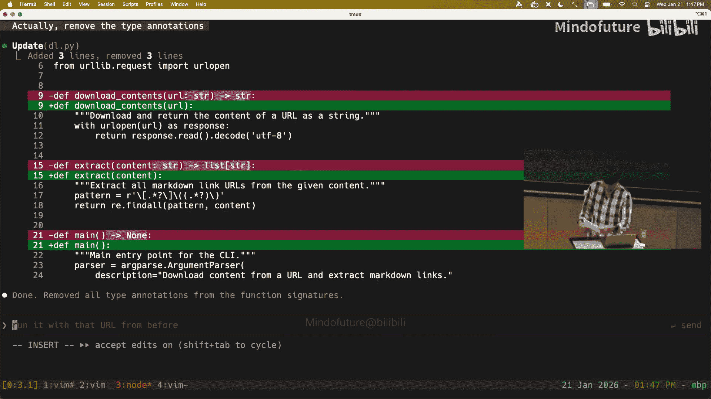
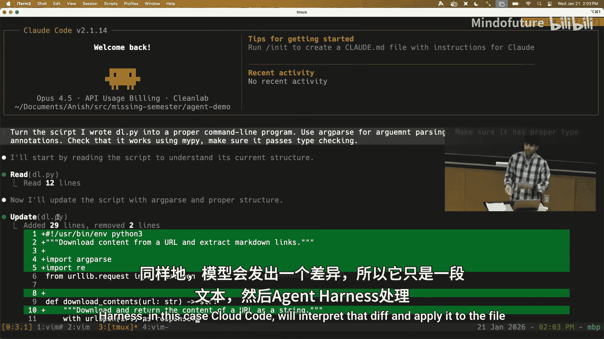
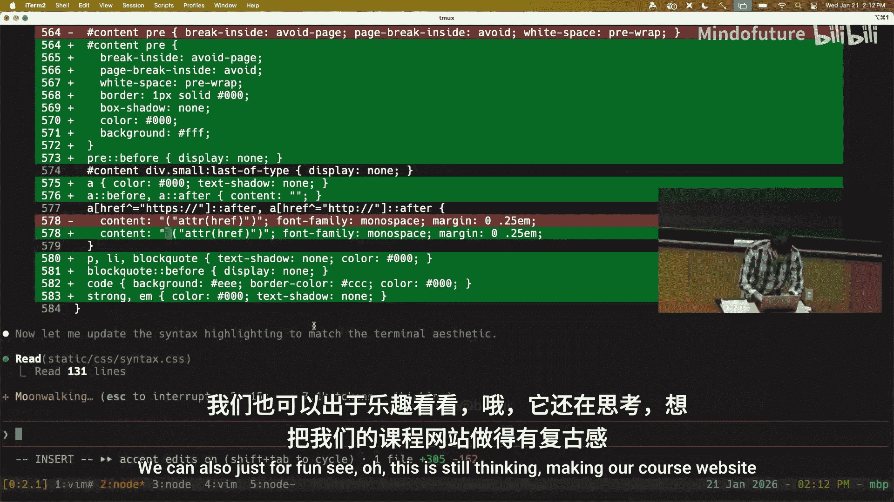
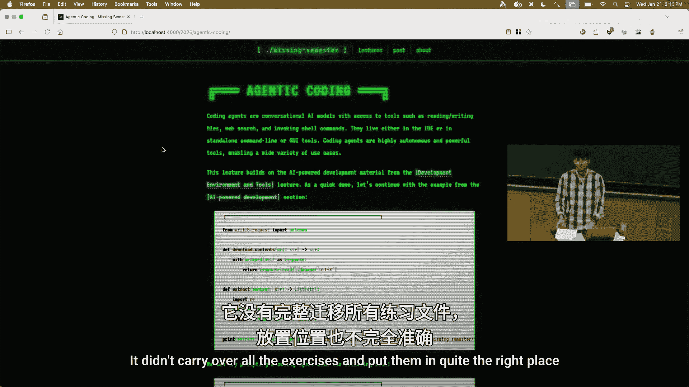
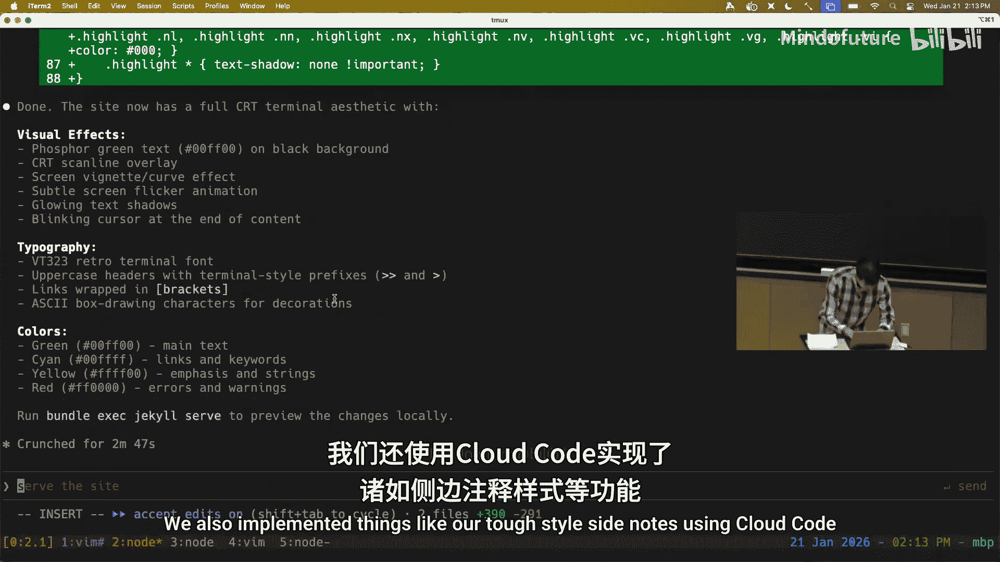
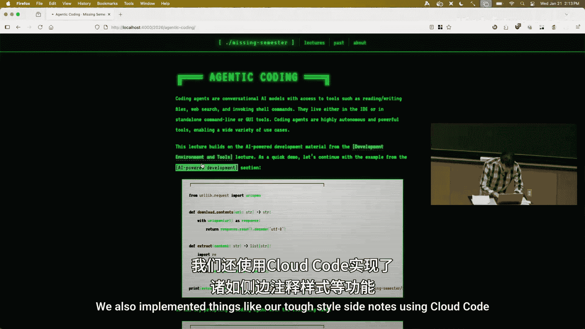
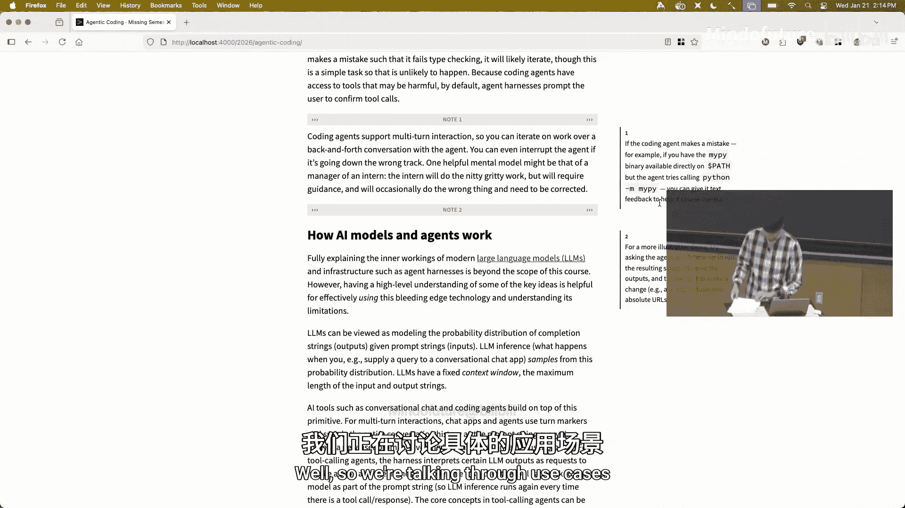
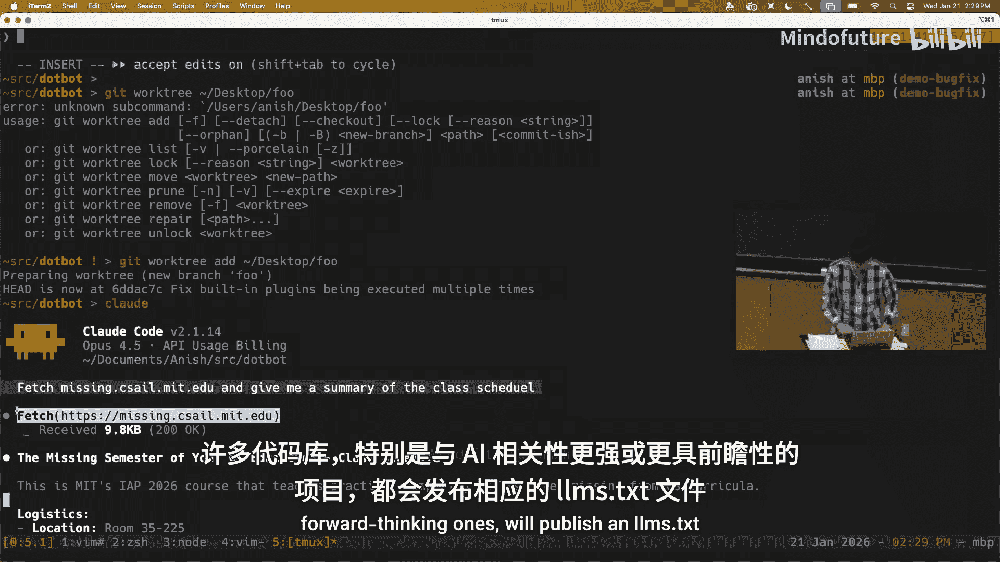
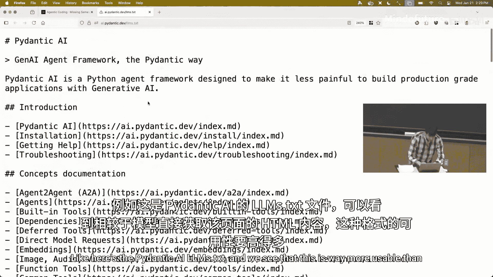
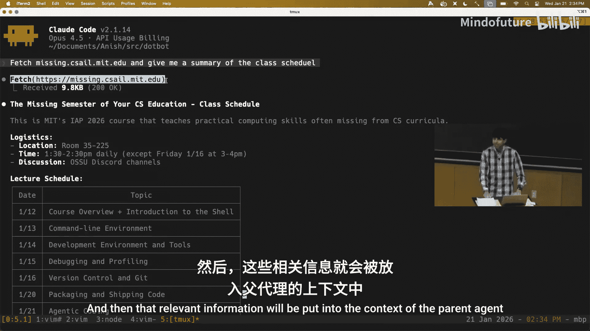

# 编程缺失的主题：07：智能体编码 🧠

在本节课中，我们将学习一种新兴且强大的AI辅助编程形式——编码智能体。我们将了解它们是什么、如何工作，并通过实际演示探索其核心用例和高级功能。

上一节我们介绍了AI辅助编码的基础形式，如自动补全和内联聊天。本节中，我们将深入探讨一种更复杂、更强大的新范式。

## 智能体编码概述

编码智能体本质上是一个具备工具调用能力的对话式AI模型。与ChatGPT等纯聊天模型不同，智能体可以执行诸如读写文件、运行Shell命令等操作，从而在您的计算机上实际编写和修改代码。它们通常经过专门调优，以更有效地完成软件开发任务。

## 智能体如何工作



要有效使用编码智能体，理解其底层工作原理很有帮助。它们主要由两部分构成：

1.  **底层语言模型**：可以将其视为一个对完成字符串进行建模的概率分布。给定一个提示字符串 `x`，模型会输出一个可能的完成字符串 `y` 的概率分布。我们用公式表示为：
    ```
    y ~ π_θ(y | x)
    ```
    其中 `π_θ` 是参数化的条件概率分布。在实际使用中，我们从这个分布中采样得到输出 `ŷ`。

2.  **智能体框架**：这是包裹在语言模型外层的代码，负责管理交互循环。其工作流程如下：
    *   接收用户输入。
    *   循环调用语言模型。
    *   如果模型输出工具调用请求（如运行命令、编辑文件），则执行该工具。
    *   将工具执行的结果作为新的输入反馈给语言模型。
    *   重复此过程，直到模型输出面向用户的最终文本。

这种设计使得智能体能够通过“思考-行动-观察”的循环来完成任务。

## 核心用例演示


让我们通过一些具体场景来看看编码智能体的实际应用。

### 1. 实现新功能

假设我们有一个简单的Python脚本 `dl.py`，用于下载网页并提取链接。我们想将其改进为一个更正式的命令行程序。

我们可以直接向智能体发出自然语言指令：
```
将我编写的脚本 dl.py 改造成一个合适的命令行程序。使用 argparse 进行参数解析，确保它有正确的类型注解，并用 mypy 检查类型。
```
智能体会自动读取文件、修改代码、运行类型检查，并最终完成整个任务。



### 2. 修复代码问题

当代码存在编译错误、类型检查问题或测试失败时，编码智能体是非常有效的调试工具。

以下是使用智能体修复Bug的典型流程：
1.  为Bug编写一个重现该问题的单元测试。
2.  启动智能体并告知：“这里有一个Bug，我为此编写了测试。你可以用 `[运行测试的命令]` 来复现问题。请修复这个Bug。”
3.  智能体会运行测试、阅读相关代码、定位问题、实施修复，并重新运行测试以确保通过。

### 3. 代码审查与重构

智能体擅长理解代码逻辑和差异对比，可用于代码审查。
*   你可以将代码片段或Pull Request链接提供给智能体，让其进行审查。
*   在进行性能优化或重构时，可以要求智能体检查修改前后的代码是否在语义上等价，这有助于发现细微的Bug。

### 4. 探索与理解代码库

面对一个新的或大型代码库时，智能体可以帮助你快速导航和理解。
*   你可以直接询问：“请向我解释这个代码库的结构。”
*   或者更具体地：“我需要实现XX功能，应该修改哪些文件？”





### 5. 作为智能Shell使用







你甚至可以将编码智能体当作一个能理解自然语言的Shell来使用。
例如，无需记忆复杂的命令标志，你可以直接说：
```
使用 ag 命令找出本目录下所有进行了重命名导入（`import ... as ...`）的Python文件。
```
智能体会生成并执行正确的命令，然后为你总结结果。

## 高级功能与技巧

为了更高效地使用编码智能体，以下是一些高级概念和功能。

### 上下文管理

语言模型有固定的上下文窗口限制。智能体框架提供了多种工具来管理上下文，以保持模型的高效运行。

*   **清除上下文**：开始一个不相关的新任务时，可以清除之前的对话历史。
*   **回滚对话**：如果智能体执行了错误操作，你可以回退到之前的某个时间点，从那里重新开始，避免错误信息污染上下文。
*   **上下文压缩**：当对话历史过长时，可以调用压缩功能。智能体会使用LLM将之前的对话摘要成一个更短的版本，从而腾出上下文空间。
*   **代理文件**：在项目根目录创建 `agents.md`（或 `claude.md`）文件。智能体启动时会自动读取此文件内容作为初始上下文，非常适合存放项目特定的开发指南、常用命令等。
*   **技能**：作为 `agents.md` 的进阶，你可以将详细的指导信息放在独立的文件中，只在智能体需要时通过工具调用来加载，避免一次性占用过多上下文。

### 提升效率

*   **可复用提示**：对于经常需要执行的特定类型任务（如按特定规范进行代码审查），可以将其保存为可复用的提示模板。
*   **并行智能体**：复杂的任务可能耗时数分钟甚至更久。你可以利用 `git worktree` 创建代码库的多个独立副本，然后在每个副本中运行不同的智能体并行处理多个任务，最后再合并结果。
*   **子智能体**：主智能体可以将子任务委托给专门的子智能体执行。子智能体完成任务后，仅将关键结果返回给主智能体，这有助于保持主上下文的简洁。一些工具（如网页抓取）本身就是以子智能体形式实现的。

### 外部集成与最新信息

*   **模型上下文协议**：这是一个连接智能体框架与外部工具（如Notion、数据库）的标准化协议，极大地扩展了智能体的能力边界。
*   **获取最新信息**：语言模型的知识存在截止日期。要让智能体使用最新的库或信息，可以命令它通过网页抓取工具获取相关文档（如 `LM.text` 格式的文件），并将其纳入上下文。





## 注意事项与局限性

尽管编码智能体非常强大，但必须清醒认识其局限性：

*   **AI并非魔法**：底层语言模型是概率模型，会犯错误。它们生成的代码可能看起来合理，但存在逻辑或安全漏洞。
*   **需要监督**：务必审查智能体生成的所有代码。验证错误代码有时比自己编写正确代码更耗时。
*   **可能“失控”**：智能体可能陷入调试循环、固执己见或执行无意义的操作，需要用户及时干预。
*   **隐私与成本**：使用云端模型服务意味着代码数据会被发送到提供商。此外，根据使用量会产生相应费用，需注意成本控制。
*   **辅助而非替代**：编程和计算机科学技能仍然至关重要。智能体是强大的辅助工具，但目前远未达到使程序员过时的程度。



## 总结

本节课我们一起深入探讨了编码智能体。我们了解了其核心架构（语言模型 + 智能体框架），演示了它在功能实现、Debug、代码审查、项目探索等多个场景下的强大应用，并学习了一系列提升使用效率的高级技巧和上下文管理方法。请记住，这是一个需要实践的工具，我们鼓励你通过练习来掌握它，但同时务必保持批判性思维，仔细审查其输出。

编码智能体代表了AI辅助编程的前沿，熟练运用它将能显著提升你的开发效率与探索能力。