# 【麻省理工】编程缺失的主题-｜-Missing-Semester-Iap-2026-p09-P09_第九讲_代码质量--BV11QASzrEDy_p9-

Okay let's get started today we are going to talk about code quality so we're going to cover a number of topics including code formatters。

 liters， testing， precommit hooks， continuous integration and command runners and then if we have time at the end of lecture as a bonus topic we'll cover regular expressions which is a cross-cutting topic that has applications in a number of domains。

 including in code quality like some tools have parameters that are controllable using regular expressions so we'll cover all of those topics today。

And we're going to be talking about code quality concepts in today's lecture。

 but many of the tools we are going to present in today's lecture will be language specific and the reason for that is that a lot of these tools kind of have to be language specificific because they need semantic understanding of the language they're working on。

 but again， the focus is on the concepts， not the specific tools we are presenting and the concepts are near universal。

 so for any of the concepts we're talking about like Liing or testing。

 you will find tools or libraries applicable to the programming language that you use。

And for today's lecture， I'm going to basically as a case study be working on this little library we wrote called MinlibB。

 which is this single file Python library with a bunch of random utility functions that are not actually that useful。

 but are what we need for the purpose of demonstrating the various things we want to talk about in today's class。

So let's start off talking about code formatting so code auto formatters automatically predify surface syntax in your programs and the reason for using these tools is that you can use the tool to automate the more mundane details of writing code and keeping it looking clean while you can spend your brain power thinking about deeper and more challenging problems so if we look at this code I have open on the left if you look close you'll notice there's some little formatting inconsistencies and things that are not so nice like for example in Python you can have strings delimited either by double quotes or by single quotes and I'm inconsistent here so like this line of code has double quoted strings。

 this line of code has single quoted strings I have other little weirdness here like I have this binary operator here where I have spaces in between here but I forgot to add a space here and maybe there's some other issues in here I don't remember that the auto formater will catch when I run it。

And so auto formatters will either check to see if the format complies with the standard or many of them can actually fix your code so it complies with the standard。

 so it's a job that you don't need to do anymore as a human。

And there are some tools out there that support multiple programming languages。

 there are some tools out there that are highly configurable so you can say to the tool like， oh。

 I prefer my Python strings with single quotes rather than double quotes and oh I actually want no spaces in between my binary operators and stuff like that。

And then on the other hand， there's some code formater tools that have very limited configurability and the reason for that is to reduce bike shedding。

 like programmers shouldn't be spending their time debating whether single quoted or double quoted strings in Pthon look better。

 they should spend their time on more important tasks and so the code formatator tools just try to set a standard and everybody follows a standard and you don't need to worry about anything。

Yeah。Also for some code formatters， you can set up IDE integration with your formatter。

 so when you save your code， it'll automatically get formatted that I'm not going to demonstrate today。

So yeah here I pointed out a couple issues with this code where it's not so nice and here I'm going to go and run the auto formatter I have set up for this project now I'm using a Python package a project manager called hatch and I've configured it so the Ha FMT F command runs the formatter you don't need to worry about the details of the configuration and I think we'll just open source repository if you want to look at the details of this particular one but again focus on the concept so if I do hatch format F to run the code formater and if I run dash check it will check to see if the code is compliant with the formatting standards and show me what needs to change so here I'm going to zoom in on this window and we can see it shows a diF so it's showing like okay we want a little bit more spacing between our function definitions and then there are a bunch of little issues here like the ones I pointed out like it's fixing this single coded string to be a double quoted string and it's adding a bit more space between these binary operators。

And I purposely kept this diff pretty small， didn't want to introduce just like a ton of formatting weirdness。

 but if we go and do other things like okay I add some more spaces between the parameters here。

 like maybe I have an like unnecessary new line in a weird spot like it will fix that sort of your code does need to parse though so it will fix some of these weird things for you so if I tweak it in that way it'll say I want to compress the spaces here。

So these tools can be run often in a check only mode or they can be run in a mode where they actually make the fixes to your code and so switching back to this Hat FMT F command without the dash dash check and when I run that the tool says okay one file has been reformatted and if I reload that file in my editor I'll see that all the changes that that it was going to make。

 have indeed been been made in the code。There's one other tool and standard I want to talk about in the context of formatting there's this thing called editor config which is a file format and class of IDdeE plugins that help developers maintain consistent coding standards across different IDEs so if you are using Vim and your friend is using VS code and your other friend is using CRpher and you're all working on the same code base little things that might be mismatched between the different people's configuration can lead to some annoyance for example。

 you might be using different levels of indentation in your code so like in my Python code I'm using four spaces for indentations every time I press tab things go in by four spaces but you could totally it's legal to indent your Python code like this and somebody might have their IDE configured that way and so if I open up my editor config file here it's in the root directory of the Git repository it has some basic settings like do I want to end my files with a new line character what character should I use for spaces do I want tabs or spaces should the editor。

Aomaically delete trailing whitespace at the end of the line so I've added a bunch of whitespace characters here and when I save the file it just gets rid of them and then you can do things like on a per file type basis or per file name basis configure little details like what's the indentation size you're using and so it's this little thing that helps keep things consistent across different IDEs and so we use editor config in our missing semester repo for example。

So that's a brief introduction to code format mattersters。

 it's a pretty simple concept I don't have too much more to say on it unless people have questions but to see a really handy tool that I recommend to use in every single project of yours。

嗯。Cool， so let's see here， let me actually go ahead and commit these changes so I can do like get commit dash a fixed formatting so we can slowly improve our code base over time as we're live coding in this lecture。

So the next topic I want to talk about is Ls， so there's this termlins andlins run static analysis on your code。

 so it's static analysis as opposed to dynamic analysis in the sense that thelins analyze your code without actually running it but it is a semantic analysis of your code so you can think of it as going a little bit deeper than these code auto formattters which just look at surface syntax and what Ls try to do is find antipatterns and potential issues in your code。

And the level of depth of analysis varies between tools。

 but generally these things can catch a lot of things before they become bugs that you run into in practice。

AndLs generally come equipped with a list of Lter rules and these are presets that can usually be configured on a project level basis if you want to。

 and then some Li rules， these bad code patterns that these tools look for can sometimes a false positives。

 so many Ls also support disabling L rules on a per file or per line basis。U。

And a couple of the good things to know， generally the goodlins will have hell per documentation that when it complains about aspects of your code。

 it'll tell you what pattern is looking for， why that particular code pattern is bad and should be avoided and might actually suggest a better alternative for the code pattern and somelins can actually fix some issues for you the tricky thing with Ls though is it's going beyond just a synta analysis is a semantic analysis and sometimes these static analyses are not perfect and so somelinter rules come with safe fixes where it's always safe to apply the fix to your code and in other times it can find things that are like potentially problematic things in your code and it's really hard to write a safe transformation to your code that will preserve semantics and won't break anything so sometimes Li errors will have to just be fixed by the human programmer working on the code base。

So let's look at a demonstration of a liter running on this code base。So let me。So again。

 in my project I'm using the Hat project manager， I've set up this command to run a Lter configured with a bunch of Lter rules。

For my Python code， and here I'm running it with dash dash check。

 so it'll just flag potential issues with my code， and then later we'll see what it can auto fix versus what it can't。

And so we can see here the summary at the bottom， let me again zoom into this window。

 it says found seven errors and the L points out， oh。

 three of these are actually fixable with the dash dash fix option。

And there's also this dash dash unsafe fixes option if you're feeling dangerous。

And so we can see some of the things that complains about。

 we can see that these are yeah like lightweight semantic checks on our code。

 so we're seeing like okay， this is saying I have some code that does an import star and that's problematic because it makes other static analysis more difficult among other things so that's an antipattern。

 I have unsorted block of imports， so just for cleanliness it's nice to have Python imports in sorted order。

I'm importing a module that I'm actually not using。

 so here I see okay OS imported but not used and so on。

So let's go through some of these and fix them。 and as a starting point actually let's call the Lter without the dash dash check so it can actually automatically fix some of the issues。

 So actually let me call it with the dash dash check and walk you through the issues it's going to automatically fixed。

 So this one has a star on it the way this li is set up it'll mark with a star the things that can be autofi。

 So yeah like sorting things like sorting imports is a safe operation to auto fix this it'll automatically remove this unused import and then another little code pattern it points out is not great is here I have this if return and then an else if but you actually don't need an else if because in this branch you' are returning in the if case。

 So this can actually just be a regular old if without being an else if that's another pattern that they recommend you don't using in your code。

So if I run the Li with fix mode on and I reload my file。

 I'll see that some of these things have been changed， so my if elseif elses if changes to an if。

 if if the unused import's gone， and I think maybe some other minor fixes were made。

But now I can take a look at the things that the  Lncher was not able to auto fix for us。

So let's start with the first one。 I have this import star here。

 I've done that so that in this particular library I can do from Minlib import whatever。

 and it'll import the names from this us submodule。 So I actually want my code to behave that way。

 I mean this is not a great programming practice， but for demonstration purposes say I want to keep things that way。

 I can actually say like okay， so this code。The Linter was complaining about and it's giving this like F 403 error。

 and so I can say no QA F403， and this turns off the Lter for that particular line。

 so if I run thelinter again now I don't see that particular error anymore。

And so this is generally how these tools are used， like especially for larger projects like you will want to keep a lot of static analyses enabled because they do help catch potential bugs and bad patterns in your code。

 but the analyses aren't perfect and so you might have to add these no QA sort of annotations in various parts of your code。

So let's keep going and fix the rest of the winter errors。嗯。

So I also want to demonstrate how the Ls can actually teach you about how to write better code and so let's take a look here I'll zoom in and let's take a look at this first the second issue here I have this code that raises a value error and I have a string literal in there divide by zero and the Lter says yeah I'm101 exception must not use a string literal assigned to a variable first so that's telling us what to do and we can just go and fix the thing but if we want to learn about why this is bad。

 we can just Google this and for this particularlinn I'm using the roughlin under the hood。

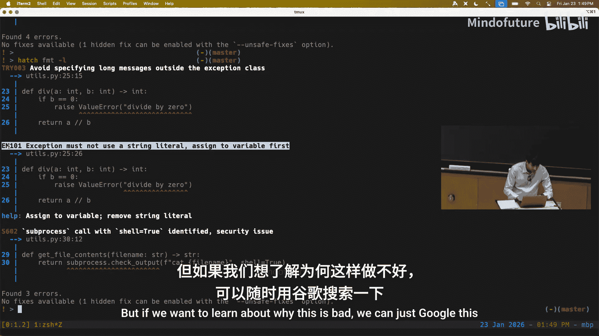

And they have extensive documentation which explains every single inter rule and then there's a what it does so you know what code patterns is looking for and then the why it's bad so you can actually learn。

 So like here it's saying when you use a raise statement and Python code it shows you a back trace so it shows you like what lines of code were executed that led to that exception and then it also shows you the error message down below and so if you use a string literal in the。

😊，In the same line as this raise， you'll end up seeing the message twice so' a kind of redundant and takes up space on your screen and they even have a concrete example here。

 So if you have Python code that says raise runtime error some values incorrect。

 you'll see this kind of a back trace where it'll show this line of code this raise。

 but then it'll also show the error class and the error message here so this appears twice and so that's the bad like that's why we want to avoid this pattern and then the linear documentation tells us like what's the right way to do this instead you assign this string to a variable So you just had one extra line of code bind to a variable first and now you have much nicer error messages where you see raise runtime error message without the redundant string in there so simple fix。

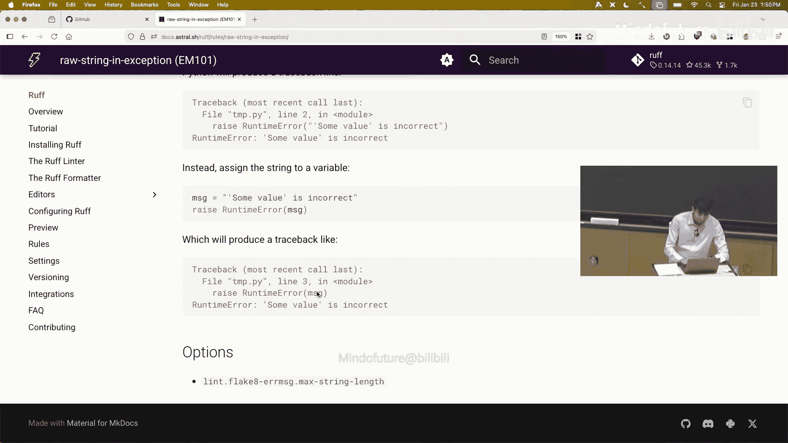

So let's go ahead and make that fixed to our code。And when I save this and rerun the Li。

 now it's complaining about only one more thing。So it's saying that I have this code down here that it uses the Python subprocess module and calls the cat command。

 but it's being spawned with shell equals true， so instead of calling the cat program directly this actually calls like Z shellll on my computer and that parsees the string and executes it and this is a bit dangerous。

 their potential security issues here and we won't talk about why this is a security issue in TLDR like if this file name contains certain funny characters like if there's a semicolon followed by something。

 then the thing after the semicolon will be interpreted as code and run by the shell。Anyway。

 like this is a bad pattern you should avoid in your code。

 and this is another thing that this L rule catches。

Let's actually go ahead and ignore this one for a moment。 so I'm going add that no QA line。

 no Q A S 602。 And then when I rerun this L it passes。

 So now instead of returning a nonzero exit code I see that when I run the Li it just says all checks past and return zero So we're all good。

 and the reason I in practice you'd probably like fix this this is not a good code pattern to follow。

 but the reason I wanted to suppress this for the moment was that I wanted to introduce one more tool to you。

So when you get Lter set up for your projects， you're probably pick some popular one for the programming language you're using and it'll come with a large list of builtin Lter rules like if we go to here and look up like rough L rules they'll be hundreds and hundreds like R has 800 different code patterns it's looking for in your code and there's this huge list that'll explain them all to you so this is great for getting started。

 but sometimes for specific projects， you might want to have project specific Lter rules like maybe in a particular project you're working on you say like oh we don't want to use the Python pickle module because it can be used in insecure ways or oh we don't want code that uses the exact function in Python or things like that and for such situations it's handy to be able to write your own L rules。

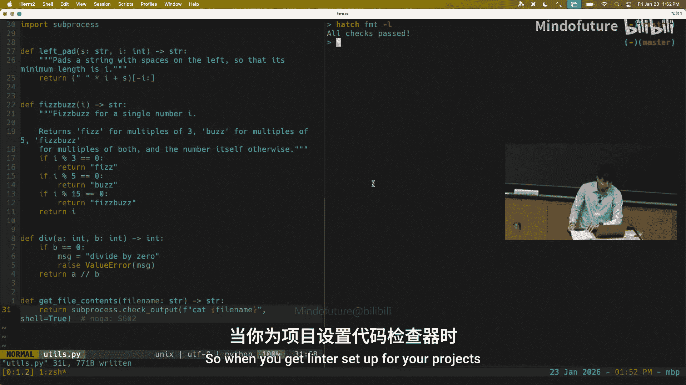

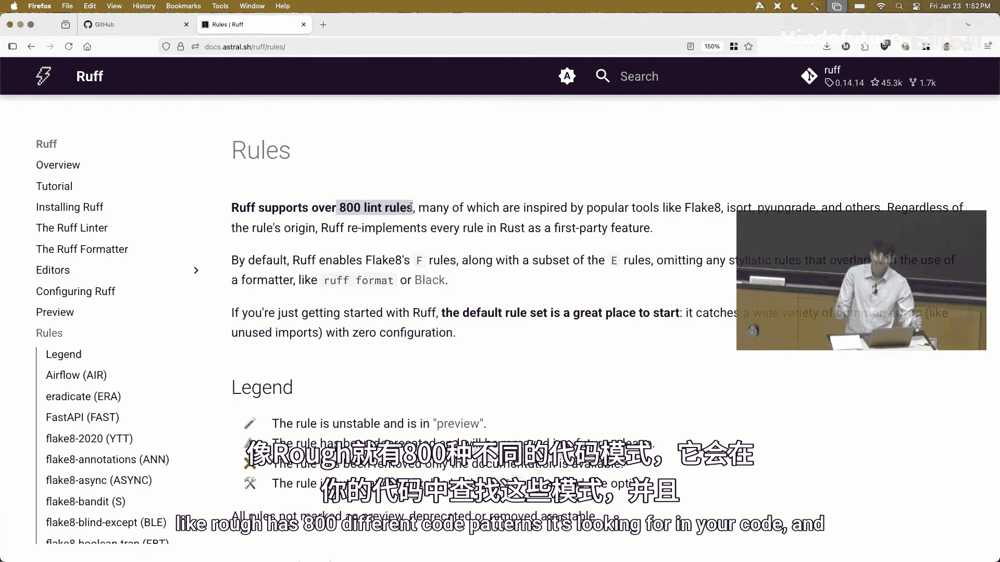

Sometimes the mainlin tool you're using will be configurable but another tool that can come in handy is something called SGp。

 which stands for symmantic GrP So recall that we introduced the Grep tool I think in lecture1 and searches text or code for patterns for string patterns So someGp is conceptually similar but it actually parses the syntax tree of the programming language you're using and searches at that level and so it can actually go like a little bit deeper than a very like character level syntactic search can go and so there' a concrete example let's say that we want to let's say that Lter didn't have a built-in check for this subprocess do check output with shell equals true so we can imagine writing some Gr command like use I'm going use a Gr alternative called AG but we can do something like search for subprocess do check output open parentheses and then like dot star which in re some number of。

comma shall equals true， and then I can search for this， and it indeed matches this line。

 It says that this is found right so then I could set up a little script related to my project where it would search for these kinds of things and help catch bad patterns in my code right The problem is that this regular expression here。

 for example， is a little bit fragile like you in this particular case。

 this subprocess do check output command takes additional keyword arguments so I could do like。

Add some more code。 And then this will actually oh sorry， this is a capture group。

 It's not looking for literal openclo parentheses。 but when I fix that， yeah， this no longer matches。

 So if I undo this change to my code this matches。 but if I make a slight tweak to the code。

 it doesn't match anymore。 And so you could put in a bunch of effort and try trying to write a rex pattern that works。

 but then like little things will break it like another thing thatll break it actually is just adding a new line here。

 So let me zoom into this window so you can see where my line breaks are like you could totally format your python code like this and in this case。

 I think the auto format or will change it back。 But here again。

 when I do this Gr or AG command it doesn't match this anymore because these are now broken across lines。

 And so you can kind of play wackamable and like try to write a whole bunch of rex patterns that look for the thing you want。

 But instead you can use the someG tool。And so SeGP is language aware so you can say I want to search Python programs and look for the SGP pattern。

 I'm looking for subprocess。che。Call or check output here。

And I want to find all instances where this is called with like some arguments。

 then a shall equals true and then some more arguments。 and when I run this。

It does find this instance of this code， even though I have this line breaking in here。

 and if I add something like。Like this， it will still match that code。

So SGp is a useful tool for writing your own lightweight analyses in order to augment your L in your project。

Any questions about that？Cool， so let's go ahead and。Get commit these changes， just to。

Get them out of way， fix Li errors。And let me rerun my。嗯。Oh yeah。

 this no QA thing doesn't work anymore because I broke this across lines。Let me fix this。

602 and rerun my formatter Li。And commit that， okay， yeah。

 any questions about linting before we move on to the next topic？Great。

 we're well on our way to having high quality code。

So the next topic we're going to talk about is software testing now testing is a really deep topic and you can teach multiple lectures on how to write good tests。

 so I'm just going to introduce you to some of the high levelvel concepts and then encourage you to explore more on your own time so software testing is a standard technique for increasing the confidence in the code you've written and the very high level idea is that you write some code and then you write some more code that exercises the code you just wrote and evaluates whether it behaves in ways that you expect。

And the idea is that you can write your code， write these tests。

 and then the tests are useful long term， so you can keep running the tests as you evolve your code to make sure nothing breaks in your code or things like that。

😊，And then there are many different approaches to writing tests and tests can be written at different levels of granularity。

 so there are unit tests， you can test say individual functions in your program so you can say oh Fizzbu should behave in this way and left pad should behave in this way and so on。

There are integration tests that can test for interaction between different modules or services in your project and then there' functional tests which are more end to end like does the software satisfy user requirements you can evaluate entire end- to- end scenarios there so you can think of testing at different levels of granularity and then their different testing approach to like one popular approach to developing software is something called test drivenriven development where instead of writing an implementation first and then writing test for it later。

 you'll actually flip the script and you'll have an idea for something you want to implement have a specification in your mind and basically express that specification or a partial specification through tests like this function I'm going to write should behave in this way and then you can go ahead and write the implementation and then run the test to confirm that the implementation indeed satisfies the spec。

Yes。Great， so there were unit tests， which is testing individual functions and then well。

AndAnother there was an。est wholeYeah， so they're unit tests， integration tests， functional tests。

 and this is all in the lecture notes and also people come with different terminologies to describe different testing approaches that are not in the lecture notes as well。

 this is a pretty deep field。Uh。So let's look at some examples of software tests and for those of you who are looking closely at the code on the left。

 you might have identified some bugs in this code already。

 but let's think about this more from the testing standpoint and try writing some tests for these functions in order to help us。

Catch the bugs in the code。And so let's start out with。Let's start out writing tests for FISBs。

 I think we've talked about fsBuzz before， but it's this I've basically turned fizzBuzz into a function here and here's the specification in English language for a given integer I I want to return fiz for multiples of three buzzuzz for multiples of five and fISBuzz for multiples of both three and five and if none of those hold then I want to return just the number itself。

And so I am going to write some tests for this， so I'm going to split the screen so you can see the Fibos implementation up here and then here I am going to。

嗯。Create a new file test FsBs。 Pi the specifics of exactly how you set up your testing framework and where you put your tests and all that is dependent on the programming language you use and also on the particular testing framework like here I'm using Python and PyT。

 but yeah when you get to this point in your own projects you should just look up like how to set up testing for whatever language you're using like what Java testing framework should you use。

In the P test framework that I'm using what tests look like or they go in the special location。

 they start with test underscore and they're just plain old Python functions that take no arguments。

 return nothing and just contain a bunch of assert statements and then the testing framework will run all these functions when I ask it to run so I can do something like assert fsBs of three is equal to Fiz。

So I can write that test and I'm going to run Ha test here to run all my tests， where is this file？嗯。

是。Oh I am not at the top level of my project here。 Yeah。

 so I'm gonna to zoom into this window and rerun that so it looks a little bit better。 Yeah。

 so I just ran my singular test where I asserted that fsB of three was equal to Phz And then here it says name error name FizB not defined So this also illustrates that you can actually have a bug in your test themselves I forgot to import my module here。

 So I'm going to do from minilib import fizzBuzz。And then let me rerun my tests。

 and then I see it's all green， it says one test passed， right？

And so the idea is that you can write a bunch of tests。

Hopefully going a little bit deeper than these very simple programs and tests I've written here。

 and that might help you catch some bugs in your program。 So what's another test that you might want。

 Maybe like fizz buzzuzz of 30 should be。The string fsbuuzz right and then when I go ahead and run the test there。

 it'll complain whoops here it'll say， okay， this test failed。

 the test fbu 2 failed assertion error assert fz equals equals fs buzz So the thing on the left here is actually returning just fz when I wanted fizzBuzz right So based on this failure now I can go and analyze my code and try to figure out like okay for this concrete input。

 why did it fail to give me this concrete output I was expecting and then I can go ahead and notice like oh maybe this。

Test here should have been at the top so I can go ahead and fix that， rerun my code。

 and now both of these tests pass。So great， any questions so far？

So a couple other topics I want to cover related to tests。

 one question you might have is how do you measure how good your tests are。

 like how do you know that you've done a good job？And in part。

 it's kind of hard for somebody to like write a program to tell you how good your tests are because it requires like creativity。

 you want to exercise your code in the right way and testing is a little bit of an art that you'll get better at over time but there are some tools that can help you so there's this one metric called code coverage which looks at of your implementation like which of the lines of code are actually exercise by the tests like if we look at these tests for example like actually let me just go ahead and run my code coverage tools and show you what that looks like so I'm gonna to do hatch test C so set the up computes code coverage when it's running the tests。

And it tells me， okay， in this uTs。 pi program， I have 18 statements and actually missed nine。

 so only a 50% coverage， there's a bunch of untested code in this implementation。

And when you use code coverage tools， you can actually get a nicer report than this in my setup。

 I can do Ha run coverage HTML， and this will generate an HTML formatted report that I can open in my web browser。

To help me better understand。

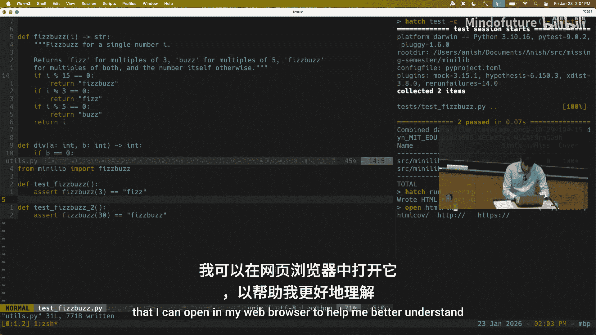

。Where I need to focus on writing tests， so this is that code coverage interface just running from that local file in my web browser and if I open up this Us dot pi thing here。

 I can see like okay， I had that I equals 30 test case for FISBuzzs and so this is covered its in white or with no background。

 this was also covered that was the first test I rose。

 wrote but these two cases actually aren't covered by my tests。

And also this stuff down here is not covered by my tests。All right。

 so I can go back and say like okay I realize I'm missing some tests to let me improve my coverage。

 I'm going to write a test ViB3 function that does assert visBAs of let's do like 99 so what should this be that should be Phiz right？

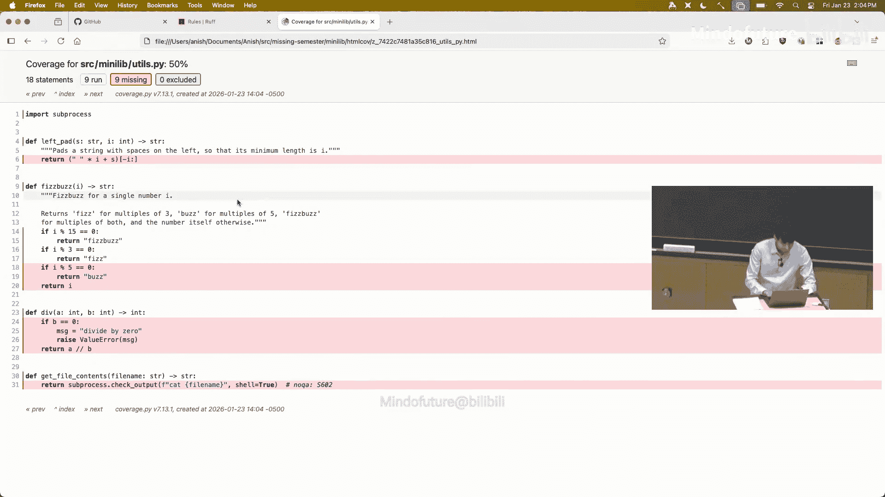

And maybe I can do one that's just a actually， I'll just leave it at that。

I can rerun my tests with coverage， I get my report， and then I can do。Oh wait， sorry。

 that was not useful because we were already testing three。

 we want to hit this line of code so let's do like 95 here and there should be buzz。

So when I rerun my test with coverage， now I see that the coverage has gone up from 50% to 61%。

And I can generate the HTML coverage report and open it up in my browser again。

 and now I see that that line is indeed covered。

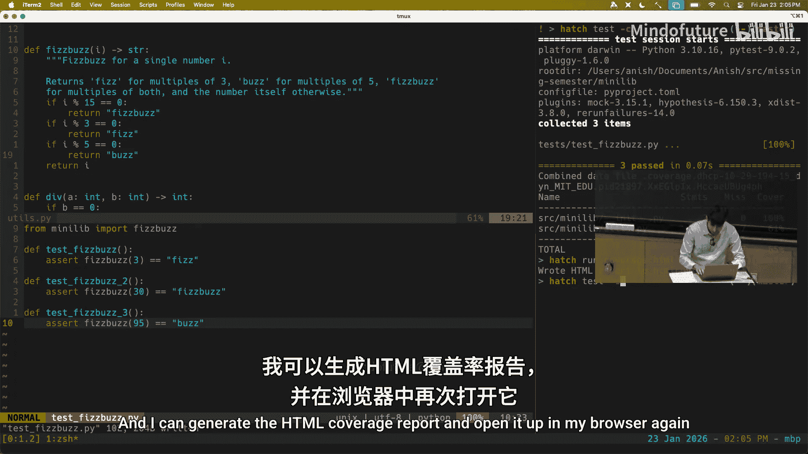

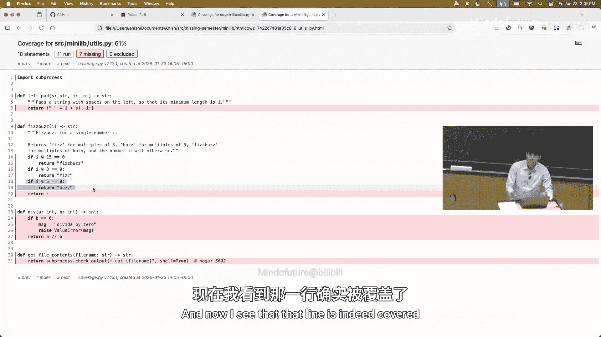

So that's code coverage I think it's a pretty decent metric to use。

 it's also a decent metric to look at when you're trying to assess the quality of some open source project that you find online like if they're doing a good job and running all these code quality tools and things like that。

 they will probably care to some degree about code coverage and if you see a project with very low code coverage then you don't know how high quality the code might be。

One more cool topic I want to。Great question， but。Is there an easy way of saying with AI how would I need to change what I'm doing in order to get more code coverage testing Yeah。

 that's a great question So just it make it better it cover more and suggest something how would you do Yeah so the question is can you use AI to help you improve code coverage and the answer is absolutely that's one of the exercises we recommend for this lecture you can set things up in a kind of close loop way where you make sure your AI agent is able to run your tests and run it with coverage and generate a report that can look at like either in that HTML format or with the tool I'm using it can generate an XM format report。

 which will be a little bit more dense and probably better to give to your LM and then you can just tell it like improve my coverage till you get to 100% and like these AI coding agents are actually pretty decent writing tests for you？

嗯。Or maybe that's a homework assignment， but I just。

Yeah I want to make sure I cover the other topics， I think that description should be enough and if we have time at the end of the lecture。

 remind me and we can cover it。But yeah， AI agents are pretty good at writing tests。

 One thing to keep in mind though， like code coverage isn't a perfect metric and also like AI isn't perfect at writing tests and it's a little bit hard to demonstrate with code like this which is so simple but for more sophisticated code it's possible to write tests that achieve high coverage but are not actually that meaningful like they're not really thoroughly exercising your program and you can have software with bugs which passes all the tests right and so like I have seen people who've done AI generated testing。

 especially for things like Fend where I've seen repositories with 100% code coverage and the tests are like almost completely useless So something to be aware of like it can be good。

 but it can sometimes not be good not the functionality Yeah so the question is can you guide the AI more and say things like test the functionality I mean yes you can and AI can be pretty decent at writing tests。

 I'm just saying that it's not like necessarily perfect and you do want to scrutinize its output and sometimes you might need to give it more input than just like write tests for my program you might need to guide it and that'll let the AI produce better better。

Tests。Cool， so while I was coding， has anybody noticed the bug in this left pad function yet？

So anyway this function is a bug， but it's a little bit hard to spot because I've written this kind of tricky way of implementing this left pad。

 the speck of left pad is given a string， I want to pad it with spaces on the left so that its's minimum string length is I it's useful for like table formatting and stuff like that in command line programs。

😊，So I want to introduce you to another type of another approach to testing。

 something that's called property based testing。 and the idea with property based testing is that instead of writing。

K of discretereet test cases like this， like oh with this concrete input。

 does my program produce this concrete output， you can instead write down properties that your function should have and the testing library can actually test those properties over a bunch of different inputs that are automatically generated。

And so this gets you a little bit closer to writing down a formal specification for your program and they're generally not complete specifications。

 but you can write down partial specifications of properties that should hold So let's demonstrate that in the context of this left pad thing and I'll create a new file for that and do from MinlibB import left pad。

Yes。And then for this property based testing， I'm using a library in Python called Hyth。

 this approach was originally invented and popularized by the Haskell Quick check library。

 but now there are libraries in a bunch of programming languages that support this kind of testing。

So like can anybody tell me like what's a property。

 what's a mathematical property that this left pad function should have and think with your math hat on。

 like I want a statement of the form like for all strings and for all integers property。Yes。

If we generate a bunch of random integers。And then multiply them by， and then we multiply them by。

And then we run them some algorithm to make sure that there're。My5 can the。Yeahま。Okay。

 so I'm asking about the left pad function。 So I want some property that's the form like。Like。

For all S string， for all I int。Something。And that something should be a statement about the left pad function。

Black pad should be equal to I plus the electrons。Yeah， great， very close。

 there's a spec for left pad here is that the minimum length of the output is I。So呃。

If you have a string of length 5 and I5 then the output is actually just length 5。

 but yeah that's a reasonable property to write down so in hypothesis I can do this like this I can say I want like test left pad。

And then this takes in a string in an integer as arguments that are supplied by the testing framework。

 And then I can write down the property in here。 It's a function of like for all S for all I。

 I can say， okay， the length of left padding S。With I should be at least I right like if I take a string and I pat it to a length of I like the result should be at least a length of I if I start with something bigger then it's okay if the thing is bigger。

 but it should never be less than I right so I can write down this property and then with hypothesis you can set this up with this code。

And then yeah， this will vary by。Property based testing library that you use。

And then important to keep in mind that here hypothesis is not doing like a mathematical proof of this property。

 there are some techniques for doing that sort of very deep reasoning about your code。

 but here what it's doing is it's generating a bunch of random inputs and looking and seeing if the property holds so you do need to parameterize this and give it a little bit of help like okay for S I want you to consider text up to length 20 and for I I want you to consider numbers between 0 and 50 so a little bit of human intuition required there。

And so I can do a hatch test， and I see that this indeed passes this test。 so fantastic。

But let's go ahead and write another test。 Another property that a padding function should have is that if you take a string and you pat it。

 the original string should be contained in the result， right。

 that's like another reasonable property that you might want。

 So S should be contained in left pad of SI。And when I run this。This works。

What was the was the bug I created at like 2 am last night that I was trying to reproduce？嗯。他ello。

In any case。In the interest of time， I'm not going to try to remember that。

 Let's just go and break this implementation like let's say that we always。

 let's say that we left pad by。Taking the padding length and multiplying it by I and then adding an S。

 So this is like clearly wrong， right， Like if we start with a string of length 5 and want to make the padding 7。

 we don't add  seven spaces to the left of the string。

 But I'm just going to go ahead and break it in this way just so I can demonstrate that this property based testing approach catches it what。

actually， this still sounded okay， well I guess this demonstrates a different aspect of property based testing。

 which is this is a partial specification， it's checking to see that certain properties hold。

 but actually this broken implementation still satisfies these properties。😊。

Let's do something like this like okay suppose I just forgot to implement this in return S this still holds right let's say that I。

Take a substring of this string now like I'm doing something insane here。What is going on？Live demos。

是。是。到了。Yeah， like this property should not hold anymore。program。嗯是。All right， have。

I'm running all the tests。 So it is running this test left pad 1。 Oh， wait， I am missing asserts。

 That is what is going on。 So it was just like evaluating that expression。

 And it was either true or false。 And that was continuing on to the next line。 Okay， let me。

 I think this actually did fail some of the tests。 So let's restore that。 And now we see， okay。

 so this implementation I had before， which actually， I think will pass。😊。

This first property like this will always hold for this broken code。

 but the second property that the string is contained in the left padded version actually doesn't hold and an example where that doesn't hold so the cool thing with property based testing is it'll try this for a bunch of random inputs and then we'll see okay。

This gives you a concrete counter example where the property does not hold where here say S is the string is 00 and I is1。

 and then armed with this concrete counterex， I can go and debug the code。And yeah。

 we can go ahead and fix this if we want to， but I think in the interest of time。

 we won't fix it and if you were so inclined you can go and try to fix the codes that passes these property based tests and doesn't fail this one anymore。

So any questions about property based testing？Great。

 then moving right along another useful tool that you can use to enforce code quality across everybody contributing to your project is something called precommit hooks。

 And this is a mechanism by which you can set up git so that it runs a script before any git commit happens and so in this project we've already set up let me just get rid of this yeah you can leave this as this we've already set up a formater and Li and we have mechanism to run tests and so on。

 and so。😊，I have in this file precommitconfig。 yaml。

 I'm using a program called precommit that's linked in the lecture notes。

 but there's also this general concept of pre commitmit hooks In this file I've been configuring this pre commitmit command so it runs hatch format dash dash check before I make any commits。

And then a developer who's working on this repo just one time has to do pre commitmit install and then it says。

 okay， it's installed the pre commitmit hooks in the Git directory and then after this。

 if there's any errors in the code like let's just go and like badly format this if I try to do Git commit。

Before it pops up the editor and lets me write my commit message。

 it runs all the precommit hooks so in this case it's run this Ha format dash dash check。

 which return to nonzero exit code and then that's interpreted by precommit and by git as like oh。

 something went wrong and it's showing all thisbug all this debug output and until I fixed these issues I cannot proceed with the commit。

So it's a good way to enforce code quality across all the people working on your repo because otherwise it's easy to forget to run like Ha format before you commit changes。

Was there a question？so pre commitit。It's a list of。

Look into your repo and you're forced to pass all of them before。Yeah。

 exactly pre commitmit hooks are checks that run before every commit and if the check fails。

 then Git will not let you commit there's a flag you can pass to skip the pre commitmit checks if you really need to。

 but it's a good way to enforce consistency across all developers。

Okay so so far we've talked about running all these checks on our local machine now we're going to talk about continuous integration services So C services like Gitthub actions。

 which maybe you've heard of， are often paired with repository hosting services like GitHub and the idea is that you can run software on a remote server there whenever certain things happen so you can set these things up so that whenever you push changes to your code or whenever somebody makes a pull request or even on a schedule like every like Monday at 9 a it'll run some code for you and then you can go and put a whole bunch of useful code or like configure the C service to do things like run the format checker and run we haven't talked about type checking yet but for statically type languages you can run the type checker is another type of code quality check you can run your tests Another useful thing you can do is that in these C services since it's a remote machine that's happy to run a long-running job you can run what's called a matrix of tests So so far when we were doing hash tests on my computer it was running these tests just like on Mac。

So us using Python like 3。10 here。For more sophisticated projects that have a lot of complicated dependencies and things like that。

 you might want to run the tests across a variety of platforms like you want to run them on Windows and Linux and MacOS。

 and you want to run them for all the different Python versions like 3。7 all the way through to 3。

14 and CI services let you easily configure things so that you can run this whole matrix of tests like this Cartesian product across all the different parameters you want to vary and all in parallel so it runs pretty fast。

And then since this is run in a centralized place， anybody can look at the CI results and it's all very convenient。

And we don't have time to talk about the details of exactly how to configure GitHub actions in today's lecture。

 but as a general strategy， like for all of this code quality stuff。

 like even I don't memorize how to use GitHub actions like whenever I need to use it I'll go look up the documentation or like find an example from a different repo that's similar and just massage it to fit my needs or ask your coding agent to do if those things are really good at doing that too what I will demonstrate right now is just。

rununning all this stuff in CI and so this is configured for this repository through this special file there's this directory do Gitthub slash workflows and then you can put all your GitthHub actions workflows in there and in here I have a bunch of configuration that'll explain at a high level。

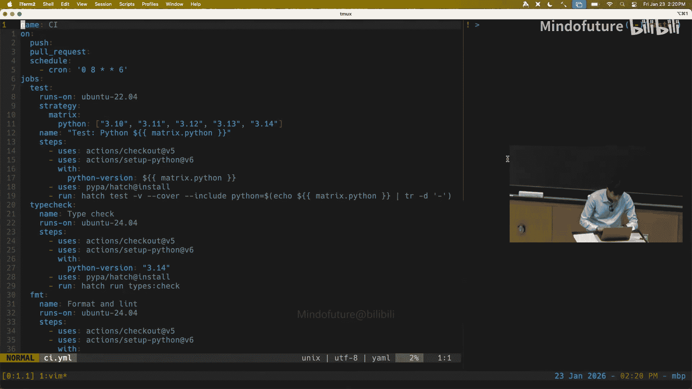

And before I do so， let me actually just make。New repository on GitHub and push this so that you can see what the results look like。

 so I'm going to create a repository on the missing semester organization。

 you can have it public so if anybody wants to poke at it later， you can look around。

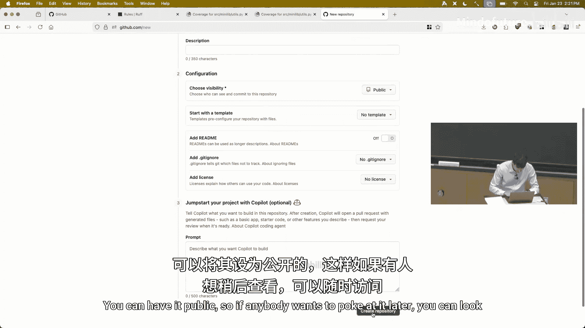

And then I'm going to set up and you get remote。And push this so this will be running in the background while I talk to this C configuration。

 So in this case this is just a single file。 there are a couple components of this that might be interesting to look at so you can run the C script you can instruct the C service to run your script on a variety of events So here I'm saying like whenever I push changes whenever somebody makes a pull request or on this schedule and this is the particular syntax。

 you can look up it'll run these checks automatically this last component can be helpful in terms of making sure that your code is compatible with all of its external dependencies like if one of the dependencies of your project makes a breaking change then running your C on a schedule will help you catch that like even though it's not really your fault like somebody else caused the problem。

 you will need to find a way to fix it。So that's the set of events on which this runs and then the script defines a bunch of jobs all this isn in a special syntax it's in a Yaml file which is the declarative configuration file and yeah you can look up this syntax in the Github documentation and it's kind of analogous for any CI service you might use I define a matrix of tests I want to run for a bunch of different Python versions and then I have a bunch of different jobs so I have this testop test job I have a type checking job and I have a formatting job and if we look at any one of these closely you can see like okay we can define the operating system on which this runs and then Gitthub actions are composable and they can build on top of other actions so there's some predefined things like I can check out the latest commit of my repo install Python on the machine that's running this stuff install Ha this Python project manager I was using to do things like Ha format。

嗯。And then finally you can define basically a shell command to run and if any of these return a non-zero return code。

 then the CI service says like oh something went wrong， that's a CI failure。

 And so here I'm running my format checker and my type checker and I'm also running the tests on all the different Python versions and so if I go over here and refresh this and look at the Gitthub actions tab in my repo I can find that for the latest commit the format or and Li pass so there's a screen check mark but the type checker failed so its yeah this is the detailed outputs of the type checker and then you could iterate on this and you can say like stuff is failing let me go fix it test on my local machine push it up to CI and ensure it works there and iterate till everything is all good。

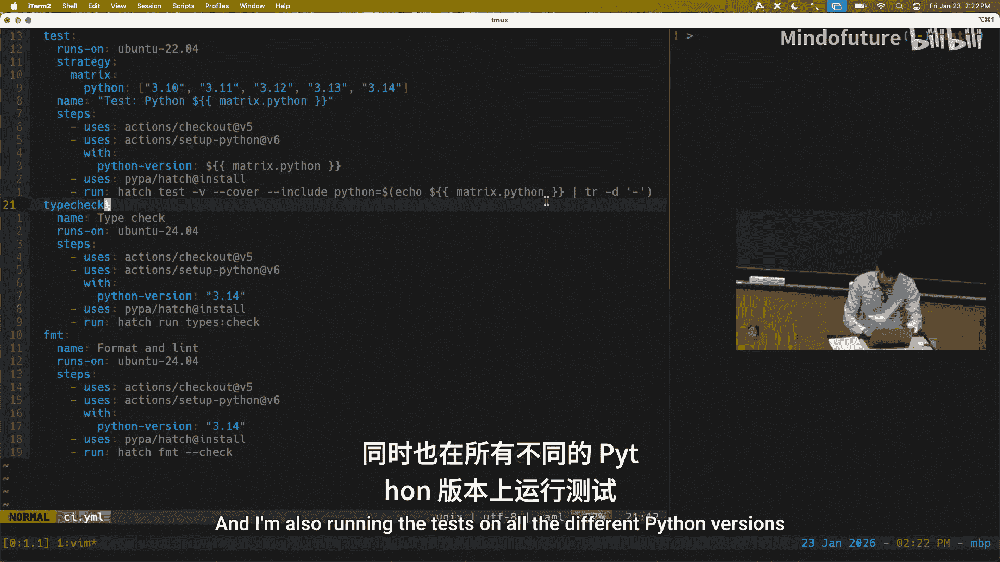

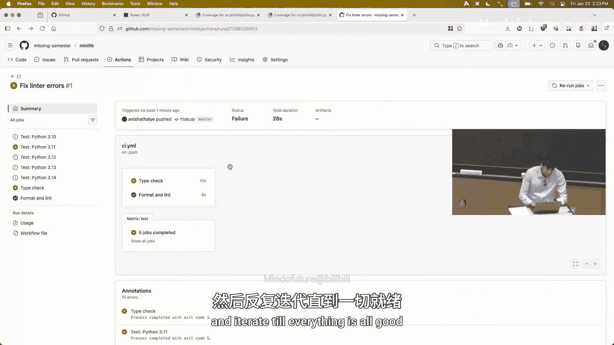

是。よのけか。Yes， John points out that this is particularly useful for pull requests from others。

 so oftentimes people contributing to your projects won't even do basic things like run the code format or run the type checker and so this kind of forces it to run for them and that information on whether the CI passes or not will actually show up attached to the pull request on Gitthub so it's available therere at a glance。

Clly related concept to continuous integration is something called continuous deployment。

 so many projects make use of the CI infrastructure to not only test code but also to deploy it so you can do things like if you have a binary software you're working on you can actually run the compiler and produce builds for like all the different operating systems and automatically publish them online or things like that。

 you can automatically deploy applications to web services we even use this in missing semester so if you take a look at the repository for our course you'll see that we use CI and Gitthub pages to automatically publish an updated version of our website whenever we get push to our lecture notes repo so super handy tool there。

Integration is automatically formatted。落つだけ。Is automatically Yeah so the question is what is continuous integration and really it's a way to run code in the cloud when certain things happen with your repository and you can do a variety of things in there。

 one of the most common things to do is to run all these code quality checks so you can run a format check。

 you can run a L check you can run the tests you can do things like run code coverage and actually upload that to a different service。

 something like code Co where you can see like a hosted web UI where you can look at and monitor code coverage over time but you can run pretty much any code you want in here so you can like write your own script and run it and there are other use cases you can come up with for continuous integration。

Code quality is just one of the primary ones。Cool and then one other closely related topic i'll talk about is command runners so in this lecture you are seeing me type out commands like hatch format and hatch test and stuff like that and so how do those work。

Hatch is a Python project manager and it supports this Ppro。

tla configurationration file and it also has a bunch of built- in things like Hatch FMT is a builtin thing that uses the rough formatter and Li under the hood。

 and so it's a convenient way to run and of all the commands related to code quality without having to type out long ins。

 but in certain projects if you're not using a language specific project manager。

 you might have to type out things like maybe you want to directly like manually call myP and you might type out like myP。

 dash dash strict dash dash install type， dash dash noninteractive。

Source are tests to like run the type checker over your code and typing this out every time is tedious。

 right， You don't want to do that。 And so there's also a notion of something called a command runner。

 which basically just a list of。You can show you what that looks like there's a command runner called just JUST and you can basically define these short aliases for longer commands。

 so again here it's a little bit redundant because I'm using the Ha project manager which also supports this functionality but if you were working in a project where you weren't using something like this and you wanted to not have to type out long things like this string instead you can do like just type check。

And just format and so on， and it will run the things defined in this just file here。

So handy little tool。告。So any questions about command runners or about continuous integration and continuous deployment or code quality more broadly？

All right cool so that's all I had to say about code quality if people have to leave feel free to go but i'm going to take another 10 minutes to talk about regular expressions。

 this is a topic which we originally had in the development Enments lecture and then moved around just because of time reasons and it's a kind of cross cuttingtting topic so I think it does fit in here as well。

Basically regular expressions commonly abbreviated as reex， hopefully we've heard of these before。

 it's a language used to represent sets of strings or analogously string patterns and these rex patterns are commonly used in command line tools where you can specify arguments where you give string patterns。

 I mean even in this lecture we were specifying a rex pattern to the AG tool to look for this pattern of。

Pattern in our code。There are other command line tools that will use Raex for things like if you have thousands of tests you've written for your program and you want to run some subset of them。

 these tools like Ha test will support an argument which will let you give a rex pattern where it'll run only the subset of tests that match that pattern other use cases of reex include things like in your IDE you can search by Rax pattern so instead of searching for a concrete thing look down here like hatch I could search for like I want to find all。

Let's look at a different thing。 Let's go to like utilities dot pi。

 Let's say I want to find all numbers。 I can search for back slash D。

Backslash plus in Vm Raex syntax and we see highlighted here all the the numbers in my code right and you can even do search and replace so I can replace all the backslash D backslash pluses with high which is not very useful but see like all of these have been changed to high so Raex is really useful for search and replace as well。

And so hopefully that motivates learning this like mini language used for describing sets of strings and describing replacements on matched strings。

So。Let's talk a little bit more about Regex syntax I think throughout this course like including in lecture1 when we gave some examples of G all the way through to today's lecture where we have this example of AG hopefully we have a little bit of intuition for like roughly what rex patterns look like and what they're used for and we can go a little bit deeper on how to think about them some things to be aware of like regular expressions are really a CS theory concept and then there implementations of reex and many different programming languages and tools so like my VIm editor which I have open on the left here has an implementation of rex to search for things AG which I was using on the right here has a reex implementation to do string pattern matching What's a little bit annoying is that there are many different flavors of reex like between different programming languages and libraries and tools and stuff like that and the underlying concepts are the same but there's some slight difference in surface syntax so with ViIm you saw on the left I had to do backlash D backlash plus so I had a backslash for both of those special character classes。

Or like special features in Rx， but I think in AG it's just like backslash D。

 and then I can do plus here to find all the digits。

So like little variations like that so it's like an annoying thing you have to deal with。

 but the core functionality of Ra is like pretty similar across tools and these little differences like either you'll memorize or look up when you need them in the lecture notes we've linked to a comprehensive guide on Rax syntax which I recommend to skimming through at some point and then right now we'll walk you through some of the fundamental concepts。

😊，Another really useful tool， like hopefully are we all good on the context like where in what situations we might want to use Reex such that we can focus just on the language and pattern matching itself because if we are then I'll use this tool called Rex 101。

com There are many websites like this around but they'll let you do things like write down a bunch of possible test strings。

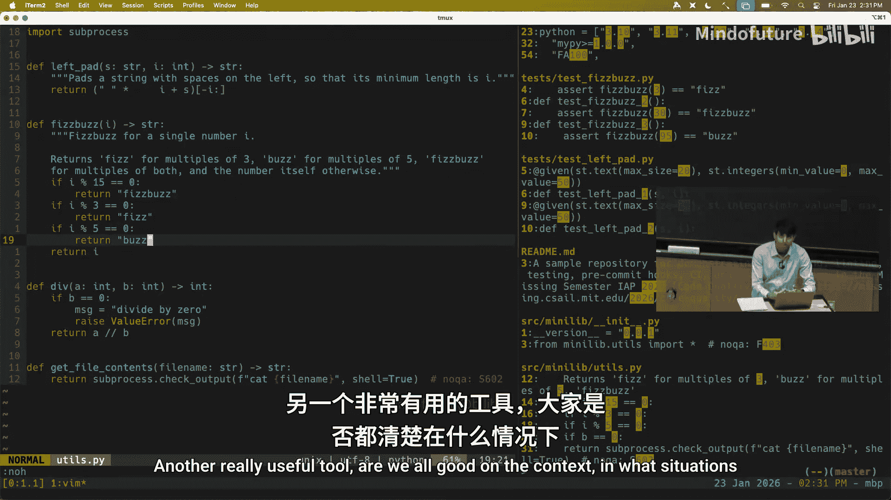

And then write a regular expression here， and it'll show you which strings are matched by the regular expression being tested。

You can also using these tools。Switch between different flavors of rex。

 so like Python rex varies a little bit from JavaScript Rax。

 but you can try all the different ones using such a tool。So。Was there a question？

What is this doing and missing the regular session test？Yeah。

 so this up here is the regular expression， so I can do something like the back slash D back slash plus here。

 this is kind of like a RegX debugger tool so it'll explain it to you and let you evaluate this Regx。

Against a bunch of strings。At the Thatcher。Sorry what a is Yeah or whatever you're trying to match。

 Yeah， like more abstractly， like Rax is a language for describing sets of strings。

 and then here it's showing you which of these concrete strings match the expression provided up here。

So yeah that's what the setting is that's what this re X 101 tool is doing for us and so here in Regx certain characters just match literals so like the character if I just type in a Regx that's just the string ABC。

It'll match the literal ABC， that's the most fundamental building block of reexes。

Then some other little components to be aware of， there's something called Raga's character classes and in square brackets you can say like this should match any of the string ABC so if I do ABC here and maybe I'll get rid of that。

This pattern bracket， ABC closed bracket matches。A or B or C。

 so this assess saying any one of these characters， now you can compose these。

 so if I do like hello and then bracket ABC， this will match the string hello A， hello B。

 but not hello D。You can also negate these with the carrot character so if you do open bracket carrot。

 then it's like not any of these strings and now I've inverted what I match see it matches hello A hello B。

 doesn't match these two anymore， but it matches hello D， it'll also match like something oh wait。

 it'll match hello yeah like hello F， for example。呃我。Yeah， so the question is。

 will it match hello AB so we can just test that out and no it doesn't match because it starts matching from the left and this H ELLO matches up to here。

 but then the next character has to be something that's not one of these。

 So this does not satisfy not any of ABC that any character Yeah so in brackets it's like any single character。

You can also do ranges here so you can do A through C or A through F。

So you don't have to type out individual characters。

Then there's some combbininators like the alternation combinator， so you can sayHo or world。

 so this will match hello。It'll match world， but not missing or semester。

So this thing says either pattern on the left or right of this alternation operator。

There's some more convenient ways to represent classes of digits。

 generally denoted with the escape character backslash followed by the like a p mnemonic letter。

 so backslash D for example， matches digits。So slow match three and four。

 but not any of these words up here。There are other useful character classes like back/lashW。

 which matches any word character， so not a digit。A really handy one is something called backslash B that matches word boundaries。

 So if you want to find all say like you want to find all the function definitions in your Python codes。

 you're looking for all the DFs。 like maybe you're using the word DF in other context。

 You might have like a deaf fo， but you might also have like a defined like maybe of have a string like helllo bla blah define and you want to match this DF。

 but not match this DF。 you can say I'm looking for a word boundaries。

 So this actually matches things in between characters if it's a word boundary。

 So it's not matching in a character itself。Flllowed by DEF， followed by a word boundary。

 and when I do this like boundary DEF boundary， and it matches this DEF， but not the DEF in define。

There's some other handy combbininators， you can group things together so you can do something likeHlo or world like this。

So combining this with the alternation character， now this worked without the ors。

 but in certain cases you do need the grouping just due to the way operator precedence works。

So you can use parentheses for that。And then I'll go through maybe just a couple other things。

 dot matches any character。We saw we use backslash as a special character。

 so if you want to actually match a literal backslash， you have the pattern backslash backslash。

 which escapes the following backslash。And then kind of similar to the word boundary special escape。

 there is a。Carrot character。 that's like it matches the start of the line and then dollar matches the end of the line。

 So this will match world but match like hello world。佢是。We have to have start of line。

 world end of line。And then briefly going back to these groups we were talking about。

These are not only for grouping an operator precedence。

But they're also used as capturing groups you see like popup that says capture group。

 So this lets us talk about reex search and replaces and actually refer back to subparts of the matched expression。

 So this can be useful in an IE for example， where like say I want to match all the numbers and actually replace them with like the number repeated So like I want to replace the 15 with 15。

15 and the0 with 0，0。 And this is a kind of wacky example in practice you can come up with more realistic things that make more sense。

 but let's demonstrate this。 So we can match。 So how do we do a digit。

 It's back slash D I think I didn't introduce this particular one。

 There's a lot of details of rex that you can look up。

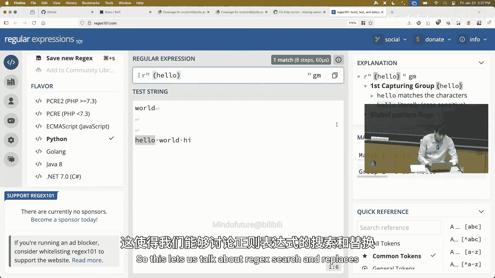

So here I'm doing substitute backslash D backslash plus what the backslash plus does is it says one or more of whatever came before it。

 so I'm matching one or more digit and I can do slash so that is in Vim that's how you denote the end of the rex pattern and now I have the replacement so if I do hello it'll show me like all of these things are being replaced with Holello but you can also refer back to a captured match by putting this in parentheses and then doing backslashops。

Let's do the escaping is different between different tools so I think in Vm the capture group needs to be escapes of a backslash openP backslash D backslash plus backslash closeP slash end the rex pattern and then backslash1 to refer to the first element of the capture group so I can actually replace this with backslash 1 backslash1 and then slash G to replace globally and this is letting me preview the replacement and when I hit enter I see that like the 15 change to a 1515 and so on。

So these replacement patterns can be helpful in IDEs or in other contexts where you'll have a reex that includes capture groups and then a replacement pattern that refers back to elements of that capture group this is also helpful in the context of programming languages like many times you'll be writing a program and it'll be handy to have some way to talk about patterns of strings like maybe you're trying to parse email addresses in a program or other things like that you can use Regex for some lightweight parsing。

For really sophisticated languages you shouldn't use Reex because it's a kind of limited language。

 but for simple things like say we're trying to pars a file where there's a bunch of dates in year year year year dash month month。

 dash day day format so we have a bunch of strings like 202601-23 today's date and say we want to parse out from here just the just the year。

 so we can do that using Reex， so in Python we can do for example， RE dot match。

R is making this a raw string so it's a little bit less painful to type in all the escape characters and I can say okay I want to match against backslash D this brace4 brace is saying four of the thing that comes before it。

 so I want to capture this and then this is followed by two more digits and then this is followed by two more digits so to match that pattern in say this example for example。

 and maybe you'll have like a loop that does this over a whole bunch of strings or all the lines in your program or something like that so I can go ahead and like bind this to M。

And if I look at。M dot group1， this gives me the first capture group and then I can go ahead and here and if I want to define multiple capture groups。

 I can do something like this and extract out different components of this match string So this is helpful for things like if you have say web server logs where you want to parse out like what IP addresses were hitting your web server。

 you can write a reex pattern for that and then write a program that uses your programming languages。

 Regex library to filter out what you need。Or equivalently。

 use the same brax pattern and feelll like gr to filter out what you need。

So yeah just as a recap Regxs are a really compact language for describing sets of strings Rexes do have some limitations and there's actually some like fancy CSs theory stuff we link to in the lecture notes if you're interested but basically you can't use rexs to do certain things like if you wanted to parse HTML like the language of rexes is actually not powerful enough to do that correctly and so in certain cases you will need to reach for a more sophisticated parser but for many string processing tasks Regexes are super handy and it's like a simple succinct language to learn and way more lightweight than something like a full like context free gramar parser。

Do you use re inside of your code？Yeah， so the question is can you use reex inside your code and the answer is absolutely and actually that's what we were doing here like I opened up a Python reppple and I was just typing in individual lines of Python code。

 but yeah we could totally go to like this program and do like import AE and use the reggex library in here and in fact like a lot of the programs we're looking at like AG for example。

 uses an external dependency that actually implements the reggex library like they didn't cook up their own。

 it just uses like one of the popular Ru Reex libraries import。Yeah， like in Python。

 it's called REE in different languages， like I think in RuT。

 there's a popular third party libraries， so it's not part of the standard library of RuT。

dependss on programming language。

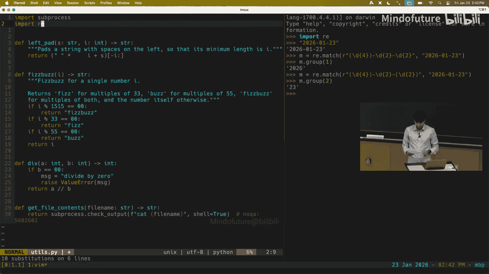

好。So we did end up covering reexes in the class fantastic and that is actually all we have for you today。

 so happy to stick around and answer any questions if anybody has questions on maybe the entirety of the contents of the course and if there are no questions we can wrap up Also if John wants to come up here you can also take another mic and answer questions。

😊，Yes， yes， this is indeed the end of the course。Yeah， hope you hope you enjoyed it AI I Sure， yeah。

 Yeah think coverage。Any of but。How you use it to。Have more code coverage and also how can you use it to say not just your code coverage。

 but test the different。Functionality of it like like they actually do that in real time。

 I do this thatd be helpful to see how you implement it。Yeah， so I guess thes。

I don't know if the thing's on。Maybe not。Now it is great。

 I have the power so the question is basically can you use AI or can you show us how to use AI to like expand the test suite to get better coverage and so on we can show you some of this here the thing this also comes back to the discussion we had last lecture about like how much can AI actually do like does it actually understand and some of the things you'll find here is that you start out by it giving you really useful tests but as you ask it to generate more and more it will start to generate more useless ones unless you guide it well and so like it will not do it automatically for you but if you guide it sufficiently then you can get to like sort of collaboratively you can get to a very good place。

😊，What use。There are tons of resources online。 Some people have concrete examples。

 I think there are other situations where people commit prompts in the commit messages when they do AI assisted coding。

 So there are various places where you can find prompts。 but also you can just be creative。

 These things are pretty intuitive。Yeah， I mean no。

 but one of the things to think about with these LLMs in particular is that they tend to be pretty good at following English instructions like you don't need to write the prompts in a very specific way。

 you can sometimes squeeze a little bit more out of them if you know how to like make them focus on particular things or use particular keywords or those kinds of things but usually that's for like the last couple of percent。

 that's not for the majority of the usefulness。Yes， we now have 100% coverage。Yeah， there we go。

 fantasticastic。 Can you look at the tests generated， Yeah， so let's look at the tests。😊。

These functions in here are so simple that I think the tests are actually pretty decent for these functions。

But it has like reasonably thorough tests and we see it tests like all the different。

 like multiples of  three， 5， 15， so it hits all the cases of that FISBuzz。It tests to see like。

 do we actually hit the exception and things like that。 And if we look at the coverage report。

 it is at 100% now。I also asked the AI to fix the bug as it went， so like it fixed on bugs。

 wrote some tests， reproduced the bugs， fixed the tests。

 and so on and itererateated till it reached a fixed point。can watch that more。 Yeah， yeah。

 it's in the， it's it'll be in the video。 But yeah， I had a short like couple sentence pro for it。

First all， thanks a lot。I think semester， more than it。嗯，就是。Oice question。

 But why not write the test in the go itself。Why， why have that sacrifice。The logic我觉得给他们来都真实。

I wouldn't say it's a fundamental principle like for example。

 in rustT it's very common to write unit tests in the same file as the functions that have them and and this sort of depends on the language and the conventions。

 but also the kind of tests so usually at least in rust。

 the unit tests tend to be fairly small and so it's reasonable to have them in the same file as the functions you're testing once you start writing more complex integration tests then rust has a separate mechanism for writing them in separate files it like Python does here I don't know whether in Python you can also write tests in lines something called doc tests so you have a similar thing in Python where you can also write them in line with the rest of the code it sort of depends on whether it feels right for the tests to be small and next to the function or whether it's you're writing sufficiently advanced or complex set of tests that you want them to be split out for compiled languages。

 this distinction can also matter so if you put your unit tests in the same file as your code you can。

Actually end up having to recompile your whole project because you change the tests。

Because you ended up changing the source file that contained。

Like the tracking is only based on the file， not based on which part of the file did you modify？Cool。

 yeah， good ahead。诶。And how do you assess there's one of API goals going back and forth nowadays？嗯。

Is the testing exactly the same or do you apply different methods there？Yeah。

 so the question is if you have API calls in the program you're writing like how do you test those。

 what does the methodology look like and there are a couple different methods people use One concept we didn't cover today is something called mocking so you can basically build out mock versions of dependencies that your application your functions use and inject those when the tests are running so for example if there's an API client like say you're building an AI agent and there's an open AI API client that's calling out to the openI API you can instead mock that client and basically fake return values for specific arguments for the purpose of individual tests that so mocking is when you you implement the API of something but you have your own implementation behind that API so for example。

 you might write you might write an implementation of the API of I don't know。

YouTube API right the Google documents a bunch of APIs for YouTube and let's say you wrote an application that wants to interact with YouTube well you could write a program that has the same API as the real YouTube API but behind the scenes just like some very simple implementation you wrote that you can use this part of your test suite and so when you're testing with a mock you would run your program but point it at that one instead of the real YouTube API and that way you have much tighter control over what happens behind the scenes you can like tell it to return an error or whatever you might want it to do and you can also have like you can run it without having an internet connection you can do a bunch more things because you control the implementation。

There's another technique people sometimes use which actually runs the tests against the live API once and records all network communications such that it can be replayed for future tests。

 so for Python for example there's a library called I think PyT VCR that does this Also you can just run tests against a live API like that is the thing people do their upsides and downsides to that。

这个嗯你 quickly send。Find different。cross。So you're not going to find a place that has prompts that there's no repository of like all the prompts。

 but but so you'll find that there are a lot of articles online on how to write good prompts there are good YouTube videos and articles and the like。

for coding， but also a lot of first party content， like Open AI and Anthropic and others like want you to be good at writing prompts so you can use their products and services So they've written like pretty good guides on how to use these tools。

 like Anthropic and open AI and other labs that develop these AI models。Yeah， and in general。

 that you'll find this more in the sense of guidance for writing good prompts rather than example prompts that's less common because the examples tend to be very tied to the particular codeb on what you want to do。

 if you want example prompts， then I think the best you could find is either someone who has like recorded themselves on YouTube or something having a session with an agent trying to make some change or you could also like just。

Search around for like experience stories people have on Blue Sky or Mastodon or LinkedIn for that matter or Twitter。

 like look around for people who sort of share their experience。

 but I think your hit rate will be pretty low there， the guidance articles tend to be better。公。

Thank you and see you all in hopefully less than maybe six years， we'll see。

