# 麻省理工编程缺失主题：P09：代码质量 🛠️

在本节课中，我们将学习如何提升代码质量。我们将涵盖一系列主题，包括代码格式化、代码检查、软件测试、预提交钩子、持续集成和命令运行器。如果时间允许，我们还将作为一个额外主题，介绍正则表达式。正则表达式是一个跨领域主题，在包括代码质量在内的多个领域都有应用。

我们将以一个小型 Python 库 `MinlibB` 作为案例进行研究。这个库包含一些随机但并非特别有用的工具函数，非常适合用来演示我们今天要讨论的各种概念。

## 代码格式化 ✨

上一节我们介绍了课程概述，本节中我们来看看代码格式化。

代码自动格式化工具可以自动美化程序中的表面语法。使用这些工具的原因在于，你可以将编写代码和保持代码整洁这些繁琐的细节工作自动化，从而将脑力集中在思考更深层、更具挑战性的问题上。

例如，观察左侧的代码，你会发现一些格式不一致的地方。在 Python 中，字符串可以用双引号或单引号界定，但这里的使用并不一致。此外，二元运算符之间的空格使用也不统一。

自动格式化工具可以检查代码格式是否符合标准，或者直接修复代码使其符合标准。这样，你就不需要再手动完成这项工作。

有些工具支持多种编程语言，并且高度可配置。另一些工具则配置选项有限，目的是减少无谓的争论，让程序员遵循统一标准，专注于更重要的任务。

你还可以将格式化工具与 IDE 集成，例如在保存代码时自动格式化。

以下是使用格式化工具的示例：

```bash
# 检查代码格式是否符合标准
hatch fmt --check

# 自动修复代码格式
hatch fmt
```

运行格式化工具后，它会显示一个差异对比，指出需要修改的地方，例如调整函数定义之间的间距、统一字符串引号、修正二元运算符的空格等。

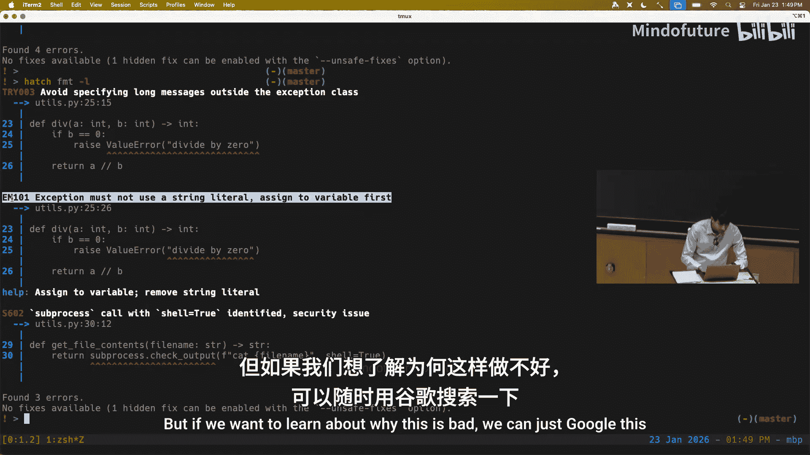

另一个与格式化相关的工具是 EditorConfig。它是一个文件格式和一类 IDE 插件，帮助开发者在不同 IDE 间保持一致的编码标准。例如，它可以统一缩进大小、文件末尾换行符等设置。

## 代码检查 🔍

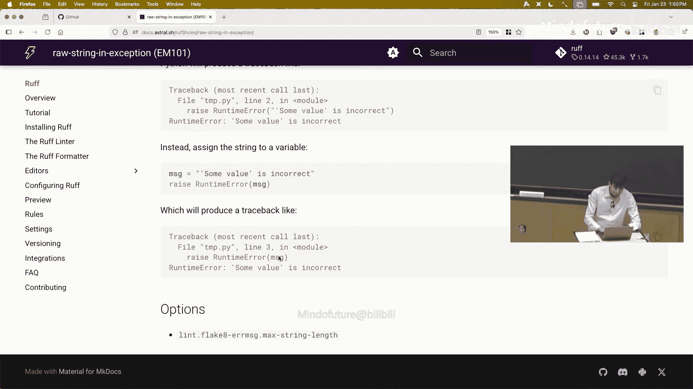

上一节我们介绍了代码格式化，本节中我们来看看代码检查。

代码检查工具会对你的代码进行静态分析。这里的“静态”指的是在不实际运行代码的情况下进行分析，但它比格式化工具更深入，会进行语义分析。代码检查旨在发现代码中的反模式和潜在问题。

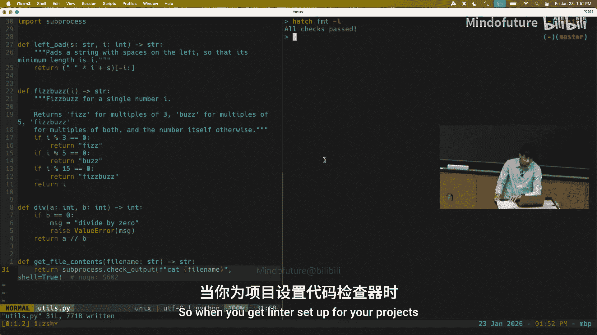

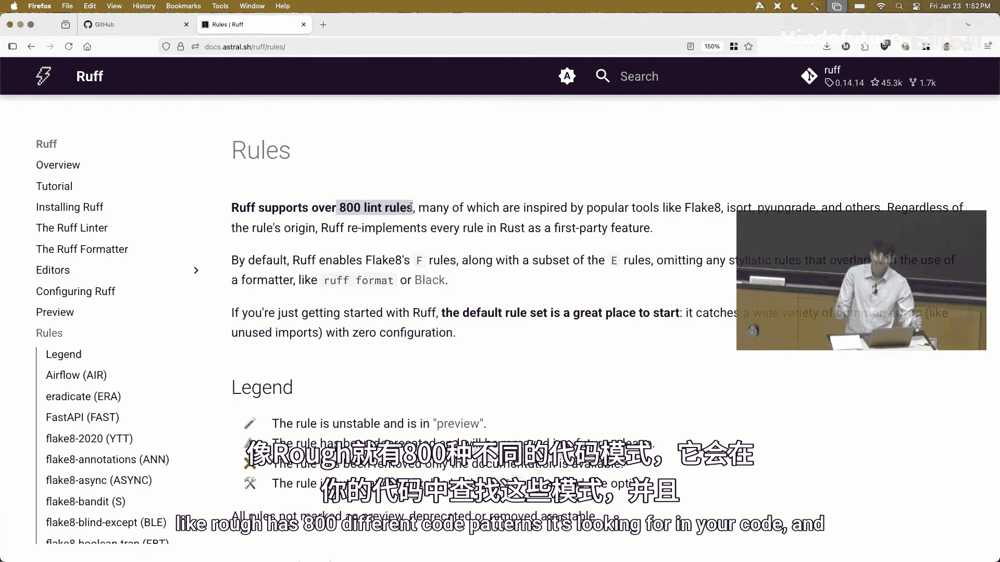

不同工具的检查深度不同，但它们通常能在问题演变成实际 bug 之前发现很多问题。

代码检查工具通常配备一系列检查规则，这些规则可以在项目级别进行配置。有时，某些规则可能会产生误报，因此许多检查工具支持在特定文件或代码行上禁用某些规则。

好的检查工具会在发现问题时，告诉你它寻找的模式是什么、为什么这种模式不好，并可能建议更好的替代方案。有些检查工具甚至可以自动修复一些问题。然而，由于静态分析并不完美，有些修复是安全的，有些则可能需要程序员手动修复。

以下是运行代码检查工具的示例：

```bash
# 运行代码检查，仅标记问题
hatch lint --check

# 运行代码检查并自动修复可修复的问题
hatch lint
```

运行后，工具会列出发现的问题。例如，它可能指出：
*   使用了 `import *`，这会使其他静态分析变得困难。
*   导入模块的顺序未排序。
*   导入了未使用的模块。
*   存在可以简化的 `if-return-else` 结构。

对于无法自动修复的问题，或者你决定保留的特定代码模式，你可以使用注释来禁用特定行的检查，例如 `# noqa: F403`。

代码检查工具也是一个很好的学习工具。例如，它可能指出在 `raise` 语句中直接使用字符串字面量会导致错误信息在回溯中重复显示，建议先将字符串赋值给变量。

有时，你可能需要为特定项目编写自定义的检查规则。这时，可以使用 `semgrep` 这样的工具。与基于文本搜索的 `grep` 不同，`semgrep` 能解析编程语言的语法树，进行更深层次的搜索，因此更健壮。

## 软件测试 🧪

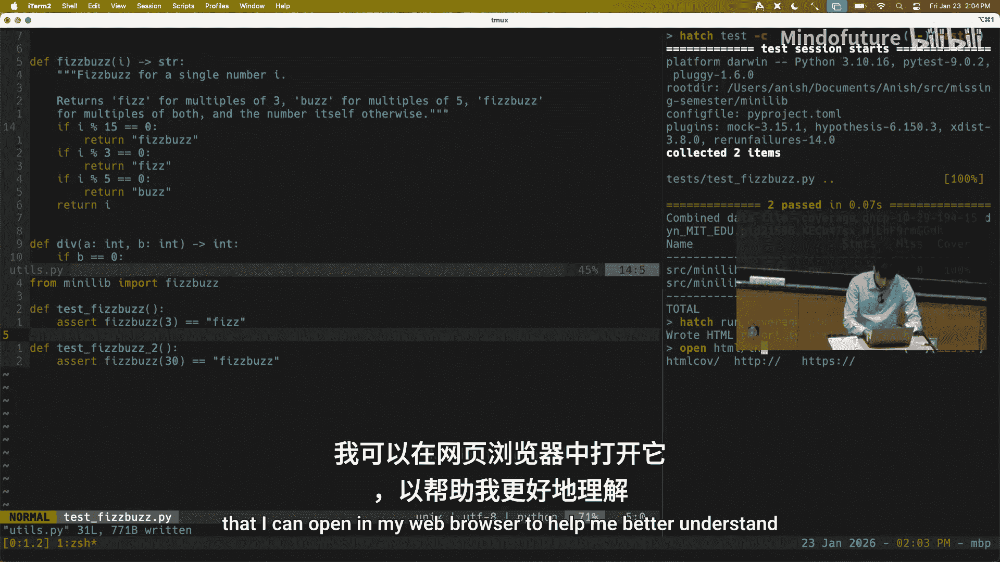

上一节我们介绍了代码检查，本节中我们来看看软件测试。

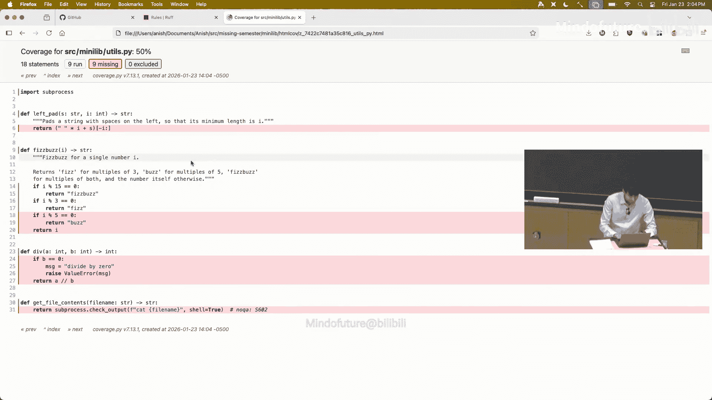

软件测试是提高代码信心的标准技术。其核心思想是，在编写代码后，再编写一些代码来“练习”你写的代码，并评估其行为是否符合预期。测试在长期内非常有用，可以在代码演进过程中持续运行，确保没有引入破坏性更改。

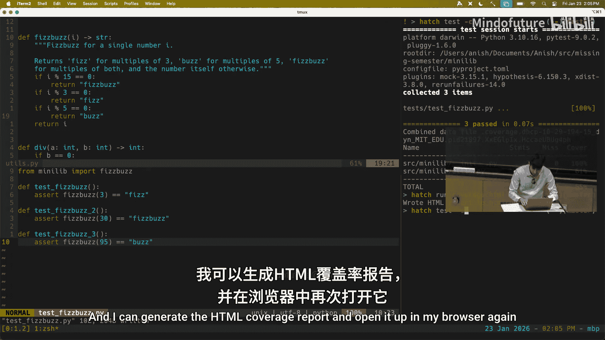

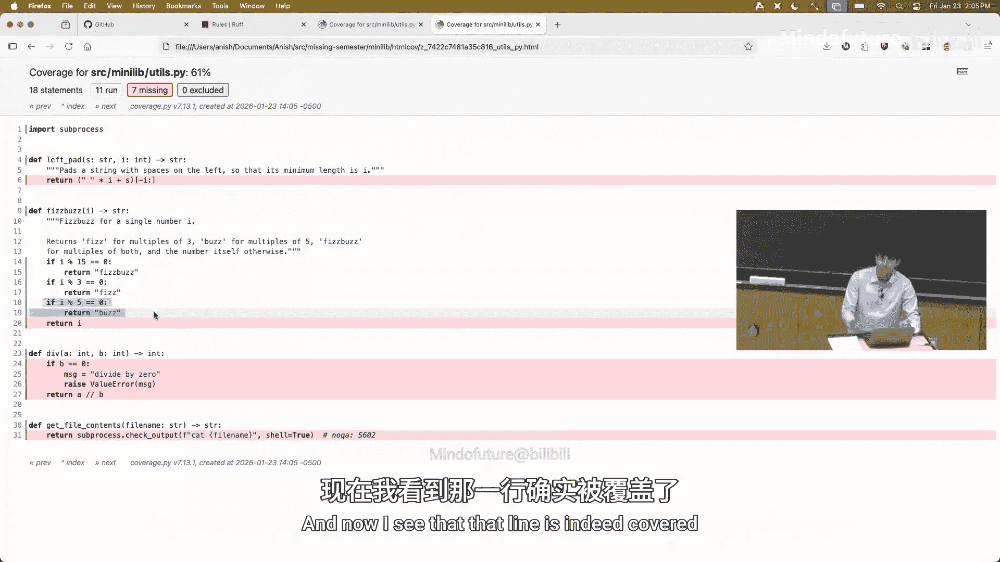

测试可以在不同的粒度级别进行：
*   **单元测试**：测试单个函数。
*   **集成测试**：测试不同模块或服务之间的交互。
*   **功能测试**：更端到端的测试，评估软件是否满足用户需求。

还有一种流行的开发方法叫**测试驱动开发**，即先根据规格编写测试，然后再编写实现代码。

让我们以为 `fizzBuzz` 函数编写测试为例。该函数的规格是：对于给定的整数，返回 “fizz”（3的倍数）、”buzz”（5的倍数）、”fizzbuzz”（3和5的公倍数），否则返回数字本身。

在 Python 中，使用 `pytest` 框架，测试文件通常以 `test_` 开头，测试函数也以 `test_` 开头。

```python
# test_fizzbuzz.py
from minilib import fizzbuzz

def test_fizzbuzz():
    assert fizzbuzz(3) == "fizz"
    assert fizzbuzz(30) == "fizzbuzz"
```

运行测试：
```bash
hatch test
```

如果测试失败，你可以根据具体的输入输出去分析和修复代码。

一个衡量测试好坏的重要指标是**代码覆盖率**。它衡量的是你的测试执行了实现代码中多少行的代码。虽然高覆盖率不能保证测试完美，但低覆盖率通常意味着很多代码路径未经测试。

你可以使用工具生成覆盖率报告：
```bash
# 运行测试并计算覆盖率
hatch test --cov

# 生成 HTML 格式的覆盖率报告
hatch run coverage html
```

报告会高亮显示哪些代码行已被覆盖，哪些未被覆盖，从而指导你编写更有针对性的测试。

另一种强大的测试方法是**基于属性的测试**。与编写具体的测试用例不同，你可以描述代码应该满足的属性，测试库会自动生成大量随机输入来验证这些属性。

例如，对于 `left_pad` 函数（在字符串左侧填充空格至指定长度），其属性可能包括：
1.  输出字符串的长度至少等于指定的长度 `i`。
2.  原始字符串 `s` 应包含在输出字符串中。

在 Python 中，可以使用 `hypothesis` 库进行基于属性的测试。

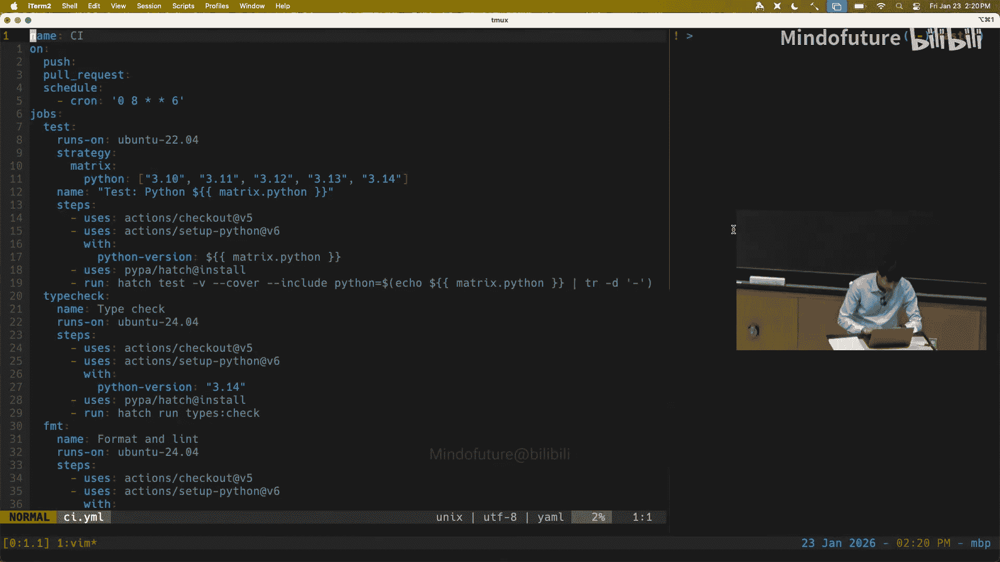

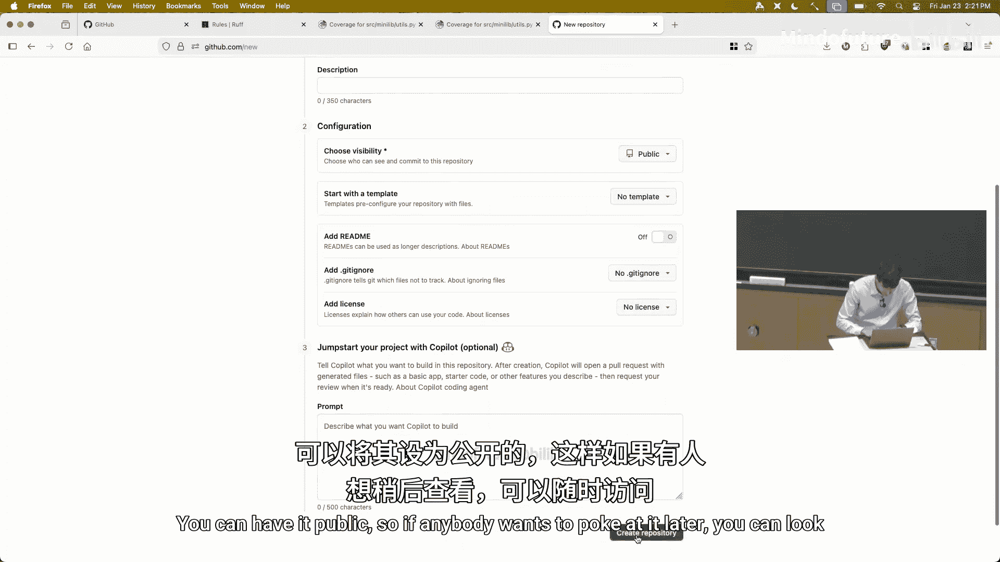

```python
from hypothesis import given, strategies as st
from minilib import left_pad

@given(st.text(max_size=20), st.integers(min_value=0, max_value=50))
def test_left_pad_length(s, i):
    assert len(left_pad(s, i)) >= i

@given(st.text(max_size=20), st.integers(min_value=0, max_value=50))
def test_left_pad_contains(s, i):
    assert s in left_pad(s, i)
```

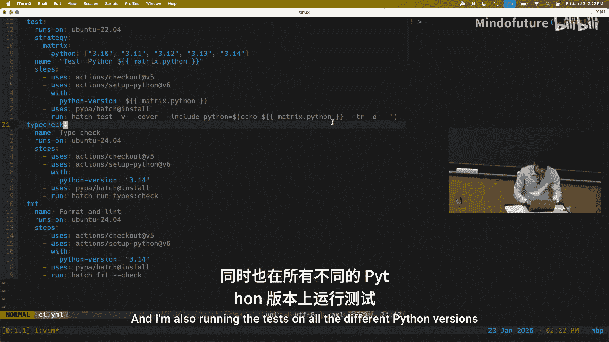

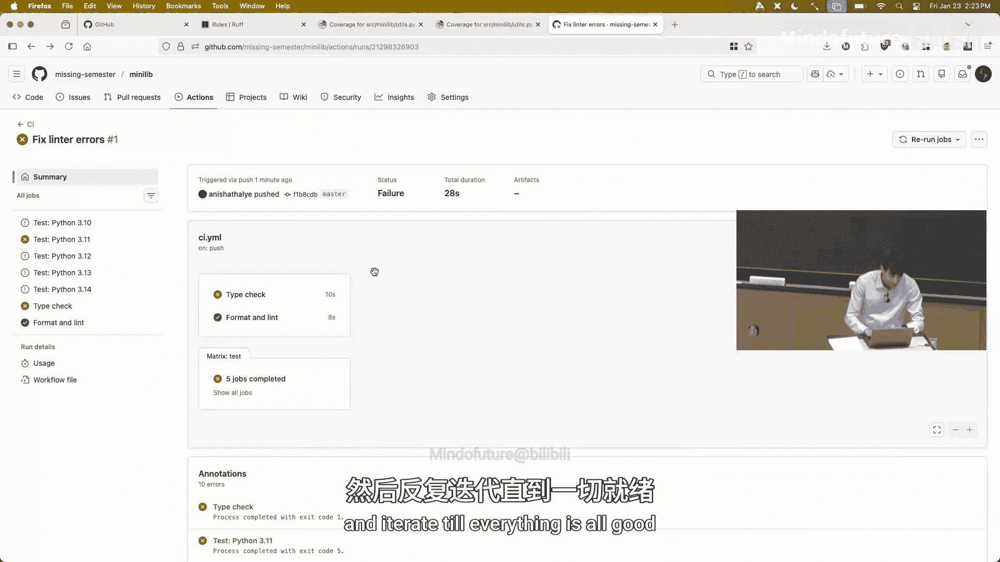

当测试失败时，`hypothesis` 会提供一个具体的反例，帮助你调试。

## 预提交钩子与持续集成 🤖

上一节我们介绍了软件测试，本节中我们来看看如何自动化执行这些质量检查。

**预提交钩子**是一种 Git 机制，允许你在每次提交前自动运行脚本。这可以确保所有提交到仓库的代码都符合质量标准。

你可以使用 `pre-commit` 等工具来管理这些钩子。在配置文件（如 `.pre-commit-config.yaml`）中定义要运行的检查，例如代码格式化和代码检查。

```yaml
# .pre-commit-config.yaml
repos:
  - repo: local
    hooks:
      - id: format-check
        name: Format Check
        entry: hatch fmt --check
        language: system
      - id: lint-check
        name: Lint Check
        entry: hatch lint --check
        language: system
```

开发者只需运行一次 `pre-commit install` 来安装钩子。之后，每次尝试 `git commit` 时，这些检查都会自动运行。如果任何检查失败，提交将被阻止，直到问题被修复。

**持续集成**服务（如 GitHub Actions）则是在远程服务器上自动化运行工作流。你可以配置 CI，使其在特定事件发生时触发，例如推送代码、创建拉取请求或按计划定时运行。

CI 可以运行所有本地能运行的检查（格式化、检查、测试、类型检查等），并且因为它运行在远程环境，你还可以轻松地运行**矩阵测试**。例如，在不同的操作系统（Windows、Linux、macOS）和不同的 Python 版本（3.7, 3.8, …, 3.12）上并行运行你的测试套件。

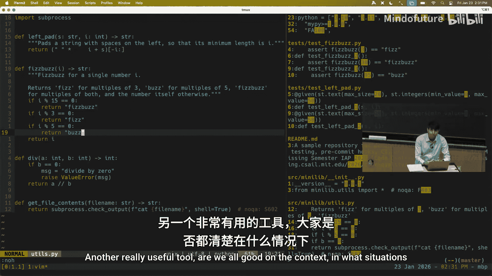

CI 的配置通常以 YAML 文件形式定义（例如 `.github/workflows/ci.yml`），其中指定了触发事件、运行环境、安装步骤和要执行的命令。

```yaml
# .github/workflows/ci.yml 示例片段
jobs:
  test:
    strategy:
      matrix:
        python-version: ["3.10", "3.11", "3.12"]
    steps:
      - uses: actions/checkout@v4
      - uses: actions/setup-python@v5
        with:
          python-version: ${{ matrix.python-version }}
      - run: pip install hatch
      - run: hatch test
```

CI 的结果会显示在拉取请求页面上，方便团队审查。与 CI 紧密相关的是**持续部署**，即利用 CI 基础设施在代码通过所有检查后，自动构建和部署应用程序。

## 命令运行器与正则表达式 ⚙️

上一节我们介绍了预提交钩子和持续集成，本节中我们来看看两个能提升效率的实用工具：命令运行器和正则表达式。

**命令运行器**（如 `just`）用于为项目中常用的长命令创建简短的别名。如果你没有使用像 `hatch` 这样内置命令管理的项目管理器，这将非常有用。

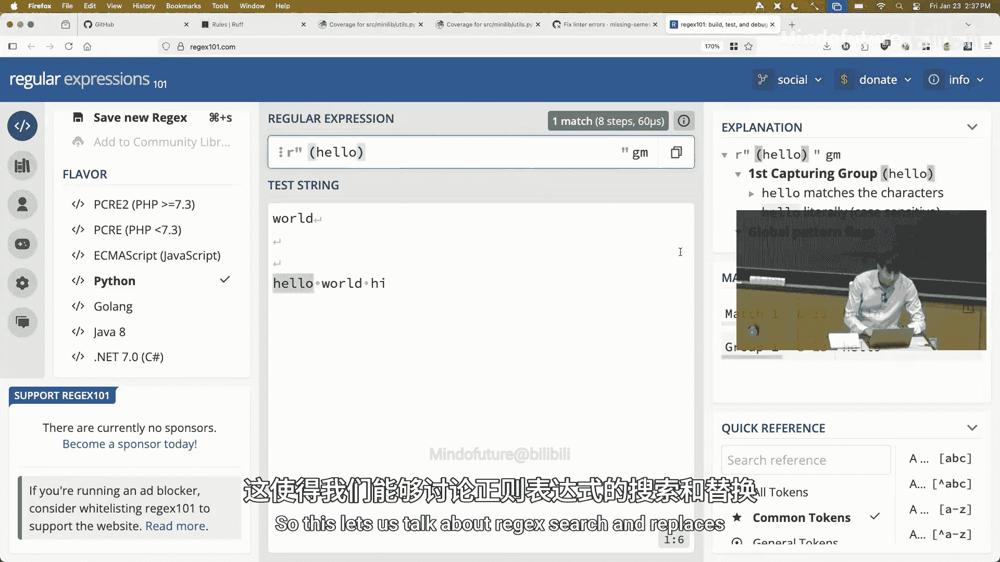

例如，你可以创建一个 `justfile`：
```makefile
# justfile
format:
    black .
    isort .

lint:
    flake8 .

test:
    pytest
```
然后，你只需运行 `just format`、`just lint` 或 `just test` 即可。

**正则表达式**是一种用于描述字符串集合（模式）的微型语言。它在代码质量工具（如搜索特定代码模式）、IDE 搜索替换、文本处理等场景中广泛应用。

正则表达式的基本语法包括：
*   **字面量**：`abc` 匹配字符串 “abc”。
*   **字符类**：`[abc]` 匹配 a、b 或 c 中的任意一个字符。`[^abc]` 匹配不在 a、b、c 中的任意字符。`[a-z]` 匹配一个范围。
*   **特殊字符**：
    *   `.`：匹配任意字符（除换行符外）。
    *   `\d`：匹配数字。
    *   `\w`：匹配单词字符（字母、数字、下划线）。
    *   `\s`：匹配空白字符（空格、制表符等）。
*   **量词**：
    *   `*`：零次或多次。
    *   `+`：一次或多次。
    *   `?`：零次或一次。
    *   `{n}`：恰好 n 次。
    *   `{n,}`：至少 n 次。
    *   `{n,m}`：n 到 m 次。
*   **定位符**：
    *   `^`：匹配字符串开始。
    *   `$`：匹配字符串结束。
    *   `\b`：匹配单词边界。
*   **分组与捕获**：使用括号 `()` 进行分组，并可以捕获匹配的子串，用于后续引用或替换。
*   **选择**：`|` 表示“或”，例如 `cat|dog`。

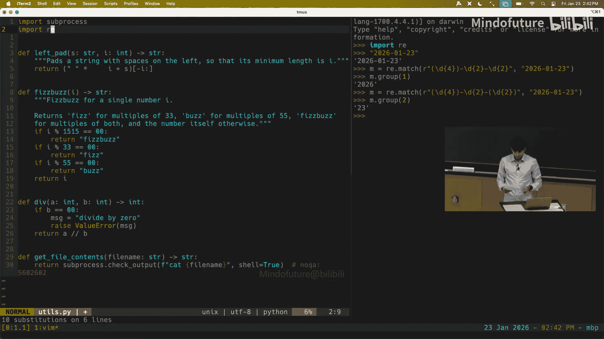

在搜索替换中，你可以使用捕获组。例如，在 Vim 中，将所有的数字重复一遍：
```
:%s/\(\d\+\)/\1\1/g
```
这里 `\(\d\+\)` 捕获一个或多个数字，`\1` 在替换部分引用第一个捕获组。

在编程中，正则表达式库（如 Python 的 `re` 模块）也广泛用于解析和验证文本。

需要注意的是，不同工具和编程语言的正则表达式实现（“风味”）略有差异。对于复杂的语言解析（如 HTML），正则表达式能力不足，需要使用更专业的解析器。

## 总结 📚

本节课中我们一起学习了提升代码质量的一系列核心概念和工具。

我们从**代码格式化**开始，了解了如何利用工具自动保持代码风格一致。接着，我们探讨了**代码检查**，它通过静态分析发现更深层的反模式和潜在问题。然后，我们深入研究了**软件测试**，包括单元测试、基于属性的测试以及衡量测试效果的代码覆盖率。

为了将这些检查流程自动化并标准化，我们介绍了**预提交钩子**，它能在代码提交前强制执行质量门禁；以及**持续集成**服务，它能在云端为每次变更运行全面的测试矩阵。

最后，我们了解了提升效率的**命令运行器**，并学习了强大的文本处理工具**正则表达式**的基礎。

记住，具体的工具（如 `black`、`ruff`、`pytest`、GitHub Actions）会因编程语言和项目而异，但这里介绍的概念是普适的。掌握这些理念并应用合适的工具，将帮助你编写出更健壮、更可维护的高质量代码。