# NDC-Security-安全大会-2025-｜-AI工作流-｜-智能体-｜-网络安全-｜-Dapr框架-｜-开源工具-｜-LLM应用-｜-自动化安全-｜-黑客-p01-P01-Floki---Defining-Agentic-Workflows-for-Security---Roberto-Rodriguez--BV1ihgQzJE2h_p1-

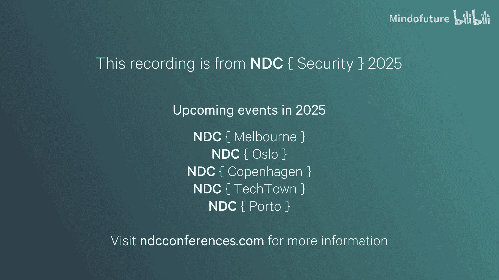

Thank you for， you know， for coming by the way， because this is like， you know， you know。

 hidden from from the whole conference and it's not as easy just to walk in into one of those rooms。

 So I do appreciate you taking the time and walking a little bit all the way， all the way here。😊，嗯。

Alright， so we can at least start with the introduction of this。 This is gonna be。

A presentation about diving into some of the workflows that are possible with flocky。

And flog is built on the top of dapper。 And I'm going to explain a little bit what that is in a couple minutes。

And of course， just before I say anything， this is not。

 this is not a presentation that I'm doing for Microsoft or， or， you know， with Microsoft。

 I'm actually a cybersecur researcher who has been you know。

 very passionate about AI for the past like2 to three years。

 And now my career is actually going in that direction at the moment。

 So everything that you guys are gonna see here It's just a lot of the research that I've done on my own。

 and also sharing a few things internally with， you know， with a couple of you know。

 friends also in the company， right， But just in case I don't represent right Microsoft in this presentation。

😊，And let's just go straight to what flocky is， right， Because I know that just by the title。

 a lot of you might have been like know what's going on with this presentation。 Flocky。 first。

 I'm a big fan of the Vikings series。 and I love the character flocky because he was a， you know。

 really you know hands on person。 He could build boats。

 And he could actually enable other Vikings to travel So that was kind of like idea of building something that others can use and actually build their own tools on the top of that。

 And think about flocky as an agent framework that you can use to build applications like LLM based applications。

 For those that are already in the field or you know。

 curious about AI and how it applies in multiple topics， you might have heard of。

 libraries like Lcha， for example， or like Lama index or you know， crew AI， etc。😊。

Flo is my own interpretation into what I believe an Asian needs。I'm trying to keep it as。

 as lightweight as possible， even though it already has a lot of multiple things。

 But my goal was to learn the internals of the tool and， and exactly how everything works。

 I actually actually just remember my journey when I was trying to learn into like how an agent communicates with。

 you know， with APIs， etc ce。 It so f it's like the first milestone to build something after。

 you know， reading about it。😊，And the big thing with flocky is that。To me。

 when I saw all these other applications。It was not as easy to build workflows， right， to。

 to chain actions or， or build things that were driven by other events or try to integrate a human in the loop。

 for example， it was not as easy。 It is still not as easy。

 Like if you actually see a workflow with La graph and a workflow with Lama index。

 You have to really become kind of like an expert on those two tools in order to build one。

 So Fy is kind of like， let's make it easy。 Let's build workflows that are super， you know。

 easy to understand and follow。 So hopefully， this is a tool that you will be able to use at some point and you know。

 let me know。 it's already Github。 And it has been already two months since I release it。Alright。

 just to start who's familiar with agents in the audience， Anyone that， alright。

 so you guys all know what an agent is。 Alright， so， but in general， right。

 think about this application。Where the user is interacting with an LLM or just a language model。

 And then this model is the one that is doing a lot of the thinking。

 Some people say it's not reasoning。 it's just predicting， right， that next word But a lot of the。

 the knowledge and context that it has。 it kind of produces output that it's， it's super interesting。

 And it looks like it's actually thinking， reasoning across different tasks。

 And the idea is that the very basic idea is to。Help the human or help itself to choose the right tool or the right nextx step to take。

 Sometimes this can come with a predetermined plan that he was able to produce or in some scenarios。

 Just go one a step at a time and try to just pick the right thing that it needs。 And then。

 of course， the the model doesn't execute any tools。

 The model just suggest the tool and suggest how you can execute the tool。

 And then you have to take that context and then execute yourself。 right。

 And the idea is that with this basic flow， you are exposing a model to the world， right。

 you're allowing it to， to get observations from different environments depending on the scenario that you're using this agent for。

 right， So think about that。 that's just the foundations。 very basic， I guess。

 way to explain an agent。😊，And when we start thinking about this agent flow， right， So this， to me。

Technically， you can use it like this where you want some type of input where you provide some input。

 You want this thing to reason， to act on it and also to observe what happened。

 and then let you know， right。At the same time， you can add some loops so you can say， hey。

 let's probably give it another try， right， I don't think this is what I needed。

 Why don't you go again and do the whole loop。And at the same time。

 you can pretty much have this loop sometimes set to like 20 to 100 different times。

 or you can just probably， you know， let it run multiple times。

 So every time you think about an agent， there is some type of flow already integrated and there is different agent patterns that follow some type of flow。

 right。Now， the cool thing is that in some of these steps in the flow is when you have the model that is actually doing something。

 right， So in this case， when you are asking it， let's say to， to reason the model。 the。

 the model is at that step when you wanted to act once again， the model doesn't act。

 So it's very important to understand also in what part of the flow you're actually using the model so you can probably integrate it with。

 you know， with other tools， etc。😊，And the tools， of course， are set， I guess。

 on the act part and the observations is anything that it。

 it's able to gather from the world or of from the environment that it is， you know， like。

 kind operating on。😊，So when you think about， you know， the agent patterns， right， So the。

 the first one that we talked about here， this is just your basic reflection type of loop where it's taking the。

 the， the task is reasoning over， executing something。

 trying to reason providing some feedback into like what happens。

 And then it just goes back right into that， into that loop。Then， of course。

 you have the tool use where you're adding tools for it to use in order to act based on the reasoning。

 right。You can actually add some planning also。 So this is。Very interesting pattern， because to me。

 in some scenarios like in cybersecurity， for example。

 you can not just plan the whole investigation because the investigation usually usually you start with an alert and you're trying to figure out what happens next。

 So you might have a plan that might say at a high level， this is what I would do。 But you know what。

 this plan might need to become a different plan in the next couple steps。

 but at least one plan is good in order to cover maybe the fundamental steps that this system can take right And at the end。

 of course， you can take all these patterns， all these patterns。

 and you can kind of encapsulate them in like one microservice。

 And then that thing can actually interact with other microservices that have their own patterns。

 right So when you start thinking about a agent patterns。

 there is always a workflow under a capability that this agent or this application has， right。😊，And。

 and to me， a lot of people。Talk about workflows as。For example。If it's deterministic。

 it's not an agent workflow。Or if it's non deterministic， it is an agent workflow， right。

 But in my experience， you mix it up for a lot of different。😊，Thanks。😊。

There's gonna be places where it's going to be very deterministic places where you wanted to go in directions。

 depending on what observations is's actually acquiring。

 So it's very interesting to think about this， this type of flows。Who has heard of react patterns。

Yeah， so the。You know， reasoning or you reason and act is pretty much what I was showing you initially。

 It's just a way for the agent to be able to reason over the task。

 be able to act and then simply just go in that loop。 And that at the end。

 is' just a basic workflow once again。 right？ So when somebody says an agent pattern， a a react。

 agent pattern。 And then you see this flow， it， is very basic， right So when somebody says agent。😊。

You have to thinking about that something like that is agent。 Apparently， right。

 There is other complex type of workflows that that you might experience as well。

And there is a big debate also at Microsoft， what， in my opinion。

 based on my team and other interactions that the agents， the， I mean。You know。

 I'm not here to sell anything but the copiloot agents。 And sometimes I think about it。

 I say that sounds to me more like a chatbot。 but there's a lot of connections。

 probably somewhere else where there is some agent workflow is going on。 But anyways， it， it's。

 it's a very interesting concept。 And to me， I like to dive into like what's going on underneath。

 and not worry so much about calling it agent or not， right。😊。

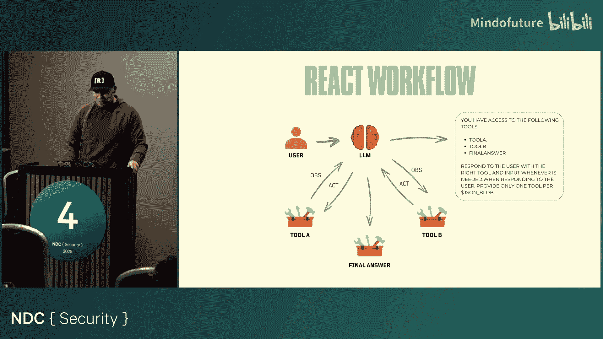

So the idea of react would be something like this。 So this is something that。

 I don't know if you can see it， but this is something that。We can do with flocky， for example。

 As I mentioned before， Flocky comes with a lot of the basics of， of initializing an agent in Python。

 and then you can simply， you know， give it tools and then make it just reason over the task and then use the tools。

 right。

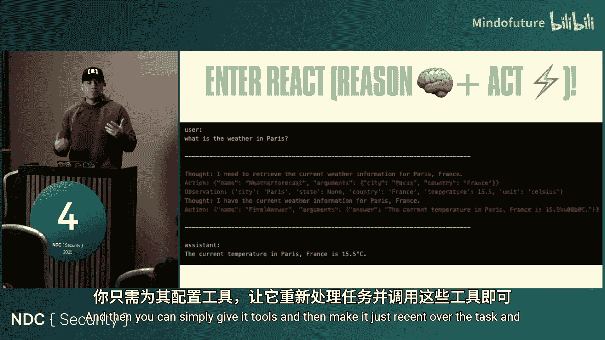

So nothing crazy in here。 Now， what is dapper。So for those that have never heard of Dpper， right。

 it's a distributed application runtime。And to me， this is one of the projects that， to be honest。

 I've。Being so happy about for the past couple of years。

 And the reason why is because every time I want to build something， right。

 there is an API that I need to start interacting with。

 there is a new module that I need to write to communicate with a keyva with a actual customs D with an AW S instance。

 There is a lot of different resources out there that I don't have the time to start building all of the connectors that exist in the world。

 So when you start thinking about Lcha and Lama index， that's what they do， right。

 they actually separated a library to say core Lcha。 And then community Lcha。

 because of all the connectors that they want to have。 And to me。

 it's just crazy to even think about like。😊，If I go from a resource from Azure and I move it to AW S or GCP。

 I have to change my code。 I have to probably have different parameters。 It's just a pain the。

 So daappper can of like comes with this concept of a sidecar that it's already acting as a proxy for you。

 And there is already a lot of different connectors and integrations for specific services。 right。

 So as you can see in here， you can do workflows， you can access secrets。

 And but I and what I mean by that is that if I write code to access a secret from an Azure keyboard。

😊，I don't wantanna rewrite it or import another thing just to， you know。

 talk to the equivalent in A W S Dpper as a sidecar。Gives you those API。 So。

 so you don't have to worry about what it is that you're integrating with。 right？

 So that's something that I like about it。 And it's also， you know， platform agnostic。

 and it comes in different languages， Python， C sharp， What else， No Yeah， no， Java， etca， right。

So one of the components that Dpper has is dapper workflows。

 And this is actually built on the top of durable tasks。

 So if you have heard of that concept of a durable task in Azure。

 is actually what it's running I would say on the orchestrators and workflows of of Azure functions。

 for example， in Azure。 So the open source a lot of their SD DKs， like Python。

 I think there is also go SD D case and Dpper is the core components are written in go。😊。

But this one is the one that， to me， when I saw it， this is pretty cool，2023。😊。

I was trying to build things with this。 and it was not as good。 it was not as stable。

 But now it's way better than what it was in 2023。 And the idea here is that I want to define my workflows as code。

 Like I would love to do a basic for loop， a while loop。

 a conditional statement without have to worry about， how do I do a for loop with this。

 And that's what I experience with other libraries。 once again， I mean， I'm not trying to say。

 don't use language La graph and usey， I'm not saying that But if I go back to land graph and and all these things to build basic workflows。

 I have to learn so many different new things。 And I don't have time to do that， to be honest。

 So I just wanted to work with something that will make it easy to deploying production and also be able to test everything locally and just define my workflows as code。

 or just as a。😊，Basic， I guess。Bythonic， you know， way to do it。

So the workflow patterns that dapper comes with are very basic。 You know， task chain。

 It comes with a fan out fan in。And also with the concept of， of monitoring。

So what that means is that you can have this wild loop and also expect an event to occur in order for you to do something with it。

 right。So even though this is super basic， right。You can build so much with these three patterns。

 And if you start looking into multiple blog posts out there to build the next agent rack and the next workflow to even build a podcast。

You can do the same thing with these three things in here。 right。

 And the idea is that some of them can be just multiple L L M base， you know， tasks， right， or。

You can wrap a whole agent into it， which will have its own little workflow inside。

 and you can just make it communicate or simply be able to be part of every single step。

So the difference is that I could say， can you write an email， Can you define the。

 maybe the sentiment of the email， Can you fix the email That， to me， is just trying to do L L M。

 you know， best base like API calls or is just me doing chattP T。

 What I'm expecting just to do something for me right away。One agent could be， hey， can you。

 I don't know， query all the alerts in my environment and maybe。Just connect to other instances。

 other services and maybe do some other things。 So now this thing just goes and and with the right access。

 we'll just start， you know， going through the process recently in executing tools， etc ce。

 So that's what I mean by having an agent basis versus just an LL M based task， right。And， of course。

 when it comes to monitor。You can monitor us， a set of agents and， and one capability， of course。

 that you get with Dpper is that you can connect with services that make it easy to share messages。

And that's also something that， in my opinion， services like Dpper and any other probably frameworks that you probably。

 probably have heard of that are similar to Dpper， They have already figured it out， right。

 They already deploy things in production to do this type of message sharing， etc。

 So when I see a lot of other frameworks trying to rebuild it。Like the ones that I already mentioned。

 it's just so frustrating， right， because it's already there， right。

 They already connect with all the， the things that， you know， will make it happen。😊，So at the end。

 that's what Flocky is。A， a tool that not only provides the fundamentals of one agent。

 but it actually allows you to take that agent and convert it into a microservice and also have it exposed as like。

 I don't know。 fast API。 And then it's able to communicate with other。

 you know microservices through you know， message systems I pops up， right。

 like publish and subscribing right， So that's what you know， F is。 And if you give it a try。

 please let me know， I've been fixing a lot of box recently。

 I'm the type of person that if I release the project， it has to be perfect。

 But that will never happen。 So So I had to release it in November。😊。

It's funny because I always bring my wife into this because that's the only person that I talk to seriously like everyday day because because I work from home and she's like。

 you have to release it。 Like， there is no， no way that you're gonna be working on this for the next year or two。

 trying to make it the best project ever。 So that's what I mean。 if there is box。 I'm sorry。

 it's still an early project。 But you know， hopefully， you guys can， can give it a try。

So now think about that if you now have an agent。By default， like out of the box， right。

 when you deploy it。As a service with Dpper， right。

 you will be able to directly if you do dapper in it locally， for example， you you will have。Locally。

 multiple docker containers that will provide several capabilities that are amazing when you start building。

 in my opinion， you know， agents， not necessarily to see what the API calls where like the messages。

 There is other applications that I use for that。 But to figured out how the orchestration is happening。

 how much time is taking every single step， this is amazing。 And。

 and can I keep the state of my agents， for example， somewhere。

 you can do that with dapper automatically， because they already have an API where you can simply say。

 safe state， and then you pass a dictionary。😊，So instead of me trying to build the whole thing。

 it's already there， so。Very simple。 And the concept in here is pretty much saying that all the agents that you probably want to build will already come with a lot of different。

 you know， integrations right now。And this is what I was talking about。If I build an agent。

 in my opinion， and I wanted to interact with multiple services， right。

 I don't want to build the connectors。No way。 right。 There is， no。

 there is even things that I've never heard of in here， to be honest。

 And you guys probably already know a lot of them。 But for example。

 what is the one that I was looking at the other day。 Oh， yeah， there's this one here。Yeah， the。

 the open policy agent， to be honest， I， I have never， you know heard of。

 and I thought it was another agent， like another AI agent。 but it doesn't seem to be。

 But this is what I'm talking about。 So if someone says， oh。

 the organization wants us to build something with reddis。

And connect with actualure Cosmos D B or or Kivo， right， or use Kafka， for example， for like pops up。

You don't have to worry about that anymore， right， So that's the beauty of dapper and why I。

 I build flolocky on the top of that， right。😊，And the idea now is that you will have multiple agents that will communicate with each other through those services。

 right， So that's pretty much what， you know， But this is。

 And I just want you to pay attention on the sidecar right。

 So the idea is that the sidecar is the one that will expose a lot of these capabilities。

 And at the same time， when you execute something is already capture in telemetry because a sidecar is present in front of you。

 right， So there is a lot of different projects right now that are trying to figure out how open telemetry works in order to capture all these。

 all these actions that the agents are are executing you don't have to worry about any of that。😊。

So that's， that's the beauty。 And I wanna show you in a little bit。And the last thing。

 as I mentioned before。 So a lot of these microservices or。Multi agent systems， right。

 they need to communicate somehow， right。You can have an agent as a class that you can just initialize and say。

 run this。 and then you run this。 And then you right， And then you can say。

 I'm communicating with all of them。 I'm doing it in in a loop in a workflow。 right， Yeah。

 you can say that。😊，But this way of communicating is super powerful， because you are。Generating this。

 like conversation context， this， this chat way to relay messages or work on a problem that is super powerful as well。

 You can provide in a conversation， you provide more context， maybe some other new ideas， right。

 versus if you just say， execute an action。 And if it fails， let's see what's going on。

 And let's execute it again and， you know。😊，Read the error versus。You know。

 having a conversation about it， it's a little bit different。So， with dapper and flolocky。

There are specific。A Ps， as you could see， publish， pops up and broadcast like the whole path。

 That's something that I didn't write， right， which means that if I deploy my agents as part of a adapter。

 let's say cluster， I can simply just say broadcast to all my agents in the state metaada。That's it。

 right， So I use that a lot now。 It's a way easier， easier to， to use， in my opinion。

 And then you can define also the type of messages that you can send。

And it uses cloud events schemas by default。 So if you're familiar with cloud events is standard。

 right， GRC GRCP， I think it is standard GRCP。 So it's super powerful as well。

 because you get additional metadata for every single message that you exchange。😊，Alright。

 so just something quick since we're just you 20 minutes into the presentation。

 I thought I was already 20 minutes。 There is this project。 And this is more for security research。

 So I like to start from here。 Why， because that's exactly how I， I believe I started my。

 my career in this field。 As I mentioned before， I've been doing cyberse especially on the defense side and。

 and at Microsoft for for four years doing offense as well。😊，For years。 And so to me。

 to dive into something new， it was very important to learn a faster way to， you know。

 process like all this information。😊，So this is， It know why I did that。

 So this is something that I built with flocky。 and I'm gonna show you what it does in a in a second。

 But the idea is that I wanted to define a couple of， you know， deterministic workflows initially。

 just to kind of download papers from Arcif， which keeps a lot of the， you know， research， I guess。

 papers。😊，That the community publishes and， you know， shares with others。

 And there's an API that you can set and say， for example。

 I wna focus only on computer science papers。 And I would love to look for the concepts of agents or Gen A I and like blue team。

 red team， offense， defense across all of them， right。

And the reason why I build this is because also， there was a lot of people in my organization that were sharing emails with like 20 different links with multiple bullet points。

And theres no way I'm gonnana read that， right， Like， I I don't know。 I have， you know， AHD。

 I believe， where I just can't focus in so many different things。 Like， I I， I just can do that。

 So the only way that I can learn I， if I really want to。😊。

Force myself to learn something is through a podcast。

 through a way to communicate and just listen while I'm either commuting while I'm been working out。

 So the idea was to download all the papers。😊，Filter all the papers with an LLM just to make sure that we're capturing the right context。

 You can capture the summaries of every single paper。 And then at the end， you know。

 we can download all of them。And then it started using also L L Ms to write a transcript。

 So every single page is gonna be read。And you tell through a prompt， hey， I would love to。

 you to focus on every single page， trying to gather the key concepts of， of every single page。

 everything that might be too complex for a regular person。 Try to break it down and just。Tell me。

 like， if I was 5。 and then I would like you to also。

Tell me what the key takeaways of every single page are， right。

 and try to describe it as if you were just talking to me。Right， explaining it to me。

So that was the writing the transcript。And then， we。Started doing the text speech。

 And this is something that I could do with the company 11 labs。 So you can do for I，20 bucks， Yeah。

20 bucks a month。 You can actually do。10 concurrent API calls。 so we can just， you know。

 fan out and then fan in， right， And then we can also generate every single episode。

So what does that mean。So I take the transcript， right。

 Theyre pretty much a summary of every single paper。And then I take the summary of the paper itself。

 because the paper comes with a little summary。 And I'm trying to define what that episode right would be and give it a title that is more engaging than just trying to right put that right that title of the papers。

 It just sucks sometimes。 So that's what I do。 And then I simply generate the， the， the audio。😊。

And that's pretty much what we do with。The was yeah， sorry。 I can't see what heard it is。 write all。

 yeah， and they just write all the， the， the episodes to， you know， to MP3s， right。

So there is already a podcast。 Let me see if I can show you here real quick。So， if you can。

You can sign up。Let's see if we can do this real quick。 There you go。Spotify。嗯。There you go。

How do we get to that。Let me。

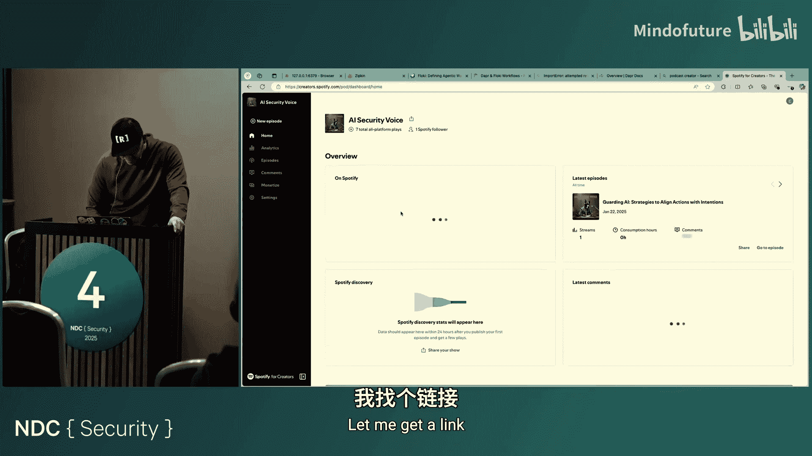

Getling。Here is。putut that in there。I think that's the one。

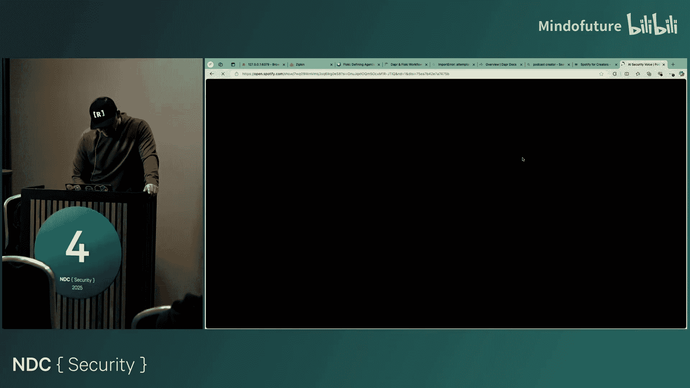

那一个。So this is the AI security voice podcast。 It already has two episodes。

 And there is one more coming today。I， it's just pretty much talking about。 Let me see if I can play。

 I don't know if I can play the thing through here。

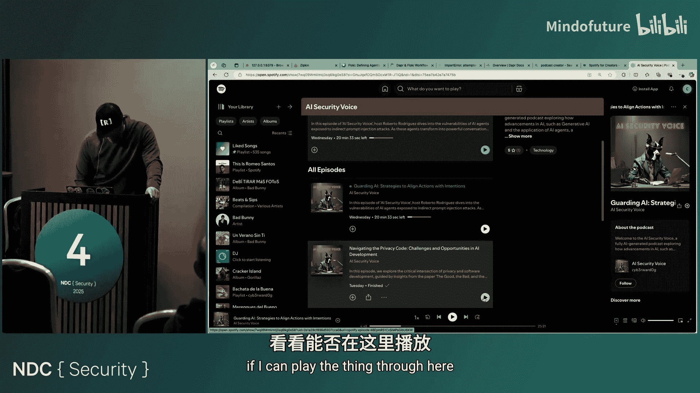

By design effectively。 So addressing these concerns can lead us to a structured rope。

 So what I did is I also clone my voice。 So which is very easy to do。

 You have to do like 30 minutes of like recordings。

 And then you just wait in the models are train fine tune on your voice。

 and then they can generate output。 So one of my dreams has been to have a podcast。

 but I but I actually say it explicitly in the overview。 This is an AI generated podcast。

 right I don't wantna light on your body。 But I figure， you know what， I just put my voice in it。

 and then just listen to the podcast every day while I work out in the morning。 That's it。😊。

And there is already， So if we go to this project of flocky。P I need to。One second。

 just make sure I can show you。There you go， and I'll make it bigger。Once again， here it is。

 So output samples。 So we have the。All the papers that he downloads in here。

 and then all the episodes at the end are pretty much my God， V S code is terrible。Sorry。

 there you go。 And it's just pretty much what is generated by the system itself。

 The the A gives me the title overview， takeaway of the whole of the whole paper。

 And then we also have the index of every single paper。And then the updated index。

 where the L N says。 and these are not actually related to cybersecur。 So maybe those。

 right you should escape。And then we also have the transcripts。So let me just do this。 So。

 in a transcript， you have， for example。My project， the AI security voice。

 It's actually coming the project is gonna be released this week。

 where you can define your own character， your own title， or you can have multiple people。

 So right now， I just say， if you see one person as a host and no participants。

 just be a like a one person podcast。 if you see other participants， just start， you know。

 conversating about every single page pretty much。 and to me。

 does's a really good job doing it that way。😊，But I felt maybe the first episode just to be me for now。

 And at some point， it's like a little bit boring。After 20 minutes in， I'm like。

 or I I'm tired of listening to myself。 but its is but it's pretty cool how you could actually。

 you know， do this for research。 So that's part of my security research。 Now。

 I can this is to be honest， even though it might be just a little， you know， I would say maybe。

 maybe funny。 But that seriously is。😊。

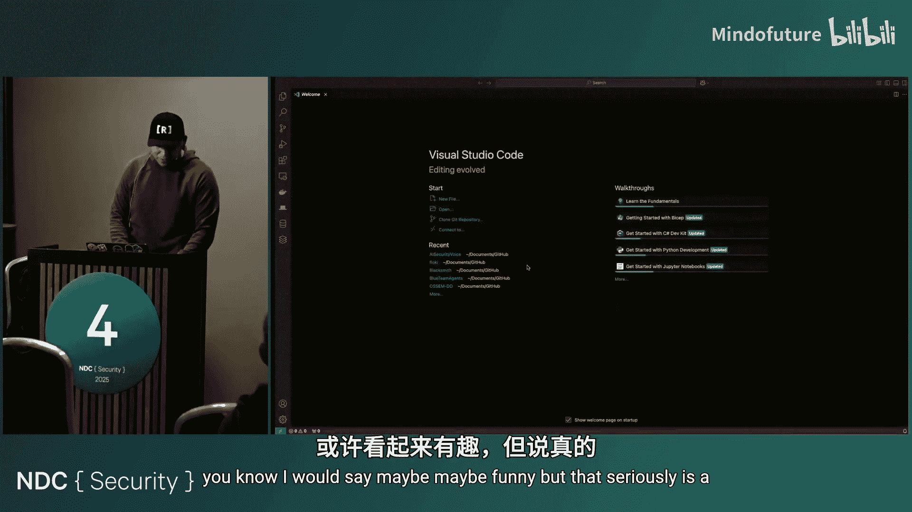

hy percent那个。That is the first time that I actually automate myself， right， to be honest。😊。

Because Ive， I've been trying to do that for a long time because there is so much that I wanna do。

 It's no time and。Reading papers was something that just， you know， is too much for me。

And this is one way that now， to be honest， every day when I'm just in my office， you know。

 trying to drink my coffee， just listen to the podcast。 And then I。

 and then I could be doing other things as well， as I mentioned before， and。Is you know， fascinating。

 So anyways， So that was one of the first， I， I would say security stuff that I do。

 and now is helping me a lot to keep up with all these different things。 Now。

 what are the challenges that we're trying to solve， in my opinion， in cybersecur。

 especially from the defensive S。😊，Right。This is what everybody wants to build。Right。

 this is something that even when I talk to a few folks internally at Microsoft， right。

 we're trying to figure out what is the best way to have a system that has the right tools to communicate with the right tables。

 do N L to K Q L and then figured out like how to query all that information and then just have an analyst that is just waiting for some next steps。

 maybe for some feedback into like what's going on in this incident， right。

 all the way to have it to do this a multi step right or three branches type of investigations。

 right。😊，But least。Yeah， but let's be realistic， right。If you want to query， you know， K Q L。

 for example。And you are going into this。So who does investigations in this room。那一个sco bi捕。

Your query goes from this to this， right， Like once you start integrating multiple things。

 once you start actually trying to， you know， like。

 expand the scope sometimes join with multiple things。 at the end of the day。

 you have this like massive query that for us。That's gold。 Like for a lot of AI also。

 folks that are trying to find own models figured out how to improve agents。

 That's gold because they wanna， they w to learn from that。

 or they just wna push that those big queries to the system so that they could reference some of that and maybe write a variation of that。

But to be honest， I have not seen that succeeding that well。

 And that's because of the complexities that goes into， for example。

 something like K Q L to be able to。Capture multiple things。

And when you're thinking about the investigation。You start connecting the dots。

 You start joining nodes， right？ And your query is not going to be， in my opinion。

 sustainable just to be creating this massive thing， right， So agents or models， language models。

Are not good at that， right？ And there's been years already of trying to do an L K Q L。

 And theyre doing a great job， I think， compared to like 2，3 years ago。

 But this is still a big challenge。 right， at the moment， I'm not saying that it's gonna be forever。

 but it's just a challenge。So one of the things that。Yeah。

 that I was thinking as part of the research was that。Technically， even when there is， you know。

 transformation going on， you have this like massive ontology or data model that you're trying to keep up。

And when an investigation occurs， your data model and your ontology can just get out of the window。

 too。For example， on Microsoft， when there are investigations， there is multiple。

Da science teams that they bring their own data。 So they capture it from multiple places。

 and they bring it into one， into one cluster cluster， and they say。I enrich this data。

 Go ahead and hunt on it。Right away， we're like， okay， but what's the schema here， like， you know。

 So you have to now learn new schemas in the middle of an investigation。 That's not fun。

 So trying to keep up with that， it's， it's very hard， right。And usually， I。

 I see these as data transformation。 and then the hunt， right。

 And usually we are involved with the hunt， not so much on this area。 My team right now。

 that is more focused on AI。 let's say， enabling autonomy to defend Microsoft。

 that's my team at the moment， we are now focusing on the ontology。

 but to support agents and figured out what they can do with it。😊，So something like this。

 for example， could be， you know， is's possible that concept。So what's going on in here。

In this concept， as you can see， the lines from the previous one。 So you have。

The ontology stops over there， and the analyst just receives the ontology。This one is kinda。

 kind of together， like。Can we have a little bit of data transformation。 And at the same time。

 I I make it part of the hunt。 So what that means is。

 what if I can build a system that allows me to transform the data。

In a way that it could also inferair its own ontology。Right。

It can infer his own schema is its own data model。And then since we always think in graphs。

 because we're trying to connect the dots， trying to connect the evidence， right。5。

We can actually go from the ontology， the data model， right to a graph。

And we can also make the system write the code to go from cuto with ontology and directly inges it into a graph。

So a couple things that are being， in my opinion， taken care of there。 One。

 you don't have to worry about any other schemas anymore。 like even if I， you know。

 get wrapped into an incident where there is multiple guta clusters with new schemas。

 I don't have to worry about that because there is a system that will be able to right。

 take a look at it。 We'll be able to query maybe the last five events and get an idea of like what thisyntology could be。

 like what is a schema of this event， So there is a lot of power into doing that。And then at the end。

 the analyst， it's someone that could just pretty much interact with the system in natural language。

Because now the system was able to understand the intent of the user。

It was able to understand the data schemas。 It was able to come up with its own ontology。😊。

And he was able to write code， to generate a graph。

So now I can ask questions where the system with this schema of the graph in ontology is capable to write graph queries versus writing this like massive right queries。

 where you're trying to do multiple joins。 Now， I'm not saying that graphs are better than coastta clusters and all of that。

 That's not a case because experience as well。 by doing this。😊。

Is crazy If you rely on a graph database， as your。Massive database。

 So you're trying to migrate a lot of things from Cto to a graph database。 It's。

 it's not gonna scale later。 But what I love about this is that it's kind of like a more。

Local view of your environment。 And if I care about only 2% of my environment for now。

 because I'm trying to start my investigation， I'm okay graphing that 2%， right， I'm okay doing that。

 graphing the whole world。 it's a total different challenge， right。

 But this is super useful because you can actually dive into even make the model think。😊。

Even in graphs， for example， right， like the next question that you have during the investigation。

 you could say， I want you to connect a user that might have been added to a group and tell me how that group is related to other resources in the in the environment。

 You can write a cipher query or a you know， Gremling query for those that use， you know， tinker pop。

 for example， and those are easier to even understand and even explain in natural language。 So just。

 just think about that， right， How， how powerful that could be， right。So the end， right， you have。

All of these security platforms with all these different information。

 It doesn't matter if you even add things such as attack paths from like bloodhound， for example。

 or or any other， you know， attack path management system， you can integrate that and say， hey。

 can you just add it to the ontology， right？ Can you just connect that thing with my activity data and then be able to。

 to traverse the graph， right。😊，Now， one thing that is very interesting to me is that。

When you traverse the graph with an agent。And you ask the agent to plan。 It's really good at saying。

 oh， I found X and I can connect it to Y and， and Z。 And I can just go like this， right。😊。

But when you ask it for a plan。It usually says， find suspicious activity。😊。

To me that what does that mean。How do I find suspicious activity， right？ So at that point。😊，To me。

 this effort， its a local view of your graph or imposture。But if you want to identify anomalies。

 you have to look at it from a global view， right？ So the efforts right now， for example。

 in the team in general， And this is not new。 every it's a lot of people that have been doing that already。

 So that's what you， I can， to me， I can share it。But we're trying to figure out what it means to have a global view of。

 of a graph。How much time it takes to train a model， right， to identify those anomalies。

 We're starting from a small environment。 And， and， and to me， later。

 that would be an input for the agent。So in the plan when the agent says， let's find anomalies。

 It would just interact with that tool and say， hey。You know。

 I have this entity and would love to know what the score is from an analogly perspective。 right？

 So that's how you integrate the global view and the local view。 This is pure local view。

 very scope and super useful for those， for example。

 that are pretty junior into investigating or even in the company itself。

 maybe you are super like an expert in your in， in your topic。

 But the moment you go into a new organization， you have to learn one more time with all of these schemas and data and everything。

 As I mentioned before investigations， you run into a new data set all the time， right。😊。

Something like this would help。So。How does that work。This is something that I put together。

 It's kinda a little messy。But hopefully it makes sense。 And so so I can take you from here then to。

 to the code to to flocky。 And I can explain certain areas into how I'm using the concepts of。

 you know， the fan out， fanning， chaining， loops and everything all together running a workflow with flocky and and dapper。

 right。😊，So we start by taking the user message， the question， you know。

 I'm trying to look for files being created in my environment。Next step。 Let's no plan anything yet。

 Why， because we're going to we're trying to go from left to right， right left。

 meaning the closest to the data closest to the environment， right， first question I always have。

 it's if you're looking for file creations。 Can we figure out what are the file creation data sets。

 like， where do I go to look for that data， that's a valid question。

 and a lot of people can answer that， like truly answer that。 even at Microsoft。

 if you ask where the signing log data is。Youll be like。

 where are you talking about something that customers can see or something that we can see。

 Is it something that exists in this environment。 It's is a mess。😊，Right， so。The idea is that。

 you know， we can index a lot of these schemas。 And the more schemas people bring to the conversation is totally define。

 Just bring all the schemas that you have and then be able to take all of those， create an index。

 So be able to send those to a vector database。😊，Try to do query decomposition where you can take the first。

 the， the question or the multiple sentence sentence question that a user might have。

 break it down into small pieces and do like a multihub type of rack， right。

 Rettririeval augmented generation where you could identify similar schemas。

 right related to the query， right so。So we do that。 and then we get relevant schemas。

And then we also use an LLM to inspect all the schemas。 So that's what that one does。

 So once you do multihub， you're gonna end up with multiple schemas。 So at the end。

 you have to do another pass and figure out which ones are the top that will support the intent of the user。

 right。Then we can do some， you know， fan out。Where the idea here is that now that that I know。

What data I need to collect and where I can， I can collect it from。 I can actually execute。Querries。

Not to do the super crazy queries， but very basic， let's say， K， Q。

 L or S P L or any other splung or anything。Very basic queryries， just to say， based on the schema。

 if you want to look for file creations， we might look for event 11 in Sismmon for onprem and。

 or we can look at the file creation events of like M D E， right in in defender。

Let's just capture the time that you're looking for。

 and let's go to the data set and let's just retrieve maybe the top 500 events。 right。

 So that's like one way that we do this so we can create a couple of files。And then。We actually。

 you know， ask an L M to also generate radio ontology based on the schemas， right。

 So as all of this is happening， we can execute the other task where we say you have all these five e。

5 e schemas from， right from different tables。😊，And I want you to regene a graph。

 graph ontology with this。So to me， that's very powerful because you're not given it。

500 times 4 events to another M。You're just given a schema。Right。

 so even if you have  tennis schemas， that thing is gonna fit in one pro， right。

So the idea is how you can start create this structure of based on the schemas that I'm working with。

 what are the top entities and what relationships can I define in these is schemas。

And then based on that， you could actually make a right code for you。Right now， of course。

 is very basic Python code， But you can make it， of course， better。 An idea would say， look。

 I have this schema， which means that we know。How the events are going to be， you know， process。

And we also now have a graphontology。So can we write some code that would allow us to translate that into a graph。

Right， and that， of course， once again， if you do it over hundreds of thousands。

 it's gonna take time。 But if you do it in a very scoped you know engagement。

 it's gonna be super cool to， to have all of that， you know， ready。

 And then it goes to a graph database。😊，Now， the user can actually ask the question again or simply let its first question just to kind of be ready to be answered。

And now that the system has an ontology。Right， based on the schemas。

 now we can also generate graph queries， right。So at the end。

 you can actually have this system where every time someone was wants to investigate something。

 you can kick off the indexing。Right， because every question is gonna be different。I mean。

 most of them will be different because you might be looking for， or I already did file creation。

 Let's look into process that maybe created that thing。 Let's see who access that thing， right。

 Let's see what network connections probably occur。All of that， as you all know。

 has different tables， different schemas， right， They might have some similar fields。

 And that's how you kind of like show the the model， like how they could be connected。

 But that's something that you can do。 And you can use this as an on demand type of tool。嗯。

And it's pretty useful。Yeah， very helpful， to。Do it， so。

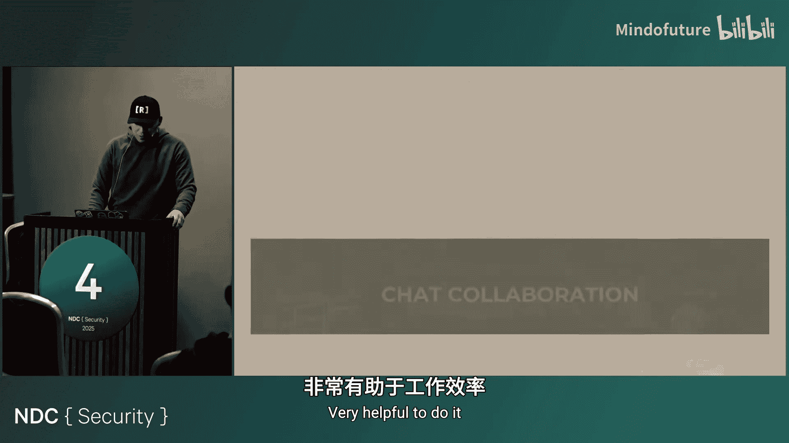

Let's see if we can do this。 I'm gonna to try to。Make this better。

 because I don't like to see all these things。 Hopefully， you guys can see。

Let me just make it little。All right。So let me show you first， I guess maybe the basics would be。

F flocky first， I'm， I gonna close some of these things。Let me show you what a workflow in。

Kind of looks like in， in dapper。Let me see one second。For example， this is the way how a dapper。

 you know， workflow kind of looks like。Where you simply， you know， import your libraries。

You can initialize the you know， workflow。And you can use decorators to say， this is my workflow。

And inside， I'm going to simply run the context right call activity and simply run other functions that are in the same script that have the decorator activity。

😊，That's。Pretty much it， right。 And then you can inside of the workflow。

 you can do your basic tasks chain， which is what the， you know， yield it's for。

 So yield will kind of wait until it's done and they move to the next one and the next one。😊。

But if you take the yield， it's going to just run async。嗯。This is so basic。But at the same time。

I really encourage you。To， to， to go and figure out how to do that with other libraries that are doing it for AI。

 I'm， I'm not saying for， for this type of things。 And now the value of this once again is that every single task that is being executed is wrapped around right。

 the concept of dapper， the sidecars， the services underneath。

 which are capturing all the telemetry and all of that。 So what does that mean， for example。

 if I go to。

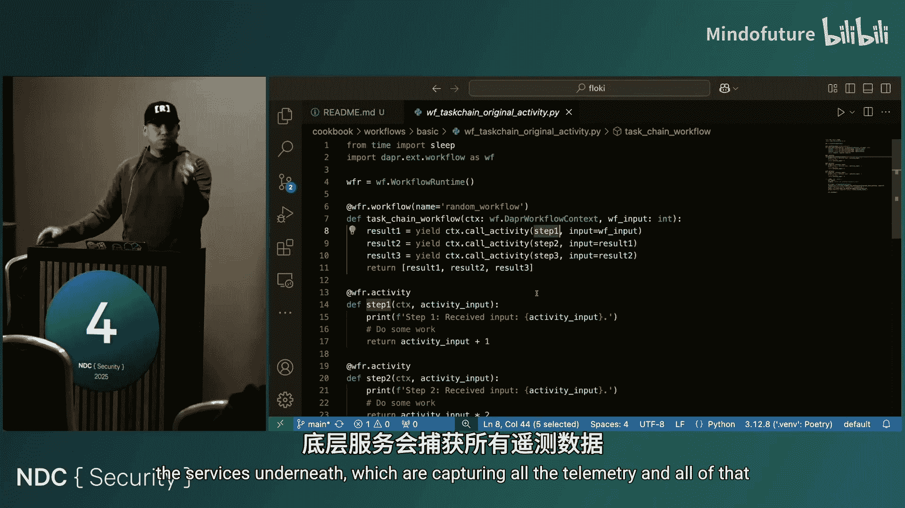

sorryrry。As I mentioned before， let me make this bigger。Dpper， when you deploy it locally。

 you can actually。Have， a docker container that gets deployed automatically that is going to run Skin and。

 and， you know， Sipkin actually captures the open telemetry from。😊，From dapper。

And then you can actually see， for example， the execution。 Let me just see if I can find another one。

Probably no。

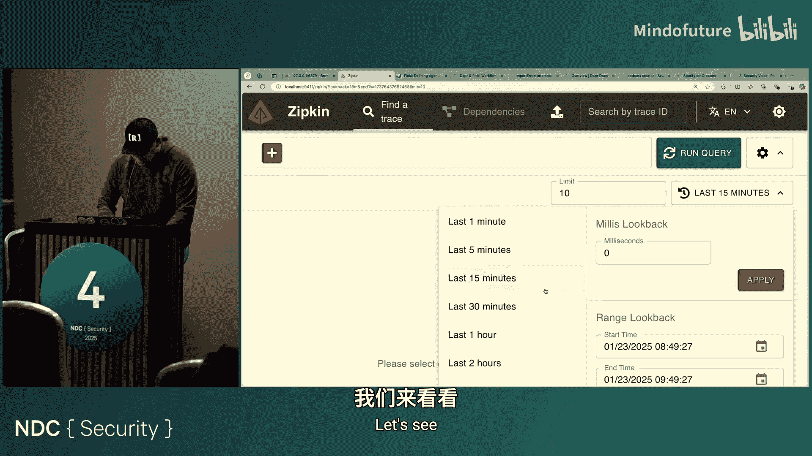

是。😔，There you go。 look， this so my， my demo failed earlier。Which is fine。

 But at least I have proof that how do we do this。 There you go。So automatically。

 you can see in here that。You get this like out in out of the box， right。

And there are a a couple services that are trying to do this。

 But you have to either one pay for it or you have to send your data to a cloud service。

 And this is something that that you do with Biantic。 For example， if you use bidantic AI。

 you can use this amazing locksmith。 I think is' called service where you can get open telemetry from your applications。

 AI applications， But all your data goes out there。 right。

 This one in your computer and you get a similar feeling。😊，And you can actually see exactly。

 you know， like， what was， for example， the error。Let me show here。1。

 I like how it kind of shows you the sequence of things， right。

 Like when it's something being executed， for example， the query generation。

 you can see that those three were executed as a fan now， right， Those three queries。

 But then this one， I guess， took forever。😊，And here's an error here。So。

Yeah I was wondering what happened with this one。So I know that it failed in my main。

 my main workflow。And this is not a message。 Oh， okay， a variable that I'm using to pass to my。

 my tasks in in my， in my， in my in， in a workflow。But anyways。

 But that's what I mean by something like this。When you look at it is very simple， right。

 But there is a lot of things going on underneath that， to me。

 are super powerful when you're trying to monitor what the agent is doing or not。Now。

 what is the difference with， you know， what does you know， Flocky does， So I can take the same。

It's gonna look kind of like the same。 So this is flocky。He looks pretty much the same。

But but the difference with flocky。Is that。Dpper only allows you to define a workflow， a function。

 and， an， and instead of a task。It was cold。An activity。Right。That's call activity， right。

 activity activity activity。And all you can execute is just Python functions， right。With flocky。

 I introduce the concept of a task。 You can see how we change it， right。

And is that good size for you guys in the bag yeah， okay。

So the difference with a task and an activity is that with flocky， you can take a task。

And you can pass a description of the task。 And that would be a prompt。Underneath。

 there is already a one LLM client that is being initialized。 and by default， it's just open AI。

 right， clients。 But you can set it up to whatever you want。

 There is actually a a parameter in the task that you can use to define the prompt and to define the LL M。

Or to define the agent。So you can attach an agent also to the task itself， right。

So that's the concepts of flocky， how he creates wrapper around da activities and makes it so easy just to create a So let me show you what that means。

 For example， if you go to。😊，To daer and you want to call， for example， like open AI， right。

 you will have to do this， which is fine， right， Like。

 it's okay to import open AI initialize it and then you know put a couple messages and then try to get right the characters。

 right。😊，But。If we go to flocky and this is all in the repo， by the way。

 you can go to the cookbook workflows and basic。And this is what it looks like。In flock。

So in this case， I'm saying， you know， pick a random character from the lot of the rings。

 I'm a a big fan and then respond with a character's name only。😊，That's it。 And underneath。

 that's gonna be taken by an L M client， sendend it over， right， retrieve it。

 And then can I show you what's going on。 And one thing that I'm not showing in here or maybe I I do。

 Oh here it is。One thing that you can do also with flocky。Is something like this。 Look how。Small。

 that thing is so you can have a workflow where you can only have， let's say。

 one task with its own prompt。V。😔，The variables， I guess the， the。

 the parameters or arguments of the function are going to also be used。To， you know。

 be substitute inside of the prompt， for example。 So if I call this function with name in this case。

 I was calling it with a scooby do， then the prompt is gonna be is gonna be a run with that， right。

 Who was scubby do， right。And the second thing is that if you define a pedantic object or class。

As a schema。😊，You can pass it to the types， the return type。And then the task is going to know， oh。

 okay， you want me to do structure， you know， output or be able to use a tool call from open AI to be able to receive a structure output。

 right？ So that's something that。That we do in in flocky you can just do it in a simple way like this。

 And at the end， every single output of every single task must be a dictionary。

 So at the end of the day， well， flocky does underneath， it takes that byantic object。

 It receives the structure output， it validates it。 And then it just， you know。

 model dump and it just exports a dictionary， right， So all of that， instead of typing it over。

 you can just do a like， right like that。 Allright， So that gives you， you know。

101 into how flocky operates。😊，And another thing that we can do。 Let me see if I can。Maybe show you。

Here， and then we dive into the other example the the。Let me see if I can do this。

 I don't know why my。还有1个2号村份。So， with flocky。We can actually do， So if we go to cookbook。

 we go to workflows。And there is actually very basic。 And， and it kinda gives you the idea of。

 you know， how this works。And by the way， the doctor podcast is also here。 The basic idea。

 But then I have another project that takes it to the next level。So the idea with。

 with flocky is that when you work with Dpper， for example。And you want to define your services。

Right， you define services that are exposed with a fast API server like this in Dpper， right。

 You can actually build an application and then simply expose it right with an API。

 in Dpper has an extension for， right for all of that。 So what I did is I just took my agent。

 The basic one that was telling me the weather and all these things。

 And I just exposed it as a service， just one raper very easy to do。 So I'm gonna show you right now。

 But this is how you can run like multi like agents。😊，You know， very easily， right。

 trying to define the dapper ports， the basic port for the application。

 And let me show you what that actually looks like。 So if I open services。And I go to the Elf。

 and the app。this is what the app looks like， for example。

Where all it is doing is initializing the agent， right。

 give it your typical goals and instructions and everything you want。 And then at the end。

 you can wrap it around this dapper agent service， which exposes all the dapper connectors and components。

 right And now you're ready to start like exchanging messages and all of that。😊。

So that's how easy it is to define just one agent as a service。 And it's already right working。

And just to do a very basic one。Here。😔，It's gonna be the。Let me see how we can once again。

So we're gonna use the workflow。Services， workflow L M。 Alright， so let's use the workflow L M。

 So what that means is that。The wake of this。Workflow works。

Is that it's going to know how many agents are。 It's gonna know the goals of the agents。

 And then every single question is gonna be routed through this you know manager agent and it's going to decide who speaks next。

 That's something that you see in autogen in， in other frameworks。

 But in this case is all being done with dapper。And if you w to know how that works。

 you can go to the source， floy。Agent。Workflows。helM。And。It pretty much。Kind of like。For example。

 this is the prompt。 one of the prompts in here。嗯，那不让。inside。So the other workflow， it just。

 you know， processes the input。 It adds a message to the whole， you know， history of， of。

 of every single agent。You know， broadcast the message。And then it's a Le to next speaker。

He triggers an next speaker。And this is something that also is super powerful with dapper and flocky。

 where you could actually， you know， wait for an external event。 So this is where you could also。😊。

At the human in the loop。 So when you're doing， for example。

 a security investigation or using the system that that I mentioned before。

 it's something where you could say is the ontology okay， and then just wait right。

 or is this query the right one。 I this are this is schemas what you were actually thinking of right from like what schemas are makes sense to query data for So that this is so simple on like how you could just generate an event as long as the event comes in。

 is's gonna be waiting， right， And that event can come from multiple services， right。

 You can do it locally or you can just have an API or being connected to to a service。😊，Alright。

 and then for just to finish。We can just do a quick。 let me run the other one so we can finish the。

Presentation here。So， this is the incident。Tage。Let's say， like agent。

And this is what I was showing you in the。Slide， where there is a couple agents。

And there is an agent。 There is my stockck manager agent。

And if I go to the main workflow of the agent， we can actually walk through this real quick。

And it's going to be a release， also this weekend。This is pretty much what I was telling you about。

 So this workflow is going to initiate。 It's going to capture any input。

It's gonna be waiting for any type of。 This could be a question of like， hey。

 I want to query for any type of file creation events in my environment。And then。

 this is going to directly。But also the input just to kind of say， alright。

 So I'm gonna take your message。 I'm going to put it in a format that I can exchange。 I can。

 I can send it to everybody in the， in the， in， in， in， in in the multi in。

 multi agentian collaboration team。And then I'm going to execute a child workflow。

So this is also great， because you could actually。😊，Keep your main workflow very kind of simple。

 And you can just define multiple workflows with flocky。 And what this one does， if I go to that one。

 So I go to workflows and retrieve schemas。Workflow。It's very， very easy to read。

Is reading all the schemas， is creating the documents。 So it's taking all of them。

 It's going be indexing all the documents and is's going to perform the query the composition。

And then at the end， it's going to just simply start generating the。

Relevant is gonna be trying to figure out what are the relevant schemas to be able to investigate this incident。

And then at the end， it's gonna filter the schemas。And simply return that。

 So with this basic workflow， we are already trying to identify what is the right data set to use in order to query or do an investigation。

And the way have you run this。When I do it right now。

 it's potentially gonna break because it keeps breaking a couple of things。

So what I do is I go to my demos。Incentriage。And there is a。Dappper Yamo file。

 which just has a basic way。 how to right define every single agent。And I can just do dapper。

Run that age。 I'm sorry， that F and that。

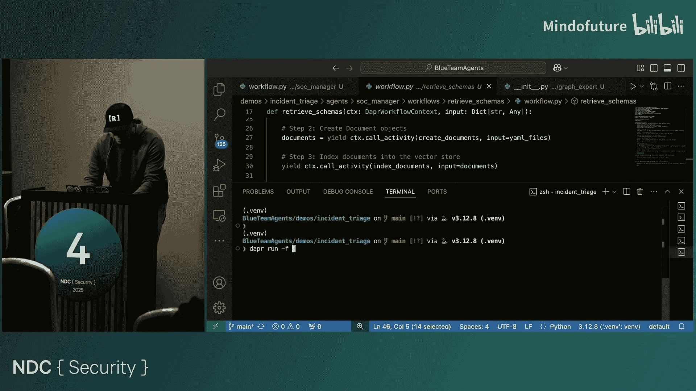

And let's put all of these all the way up。And what this is doing， as you can see， it's。Oh， actually。

 so this is what I love about dapper。 Dpper also captured to the state。 So I。

 I stopped it before coming down from my room。 So it's trying to get back to what it was。

 That's also one of the benefits。 it kind of like plays it to from where he stopped。

 And now you can see that you try to do that。 But then it， it's stop。 And now all the agents。

 the two agents that I have are are just reporting back saying， hey， you know， I'm alive。

 which is also by default， something that I didn't build。 as long as I wrap it around the services。

 You can do it。😊，But let me just stop it。And then。Every single dapper project comes with。A reddis。

 And you can use reddis insights in order to see what's going on。And I'm going to delete all of this。

Right。So， we back。That。

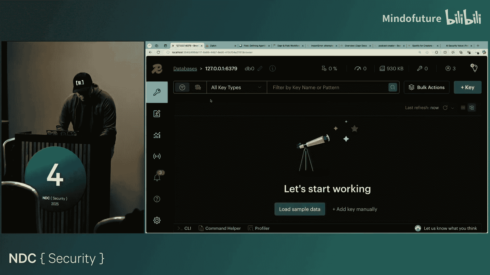

There's nothing in there。 I'm going to start this again。And let me show you here， for example。

 And here is just。My graph expert is called graph use。And my stockck manager is here。

 So it's all there。And then。My threat intelligence person is logoless， like log and Legoless。

And then it's just there waiting， right， So now what I can do。

Is I can just interact this as if it was just as any API。 I'm gonna to make this bigger。

And I'm just saying a file was involved in an alert。

 and it is now in every in every in several endpoints， I want to know more about files being created。

 right， So I'm just giving it my task as if I was just calling an API。

And I'm just gonna give you this， even though the time is wrong， it might not pick the right queries。

 But if I'm gonna send that。

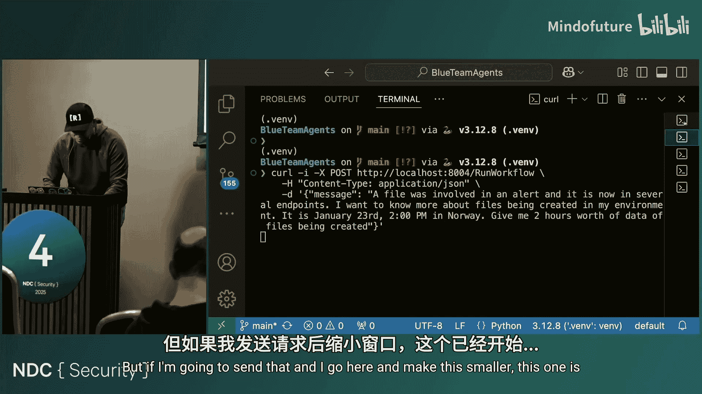

And I go here and make this smaller。This one is already。It's already embedding。

 There is generating embeddings of the schemas。 and it's just going over the whole process， right。

 of identifying what schemas are relevant to use for the investigation based on my intent on my query。

 And then it's just kind of going over every single step。 right now is trying to come up with the。

Querries that it needs to execute。 Some of them will fail once again， because of the time。Right now。

 it was able to capture。The schema of。I think this is file creation。 No， this is。

 this is file stream， for example。 So it was able to pick the file stream schema。

 But then I can just simply have a loop that says think harder is now file streams。

 You have to look for the file creations。😊，And what I。

 but this is still pretty good because if I go to the schemas， for example。

 I give it a ton of schemas。😊，And it's just like。You know， multiple things， not only files is。

 is's just uszure stuff and。Defender。 and he was able to at least capture the， the， Oh。

 here it is something。A file was involved in an alert。Then， graphs。

It's saying he's gonna run this query， Neo4j query for file creation。

That file was created by S PCC hose with this gut。And then graph view says， let you are。 Yeah。

 there you go。 So that's pretty cool。 right， So we went from。

 right from the process of running a deterministic workflow just to define what it is that we need for this basic hunt。

 And now that we have the data available and things in a graph。

 Then we can simply make the agents generate their own graph queries and simply interact with that。

 And graph views had the context of being a graph expert。 So the stockck manager says， all right。

 you will be the one executing that query， right。😊，And that's it。 So you can do a lot of this with。

 with flocky。 And as you could see， integrating it with very complex workflows， right。

 to be able to do this， if you put this at scale。It's very cool。 So anyways， this is flocky。

 You will be able to get some stickers， if you wanted to。😊。

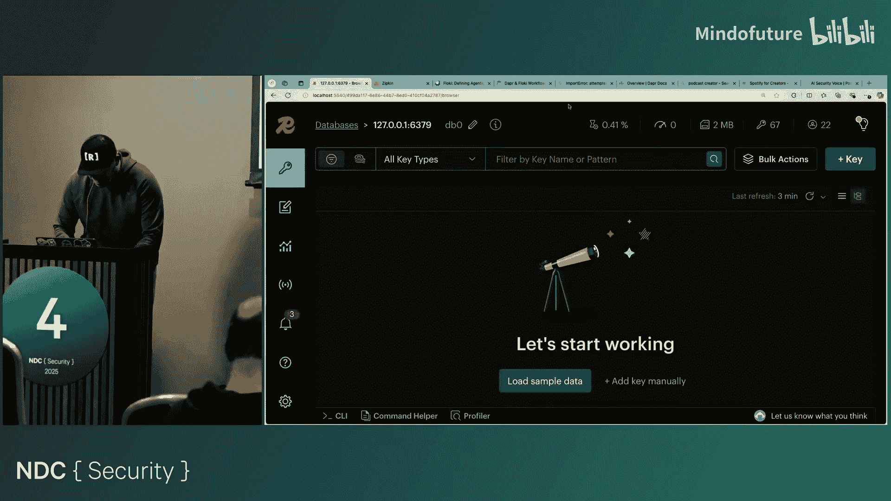

If not， it's fine。But yeah， so that's flolocky。 Thank you。 Thank you very much for your time。

 And sorry， we went a couple extra minutes， but I appreciate it。 Thank you。😊。

