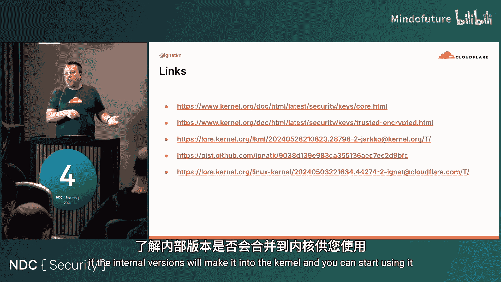

# NDC-Security-安全大会-2025-｜-AI工作流-｜-智能体-｜-网络安全-｜-Dapr框架-｜-开源工具-｜-LLM应用-｜-自动化安全-｜-黑客-p02-P02-TPMs-and-the-Linux-Kernel---unlocking-a-better-path-to-hardware-security---I--BV1ihgQzJE2h_p2-

Who here knows about T。哦。Okay， so I'll not explain what we generally do。 I'll。

 I'll just talk a little bit about myself first， so。I do Linux at Cloudfer like we。

 I manage the operating system we run in production。

I'm passionate about system security and performance， and I enjoy low level programming。

 The was kernels， drivers。😊，Boootloaders and other stuff written in unsafe programming languages。

I'm also a dieihar Linux fan。And you can see that I'm presenting from a Mac now， so。

And there are reasons for that。 So Linux is great， but it cannot do two things。1 is like。

 connect to external projectors and empower management。So， yeah。呃。Okay。Today， were。

Going to talk about T PMs。 Who knows what a TPM is trusted platform module。Who here has a laptop。

Who here thinks that their laptop doesn't have a TPM。Okay， so you'll see。 So yeah， A TPM is a small。

 often discrete， but in modern hardware， it can be integrated security chip。 I。

 it is present on most modern laptop termss， like not even modern， like。

 I think it has been around for many， many years。 and like servers alike。Yeah， it's。

It's a passive and non intrusive device。 It's not like some other security systems that are very。

 you know， like， try to spy on you。 it's。It only， it's passive。

 It only responds to commentss and performs stuff。 If you ask it， if you don't ask it to do， it。

 will not do anything。 So it doesn't tap into memory or anything。But even though it's a very cheap。

 low powered， slow device。It allows you to build a great foundation for platform integrity。

 authentication and remote attest station。And luckily， for us today， like。It's a cryptto chip。

 so it can handle cryptographic key。Which is good。If you ever been to previously to any TPM talks。

 like most talks and like blog posts out there and。

Everything is all about T PM and remote atest station， right。

 Like anyone here doesn't know what a remote attestation is。呃，稍 yeah呃。

Remote atest and platform integrity。 So the， the， the primary usefulness of the TM that you can remotely attest your hardware and ask it like。

 are you running the operating system I expected you to run。

 Are you running the patches I you expected to run。 Did you boot the。

 Did you have the proper boot cycle。 So you can be remotely have guarantees of assurance of a state of a platform at a particular point of time。

 And it's a really nice feature， for example， even for server deployment， like in cloudware。

 We have many， many servers around the world and like。😊。

There even we have data standard locations where there was never a single call for employee even visiting it。

So like， but still like as， as an operations team， we can say， like， okay。

 I know what this server is running right now， Which operating system。

 which software just because we have a TPM and it can provide this information。But。TPMs are great。

 So operating system use it like vendors use it， Windows uses it， everything。

 But it's available on every machine。 I had a question is why there is not much open source or commercial software actually utilizing TPM for more for storing your cryptographic keys。

 right， So like we all use Ubi keys。 We all use like fancy mobile authenticcation。

 You have like a super secure。😊，Cpe in your hardware right here right now。

 And there is actually almost zero software which can utilize it， right。

So the question about this presentation is not about remote adaptationestation。 It's about。

As a developer， I'm a software developer， Imagine I just wna develop a tool which。

 which stores cryptographic key on the team。 Can I store my keys in the TPM。Yeah， and。

This is basically my mental model as a developer， right， So I write code。 There is a T PMM。

I want to use it， right。呃。Unfortunately， apparently， it's not that simple， right， Like my code runs。

On a computer which runs like modern computers runs operating systems。

 So you most likely use an operating system。 And like， if you run an operating system。

 you cannot talk to a hardware directly， right， You need to use operating system abstractions。

Because the operating system mediates applications and access to hardware。 So if I run， for example。

 on Linux and we'll be talking about Linux today， like to access the TPM。

 my application needs to talk to slash devf T PMM 0， like a Linux device file representing the TPM。

 right， so。Well， okay。But it's not over yet。 So what you to talk to the T PMM。

 you need a thing called a resource manager。And the problem is， T P。

 T P Ms are nice because they're super cheap。 So for vendors。

 it's almost have zero cost putting them。 and if it breaks。 It's like a 5 buck replacement。

But on the other side， they're not very powerful They， and they don't support， you know。

 like multi tenantant access， like simultaneous access。 And like most likely。

 if you run an operating system， you have a multitasking， right。

 So like there may be many applications trying to access the TPM。

So what resource manager does is kind of serializes his access so the T PMM doesn't get confused。

Right， so I need this resource manager。Well。And not only that。 So I also need a T PMM library， right。

 So like to talk to with a resource manager to T PMM， I need some kind of high level obstructions to。

To talk to me。 So like， my initial mental model was application T PM。

 But now I need all these things and know about all these things， right？ So now。

 let's zoom into the resource manager specifically， so。

The other problem with the resource manager is the first implementation of the resource manager was a demon。

On Linux， right， it was like a user space service。Which mediated this access。 And it。

 it is very confusing for developers。 So like from your perspective。

 you kind of try to access a device。 But what if like that that demon is written in C and like。

 it may crash or or didn't start or is the system maybe misconfigured。 So like， from my perspective。

 I'm trying to access a device， I know it exists。But because some service is not running like my application doesn't work。

 So like this sounds not very convenient。 So I think like Linux kernel developers。

 like recognize this。 And in modern than Linux kernels。

 they basically reimplemented the resource manager directly into the operating system。

 So the kernel always runs So the resource manager is always running。

 So basically now if you want to use in kernel resource manager to access the TPM。

 you need not to talk to slash dev TPM you need to talk to slash dev TPM R M。

 which stands for resource manager at different device file。

 So if you're writing software talking to a TPM don't never talk to TPM device directly talk to the resource。

Okay， let's， let's move to the TPM library。 What we can use these days， and。呃。

The situation here is not better。 So we have like two major competing implementations。

 One is called Intel TS S。 TSS stands for。😀Trusted something， something。

 T S S stack is like trusted software stack， yeah。😊，And we have an implementation from IBM。

 like two companies， propon major companies proponing TPM usage。The problem with these。

 they cannot both try to follow standards， but the standards doesn't define APIs。 So they。

 they have completely。EIncompatible API。 So， for example。

 you have to choose either you use one or the other or you rip a wrapper that yeah。You can use both。

 but like， you have to do more work here because， for example。

 if you want to package your application for major Linux distributions。

 you cannot be sure if the distribution provides either this or that or both。 So like。

 you have to think about that。 So there's a lot of stuff going on。And。

And these are like C implementation。 So if you， for example， write your code and go， you know。

 like go people， they don't even like external dependencies at all。 So they say， like， oh。

 they Google implemented a pure go implementation of the TPM article called Go TPM and。To be honest。

 I never checked the rust space these days， but I'm sure maybe there is a rust implementation as well。

 So like， yeah， So like， you also need to understand what kind of T PMM library is available and you rely on that。

 or should you bundle it Now stuff。If you go to the Github page of the。

TPM to software stack to understand what， what that stack is all about。 youll see this slide， right。

 And they will say， like， oh， you have these various layers where you can hook into。

 you have like the lower layers， which is like closer APIs the high levels。

 which give you like more abstracted APIs， but you can do less things or， or you have a middle layer。

 which you can basically reconfigure like。😊，Like， it all becomes really， really confusing。

 Like you just want to talk to T PMM and store the key， right。😊，But imagine you， like。

 understood all of that。 You researched it。 You're now a TPM expert。

 You're finally ready to write code。 So you write some code， and。The problem with this， like。

Your code， you have like， if your application will try to access the resource manager on the operating system。

 you'll get permission denied。 why， I mean， and this is like a basically a standard bare bone Debian installations。

 for example。Why， because， well， on the standard debutbian installation by default。

Access to the TPM device is only allowed for route and the same for the resource manager。 So like。

 you know， like， you write your code and you have to package it that it runs as root privileges。

 And then like， you want to officially distribute it from Deby and Deian folks will ask you， like。

 why does your application need to run as route。 Like it's a privilege escalation， right。

More confusingly， if you on Deian， at least， like if you do install the Intel T S S TPM to2s。

 which use Intel T S S tech， you will notice that。The permissions will change on the T PMM0 device。

 Now， it's owned by a special T S S user。 and， yeah， and。

TPM resource manager will owned by T S S user。Oh， here I have and。T S S group。

 So you can technically put your。User from which your application runs from to into T S S group。

 and it can access。 but again， you have all these packaging problems。

 So you have to package for every distribution， Like， understand how it works。 You know， like。

 you have to convince the developers， if you want to distribute your package officially that you need to be in this group。

 And like， you have to understand how your users will run the software。

 will their user be in the T S S group。Like， and， and for example， if your application。

Is written and go and you don't use the Intel TS S tag。

 Do you need to have TPM tool still as a dependency， So you get this configuration。 yeah， it's。

It's very， very complicated。And that's why like no software just don't do it， right。

Because they can't figure all these out， out really well。There is another way， like。

 who've been here in 2023。Oh couple of people。 I don't know if you attended my talk about the Linux Colonel key store。

So， and if not， it's okay because I'm going to repeat some of this here。 Linux has a nice。

 cool feature called Linux kernel key retention service， A K。

 A A call it key rings or key store for short。 Who， who knows that Linux has a key store。😊，Okay。Yeah。

 so for， for those who doesn't know， like key store is kind of like similar a keychain on Mac。

 or I don't know what's the Windows equivalent where you store certificates and stuff。

Crypto providers， it was， or something like that。Yeah， so Linux has this service。

 And what it basically is， is like， let's imagine you have many applications which run on Linux。

 Obviously， you have the Linux kernel because you run on Linux。

 So the Linux kernel provides the applications， basically three specific system calls to manage keys and applications can use these system calls。

 for example， to store keys as kernel object inside the kernel。😊，And originally。

 it was designed to provide cryptographic information to the kernel for kernel subystem。 So。

 for example， if you have full disk encryption enabled， which you， you should。

 you need to provide the password to unlock the desk， right。

 So the kernel needs to know your password So these system calls at the interface， the applications。

 you are like password。Unlocking program will provide it to the kernel。

 and colonel will use that password to unlock your desk， for example。But eventually。

 it was extended that applications also can use these keys that you provide to the kernels。

 So some applications can provide keys to the kernel。 The other applications can use those keys。

 So like the key and the keys are kind of stored inside the kernel itself。

 But applications are using it。 So it's kind of like a software HSM model where keys are kept separately from the application address memory space。

 which is really good for security。😊，Who here remembers hardly。OhYeah， all like if。

 if you store your T L S key。In kernel key store， instead of like in open SS cell。

 you would not be affected by heart debate。And internally。

 keys and inside the kernel represented as a collection of key rings and keys。

 So keyings may contain other keys， and also key rings may contain keys。

 So it's kind of similar to a file system hierarchy where keyings are directories like collections of keys and the keys themselves are files the objects that have the cryptographic data or secret or whatever。

 right， the probably the difference is like a key can be in keyings simultaneously。 So and the key。

The key。Presence in the keying defines the lifetime as the key。 So， for example， if this key。

 I will remove it from these bow keyings。 So like a key cannot exist independently without any keyings。

 the operating system will destroy securely automatically。

 So it will release the memory back by this key and zero it out。

 So it's very great in terms of even like secure key diletion。😊，So here is， for example， a basic。

 basic example of a Linuxux kernelel key store。 And if you heard my presentations before。

 I like to say that。All these comments are copied from a real terminal from my De Deian machine。

 So consider this is a demo。 But unlike the demos we see yesterday is with Michael Ksk。

 it doesn't fail because。😊，😀へ。😊，Yeah， but you can like walk through and copy paste all of that。

 And you should get the same result， mostly。So， yeah， we have like two users。On my system。

 So Alice and Ba。 And we can see that they don't share any credentials。

 So they have separate user ideas。 They're not part of the same group。 Nothing。

 Theyre like just two separate users， right。And let's imagine Alice wants to share a secret with Bob somehow。

 So Alice can use a key store。 So what Alice does is Alice adds with this common。

 Alice adds a key a secret， basically with the contents of Hunter2 to Alice key store。咩。

What Bob can now do， Bob can now create a new key ring。

Which is basically an empty collection of keys。 And let's call it from others。

 So to receive Alice keys。 Now， what Bob can do is like because it's a proper kernel object。 now。

 it has associated permission similar to like file permissions。

 But there are like more permissions on， on the kernel key objects。 So what this means is basically。

 Bob allows anyone on the system to write to the keying and writing to the keying means putting keys there。

 right， So it will make it like world writeable。So now Alice has access to that keying。

 So Alice moves her key。To， and， and， yeah。 and every object。

 like both keys and keyings are represented by this unique number called a serial number。 So like。

 now Alice can use that serial number and move her key to the bo's key ring。

 And now box has a key and Bob can。Actually， read out the secret back。 So like Bob now has a secret。

 And you can also see that Bob， it now possesses the key。

 What's called like having a key in your key ring means key possession。 And Alice actually。

 because we move the key， doesn't have the key anymore。 Alice cannot read that secret at all。

And Linux kernel key store provides several key types。

 So the example with just saw it says the simplest key type called user key。

 And the user key is basically a buffer with secret or or bytes。

 So one process can put that key inside the kernel。

 And either the same process or another process who。

 which has appropriate permissions can read that keyback。

There is a variation of user key called a log on key。 loggan key is kind of the same。

 But once you put it inside the kernel， no matter how which permissions do you have。

 you can never read it back。 And why it's useful， it's exactly useful for providing cryptographic material to in kernel substem。

 which need access to， to it like disk encryption。 So if you have recently more than Linux distribution。

 you will see that your disk unlocking password is actually provided as a log on key。

 you provided the kernel once on boot， but you technically never need to read it back。

 So it's inserted in the kernel as a loggan key。Yeah， there is also like asymmetric key support。

 which I think is cool。 So imagine you just don't have like a string of bytes of secret。

 You have an R A key。😊，You can put it inside the kernel and another process instead of reading it back。

 if it has appropriate permissions， it can perform cryptographic operations with that key。

 So it doesn't need to read the key， but it can say， hey kernel。

 Please sign me this data with the key you have， which is referenced by the serial number。

 And this is where it became cool like the kernel becomes your like soft HSM or or a soft token right。

 to handle your keys。😊，So sounds good like， so like， we have this software HSM， E subsystem。

 We have T PMs， which is supposed to store cryptographical。

 Would it be better to somehow combine them together， right， like in a very useful primitive。😊。

And Linux actually kind of does it。 But like in a very specific case。 So there is a。

K type called a trusted key。 and the trusted key means like in on the previous examples。

 the problem is that with user keys， that even though you can insert it to the kernel。

 the process itself that inserts it that still has access to plain text cryptographic material。

 right So there is still a window of time that sensitive material is available to the process。

 So if you still have a hardly type of vulnerability， which is triggered at that exact moment。

 that memory can be dumped and then your key will be leak。

 would it be better to somehow design a system where the plain text secrets or key are never accessible to user space only inside the kernel。

 which is literally better protected。 So this is where rap keys come in。

 So a rap key is basically an encrypted blob with a secret encrypted to a particular TPM。

 So when some process inserts the rap key， the kernel internally。😊，s to the TPM to decrypt it。

 So in the kernel space， the key exists in plain text。 But if you try to read it back。

 it's always automatically wrapped of this TPM again。 And in user space。

 it's always in an encrypted block。But it's good， but up until recently， it wasn't very useful。

 So the only useful feature for that was actually， again。

 providing you the ability to provide your disk encryption password in encrypted form to the kernel。

 like nothing more because like in the process， you could。

 could not use that rap key at all because it's always encrypted， right。😊，嗯。

And this is where there is another subsystem called Linux crypto API in Linux。

 which is different from Linux Chmal Key store and is different from T PMs。呃。So。I Linux crypto API。

 you can use the Linux kernel as a crypto library。So， for example。

 if you run Linux on a small II T device and you don't even have space for installing open as a cell to do crypto in your software。

 you can actually ask the kernel to do it。And the way how it's done。

 you create a sp special socket type。EIt's not a network socket。

 but it's a socket basically from your process to the kernel。

And the crypto socket will instantiate like an instance of an encryption algorithm in the kernel。So。

 for example， as， right now， you as， as a process， you are responsible for providing cryptographic material to initialize this instance。

 So what you， you have your cryptographic key， which is an A S key， you send it through the socket。

 and the kernel instantiates this。EThis encryption algorithm。

 And now you can send some data to that socket， and the kernel will encrypt this data with this key and。

 and send the data back。The problem with this， and this is where I say the Linux crypto API is independent from the key store API。

 This is not a kernel key store key。 So this is a totally different subsystem。

 This is just a by buffer in your application， which。Was silly。 So like。

We saw that as an opportunity。 So what we did is we proposed a patch to the Linux kernel to actually combine these two subsystem and allow you to instead providing a byte buffer to encrypt something with the kernel to actually reference a key store key。

😊，And so what you can do now。 And this makes actually rap keys much more usable because， for example。

 you provided a rap key to the kernel。 It's in plain text in the kernel。

 But now you want to use it somehow。 So you have a process3， for example。

 which will create this crypto socket and instantiate an encryption algorithm。

 But instead of providing the key directly， this process will say like， hey。

 I want this algorithm to reference this key。 And then the kernel will do it for you。

 And now you can kind of like instead the rap key into the kernel。

 you don't know what the contents of that key， but you can still use it in encrypt data with it。😊。

Yeah， so now the applications can encrypt the。 and it it even brings you even more closer to a proper software registerm。

 like， and if you want to use this functionality it's been merged from Linux 6。2。

 So if youre run an older kernel， it's not available。 but if 6。2 and oddwards， it's available。

The problem with this approach， it only supports symmetric keys for now。 So you cannot。

 you can only encrypt in encrypt data， but you cannot sign or verify for that。

 You have to use the assymmetric key type， which just different。

And we also wanted to kind of fix that and connect it all to the T Ps。 But actually。

 the Linux kernel developers are already on it。 So there is a。Patch set， which has been。

Developed by the TPM maintainers for a couple of years。 So hopefully they'll， they'll merge it some。

The problem with this patch said， though。 So it kind of like will allow you to。Do this。 So like。

 this is a， a simple。呃。Signing key， right， So you have the signing key。 you can use it。

 So now we want to bind it to T PMM。 so we can never see the plain text assymmetric material。

 So they will do something like that。 So you have an errorero save rap key and you insert it to the kernel and the kernel instead having the plane text。

And the kernel will handle it to the TPM。 So the key will actually reside on the TPM。

 And even the kernel will not have the plain X cryptographic material。 And then you can use it。

But there is kind of like， inherent problem。Several problems with this approach。

The problem number one is like if you do everything through the D PMM。

 remember at the beginning of the talk， I said that TPMs are， are slow， right。

 So like you can not put actually many keys like this。 So you cannot， if you manage your web server。

 you cannot put your TL S key there to protect it because basically your web server will be slow。

 your TL S handshake will be too slow。There is another problem with these rap keys and likes a fundamental problem with the way how they created。

So， and the way how they create it。 So you have a random number generator， like。

 how do you create keys， You generate them randomly， right， So you generate some keys。

Then you basically take your TPM and rub this key into an encrypted blob。

Which brings us to the next problem。 So this approach solves the fact that your key is now protected。

 but it has a really poor， key management part。 So imagine。You can do all of that， right？

 But what if you， even though you rap keys， what if you lose it， right。

 what if you wrap your disk encryption password like this and you lose that blob， you。

 you don't know what your disk encryption password is because it's encrypted So you cannot recover it and you use that blob。

 you cannot unlock your disk。 So yeah， so where to store these rap keys， Like you obvious case。

 you will store them on this。 But like。At， at least like what we have at scale problem。

 And you might even have it on your laptop。 What about like disless systems， right so。

Where do you store your rub blobs， What about if you disk brokes and it breaks and you don't have any backup copy。

 So now you have to think about。Proper key management and doing backup copies。

 What if you just accidentally wipe。Yeah， this， it happened like， in our production environments。

 for， for example， a configuration management was misconfigured， and it wiped the server。

Everything is lost。 And like， and， like， you don't even have to wipe all the data。

 You only have to wipe this small blob and then boom。 you can't decrypt your data anymore。

And the fundamental problem with this architecture is also， you wna have a unique keeper application。

 right， So if you run write many applications， every applications you use dedicated E。

 So you have one blo。What if we have more services。

 you have more blobs and more blobs and you have this， you know， like all extra state。

 which is really， really critical for you that you have to keep an eye on。

 Like you have to store it somewhere。 You have to back it up。You have to do all these other things。

So I've been thinking， like， is there a better way。

And what if we like flip how we actually generate keys， What if we turn rub keys into derived keys。

 So like the way how we create keys would be different。 And we can do that with the TPM。

 So with the TPM， every TPM has。A so calledled seed there are like more than one。

 But like for the purposes of this prevention seed is like a very secure。

 larger cryptographic material， which is unique to your TPM。

 And by T PMM designed by all this standards， you can never， never， never。

 ever get it from the T PMM。 So it's like an internal T PMM， an internal like secure string。

 unique to the T PMM。What the TPM does provide is how to access that seatd is a key derivation function。

 So even though you can't access this seatd directly， you can kind of derive keys from that。

And this is all this is mandated by the TPM standards。

 So like every TPM should have a seed and a K D F。 like if it it's not， it's like it's not compliant。

 So you can rely on the fact that every T PMM has then right So what if we instead of generating keys。

 What we use this approach。 and to make the key unique per application。

 we will provide I call it a mix in， like an application metadata， which is unique to application。

 but it doesn't have to be secret， it can be like anything like in the examples that I will show later。

 we can use like the pass on the file system， right or something else， like any application metadata。

 which uniquely defines an application， So we can generate。😊，Reliably， a key。

 which is unique to application and based on the TPM。And the nice thing about this approach。

 So that's how it scales， right， So imagine we have many。

 many applications and services for which we have want to have a TPM based key。 So we generate one。

 if we have more， we can generate as many as we want。 as long as this mix in will be unique。

 we can generate many more keys。😊，But the nice thing about this approach。

 this is totally disposable state， right。Because the process of key generation is totally reproducible from the TPM。

 So you don't have to store all of that。 You can basically do this on every machine。 sorry。

 on every boot。E，For example， imagine。You have a diskless。

 small IAT T device where you want to SS H into， right？

 So anyone has a raspberry pie or something like a project at home。And like if you have。

 if you don't have like persistent memory。 if you S S H into it。

 you will always have a random key and your S H will complain。 oh。

 that key is different from what I seen last time。 Yeah， like I would like。

 would you like to accept it。 So like it's， it's not a great security。 What if using this approach。

 you can have a static S H key， even in a disk system because with every boot。

 the software will be able to red derive that key back from the TPMC， which is static。😊。

So how to implement all of that。 So and to do that。

 I I wanted to explain the difference of two system calls in Linux。

 It's called a key and request key。 They're both part of the Linux kernel key retention service。

 But they have just semantic differences。 So with a's key system call。

 we been using so far a key in our examples， the process itself is responsible to providing cryptographic material to the kernel。

 So what the process is doing is like like， hey， I have some key material with user key it will be a plain text cryptographic material with rap key will be in cryto block。

 But the process needs to get it from somewhere， right。

 And and uses that key and the semantic is hey kernel Here's my key。 put it inside you right。

 So and the kernel does it。Request key is different with request key。

 It is assumed that the process itself doesn't have any access to any cryptographic material。

 Instead of says kernel， it says to the kernel， hey kernel。Give me the key。Give me my key， right。

 So like， give me the key for me， which I need to know。 like。

 and the kernel is actually responsible to somehow find the key for that process。 And， of course。😊。

Everyone setup is different。 And， you know， like the kernel by itself doesn't know where to get your key from。

 So what it does， it creates a a placeholder。 But what you can do to configure your system。

 it will create a user space， a special user space process in the Linuxux kernel terminology is called a call out process。

 which is located any binary which is located at as being request key， and say， hey。

 help me to find this key。😊，And you， as an admin， you can reconfigure that process or even write custom modules to it to handle specific key types。

 So， for example， if the key I D is you can parse that key I D and say， like， oh。

 the process requested the key from， I don't know， my Amazon K M S or my localvat instance or something like that。

 So you can actually satisfy that request。And。I was thinking， like。

 what if I write a module where the request would be satisfied with the TPM。

 So like I wrote a module which basically redirects the request back to the TPM。

 And what happens is like if the process request the key， the plugin properly works。

 And it kind of like generates a key right with that architecture that I presented。

 returns it back and down the kernel that has the key and the kernel basically notifies that the process that your key is ready。

 you can use it。 So in this case， basically the process doesn't have to even know what key it needs。

 It kind of said， like， hey， give me my key and here's your key。Yeah， and this plugin。

 this is a short link。 It， it's located in my Github。 I'll， I can share the link。

 I will reshare the link later。嗯。I'm sorry。 this is like a proof of concept。 So it's not。

 it's written in Python and not a real programming language， so。Yeah。

 what you can go and download and try it out。 And what it does is basically， it generates key。

 not generates， but derives key from the T PN seat。

Reliably based on application metadata on the application which requested。 And now you can do very。

 very interesting things。 So Im this， you don't have to under fully understand what this does。

 It's basically a way to confi， if you download my plugin how to reconfigure your system to actually use it。

So what， what it basically says is if an application requests a key。

 which starts with an I D T PMM 2 derived and whatever the name application gives here。

 Invoke my plugin， which will talk to the T PMM to generate that key。And now we can test it， right。

 So imagine I will not write my own code， but I will use the Linux provided system called rappers as tools。

 So imagine my application wants to request a key。 And so like it， it issues Give me my key。

 I it has to be a user key。 and the key I D is TPM2 derived。😊，Test。

And it can also provide some parameters。 And I've implemented at the begin that it actually parses two parameters。

 The first one is 32 is basically the number of bytes the key should have。

 So I'm requesting a 32 byte key。 And the second parameter actually identify。

 tells my plugin which application specific metadata to use to make this key unique to my application。

 And in this case， I call， I tell it， hey， use my path， right。嗯。Yeah， and like you see。

 the request will be satisfied。 So I get my keyback， and I can actually print it out。So I。

 if I print this key， I get some generated key here， right。And it will be unique to my application。

 And now to show you that it's unique and fully reproducible， I can delete it。😊，I can delete it。

So the kernel will wipe the memory securely， as it should。And I can request it again。

 And now I can see from the kernel perspective， I'm getting a different key because I'm getting a different I D here。

 So the key is regenerated。 But if I print it back。You， it has the same content。

 So this key is unique to my application， and I don't need to worry about storing it anywhere。

 I can always recreate it when I need it。公。Yeah， so now let's delete Now let's actually check that it it it it kind of like it is unique to my application。

 So I delete the key again。 And what I do now， because I requested a path as an application metadata。

 I copy my application from one place。 It was in user bin to my home directory。

 So it's now in different place on the file system。 I will rerun it with the same argument。

 But then I have a different key， because now my application is located in a different place on the file system。

 So I will get a different key。 This is how you can， for example。

 do the static SSH key for SSHD whatever is located that user being SHD or as been SSHD will get an SH key for your system。

 right， but no other executable on your system will be able to get the same key because it's unique to that particular application。

😊，I also wanted to show you。 So we're also taking a user I D into their account。 So like。

 if I basicallyrun the same thing。 but with a different user， I also get a different key。 So。

 for example，An application may have permission be 7，5，5 executable by anyone， right。

 And if different users can execute the same binary。

 they should generally probably get different keys for that。Because otherwise。

 you can ex execute your S S H demon as an as your user， not as rude。 And then you can kind of leak。

 lick its unique key， right， which is not， not great。

There is another option I've implemented my P OC plugin。 So I。

 I request a different key now instead of， well， let's say my D， but the metadata instead of pass。

 I tell keyword check some and a check some means a checkum of the application executable itself。

 So now I'm binding my key to the platform via the TPM。

 and I also binding my key to the executable code itself， which was requested it。

And this is pretty cool as well。 So like， yeah， I can print it。😊，It it has some numbers。

 I can delete it again。 Now， because I'm using a different metadata。

 I can move this application from one past to another。 I can move it from K， C， T， L 1 to Q C， T。

 L 2。I will re request it， and I still get the same key， right， So because whatever I move this。

 I can move it anywhere in my system。 But the key is bind to the， to， to the executable itself。And。

 and to to prove that now let's， I， I'll patch my executable。 So I know the K C。

 T L utility has an error stream called bad message。So I'll just change 1 B here。

 I'll change bad massage。 It will still work， right， But one bite。If I rerun it。

 I get a totally different key because the executable change now。 So the key， the key is different。

OkaySimilarly， you can also do asymmetric keys with my plugin。

 So you can request an asymmetric key type。 and you get some key。

 And now you can generate some test data with open SSL。

 And you can ask the Linuxux kernel key store to sign it。 So like you get。You get some signature。

You can delete the key because you cannot actually read asymmetric keys back to prove it's the same key。

 I will delete it， recreate again and generate the signature again。

 And you see the signature as much because the key was reliably recreated。 And， and， and yeah。

 you can， and it's specific to your application。So， yeah， I find this architecture really。

 really well。 There is。One more thing I still don't like about it， right。

 So like there's still this a place where the key exists in plain text and user space， right。

 It's much better than before because it only exists in this special like privilege process。

 it's not existed like in your regular applications， it's only one place。

 So and in modern than Linux distribution。 you have address memory space installation。

 So you will still probably not be affected by hable。 but like。

 it would be even better if we just can cut this like middle。😊，Peace， right， And just like， do this。

 But for this， we need kernel development， so。And for historical reasons。

 we need to replace the request key system called for a keys and would want to have something like that。

And the reason is basically because rap keys are using this。

 where rap keys should be using request key。Properly， so I actually proposed。

A patch set to the Linux kernel last year， actually implementing all this， but inside the kernel。

And describing all my use cases， everything that I told today。The first feedback was like。

 I don't honestly believe that this delivery solution for any possible problem exists on this planet。

Yeah。😊，And partly， this is why I'm doing this presentation。 Do you think it is useful。Yeah。Yeah。

 so I can like feed that data back。 And like， but after some back and forth。

 I think like we reached an agreement that we should continue researching this further。

 Like the kernel folks propose some good improvements， for example， so you can make， for example。

 your。哎。What they said， like the concern was， if you implement it in the kernel。

 let's say you use the kernel to generate a key in the TPM。

 But then you have root privileges on the system and you talk to the TPM directly and kind of steal that key because you can regenerate it right and steal it。

 So they say， like how how can we address that。 And my idea was through patching the TPM driver。

 we can actually probably reserve a whole namespace of keys， specifically for the kernels。 So。

 for example， if the key starts TPM to derived kernel blah， blah， blah。

Only the kernel can generate this key from the TPM。

 And if user user process tries to generate the same key through the user space interface the drywall。

 say like permission denied， for example， This is where you can even be even closer to like a proper HSM。

 and you can have like hardware security and you can have a static keys and you can have diskx system。

 You can have so many nice things。Alright， that was， I hope not too much information。conclusions。

But yeah， the whole point of this presentation was Interfacing directly with TPMs is very hard。

 But Colonel Key store is this really nice abstraction， which is available to every application。

 You don't need special permissions to talk to it。 Yeah， so interfacing with T PMs is hard。😊。

So that's why most applications avoid them altogether。Yeah。

 Linux kernel key retention service can be a good This abstraction layer to obstruct the T PMM interaction complexity for application。

But as you saw， like some additional development might be required。 You have to。

As you plug in or wait for the kernel stuff。To be merged。

But TPM derived keys is probably a very good alternative alternative to T PMM rap keys。嗯。

And it provides kind of similar hardware by security guarantees as rap keys。

 but with potentially really， really much easier key management。And currently。

 you can even use it now。 it can be implemented via request key plugin for current kernels。

 like you can go and just download and improve my plugin or rewrite it in a proper programming language。

 Or you can wait for in version to avoid exposing the plain text material to user space。 Yeah， and。

Yeah， and like exposing T PM through Linux kernel key store can provide applications to these straightforward paths to adopting hardware security。

 because from an application perspective now， it's just talking to the operating system through system calls and similar to reading a file or。

 or doing network I O， right。And also， it's probably true for other security chips。 I know。

 like mobile phones have security chips these days。

 Some companies do their own chips like Titans or like whatever like Amazon does。

 So if you're involved in development of any security chip。

 do consider exposing its key store of functionality through the Linux kernel keytoia。

 because if you do that， like any application on the system can now easily use your hardware without like needing any extra software dependence。

Well， that's basically it。 Here are some useful links。

So the first two are the documentation for Linuxnus Colonel Key store and the trusted keys in particular。

The third link is。An ongoing effort for TPM maintainers to implement an asymmetric TPM based key。

 The first link is an extended link for my Python request key plugin。

 which you can go and download and and play with it and copy paste all the code from my presentation。

 But you have to be。 your output will be different because you have a different T PMM and different seed。

 And if it's not， please tell me， please because because there's probably vulnerability somewhere。

 right， Yeah， and the fifth is like， follow this work。 If you wanna。😊，Follow along and see。

 like if the internal versions will like， make it into the kernel and you can start using it。

Thank you very much。 And I think I have some time for questions。Any questions， yes。Yes。

 thiss plugging。Are those derived keys still bound。Yeah， yeah。 If you go into the code。

 you will see like when the plugin receives a request from the kernel it checks like， okay。

 which application。Requested and which user I。 Yeah so like it will use all that metadata to fit into the KDF hash function to generate this unique key。

 and you can probably tweak it with other use cases。

 Like this is a nice thing actually about the plug in itself。

 So you can actually retwe it to the metadata， You think it is important and you can like implement new metadata types。

 you can make some metadata optional some metadata not。

 So like depending on and what you want to do because like the reason I've implemented even two parts。

 because I think like they check some metadata is cooler because it's like securely binds your key to your application。

 But then the first question comes out， how do you do software updates。

 right if your S HD updates like your key is invalid， which is not great。

 That's why like the pass is also useful option。 But maybe there are others。大かし？嗯哼。😊，So。

Good question。I， I forgot to check this， and I probably should。No， I mean， generally。

 you can't bypass because I think the。Have to check。

 But the kernel key store itself is not properly in namespace。

 I think it's like only namespace by user namespaces。So when basically。

 when the request comes into the kernel， when it goes out。

 it kind of strips all the container information， which is kind of like if a bug and a feature at the same time。

 bug because like you cannot like containerizes， but a feature， for example。

 it allows you to use this in a multitenant system， Right， So， for example。

 imagine you have a docker cluster， a docker node， right， So and containers request there key。

 So you want cost to be in the control， which keys to you provide the container It' versus each container doing their own thing。

 right。Yeah， but I mean。Technically， because the plugin itself executes in the host namespace and it executes with root。

 you can literally make the checks as strict as you want。

 You can go into Pro file system and you see if it's a namespace if。

 if the user I is namespaced and like all the all sorts of things。Yes。No， to be honest。

 and this is where I even like from season current developers， I， I met， I don't know。 if you know。

 James Botanly， who is considered to be the TPM guy in the world。 And like he's like， why don't you。

 why do you have this problem， Like， why don't you store it on disk like discs like fail。

 and they're not always there。 right， So like people just don't consider these cases。 Yeah， I I。

 I never saw that similar prospect。 And that's why I went to the rabbit hole of developing it。😊。

But to be honest， in Clouder， we use a previous version of derived keys。

 I had a talk about this myself， like。7even or  eight years ago。Which doesn't use TPM。

 but it use a similar approach。 And it worked for us as a key management like really。

 really well because of this derived unique key approach。

 you can really scale your keys to millions of servers， millions of applications。

 And you don't have to worry too much about backing those up because you eventually can always recreate it if you still have access to the C。

 And so this kind of prompted me to improve it by adding hardware security and the T S。

 because TPM's already provide all the primitives。For， for some reason。to answer your question。

 it's not used in operating system， but it's kind of natively used in the TPM， so。

the reason it actually exists when you do TPM initialization。

 you create a so-called storage root key。 Like if you read any TPM setup guide and storage root key is basically generates an asymmetric key from that seatd in this reliable manner。

 So like you can wipe the TPM regenerated and it will always be there。

 So this like this approach is a cornerstone of how TPM work。Any more questions。Going once。Twice。

Thank you。