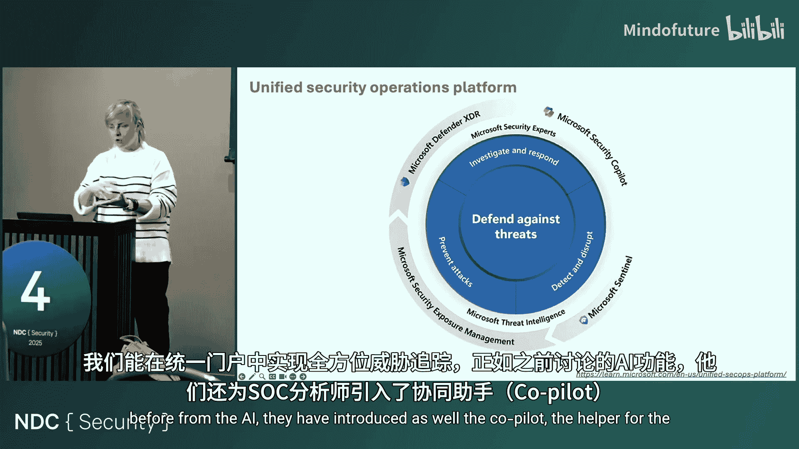
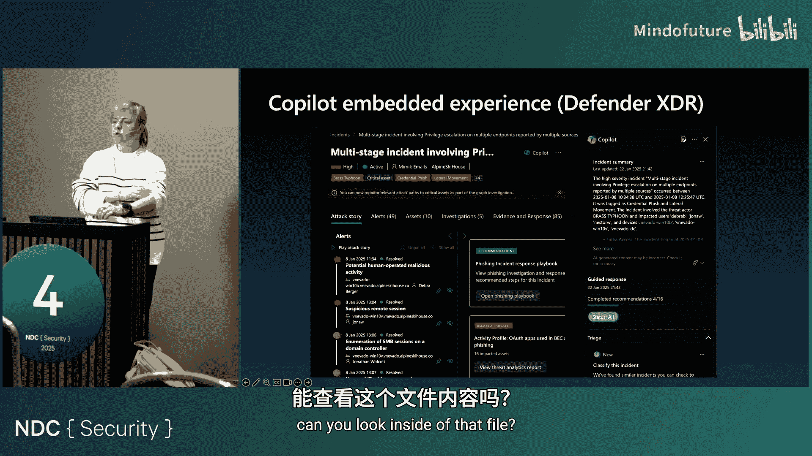
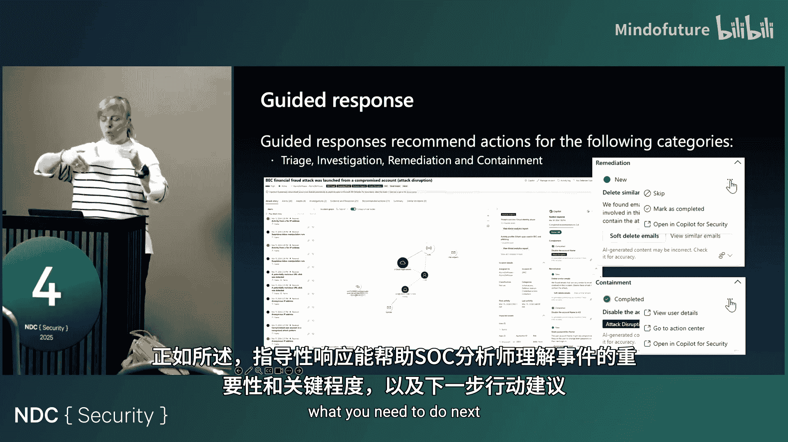
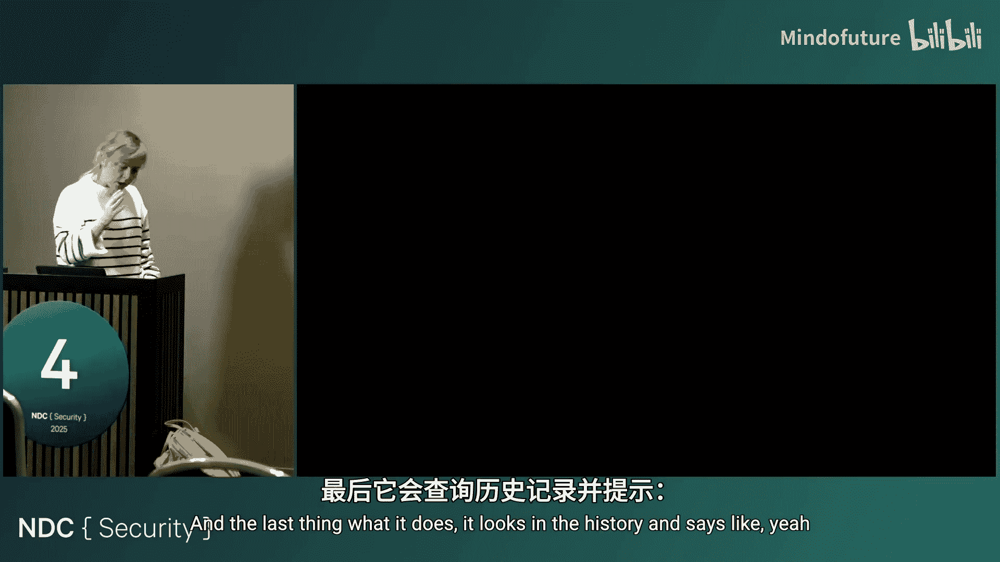
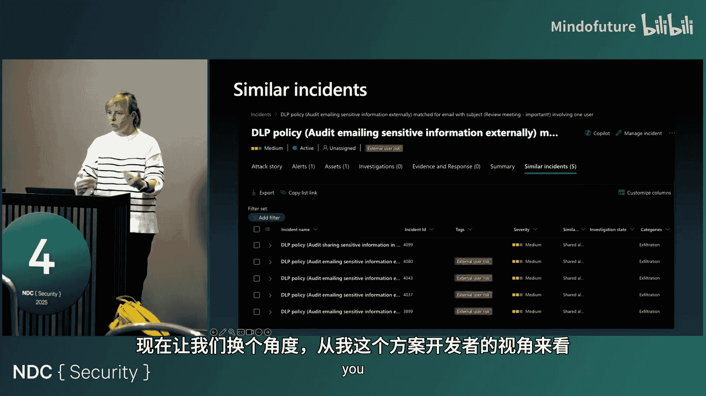
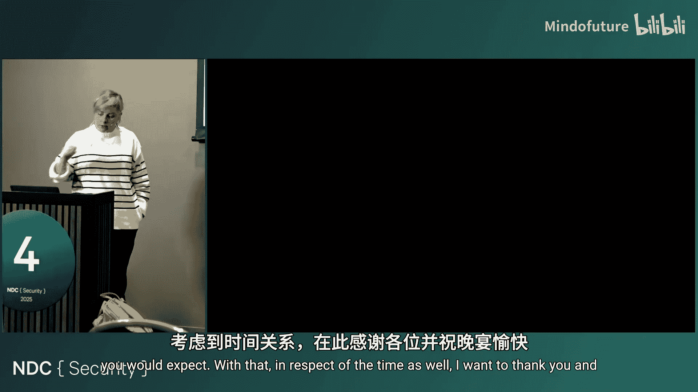

# NDC-Security-安全大会-2025-｜-AI工作流-｜-智能体-｜-网络安全-｜-Dapr框架-｜-开源工具-｜-LLM应用-｜-自动化安全-｜-黑客-p03-P03-AI-and-the-SOC-Engineer---The-Evolving-Human-Element-in-Security---Victoria--BV1ihgQzJE2h_p3-

Yeah， that's good。 But you have stayed all appreciation。

 And I will try to be on the positive note today， to be honest， because it's you。

 you got a lot of the things like in the two days。 And I guess there was a lot of deep dive technical stuff。

 And as well， a lot of like AI and maybe a bit of the scary stories。

 So I will try to be a more positive note。And I do appreciate for you for coming。

 My name is Victoria。 I do work for the Microsoft as a security architect， but the talk。

 even if I will use the some Microsoft technologies like the C M solution is just for the like。

 you know， for the comparison。 And because I know the best insight how it works， right。

 So I cannot comment on the Palo Alto， the snowflakes and and so on。

 But my goal today is like just to look how do we live in the world where AI is not anymore the hype and we have seen is like all the two days。

We got a lot of the AI conversations in the different dimensions。

 like starting from like how to secure AI， AI threat and and so on。 But at the end of the day。

 we already know that at least on the large organizations。 AI is not anymore the hype。

 we have the AI agents， like for the last two years。 and actually， to be honest。

 a lot of the things what we can be consider in the security as a something new。

 but actually it was built like2，3，4 years ago based on the machine learning。So today。

 I want to look into bit into the future like how we're gonna see the sock in， in the future。

 not for away， like five years， but because I don't believe it is possible to predict anything like for the next two。

 three years。 So let's take with the five years， right。And as I mentioned it， at the beginning。

 I want to make this talk a bit light。 I'm gonna deep dive on some technical parts。

 and let me know if you want to see the demos I will do， as well。But technically。

 I want to look from the perspective of the history to the future。

 It like how the security operations evolved over the time and what it meant for the sock engineers。

 for the sock analysts in the last 25 years。And then we're gonna have a bit of the look in the future。

 which I believe is already here。 So how the C M solutions。

 even if I can call it any more than C M solutions， We not。

 It's like the unified security operation platforms， how do they work and what。

How the AI has influenced them。And then on that example。

 we are going to look into one of the parts of the A because obviously。

 a lot of the AI functionality， what is incorporated in the so solutions is not。

Accessible for you as a consumer， as an so analyst。 It just gives you the results， right？

 But then we start to see like the copit things， right。

 So we got the Github Copit for the developers。 We got the copilos even for， I don't know。

 for the accounting， Microsoft has released。 the Copilot， like， obviously for everything。

 like from the Office 3，65。 and you name it。 And， of course， security didn't stay in the corner。

 They got their own Microsoft Copit for the security。 We have the aim to help the the So analyst。

And this is where we actually can look behind the curtains and see what is inside。 how it works。

 And that could give us as well， a bit of the inspiration and understanding what to expect from you as a so analyst。

 what you need to know today and what you need to learn and know tomorrow to succeed in， in the role。

I'm gonna do the spoiler alert。 I would say AI will not replace Socans， absolutely。

 That is that or you thinking that we gonna achieve like in next five years。

 fully automated security operations。No。No at least what I have seen in the conversations between the seesaws。

The management is not ready to give the machine to make the decision fully how to protect their environments。

 So that's not going to happen。But what we are going to see is actually more work for the so analysts。

And I would call it as a more fun work comparing maybe view of the previous stuff and。To understand。

 like， when I say more fun work， I want to look a bit of the evolution of the security operations。

 so。I will not ask how many of you are like in are the sock analyst， but for you。

 at least are you like in the so no。Okay， then I guess that history is going to be a bit interesting for you。

 because if you always wanted to understand what Ws guys are doing with that crazy C M solution behind the doors。

 that's what we we are going to talk about。So， technically。As you know。

 the security comparing with it depends with what we compared like if we we compare with the world age。

 everything is young， right？ But if we compare like even with the I T， the security young。

 like it's like 30 years or something。 And this is where the C M solutions or like the sock centers。

 Sock stands for the security operations center， right， So in 90s。

 that's where the security operations centers began to exist。

 And as always like with the I T or the security， it usually starts the life like in I would say。

In governmental or the defense organizations。 So back in 90s。

 there was developed like yearly network security monitoring。

 So it that solution was really all about like， you know， having the basic network monitoring。

 just checking the firewalls， if all is good。 like， you know。

 and some cost intrusion detection systems and that stuff。 very， very very， very basic。So primarily。

 it was really focusing on the collecting the logs and what's going on in the firewalls on the network level。

 And that meant that there was even no dedicated so analyst。 that roll didn't exist， right？

 So we have no a lot of the different security breed， right， But then the sock analyst。

 it was not a role。 It was like just I T admin， who was more like network admin。

 who was like looking for that。 And to be able successfully to do that。

 they just needed to know the network protocols， basic firewall configurations。

 And what are the logs。 And then they were looking for the p you。

 so for the potential intrusion and that stuff。嗯。In， in early 200s。

 that's where we started to see that the that concept was appreciated by the big enterprises and by the bank infrastructures。

 And we started to look into that as having as very protection mechanisms to like just to get the understanding what's going on。

 So in in that time spent we started to see the centralized security monitoring concept。 So。

 and the dedicated so solutions。 and this is where， you know， the C M concept came into the play。

And of course， this is where， like as a financial institutions。

 we want to to be ensured that the security is like good。 This is where we start to see 24，7 teams。

 And then this is where we started to get dedicated security an analysts。

And to be successful in natural， you just still need to know this concepts。 So going by the history。

 you need to remember that all skills are getting adding up。 It's not replacing each other。

 It's just like you need to know more more and over the time。 So additionally to this one。

 you need to understand like how the tool is operating。 And of course。

 some internal incident response per procedures like what to do if the incident happens。

 like if we find in the logs that it looks that someone is trying to scan our network and get inside。

 what should we do， we need to contact we need to look viral configurations we need to block and so。

 So that's what we do like or if someone has broken like got inside。

 So we are like where the process begins to be formalized。 And of course， already in the200s。

 we had the fantastic stuff called。Is。So technically， you。

 as an soc analyst is you need to understand like and bit how the malware functions。

And it doesn't ask you to do the like， you know， the engineering court， like。Looking inside。

 but you need to understand the concept。But as we have the I T， as you see。

 we have all other things whats happening like in the in the digital world。It started like you。

 to take the speed。So even on early 2000s， we started to see like the integration。

 So we started to pull more logs from other security solutions like not only the ED S。

 This is where the D LP concept came into the plate like data leakage prevention。 So technically。

 the team started to look as well。 like if someone is trying to steal exfiltrate the data。

And in the mid， I would say like， yeah， that was the time on 2005。

 the compliance came into the play and they said， like， hey， now you have the information。

 security management standard， which you must follow。And the fun fact， in the same year。

 the partnerner came up the first quarant for the C M solutions。 Its like。

 is it the Qador from the IBM or what's， what's the best in the breed in the C M world。So。

Technically， that means that you the sock analyst role started to change。

 They started to become as well the tiers。 So the way how the security operations center works。

 we have several layers like the tier 1， tier 2， tier 3， not to deep dive， but in short。

 it think about like on the tier 1 there maybe the junior sock analysts who are just looking all the incidents coming in and doing deter charging Its like。

 oh， it's false positive or its real case and needs to have the investigation。

 we can give it up to the next year。 So this approach started to to come。 And to be honest。

 like if you， if you look from that perspective。嗯。Again， the， in the skills perspective now the。Talk。

Analyst should know a bit more， right， So technically。

 we need to understand as well a bit of the or have the regular regular knowledge， too。

And that's where the fun thing begins。 Actually， the period from the 2007 to the 2014 is considered as a golden age for the for the C M solutions。

 because or for the sock evolution， because this is where， like I mentioned in the previous。

 early in 2007 somewhere the LP came in then。By that time。

 we also got like here in 2010 and going on onward， we got our advanced。sorry。

 advance persisting threatts coming up， right， So technically， during that period。

 I think during like 2010 and。To the 2011 A P T type of the attacks， like the targeted attacks。

 rise it up like almost under 81%。So now this is where like smaller， larger。

 medium size businesses start to realize we I need to have the socks， right， so。

And this is where as well， the men managed security service providers came into the play。So maybe in。

 in your case， you even don't have in your company Sock team。 It's outsourced。And the， the company。

 who is doing like all that work for you， We are called the managed security service providers。

 And this is where Ray started to。And had to provide such services。 So technically。

 we started to give you so as a service。 So we were just collecting from your logs and using their own skills of just doing all thetri and taking care。

 So's say， right， so。As well， like thiss were。The first signs of the so came in。

 If you heard about reappriation， I'm trying to avoid a lot of the operationsations because I don't want to get you sleepy。

But technically， the so is security orchestration， Auto automation response。

So it's all about as well。 how do you automatically respond in some events， like if it an incident。

 Like， for example， if you have detected the viruss， which infected the computer like sorry。

 not the viruss like， but yeahep。The phishing attack is happening as an example， right。

 and you want to contain the machine。 You can automate that process or like block the user automatically。

 right。 So that is as a concept。 So that's where it started like， you know， to evolve。

 And that meant as well for you as a so engineer or the analyst。

 you need to start to be a bit more advanced and you need already to look into the forensic investigation。

 because now we are talking about the advanced attacks。 And as well， like if you want to be on。

On the edge， like over working with the next generation security operation centers and get into the concept of Sar。

 you need to have a scripting skills。 like how do you write an automate。嗯。

And if that would not be enough， like since 2015， somewhere around that。

 its like it's the date we the。C M solution vendors。 we see。

 But it became like a lot of the logs coming。 A lot of the information is coming in， right？

 And now we suddenly have the cloud in environments like the Amazon， Asia， Google。

 they started to creep in。 And then as well， like you want to look for the security there as well。

 So technically， theyre coming a lot of the signals。

And C M vendors we understood that so till until this momentum， it was all a lot of like， you know。

 reactive approach。 So there is an incident， let's work。 when we introduced the soar。

 we started around that sorry， around 2014，15， there was as well introduction of productive hunting。

 It's like， let's look and start proactively hunting for the potential intrusions。

 like if there are something， right， So this is where we started to get the sore and everything it becomes more proactive approach。

On the top of that。Here。Started like， like I said， theres begun a bit of the alert fatigue。

 which means like there are a lot of the things are coming in and the rule based。

Surarch is not working anymore like investigation where usually like rule based。

 And that's there was introduced as well。 U Eba， which stands for the user behavior analytics。

 So technically， as we look。What it means， it means like。

The Sock Security Op center with a V C M solution like Qar。 I don't know。 you name it like plan。

 We start to look with solutions。 we start to look on the user behavior or the entity behavior。

 And if it causes anly， that means that something wrong with that user。

 and it may potentially be compromised， right， So this is like quite like explanation of the U。And。

 of course， like， we got the cloud and we got the your own device stuff as well。That meant。

 that meant that we need to monitor as well。 like the employees。

 private computers collect all the signals there in the cloud environment。

 there was a lot of other security solutions introduced in the parallel， like cloud security brokers。

 which means technically that like venue。See that your work computer and you want to to go to the Onerive or to go to any social network。

 Like， let's say the Facebook or YouTube， the CaS cloud So the caS cloud access security broker is looking on on ws all cloud solutions。

 Are they safe for you。 Are you coming there is's like and and so on right， So technically。

 it monitors the shadow I T， What's called。And， and， of course。

 when you started to put the workloads in the cloud， you need to protect them。

 And this is where the cloud security posture management came in。 Cloud workload protection came in。

 and you need to collect all signals。 So all of those signals are coming there。

 What it means for the socon。It's not enough that you need to know networking， now identity。

 now you need to be good at de scripting。 but apparently。

 you need to understand what the Azure or the Amazon is。How it works， right？

 So as you can see over the time， it's like the skill。

 the skills are like evolving and you and the so analyst should become more， more versatile。 And。

 of course， that means that actually。In the Sock teams。

 what we started to have dedicated S Ms or the subject matter experts， right。

 So the one sock analyst is quite good。 For example， in the cloud environments。

 another is quite good on others。And here we are。 We are today here。 And that means like。Right now。

 we have a pretty advanced socks socks or the security operations and pretty advanced E M solutions。

 which are actually like powered by the I would start carefully by saying the machine learning。

 And then in later years， like in the last two three years， as well。

 We have the artificial intelligence， We have the AI stuff。Long story short。

 that means that now there are even more skills required。For， for the so analyst， it may sound like。

 oh， AI is gonna make our life easier。 Yes， but at the same time。

 you need to get a bit of the understanding of the AI as well， how it works。

So if we look on the one of the C M solution。And try to calculate how much the machine learning or the AI is incorporated。

 Then we can check it， just。Each area of the security operation center。 So if we。

 if you look from the threat detection and analysis， we're gonna see that， as I already mentioned。

 So the C M solutions like the sentinel or like for example。

 from the Pao Alto solutions against snowflakes or the spanks。

 So we do the threat detections and may are powered by like the machine learning algorithms which are checking like if there are the some anlies。

EIn the behavior， that's one thing。And then as well， web， which I already mentioned。

 And when the automated response。So technically， wa， what is happening if we detect real threat。

 This is， as well is powered by the AI， so。Let me give the example。 like。

 if you are familiar with the defender XDR system。It has what is called the threat disruption。

 So what it means like X thereR platform identifies that one of the workstations。

 there is a user and potentially that user has been compromised。

 and it sends all who signals and visit attack disruption system。

 It just deactivates the user in active directory， and the user like needs to go like to IT fix the issues and and so on for the investigation。

 and it happens automatically。And it's powered by the AI。And， of course。

 I already mentioned the security orchestration automation response。 At the beginning。

 it was a lot like a bit of， I would say， if I may call it a bit of the manual。

 But now these capabilities are as well powered by the AI。And， of course， like， okay。

 once we have identified the incident， how do we prioritize。Which is high， which is medium。

 which is low。And that is what the Socon noise may should do as a decision based on their knowledge。

 They like the， the business context and all the risk signals what we got now， you can do it again。

 Most of the C M solutions we do provide with based on the AI。The threat hunting。

 that area has been touched as well。 like we with the I， like， for example。In the Sinel， I had。

The case where like the company was even having the data scientists in the security Op center。

 what they were doing We using the notebooks like Upiter notebooks and they were writing the advance for hunting procedures。

 just based on their business context like what is relevant， like for business， like， for example。

 if someone is trying to steal the information like on that stuff。 And again。

 this is where like the AI could be utilized in today's world。And， of course， like in the。

 in the last two years， you already have seen the， the copis a lot of real stock。 right。

 so that's where we're gonna talk about a bit more in the details。 And technically。

 the security copit integrations came。 And there are other helpers， like even。If you。

 if you look on the C M solution， it even can come now back to you and say， like， oh。

 I have identified how your so works。 Security operation center works， how the analysts are working。

 And by the， by the way， in the similar size of the company and in similar size of the business they do these things better。

 Maybe you need to improve it in your security operation center as well。

 to get to be able to get more efficient to work for the analyst。So technically， we type up for。

 the suggestions are coming。So how does it look in the practice， all of these things。

 what I mentioned， I I will take it in reality， based on， again， that's not the sales pitch。

 I just want to take it as an as an example， all of these type of the functionalities in the one to one or another extent。

 they exist in different products as I mentioned， like this plan the Sinel and so on。

 But all of views things are now existing in the thing。

 What is called the unified security operation platform。So not to make the things more confusing。嗯。

Even2， three years ago， we used to have like， yes， we have a C M solution like Sentinel。

 which is just collecting gold logs from the cloud， collecting like the logs from the infrastructure。

And then we got the XDR solutions， which were focusing like on the things of the end user of Fi3 65 and that stuff。

 right？ but over the time， it was like in the Microsoft case， it was clear that the So analyst we。

 when they need to investigate the case。 like， for example。

 the user was compromised through the phishing email。Usually。

 you would go and hunt it in the XDR platform， like in the XDR portal。 But apparently。

 that user had a right in the Asiazure， like in the cloud。And to look if there is something there。

 you need to go back to the Sinel to the C M solution， just because the old like， you know。

 the investigation was happening there。 So they were spending a lot of the time in。

 in between the portals。 And that is a common problem across the industry。

There a lot of the security tools。 there' is no single pane of the glass。 And that's where like。

 you know， if you even take another organization or another security vendors。

 they kind of sell similar things like X DR 1， the C M solution， another。

And the security operations centers will go into the future and the vendors will go in the same future of unifying these。

So just to explain， and that is was introduced by the Microsoft like last year with the approach that there is no going to be the like there's gonna be still the separate Sinel。

 There's gonna be still the defender is there are。 But the so analysts as well have the opportunity to use and utilizeilize everything under the one portal like security Microsoft do co what's not in the one portal。

 We can hunt everything in one place on the top of that。As similarly as like。

 if I may do this comparison， like。With all functionality， what we looked before from the AI。

 they have introduced as well the Copilot， the helper for the so analyst， because obviously。

 you have a lot of the a lot of the challenges， like you， as you already know notice it， the bold。

Skills， requirements。 And as well as like you have plenty of the tables。

 I think Robertum on his previous talk when he was looking it a bit from the AI researcher perspective。

 he mentioned a plenty of the schemas。 So technically， as a so analystly。

 you need to know the product like it could be the plank or it could be like the Microsoft Sentinel or XDR and ways toward the information like in the tables or the schemas。

 And you need to know all of we schemas to be able to write the queries。So you， that's another step。

 you need to know， like in Microsoft case， in the Sinel or ex they already need to know cuto query language。

 which is like sQel style where you are like writing the queries towards with schemas。

And that could be quite。Hard， sometimes， especially for the junior sock analyst coming in， right？

 And as well， how to priorize。 So the so analysts need to know all of those stuff。

 And the copi was introduced to help with that stuff。 The way how it works actually。

 it comes with the several capabilities。 We're gonna talk about them in a minute。 But technically。

 it works as like if you're using the charge GP T。I guess you all of you using like Cha GPT perplexity。

 any other favorite chatbot， right？ So you know， there's the pump engineering。

 So the users like submitting the prompt the Cha GPT stuff happening behind the scenes like' just making jokeg。

 but technically the open AI model is behind the scenes。

 it processes the the the prompt and gives the result。 if we go a bit more in technical like details。

 So so analyst can do these prompting from either like from the dedicated website or dedicated interface for the Microsoft Securitypi or can come from the unified platform or through the X DR or the Sinel。

And technically， it can write like and say， hey， can you show me。

All incidents related to this entity， like it could be the user I D。

 or can you write the cuousto query language script for me to select。

Top 10 incidents I'm just making up。 and it converts。 So it technically receives the prompt。

 Then it goes and collects all information like from the C M social， like in this case。

 from the Sinel from X Microsoft X DR threatret intelligence and the in tune in tune is for the device management。

 So it collects from the information from all of the available log resources goes。

 and then sends that information like to large language models and then gets the response。

And as well， then if there are some plugins enabled because what you can do。

 you can configure like the plugins view the service now， for example。

 create the ticket in the service now， it， it utilizes plugins for the post processing。

 And then it sends the response as well， like to back to the security product。

 So back to your interface。 So that is like quickly， how it works。And technically， like， if you。

 if you look in inside of the one case， if you as a so analyst， you open quite。

I would say quite comprehensive incident， which is like the multi multistage incident。

 You can see there are like a lot of the alerts which have been collected and made as an incident。

 and like there is a lot going on， especially for the juniors。 so analyst。

 then what copilt as well can do besides of just answering your questions and helping you with the K Q L。

 out of the box come up to you like， you know， let me provide you the incident summary。

 explainplain you in the human language。 What。Its happening here。

 What the heck is happening on the left place， like， you know。嗯。So technically。

 it gives like the summary as explains。 And as well， it gives you the guided response。

 So that's where we're gonna spend a bit of the today's time。 What the guided response means。

 it also gives you the offer what to do next。And then。Okay， you looked here is like， yeah。

 the suspicious remote session。 If you see there is， for example。

 where has been detected a suspicious Powerhell file， you even can go to the coppit and say， like。

 hey， can you do like， can you look inside of that file。 What's that file is doing。

And this is just as a standalone experience。 If we will have a time， I will， as well。

 if you're interested， I can show it later in the live。 But technically。

 you can just go as you can see and ask the same things like， hey。

 how can you help similar experience What you have done in the private life We all the church U B T and that stuff。

So technically， the copilot primary cases are to give you the summary in the human readable way。

 do the reverse engineering of the files if you get interested to understand like how how like that script was running what exactly the steps it did。

 which is fantastic for the juniors who are not good at the scripting and they just seem like there was done and now you need to understand how it even explains what happened。

 and you as well can ask like I already mentioned it can as well write the K QL or the queries for you if you need to get more information and it does the impact analysis。

 and when it looks provides you the guided response。So technically。

 that's where we're gonna look inside。嗯。All over the place， like if you look on the coppilot。

 as I already mentioned， it's powered by the。The open air model。The two models are in the place。

 The one， the open air。 another one is a bit more Microsoft。 like。

 so it's Microsoft custom tailored to the security。 The first one is， again。

 as well tailored to the security。But technically， it was using like the the version number 4。

The guide that responds is a completely different story。 It's a bit。So technically， as I mentioned。

 what the guide that respond gives for the so analyst， It helps you to try。

 like to understand how important or how critical the event is。 and like。

 or what you need to do next。 it looks helps you with the investigation， remediation and containment。

How does it look in in life like， So technically， like I said， it helps。 It starts with the proposal。

 How do you。To how do you trash。 like on the right side， it's immediately gonna say， like， hey。

 you know， first of all， you need to classify the incident。

 And based on the things what I have seen before， a similar incident， it may look that this。

 this one is not the false positive。 It's it's positive。 So， first of all， may make a this decision。

 Is it like the false positive or not or it's true positive。

If I will not deep dive in the complexity world of。The so corporations， there is one problem like。

 it's always clear how to define the tub positive and the false positive。 Benning positive。

 That means like it's， yeah， it happened， but it's informational， right。

And every time when the socon makes the say decision， this guided response actually learns from that。

 And what we have seen before that。that makes sometimes the troubles to do the suggestions because there's no good standard。

 like when the people are putting the banning positive， right So so technically。

 this is what the guided response gives you。 And then it gives you as well。

 the containment in remediations like， hey， what should you do to fix the issue。 Like in this case。

 hes like suggesting that you need to isolate the device because it's obviously it's infected， right。

 And you can do it like by just clicking the button。And as well， like you can send the。

 you should send the email to the user。That if you need to to get more。

 I think it was on the tri traaging process。 like， yes， sorry， on the tra process。

 it suggests you to contact the user， the fun fact。P today， you even don't need to write email。

 You can just copy paste。 It writes the email for you。And if you， if。

 if you don't want to contact them by the email， you can contact like， by the teams and that stuff。

So， yeah， once we have done deter th， the guided response helped you as well， like。To contain。

And the last thing， what it does， it looks in the history and says like， yeah。

 I looked a new incident。 And by， by the way， in our history for the last three months。

 I think it was like 30 days， sorry it's180 days。 So it's six months right。

 half year in the health of a year， we have seen maybe we type of the incident as well。

Similar incident。 So that brings the food for for you as a soconist for the collective hunting。

 So there was a similar incident。

嗯。And to be honest， this is a quite huge helper for the Soconist。So technically。

 once you start to work with that， it becomes like as as you， as your copit， as like， you know。

 Ask the developers once they started to use the Gi Copit， would we foresee future without that one。

 I doubt， right？ So it helps you。But now let's look from the perspective of like， you know， me。

 who's developing that solution for you。 Its like， how it's developed。 There are some challenges。

So， technically。嗯。When you create these guided responses， there are the problem。

 like the complexity of the security incident。 There are the 10 of the thousand rules like detection rules coming all the time。

 and there are like， you know， these incidents we can very significantly in the complexity。

 And it's quite hard to make the accurate prediction。 Its like or give you even accurate guidance。

 how to make how to work through that。 And there is expectancy。

 But we guide or the coppit who is giving you the guided steps in the tri in containment is going to be quite precise and precise。

 Sorry， precise。 and as well gives you。The good。As well。

 it's gonna catch up the all re relevant threat。 It's not so big deal when you have just false positive。

 but it's a big deal that apparently， it marks as a false positive， but it was a real threatt， right。

 So you don't want to have it from the guy that responds。And another thing。

 think about all of those products like or all of your current environment in your company。

 How many logs we are producing per day。And now it multiplied like， you know。

 So then the question is like， how the guided response is going to deal with that。

 Because there are thousands of or the millions of the incidents or like the signals are coming in。

And， and the， the last is adaptability to the sock preference because every sock operates in different way。

 And as well on the top， they have their business context。

 So it's not easy to ask to create the good guided response。And， of course。

 it needs to continuously to learn because the fts are not static Every day。

 the attackers may find a new way like how to try to break him。

And that's where the Co Copilot guide the responsese team when we started to develop A， of course。

 looked on the AI。 And I said， like， good， we need to look into how we can utilize all the L O Ms。

 obviously， right， And you know what we gonna do this time。

 We actually not only try to build that architecture and use it in the copilot。

 but we are going to share it。So Microsoft has released this in depth paper。

 which details all the architecture for the few reasons。So We， first of all。

 did not release only this deep dive paper。 If you're a data scientist， I suggested to look into。

 it's， it's fantastic read， to be honest。But they as well， release the data set。

It's a real dataset which contains around like 33 entity types。 So entity means user， computer。

 IP P and other things， right， but it contains around like one point。

 almost2 millions of the alert and around millions of the unnotated incidents。

 We have all the chargeage labels。 Obviously， it's like obviously and all of these dataset is a real wall dataset。

 So。It was released with the aim for the two reasons。 The one is to spark the conversation。

 like how do， how do you build the guide that responds for， for the security， right。

 for the security analyst。 another thing is this one for anyone who wants to play and try to build their own。

 like， you know， we type of the AI agents， for example， right？ So。

The data is available on the Kegggle， and it's not updated。 So it's aesthetic static， right， So。

 but it's， it's a， it's a good。嗯呃。It's a good data set for。

Researchers to study the real world security incidents。So technically， how it looks inside。

I promise not to go a deep dive into the AI science because obviously， it's not the。

 the main point here。 But technically， I will try really to explain it as for the five years old person。

Technically， that。Deep dive paper explains the free pipelines。

 The guided response is having like the， the three pipelines。 The first one which runs every week。

 So it's running weekly， It trains the grade and the action recommendation models by using all the so telemetry。

 the historical so telemetry， to provide all tailed responses。 So。

This pipeline isn't the charge to look into the Asia data。They like。Collect all， all。

 all the the log， not the logs， but the incidents， then do all。I would say like pre pre。

 prepro and like， you know， the mass， I would call it like this。And prepare like， you know。

 to train the two models， right， on the outcome， you get the the two models。And then。

The second one is the inference pipeline。 This one is operating every 15 minutes。

 and this pipeline isn't the charge for the like。For action recommendations。

 for the incoming incidents。 And additionally， this one is in the charge as well to provide what you saw as a similar incident。

 right， so。And the last， but not this one， the embedding pipeline。

 That one is running every 30 minutes。 And what it does。

 it goes historically to the data until the 180 days of all of the incident embeddings。

 which were generated previously， right。 and it allows them again。

 to find all the similar recommendations and all of all of the stuff。Technically。

 this solution is deployed in each region。 And if this one， when you ask from the data perspective。

 it looks on your so。 That's what allows to build like really customized recommendations in your case。

 So technically， it learns from your。So environment from your unified security operation platform。

 or I would call it sentin on XDR。 if you're interested like from the deployment infrastructure infrastructure。

 it's it is leveraging the synapse based bypar cluster。 as I mentioned already。

 it's built in each geographical region for the privacy reasons。And then like as I mentioned。

 there is Asia data lake databases。Synapse is a beckend。嗯。

They try to utilize as much as possible bypar， like just not like， you know， go。

 go less into the Python stuff。 And there's the problem is we the synapse But we there's now out of the box。

 good monitoring for the model monitoring and the versioning。

 So we have created the separate infrastructure。 that paper goes deep dive and it addresses as well。

 the challenges what we have seen， especially with the biggest data sets。

 and it explains on specifically on that train pipeline how we。Overcome that one。 So as I mentioned。

 the that paper is like the the aim to spark these conversations like and maybe inspire others to build more of these guided response agents。

 I would call it。So， okay。I'm the so analyst。 I'm not the data I stuffs like， O。Gm makes sense。 good。

 but is it effective。At the end of the day， that is quite of the question。嗯。

Microsoft has done the studies。 Let me just skip all that stuff。 technically。

 we did the two researchers。 This is one specifically tailored for the So analyst。 But in。

 in the same place where the previous paper is published at act Act there is the second paper where they have done the studies towards the I T admins。

It's like how much re compile pilot it is useful for the I D， I T admins。

 like who are working with the identity or the ins。

 like we are just in enter I D identity provider world or the ins。And surprisingly， not surprisingly。

 very all similar。Re。So the way how we did， we collected the two groups。

 The one is like the advanced guys， the security professionals and the security noises。

 And that second research， we did the same。 the fun fact we actually how we。

Collected them in I increases the freelancing platform at work。

 So if you want to participate in such research， Up work is a place to go。But in overall。

 there are obviously the positive answers because who doesn't want to have the helper who understands you。

 right。But for me， what I find quite interesting is it this bigger helper for the security noiseis。

 So for the security analyst are like two， I think， two year or less experience and the same。

 and the same result was actually for the I T admins。 it was more effective for them。

 and it was more effective in the broader scope。 It's like when you try to ask more concrete stuff like just do this。

 Yeah， it helped。 But if you， for for example， you。

 you need to exercise those some investigation where you don't know where to start， it。

 it showed the more effective results。So technically。

 it gives kind of the understanding that Wooco pilots were coming to stay。 And the next step is like。

 okay， we need to learn how to。Coexist and maybe actually not coexist， but use it to our benefit。

And there are the three ways。 I would say the one is become quite efficient in them。

The second is become very good at them in terms of even building as。

 because with co pilots like Wiismmon is supporting the plugins and the connectors。

 which means that you can connect more sources， or you even can via the plugins or like in this case。

This is， by the way， the suggestion from the M S SP。 Remember at the at the history at the beginning。

 I mentioned that there are the companies who are doing the security operation centers for you。

And they were usuallyly adopters。 And they already like， now， like。6，7。

8 months of were using comms for customers。 And that's what they have learned。First of all。

 they got pretty similar results in terms of the effectiveness in their sock team。

 But then we learned as well as like to， to， to be able to utilize it at at full efficiency。

 the we are the steps。 But for me， as a sock analyst， Yeah， this is。

This lays out the the path where I need to go， right？

 So another thing is if you want to become even more advanced。

 you as well can write the prompt books。 So the security copil that comes as a weve like weve templates of the some prompt。

But to you as well can create your own poem books。 So if you want to。Evolve as a socon in your role。

 you technically， that means it's like it's not only about the pump engineering。

 but as well getting quite good in writing the， the po books and sharing and then writing the plugins。

嗯。Of course， it may sound a bit scary again。 Like， you know， there's， it sounds that the AI just。

 you know， came to replace us。 That's not a thing。 And then the second fear is。

 how do I learn everything right now。 And on the top of the evolution， what I mentioned。😰。

I didn't mention another thing is like， it's not only the cloud environments。

 what are what are now in the Sock teams in the sock center。 Sorry。

 what where the sock analyst needs to have the expertise。 but there are as well the O T。

The manufacturers， right？ So the I T and I T logs， there is the synergy happening like there is a separate deep dive topic。

 but long story short， the security operations centers start to become in the charge of overseeing the security of the manufacturing lines。

 We are collecting all those logs as well from there because theres automation happening there。

 So if we look now from all of these perspective， like。Oh。

 that means that I would say there are plenty of the fears。 The one fear for you is like。

 I need to learn a lot。Another fear for you is like， why should I learn。

 Because the company may say there are so much advanced AI。 I can just hire the junior sock analyst。

 Am I going to use the copilot。And we'll be cool， I mean。W， yeah， but。That's not the case。

 because if you look on the current challenges。 And when I say the current challenges， I mean。

2025 challenges which are coming already from 2024， is that。It's still。

 there is a still shortage of the experts。That's， that's a huge problem。 Theres a steel problem。

 with all of these advanced things， what we look today。

 There is a steel problem with all of these alert fatigue。And then。

I mentioned the security orchestration automation response。 And if you remember。

 it was like at least 10 years in the play。 But to be honest Gartner at some point said that Soar came and Sor died because theres some other problems with the automation。

Due to the complexity of the environment， complexity of the signals and， and so on。As a result。

 the teams or the sock teams with whom I worked or with the customers with whom I worked。

You it's still the problem。 There is still limited automation。

 People are so the so teams were still not automating a lot of the stuff， just even not using the AI。

 but the classical playbooks which they have， we don't automate。 and， of course。

 like the compliance burden。 I mean， not to go far away like we have GDPs， everyone knows。

 but therefore for the financial institutions this year 17 January， if you do since 17 January。

 if you do operate as a financial institution in European， now。

 apparently you must be compliant with the Dora。How many of you have heard the Dora。

We can speak about that。 And then as well， there is a NC2 or N 2 and other standards， right。

 And that is like there is a compliance burden goes on， on the Sock teams as well。

And another problem is like， we already looked on the breadth of of the skills。

And that threats were not going away。 We are just keeping evolving because not only us who are we are very smart to use the AI。

 but the threat actors are using the AI。 And again， in during these two days。 Obviously， you。

 you heard a lot how you can abuse the AI itself from the security perspective， right？

 So there the threats are evolving。But I like to say that the hard times create the new opportunities。

 right， So technically。First of all， you will not stay without the job At the beginning， Like I said。

 it's going to be a bit more motivational。 It's just to show how many opportunities there are。

 And you saw even on the Copilot case on the architecture。 and as well， like there are plenty of。

Depenency on the sock analyst， even to make the AI more efficient。

 there should be the sock analyst in the first place。

 And the smart ones should who are providing increased guidelines as well for the the coppis。

 because every time when you are answering convey recommendations。As you。

 as I showed on that architecture every time when you say like on， when it says。

 can you try it and you say， yes， it's true。Positive， it learns from that。

 That means that AI is dependent on the socon and the socon are dependent on AI。

 So if you are stepping into this field， it does mean that you need to be。Expert in everything。

You can be highly skilled in the one or the two areas。 But if I would go and say， like。

 if you start from today， pick the two skills。One of them， AI and the pump engineering mastery。

 that is must have。 right， So I think like if we， if we look back on the industrial revolutionvol revolution。

 right， and the automation came in the manufacturing and the people started just to learn how these pipelines are are working。

 right， we started to get more and more engineers who need to fix them and so on。

 the same is happening here。 We the AI in the security field we just need to live alongside and actually use to our advance and coming into the risk market。

It's quite good to know how to efficiently utilize the prompt。

 And even later to become as an expert in AI， to be able proactively to write the pro books for the juniors or write the plugins and so on。

The cloud expertise， it helps a lot， because。HowOver the time。

 you can see that on premise environment is shrinking。 We just go in the cloud。 We go into the Asia。

 We go to the Amazon。 So knowing the concept of the cloud security and knowing one of the clouds very well helps a lot。

But the the most important is to have is adaptability to the all security diversity。So technically。

 stay agile all the time。 learn the things like on the conferences or just do。嗯。

All in the research or like。Utilize the same AI for the upskilling。 again， like it helps a lot。So。

As I mentioned at the beginning， even the sea level or the seesaws。

 the chief information security officers， they said like， no， there is not going be next 5，10 years。

 the time when I will fully outsource the decision。

To my C M solution or the unified security operation platform。

They're still going to be the human who will make the decisions， right， And then again。

 for the sock analysts， or I would say the future is the brighter。The brighter than you would expect。

With that in respect of the time as well， I want to thank you and。

I wish you the fantastic evening。 And thank you for me。

