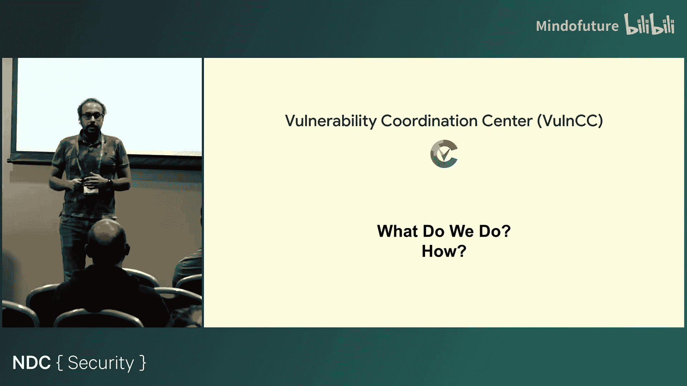
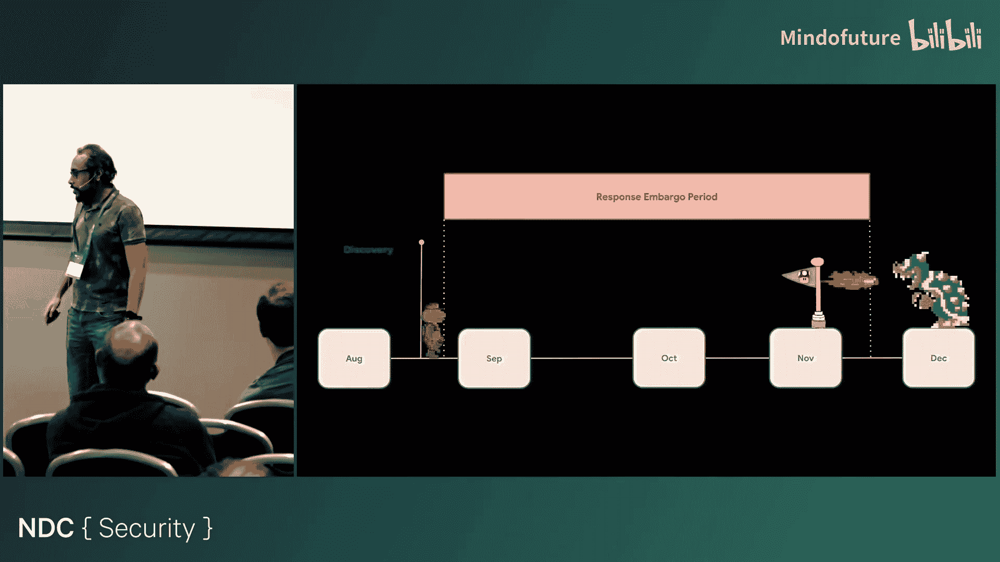
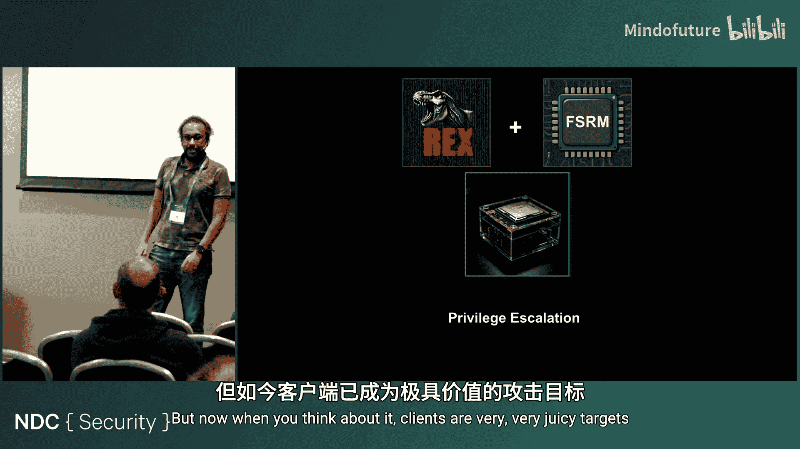
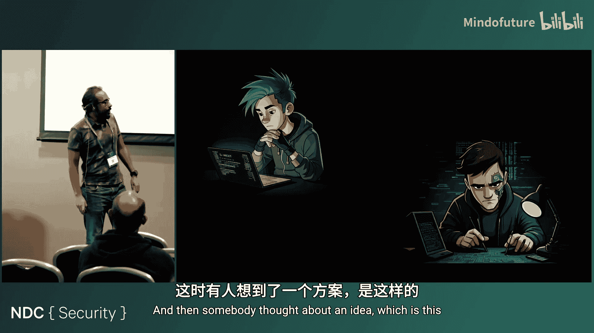
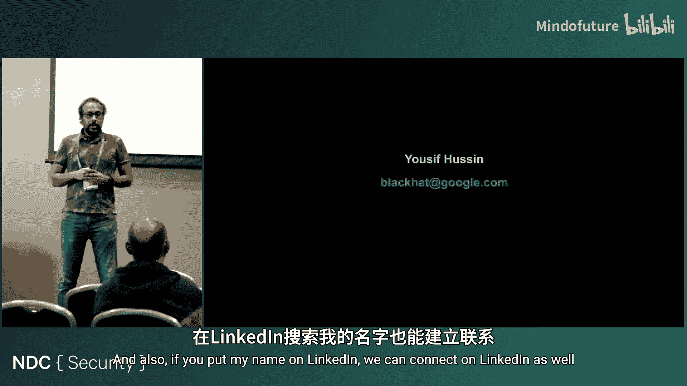

# NDC-Security-安全大会-2025-｜-AI工作流-｜-智能体-｜-网络安全-｜-Dapr框架-｜-开源工具-｜-LLM应用-｜-自动化安全-｜-黑客-p04-P04-Inside-Googles-Discovery-and-Remediation-of-a-Critical-CPU-Vulnerability---Y--BV1ihgQzJE2h_p4-

Alright， I understand the this is the first talk in the morning。 So I'll。

 I'll do the best I can to make it a little interesting at the same time， light enough。嗯。

And maybe instead of it like being just me speaking。

 I'll try to maybe be a little bit more collaborative with you。 And then maybe you can help me out。

 If I say something absolutely stupid， please correct me。呃。I do that sometimes。 And also。

 I did speak at conferences before， but generally， there've been more like security conferences。

 I think this is the first time。I get to involved in a conference that's more development heavy。

 And based on the discussions of how to some of the folks yesterday。

 like a lot of smart people are on here。 So I really like this opportunity to basically learn from others。

But okay， so I can start。And first of all， my name is Yu Hassein。 I'm a security engineer at Google。

And part of a team called the。呃。Enterprise infrastructure protection team。

But the talk that I'm gonna do now is going be related to a team that I left recently。

It's a previous role。The team I'm part of right now is enterprise Infrastructure Prote team is the team that's responsible for building security controls for Google's infrastructure。

And there is a bit of focus on securing the use of clouds。By Google。 So when Google uses cloud。

 that includes like， not just Google Cloud， Google Cloud， Azure， A W S。

So we're the team that's responsible for making sure it's done in a safe manner and the infrastructure is pretty much secure。

 So we want to enforce all security policies so that it's secure by default。Now， in my previous role。

I was in a team called the Vulnerability Coordination Center。And this is a fairly new team at Google。

 And I。Business experience， it's generally in the industry。 It's a bit of a new thing。

So I understand that it's vulnerability management。

 And pretty much all companies or large companies have like a team or an individual that does vulnerability management。

But what we do here is a little bit different。What we do here is there is a team that specializes in addressing critical vulnerabilities。

Now what that means is sometimes you have a vulnerability that is so critical and fixing it and remedia it across a company like Google is a lot of work。

And it gets really stressful。It gets so difficult on a technical side。

 but also on the non technical side。 And you want somebody who knows how to manage this orchestra castte it end to end。

And this is basically what the relations standard teams does。 It's one of the core roles。

 I think it's the most important part of the role。 I was part of that team， and。

There was a time I was leading an engagement or a response to a vulnerability myself。

 And this is the one I'm actually going to go through during the talk。

The other thing I wantna mention， I'm also part of the team that manages the Black balance program for Google。

So when you submit a report like find vulnerability to Google， I would ret。

 reproduce it and then work with the developers on how to fix it。

Another part of my role that I really enjoy is development of security tooling。So。

 you could say I'm a security engineer slash software developer。Or software engineer。

 because I do a lot of development of tools for Google。 And because we do it for Google。

 we have to do it at scale。 So I have to think like a software engineer。

 And that's really different from like a security engineer who is just writing scripts to do security stuff。

Oh。An example of that I did develop an automation for Google that basically ingest public information about vulnerabilities that are known to the in the wild or are outside of Google and people know about it and then automatically correlate that data with intelligence data that correspond to that vulnerability。

 And if there is an exploit that's found in the wild or if it was identified that this particular vulnerability could be exploited or over the network over the Internet。

 things like that， it would my automation would automatically adjust。

The ticket for that particular vulnerability and get it to the developer so that they can fix it。

 And then it， the priority can adjust up and down based on the severity of the vulnerability。

So that's one of the things that I worked on myself。 and I let the development of。

One thing that is interesting between these two teams is the W Mountainty and Von Sii。

This one is internal， is called whoops。They you just say it's VRP publicly， VRP 1， C。

Is that VP team would reach all kinds of vulnerabilities。

And not all vulnerabilities need to be handled by oneCC。It's only the very interesting。

 complex stuff that gets escalated from here to there。And I'm part of two teams。

 I'm actually the only one that is part of both。 So sometimes I would be sitting here。

 And then I would try out the vulnerability and be like， oh， this is complex。

 We really need some help over there。 And then I would escalate it there。 And I would do the。

 I would do that work over there。and， and I did really enjoy the this kind of work。

 I like vulnerabilities， working with vulnerabilities， identifying them， exploitloing them。

 just finding ways to break stuff is something that I enjoy doing。😊，So。

Vulnerability coordination center。 I think I already talked about this。So。

How do we do remediation at scale at Google。So the vulnerability coordination Center is a team that knows the technical side of things。

 how do you fix this technically， how do you fix things technically。

 How do vulnerabilities get identified and fixed and reproduced。 But also at the same time。

 how do we manage an incident at large scale。To addition， a lot of companies。

You would have a team that does things like。Yeah， we got hacked。

 We want to do management for this incident。 We wantna analyze the malware， you know。

 like we got a phishing email or whatever all that kind of traditional stuff。

 And then we have a team that does incident management for that。 Now at Google。

 we do something a little bit more interesting for vulnerabilities。

 If our vulnerability is identified and it's critical even before we get hacked。

 we already declare this an incident。 and we manage it like an incident。 We already have a problem。

 There is a vulnerabability。 Some might find it。 and somebody might exploit it。

 somebody might hack us。 And as you probably agree it is a big deal。Like just a funny example。

 Like if there's a vulnerability and somebody found out how to shut down Google search， for example。

 this would be something that would go to vulner， the the vulnerability coordination center to lead。

And time is really important in things like that。So。

I wanted to build a little bit of context。Just so we're all on the same page。And。

I don't think a lot of this is going be foreign topics to you。

 but let just make sure that we're on track， first of all。

How many of you can actually look at bits like this and。Tell what this is。Just by looking at bits。

Like can you look at this and say， oh， this is a hello world program。Really， nobody can。Okay。Yeah。

 so as you'll probably know。Yeah， you would write code in C or compile the program。

 then all the way it goes all the way down to a set of bits that represent instructions for the machine to。

 to perform， right。And then as you know， there's a disassembler that you could use。

 basically can actually take a step back。Into what， into assembly， right， And， that's kind of like。

 yeah， everybody can read it。But it is probably the closest to the machine that a human can read。

So the first time I I。I was having a conversation with someone。And then I was like， well。

 looking at bits， that's difficult and stuff。 And then they were like， well。

 there's a this somewhere you can use。 It can actually get to this。 And I was like。Wow。😮，Nice。

 but that didn't help。I mean。How many of you read assembly there today。Oh， nice。s pretty impressive。

 okay。So I do a little bit of this the security wrong because before I used to do some reverse engineering for malware。

 And when you do reverse engineering for malware， a lot of times you get you stumble upon assembly a little bit。

But one of the things I did when I was working at a bank called GP Morganorgan Chase a few years back。

Is building a system that would automate the analysis of malware so that the security engine wouldn't have to read assembly code。

 So it makes it easy。 But anyway， So this is an instruction assembly。 And this one is pretty easy。

 Its move E X， E， B X is kind of like it kind of tells you that you're moving something from a place to another。

 And in the machine that like these boxes It called registers， right， And at the end of the day。

 what the computer does。 is's moving bits around between these registers。

 And then it does do some computation on them。So in the case of move。E A X， E， B， X。

 the move is the instruction itself。 But then you've got the operarans。

 which are the source and the destination。 And in this case。

 you're moving something from register called E， B， X to a register called E， A X。Okay。

 so that's simple。But then you've got an instruction that looks a little bit like this。move SB。

So this one doesn't have opera。But it is a moving instruction。

 You're still moving something from a source destination。 The only difference in this is that。

The operas are implicit。 So just by using this instruction。

 the the machine already knows moving from where to the where。 And then be before it， you've got rep。

 which is basically just repeating the instruction。

And this is the setup for the Zor and destination that I told you about the machine would do behind the scenes。

嗯嗯。Okay。So this rep that basically tells us the machine， hey。

 repeat this instruction is called the prefix。If you do it like this。

 the machine instruction would work just as expected。

 But what would happen if you give a machine instruction that looks like this rep， rep。

Would it break the machine， Would it cause an error， would it did anybody have any idea。嗯。

find better here。kind of， so， so。It wouldn't do anything。It would ignore it。

 like even if you do something like this。It would be like， okay， that's fine。 I don't care。

 I'm just gonna take the one rip。 I'm just gonna use up。So when we're talking about registers。

 you've got the opera end and the opera here E， B， X， for example， this represents a register。

 And this is 3 B， which basically means how many register we could have in a system of 32 B。Px 8。

Because with3 bit， you can address。It registers， right？But when in 64 B systems。

How do we address it with three bits。So turns out what happens is that。When they designed that。

 they were like， well， remember this prefix that we could ignore。 How about we don't ignore it。

 We could actually just borrow a bit from it。 And now we have 4 bits。

 And now we can address 16 registers in a 64 B system。 So the 64 B system is kind of like。

A hack in this case， like， it's not really 64 bit。But anyway。Now。

 another concept I want to cover quickly just to make sure that we're on the stand track is this。

E RMS S， FSR M， I think。When I came across like terminologies for different things and technologies。

 these are probably among the top ugliest names I've ever come across。

 And I always forget what they stand for。 But I'm gonna try A R M S。 I think it's extended enhanced。

Repeat， move store。And F SR M is fast short。呃。Repeat move。What these features are。

 These are features that are introduced in Intel CPU。And what they do is。

 they're basically a performance feature。Start with E R M S。

 It's basically a performance feature that basically makes some of the repeat move operations a little bit more efficient in the system。

The， the only issue with it is that when the operation involves a block of something like something is small。

 a little bit less than 2，56 B， then it wouldn't be worth the investment of using it because it has like some cycles of overhead have to do a few things before actually running the operation。

And that's what FSRM is for。It would give you that benefit of the performance feature。

In small blocks， for small blocks。The last concept I want to cover before I go to the response story is this。

 Does anybody know what this logo is。So let me tell you something。 This logo。

 Everybody in the room knows what it is。 But at the same time。

 everybody in the room doesn't know what it is。 You're gonna know what I mean by that later。

 But I'm gonna get back to this。 It's important。So a response story。 So what happens is at Google。

 we have security researchers。 What they do all day is trying to identify interesting vulnerabilities。

 And sometimes they identify vulnerabilities in CPUs。

So one of the things that they do is they would get one program。And they make another copy of it。

 And then with slight different characteristics in it。

You would expect the program would produce the same output。

But if you have these different characteristics and they， and it， and it produces a different output。

 then。You would assume something is wrong here。So what they would do is they would basically get these two programs and run it。

 And it turns out when they were doing the issue， like， you know。

 testing the two programs with different characteristics。Any system that has the feature of F SR M。

And it uses the。呃，This。Befings。That gets borrowed for 16 bit for 64 B systems to address the 16 registers。

And there certain conditions would basically cause a denial of service。

 Not enough So let's just say it would cause an machine check exception。 Okay。

 so machine would basically just halt。That's it。 So that's what they found。 And they were like， okay。

 well， that's interesting。 The machine gets shut down。And， and that basically was。

The foundation of vulnerability that was identified， called repptar。Affecting Intel CPUs。But。

It doesn't really sound like a problem， right， Like what， what does it mean Like you just。

 you run some code in your system and it shut down like， it's not really a big for problem， right。

Is it。It wouldn't be a concern with it。Yeah， okay。So you got a piece of code。

 You're running on your system。And your system runs intel CPU。 that's vulnerable to this。还有个需要得没？

Why is that a problem。被责任队的审诉人。It's your own data center。 You have access to it。

 and you basically put the code， and then you run it and you shut down systems， right。Yeah。

 that's okay。 that's， that's basically， I was looking for the cloud because it turns out。That。

When you run this on a guest machine on a cloud， it would actually cause it in a machine check exception on the horse machine。

 not just the guest。So if you think cloud， this is。It's kind of a disaster， right。Like when you。

 because the cloud is basically based on the file the idea that you're basically sharing machines。

 right， So you just spin up， you know， a virtual machine on Google cloud。呃。

And he shut down the physical machine， like。It's not fun， right。I mean， if you're the attacker。

 it could be fun， but。But for us now， so I'm gonna go through some certain stages on how we actually responded to this particular variabilityability。

 So this is what happened。 We know about repar internally at Google。

 And now we're gonna have to respond to this。 We're gonna have to。Find out if we're vulnerable to it。

 how are we gonna fix it and all that kind of stuff。 And this is the part that I like at Google。 And。

 and it involves certain stages。 And it start from， this is just a way to illustrate it。

 I find it really easy。 Basically， we're gonna go from here all the way down to the end。

And start with something called an impact assessment。Yeah， that's easy。

 But the way that we do this is that at Google， we have to answer certain questions like， okay。

 this is a vulnerability。How could you exploit it。Is it easy to exploit。

Do we have a product that uses a system that's vulnerable， And then we come up with like an impact。

And like I said， in this particular case。Is it really concerning。

 We kind of are in agreement that for cloud， it is a concerning because you can basically shut down a machine that host multiple guests。

This is basically the。The guy that said it's not a big deal。

 But I guess we are in agreement that it is kind of a big deal in cloud。

So whether it be the first product that would come to mind whenre talking about cloud that could be vulnerable to this。

Yeah。Or Google Cloud， in general。嗯。Okay， so Google Cloud。 So yes。 So we， we did know very early。

 We didt know very early that， hey， we're affecting Google cloud and we need to start fixing things。

Somebody could just go to Google cloud and shut down machines at scale。With a small script。

It's not very difficult to exploit this。 It really just looks like it， it looks basically like this。

 Like， it's okay。 You've got the exploit code。You would run it in your gift machine。

Shut down the physical machine， Google cloud。Other guest machines or host would basically shut down。

It's pretty simple。Oh， you don't really know what other guests are going to be in that machine。

 But if you do this at scale， you could basically just spin up virtual machine， shut down。

 Sp up shutdown。It could get really， really ugly。And now we're going get to this。So。

A little bit of history。 back around 2003。The way that we used to manage。

Applications running in our data centers with a little bit。Traditional， let's say， like kind of。

All the style where you would have a program that you run on a machine。

And another team would have a programme runner machine。

 They would basically provision a machine and the runner machine， something like that。

We have a lot of clusters our data centers， but we， we weren't really efficiently using them。

And the management of these systems was a lot of work。

So what we wanted to do at Google was to find a way to。To automate the provisioning of these systems。

In a way， that is。Very easy to manage globally at Google。

And that was basically the verse of something called Borg。Anybody has heard of it？

Is a cluster management system for Google data centers， globally。

So this is how we run software at Google。 is like we use something called Borg。

And then a couple of years later， from 2003。We wanted to run this that scale even more， basically。

 by sharing resources。So to do that， you probably want to make sure that a resource is not going to be fighting with another another process for resources。

 And that basically LED to the development of C groups， control groups。

Which is kind of the foundation of how we're controlling access between resources on containers。

 right。Also， which， which was developed by Google。 then about 10 years later。

Something very similar to workrg。Came to a public domain。 And we know what that is。Yeah， exactly。

So this is how we got to give that is， basically。Now， based on what I just told you。Would you think。

This would be affected by the vulnerability。Proly。Because we have machines。 they share。

 they share resources。 Theyre running the same host。 And some of them use Intel C P as well。 So， yes。

 we did have a lot of machines that are on CPU of Intel in cloud， as well as on Borg infrastructure。

 And in Google， we still use Borg。We pretty much run everything on work at Google， yeah。

So this is what it is。 It's basically a cluster management system for running all software across Google data centers globally。

And so we were like， well， we've got Google Cloud， and we've got Borg。Okay。

 and we have an embargo period of about a month。 We have to basically find out a solution to this。

 fix it。 And then at the end of the embargo period。

 we're gonna have to be publishing this vulnerability to the public domain after we fix everything。

So the other people can fix it。So what happened initially is going to Intel and basically report the vulnerability to them。

So that we can work with Intel。On addressing that vulnerability。So that would be the initial step。

 And at the same time， there's like a circle of companies that include companies like Amazon。

 Microsoft and Google， where we would basically work together on testing the if there is fix and then collaborate。

 And then we address our vulnerability internally before。It's published to the public， You mean。

So you have to follow certain protocols very carefully。Is that all。

In terms of what could be affected， Can anybody tell me where else we might be affected。

So I've been talking about servers。 Do you think client devices will be affected。

 Do you have any clients running until。Yeah， and and luckily， we had Chro OS S。

 which was running intel。 So there was also the Chrome O S laptops are also affected by this。

 So we also had to address the vulnerability there。😊，But in client， like。chrom OS。

It would basically just cause。You're halting the client like in a server。 I know。

 we talked about this shareability and then you can shut down the host machine and affect other guests。

 But in clients， why would that be a problem， It's just an inconvenience， right。you do what。

Members Cha。Yeah， but。First of all， how are you gonna to exploit a client in that way。

So you've got your laptop。 you've got a Chs device。

How what would be like a scenario of an attacker that's actually going to use this vulnerability to cause you any sort of harm。

Can you think of anything。O。The answer is， its， it， it's kind of right。

 like it based on what we've said so far。It is annoying。 It could be annoying to basically try to。

Goes your system shut down。 But the thing is。It's a little bit difficult to exploit， but also。

 it just shut down。 and inlines a little bit different。Than on servers， because on server。

 you're sharing services with other people。 And then you can shut them down。

 It's a little bit different until， but things are gonna change in a minute。

So what happens is when we were doing the research at Google。Intel CPU in itself is a black box。

 We don't actually get to know all of the internals of it。So when reported this to Intel。

 Intel did their own research because they know the internals of the CPU。 And they were like， oh。

 interesting。As it turns out， we can do parallel escalation。Through this。Now。

 when we're talking about clients， does that change anything。Now， it's a totally different thing。

 right， And it is possible。 like in Siri， it's possible that you could actually basically exploit the client system through a browsing session。

And called privilege escalation， privilege escalation。 Basically， you could own the system， right。

And。I mean， back in the days when I was younger in the security industry。

 like thinking you always wantna tech servers。 That's big stuff。But now when you think about it。

 clients are very， very e juicy targets， right。

So， verbal escalation， nice。So what did we do here， We've got like， okay。

 we know we've got Google cloud。 We've got Borg and we've got Chromo OS。 These are affected。

 We're like in the first couple of weeks of this response， What are we gonna do。 First of all。

 we wantna basically identify the machines are affected。 How many machines do we have， right。

 How many machines and， and， and then once we get that number。

 how long is it gonna take to roll out effects。And we haven't even talked about the fix yet， right。

 But let's first to start like。Counting the numbers。 So we've got Google Cloud。 and at Google。

 we've got pretty impressive systems in terms of like discovery。

 So you could basically just run like anQl kind of query query。

 basically tells you these are the machines are running intel CPUus in Google Cloud or Borg or Chromes for them。

So we did that。 We got all of these numbers。 Now， the question is， how do we fix it。

So there's like the option， of course， of like waiting for the vendor and hoping that they're going to fix it。

But then， there is like。It is this risk of what is it， What if it gets leaked。Is vulnerability。

Are we just gonna basically just wait on the vendor be at the mercy of the vendor。

And this is Google Cloud on Borg and pretty much everything。嗯。And then。

 or we could probably just come up with something in our own。 So we did try。 we did think about。

 okay， what can we do ourselves。If the vendor doesn't give us something。

And then somebody thought about the an idea。

Which is。这是。So是。So this particular engineer said， we can use something。Like this。 anybody tell me。

 Can anybody tell me what she's trying to say here。

For those who are familiar with CPUs and features enables。Okay， that's okay。 So turns out that。

Sometimes in the CPU， when they have a new feature。

 they would give you a bit that you could flip on and off。To disable a feature。

And if you remember earlier， I said that a requirement for this vulnerability to be exploitable。

I it would be a system that is that uses that feature of HRM。So you could disable that feature。

 So now you cannot exploit vulnerability anymore。It's called the chicken bit。

I think they called it a chicken bit because can chicken out of it or something something like that。

So， yeah， chicken bit。I think in the slide earlier， I showed this quickly and I went back。

 So you could have cheat it And。 So the next step is the microco update date。

 So In date actually indeed come back to us and say。

We've got a microco update that's going to fix its vulnerability without having to disable the feature。

Now， we've got two solutions。 We've got the disabling of the feature。

 and we've got the microco update from Intel that we could apply。 Now， here's the question。

Which do you think would be the better solution。And， and why can anybody tell me。

Disabling the feature with a chicken bit。A firm more update from Mintel。

That's gonna fix it without disabling the feature。Which you think would be the better option。

Seconden bit。喂hy。Let's assume， we trust Intel code。Yeah。Yeah， so， so here's the thing。Earlier。

 when I was talking about F SR M， I did mention something important that it was a performance feature。

So when you disable it， do you think it might cause a problem。Yeah， so that was the issue。

 So basically。It would degrade the performance， about 10%。So。Unfortunately。

 it's not as simple as going to Google Cloud customer to be like， hey guys。

 we're just gonna go down 10% because we w to protect you from a vulnerable like right it's like。

 yeah， like imagine tell I'm gonna protect the diddos attack by introducing a didos attack。 yeah。

 so so that was the disadvantage。 But that doesn't mean that it's a very bad solution because what we did was keeping it in our back pocket just in case the vendor doesn't come back with something。

 And if we're in a situation where it just gets leaked or we come to a situation well be like， okay。

 well， it's either we get hacked or we go down 10%。

 we might decide going down in 10% to that particular situation So we kept that solution or back just in case。

But then in camera put a microco update。 and that fixed the vulnerability。

So these are like the differences。The performance impact。

 because of the chicken bit and then the microco update is's effective。 And also。

 there's no performance impact。So， the next step was。

Microcode tested and PV PV basically stands for production validated， which basically means Google。

 Amazon and similar companies have tested microcode update。

 And now it qualifies as production validated。And this is a good solution。 we can rely on。

There several microco that they roll out。 So how are we gonna roll out this particular fix？

 And there are a couple of strategies to do that。One way is to restart the machines。

 apply the firmware。Now， again， there is an issue here， right， Like just rebooting machines you know。

 for all board machines or like Google cloud is。You might have to do it。

 And there are strategy you can do it。 Maybe like， move the workloads to another machine and reboot this and then return back and things like that。

It's a bit of a challenge。But then there' is another strategy that we followed。

Where we basically applied all the microco updates without reportinging the machines and。

What we did was basically hot loading the， the microco。

So how load is basically just the mechanism by which you can apply the fix。

 You apply for firmware on the CPU without rebooting the machine。 So it went transparently。

So basically， customers or anything wouldn't be affected。 Now， when I say transparently， technically。

 is it  hundred0% transparent。Like， if you go down to the cycles of the CPU。

 you're probably gonna see a little bit of a difference。But isn't。

 it isn't something that would affect an application that runs on top of it。That's how we did it。

 We basically rolled it out。Like that。Now， when it comes to the chromronmo S fix。

EChromo waste was a little bit easier。Because youd get the fix and then you would publish it to the clients。

 and they would basically download it and apply the fix。Oh。And and and that was it。

So we didn't really have to worry too much about that。Now。I talked about a lot of things that we did。

But do you think that all， all of this was done by 1，2，3 people。 It's a lot of people。 It's。

 it's a team。 And one of the things that we have at Google is something called Iac。

 which is short for incident management at Google。It's a set of protocols and a process that we follow when we're managing incidents at Google。

And everybody at Google follows these protocols when we have an incident。

It's basically inspired by the same protocols followed by like medics and firefighters。

Because it's kind of the same problem， right， You're kind of in a panic situation。

And you want to follow up playbook without panicking， right。

So this is what we have at Google Imac and。In Iag in at Google， once you start Iac， in Iac。

 once you initiate the process， you would start with building a structure of a team that's going to be managing this incident。

And this structure would be different， would be separate from the management structure of the company or Google。

 like， for example， in this particular case， I was leading this incident。

 I would be called the incident commander。 I would basically be kind of like the CEO for that incident。

呃。I do remember when we did the training for I at Google。 the yellow。

 this is the only time you can bus your own bus。Because if he helps in that incident。

 he would be the manager for that particular incident for everyone。So， but again。

 it's a responsibility， right， Like you're， ultimately responsible for this。So in this case。

 I'm the incident commander。 Of course， I wish the team was like this。

 like we could just push buttons and like fix everything Unfortunately， that's not the case。

So this is what the team looks like。 And initially。

 it will start with something called the operationseration lead。

This is basically the first person that I really need their help because they're gonna start fixing things。

What is the solution， how we're gonna fix it， how we're gonna roll it to the all of the server fleets。

In an effective way。The operations lead would have like data center response lead that reports to him because that's going to be focusing on things like data center。

And then， of course， Google Cloud。Lead， which is going to be under the data center。

 And these are only leads。 These are not just the individuals of the team。

 Each lead would have a team that report to that particular lead。 Everybody here is just a lead。

And then we've got the Chme O S。 also， the Ch OS response lead。 cause that there's gonna be a lot of。

Different， different challenges when it comes to client systems。 So we have a lead in that area。

And then we' got corporate response lead and。Plaform security lead。

 These are the ones that are going to be protecting like the internal。

 corporate internal systems at Google that are also affected by this。Tech research lead。

 This is the lead that that leads the， the team of the research that identified the vulnerability。

And then we've got the tech lead。 The tech lead is really the。Is the highest level， technical。呃。

Remediation lead within the response that basically leads all of the technical kind of elements。

 And and it would lead the overall technical challenges。 But also at the same time。

 they would engage with the vendor like Intel。Now， communication lead， unfortunately。

 for some people that， you know， like， you have to deal with things like communications。

When you're doing this， for example， when you publish this to the public。

 you have to write something called the security bulletin。You has to do it in in a certain way。

 So you'd have people that work in communication。 It's not all just pushing code and writing code。

And， of course， for communications， we've got the internal communications。

 how arere gonna tell the other Googlers are Google there about this vulnerability and what they need to do。

 But then we're also talking about the people that are outside。And then the GCP support comes lead。

 iss the person that's going be leading how we're gonna communicate to GCP customers and the GCP issues。

 Google Cloud。Legal lead。Because a lot of times， these communications need to be approved from a legal's perspective。

 So have legally。 And then there is this interesting orange box。So。N Google alphabet。

Doesbody tell me what that means。If you're aware。So。There are alphabet companies that are not Google。

And。They also run the system， like， for example。You've got things like Verily and some other companies that are also under YouTube。

 I believe used to be like an an non Google alphabet company came to Google。

 So you've got this other company that are falling under alphabet are not Google。

 but we also need to protect these companies。 But the issue was。

 or the challenge was that we couldn't really fix。The vulnerabilities at non Google alphaphabet companies before the publishing of the vulnerability。

 because the N D A between untiltel and Google was only with Google。So we had to plan things。

 But once it became public， we went to the other non Google companies and told them， hey。

 can you fix everything just like everybody else in the public domain。So， I had to。Rely on。

 a point and rely on an lead for that particular part。So。The last part of the response is disclosure。

 And this is a day when we basically kind of like celebrate like over we done。

 is disclosed as the public。 and hopefully nothing bad is gonna happen。 So now when。

 when you this in my opinion。One of the things that really scared me as a security engineer。

And this is my， my opinion， my personal experience。Aren't the actual professionals。Like the， the。

 the， the security experts that work at big companies or the governments or， you know。

 like the sci-fi movies， you know， like these people at these tops。You know。

 secret agencies or whatever。My I don't think it works that way。 It's actually the。

 the ones that have all of their time in their hands。 and they're not doing this for money。

 And they're just doing it for fun or one really really scary。 once something gets published。

 I'm like， let's see what the world is gonna bring us because this is really the interesting part。

 That's in my experience。 So once something gets published， I'm like，😊。

I think there is a good chance somebody is gonna find a way to exploit in inclined client side。

 Some is gonna find a way to exploit it much easier than we did。

Or somebody might fork another vulnerability out of this， or something。If you know what I mean。

So this date came， and then we already had created the security bulletin， and we published it on。

On the Google's documentation online。And in Google cloud website。And okay， we celebrate it done。 We。

 we， we fixed everything by that date and it's published， and now everybody else can fix it。

And then one day， after this。After all of this， and we're done。I just about to go on holiday。

We got this message from somebody， from the public。So Cloud Shell is。

 is like this interactive shell environment in Google Cloud that anybody can use。So somebody said。

 well， look， guys， So just to give you a little bit of context。

Icebreak tool is really the tool that we developed so that you can test your system and find out if it's vulnerable or not。

So I should have said that earlier。 Sorry about that。So。

Somebody in the public domain sent us this message said， okay， well， after all this。

 we actually tested this in Google Cloud in Cloudhell， and it worked。

So we were a little bit concerned with like， whoa， whoa， what the heck like。呃。And。

And then in a little bit of panic or like looking， okay， let's go to these systems。

 Are they really affected and go cloud and boardrg， whatever。 And let's do this quickly and。

And after a lot of analysis。Here's what I figured out。

 Figure out that there was a bug in the icebreak tool。So things were fine。

 But the iceberg tool itself that was supposed to tell you youre vulnerable had an issue in it。

So you couldn't trust it。 So anyway， we fixed that。 So it's fine。 So that was good news。

 So I still could go on my holiday。😊，是呀。Oh。Oh， yeah。It was a bit of a panic situation。

 It was kind of scary。So。What did you learn from this。

 some of the things that I think I really did learn from this is that。

When I followed this Iac protocol， I was like， really。

 really happy that I did because a lot of the things。

 a lot of decisions we had to make and a lot of work that we had to do。😊，Was very important。

 And I really didn't wantanna get distracted by panic。 I don't wantna be like really nervous。

 I don't wantanna be very stressed out。 I wanna just follow a playbook and focus on the analytical。

 important work。And then my protocol really helped with that。 And after that。

 I just keep kept telling my， my， my colleagues in the same team。Do it this way。

 It's just gonna make a level a lot easier when you dealing with a vulnerability like this。

What can we do better。Well， I I did lead that response。

 I don't think there's a way you can do it better。 You know， I'm just kidding， but。Actually， when I。

 when I joined the。如果 like just。A few months after I joined， I was complaining that， hey。

 I really wantanna work on something interesting。 I want to work on something big。

 I wantna get a vulnerability that's interesting and lead。

And then one day I kept complaining to my manager。 And then one day they were like， there you go。

So I was like， in the situation like， well， that's kind of maybe a little too big。

So I was little nervous。 But at the same time， it was a really exciting experience that I actually went through。

 It kinda like going to the Army or something。 So after that， I felt like everything is just simple。

😊，So what can we do better， I think。Doing a little bit more exercises and basically becoming a little bit more comfortable with responses like this。

There were some interesting challenges in between， like， for example。

 in terms of communication and deploying things in our tooling that didn't work perfectly。

And I think we could do better next time。They went well， but， of course， not perfectly。 but again。

 like， nothing is perfect。Can we automate， of course。

 And this basically LED to a project that I'm gonna mention a little bit。That I worked on internally。

 Are we prepared for the next one， I do believe so。

 I think we have the strong processes and teams and tooling at Google to basically handle things like this properly。

If you don't panic and follow the Mac protocol and manage it properly。Now。

 there is something called Google CPU response toolkit。Which I developed after this response。

 which is basically a way to make responses to CP vnerabilities at Google more manageable。And。

As an incident commander， you didn't have to worry about creating artifact documentations。呃。The， the。

 the， the fix readiness， the fix software and things like that that。

 that might take a little bit of time。 And it's really just manual work that you could automate。

 So what I did was developing a toolkit that you could initiate。

 And then a lot of this preparation work could be done。So we'd have things like are artifacts ready。

 fixes ready。 and then not the fix itself。 but the pieces that would prepare the fix。

 And then communication with other teams。 Which teams do you need to involve and things like that。

 And then you only focus on the important parts。 So this particular toolki is something that I I developed and then it would use subsequently for under other responses。

 so that you don't have to do a lot of the things and just focus on other interesting things that are more ethical that involve you as an incident commander。

That said， and I really hope you enjoyed this and kind of get a little bit of his idea of how we do this kind of stuff at Google。

If you'd like to connect with me， actually first， if you have any questions。Feel free to ask me。

 but I would。For reasons， I would suggest like， ask me during lunch or outside。呃。

And if you want to connect with me after， it's pretty easy。 That's my email。 It's blackca。

 Google dot com。And also， if it， if you put my name on LinkedIn， we could connect LinkedIn as well。

Thank you。

