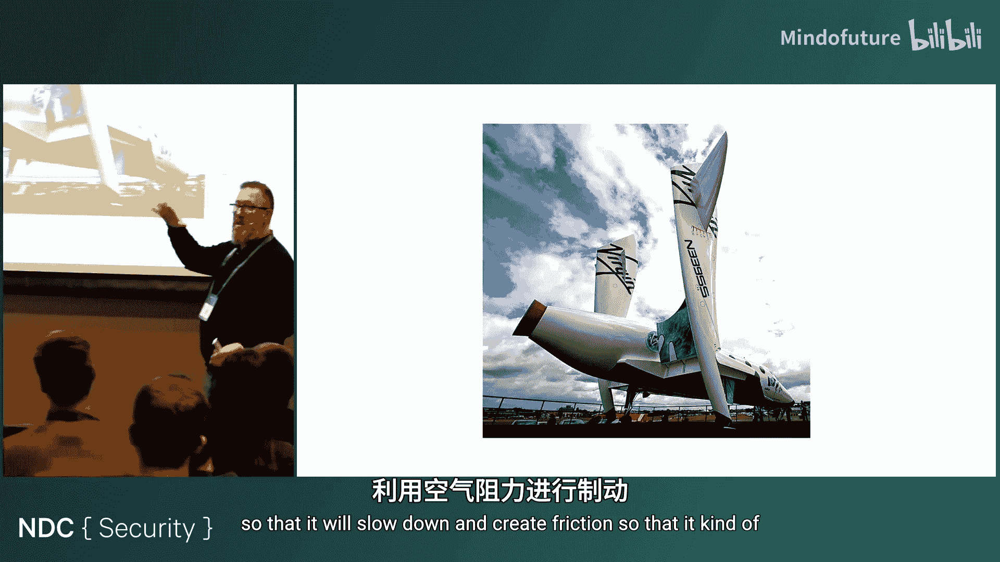
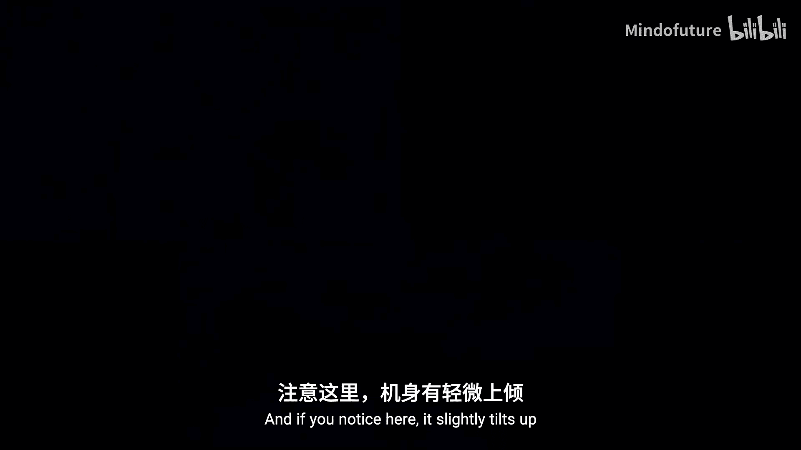
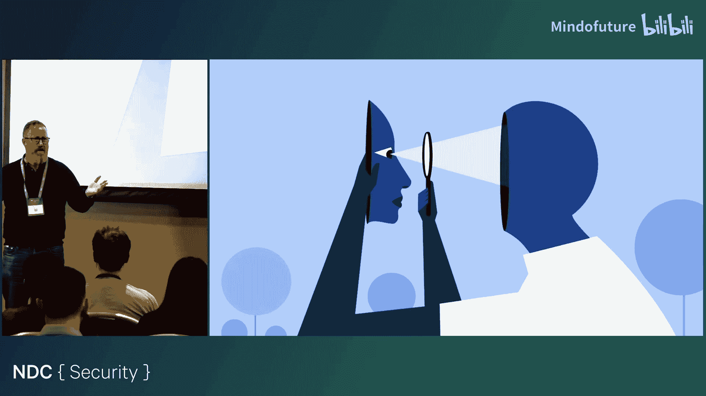

# NDC-Security-安全大会-2025-｜-AI工作流-｜-智能体-｜-网络安全-｜-Dapr框架-｜-开源工具-｜-LLM应用-｜-自动化安全-｜-黑客-p05-P05-Optimistic-Security---Niall-Merrigan--BV1ihgQzJE2h_p5-

Rightice， good afternoon。 Welcome to optimistic Security。😊，This talk is not technical。

 It's about how we make mistakes。 It's about psychology。

 It's about breaking your brain and why we do stuff the way we do it。 It is not。

 I am not a psychology person。 However， I have learned a lot about this trying to understand when I did social engineering。

In a really weird twist， about4 or five weeks ago， I was presenting down as theger and the associate professor from the University of Azo in P psychology was doing a talk right before me on AI。

 And I rock up。 And I said， I'm going tell you why we make mistakes and the psychology behind them。

 And she's sitting right there and I'm going， this is going be also graded。

 because you can imagine you're sitting there and you're like， oh God。

 So we had the psychology professor talking about AI and the technologist talking about psychology。

 So with that， I am Nil， I am a strategic A T S at Microsoft。

 a strategic A T S is a account technology strategist。 I'm a strategic strategist。

 which is still prove that Microsoft is at naming things。 I work as an advise。

 I talk to people and I give very opinionated views of what you should do and what you shouldn't do。

 I work one of the the largest oil and gas company in Norway directly with them and helping them understand stuff。

 Now。😊，Our brains are the biggest computers we own。They are more powerful than we can ever imagine。

 We still haven't figure them out fully， but they are also working over time every day to deal with all the different inputs we receive。

 all the sensory， visual hearing， all this type of stuff。

 And we have to do things like make decisions every day。 Dec are hard。 Apparently。

 the US did it wrong this year。That is my only political commentary。 I'm sorry。

 If you voted for the other guy。 I really， sorry。 Anniehu。

 But our brains are geared up to make decisions。 and we are。

 we have a lot of things we have to make decisions about， Like。

 what is the hardest decision you make every day。 What is the worst question to be asked every day。

Correct， what do you want for dinner。 And every single person goes， I don't care。 Like myself。

 my wife have a game where whoever rings first and says what do you want for dinner。

 The other person has to make it。 So I literally are before 4 o'clock going， hey， honey。

 what do you for dinner。 Oh O， fine， Will we have this。 That sounds great。 Now。

 how do you get a better response out of what do you want for dinner。😊，Yes。今日は。

Do you have two options for dinner。 You have one option or you could do what my mother said you could like it or you could love it。

Mine is guess what I made you。Someone's been hacking the wife thing。 That is also a very good。

 you can always say， I feel like chicken is that good。 And they'll get it。 yes， no answer。

 You'll get something else。 very often， it helps us。

 And it's also what we do when we're trying to work with customers who don't really know what they want。

 We ask them， does this make sense to you。 Does this not make， And then we start getting more。

 But our brains are geared up。 and they have to do all this type of work on a regular basis。

 And they get very tired。 So they make shortcuts。 And we call these shortcuts heuristics。😊。

And heuristics are these kind of little things in our head that allow us to do and make decisions quicker。

 Very often， they work very well for us。 Sometimes they're not so good。 And but we。

 we kind of view and learn more as we go。 And we discovered a lot of these heuristics from these two gentlemen。

 which is Amos Tsky and Daniel Kaanman， One is a。😊。

Economic psychologist and the other one was a mathematical psychologist。

 which I don't really know what they are。 But apparently what they did was they worked out the science of why we buy。

 And then one of the other fellow said I can work out the math to show it。

 These two people helped us define and understand a lot of the different heuristics and biases we now know as things that can affect us。

You might have heard of Daniel Kaanman before from this kind of think Think fast and slow book。

 It is an extremely good book。 If you want to learn how to go to sleep。😊，It's difficult。

 It's challenging。 It's very good， but it is a， if you're into economics and you're into things about it can be a great way to fall asleep you' an insomniac。

 I tried reading it。 I gave up being very honest， you might be better than me if。

 if economics is your thing。😊，Now， one of these kind of heuristics we use is what we call a fast and frugal tree。

 And you're probably going， I've never seen an upside down tree before。 but O。

 maybe you're from Australia。 this is normal。 But if you're not。

 a fast and frugal tree is a decision making process we do when we are trying to determine or troubleshoot。

And you've probably all done this before。Let's try an experiment。 Okay。

 we're gonna test the audience。Ladies and gentlemen， what happens when you press the， your TV。

 you press the button on your TV remote and your TV doesn't turn on。 What do you do。Press the again。

Check is the right remote。 Check the batteries。 Check is are plugged in。

 Check all these different things。 And these are great because this is our brain just going， okay。

 if then， if then else。 So that is what a fast and frugal tree is。

 It is a kind of a checklist as you go through things to help you decide And they're usually if it's not this。

 it could be this。 if it's not that。 It could be this。

 And you keep working out what something could be very quick and easy way to make a decision。

 So this is really handy when you're in a very difficult situation such as working in medicine where you're trying to triage patients very quickly。

 you can， for example， use a fast and frugal tree to work out。

 does the person need to go into coary care。 If the chief complaint is chest pain and they have one of these other factors。

 which I don't understand， it should go into coary care otherwise into a normal bed。😊。

It seems very simple， but it's a very handy way for us to make decisions。

 I don't have enough time to explore everything。 I need to make a decision fast。 What is the normal。

 quick way to do it。Besides choosing。Dinners。What is also one of the most difficult things we do every day。

关一思。No。😔，Waking up in the front row。 So I did this talk in Poland， right， And this guy， he's like。

 all these people are very all happy。 And this， this one， I said。

 what is the most difficult thing you do every day And this pure Polish guy goes waking up。

 And I went。😊，I said， do you need a hug。Netfl， no it is。 Is that how you wake up。

 One of the most difficult things I think we do every is how do we interact in public and doing social stuff。

😊，Being social and understand what do you do when you don't know what to do。

 I'm going let me pause on there for a second。 What happens when you go into a situation you've never been in before。

Right， and you're trying to figure out what is the social norms。 What do you do。As TPT before Cha ET。

 their chief。I like， I good。 I there， I I don't know。 is the heckling moving， It's like spreading。

 And by the time the， the lovely people in the end going， yeah， you suck。😊，What do you do， No。

 seriously， Like when you walked in here this morning and there's all the different stands。

 What do you do， Yes， Sir。Correct， you look at what everyone else is doing and you mimic it。

 We do that as humans all the time。 If you walk into an event and you don't know what to do。

 you just kind of see what everyone else is doing and follow the leader。

That leads me to the most evil thing you can do to people。Watch this。You walk along。

 you're walking along the street， and you stop and you look up。And you waste。

Watch a whole lot of people like。And then as theyre looking up， you leave。

And then you watch from forar and see how long that keeps going。

Cause they don't know what you're looking at， but they are allt gonna to follow you。

It's a horrible thing。 I， I， I tried。 I did that with my kids once。 And my my wife goes， Nile。

 why the hell Are the children looking on the roof。 I'm like。I was looking。

 and they didn't know what' to look。 And I said， just， just keep looking。 You'll find us。

 And I walked off。And they're there three minutes later going， I don't know what he's looking for。

 Is， is's that what he's looking looking for。My poor kids， I use them as social experiments。

 but it's a great， it's a great understanding of how our brains work。 when we don't know what to do。

 we instinctively look at everyone else。 And we get to understand what actually makes sense。

 And this is called social influence。 Like we have， we've heard of influencers。

 you kind of what happens when someone gets something really cool。 And you go， oh， thatll be clever。

 I could use that myself。 and we kind go， oh， that be or if you someone has bought a new car。

 And the first thing you are you happy with it。 And they say， yeah， really happy。

 Its a really good idea。 and you kind maybe that could work for me。😊。

And it depends on the type of person。 But you will see that it kind of if you hear from your friends。

 you're more likely to buy， we know this in marketing and sales。 very often。

 if you hear from your friends you're more likely to buy。

 or if you hear something bad about a product from one of your friends。

 you're more likely to trust their instinct than something online。 And that's the way we are。

 But what's really cool is it's a very interesting thing to watch in real time。

 I'm about to show you a video now， hopefully my sound guy won't blow your ears off。

 and just woke him up。 And let's see what happens， Watch this situation where a football fan who has a。

 I think a mental condition or he's just a bit disabled is trying to attract the attention of his winning football team。

😊，So see here。Gubs the arm。Right， nothing happens。Okay， he's trying to get the attention。

 you can see what's happening， watch this gentleman here。And。And。It's instinctual now what's this。

 it changes again。😡，He gets a hook。What do you think happens next？What becomes the norm？

You they follow the leader。The first three or four people came down， they didn't do anything。

 didn't interact， one person changed the motion and they all interact。

Have you ever seen this being done before， if you watch your children if you have kids？

You watch kids。 Theyll， they do what you do。My kids are hilarious like this。

 They have got Irish mannerisms。 They They're very Norwegian children。

But I'll be sitting there going。And I， I speak Norwegian with them sometimes just to confuse them。

 because if I speak Norwegian， they takes them a couple of seconds to figure out what I just saidca they expect him to speak English and they'll be like。

 they'll， my son will be in talking to his mother in Norwegian and go I'll say something。 he say， oh。

 no， no， Papa， you're grand。Very Irish。 Papa， your grand。I'm sitting gonna okay。

 and then he'll speak and go， they brah， ma fantastic。's get yeah， Papa that's excellent。

 And then and it's normal for him， but it's normal at our house。 Other kids come in。

 They are so confused for the first dinner， and then they just roll with it。😊。

They all start speaking English to me。And I'm sitting going I speak Norwegian。 no， you don nott。No。

 you don't。But what happens when our cool heuristics become overused and our shortcuts become the defined path。

The normal path。Now， this is what we would normally call a path of convenience or desire path。

 It's where we've we've built this normal solution， our normal thing of working。

 And then people just make their own shortcut through it。 We've seen this before。

 If you've seen it inside in the inta， you'll see it all over the place where people will just make their own little paths as they go。

 And then that becomes the norm。 But these。😊，Advance of these shortcuts when they become overused go from being heuristics to what we call a cognitive bias。

 A cognitive bias as defined。 And I have to go over here quietly and look at it。

 It says a simple procedure。 So a heuristic as a simple procedure that helps find adequate。

 though often imperfect answers to difficult questions。

 a cognitive bias is when we overuse a heuristic and biases a resulting。

 resulting gaps between normative behavior and heurically determined behavior。3。Sounds complicated。

Conognigress biases that stem from the reliance on judgmental heuristics。

 These are what they have been defined as by all these particular experts。

 When I looked at Wikipedia， gave me a much more advanced version。

And we are not going to make you read。 But one of the things it says an individual's construction of reality。

 not objective input， may dictate their behaviour in the world。 Thus。

 cognitive biases may sometimes lead to perceptual distortion， inaccurate judgment。

 illogical interpretation and irrationality。Are they drunk。Are they in love。

Are they doing something like， we see this。 And it's。

 it's a very kind of lovely kind of really sounds really defined， but it's also very fluffy。😊。

Heuristics， are cognitive biases have been identified， and they are invariably all there。

 there's a lot of them。 There's about approximately about 186。 And this is a really cool thing。

 I'll put the link out。 but it's a real interesting way to learn about the various different cognitive biases。

 They're grouped into like too much information where you've got too much information。

 We're trying to shrink it down。 You've got not enough meaning and trying to fill out。

 You've probably done that where you're gonna I wonder why this doesn't work and you start thinking of it could be。

 could it be and filling in the gaps And when it makes sense， it does。😊，You could have。

 we need to act fast。 And the one my kids are very bad at what we need to remember。 Like。

 they can remember。 I promised them an ice cream 6 weeks ago。

 but cannot find where they put took off their socks 6 minutes ago。Now。

 I'm gonna zoom in here a little bit and have a quick look at some of these。

 But one of the ones that I kind of， I'm gonna have a look at is like this idea。 we notice here。

 we notice things already primed。Memory are repeated often。How many of you bought a car recently。

Cool， how many of you when you bought the car could only see that car on the road。You're all going。

 oh， I just， I， and you kind of notice because you're thinking about it。 So your brain's going。

 I only see that and you see， oh， it's， I'm used to seeing it。 Or if you see a particular thing。

 you keep noticing it。We're very good at that。 Our brains are weird like that。 And they kind of it's。

 it's what is known as， let me just see if I can find the。Where is it called again， Sorry。

 it is called the frequency illusion。It's where our brains， we because we are。

 we are kind of thinking about one thing and our brains are primed for it。

 We are more likely to see it。It's a very common thing。 And。

 and I use the car analogy because I just bought on myself， and I noticed it myself very quickly。

 And my son was， I've just counted 27 Teslas。 I'm like， yeah。

 but how many other cars there don't know。What I'm interested in。 It's like， okay。Now， I did this。

 and I went， and I did a clever thing。 and I went off， and I learned all about these biases。

 And by the end of it， I just couldn't see anything else。I was so confused at this。

 I couldn't figure out if something was just me being quirky。 Was it an actual bias。

 Was it anything else， And I， you kind of you start。

 the first one you always start was confirmation bias。

 because confirmation bias is that one where you find some information that confirms what you're doing and you're happy。

You know， and then you just ignore everything else。 So I found this great tweet by Michael Feaths。

 says， you want you start looking for confirmation bias， you see it everywhere。😊。

Maybe confirmation bias is just confirmation bias。 So I thought I'd start with one that makes me laugh a lot。

 And I thought I'd start with this one。 What do you see here。😊，Yeah， happy plug。It's a Danish plug。

 Of course， it's happy。The Dananish are always happy。It's because they can't talk。

For those you who are who are understanding Norwegian Carmaloso， for those who don't。

 please look up that thing， is's quite funny。 It' I just gave him a clump of money。

 It's a great ski for the foreign folks in the audience here。 it'll be fine。

 But this is a happy plug。 But this is actually a bias， which we call paraollia。😊。

Paraollia is where we see faces in things that don't have faces。

 such as like bags or chopping boards and。Oh my God， that bag is a face。 It's a weird thing。

 But what happens， like you're seeing this and you got， oh， yeah， of course。

 that's just because my brain's quirky。 But what happens with this one。

 Does anyone know what this is。There's the face on Mars。Yeah， the face on Mars for many。

 many years was a photo that was taken where people were convinced this was an example of Martian intelligence and extraterrestrial life。

This particular photo， people said it could not have been natural。 It must be。

 you know artificially made。 And someone went so， let me get a better camera。

 So they took an iPhone up and they took better photos。And it， that is actually what it is。

 That's the when you take away the shadows， when you take， you do a proper rendering。

 the actual mountain looks like that。 There is no face on Mars。How many of you， it's， it's a space。

There's always one guy， the conspiracy theorist in the front who goes， no， no。

 it was planted there by the Russians。It's a secret moon base for the Justice League。

You've made me completely derail my train thought no。Thanks that。 appreciate it。

 It's better than the snoring， I suppose。 But for many people， it was this kind of idea that。

 you know， we see these faces because we want to be。 But why do we see faces more often。😊，Yeah。

 because it's how we interact with people。We recognize people by their face。If you look at people。

 you kind of like， if you see a face， if you， you know。

 we're on on on a team call and no one puts on on their camera and you can't see anyone， you kind of。

 you lose some of the interactions。 But if they have their face。

 you can see their kind of social cues， you can see other things。

 But when we're talking to people as well， that it does help。

So you can know if someone's actually upset because they're， but they might sound happy。 You know。

 Irish people on a general day to day basis， even if we're unhappy， we sound happy。

 It's just in our accent。You know。We also have a one called bike shedding。

Everyone's heard of bike sheing before。Cool， anyone know what it really comes from。Right， good。

 It makes it easier for me to explain this talk。Bike shedding is where you're given a very。

 very difficult task that you have no idea how to do。

And then you focus on the bit that you can understand。

Bike shedding comes from the idea that if you gave a load of non technical people the task of building a nuclear reactor。

 they would most likely focus on the color of the bike she roof。Because that's the bit they can do。

 It provides no additional value。To getting the job done。 But it's something they can do。

Bike shedding is a very common thing。 If You'll probably see this when you're inside in meetings with technical and non technical folks。

The technical folks are focusing on this kind of weird problem that they know they can fix。

 And the non technical folks are， can we have a pink button。And you're kind of like。

 what it doesn't really care。 It can be added。 But to them， it's important。 But to you， it's a。

 it doesn't solve the problem we're trying to fix。We probably have heard these two gentlemen Kruger and Dunning。

 but not in this order。 the Dunning Kruger effect。The Dunning Kruger effect is a very interesting thing。

 and it affects us all in various ways。 It's where we kind of where out any。

 where we have been quite good about something or we understand something。

 we think we can do something that is adjacent to it。😊，All right。And you， you might。

 and we get very quickly skilled， and we kind of realized that we might be out of our depth and it goes back down。

All right。It comes from the idea that。If you have， it is not a kind of thing that people would lower kind of intelligence overestimate their ability。

 It's people with any level of intelligence overestimate their ability to do something anyway。

For example， how many of you have raspberry pies at home， which are not projects anymore。

Every one of us is like， yeah， and why。I have a raspberry pie which was never Yeah， I'm so do I。

 Min never even grew into being a raspberry。 It's a raspberry pie。

 or you've got domain names sitting that were once an idea for a project and never became anything else。

😊，Console 3 app 13。We do this because we think we can do it。

 And then we realize it's hard So we give up。Or we change。

Now the Dunning Kruger effect has a very dangerous aspect to it when you are working in certain kind of fields。

 And I'm going to tell you a very personal story about the effect of the Dunning Kruger effect on me and my family。

And my wife give me permission to tell you this。So， back in 20。16。

Myself and my wife are expecting our second child。 It's gonna be a little girl。

And we're really excited。I was traveling a lot。 I was doing a lot of presentations all over the world。

 and I was heading。 I think it was around。February or January of February。

 I was heading to Las Vegas to speak at a conference。

 I was going to fly out on Sunday and be back at home in Norway on Thursday。And。

The week before I get a phone call from my wife in bits。 Now。

 Irish expression in bits means she's on the phone crying。 She's a Norwegian woman。 She don't cry。

 She don't。 they they're very resilient Norwegian woman。

 Like the quick way to piss off a Norwegian woman is offered them your seat on the bus。

 Even when they're 80， they'll kill you。 And I realized， I， I'm like， I'm shocked。 I'm like。

 what's going on。 And she goes， Nile， I was just at the doctor。

 He was doing a quick check on me and everything to make sure everything was over with the baby。

And they couldn't find a heartbeat。I said， what， so he couldn't find a heartbeat。I said， now。

 I have learned from my wife。And we have a very good kind of relationship。 And I said。

 I didn't go into typical， Let's fix this mode。 I said。What happened？ Tell me what happened。

 She goes right。 I SAT up。 We were discussing stuff， and he said， listen， let's do a quick check。

 make sure everything's all right with the kid。 Okay， put the gel on her tummy。 did the quick scan。

 couldn't get a heartbeat。And I'm saying。O。And then I asked the question that no potential father wants to ask。

What if it's dead， What if there's no heartbeat。And my wife says to me， she goes， Nile。

 if it is dead in utero， I have to go to the hospital to get it removed before it goes toxy and kill me。

H con。Okay。What did the doctor say， He said， just come back on Thursday。 I'm like。

 we can't come back on Thursday or Friday， whatever it was。 Like we， we need to know now， this is。

 this is not something I just gonna， you know， I let's hope it kind of writes itself。And。She's like。

 I said。Okay， do you want me to take control。It's our code words we use when someone is struggling。

 And we， and the other person says， I want you to make the decisions。

 I want you to take control and fix things。 rather than just。

 let's get down this because sometimes we just want to vent at each other。 But this one says。

 do you want me to take control。 she goes， yes， and said， okay， you go home。

I'm going ring a midwife and see can I get us an appointment for tomorrow。And luckily enough。

 I found a midwife in the center of Norway or center of Swvaner and。

On Wednesday morning at 9 o'clock， and I remember it vividly because I， it was really sunny day。

 And the previous night， we had gone home。 and my son， whose for was just like。

 his typical four year old。 He's chaanttting away。 I mean， we are very， very quiet。😊。

We're trying to figure。 we're trying to process。 We're really worried。And。I we go in to the midwife。

 and she says， why are you here and says this， and she goes， oh。And she turns out she was， listen。

 if everything is has gone wrong， we do have grief counsellors。 we can send you to。 And I said。

 fantastic。 Thank you。Sweak it up。Lift the top， puts the gel on。 Your one goes bang。And there。

So what's that， your daughter's heart beating 160 beats per minute。I。My wife collapsed。

Tears not crying， everything。啊。On the floor， I dropped。 I have never been so relieved。

 I've never seen so happy and I've never been so fucking angry at one person in my life。😡。

And I get up and she， and my wife turns on and dead eyes me and she goes。I've got control now。

And I went holy shit。 he did。She went back into on Friday and read him the riot act。

 which is an Irish expression， is that she used some Norwegian words I still haven't learnt。

And she called in some words。 I still don't want to learn。But she last。

 she gave out something fierce to him。 And it turns out， and she says， why， how the hell。

 you as a doctor， made this mistake。 He goes， I didn't know how to use the system。

 I just thought I'd be fine。I see by your reaction， Madam。 That's exactly what I I was I I mouth。

 Are you keep kidding me。 How many of us have been asked to do something we've never done before。

 but we thought we should be able to do it with code。It's exact same thing。And I am the proud owner。

 I won't say owner caretaker of an eight year old who thinks she's 42 and bouncing around the world。

 Now， you're thinking， oh my God， that's a great example of the Dunning Kruger effect。

 He took me on a roller coaster the exact same way。 It brought me up， brought me back down。

 I'm a little bit upset。 and I've just used an anecdotal fallacy to prove my point。😊，Where。You might。

 for example， be be presented with some facts and some， like， for example， smoking kills And you go。

 yeah， but my grandma used to smoke cigarettes made of asbestos and had never killed her。

 She died by walking in front of a truck。God bless her。No， because the thing is that's。

 and we hear that a lot。 Do you remember， someone has said to you， oh， it's never happened to me。

 It'll never happen to someone else。 And the odds are that。

So I kind of hate anecdotes for proving points。 So I went off and said， listen。

 let's think about this and find some real world proof as to why we make mistakes and why our brains are geared in a particular way。

And I got this particular one。 There's a lot of different ones out there。

 and I tried to be very good。 I'm not just picking the first 1。 I found confirmation bias。

 I tried to read them all sleepy bias。 And I read this particular one。

 And this is from 10 different programmers who were observed as part of a startup where they were observed working for an hour with a person side by side and another person remotely and they were observed of what they did for an hour on a particular task。

 you can see the persons from P 10， which is a woman who has one years' experience in Python all the way up to a programmer of 21 years with Java and uses eclipse and other one use Python。

😊，And then what they found is these particular different biases kicked in。

Based on what was being used， I said， more experienced programmers very often rely on their historical knowledge instead of using new new particular piece of information。

 How many of you us have ever gone back and used something we know probably shouldn't go in this project。

 but it's， it works for us anyway。 So we'll probably reuse it。Yes。

 how many of us have built our own bits and pieces where we could have used off the shelf products。

We call that Iike effect。 Do you know why it's called the Ike effect。Cause， you know， the I。

 you know， okay， the Ikea effect is where you build something yourself and youre。

 you are more likely to accept the fault of the product than if it was built by someone else。 Hence。

 when you build an Ikea wardrobe and it sways a little bit or goes back and forth a little bit。

 you're like， it's fine。I built this。 Or if you have a little bit slightly wonky。

 Like was ever anyone ever got the Ikea doors on the press on the yeah， to line， yeah。

But the fact is that there was also kind of， for example。Like optimism。

 there was particular4 was proud of his new aggregating map code。 but got an error after was printed。

 And this is just example of where people make mistakes。 And we have great example from Kent Beckck。

 where he says Op is an occupational habit hazardazard of programming。 Fe is the treatment。

 This highlights the delicate balance that programmers must maintain between an inherent optimism and the reality of software development。

 We get asked very often to make stuff that no one else has done before。

 or we couldn't be bothered finding。😊，Or we're getting something to do where we may not have done it before。

 but we're asked to fix problems。Invariably， this leads us into being， I can probably do this。

 And I overestimated my ability to be able to do something。

 and then gives you this idea of a plan where you think it's gonna be a straight walk。

 but it's up and down。 This is what I kind of like to say， for example。

 for AI adoption is exactly the same way。 Everyone thinks it's gonna be very easy until they realize that their data sucks。

 and their security model sucks and they have to go change all that。People need。

To understand that being optimistic can。Be a dangerous thing。

Another good example of this is the VS S 2。The Virgin space shuttle，2。This is an amazing aircraft。

 an amazing piece of technology。😊，The two outer parts are the mothership。

 and the middle bit is the actual spaceship。Alright。

 the two outer parts together is known as white Nice。

And what it does is it takes you up to 41000 feet into the air，14 km above sea level。

And it drops this thing。From the belly， where it ignites a nylon burning engine。

So it burns Stpo booksa， Pipi。Fires it off。 That's where all your odd socks go， by the way。

 into this type thing。 I explained this to my kids and they， really， I'm like， yes， they did。 Again。

 they're still looking at the top of the roof at this stage， so。😊，This thing drops it。

 It accelerates like a bat out of hell， kicks it off up into space， opens the outer atmosphere。

 stays up there and then comes back down。 Now， you can imagine something as aerodynamic as this。

 It's gonna be really hard to stop on the way back down， Right。

 So what they did is they took advice from Mother Nature。

 And they made a cool thing where os They made a cool thing where。😊。

It has to feather the particular its fins， like it basically folds its。

Wings like this so that it will slow down and， and create friction so that it it kind of what itll end up is looking like this。

 It comes in and a belly and just flow flows in。 And after a while， then levels out and lands。

Really cool。😊，Now， what happened on its first flight was is broke up and left a debris field of about 15 kmre across the Mojave Desert。

And in the case of this， when you have a accident involving airplanes in the US。

 you call in the N T SB National Transport and Safety Board。But you also。

 because it's in space shuttle， you have to call it NASA。Right， now。

 they don't have a black box in this thing。And there's a good reason why。

 because they have all the telemetry being sent to a control centre in the Mojave。

So what they could do is they could watch a video and see the telemetry and see everything rather than having to work out from the voice voice cockpit recorder or whatever。

 They could actually see what the， what the particular pilots were doing。

 And they took some videos of it。 And we'll see them now in a second。😊，So here is。

 there's a three part video， three ways。 And it's， you see it drops， ignites the engine， accelerates。

 You can see it going super fast。 now， right， it accelerates。😊，And if you notice here。

 it slightly tilts up。

I watch it again， in the larger version。Drops。Accelates， there's your nylon going。

And in the last seconds， But now， you'll see it kind of flicking。And what， and they kind of said。

 well， what actually happened。Turns out， was this。The feathering mechanism was disengaged。

At a particular speed， when it dropped。And if you imagine you took your hand here like that and you flick back as hard as possible。

It basically broken， too。So you know what happened。They didn't know why it happened。Now， the N T SB。

 if youve ever watched， have you ever watched a aircraft investigation that's serious。

 I watched that on airplanes。I sit there beside people who say， this is awesome。 It's 7，3，7。

 same as this aircraft。😊，I'm not a fun person to sit by。 but That's why I get the road to myself。

 It's the quickest way when I watch a aircraft investigation。 No， okay， over there。😊。

What I found out was this that they went back and they said， riceice。Why。

 when does the the feathering mechanism get disengaged。

 I said you have to disengage it between Mac 1。4 and Mac 1。8。 So 1。4 times the speed of sound to 1。8。

 It's a very short window。 It's about3 seconds in this flight time。And they said， okay。

 when was it disengaged， And They said it marked 0。78。

Which is about the same speed as a jumbo jet flying over the to the US from here flies out。

 So it's an average。 It's not a super fast speed， but it's still fast。And they said， okay。

 they went to the engineers and they said， listen， guys and girls。

 What happens if you disengage the feathering mechanism at subsonic speeds。

 And they said it would be catastrophic。And it would destroy the aircraft。 And they go， okay， cool。

Do what controls do you have in place that。We don't。Why not。Like， it's a giant， do not press button。

 like beside a child with like AD， H D。You know， it's， it's， it's why is it' not there。 Oh。

 it's because we have test pilots。 They're the top 1% of the top 1%， and they don't make mistakes。

That was， that was the actual commentary from the engineers。 They don't make mistakes。

And someone went， what？And they said， okay， so we know。How。And was， but we still don't know why。

And why it happened was very， very simple。These folks are test pilots。 They are super skilled。

 but because they train like hell。 theyd go into the simulator。 They spend hours in there。

 and they spent hours in the simulator doing this。 And they went back and looked at the training logs。

 And what they discovered was in one simulation in the last hundred。

What had happened was the Co pilot who was doing the checklist forgot to disengage the feathering lock before 1。

8， and the， the flight was scrubbed。So that person had in their minds not to make that mistake。

There was nothing on the checklist that said it didn't have to be disengaged between these two points。

 It just said it had to be disengaged before you reach 1。8。And then they found。

 so I don't know if you've ever been an aircraft simulator。 They're just these amazing。

 like giant computer screens and computer games， but they don't have the same effect of the noise。

 the aggression， the acceleration， everything that goes with。 Theyre dropped a calammeter her down。

 And then there's a kick in the in the front to back where you accelerate。 And this person goes。

 I made this one mistake Once I'm gonna fix this and make sure I don't do it again。

 And that's what happened。😊，So this， there was this kind of idea of naive optimism。

Where it's wishful thinking， we think， we know， we don't。 we don't think test pilots make mistakes。

 We know they're， they're good， but theyre， you know， and it's not grounded in reality。

How many of us don't make mistakes。I votet。ThatScott， maybe。I he's in a different reality。

 But there's realistic optimism， just faith in the long。

 and you're brutally honest about the short term reality。

I'm going to ask another question the old security engineers， all security folks， developers。

K of everyone does different things。 How many of you have got into a meeting where you said， yeah。

 we need to fix this particular bug or a security hole and someone goes， it won't happen。

It's sequL injection。Or it's this。 that people do that because they're kind of like。

 it'll never happen。 Another cool little story。 I like like telling stories。 My。

 my mother is my mother， and she's mad。We were trying to book， I booked two cars down in Spain。

 I wanted to get， get my brother to pick up one。 And the I rang the car company said， yeah。

 just send us down by email。Your address said， cool， your passport number， cool。

 copy of your passports， your credit card number， your expiry days and your CCV。😊，20万啊。Said again。

 she goes， it's okay。 We do it all the time。I said， okay， prove that you， are you， where。

 what do you do with， So we print it and we leave it on the boards。And I'm like， sitting。

 I'm having an argument。 She goes， no， no， no， it， it's okay。 It's perfectly safe。

 We do this all the time。 It's fine。 I'm sitting on。 No， it's not。 I ring my moment。 She goes。

 that's okay。 I sent them mine。😊，Bless her。Microsoft are not immune to this。We got。

 we got pinged by midnight Blzard。If you didn't hear about this。

 this was quite an embarrassing thing。 And it's， it'， it kicked off a full fledged。

 what we call a secure future initiative for us。What happened was back。

 I think I I I lost the dates now。 But last year， we。

Had a developer tenant in Azure open where with develop， so developers could work in it。

 Unfortunately， it had too much rights that allowed people to escalate and。

Get to a different point within our internal network， because we weren't supposed to do this。

 but someone had not been told or had not figured this out or didn't understand。

 And we didn't have the proper controls in place。Now， what happened was midnight blizzard。

 which are a Russian， if I remember， correctly， iss that right。

 group used local VPNs and proxies like local， like as in， you know。

 neighborhood ones and used enough below the threshold to do password spraying。 In other words。

 they were looking for passwords， got in there， managed to elevate themselves and thenva a lot of different data belonging to us out。

 It was extremely， it changed how we viewed things。 We would leave developers do this。 Now we don't。

 Now you have to have the same security controls in place as if you were doing production。😊。

Coode in our developer tenants。 So we're not allowed to， for example。

 write stuff where we just test something out。 It has to have the same level of authentication。

 modern authentication， passwordless， all this type of thing。 And it can't have these over。

 over engineered rights， etca。So it is a very important part of how we learn。 We make mistakes。

 We're too optimistic。 We very invariably change how we do something because we have made mistakes。

 Wevariably have made mistakes because we are too optimistic。 The human is bill optimistically。

If we weren't， we wouldn't be able to do what we do。However， if you look at a human body being built。

 it is very optimistic。We've one heart。1 brain。 we' have no redundancy。Weve to accept。

 so the the liver is the only thing that grows back， right， It's the only organ that grows back。

 Did you know it was designed by the Irish。We ro test the shit out of us。

It is literally the only organ that grows back。And I kinda think it's greatcause we， we do test it。

 But my brother has， has had kidney failure。 His two kidneys Don went out。 I tried to give him one。

 but it didn't work out。 So he got， he got， he borrowed one from one of his friends promises to return it when it's done。

 But it's just an example of like we had， we don't have redundancy in a lot of our things。

 And that's， that is a challenge。😊，So we are optimistic in ourselves。

 We are optimistic how we treat things。 But like， how do we fix this。

It's my Swish joke thrown in a little bit of Ikea。 Again， how do we fix。

Problems with being optimistic。I can't tell you all to be pessimistic。

 You'll all be grumpy as hell by the time I'm finished。So how do we we train， We learn。

 We teach ourselves to be better。 We make sure that we can do things that we thought once we thought were hard and make it easier on ourselves in in oftentimes。

 it's like， you know， when you start something new。

 How many of you try and start the whole exercising kick in January。And they say day 10。

 as in 10th of January， is quitter's Day。It's when everyone quits， usually。

 about a week and a half later。And if you survive past that， you're probably going to keep going。

 I'm one of these people I just didn't bother starting。I didn't want to quit。

We also need to look inside ourselves。We need to look inside。

 look from the outside in and verify what's going on。 We sometimes even may have to ask ourselves。

 do we need to build this at all。here's where I'm going ask。 I have， I。

 I have a crypto expert in the front row。How many people have built their own crypto。Good。那是。

All the one that failed。 How many of you have written libraries that there is already existing new get packages for。

Or the NP PMM4。Yeah， so it says not this one guy kinda maybe I don't know where you're going with this。

How many of you have actually written software because you just wanted to try。Yeah， there we go。

 See now it's it there。 we' get into it。Maybe you told a project manager， oh， no。

 I could do that in two weeks。How long did it actually take。6 months。I'm being optimistic there。

 I learned very much actually， believe it or not from a good PM and how to do this。

 where do I need to build versus buy。And what he said to me， says， I。

 it was back in SharePoin 2007 time。 I was young。 I needed the money。 Okay。

 I still feel dirty about working with SharePoint。If you've not worked with SharePoint， go yay。

 And if you have worked with SharePot， I'm really sorry。

 But we was doing this type of thing of converting word documents to P， D， F。

And there was a particular piece of software from bamboo that did this。

 And it cost $5000 for the server license。$5000。 And I said， that's a lot of money。 And I went。

 I could probably write this in about two weeks'cause you know， it's not that hard。 And at the PM。

 he's very nice guy。 And he goes， N。Two weeks at 1000 crron or an hour billing race means you'll you'll pay。

 They'll pay more for you than Nahi buying the software，It's truee， but it's not good for us。

 And he goes， well， do you want to be supporting it for the rest of your life。 I went， hellll， no。

 let's just buy the license。 It was a very quick way of learning becauseuse he focused on the thing that I didn't want to do。

 which was maintenance。 no one likes maintenance。 No one likes documentation。 We don't do it。

But also， what happens when you can't talk to someone。Who do you talk to。You might have an issue。

 That's the second time you brought it up。 Are you actually just chat TP T in in living form。

Are you sure。 That's what， that's what an AI would have said。Yes， there you go。 Hey。

 somebody learn something。 Very often， we talk to people who don't know what we're doing so we can find out a solution。

 And we all talk about rubber ducking。 I talk to my wife a lot。

 She works in E Magling is in real estate。 I work in I T。 I have no idea what she does。

 She doesn't know what I do。 It's great。 We have a great relationship that way。

 And it means we don't talk about work at home。😊，Cause I don't know。

 But I when I'm trying to work out something with her， I shield just go， that's nice， why。😊，Really。

 why。And make me explain。 And eventually， I go， oh， yeah is a problem。 She was， here you go。

 I could know。 I could help you。😊， I went。 but it's extremely good because if you go back and ask yourselves。

But what， then， But you can't use the rubber duck for everything else， so。

What should we do if afterwards， how do we get other people to check our code。Pull requests。

We can go in and actually submit code and be pull requests。 And， you know。

 the thing with pull requests is if it's 10 lines of code， you'd find 10 issues。

If it' 500 lines of code， he'll find nothing。By the way， if you another security bug。

 if you wantan to do it， is do a large pull repository at for 500 lines on a Friday evening。

It'll get added into the branch off。 You go tip top。 It's， it's just a good example of where people。

 if it's too much information， they won't be able to do it。We can use， for example。

 the idea of path and control mechanisms to help us understand how to work through systems。

I love working with these because they help people understand what I'm trying to defend against。

 They help people understand and other new developers understand what's actually going happen。

We don't often know how our program fully behaves。 We don't know all the tracing paths。

 But if you put something like this in front of somebody who has never really seen it say， okay。

 user off could do bru force。 We want to protect against that。

 We want to against against harvest and we want to do dictionary attacks。

 These three things we can get removed。 And because our hackers gonna to use these things Once we cover this。

 we can review again and say， what next do we need to do。

But how do you kind of quantify these so that you can understand where to spend your effort。

You might use a risk matrix。Have you only seen these before。Yeah， redumbber green rags。Okay， sorry。

 where is like a medium impact and it's got a， and it's most likely to happen。 We're gonna fix it。

If it's got a low impact and it's not going to happen very often， we don't fix it， or we。

 we fix it later。An example of this is， for example， here where you have like。

 it's most likely you're gonna have ne impact when you stub your toe and it's going to be certain you're going to do it。

 And I asked this in Sweden， And what you think the answer was of how you would fix this。

From a lovely Swedish colgue。He said safety shoes。 I said， learn to walk。So an example is that like。

 if you're gonna be， it's unlikely you're gonna have an aircraft crash， but it's gonna be critical。

 But if you're gonna have a tsunami， it's unlikely it's gonna happen in Norway。

 So do we need to worry about it。 If we've seen Bin， Yes， if you haven't seen Ban， no。

It's a movie about a giant wave in a ford。 It's fantastic。

 I have never been so terrified it was a Guang or Fjod。 They had it。 Yeah， and that was there going。

 Jesusez， this this。 And I turned round to my wife。 because this really happened。 She goes， yes。😊。

Yeah， I could。No， I'm not lying， yes。So what do we do。

 I'm gonna let you out a little early causeuse it say cause it looks like I'm actually a little bit ahead of time。

 which is nice。 You might get a little chance for a break。😊，How do we keep the optimism at bay。

Imagine that as a question。 How do you stop being optimistic。How do you stop being optimistic。

That's our GBT。D때。There's， there， there's a thing on the essence of comedy where you repeat the joke until it's actually funny。

He's winning over here。Give him a green at the end， will you， He deserves it。How do we。

 How do we up being optimistic？ Well， very often， we have to become realists。

And realist is the idea where we point out something and say， you know。

 is the glass half full or is the glass half empty。 No， it's just a glass。 So I。

 I like using this as an analogy because we， I don't want to be pessimistic。 I don't want to say， no。

 I can't do this。 I don't think it's possible more saying， I think it's possible。

 but we probably need to check a couple of things first and verify。

 is this actually good something we should do。😊，And I believe when you become a realist。

 when you start looking at things and saying， is this something we should do。

 Is it something thats remains secure， Are we gonna in endanger our users。

 Are we gonna do something worse。It means you have to look inside a lot and actually question yourself very often and say。

 does this really need to be done， Are we doing it the right way， Are when we have it done， Ver。

 did we actually cover all our bases， We have found so many security issues and security bugs over the years because people have just ignored things。

 myself and Scott had lunch day， And we discussed something like the old shell shock bug。

 which was there for what，20 years。 We talked about something like heartbeed was there for like 20 plus years as well。

 Because people ignored it and just didn't want to fix it or just didn't find it。 And then went。

 it's fine。We call this the idea of a squeaky leg or a squeaky。

 What is it a squeaky legge where you go into a stairs and you know that one squeaks you skip it。

 And then someone comes in and they go。Shouldn't we fix this。 I know it's always been like that。

 Just just step over。 It'll be fine。Noello。These are common things we do。

And sometimes we will just accept。 Sometimes we won't to fix。 But maybe we have to have the bravery。

 Maybe we have to have the self insight， sell sell insect to go and look and say。

 does this actually need to be fixed。I would like you to still keep the optimism。

 but become realists。 And with that， I'll leave you out 10 minutes early。 So thank you very much。

Are there any questions？Yes， sir。 And if it's chat ET rate， I'm gonna to kick you。

Question is， like， you talked about。Optimism and love how not to be over。

but theres the other end of the spectrum。Specifically in security。We think it was tough。Yeah。

You know， like。lesss technical， like risk people do not actually use that market。 come to you。

 It's like we identified this risk。If you lose this key， like it's。She should fix it。 And it's like。

like。When you can like controls and like defenses around the key， like， why do you think it's。

to drop like， But what if they all fail's it' what we call this the what if and what aboutism。

 It's a very challenging conversation to have。 So I had this conversation with a particular company in relation to what happens if we lose access to our M3。

65 tenant， all our users。 And I went， okay， what have you got in control of it first。 And said， well。

 we have a break class。Account， which is only used for this。

 It's stored in a safe that you have to access this particular way。 I said。

 is it what's the password look like， And I said passwords 100 characters long or something bananasly expensive。

 And I said， okay， at what point do you think you will lose this。And they said。

 if someone one of our local administrators get elevated， it's really hard to do that。

 But I get where you're coming from。 And what we said is， are you overthink the problem。

 Are you just being kind of what if， what if what if versus the idea of seeking absolute perfection。

Is it good enough and do have things in place that say， for example， if this happens。I。

 we were talking about this in relation to exchange。 for example， said。

 what happens if someone turns off like multifactor authentication。I said， well， if you have， like。

 for example， one of our other products like Sentinel。 and this is not a product spec。

 it's just an example。I said， you can tell it that if this happens。

 what you do is you shut off the administrator who did that， block their account。

 revert the change and and escalate to a tier 1 instant or level 1 instant and wake up your security team。

And he goes， you can do that。 And I said， yeah， he said sometimes stuff's gonna happen。 I said。

 you drive a car， right。He goes， yeah， are you worried about crashing isn not。I said this， you know。

 you could crash every day。 There's other people who could crash into。 Yeah， butm， I'm a safe driver。

 I said， yeah， but you remember， you're associating risk。 And so I said。

 you need to kind of come back and say to yourself。

 is this actually something I need to do or do we consider it， And we notice， And we say， actually。

 we don't， we don't have it because we have 20 plus controls。No matter how much you do。

 you could do more。But there is a point of very much amount of cost versus amount of efforts and a return。

 And I usually start going to people and saying， this will cost you 50，60，70。

80000 no extra per month。 Do you need that。 And he goes， nah。Like， that's the thing。

 Sometimes you have to just maybe force the issue and say， which is more important time or money。

 What is this going cost If you're， if you're gonna lose $2 million a minute because you lose this。

 then you should be investing a fair amount of money if you're going to lose 50 kroner and invest in like super amounts of security like level。

 like it makes no sense。It's a very difficult question。 I， I don't have a great answer for it。

 other than sometimes you have to reason with them。 And sometimes you just have to say， listen。

 do what's best for you。Sorry， I hope that answered your question as much as I could。 If not。

 ask chat GT。Okay， doki。 Anyone else got a question。Then 3，2，1 class dismiss。 Thank you so much。

