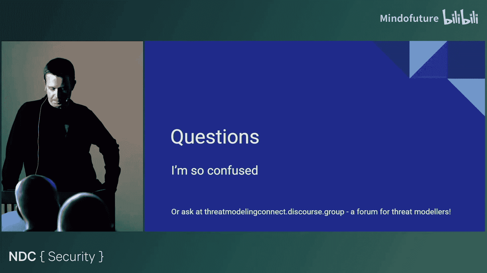
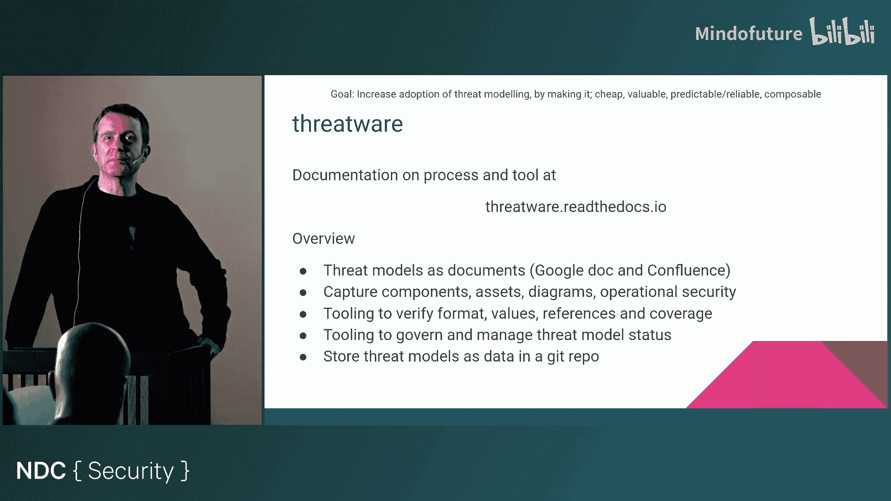

# NDC-Security-安全大会-2025-｜-AI工作流-｜-智能体-｜-网络安全-｜-Dapr框架-｜-开源工具-｜-LLM应用-｜-自动化安全-｜-黑客-p06-P06-Improve-your-threat-modelling-through-the-science-of-simplicity---Dave-Solde--BV1ihgQzJE2h_p6-

Good afternoon， everyone。I am here today to， to talk about threat modelling。

 one of my favourite subjects and simplicity， which is something that I think sort of interests a lot of people and how those two things are gonna combine to。

 hopefully。😊，Improve the way that we can do remodeling。I am a security architect。

 a former pen tester。 General， I just like to think of myself as a bit of an engineer。

 really at heart。I've been doing security for a long time in many different places。

 But for the past several years， a lot of my focus has been spent on threat modeling。

And I really got into threat modeling after being appented because I tended just to see the same issues over and over again。

 And threat modelling sort of appealed to the engineer and me。

Because engineers like to create solutions to recurring problems。

 And I wanted a solution to the problem of seeing the same sort of security issues over and over again。

And threat modelling really offers that solution because it helps to identify those issues that should be really solved by design。

 which then leads to those issues becoming rarer and rarer。But Thr muing has some challenges。 It's。

 it's a manual process。 And to scale manual processes， you usually need a lot of people。

So something like a security champions program can definitely help。 But even so。

 the process of threat modelling really needs to be as accessible as possible。

 It's sort of like putting on this conference， right。

 It's a huge logistics exercise to get everyone in the same room together。 But at the end of the day。

 you can't forget that you still need to deliver really interesting talks。

And it's like this with many security activities。 A security champions program will really help the logistics of rolling out that security activity to lots and lots of different people in the company。

 But the activity itself still has to not suck right， It has to be good。

 still to do what you want it to do。😊，Now， in my opinion。

 one way to make threat modeling more accessible is to keep it as simple as possible。

But what does it， What does simple really mean， right？

 So this talk is about how to leverage simplicity to make threat modelling inactivity。

 something that more people are likely to come back and do。So what is simple。

 How do you know if something is simple， How do you make something simple。

These are the sorts of questions that I asked myself when I was trying to decide the decisions I was making around threat modelling were actually good decisions that were。

 you know， made threat modelling easier for people while also delivering value and that would enable the process to。

 to operate at scale。And I thought these， these were questions without obvious answers。

 I was relying on trial and error， and I certainly wish there was an easier way to。

 to find some of these answers。That's when I came across this guy。George M。 Whiteside。

 I'm gonna call him the chemist。Google Scholar has him as something like 200 research papers。

 He's been quoted in other scientific papers， like half a million times。

100 thousand0 times in the last year。 He seems like a pretty clever guy by， by any measure。

And he did a Ted talk called Tos a Science of Simplicity。

 And I would encourage everyone to go and see the TedD talk。 It's， it's really， really interesting。😊。

And in this talk， he talks about， well， what makes something simple。He talks about how。

The scientific community has studied complexity， quite a lot。

But has spent a lot less time really understanding what it is that makes something simple。

So he offers up a way to think about simplicity based of his experience。Now。

 I was really blown away by this talk because I'd never really come across anything that had really helped me to think about the decisions that I made for threat modelling or about a way to evaluate other processes for like simplicity。

I was to talk and thought， wow， I can， I can definitely understand how a lot of what he talks about applies to script modeling。

Which was kind of bizarre because I put money on the fact that this guy has probably never even heard of threat modelling。

So a chemist who studied dozens of areas of science has come up with some sort of framework that I think is applicable to a totally different area。

Then I think there's something in this。 It was， was something worth exploring anyway。

So what I'm going cover then very briefly is part a small part of what he covered in the Ted talk。

 And then also the properties that he came up with that he identified that make something simple。

I'll then try and repurpose those properties into more of a framework so that we can use them to evaluate or how simple something really is。

So the first question pose well Ted talk。Is what the simple mean。It turns out it， it's not。

 it's not an easy question to answer。 You can think about it in different ways。

You can think about something as being simple in construction。

 So spaghetti bolognese is probably one of the first meals I ever learned to cook just because it's a simple place to start。

You know， it's kind of easy to make。You can think about something as being simple and purpose。

 So a book， whilst it can contain lots of complicated information inside。

 its purpose is quite simple just to convey information to， to people who read it。

And then you get something like a touch screen tablet， which is simple in functionality。

 And this is quite interesting because it's very much in contrast to the other ones， right。

 because a tablet is not simple in construction。 It's very complicated to build a touch screen tablet It's not particularly simple in purpose because it can be used for so many different purposes。

 Yet it is quite simple in functionality because you could give it to a child。

 And they could figure out how to use it in many ways。

So you have these very differing ways of looking at simplicity。

 And these are just three examples of how to you could view simplicity。

 that's by no means exhaustive is just meant to illustrate the difference。Now。

 even if you took one of those and said， right， well， I'm only interested in simplicity in。

 in construction， for instance， context still matters massively。If you take by example， a cup， right。

By all sort of intuitive measures， this is a simple thing。 Certainly。

 if you think about it in construction， purpose and functionality。

 because it consists of just like a holder and a handle， its purpose is to hold liquid。 And it's。

 you know， how do you use a cup。 Well， it's pretty straightforward。 So a cup， you would think， well。

 this must be simple。 This must be a good example of something simple。😊，But， of course。

 you start to think about it。 Sim for who。Not everyone can use the cup。 So， you know。

 you need to take that into account。 Sim for when。Yes， I can take it on board a ship。

 But if the seas get too rough， suddenly it's a very poor solution for something to drink out of。

And then sometimes you can think of situations that are just fundamentally violate what a cup needs。

 like gravity in order to work properly。So you take all these together。

 And the reality is you're unlikely to be able to ever point at something and be like。

 that is definitely simple， or at least in a context， free sense。 context will always matter。

And I would say that ultimately， this means there's no simple definition of simple。

 that sort of amount of irony there。 I get it。But all hope is not lost， right， Our good friend。

 the chemist tells us。There are some properties that are actually shared amongst simple things。

 These properties don't really give us a， a definition of simple。

 but they certainly give us a place to start a little bit more。

 to be a little bit more scientific about simplicity。

So what are these four properties that the that the chemist is is， is， is telling us about then。

So the first is cheap， right， A simple thing does， does not cost a lot。

 at least for the context of who's gonna use it。A simple thing tends to have a high performance or high value for the cost。

 right， Ultimately， everything simple also has a function。 It must do something。

 and that function that it does， must be worth the cost， right， It's actually got to do something。

 It can't just be useless。 It's got to do something。

So those are kind of the obvious two that you might think of yourself。

 But then he poses two other that I think are less obvious。

He says that they must be reliable and predictable。And。

The easiest initial way to think about this is。If something is unreliable and unpredictable。

 that tends to be a property of complicated things or or complex systems。

 So a simple system should be predictable and reliable。 And then the last one is。

Simple things tend to be able to act as building blocks， or they tend to be stackable。

 tend to be able to take them and， you know， put them together somehow。

 They simple things tend to be able to be repurposed easily so you can build other things with them。

 And this very much goes to that third property of reliable and predictable because you wouldn't run a really build some build on top of a simple thing that was unreliable or unpredictable。

😊，So those are the four properties。 And， you know， but what we really to make them useful is you kind of want to think about them more in a framework sense。

Because you， if you've got a framework， then you can do fun things like evaluate a process。

 a tool technology， whatever it is against these properties to be like， how simple is it。

Or then you could use these properties as a guide， right， for creating or changing or optimizing。

Something to make it simpler。For instance， to make it scale better。And you see。

 I renamed the building blocks stackable into composable。

 I felt that was just a better word for the tick that we would use in technology。 So I， I， I。

 Ive leaned towards that word。So for each of these properties。

 what I'm gonna do then is gonna try and get a deeper understanding of how to interpret them。

 So I'm gonna gonna deconstruct them a little bit in order to evaluate them。

Give you different ways of thinking about them。So the goal being。

 if you've got numerous avenues to explore with each of these properties。

 then you can use those avenues to help。Evaluate or optimize something for simplicity。

So I'm gonna start going through each of these properties and sort of thinking about the ways you might use them or think about them。

So the first property is cheap， right， this is pretty straightforward， right。

Something simple must be cheap。 It's gonna not cost a lot。 And， you know， intuitively。

 this is what people think about when they are ask to make something simpler。

 They often make it easier by making it easier。 You're saying， I'm gonna make this。

 it's gonna cost less for you to do。And how do we evaluate the cost of something， Well therere。

 there's lots of different ways， right， Like if you wanted to make something simpler， you make it。

 So it takes less time to do， takes less resources， takes less people， less effort， less knowledge。

 less training。But， of course， you can't just keep on making things cheaper indefinitely， at least。

There is a limit to how cheap you can make something。Once it is too cheap。

Chances are your effective value of， of what it is you're trying to， to work with。

Which brings us the next framework， property， which is value。So for this framework property。

 we want to evaluate the value of something。But how do we do that。

I think there are a couple of different ways。 First and foremost， something must have a function。

 So it has to be useful。what does what does useful mean。

 This is more than probably any of the others。 I think you really need to understand context in order to know if something is useful。

 right。So who is it gonna to be useful to， So a stamp collector， for instance。

 has a certain use for a stamp。 You might send a letter。

 You have an entirely different use for a stamp。Useful is gonna be about， you know。

 where and when a hammer is a useful tool， But not if you need a screwdrivercause you could run a screw in a screw。

 right， So that matters as well。Why can be important to evaluate for use， right？

 So if you're part of a sports team， you might be part of that team because you want to win everything。

 And that's how you get use out of that experience。

 Or you might just do it because there's a camaraderie amongst being part of a team and playing with with with friends。

How much is something useful， A ladder is great if you need to get on the roof of your house。

 But that same ladder that lets you get up that high is gonna be pretty useless if you need to change a light bulb in your house。

 right？ It's too much of of value if you， if you think about it in that sense。

So one way we can evaluate the value of something is by trying to understand how useful it is。

Now that there are other ways。For instance， value can be thought of by how convenient something is。

 So you can something can be offer more value if it's available in more places， at more times。

 for more people， in more variety， for more purposes and in more ways。And yet。

 another way to evaluate or optimize value is by creating different output at different costs。

 through offering variety。So just like with cheap， we can't just keep making things cheaper indefinitely。

 you can't just keep on offering value indefinitely， because inevitably。

 that makes something more expensive。 And when the cost is too high。

That means that less people are gonna kind want to use it。Now， for some people。

 they want that best value and are willing to pay the cost。So to satisfy everyone。

 you offer value for different audiences at different cost points through variety of things。

So Lego is a good example of this， right， This millennium Falcon set looks awesome。

 If you were into Lego， you would probably wantan to get that。😊。

But not everyone's gonna wan to spend the money on that， Right。 It's。

 it's pretty hard to justify the expense。 That cost value ratio just probably isn't。

 isn't 1 hundred% right。 But don't worry， there's probably a millennium falcon for you because then there's a slightly cheaper version that's still kind of cool。

Bit cheaper。 But， you know， maybe that's still too expensive。 Then there's a slightly less version。

 slightly lower cost version， slightly fewer pieces。 still cool， but smaller。 You know。

 maybe that's good for you。Then you sort of start getting a bit lower down。

 probably only offers really value for the kids。 but it's pretty cheap to buy。

 And then if you really as tight on money， you can pull together your own one for virtually nothing。

Anyway。We think about value。To think about value， you can think about how useful something is。

 how convenient it is and， and what different varieties it can come。

 And you can then evaluate or optimize something using this framework， property of value to。

To drive your， your， your making something simpler。Okay， so it's cheap and value。

 The third property is predictable， reliable。 this is， of course， two properties。

 But the Ted talk treats treats it as one property。 So that's what I'm gonna do as well。

So I sort of interpret these。 So sort of was thinking about， what do these really mean。

 So predictable for me means it meets expectations。 really， of all audiences， You know。

 something will have no surprises。 People who use it will know what to expect。

 It does what it says it's gonna do。 And it does the same thing that it did last time。

 These are the qualities of something that's predictable。Reliable， on the other hand。

 means it's going to work on given a variety of input。Maybe not any input。

 but just in the context of of your， of your situation。

 reliable also sort of invokes for me the idea of trust。

People using something like your process or tool or technology。

 they need to be able to trust that it's gonna work the way it should。So a great example of this is。

 as an old marketing campaign for this， for this varnish here。 And their marketing team was saying。

 hey， it does exactly what it says on the tin。 And that was like their clever way of saying， people。

 this is gonna be predict predictable and reliable。 and you can trust us。Of course。

 not everything that you have ever experienced has been reliable in the past。 I certainly relate to。

The issues of using Microsoft Word and， in， in that way。So in terms of the framework。

 how would you evaluate predictable and reliable。Well。

Those two things by themselves are really like important and， and essential。However。

 my interpretation is really that there are probably other properties that that also fall into this category。

 right， because。It's sort of the idea of properties that will harm adoption of this thing that you want to be simple if they're not there。

 so。I can think of it as another property。 I could take something like duration as a property， right。

 Something simple probably doesn't take ages and ages and ages to run and do its job， right。

 That would seem like a property that you would also want。

And there are probably other properties as well。 So I personally tend to think of this。

 of this sort of section of this framework of predictable reliable as being about removing barriers to adoption or trying to evaluate how usable something is。

Now， focusing on predictable and reliable。Yeah。Can't find my mouse。

Focusing on predictable and reliable is essential， but I wouldn't restrict evaluation to just those properties。

 right， If there are other properties that you think affect how usable something is。

And then the last property of the framework is composable。

 So we want the output of a process or a tool to easily be used as input to something else。

And when something is composable， it really can offer value in potentially ways that no one has ever envisioned。

 right， unless the property of it something is simple。

 people are gonna take it and use it in ways no one else had ever imagined。

And technology has lots of examples of this already， right。

So we had weird a wordle competition at work。 I kinda guess that whoever came up with Linux Gr commands and Linux piping commands never thought that it would be used to solve wordle competitions when they were designing it。

Or whoever came up with， with the， the creators of Minecraft probably never thought， you know。

 what someone might do one day is， is build a working game of pong inside the Mincraft world。

And just generally， the right software in general， software rate the world。 So， you know。

 all of the open source libraries， all the API is out there。

 it's really a big pick and mix of composability， right， you go out and you grab one。

 you grab something else， You use your open A open AI APIs， your AW S APIs。

 and you go and build crazy things that people never imagined were possible。😊，So that's great。😊。

But in terms of the framework， it is more difficult to sort of say， well。

 how composable is something， How do you actually measure that， How do you get a feel for that。

ca you don't really know how it might be used at the end of the day。

But I think you can evaluate or decide whether something was designed with composability in mind。

 simply by looking at how easy it is to sort of use the output as input to something else。 And。

 you know， these technology examples sort of show that they were really designed to。

 to use in ways that， you know。Anything could happen with them。So that is a framework we have for。

 for simple， right。In order to like， increase the adoption of a process or tool of technology。

You have these four properties。 And I sort of understand the goal of each as being to minimize the cost of the input。

 to maximize the value at a given cost or a range of costs to maximize ease use and to maximize the output being able to be used as input。

Now， it was worth recalling what I previously said about context， right。

 It's really important when trying to understand simplicity。

And so context can't be ignored when youd start looking at this framework。 And sort of。

 despite me generically deconstructing these， these properties in practice。

 you have to do this in a specific context because context is so important。

 I've sort of added a line to the top of the slide there about what the goal of my talk is today。

 And that's sort of on top of every slide pretty much from now on。 So we。

 we can always remember that's what we're doing。嗯。Yeah。

 so we briefly covered what was in the Ted talk covered how we can use these properties as a framework。

 But this is a talk about threat modelling。 But you thought I'd never get there。 And so that's。

 so that's the context that we want to explore with regards to this framework for simplicity。

 So now I'm gonna discuss and evaluate each of the properties again。 But really。

 in the specific context of threat modelling。😊，And this supports the goal here， right。

Because we w to give ourselves ways we can minimize cost and maximize value in regards to threat modeling。

 making it simpler， thereby increasing adoption。So back to our first property。

 cheap in the context of threat modeling。I mean， we all know we want the input to the threat modeling process to be as cheap as possible。

 No one wants to force teams to do more work than they should when they。

 when they help out with the threat model。So we need to think of the ways that threat moing in introduces cost to the teams you work with and evaluate how that could be be minimized。

 for instance。So people is， is the first one that I would suggest。

 How can you minimize the people cost of working on a threat model。So I suppose in an ideal world。

 you probably just work with one other person to create a threat model。

 That's probably about the minimum you can do。 But you sort of have to think about which person you're gonna accommodate that for。

 because if it needs to be the most senior person in the team。

 that sort of has a cost associated with it， doesn't it。

 because their time tends to be the most valuable time that you can get of of someone because they're a senior person。

So you can think about cost here in terms of。Can you have a threat modeling process that works with the more junior people in a team。

 But maybe more than one， would that actually be cheaper overall， for an overall cost to a team。

And that sort of brings you on time， right， And when is an important question for understanding cost。

When will do that， when will。When will do， when will you do the threat model and when will that have the least impact on a team。

 there's usually never a perfect time， but there's usually a better time in terms of opportunity costs of spending time threat modelling for the team。

 right， So like， don't ask them for a threat model just before they're about to publish a new version of something。

 that would be like a huge cost to them。I's how long it will take to do the strip model。 largelygely。

 this is defined by kind of how you choose the strip model， what process you actually decide on。

 You could time box it to a single meeting， a single day or something like that。

 You could call it do what I would call a sprintable effort。

 Sos something they can pick up and do in in one sprint。 if that's how they work。

Or it could just be a a task that manages that goes over over several weeks as a。

 as sort of a side task to the normal activities。There isn't really a right answer to this question。

 right， It's more about how can you make the threat modeling process align best with how a team works thus minimizing their time cost。

And then theres knowledge cost， right， How can we minimise the knowledge cost of populating threat model。

 And there are lots of different knowledge costs that we impose on people when we threat model。

You know， it's process knowledge， so。How much， how much cost is it for them to understand the process。

 like how many meetings are required。 What are the ways of working。

How much cost is it to figure out how they're gonna incorporate through modeling into how they work already。

 That's another cost。 There's background and training knowledge。

How much cost is it for them to familiarize themselves with threat modeling documentation。

Or to familiarize themselves with semantics or the security language that your process uses。

What about the cost to familiarize themselves with any tooling required。

Then there's knowledge types of cost，Then there's training， sorry。No little bit here。

Technical knowledge is what I mean。So then there's a technical cost。

 So there's a cost of like creating a diagram。 if that's part of what you need。

 And then is that in a tool that they're familiar with。

There's a huge cost of changing that diagram as well。 You know。

 what are the costs in terms of them needing to know about all the different parts of their system。

How those parts interact， how data assets flow through those systems and how much detail in terms of implementation are we rely we。

 do we need them to have for understanding costs。And then finally， there's security knowledge， right？

So what is the cost for them trying to really understand what it is that they protect or how much they need to know about the security controls that they already have in place and how those work。

I think what's key here is， is， is in getting to understand the processes for the people involved。

 right。 You've got to really understand how it is people work。

 So when you're evaluating ways to make things cheaper。

 you're doing it in the context of what makes it cheaper for them and not so much what makes it cheaper。

 say for you if you're， if you're creating the threat modelding process。

Because some teams like have great docs。 Men not many teams have great docs。 But， but if they do。

 then that's gonna influence how much the information gathering cost is。

Some teams have done threat modeling before。 that influence the cost of just understanding the processes。

Some teams will have focused a ton on security。 They'll really know their controls in and out For them。

 that cost is gonna be minimized。And then some teams will have team members who have worked on the system for years and years。

 and they just know everything really easily。 Other teams will have had some sort of churn。

 lost a lot of tribal knowledge about how their systems work。 The cost for them will be higher。

In the year， other teams will inherit systems and basically know nothing about how it works。

 And for them， the cost can be really big。Practically speaking， you can， of course。

 change the way you threat model for every team that you work with。

 but you can try and bend it to make sure that it's as applicable to them as possible and to miniise their。

 their costs。So then we move on to value in the context of threat modeling， right。So I think like。

 first and foremost， trip modelling。Needs to， to evaluate。

Tat Mo has to do a good job at finding relevant and actionable threats。

But how do you evaluate what are relevant and actionable threat。Well。

 the first thing is to understand the process must focus on finding what is important to the business。

 right， and in what way。 So some businesses like intellectual property， secrets， secret recipe。

 for instance， is going to be super important to them。

 Other businesses must hold data that must never change or only change in really specified ways。

 like a medical record。Availability is crucial。 If you're an airport， for instance。

 and if you're into journalism， trust might be the value that you that you think is most important。

Understanding what is important， lest you define what you wantan to focus on finding。

 what sort of threats you most interested in。I call this choosing choosing a security model or choosing the security properties that you want the systems to have。

 So common choices are things like stride， spoofing。

 tampering repudiation that you' may have heard of before。

Or you could choose a minor attack framework or minor C WE or some other well known list of security properties that you think your。

 your， your business should have or some combination of those。

The point is that at the end of the day， you need to be able to justify what you choose as being like most relevant to the business。

But， of course， the more security properties or threats you consider。

 the higher the cost to produce a threat model。And one of the best ways， in my opinion， at least。

 to reduce the cost of producing a threat model is to use a simpler security model。 You know。

 by that， I mean， sort of focus on fewer security properties。

I'd say every security property that you sort of decide you want to evaluate and include in your threat model。

 It really acts as a multiplier for the， for the， for the cost of producing a threat model。

And so removing properties can have a huge effect on。

 huge effect on the amount of cost it takes to produce a threat model。 But， of course。

 you need to remove things in such a way that you don't have a huge impact on the value that you get out of the shrimp model。

 So there's a real trade off there to consider。So the value property is very much focused on delivering knowledge of threats to the business。

 Preably reliable here is slightly different。 It's focus is to remove barriers。

 remove barriers to adoption， right， having a process to deliver what teams expect and。

 and that they can trust to do a good job and， and not waste their time effectively。

So what we really want。Is for our threat modeling process to do what it says on the 10， right？

 So what are we gonna put on the 10， Let's think of some ways that we could think of things we could put on there。

 So in terms of reliable。It should be tick agnostic， right。

 It should work with all the tech in the business。 You don't wantan to tell the team can't threat model you。

 and we don't support your tick stack。And the analysis you do should be a， a high quality analysis。

That works well for any part of the business， maybe not just technology， maybe marketing as well。

 Whatever you need to cover， it should work in that situation。It should be repeatable， right。

 The same input should have the same or similar output。

It's probably not gonna be 100% true all the time。 But basically。

 if you are doing the same process and you get different results each time。

 you're probably missing something。And then you have the stakeholders， right。

 The output needs to keep stakeholders happy。 It's more work if you need additional processes to keep other stakeholders happy。

Then we can think about predictable， right， What are the properties here。So timing。

 a threat model should be done at the right time， too early， and the threats are too generic。

 too late， and the cost of change is too high。You have scoping。

 so a threat model should cover exactly what it needs to cover in terms of what's in scope。

 And no more。 You don't want to produce a bunch of threats that a team doesn't own and can't really do anything about。

That models should cover everything that you define as being in scope。

 but you don't want to miss anything， right， That will be， that would means you'll miss threats。

It should be a certain level of consistency in how you capture information。

 You don't wan to be able to produce a tread and hand it to someone。 and they can't understand it。

'cause it's so inconsistent throughout。Although there required information should be there。

 It should be complete。 Again， you don't want to hand over a threat model to someone to someone in where half the information is missing。

It should be correct。 The data formatted inside the inside the threat model should be correct。

 Otherwise， people won't be able to use it。 It should be compliant。

 A threat model should respect company standards for something like documentation。 for instance。

 Otherwise， it's limited in use。Volumes are the number of threats it produces should be limited a number。

 right， because we've all had tools output so many threats that people just sort of get snowed under an overwhelmed by。

And then the actual output of the threat model。You know。

 other the threats and follow up actions should be the same across threat models so people can do planning with the information that they have。

 and they're not gonna struggle。Now， all this sounds like a lot of， a lot of little things， perhaps。

 but they all sort of add up。 and they present a threat modeling process to the teams that you work with that says。

 hey， this process hasn't been thought about。It's been defined。

 and it's been aligned with company requirements。 And generally。

 it just comes across as a bit more professional。And the， and the。

 the more the entire process that you create is presented as usable as meeting expectations as being trustworthy then the more likely it is to be adopted。

 Basically， there's just less reasons for any teams you work with to sort of say， no。

 we don't want to do this。And then on to the last one， composable。Now。

 composable in the context of a threat modeling is about evaluating the way the output can be used with other processors。

 right。Now， while the output might be used in ways that we can't envision。

 and that's kind of the purpose of this this of this property。

 there's still lots of ways we can envision that a threat model output could be used。

 And so you can focus on optimising for those， really， So， for instance。

 can you compose the threat model output to get a larger view of threats of the system。

 Can you use the output to enable other security processes， right。

 The output of threat model should feed into something like security testing。

Does the output help governance processes to keep track of the coverage of threats and risks across the business or against an inventory of systems to make sure you have coverage。

And does the output can it be formatted to specifications that are required for external auditors or or other partners。

And can you re use the output for creating metrics， right？

 So maybe you could measure which controls most heavily relied upon based on how commonly they mitigate threats。

 or you could come up with some sort of threat score based on the number of threats and controls a system have and compare that to maybe some。

 some average across the company。Now， to be realistic about this， you know。

 just'cause you have the output and you exposed any data in the threat model。

It often is a lot of work to make that data useful。 Moreover。

 like because a lot of threat modelling data can be free text and free format。

 that makes it even harder to use necessarily to pull out relevant information。

 I guess I'm hoping this whole machine learning thing works out and solves that problem for me。

 but I'm not quite sure it's there yet。What I would be the。

 the takeaway here would be try to optimise the output for composibility。 If we do that。

 we can make threat modeling really a foundational activity。Of your security ecosystem。

 that's really what we， we wanna get towards。 And that will ensure its continued adoption and relevance。

Now， if you haven't guessed it and you're someone who does threat modelling。

 today's talk is isn't really about how to make threat modelling easier for you。

It's kind of about the complexity required to make it simple for those who are actually going be。

 you're gonna be working with。And the idea behind this framework is really to try and help tame some of that complexity。

 to add some structure to our efforts to produce a simple process that will actually scale。

So let's try and condense some of what we've covered so far in interpreting this framework in specifically for the context of threat modelling。

 I can sort of define a specific goal， I think， for each of these properties that we're dealing with。

 So for the property of cheap， really， the goal is we want things to be as easy as possible。

 We want to reduce the cost of threat modelling in terms of people time and knowledge。 for value。

 the goal is really deliver relevant and actionable threats。

 We want to make sure the threats that we output align with what the business cares about。

Proable reliable。 We're really talking about removing barriers to adoption。 process has to be usable。

 right？ We have to look at the ways that it might introduce any friction and look at ways of making that as smooth as possible for teams。

 And then composable， we want threat moing to become a foundational activity。😊。

How can we make the output of threat modeling as useful to other processes as possible。

ca this will increase adoption， which will then help us focus on making the process more scalable。

So sort of enough with the theory， I suppose， iss any of this useful in practice。Sort of like。

It was actually how well the framework explained or at least evaluated some other common approaches to threat muuling that that really quite succinctly。

You know， made made me sort of highlight quite succinctly why I had struggled with some other threat modelling processes that were quite common。

 And that actually made me think， well， this is gonna be quite usefulcause it actually captures some of the issues that I've seen in other processes。

 So I wanted to sort of show you how I have evaluated some other common approaches to threat modelling。

😊，Against this framework， sort of better understand how well these approaches scale。So first。

 I wanted to cover was sort of brainstorming， right。When you threat model via brainstorming。

 you're basically saying you're gonna get a bunch of probably senior people into a room for an hour or a day or something like that。

 And you're gonna draw up a picture on a whiteboard。 And you're gonna be like， right。

 here's the system。 Let's start thinking of all the threats。

 And you're gonna sit down and and try and have a， have a reasonable conversation and not go。

 not go down too many rabbit holes。 Try and think of all the possible threats you can。

And if you try and like， evaluate the pros and cons of this approach， it certainly got some pros。

 right， Like tends to be one of those processes that creates novel threats。 like probably no other。

 no other approach can。But then it has some cons And the ones that I would call out mostly。

 basically， it's， it's really not a very repeatable process。 I think if you did it twice。

 you're very unlikely to come out with the same set of threats。 you might think that's a good thing。

 But I think it's， it's， if that makes it unpredictable， right， or unreliable。 And for me。

 then that sort of fails a criteria in this， in this framework for is there something simple that will scale。

Now， I should say and make it very clear， I'm not saying don't use brainstorming as an approach to threat modeling。

 I'm not saying that at all。 What I'm generally saying is。

 I think when you evaluate it against its framework。

 it doesn't really meet the criteria for something that that should say should scale。

 at least in terms of being something simple， I do think， though。

 if you understand the context of when it's prose outweigh its cons and use it in the right situation。

 So， for instance， if you are pressedful time。 If you need to do a one off the exercise。

 or you have strong commitment from the people involved。 And I think it's a great solution。

 It really has some some prose to it。But does it scale across the company In my experience。

 I don't think it does， but。You'll acknowledge my very。

And then other one is the Microsoft threat modeling tool。Again。

 I'm not saying don't use the Microsoft threat modeling tool。 In fact， if you look at the table。

 like， it's got more， more pros than it does cons。 So I think it sort of comes out。 okay。

 I think I would call out two things about it that。

I've always struggled with the part in the past and sort of aligned with the framework， right。

 The first is the， the cost aspect of getting people up to speed with using it。

 understanding how the diagrams work， understanding some of the security terminology that's used explaining stride to them。

 things like that。 And the other one is the how much the noisy output of it。

 because it produces so many threats that really lowers the value because there's just so much the signals to noise ratio isn't really correct。

But to be honest， you know， I think the Microsoft threat modeling tool is a great place to start your threat modeling journey。

 I just think after a while， some of these issues most， most notably。

 the she number of threats it produces not other than particularly useful。

 makes it hard to want to use it to scale threat modeling in a broader sense。 So again。

 it's just like the right tool for the right job。 perhaps at the right time。😊，嗯。Okay。

 so you're probably asking yourself。This guy has spent a lot of time thinking about threat modeling。

But there's a reason for that， because I actually decided to create my own approach to Thr Mo。

 I thought I've tried several other approaches and haven't really got what I wanted out of them。

 So I wanted something that I thought was gonna be simpler and more like developer friendly。

So I wanna talk about some of the design decisions that I made when I created my own process。

And how they align to this framework。Really， my goal is to demonstrate with my own process as an example。

 the sorts of decisions that you might make hopefully to create a simpler。

 more scalable threatmilling process in your own situations。

The examples I give will big based off my experience designing an open source process and tool。

 they' like call Thrware。To help with aspects of this process， Right。

 And I should make it clear that a lot of the design decisions I made。

 I made before I had even heard of this this， these four properties and this talk on simplicity。

But actually， it was the alignment between my experience and the framework that made the framework really stand out to me。

 right， I got this immediate confirmation that this framework was going to be useful because it's sort of very aptly。

Capture the rationale behind many of my decisions that I thought， well。

 maybe this is a good rationale。 Maybe it's not。 But when you see someone else come up with it and explain it kind of on your behalf。

 you're like， well， this， this makes a lot of sense。

So I'm going to talk about these design decisions。I'm not really gonna talk about how to threat model using this approach。

 right， You can read more about that on the website if that interests you。 And really。

 really importantly， I'm not claiming that this approach is gonna be the simplest you've ever seen。

 I'm not saying， hey， it can't be improved。 And， you know。

 and I'm not really saying that any of the decisions I made would necessarily be something that you should also make。

As I said before， right， context really matters。 and my decisions were made in， you know。

 to solve the problems I had in the environment that I was working in。 and you should view them。

 You should view this as more of a case study， really。 And if you benefit benefit in other ways。

 that's great。😊，So in terms of the context that I had， right。

 like many of these design decisions were made at， at a sort of a start up type company。

 They had like a couple of hundred devs。 The software process was heavily audited。

 and the threat models were audited as well。 And most of the tech stack was using things like microservices。

But I can talk about this process and ways in which I made design decisions around。

The cheap property or the goal being， How do I make things as easy as possible。

So learning a new tool has a cost。 Thiss can also lead to vendor lockken。 So this's tool。

 this process that I come up with threat where you create a a threat model using Google Docs or a confluence。

 right， Ki of everyone knows how to use those。 So there's no real burden on people to， to， to。

 to use those tools。Creating a diagram in a certain format， that can be really costly。

 especially to maintain that diagram as the system involves， right， hate changing diagrams。

 It's such a mess。Now， the threat we process that I come up with that says， you know。

 you must have a diagram， but really any relevant or mostly accurate diagram is gonna be fine， right。

 The diagram isn't the main analytical tool that's used to like capture threats。

Developers shouldn't have to be security experts。 So using security specific terminology。

 something like stride， It kind of can be a real cost to them。 It's kind of hard and and difficult。

 if not impossible， to remove all security language。 So that's clearly not gonna work。

 But you can try to minimizeise it for developers。 I， I would say。And in this process， you。

 they only really need to understand confidentiality， integrity， authentication and authorisation。

 And to be fair， authentication and authorisation can get incredibly complex in some situation。

 So it's， it is still a struggle。But the ones that you do have to explain。

 you try and explain is simple terms as possible。 So when I talk about confidentiality。

 I really just talk about， hey， does something have read access to some data。

 or if I need to talk about integrity， I really just talk about what has right access to this data and read and write access is something developers。

 you know， they just understand that already。A security model is。

4 threewears chosen just to elicit design issues， right。If you want other threats。

 they can be captured， but there's lots of other tooling for doing things like vulnerabilities and stuff like that。

 So we're gonna just focus the process on， on finding design issues。

It's gonna be threat focus and not risk focus。 What do I mean here， Well。

 when you consider threats and risk， I would argue the information you need to。

Evaluate information you need to gather to evaluate risk is more information than you need to in order to decide if a threat exists。

So this process really only asks for enough information to determine if there is a threat。

You may need to gather more information to determine what their risk is。 But if you。

 you can minimise cost by only doing that and the circumstances we're gathering that information is actually relevant to finding out the risk of something and you're not gathering it broadly for everything when you。

 when you wouldn't use it。嗯。The bigger the scope of a threat model， the more complicated it becomes。

 This is what I， I would say。 And so the process here really encourages many small threat models over a few large ones。

It's， it's really rare that any system that you ever through a model is completely unique， right。

 Like this， this process really encourages。You de generate templates with shared information。

 like the context and some threats and some controls。

 So teams don't need to start a threat model from scratch each time。

 So if one team threat models a Web app， you can take that， you can make a template from it。

 So the next team that builds a Web app， they can kind of start with this basic template for。

 for what a Web app threat model should look like that can lower their cost as well。

And you lower even and more by sharing threat models， right， teams learn best from examples。

 And this is a big one， right， And because the format is common to all threat models。

 it's very easy for them to take one and copy and use information in other threat models。

And that really accelerates their process， lowers the cost of creating a threat model。

We have detailed documentation for the threat modeling process。

 so teams can sort of self serve and solve their own problems without the need for security。

 and that alone lowers the burden on everyone。And then lastly， we have system knowledge。

 not security knowledge。Again， developers shouldn't really need to be security experts。

 expecting them to be is a huge cost on them。 So this process really just focuses on asking。

 you know， when you populate the threat model， you're populating with information about how the system works。

 really。 The idea is that if you ask for the right information， it really。

 like the threats can become apparent。 And this way you don't need developers to be security experts。

 So there's sorts of design decisions that sort of align with making it cheap for the threat model。

For value， well， you'll recall， the goal here is for delivering relevant and actionable threats。

So really， by just focusing on a few design issues related to access control。 So access to systems。

 authentication authorization， access to data， confidentiality integrity。

 This really reduces the volume of threats， right， and assures the threats are going to be always be relevant。

嗯。Even with a focused security model， evaluating security properties for every sort of permutation of component and data that can lead to an explosion of threats。

 So really， this， the threat war process allows you to express threats and aggregate。

 and that greatly reduces the number of resulting threats in the system。

 that makes a review and comprehension of threats easier and more meaningful。😊，Now。

 this issue of the permutation of components and and， and data。

 I mean that some threats might be missed。 So the threat we're tooling that exists solves this by leveraging the document structure to detect missing permutations。

 which then leads to some assurance that threats haven't been missed。And lastly， approvals， right。

 So like I said， I think it's a good thing to be able to copy content from one threat model to the next threat model。

 if it's relevant content， But you only want teams to do that。

 if you're copying high quality content。 Otherwise， you get sort of copying junk。

 sort of the stack overflow of mistaken answers。😊，Proagating。

You can solve that by having threat models being approved。

 That means that the threat models you give for people to copy have been approved。 You know。

 it's high quality content。 And then， then copying becomes a good thing because people are copying high quality content from one threat model to the next。

Okay， a third property predictable， reliable in terms of threat。

 where remember the goal here is remove barriers through adoption。

So this one I called Conway threat model， right。If your threat modeling process produces threats that a team can't solve themselves。

 That's sort of a barrier to adoption that process。 No one wants that kind of thing。

If you've heard of Conway's law， it says that your software will mimic the organization structure of your mimic your organization structure。

Meaning quite often， when you threat model， you want to decompose the system you're threat modelling to threat model small of its chunks at a time。

 So it turns out if， if Conway's law that says your organization structure maps your software structure。

 you can end up threat modelling your different teams in your organization。

 And that's one way to threat model the different parts of your system。

What that means if you just threaten model individual teams in what they build。

 you'll only come out with threats that are relevant to them。 And that way。

 you can offer this value to them。 thats you won't run into this problem of threats that they can't control。

A structured document。 So if the content of the threat model is unpredictable。

 that would be a barrier to adopt to adoption。 So by using a structured document。

 how and where the data is captured is the same for every threat model。

 So teams know exactly what they need to do and what good looks like。Now。

 teams can't tell if the content is incorrect。 That would be a barrier to adoption。

So just using a structured document， that doesn't really mean the information populate populated will be consistent and valid。

 And initially， this was really like laborious part of this process， right。

 because it's trying to manually evaluate that teams are doing the right thing is。

 is is really difficult。 So to solve that problem， wrote wrote a tool that passes the threat modeling document and validate different aspects of it。

 right。 So now teams can self-serv verification And there is a consistency about what is expected from them。

And then， lastly。If the follow up actions from threatming， don't align。

With how the team schedules work， that will be a barrier to adoption as well。 Right。

 So any work that's identified off the back of this process really just becomes a link to a ticketing system。

And that way， your teams can consume threats and their remediation advice using the same ticketing system they would use for consuming any other type of work。

Okay， so the final property is composable。 Since threat were examples for this one。 again。

 the goal here is to make it a foundational activity。So we want composable scopes， right。

 So a process that encourages this process encourages like lots of small threat models that runs a danger of having threat models that overlap with each other。

 And that would just be extra work。 So to avoid this， you。

 you can configure things so that every component is only in scope in， in one threat model。

 And this means that the set of threat models can then be composed together。

 making them complementary to analysing the security of a larger system。Of course。

 the output will contain metadata and components of assets。 So that is， again， is a way of。

 of having that data available for other purposes。Again， we call out controls。

 So if you capture all existing security controls， that becomes a useful reference for other security activities。

 like security testing or penetration testing clearly tells them what。

 what controls they need to test。Now， although the teams produce a threat model in like a Google doc or a。

 or a confluence page， the tool link converts that to a or yammal representation， right。

 Me that most of the data is actually machine readable。And then that jammal， that look。

 that Jason and Yaml representation is actually stored into A Git repo。

 and we leverage that as a version control system， right， So each approved version of a threat model。

Is stored in the repo， making it not only convenient to access the data with the threat model。

 but also any previous versions of that threat model as well。嗯。Naturally。

 it would be remiss me not to call out what are the some of the downsides of this process。 Well。

 it certainly works well for systems that can be easily decomposed。

 If you have a huge monolith that that's normally difficult to decompose。

 So it's harder to use in those situations。If you just wantan to threat model a very specific feature and you haven't threat modelled the system already in general。

 it works less well there。 Some situations might require you not to capture all existing controls。

 I would always be a fan of capturing that， but some businesses might not need it。And， of course。

 using a document format means controlling the format of the fields already only can be done if they go through the validation and use the tooling。

 Obviously， if youre threat modeling inside an app and you get that real time valid validation。

 that that's sort of a better thing。And then generally， like， I have， on purpose。

 simplified all the security model。 right， so I can't really find all the super novel threats。

 That doesn't mean you can't add them to the document。

 But then that just becomes an activity for the security team to do in conjunction with。

With a team that you're currently modeling with。Okay。

 so I made a bunch of design decisions for the threatwear。 and I contextualize them in the framework。

 Hopefully， you can see how using this framework in the context of threat mouling gives you a means to evaluate。

 review or even optimize your own script modeluling approach。

 But I wanted to leave you today in the spirit of the talk with a simpler set of questions that you can use to evaluate your own or or other threat modeluling approach something that will hopefully give you an easy place to start。

😊，So for each property in the framework， we can ask ourselves some basic questions， right。

 So in terms of cheap， we want things to be as easy as possible。 Que is。

 how can you minimise what people need to know about security。

 I think youll get a lot of mileage out of just minimising that aspect and how can you minimise what information they need to provide。

For value。How do we deliver relevant and threats， You ask yourself。

 are the threats that you predict that you find as part of your threat modelling。

 Is that they offer value to people。 What can you change。

 How can you change your process to offer more value。I'll say this。 and might be a bit controversial。

 but and definitely not applicable in all cases。 but considering a trade off between cost and value。

 I would more often than not lean towards minimising cost at the expense of value。

 It's my opinion that a threat modelling process that people actually use will always be more valuable than one that doesn't get used at all。

In the last two properties， predictable， reliable， right， Remove barriers to adoption。

 I like the one here where you think if the threat model was done twice， would I get similar results。

 Itll tell you a lot about how predictable and reliable your approach is。😊。

And then can the output of threat models integrate easily into teams existing processes。

 This is saying， like， are you aligning with the teams you're working with in ways that make their lives easier。

Then lastly， composable， we want threat muing to be a foundational activity。

The other activities can rely on。 So these are mostly security focus， right。

 Can you compose your threat models together in order to get a larger view of the security of a system。

 And then does the output of your threat modelling really work well and feed into other security activities。

So a set of simple questions here hopefully gives you a place to start in order to look at your own threat modeluling process or or other ones。

And that's all that I really wanted to cover today。 So in brief summary。

I think simplicity is really the key to scaling， probably just about anything。But simplicity is hard。

 right， like it sounds like， oh， I， this is gonna be a talk about how to make my life easy。

 It's really about how to make your life more difficult in so many ways。

 It's really not just about like， you don， get to simplicity by just doing something really basic。

 It's often the journey to simplicity is you end up with something quite complicated。

 And then you work it。 Hey， how can they strip things out。

 pull things out of this and be left with something that offers value at the right cost point。

 but is also really usable，😊，And， of course， you can't do any of those decisions or any of that work。

 unless you really truly understand the context in with which you're working。

 And in the case of a threat modeluling context， Then if we interpret the four properties like this。

 we'll hopefully get a threat modeling process that is more scalable。

More accessible and ultimately more successful。So thank you for your time。 I'm。

 I'm happy to take some questions。 I'll also say if you haven't heard of the threat modelling Connect。

 it's a forum for threat modelers where you can ask any and all threat modelling related questions。😊。

And also， a lot of the content I covered here today is in， is a blog post on that website。

 But thanks again。 And yeah， happy to take any， any questions。

No questions。 Oh， I see your hand。哦。It should also non devil。完上。So the question was， whether。

Non div parts of the organisation should consider threat modelling。

I'm not sure how mature I think it would be in those aspects。

 I would say they probably have their own areas of risk assessment that they。

 that they should be doing and understanding what works for them。

I think some of the ideas are certainly transferable to other domains。

 I'm not sure as a threat modeler for technical systems。

 I'd want to go over there and start telling them how to evaluate their things。

 So I think it is essential to do something。 I'm not sure as a threat model。

 I'd try and tell them how to do stuff。 I'd obviously give them a hand if they wanted it But yeah I I'd。

 I'd try and help them。 however they wanted to be helped rather than sort of say， hey。

 you should be doing threat modeling。Any other questions。I did对。

You will search to see like your threat。That where。P name。Yeah， it's we go to。Probably。To slow。

Yeah， if you got a throw， we don't read the docs dot O O。That's right there。Any， any other questions。

OK。Thanks very much。