# NDC-Security-安全大会-2025-｜-AI工作流-｜-智能体-｜-网络安全-｜-Dapr框架-｜-开源工具-｜-LLM应用-｜-自动化安全-｜-黑客-p08-P08-Hack-the-Planet!-What-Movies-can-Teach-Us-about-InfoSec---Simon-Painter--BV1ihgQzJE2h_p8-

Okay， is that time。 Oh， are we on。Love了。Can everybody hear me， Yeah。

 put your hand up if you can't hear me。Good， no one ever does。Right， okay， let's have a chat， so。

This is gonna be hopefully a little bit of fun to send everyone home or off to the party yet。

 If I'm not there， first， please do reserve me a beer。 My name is Simon。 I'm from the UK。

 if you can't tell from my accent。😊，And I'm a software developer。

 And this is actually my first talk on security。 Not that I don't have a background therein。 I do。

 but I've never talked on this subject before。 So please any feedback gratefully accepted。

ESo the second most common question I get asked at conference is， where are you from。

I am from Telford。The third most common question I get asked at conferences is， where's that。

The first is， who are you， So there I am from there。

 I am from a small town and no worries if you've never heard of it。

 there's no special reason why you should have。EBut that's where I'm from。

 And I've been doing I T for somewhere around 20 years now。 I'm rather enjoying it。

 and I intend to keep doing it for an awful lot longer so long as people keep paying me to do so。

 Frank， I'd carry on doing it， even if they don't。😊，But I might not do it full time at that case。

 I have also been known to appear aren't podcasts。 So has anyone actually。

 has anyone listened to this， I shush you to has else heard the podcast， the。

 the compromising positions。 No， fair enough。 Well， it's there if anyone's interested。

 It's generally about infos。 But I do the occasional guest appearance to talk about films。

 And we have a lot of fun doing。 so the the hosts are in the room tonight。 Yeah， they are'。😊。

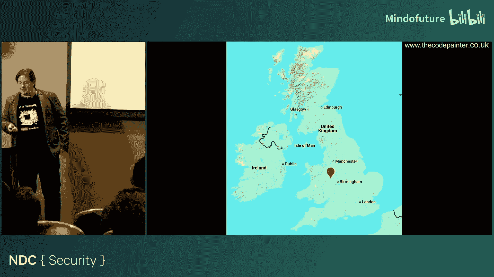

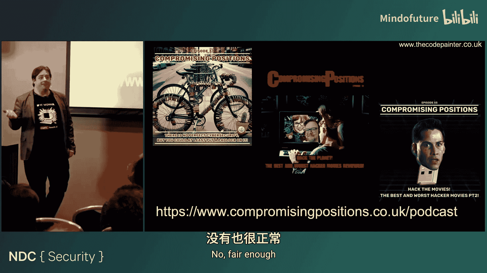

So if you'll indulge in Maanami in a moment of indulgence。 first。

 what actually does the word hacker mean， I am a big fan of word origins。

 And so I could not resist this opportunity。 Give me a moment。 It has nothing to do with。

 with hacking things to pieces。 That is sorry。I'm sorry。 It literally no connection。

 That's a coincidence。As I will see， the name ultimately comes from a guy from the early medieval period。

 as we now call the dark Ages。Called Haa with an A。 We don't know who they were。

 We have no knowledge。 We just know roughly that they existed。 possibly a Lord。

 We're not really sure。 And they possibly were the Lord of somewhere called Haers's Isle or possibly Hacker's marshland。

 again， not totally certain， which is today known as Hackney。Hckney is a place in London。🤧那。

Amongst its many features， I dare say， I've never been is a green。 There is a green on hackckney。

 And this is where they used to sell the horses。So from here。

 the horses came on to take on extra meaning。 The hackckney horse was an old。

 tired out old nag who was worn out from a life of hard drudgery。

 I have no comparison to make to the life of a developer and。

It also incidentally gave its name to the Hackney carriage pulleded by a horse from Hackney。

 which is still the name given to the vehicles that drive around London to this day。 Hackney Cs。

 But that's， again， kind of a sideline because where it really gets its name from is hack writers。

 A hack writer was compared to a hackney horse in that they did drudging creativity。

 free work on a daily basis， wearing them out。 That's where a hack writer comes from。

 And in the Massachusetts Institute of Technology。😊，They use this to refer to developers。

Specifically， developers who were able to just blast off blocks of code without having to consult manuals and do research because they could do it as if it was just ordinary boring daily work like a hack writer。

And the first time it was applied to hacking as in an illegal activity was phone freaking。

 These were actual hackers。 That is developers who could just blast off code using bits of information they knew about the way the phones worked to use them。

 shall we say creatively。😊，Incidentally， it was a sort of whistle that could blow at 48 MHz。

 I believe it is。 It came free in serial。 hence cat and crunch being used as the name of one of the early hackers。

 And it's also the name of one of my favorite magazine。

 a hacker magazine called 2600 named again after this same exact idea。

So what was the actual first hacker movie or rather， can we take a guess or what decade Sho you to。

 Does anyone wantan to take a guess， What decade did the first hacker film come from， Anyone， Go on。

 go on， go on。60s give that man a coconut。 Yes， the 60s。

The first hacker film was called Hot Millions。 I don't know that anyone's ever heard of this。

 I hadn't。 And I'm British。 And so is this film。 But there we have it。 And it's。

 it's actually pretty good。 I recommend tracking this one down。 Honestly。

 I used to think the first hacker was the Italian job。

 And that Benny Hill ought to be the first hacker。 But no。

 it's this film made one year earlier in 1965。 And actually。

 a much better a much better film for the purposes of this talk。😊。

So the first hacker ever shown on screen was played by Peter Eustenov。

He was a fantastic actor from way back when he plays a guy who is an embezzler who's been released from prison and decides that the。

 the big corporations have got rather too much money。

 He has rather not too much money and that some sort of equilibrium needs to be reached。😊。

His girlfriend， later wife， incidentally， played by a very young Maggie Smith。

 who anyone might remember from him Harry Potter， Downton Abbey， and frankly。Tons of other。

 far better products。And here she is looking very young and awesome。😊。

So he gets a job in a great big company， a big American company posing as an expert in computers。

 having sort of forged his identity。 So sidestep number one。

 there will be many of these employee fraud， because this is an example thereof， employee fraud。Now。

 what can we say about employee fraud world。 First off， it's common。

 Most companies at some point have encountered some form of employee fraud。 It is common。

 but also largely unreported because generally they don't like to。The main cause is desperation。

So rather than just kind of a bit greedy or any number of other things。

 it is usually that the person in question has fallen on hard times。

 They normally might well consider themselves a decent， honest person。 But now they are desperate。

 Maybe they've got mouths at home to feed or something like that。

 and they need some money to get them through。Perhaps I'm just sort of extrapolating from the what I've read。

The most common forms of fraud are billing fraud and just simply stealing cash。

 It's generally done at an employee level， rather than an administrative level。

 Unlike portrayed generally in Hollywood films， the sort of grand fraud that you see in those films。

I'm not saying that never happens， but it is by far not the most common form of fraud。

 It is usually much lower level than that。 People with the ability and opportunity and the motive。

Also，72% of it is done by man。 So sorry， man， you suck。

And generally tests an estimated 5% of the annual revenue of a company。Now it's not in one big hit。

 It'll be in lots of little hits， but nevertheless， it costs real money。

How could you prevent basic tips。 know your employees。 Know them。 Get to know them。

 Not only is that a good thing to do。 Not only is that the decent thing to do as a human being。

 as a company， but also， you might notice red flags that might otherwise go unnoticed。

 So and so that used to be jolly and happy over here is now miserable and talking about money。 Well。

 that's a red flag。 And rather than treating with suspicion。

 Maybe we can swoop in and see what we can do to assist。

 and then bypass the entire possibility of fraud even happening in the first place。 Just be nice。

 Is it really that hard。 It turns out it is。Supervision。

 not down to the super level of of sitting over their shoulder， but you know。

Have some level of supervision to make sure it's known that it exists。Tamperpo document trail。

 make sure that we can go back and work out what happened and why audits， carry them out。 You know。

 if there's ever any question， we can find out where it came from。 But， you know， the idea would be。

 don't get to that place in the first。 go there there in the first place。And actually， also。

 there is a genuine problem with fake employees。 This is a growing problem。

 thanks to these guys for telling me about this one。 But yeah。Fake North Korean employees。

 This is a large international， sophisticated operation， affecting many countries。

 particularly the US， where the North Korean government are paying people to set up laptop farms in places around the UK around the US in order that their people in the North Korea can use the laptops。

 therefore， using the I P and the identity of the people who actually own the area that they're in to fake that someone from North Korea is actually in your local country and all that money just get siphoned straight back off to North Korea。

It sounds preposterous， but it is actually happening， and it's a growing problem。

 And they're getting very sophisticated in the way that they hide fake employees。

So it's getting harder as well to even tell that this is happening。 But there we go。

 You just have to be very careful in your vetting process。 Make sure they're real people。

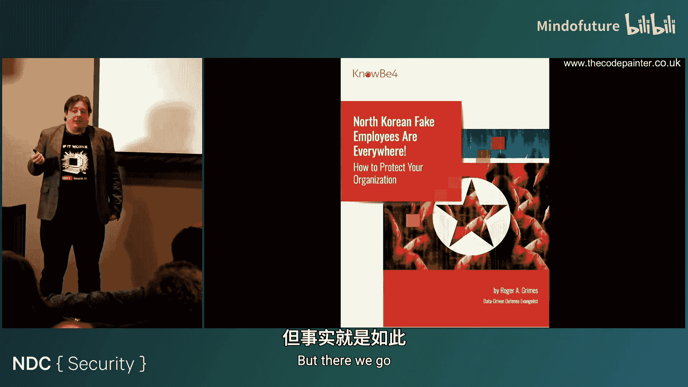

So moving back to the film， he has a go at trying to mess with the system to put in fake companies。

 That's what he really wants to do， create fake companies and start moving billings around the world to try and siphon off some of that money。

 but it's not working。 Everything says a legal procedure。

 Turns out there's a security device at work。 It's literally a blue light。

That is as much explanation as we ever get。 It's a blue life。Yeah， let's all get the blue light。

 and we're all good。I mean fine。 It was 1965。 At this point。

 people will be lucky if theyt even know what a computer is Probably it's a simplification of a much larger process that nobody's really interested in。

 Fine， it's fine。 But yeah， it's a blue light。 So how do we deal with。The blue light， right。Well。

 the first hack ever depicted on screen in Hollywood。 Actually， it's not Hollywood。 It's British。

 but there go， is these cleaning ladies。So strictly speaking。

 these ladies are the first hackers ever on screen。

 So what happens is a lady comes in with her washing basket， a basket and a pot of tea。

 She realizes that the pot of tea is not hot enough。 So she gets the bucket。

 waxs it against the machine。 The light boxs open， and she pops her pot of tea inside the machine to warm it up。

😊，Behold， our first hack。And that's actually true。I I I， it's a comedy film。

 I may possibly not have mentioned that， but it is。

 And that that is actually quite funny all the time。

 Our actual hacker is sitting there S jaw wondering what's going on。

 Turn out there was a massive security floor in the system。

 And he learns the exact spot you need to whack to open up the blue light and switch off the security system。

 Fastic。 So let's talk about vulnerability reporting。😊。

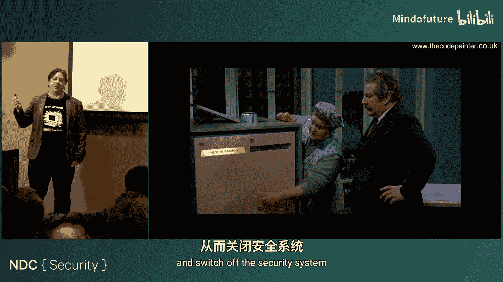

Because maybe if there had been some， we might have avoided this situation many， many years ago。

 Who can say， But make it easy to do。 have a contact details。

 Some sites these days put in security dot T X D so that it's easy to find out who it is you need to report these two。

 actually take it seriously。 Otherwise， what's the point。

Anyone can set up an email address and let people write in that there's vulnerabilities in your website。

 But unless you're seen to act on it， that source of useful vulnerability is going to dry up fast。

And give out rewards。 Why not。 It doesn't have to be money， although it can be。

 bug bounties is a thing。 Comp that hand out money in exchange for people finding bugs with their system。

 but also prestige。 I mean， just be nice。 C that somebody helped you。 I mean。

 most of us are fundamentally decent people who would probably walk around feeling happy all day because of big companies like them。

 I would。😊。

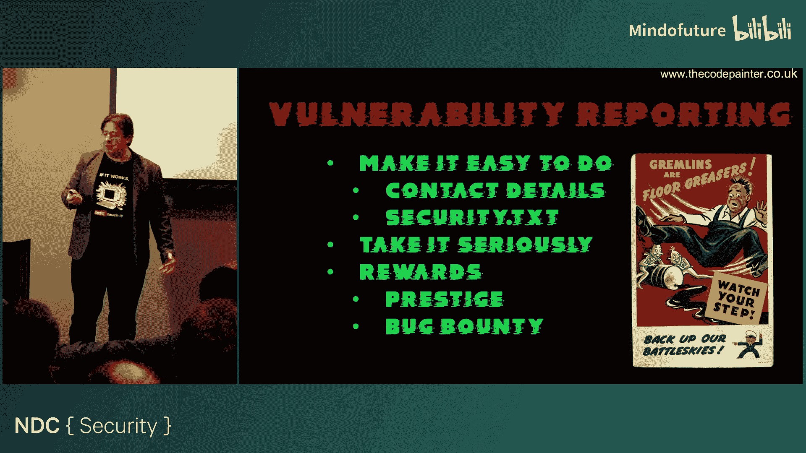

Back in the film now， he's worked out what to do。 He waxed the bucket against the。

Blue light of security and start setting up companies all over the world with CEOs named after famous composers like Cla Debu C。

 which might seem ridiculous。 But if you have a look at the details of the Enron scandal， The were。

 in fact， fake people with names are M Mo and so on created。

 They just thought no one would ever look。So it's odd has some of the most preposterous details in these things could turn out to be true。

And in the end， he takes his hot millions。 It's named after the the teapot that was hot C C and swoops off to Rio de Janeiro and eventually gets rehired for the same company as a security consultant。

Great， now， it's actually not totally outside the realms of possibility。 I mean。

 there's a lot of security consultants who are former criminals。 That happens。

 That's a real thing who's better at spotting a criminal than a criminal。 So that's all right。

 This is a great film。 You should watch it。 It does not deserve to be obscure。 It's great。 Also。

 Peter used enough。 is one of the most phenomenal actors ever。😊。

So let's move on to a proper security film like Batman and Robin。 Ha anybody seen Batman and Robin。

 I feel sorry for you all。This film sucks。I， I started watching it for your sake。

 And then after a bit， I had to turn the sound off。I。Oh， you poor thing。 She paid money for this。 Oh。

 no， no， no， no， no。 If you talk to George Clooney， I'm told he'll refund you。It's anyway。

 I'm gonna move on because there's too much to talk about in So there is a scene in which Barbara。

 not Gordon in this particular instance， is sitting with Alfred who， who's lying incredibly ill。

 And he wants to pass on his legacy as basically being Batman Butler unknown to her to someone else。

 So he says that there's a secret box here full of secret stuff。

 And she has to give it to his brother。 I did not know he had a brother。 but great。 fine。

 there it is the super secret box of super secrets that has to be only given to him。

 So as a good and decent family member， she promises that she will deliver this and then doesn't。

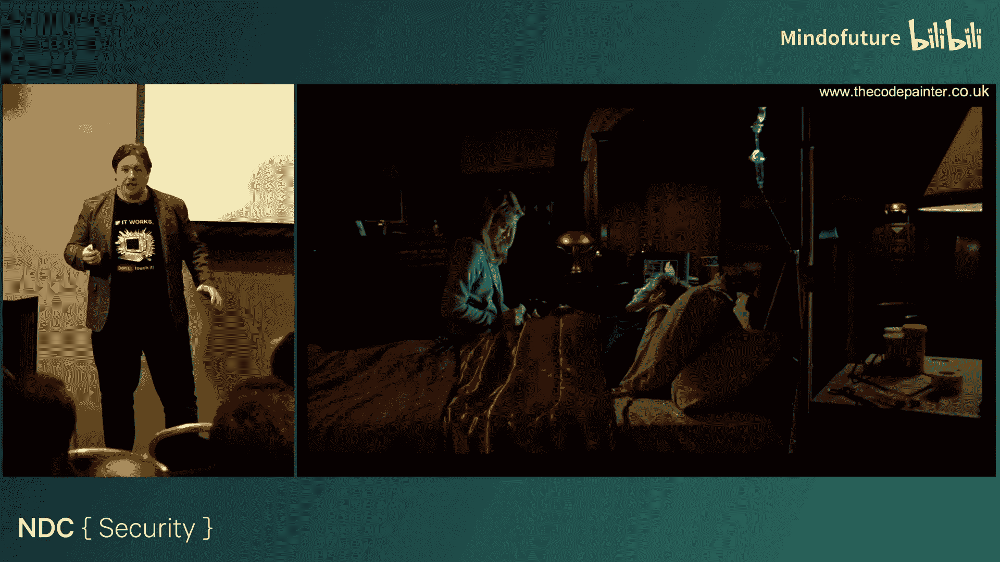

She hacks it open with a Strgrdriver and has a look inside and finds a CR。Right， okay。

 let's want this in。 What can possibly go wrong。So， oh， there's an app。 Let's have a look。

 It's called Alfred C， D。It is。 I can't can't argue with that。 So let's try a password。

 There's a password。 I notice that she's trying capital for A for Alfred。 That's a nice touch， nice。

Let's try there Alfred。 Yeah， that's not it。 And we thought this hacking business would be easy。

 Is it wane。Now it not why。Is it England you thinking outside the box out for it's English， not that。

Then she starts having a cast around the room。 Oh， there's a picture of Alfred's old girlfriend。

 Her name was Margaret。 Could it be Margaret。😊，Let's have a closer look at the picture。

 It's got the word tag on it。 short for Margaret。Is it peg， It is。This hacking business is a dodle。

 Also， incidentally，Writing。No writing。Writing。No writing。

It's almost like the test audience didn't understand what the hell was going on。

 And they threw in a random close up to try and explain why Peggy shot for Margaret。But。Fine， fine。

 fine。 But apparently， the password to all the secrets of Batman is peg。3 letters long。

All in English。Which gives you access to all the secrets of the back cave and access to the back cave。

Now， if the Jor had gotten his hands on this little box。

 even if the Jor were to sit there trying every single possible English combination of letters wouldn't take him really very long or much patience to get to beg。

So let's talk about password security for， which I'm hoping none of you。Have an issue with。

 but I could tell you some stories。 I really could。User accounts。

 we should minimum consider using user accounts， because at the moment。

 one password peg that gets you to everything。If the joker cat tracks that， well。

 then how does anybody know who's gotten in， No one knows。 It's just one password。

 One identity could be anyone。 Even the records of who used the system are worthless because we don't know who that was or which account was cracked。

High entropy， that is long passwords with a complicated combination of uppercase， lowercase。

 special characters， all that huge numbers， all as many possible sets of characters as possible。

Common password check。 It's dead easy to find yourself a list of the thousand most common passwords online。

 There's loads of them。 easy。 Stick it in the browser。

 have a check before the this password gets sent up to the to the server， whatever maximum temp。

 even this much， maybe even put in like a5，5 second delay in between that even will make a massive difference towards the ability of anyone to hack passwords。

Make the high number。 It doesn't matter just the fact that the limit exists。

 multi faculty authentication。Have a mobile device， have something else。

 beside just a password because passwords on their own are not really very secure。 password managers。

 a lot of places now are allowing the use of password managers。 I use one。Store only hashes。

 If you're storing， I， I have heard stories of some fairly well known high street brands。

Which still hold passwords in the plane， which developers think is a great idea because they can just sort of log in as anybody and try things out。

 which seems like a great idea until that password that had database gets hacked。😊，And salt the hash。

 if you don't know what that is， come and have a word with me。

 I will tell you all about it in detail。 But this is another way making sure you don't fall foul to the usual common problems。

 Look it up。This is， I've only got an hour。 I cut to thatle through。

 Pass for authentication is another option because passwords are not very secure。If you make them。

 if you make your password requirements too complicated what you end up with someone literally writing down a piece of paper and stant to your monitor。

 That's exactly the situation you want to avoid。 So biometrics。

 I actually have a kind of mixed feelings about biometrics in all honesty。

 The problem is that they don't change my my fingerprints will never change no matter what I do in all my life。

 I mean， I can maybe file them off。 But then what have I really achieved。 But I can't change them。

 I can change my sex easier than I can change my fingerprints。 That's my point。So I don't know。

 I'm not totally convinced on biometrics。 Multi fact devices。 That's pretty good。And smart cards。

 a lot of companies now use smart cards。 I did a card， attached to your belt。

 stick it while you're at the terminal， stick it in， and it's attached to your belt。

 So when you walk away， you have to take the card out， turn the machine auto locks。 I。

 I know of of more than one company that's doing that now。 So that's another option。

 depending on how higher security you really need。O TPs， one time passwords。

 lot of places don't even allow permanent log on passwords anymore。

 Just do an O TP where it sends something to your phone or something like that。

 Lo in the one time and you're in。 So there's all sorts of options。 not exactly password free。

 but still not a stored password。So on the subject of passwords。

 let's move on to one of my absolute favorites。 who's seen hackers。Yeahay， hack the planet。

I love this film。 Absolutely unapologetically， adore it。And I。

 I actually argue that this is the greatest hacking film of all time。😊，I mean。

 there's probably ones that are more accurate now before anyone says Mr。 Rob is a TV series。

 so it's disqualified。And I do also love the film Sneakers， which is also a very great film。

 But they are penesters， not hackers。 I know that the Venn diagram of the two is pretty big。

 but hackers。 I love it。 I adore this film。😊，There is a scene speaking of passwords where this guy。

 would it the plague or something I think he calls himself his real name Eugene。

 because anyone called Eugene is going want to have a cool hacker name rants at length about the use of the most common passwords in the world。

 which he claims are。Love secret sex and God。 So I got curious， is this true， Is this true。

 or do we think no， no it's not， These is the most common passwords。

 The most common password in the world is 1，2，3，4，5，6。

If you want to know why I rant so much about passwords， this is why。1，2，3，4，5，6。 Now， in fairness。

 most of these passwords honestly look like no one really cared。

 And it could be that these dummy accounts， test accounts or account where it didn't matter。

 I did see one that was Q 1， W 2 E 3。 I bet that person thought they were really clever that day。

But no， we know about that one， guys。Theses are actually。

 if you filter out the most common passwords。 Now， football， I can understand football fine。

 Both America and the UK and many other countries have a game they call football。

 It's not always the same game。I mean， America's wrong， but nevertheless， fine。But monkeykey。

I do not understand this。 I mean， dragon， sure， who doesn't love dragons。 I love dragons。

 Dragons are cool。 Wee， trust no one F。 I like flowers。 That's cool。😊，Monkey。If anyone， by the way。

 does anyone feel a need to change their password right now， Just， just wondering， just wondering。

But there we go。 You get the idea。 This stuff is not hard to find。 Moving back to our film。

 It actually opens with a trial scene where our hacker of our main character is on trial。

 It's not this lady incidentally。 This is his attorney。 It's this guy。He's a kid， shock。

So is this particularly accurate the idea that the kid could be the hacker， Yes， totally。

 here's 3 I found just in the last few years。 This is lapsus， also known as Arian Curage Curtai。

 I'm not totally sure he hacked into Nvidia and Uber and rock star games and leaked to load of footage of the Asia un releasedleaed Grant theft Autoto 6。

 all in an attempt to blackmail these companies for large quantities of money。😊。

He was 18 years old when he was arrested， he had been a hacker for many years。Daniel Kelly。

He was booted out of his college after his behaviour。

 following being treated as what he thought was meaning that he was not clever enough to complete his qualifications。

He is autistic， I believe， But nevertheless， that is no excuse for going and doing about 20 Ddos attacks against his college。

 which is what he proceeded to do。 He was 16 years old。And Max White House。

 I don't have a photo of him。 quite common amongst these juvenile delinquents。 I mean。

 most of these folks are too young to even drive a car themselves and have to be taken to court by their parents。

 So you get the idea this guy hacked an online gaming site or attempted to。 And during the trial。

 the judge suggested he maybe take up rugby or or something more interesting event。Yeah。

 you get the idea。 So no， not totally outside the bounds of possibility。 Hacking， frankly。

 is dead easy。It really is。 It's depressingly easy。

 And so it's not outside the I of real possibility。

 and largely an awful lot of high profile hacks are kids。

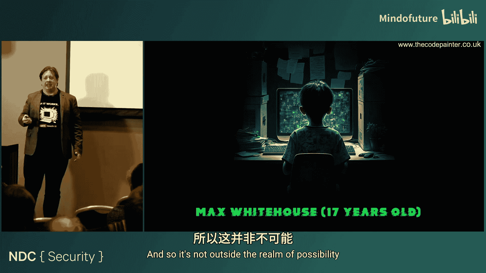

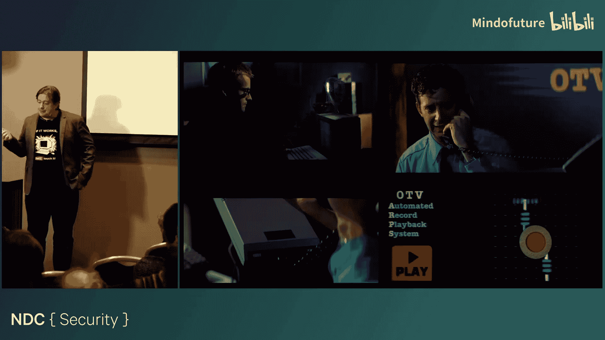

Who do it for no special reason other than why not。In our film。

 we see more grown up Danne as as he is now doing an attack against a TV station。

 which is playing far right propaganda。 He phones up the guard。

 pretends to be tech support and ask some details off the router by the phone over there。

 And the guy says， sure， O， and gives him everything。

 All him to hack in and replace the far right program with an episode of the outer limits。 Now。

 I can't totally disagree with his motives。 but nevertheless， this is still a crying guys。

And incidentally， this sort of thing did happen。 There was an infamous case in the 1980s where a hacker did somehow interrupt a broadcast of Doctor who shock in America and replace it with。

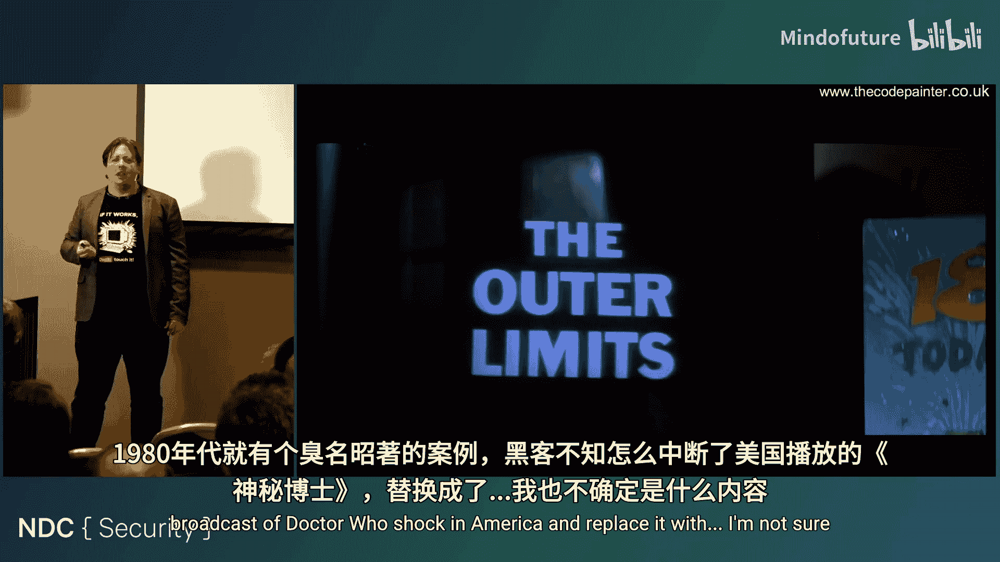

I'm not sure。It appears to be a man in a Max headroom mask。This happened twice by the same person。

And frankly， no one knows who it was or why they did it。 And you can look at this footage on YouTube。

 But I do be warned it will haunt your nightmares。It's， it's pretty strange stuff in all honesty。

 But there you go。 That actually did happen。So social engineering， that's what this is。

 There's a few forms of social engineering。 There's ph， which is， you know， here's this link。

 Why don' you totally click this link， This link looks good。Bitating。

 which is just leaving something lying around for someone to maybe find and think is useful。

 maybe leaving a USB stick somewhere around the office。 Or what looks like， you know。

 here's a whole load of lovely discounts to buy some cheap merchandise website， but it's not。

 There's loads of that going around。 pretexting， pretending to be someone you are not or something you are not。

Wale fishing， fishing， but kind of a bit more sophisticated。 It involves researching the target。

 finding out all about them and making a ph attempt that looks very convincing。

 maybe with details of people they know and projects they're working on and whatever it takes to get them to click on the link。

And fishing is now 75 times more common than malware。Out there on the Internet。

 when I was much younger， the big problem was accidentally finding a dodgy website that started installing stuff on your website on your。

 on your computer without you realizing。 And we all had to get used to reus antivirus and scanning regularly for viruses。

 It's not as much the case anymore because they frankly， just don't need to anymore。

 Fishing is a much better way of getting the money out of these people than malware。

There are over 2 million fishing sites registeredged by Google。

 That's just registeredged by Google a lot more than that out there。 I absolutely guarantee it。

Estd 1。8 million losses。 And that's just in 200 that's the statistics I've found for 2020。

 I bet you anything that's a lot higher。 Now。 This problem is only getting worse with time。

Men are 20，225% more like for it than women。 Guys， you suck。Just saying。

And 86% of organizations have had someone click on a dodgy link。

 I have heard a story of another very well known UK high street brand who had to shut down chunks of their network and change their their company hierarchy because someone somewhere clicked on a dodgy link and unleashed help。

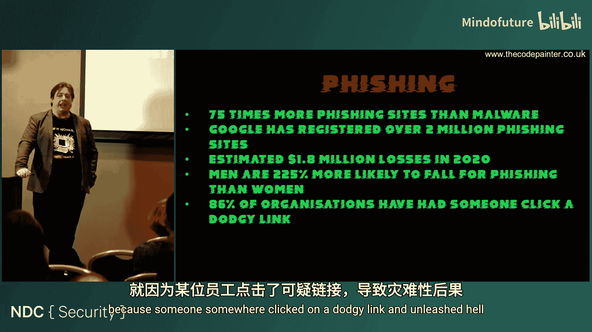

That yeah。It's a serious problem。Pretexting， if you want an example， pretexting。

 let us think of the fur， the film frozen。 I have two daughters。

 I have seen this film more times than any sane human being should。Each of them had a frozen face。

 I'm not sure I can even actually hear this film anymore。 It's just sort of background noise。

 whenever it's on now。But think of Princess Anna， who meets hands here。

 who pretends to be someone who loves her。 And she's alone and desperate and looking for someone。

Spot twist， sorry， guys。 He's totally the secret villain。 And actually， he just wants a kingdom。

 I hope no one hasn't seen frozen yet，ca it's actually a good film。 And I just ruined it for you。

You know， what， I don't feel sorry。But if this seems unlikely， let me introduce you to AI Brad Pitt。

 Has everyone heard this particular story now。It's easy to laugh。Yes。

 the lady in question should probably have used her her faculties maybe a little early and thought a little more before sending so much money。

 but。Fundamentally， we are all human beings。 And what we want is love and connection。

 And all of us have had lonely moments when we've been desperate。

 And I would honestly believe that most or all of us could fall for this。

 If it fell on our lap at the right moment in our lives， especially as in this case。

 it's not like you just said， hi， stranger。 I'm Brad Pitt， give me money。

 This went on for eight months。8 months when whoever it was was faking an entire relationship with her。

 this will have seemed personal and real。And that's horrible。That's horrible。

These people scammers know that love is a vector that consistently works on human beings。

 and they don't。Imagine wasting eight months of your life。

 And then it all just turned out to be a pretext to get your money off you。

 Some of these things go on for years， literal multiple years before they finally start drawing money。

These people are disgusting， and this is horrible， but it works， and it will continue to happen。🤢。

How can we prevent it？staff training。 I mean， frankly， that's really the ultimate solution。

 Train your people。 Let them know what this looks like， know what to expect， know what to do。

 have a facility to double check something if it seems dodgy。Minimal ne abilities。 I mean。

 at least cut down how much damage someone can do if they are convinced。

If someone doesn't need to be able to move money around， don't let them。

 If someone doesn't need the ability to install software on their machine， don't let them， whatever。

 cut everything down as low as possible。Separate admin accounts。 I mean。

 if someone manages to get someone to seize control of an account somehow。

 make it so that they got a separate admin account when they do their admin stuff if they need it。

 that's something I know a lot of companies do now。 standardized process。 Someone phones up and said。

 hey， I'm in trouble here。 Would you just do a quick bit of admin for me so I can get my job done。

 tell them stick a ticket on the ticket thing and it will go and get your boss to sign it off whatever I don't care how desperate you are。

 if that's the process。 But at least that gets around the problem because these people will try and go under the radar。

Staff training， are putting it here again because it really is the ultimate solution to the problem。

Make up your own， bring a third party company in whatever it takes。

 I know a lot of companies now do things like phishing training by literally doing fake phishing attempts on your own people or leaving USB sticks around。

 So if anyone sticks it in send an email to their manager， say that guy's a bit of a dimwi。

 you just stuck your random USB in his computer。 So at least， you know， it's a problem。

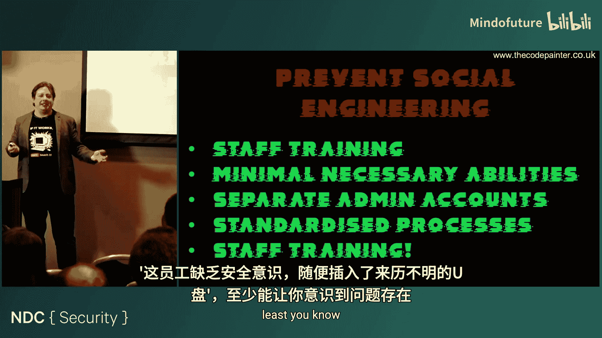

You know， there's all sorts you can do。Let's go back to our guy。

 So then what's the other hacks we see him doing， taking control of a sprinkler system in a school。

 And it's made to look as if there's something really cool and sophisticated and clever。

 It's bubbbly not。 I bet you the password was admin。😊，Bet you anything。

 I know what schools could be like。 So fine， that's not totally unrealistic。 But later。

 one of his friends tries getting into a mainframe and uses。Either the user account or the password。

 It's unclear。 God。 Honestly， this film doesn't know the difference between a username and a password。

 It uses the two words interchangeably throughout the entire film。It's confusing， but fine。

 I'll let it go。 And also， this is a server room。I like it。My office doesn't look like that。

 I w to work there。 Guys skate into on skateboards。 too。 It's the most 90s ta thing you'll ever see。

 What the bad guys are actually doing is taking advantage of rounding errors in transactions。

 or whenever there's branding error， they benefit from it by the money coming their way。

 It'll be a penny at a time。 But over time， it it's a cruise until they've got a lot of money。 Now。

 Hollywood is actually quite obsessed with this idea It's called salami slicing。

 I know of at least three films that use this exact premise， including Superman 3。😊。

Which is a completely legitimate and accurate depiction of hacking。

 including that bit where the computer turns a woman into a robot who then rampages around destroying a laser beams。

I mean， I did about you。 but it was like， I， I deal with that problem all the time。But。

If it's ever happened in the real world， I haven't yet been able to find a natural instance of sy high slicing。

 at least at the sort of grand scale we're talking about here。

So in response to the sort of attempts that are starting to gum their way from a corrupt CIA guy to control them。

 The hackers start getting back at the CIA guy。 They do a couple of things。 They。

 they hack into the bank and have his card destroyed。

 They hack into the police and give him a fake traffic violation。

 They hack into whatever government system and have him declared dead。Now， of these three things。

 one of them actually happens on a regular basis。And surprisingly， it's the dead one。That happened。

 I would like to introduce you to Padiarov。 He is from India， and he's dead， except that he's not。

The records say he is dead and on， on paper， he's as dead as it gets， except that he lives。

 He is a member of what's called the Indian Unad community。

This is actually a big problem in some countries。 And in it generally done as a scam to attempt to get their property off them because the dead cannot own properties。

 either by a relative or maybe by a tenant or someone else to get their property by declaring them dead。

And an awful lot of countries have the problem of dead tends to be a one way street。

 So their computer systems have that assumption built in。 speak generally speaking。

 in the majority of cases， those that die don't come back again。

And so when you beg that assumption in， it's hard to correct your mistake when it turns out you were wrong。

So unto our guys， now they start we start picking up the campaign。

 We are still going to hack the planet or specifically this company， rather。

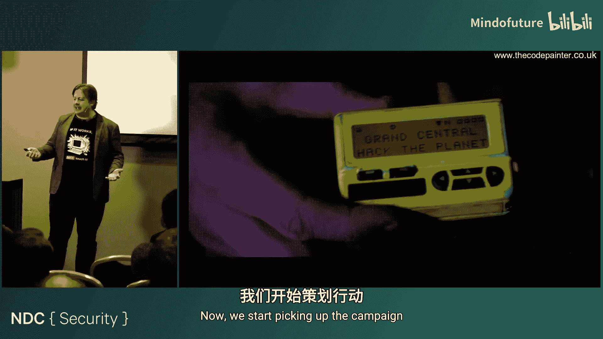

And they start gathering data， which is the first step of a legitimate hack。 So dumpster diving。

 That is actually Angelina Jolie jumping into a dumpster。 Thank you， Phil。 gathering documents。

 legitimate。 That is a real thing。 That's a genuine problem。

 There's all sorts of stuff in your documents in your organization。 I mean， in the film。

 they say they're looking for passwords， which is a simplification。

 What you're really looking for is names of people， companies， projects， servers， IP addresses。

 All of that is really useful。😊，This guy goes and pretends to be a construction worker or something and installs some devices in the office to snoop by pe packets。

And this guy pretends to be a delivery man and just literally walks around watching people take their passwords in。

I mean， yeah， it it would work。 absolutely。 So on premise security。

 because that's really important because frankly， once the the， the。

 the hackers are into your building or bets are off， they probably got what they want。

Physical security on windows， at least historically， is's pretty shockingly bad。

 It's not hard to get what you want off that machine as long as you're able to sit at it for long enough。

😮，Mark security levels on documents。 I mean， that's a basic。 that's in I S O 27，00 1， I believe。

 you know， if it's more secure， market is such So we know to treat it as such secure disposal。

 have a minimum， have a paper shredder。 that'll do it。 Or if you need to go next level。

 hire a company that will do it for you。 There's all sorts of options for this。 I D cards。

Which I blow both ways on a little bit。 Think about I D cards with the pictures on。

 No one looks at them。 frankly， they don't。I know of studies that have been done where folks have experimented by taking I D card and then replacing the picture with a picture of a rhinoceros。

And then going into the office， and no one notices。So you should have them。 It's best to have them。

 but also be aware that they're not quite the magic bullet。 you expect them to be。 Staff training。

 Tell them what to expect。 Tell them what to look for。 Tell them that it's O to challenge people。

Quite often， all these people will do。 And I know of cases that I've heard from fairly reputable sources of this。

 like folks that make their way into offices or into building sites or whatever by simply putting on a reflective jacket and carrying a clipboard。

And that's good enough。 People will assume that they're professionals or or someone in authority and know what they're doing。

That's it's in our nature not to question in many ways。 So， yeah， multi authentication。

 our good old friend。 I'm bringing it up again。Restrictt visitors。 I mean。

 why does the guy with a delivery need to come into the office at all。

 Just tell them to wait at the the door and someone will come to him。 I mean， that's pretty basic。

 but。I wouldn't be giving this talk。 I wouldn't need to if I didn't know that not everyone does this stuff。

 Sign visitors in app， maybe take a photo of them。 That's not a terrible idea。

 At least you know who they are and what they look like。

So they then start a massive hacking battle against the company。

 And this scene has to be seen to be believed。 It's wonderful。

 A literal hacking battle where they line up in central Central St in New York。

 all with their laptops at the ready plugged into the phone line like troops going into battle and includes things like a keyboard with emojis on it。

 they didn't call them that back then a totally pointless V R headset for some reason。

 and all sorts of other nonsense。 And they start sending virus after virus against the baddies to distract them。

 And it's brilliant stuff like a virus based around a cookie monster that can only be defeated by typing the word cookie and a rabbit thing that spreads like a rabbit。

 I mean， it's basically a worm， but they don't call it that because they're trying to keep things simple。

 It's brilliant。 And all of the machines in the whole of the company get locked out now。😊，These days。

 honestly， I wouldn't bother。 I'd just eat off them。I mean， you know， that。

 that's great fun in the film and all but just dodo them。

 Take control of a whole load of Io T devices and then start having them all project packets at the same time against the same company。

 It's， it's almost impossible to defend against our form of attack。

 and it will pretty effectively kill stuff。 If you've got it sophisticated enough。😊。

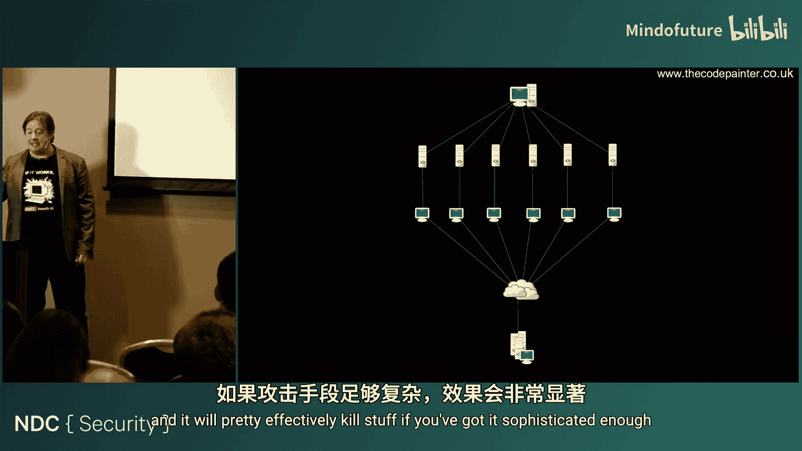

The size of the record ham Diddos attack goes up regularly。 The most recent that I could find was 3。

15 billion gig per second。It's， it's， it's big。And。These clouds， these sort of clouds of D Dos。

 I O T devices is getting bigger and bigger and bigger all the time。 This is a huge problem。

 I actually believe there was， if there was ever a giant war between two superpowers。

 this is the sort of weaponry that we'd be looking at having used。

 things like D Dos attacks to kill network infrastructure。

 which would blind and cripple armies far more effectively than killing the people。

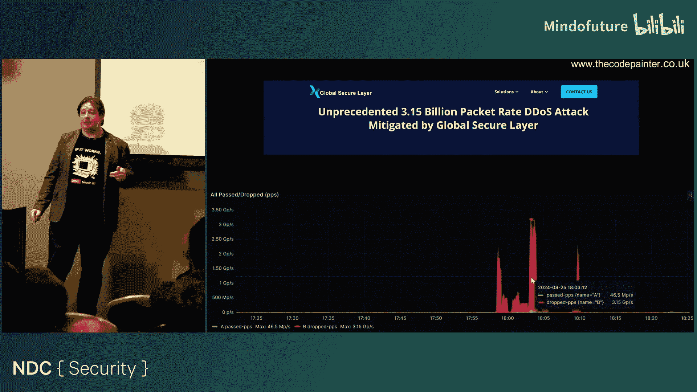

And it's getting worse。 This problem is literally getting worse， all the time。

So what can you do to mi against Diddos。Wait。See， I mean。Most of the time。

 it's going to be a bored kid。 I， I've heard plenty of stories of。

D dos clouds of I O T devices that were just literally some kids doing it for some No some reason。

 it's the computing equivalent of just going and smashing all the windows on in a Saturday night。

 It's not clever。 They just felt like doing some damage and showing how cool they are。 apparently。

 just wait till they get bored。 It can happen。Pay up。 Sometimes it's done for ransom。

Company shouldn't， but I know they do， but it's an option。Distributed web hosting， stick your。

 If you've got the money for it。 If've got the pockets for it。

 Dis a website or your Web app all around the world， at least it minimizes the problem。

 It take a heck of a Ddos organization to be able to do something about that。

 upstream square traffic scrubbing I P blacklisting。

 although that's only gonna to have somewhat of an effect on this because This isn't one giant block of of a request coming from the same I P。

 This is a cloud of thousands of them coming from all over the world。

 That record one mostly came from Russia and North Korea incidentally。And so， you know， that yeah。

 A D Dos resisting hosting service， there's plenty of them out there。 make it their problem。

 but you'll have to pay them for the， for the privilege。At I O T laws。

 I that's probably ultimately the best solution to this。 As far as I'm aware。

 there are no international standards on the security that should be applied to I O T devices。

 especially the cheaper ones。 A lot of them have got preset admin accounts with preset admin passwords。

 which are child's play literally to hack。 I could show my eight year old daughter how to do it in about 1 hundred and 20 seconds。

 It's that easy。So anybody can just either write or get a copy of a script of someone else that will literally automatically stroll the Internet。

 looking for these things， capturing them and making use of them。It's easy。

 So unless there's some sort of litigation that allows us to put some sort of minimal level of security on I O T devices。

 this problem will only ever grow。Let's talk about Jurassic Park。

I'm guessing most of you have probably seen Jurassic Park。 Now， I。

 I was born in the 1980s and grew up in the 1990s。 I got this on V H S for Christmas in 1996。

 I believe it was。 And it's a pretty awesome film。 It has dinosaurs in it。

 Who doesn't love dinosaurs。 Well， the guys in this film， they don't。😊。

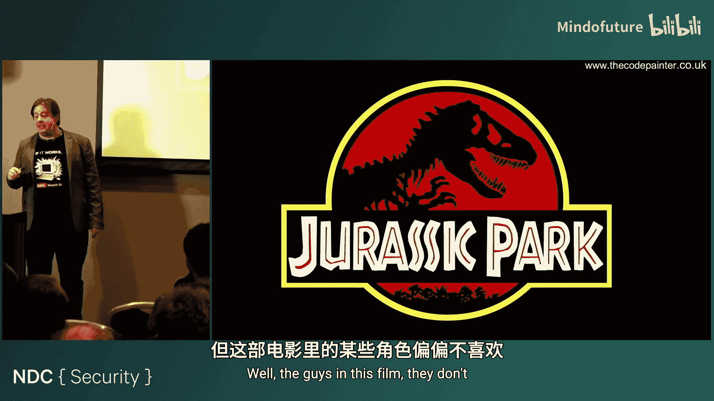

Yeah。This is the developer。 Now， this is a very unhelpful stereotype， but nevertheless。

 Hollywood loves this one。 he eats。He's， he's a sloppy guy。 He's fat。 He， he's poorly dressed。 He。

 he， he has poor social skills， Dennis Neddry。Apparently， he， he。

 he claims he can like debug 2 million lines of code。 And who else is going be able to do that， well。

And do it。 Can I go to the dinosaur park， I can do it。 I probably do better than that guy。 But fine。

 He is the only developer working for Jurassic Park。😊，Well， what could possibly go wrong。

 Spd no expense， hired one developer。Fine。Now， not only is he bad tempered and doesn't take criticism and is rude and claims he's not not appreciated enough。

 And I， I've worked with guys like this。 I know this guy。 I've worked with him。

 These guys are bad news。 Even， yeah， I knowt he's the bad and all， but still，And also。

 he complains that he has financial trouble。 But rather than doing anything about it。

 as I kind of suggested earlier， the the the boss just sort of says。

 your financial troubles are your problem。 Go back to work。Well， that won't come back to haunter。

Because it's unknown to everyone。 He's totally sold out to one of the competitors。

 and he's planning to sell all their secrets。 Oh naughty。 Nobody could have seen this coming。

And there's the source code incidentally took a quick screen grab in case anyone's curious and。

Is that object Pacal。They're doomed。Doed。But I do w to point out right at the top there。

 if you have a look。Nedreland。He has named the source code after himself because he thinks he's the only thing that's important in this entire code world。

 This is not healthy。So he goes about that night during a tropical storm， enacting his devious plan。

And oh， it， by the way， I' am back to ruin Jurasic part for you slightly。

 When you see a bit of security cam footage like this， have a look at the Butme screen right here。

 Can you see that， Can you see that。It's an A VI progress bar， and it moves across the screen。

 And then the moment it gets to the end， the video disappears。Every single time。

 I noticed this the first time I watched it in 1996。

 I've noticed it every time you may never be able to watch these scenes the same way again。

 There is a really obvious A V I progress by you're very welcome。So he starts away his program。

 which has a timer on it to give him time to break into the lab and also disable all of the security doors and then disable many of the security paddocks so that he can go about escaping。

O， well， that's a bit of a problem。Employee corruption。 We've talked about this。

He also locks out the system so that nobody can undo what he's done easily。

 And can anyone else hear this screen capture。I've watched this film so many times。

 I can literally hear the。I do like this film， though。 So the boss says。

It is best dramatic aors voice that they have to restart the system。 This is what they call it。

 They say restart the system， but actually appears to be sort of like hard reboot back to factory settings or something。

 It's unclear， which they do by pressing a button。陌明。大音。

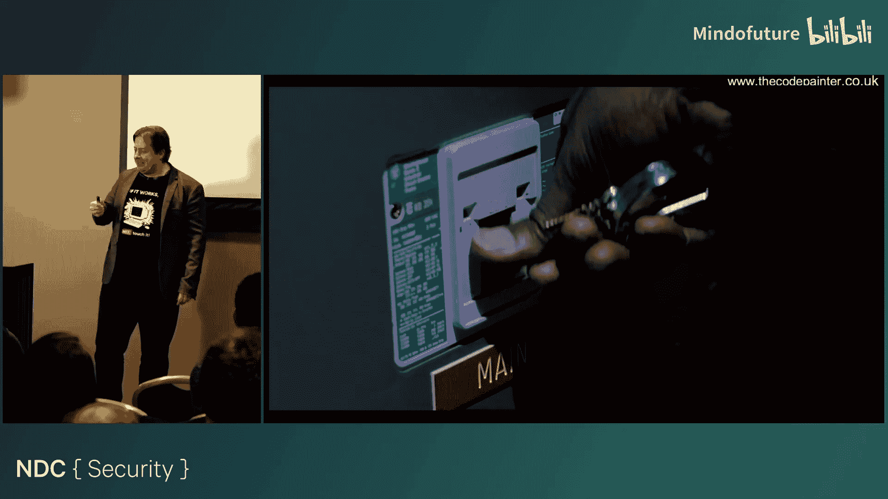

At least it's easy。 I have to give them that。 I mean。

 but you would hope what that no one would ever lean on that button or or something but fine。

 And it kills all the power to the entire park， putting everything into darkness。But system back。

 that's good。

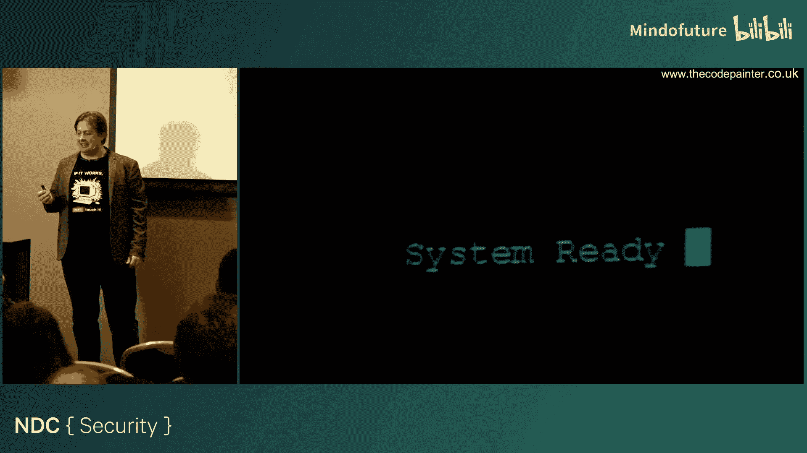

But the paddocks are still off。 That's bad。So they have to go all the way over to the other side of the compound to mess with a whole load of stuff and switch the park back on again。

 And then jobs are good， except it's now full of flesh eating dinosaurs。😊。

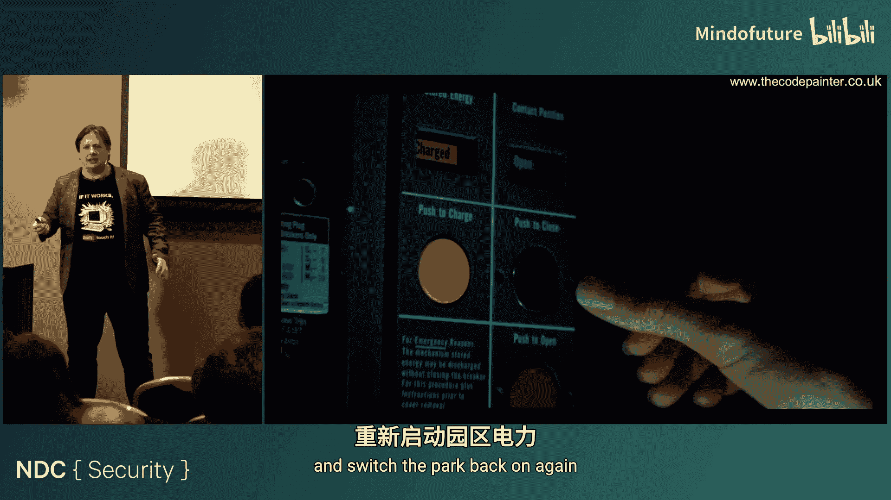

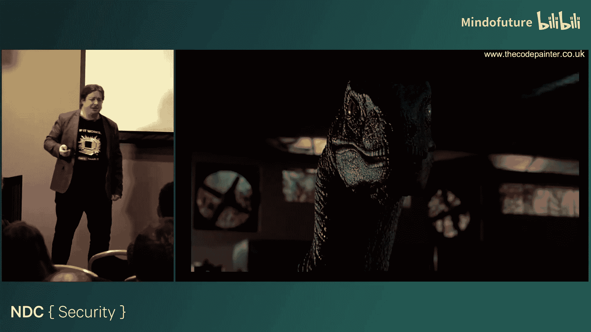

That bad。So how can we mitigate against dinosaur attack？ Well， there's a few things we can do。I mean。

 frankly， this is a bit of a Mickey Mouse operation， isn't it， Spd no expense。

 have no idea how to run I T， but fine。Developer culture。 Dennis Ndry is a terrible developer。

 He is the epitome of the worst of what we are。He doesn't take criticism。 He's egotistical。

 He thinks he's everything。 even hims a code after himself。That's dangerous。 I know people like this。

 And every single one of them was a danger to the company they worked for。

 These people should not be tolerated。I know sometimes the bosses find it easy because it's like。

 I just give all the work to that guy。 and he sits there and he just does all the work。 Yeah。

 but look at the long term consequences。 You're putting everything on this one irascible。

 unpredictable， dangerous guy。 And if they ever decide they've had enough one day。 Well， that's you。

Of the shoot。So more developers， one developer。At least two， at least， I mean。

 I'd have a whole load of you guys， because they check each other's work。 I mean。

 that can be a positive thing。 I like it when people point out problems in my code because it gives me a chance to improve。

 And I like that。 People like Dennis Nedry， no。😊，To what's it with that guy。

 But we should all take lessons from each other on how to improve。 But also。

 it makes it much harder to sneak in the code that literally switches everything off when Dennis Nery presses the button code。

Because that could happen。 And if you know that the people， other people within the code base。

 it reduces the temptation to even think about it。And you shouldn't be thinking about it， frankly。

Disaster planning， actually， like， have a disaster plan。 That would have been a good idea， I think。

 I know they haven't opened yet， but they're told that they're about to open and they have no disaster plan。

A failed strategy， open or closed。It's an important system， open or closed when the system fails。

 Do the doors go closed or do the doors go open。 You should have made a choice。

 It turns out it was doors go open。 Dinosaurs go free。I mean。

 if you are a shopping mall and the shopping mall is on fire。 Sure， doors go open。 That's good。

 If you contain a number of flesh eating dinosaurs， which is greater than 0。Doors go closed。まだ。

If you are a public toilet with an electronic door。Not sure。Either way， you lose。Now。

 I want to talk about the net。I love this film。 I love this film so much。Anyone who knows me。

 any amount knows how much I love this film。 And I really do。 Everyone should watch this film。

 but not until you've had a few drinks。😊，It's the perfect intersection between the wish to look completely authentic and having no idea how。

It's wonderful。There's a bit where she tries to find a guy by using who is command using his chat room name。

 And it gives out his real name and address。I love it So stupid。 And Sandra Bullock's in it。

 And she's doing her absolute best to make it all look legitimate and real， and。Oh， I love this film。

Anyway， this is Andrew Bullock。 She is a software tester。 Her name is Angela Bennett。And somehow。

 this rubbish got not only a sequel， but a novelization and a spin off TV series。How。But fine。 O。

 she's a software tester， and she's testing what appears to be Wolfenstein 3D。

She is told there is a bug in the game， which is clearly Wolfenstein 3D and that everyone has it。

You see， it's a virus。 Oh， no， and everyone has it。Even though it's a C D Ro game， but fine。

 Everyone has it。 And then she uses a hex editor to remove it。And now， it's gone。

How is this woman simply a tester， She， I can't do that。 I've been in this business a long time。

 and I can't do that。 She should be running the company。But fine。

 She gets sent a floppy disk containing something strange。 It's on a floppy disk。

 It's guaranteed to be strange these days。 But fine。 Okay。

 it's a website which the company have have developed。 and she was meant to test。

 There's something strange about it。 What could it be。 So it's a website on a floppy disk。

 But nevertheless， she engages her modem to run a website off a floppy disk。 fine， Okay， okay。

 Disengage， Disengage， Disengage。 It's， it's a website for a band called Mozarts ghost。

 It's actually pretty cool。 but she's told， click on the link to see the the list of concerts。

 And it takes you to Ho an E utilities。 That's weird。 Okay， wrong redirecting URL。 that's fine。

 That's fine。 There's a password English or password。 That's fine。😊，So she's told。

 go to the little pie symbol in the corner of the screen， hold down control and shift。

 And then she is automatically hacked in to secure databases。

It turns out that the bad guys made this website and the bad guys hid inside it。

The super secret code that makes you hack into any computer in the entire world。

And they sent it to third party developers to test。That seems like it may have been a mistake。

 in retrospect。But nevertheless， it's what they did。So she goes on the run with the floppy disk。

 which is the only thing you can do at this point。 And the bad guys reach into the computer system and change her identity。

 So now she's a wanted criminal mark Ruth Marx。And， and thus。

 it becomes a fairly conventional 90s conspiracy thriller。 if you like this concept。

 go watch the fugitive or， or one of those guys。 instead， they're much better films。

 If you just wantan to get drunk and laugh at something ridiculous， go for it。 This film's the best。

😊，So this is an example for start of security by obscurity。

The super secret bad guys thought no one's ever going to notice that little pie symbol in the corner of the screen and click on it。

 holding down control and shift。Co they are。 If they put this on the Internet。

 thatd be found within hours。 And then it'd be known across the Internet within the rest of the day。

 And then everyone would know。 And there is no accounting system。

 There is no way to know who's using the the super secret hacking to everything code。

 So everyone's in it now。 And they have no idea how to know who。 So that's a terrible idea。

I've heard enough stories to know that this sort of stuff still goes on。

Developers who think they are a lot cleverer than they really are hiding back doors with funny little mouse clicks or passwords And they think。

 oh， no one will ever be clever clever enough to find that because I'm the only clever one here。

 aren't I clever。 Ho， ho， ho， when， in fact， the reverse is， in fact， the truth。It's a terrible idea。

 Don't do it。 But nevertheless， I know people still do laugh at these people。 They deserve it。

Third party contractors。 They handed out the evil build to the third party contractors。 Now。

 if I were the secret organization with my website about Mozart's ghosthot。

 which is also the super secret hack into anything code。 I'd have two builds。

 I'd have good build and evil build。😊，Id send them to test the good build。

 but I would keep the evil build。 You see， work out which bits of your code base are more valuable。

 Maybe don't hand everything to the third party contractors。 So be careful what you give them。

 And frankly， it's not mentioned here， but be careful what they give you。 Actually， at the end。

 she gives them a whole load of viruses and stuff。 So yeah， be careful what they give you。

 Check the quality of their work because they don't live here。 They don't live， you know。

 in your code base。 So they don't have the same care for your code infrastructure that you do。

So I think we're doing pretty well for time。 Actually， look at that。 that's that's working out。

 I like it good。So let's wrap up。 What kind of a day has it been。

 What have we learned by this sort of little brief foray。

 There's a whole load of other films I would love to have talked about。

 I'm quite a fan of the beekeeper， but not for the reason that the filmmakers wish。

That's a terrible film。But。Yeah， it is what it is。 So what， what were are the main takeaways。

 if I could give you anything to take away from this， What would it be。Be nice to your people。

Be good to your people。Your people are your greatest asset， and your greatest vulnerability。

Just be nice。If， if they have emotional difficulties， help them。

If they have financial or other problems， see what can be done。If they are ignorant。Teach them。

It's not hard。 Doesn't necessarily even cost you a penny。But could save you literal millions。

So be good to your people。Hackers are not geniuses。 Not most of them。 I mean， yes， those guys exist。

 They do， but they're relatively rare。 Chances are most companies never going to encounter those guys。

 And frankly， if one of those guys wants to get into your organization， they will。

And there's nothing you can do about it。 If it's a sophisticated， well funded enough operation。

 they'll get in nothing you can do。 Most hackers are just script kidies mucking about with tools they found on the Internet and are doing it for what's sits in giggles。

So。You don't need to worry about going all the way to the absolute maximum level of assuming that you'll have state level attacks going on unless you are literally a state in which case maybe you actually do。

 that that does happen。But， you know， do， this is the level that is more realistic for most companies。

 I don't know who you are and what you need to be achieving， but nevertheless， bear that in mind。

And I came up with this with this analogy one of our podcasts。 to me。

 security is like a lock on a bike。And hackers are like someone who's just going around。

 looking at all the bikes， looking for which one they can nick。If one of those bikes has no lock。

 well， they'll have that one。If they've all got locks， but one of those locks is so rubbish。

 it's want to pull it。 not have that one。Your security doesn't need to be perfect。

 It just needs to be better than everyone else。It， it's like the old joke when you're being chased by a lion with your friend。

 you don't need to erase a lion。You need to outse your friends。

That's a slightly more savage way of putting it。 but you get the idea。This， if anyone is interested。

 is my website。 I don't keep it awful lot about cyber securityity on here at the moment。

 Who knows for the future。 But， you know， there's a blog there's a list of appearances。

 You can even find some lovely photos of me。 if that's really what floaty boat。 But， you know。

 there we go。 That is my website。 Feel free。 Have a agana。😊，Just give you yourself。

This is my blue sky account。 I used to be on Twitter。

 And I'm carry on calling that because it apparently annoys Elon Musk。

 And I am all in favor of annoying Elon Musk。But I'm on blue Sky。

 I have something like Simon underscore John as paintiner or something like that。And finally。

 who fresh off the press。 thanks for this graphic， which I was just handed this morning。

 We have another podcast coming out in the near future。 Do look for this。

 It's gonna be called tech film Noir。 And it's gonna be more like deep dives into individual films。

 What we thought of them and some general goofing around。 And I am a massive film nerd。

 And I know these two guys are here。 So hopefully this。

 this might be something that everyone look rejos。 But do keep an eye out。 follow the stuff。

 You'll probably get some news。 And then。😊。

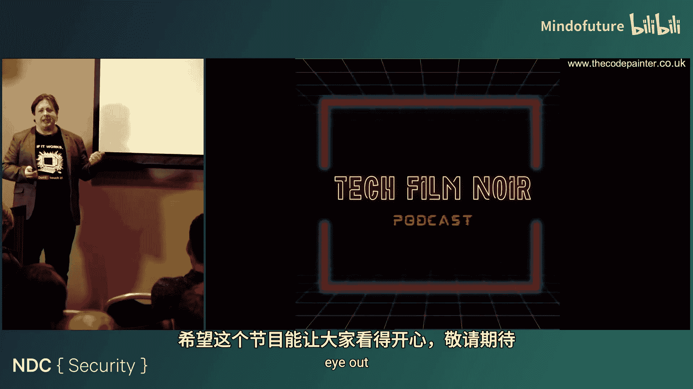

With that。The end， Thank you very much。