# NDC-Security-安全大会-2025-｜-AI工作流-｜-智能体-｜-网络安全-｜-Dapr框架-｜-开源工具-｜-LLM应用-｜-自动化安全-｜-黑客-p09-P09-Linux-containers-in-(less-than)-100-lines-of-shell---Michael-Kerrisk--BV1ihgQzJE2h_p9-

And。So one day， I decided to try and set myself a little challenge。Can I make a container。

I feel feel like I know a lot about containers， at least know a lot about how they make them。

 But can I do it just using shell commands， Can I make something that looks plausibly like a container。

 just using sh shell commands。 And after a few days， I concluded yes I can。

Your definition of decent and my definition of decent might differ。 But I think it's kind of decent。

It's not perfect。 There's some messy corners。 There's some steps you have to do manually still。

 And there are one who thinks you simply can't do。 So I don't do them， for instance。

 I have no set comp system called filtering because there is no shell command to set that up。But。

 it is just standard shell commands that you'll find on any Linux distribution and。

Becauses a reasonable approximation of what？Kind of isolation you would have in， say。

 a docker container。The shell commands are going to use。

 aside from the standard commands that you'd know about every day。

 Some less common commands that I want to use unshare the mount command and the pivot root command。

 All those commands are built on top of system calls that have exactly the same name。

 basically they tend to be sort of pretty thin wrappers on top of the actual system calls。

And I'm going to use busy box because Bu box is great。

 It gives me one binary that does a few hundred different things。

 It gives me I have a few hundred different shell commands under my container。

 I just busy box in there。 and I've got something that's usable。😊，Okay， busy。

 busy box implements the the core functionality of about 400 different shell commands， but it does。

 doest using just one statistically linked binary。 And so I didn't have to copy in 400 binaries and share libraries into my container to set things up。

 I can just do it really， in a couple of steps。it is off shell commands， but， of course。

 I'm not going type all the shell commands。 I put them into scripts。

 And what I'm going to do is just talk us through the scripts。And so so I've got three。

 three principal script。1，1 is a script that can creates the。

 the file system that my container is going to use because a container needs to have a file system。

 And so I need to build that file system。The next script。Launches the container。

 It does a number of things get the container ready to go。 And then it launches it。

 then then there's one more script。 And this script is automatically executed once the container is being launched。

 and it does some steps that need to be done inside the container after it's been launched。So。

 so the are various pieces。OurOur container needs a file system and a root file system。

 so called and。Of course， each container should have its own private file system so that when one container changes files。

 of course， that doesn't affect other containers。Each container is going to have some files that are unique to that container。

 But there's a lot of files that are the same in every container。 For instance。

 every container is going have a bin director with some binaries in it。

 and they're the same binaries。 So there's， there's a lot of duplication in terms of file system content across the containers。

Now， if the way we did things was each container gets a separate copy of all of the files。

 that would be。A bit of a problem for a couple of reasons。 One is a lot of wasted space， because。

A lot of containers that mostly have the same file system content。 So we just， we just chew。

 chewed up disk space for for no reason and chew up memory as well。嗯。

The other thing is that when we launch the container。

 because the container needs to be launched with the fastest image which we need to copy all of those files。

 that takes some time。 That would make our container start up a little bit slower。

The solution to these problems is to use what's called a union mount。 Now， a union mount is。

Really just the technique for combining the contents of several different directories。

 stacking them up in a way and providing a merged view of that stack of directories。

 And the idea is that you have。In the lower part of the la， one or more read only directories。

 and then。On the top layer， you have a read write layer， readr directory。

 That is the differences between the contents of the lower layers。

 And it's that readrite upper layer in each container that is going to contain the stuff that is unique for each container。

 but the lower layers are going to be actually the same files。

 same directories across all containers。嗯。So yeah， the idea then is， you know。

 lower layers or lower layer is content common to all the containers。

 U layer is the stuff that is private to individual containers。

There's a few different ways of doing this。 The modern way of doing this。 This is used by。

Docker and Podman and a few other tools is to use a union mount file system called overlay F S。

 There are other ways。 There's a few other tech techniques I just listed there at the bottom of the slides。

 including some， some predecessors of overlay F S， union F S and A UF S。The idea with overlay F S is。

 you mount。An overlay， create an overlay F S mount by specifying what directories are going to be part of the mount。

 And so here I've got a mount command where I'm saying it's an overlay mount。

And then I specify elsewhere in the mountain command。 What are my layers。

 And here I've said my lower layers。 And this is a list of directories。 Now， in this particular case。

 I've specified two directories separated by colons。 Okay， lower 1 and lower 2。And then elsewhere。

 I specify what directory is going to be the upper layer。

And then this one more thing that I need to do as part of that amount is to create what's called or to set to also specify a directory that's going to be used as a working directory。

 this directory is used behind the scenes by overlay F for doing sort of temporary setup for files。

 Sometimes there are certain actions that need to be done and then once they've been done the resulting file needs to be moved into the upper layer。

 But before the action is complete that file shouldn't be visible in the upper layer。

 And I give an example， for instance， here， suppose you do an echo command and you say。

 I want to add some content at the end of a file that's in a lower layer。 Now， ultimately。

 what you end up within the upper layer is a complete file with that additional content。

 But until that。

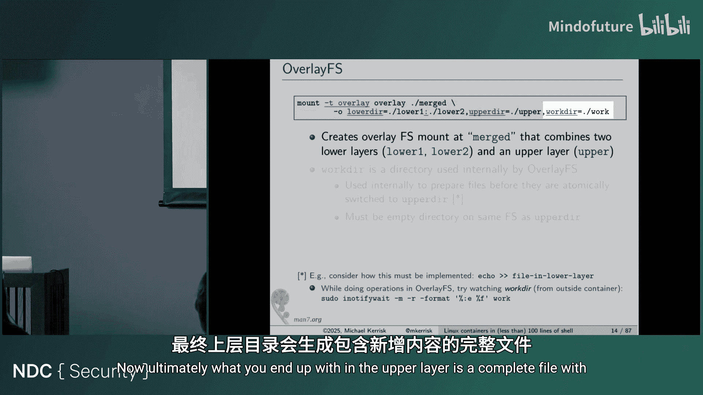

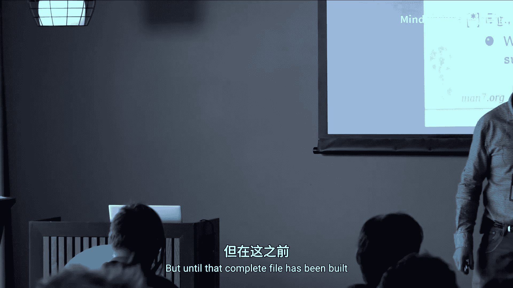

Complete file has been built。 You don't want the partially copied file to be visible because it's not yet completed。

 And this is done in， in the working directory。The work directory needs to be on the same file system as the upper directory。

 because what's going to happen is when the work is finished， when the setup work is finished。

 what happens is the file gets moved from the work directory into the upper directory。

 just using rename and rename is atomic。Okay， so if I do mount command like that。

 the arrangement I'm ending up with is like this。 I've got a series of stacked directories， and。

They are stacked up like this lowerer 2， lower 1。 notice the order there corresponding in the command。

 the first named lower directory is the one that's at the top of the lower layers and so on。

 And then above that， the upper layer。And what I also specified as part of my mount was the location where the。

Mount is that the merged view of all of these directories。

 And so what I'm going to be able to see in that merged view is the combination of everything that's visible from the lower layers。

 Now， of course， you could have。In the different lower layers。

 files that have the same name in the same place。 In that case。

 the file you actually see in the merge view is the one that is in the uppermost layer。

 So you can see here， I've got a file called all that is visible in all of those lower layers。

 or it's part of all of those layer layers， lower layers。

 The one that's visible in the merge view is the topmost one， The one from the upper directory here。

 I've got a file that is is present in two different power nameses in in the two different lower layers。

 The one that's visible at the top is the one in the uppermost layer。

You can also have the concept where you have a file from a lower layer that has been deleted。And。

 of course， therefore， it shouldn't be visible in an upper layer。

 And the way this is done is by creating what's called a white out。

 that's just my way of representing a white out。 A white out is especially entering in the file system that is basically saying。

 hide。The thing that is below。And so you can， you can remove files or make them become invisible from the lower layers using a whiteout。

 or that's what the the file system is doing for you。Okay， so。

What I'm going to do for my container is have an overlay file system。

 where I have a single lower layer， which is the contents of the director the the files that are common to all of my containers。

 It's going my bin directory and things like that， for example。

 And then my upper layer is the differences。 the the stuff that is unique to this container。

I've got my script that builds that lower layer， and。I get one argument。

 just the directory where that lower layer the the。

 the path name with the directory containing that lower layer should be constructed。

What I do is in the script。Make that directory， step into that directory。

 And then I create the kinds of directors you'd expect to see in a root file system， be devev。

 etc cea， and so on。Then， I。Step into the bin directory and copy in busy box。Okay， the witch command。

 if you're not familiar with it， gesture tells you。

 what's the path name where a certain command is located。

 So I'm just using command substitution there to get the path name of the busy box binary。

 And I copy it into my bin directory。And then。Busy box has this really cool feature。

Where it emmanulateates the functionality of about 400 different shell commands。 And the way that。

 way that it does that is there are links to the binary with 400 different names， A link called L S。

 meaning busy box should list files， a link called R M， meaning that。Busy box remove files。 And。

 of course。One of the things I need to do is construct the links。Well， busy box does that for you。

 You can say busy box。 You need to give a full path name， dash dash and stall dot。

 and it makes the links。 And after I've done that， I've got about 400 links to the busy box binary in that bin directory。

O。So that's my file or the start of my files is to at least now。In our container。

 we need to be doing various kinds of isolation。 The whole idea of container is to provide an illusion that there is no outside world。

 There's a bunch of processes inside the container。 They seem to be in a world of their own。

 There is no outside world。 And how do we provide that illusion。

 And namespaces are a key part of that illusion。What we want to have for a container。

 Each container should have its own set of mounted file systems， have its own host name。

 have its own network infrastructure。A private set of P I Ds。For that container。

 And one of the reasons we won't be able to have that is we want in each container to have a P I D1。

 an in it process。 In it is a rather special process on classical Uni systems。

 and a special in containers as well， one of the things that in it does， for example。

 is when a process becomes orphaned because it's parent terminated。

 the orphaned child process gets reparented to the in it process。 And， of course。

 we want that torsr work inside the container， so that if a process inside the container becomes orphaned。

 It gets repared not to the in it process on the outside system。

 but rather to the in it process inside the container。

We also want in our container the concept of super user， a privileged privileged processor。

 processes that can do super usery things inside the container。

But are not privileged outside the container。And again， namespaces allow this possibility。

So the general idea of a namespace is to isolate some kind of resource and make it seem like there is a private copy of that resource for a certain group of processes。

 Weve got a number of different types of namespace。 I'm not gonna talk about all of them。

 But here's a few examples。 P ID namespaces。 These make the set of P I Ds private to that group of processes。

 And in particular， as I' mentioned already， this means that we can have a P I D1 in our container。

We've got mountain land spaces。 What mountain land space is doing is isolating the set of mounts。

 This means that different groups of processor can see different sets of mounts and therefore different single directory hierarchies。

 different sets of mounted file systems。UTS namespace is the simplest one。

 All they're doing is isolating and isolating a couple of system identifiers。 notably the host name。

 And this means each one of our containers can have a different host name。

 The container can broadcast that host name on DHCP so it gets assigned an I P address。😊。

And we've got network name spaces， which， of course。

 are also rather important because it means each container can have its own。

Pieces of network infrastructure， its own virtual networking device with an IP address。

 its own set of socket port numbers， its own roing table rules， its own firewall rules and so on。

 And the idea of there， of course， is， you， let's make our containers useful in a networking sense。

For our container， we're going to create one namespace of each one of the types。

 I've talked about four namespace types there。 There are eight types of name space altogether。

 but I'm not going to talk about all the others。So。Then the question is。

 how do we do super user inside a container。And that concept is supported by another type of name space called a username space。

 And what username spaces are doing is。Isolating the user I D and the group I D number space。

 What this means is that。You can have a process that in the outside world has an unprivied user I。

 maybe user I D 1000。 But in the inside the container， it has a different user I D。

 And in particularly the interesting case here is a process that inside the container has U I D 0。

 It has super user powers inside the container。Now。

 the other piece that goes along with user namespaces here is capabilities。

 capabilities are the modern way of implementing privilege on Linuxux systems。

 The idea of capabilities is let's break the power of super user into smaller pieces。

 There are currently 41 of those smaller pieces and what we think of as being classical super user nowadays is really conceptually just a process that has all 41 of those capabilities。

 and processes that have UI D0 normally have all 41 of those capabilities。

So we're gonna create a new user name space for our container。

 One of the things that happens when a new user name space is created。

 the kernel magically says the first process that's created inside that user namespace。

 you shall have all capabilities。 It's just a thing that the kernel does。

 And so as a consequence consequence of somebody creating user namespace with a process inside it。

 that process has all 41 capabilities， which is great。 It's a super user process。

 We want one of those。😊，The way we create a namespace at the shell level is a command called unshare。

 It's a funny name， but there's a funny history beside behind it。

 And it's built on top of the unshare system call。 And so we can do something like this。 for example。

 here I'm saying unshare， dash dash user， create a user namespace。 dash， dash P I D。

 create a P I D namespace as well。 dash， dash fork， create a child process。 Okay。

 because I want a child process that I'm going to use to execute a command。 And then。😊。

The rest of the line is the command that's going to be executed by that child process。 And I said。

 my command is a shell。And it has some options。 Dash C says execute the command that is in the argument。

 in the， in the quoted argument there。And I say， echo， my P I D is dollar dollar。 Okay。

 the P I D of the shell。 And when I do that。Magically。

 that shell has P I D1 because it was the first process in that new P I D namespace。😊，Okay。

 now another part of the isolation that we want to do inside a container is C groups。

 We want to limit the resources that the processes in the container can use。

 We want to do that because， first of all， we want to prevent our container from overwhelming the rest of the system by trying to consume too much resource。

 You know， create too many processes or use too much memory or burn up too much CPU time。that's。

 that's one side of the guarantee we want。 But there's also the， the mirror side of the guarantee。

 which is we want to make sure the other containers don't overwhelm the system so we can actually get something。

Two sides of the same coin。But we also want do things like limiting access to to devices inside a container。

 We don't generally want our the process to be able to access。Random devices on the system。

 There are some good security reasons for that。 Some。

 some devices can be used for some kinds of privilege escalations。

 So we actually want to only allow a very limited set of of devices to be visible inside a container。

 We do this using C groups。We can also use the C groups to measure the resources that are being consumed by the container。

 How much CPU time has being used， How much memory is the container using and so on。

And the way this is being done is with this Linux feature called C groups， control groups。

 The important point about C groups is they are allowing us to do resource limitation。

And resource management per group of processes。 We can set a limit that applies to a group of processes。

 maybe one process uses a lot of the resource and the other process uses a little。 But the point is。

 whatever we allocate is shared across the group。There were older mechanisms。 There are。

 They still exist for doing resource limitation on Uni systems， the U limit command。

 But the thing about the U limit command， it is just a per process limit。

 It's not the limit is not shared across groups of processes。

The way that C groups work the interface for controlling C groups， it's a file system。

 And in order to make a C group， what we do is on that file system。

 it's socalled C group too fast and mounted at this location here to make a C group。

 all we do is make a directory in that file system and that is synonymous with the act of creating a C group。

 and C groups have a hierarchical arrangement。 And when you set limits in C groups。

 the limits apply to the lower parts of the hierarchy。 and of course。

 the way we're going to construct our hierarchy is by having a hierarchy of directories。

The the directory hierarchy is synonymous with the sea group hierarchy。Okay， now。

We want to look at the class now， to actually launch our。Our container。 So I'm gonna make。

 I've got another script here。 It takes a few arguments。

 One of them is the directory that contains the lower。Level of our file system。

 That's the directory that my first script created。

Another argument is the location where the overlay file system is going to be mounted。

 my merged directory。And。The a couple of other possible options here。

 a path name that my container is going to use for its C group and also the host name that my container should set up in its。

 in its U T S namespace。And。I'm going skip over some details and just say those various pieces there。

 My script just sticks them into some suitably named variables。 Okay， lower overlaer C group host。

 Just assume that that was done。 I'm not gonna show you that， that's mechanical。Okay。

 so having got those variables， what am I doing， Well， I'm making some directories in in my overlay。

 I'm making an upper directory。 That's going to be my readrite upper layer in my overlay file system mount the work directory that is needed for overlay F S。

 the mount point， create the mount point where the overlay F S is going to be mounted。😊。

Then I do the mount。 Suu Mount D T overlay。 there's my lower directory。 There's my upper directory。

 Here's my work directory。 and then source of the mount is any string I've just written overlay there。

 but then here's the mountain point。And then my script steps in to that directory。Okay。

 just by way of demonstration， I then create my my script then creates a little file with a bit of information about the start of the script。

 just puts data in there， P I D and one or two other things and。Then。

That file will actually be created in the upper directory of that overlay mount。St up。Now if。

I specified a C group。 when I launched my script， then this variable here will be set。

 And so what I'm going to do is create a C group that is going to be used by this by。

 by this container。So my secret group path is C F F Se。

 That's the standard mountain point for the Sea group file system。 And then whatever path。

 whatever name I gave as an argument to my script。I make that directory so do make the dash P。

 And then I say here， echo， I do a shell command where I say。

 echo the P I D of this shell script into。A file called C group dot paths in C group dot prox in that C group。

What that is doing， This is the way that you put a process into a C group。

 You write its P I D to that file。 And so now this shell script。

It's a member of that secret that the shell that is running the script is a member of that sea group。

There's a bit more。Okay， still， still here with C groups。 One more thing。

 I do what's called delegation for the sea group。The the files in the Sea group file system are all owned by super user。

 So the default situation is in order to do things with those files。

 you need to be have a root shell。

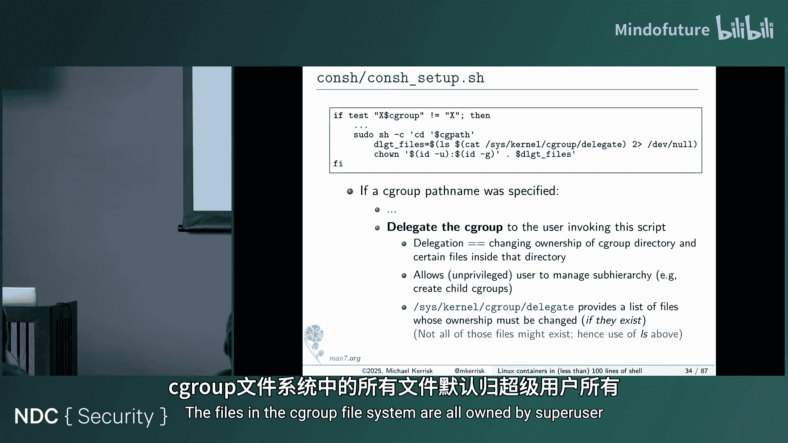

But I want to run a container。For an unppoposed user。

So what I'm going to do is take my sub hierarchy。 They' the secret that I'm creating change its ownership to be the unpreed user。

And as well， I need to change the ownership of a certain set of files inside that directory。

 There's a file here， cis kernelel C group delegate。

 and it tells me which of those files also need to have their ownership changed because not all the files need to be changed and certain files。

 their ownership should not be changed。 but there's a certain set of files whose ownership must be changed and as well。

 the ownership of the directory must be changed。 So what I'm doing here is saying so do S。

 here's my shell command where I say step into that C group and then work out which files need to be delegated。

 what I do is I list the contents of this file to see which files are actually present in the directory。

 Some of them won't be。 they'll generate errors， but I'm going to throw the errors away。

 But the result of the N is I'm going have a list of files that actually exist in the directory。

 And then I say that's my list of files。 And then I say CH O to my user ID my group I the unproed user and group。

And on dot， the， the， the C group directory。 And though that set of files that I've discovered inside the directory that。

Whose ownership needs to be changed。Okay。没有。The next step in my shell script， I use exec now。

I don't know if you're familiar with the shell command exec。 What exec says is replace this shell。

With a different program， it's the same process it was running a shell。 But now the shell is saying。

 I don't need be here anymore。 Re me with another program。

 And the program I'm replacing the shell with is another program called in。Now。

 in is a program that does things with environment variables。

 And what I'm doing here is saying in dash I initialize some environment variables。

I'm going to initialize the variable home to be slash root my home directory for my。

 for my super for my super user's shell that I'm going to have inside the container and initialize path with some suitable list of path names。

😊，Set host name to whatever was supplied to the script。

And then one more environment variable that I'm gonna sit up here is called in oh。

Delay explaining that just for a moment。 All I'll say is that I'm setting up that environment variable to point to another script。

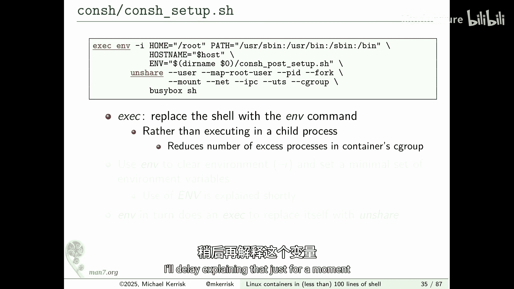

I'll show you that script in a moment。Okay， and then having done its work in then itself does an exact operation to replace itself with another program。

 The program I'm replacing it with is uns。And what I'm saying with I sharere here is create a new username space with the so called。

 I I just jump forward a slide or two here。 createate a new username space。😊，And then。

With the root mappings， root mappings means my credentials in the outside world are going to be mapped to 0 in the inside world。

 So in the outside world， I might have had user I D 1000。But in the inside world， I want U I D 0。

 I want Subus powers。Same thing for for the group I D。 the group I D also gets mapped to 0。

 So we end up with a process that has U I D 0， G， I D 0 inside the namespace。And then as well。

 I'm saying， create a P I D namespace， create a child process。

 because that's gonna to be the process inside my container。

And then I crack the other kinds of namespaces as well， a mount namespace， a network namespace。

 an IPC namespace， A U T S namespace and a C group namespace。 I haven't talked about all of those。

 but that doesn't matter。And then。Anchair is going to launch a command in that child process。

 What command am I going to launch， I'm going to launch Bu box。 Okay， and when you launch Bu box。

 you can say， what do you want it to be， And I'm saying， I want my busy box to behave like a shell。

Okay， and this is going to be my very first process inside the container。 It's a shell。

 It has super user powers， and it has P I D1。😊，Okay。Now，嗯。

I could have just written instead of busy box S H there， I could have written just bash。

 but I wanted to use busy box S， H， because I want the initial shell to be the same kind of shell that is already available in the boomon file system inside my container。

Okay， otherwise， I'd have a more powerful shell as the root shell， which would just， it's not wrong。

 It's just a little bit confusing。Okay。W， hurry up。 Okay， so。After all of that。

 there's still some more initialization steps that I need to do。

I'm going to do this in another script， this one cornius H post setup。

And I automate the execution of that script。 Remember that end of environment variable that I set earlier on。

 that is a special variable that is understood by shells。 When a shell is launched。

 it says if the end of environment variable is initialized。

 I'm going to execute the commands that are inside it。😊，And so。

I'm automating the creation of the script。 I don't even need to do it manually。

 My busy boxhe is going to do this as it starts up。And。

The very first thing I do in that next script is unset in， because I don't want， you know。

 when launch another shell inside the container， I don't want it to execute that in script。

 That would be a mess。Okay， now my container inherited some mounts。From the。

 from the initial mountain space， I don't want those mounts。

 All I really want to do is have mounted is my container root file system。And。

So I need to swap the current root file system with my overlay file system and make that the root file system。

 And there's a special command to do。 This's called pivot root。 You say pivot root。

 and you say this is the director。 I want to be the new route directory。

 And I want you to move the old route directory， the old root mount。😊，To this location instead。

Eventually， I'm going to unmount。That， that old route file system， because we don't need it。

In a picture， this is what pivot root is doing。 You know。

 we've got before we've got a real route directory。 We've got some location underneath。

 which is where my， I'm gonna mount my new route file system。

 And what's happening is all that pivot root is doing is shuffling the mounts around。

 It's arranging things So this new route is now the root mount。

 And the slash mount here got mounted down here。 So now it's sitting underneath the new root mount。

 That's all it's doing just shuffling mounts around。😊，嗯。

There's a lot of rules about using pivot root。 I don't want to try and explain them all。

 You can read the manual page， but there's a few rules like the new route and put old must not be on the same mount as the current route And when you look at that picture。

 of course， well you you can work out why we didnt up with something quite circular。

 the what else should I say new route must be the path name of an existing mount。

 And the reason is all the pivot route doing is rearranging mounts。 Now， if our。

New route Mount is not a mount。That's easy to fix。 All we do is make a bind mount where we mount the same directory on top of itself。

 And then it looks like a mound point。 and pivot root can shuffle it around。

 And that's what I will be doing。There's also another detail that I'm not going to try and explain。

 which is I need to turn off what is called mount propagation in the new mountain land space for the various mounts。

 And the reason is mount propagation is a mechanism that the kernel uses to automatically copy mounts from one mountain land space to another。

 And this happens by default。 But I don't want that to happen because if I did that。

 and the new mounts I'm going to create got propagated to the main mountain land space that would be messer or else。

 So I'm going to disable mount propagation。 So to disable mount propagation。

 I say mount dash make are private。 Private is the opposite of shared。

 shared is the thing that propagates private says don't do propagation。 then。

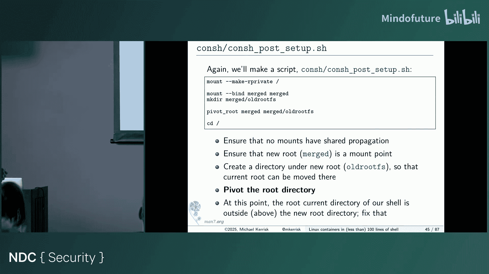

Make my new root mount a amount。 make my directory merged amount by saying mount dash。

 dash buying merged on top of merge。 All that did was create a mount point at that directory。

 and it's still the same continents that is visible a air。

 It's just a way of making a amount at that location。

 make old route if that's wrong the route the old route is going to end up。 The old root mount。

And then do the pivot， where I say， make merge the new route and move the old route to merged old root F。

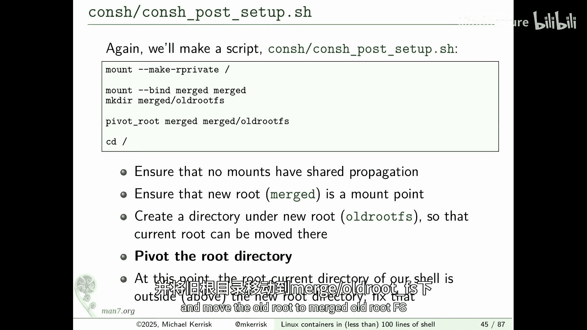

Then simple stuff here。 I want some other nice stuff in terms of mounts in my container。

 mount a proc file system， an aive S file system， mount a C group file system。

 mount an M Q file system for my Po messages。 That's all simple stuff。 And then I want some devices。

😊，This is the standard sort of set of devices you'd find inside a container， full device。

 null device， random T T Y， U random 0， I pull。When I first learned how to do this。

 I was kind of surprised that it works， but it does。 I say in the dev directory。

 make a file with that name， and then mount dash， dash bind from the old root file system in the dev directory。

 B mount that device to slash devev in my new root mount。 And this just works。

 I was surprised that it just works。 but it does。😮，And this gives me those devices。

And then I don't need the old root mount anymore。 So I do an unmount of that old root mount that throws away all。

 the old root mount and all the submounts underneath it。And then I can remove that directory。

 then I set my host name from the environment variable that got set up earlier on。😊，In。That's it。

What was？ What time was I supposed to finish。Was about 10 o'clock， I suppose， was it。No。

 that's sorry，11 o'clock。Maybe I'm the second half is just gonna be demonstrating how this all works in practice。

 Okay， and we'll see how things look。 but maybe there are some questions first before we， Yes。

 please down the back。 Inut。 I recognize you。My question is。有プすな。Initially create。

It's possible to rear that。I'm going to。I think you're good。

 It's just low So it's recording like in your preset up script。

 you're first creating the merged view using overlay fast and then creating the container。

 and for that， you need super user privileges in the host file system。

 do you think it's possible to arrange it in a way that you can do it from an unprivileged user。

 for example， if you create a user name space first and then create overlay fast inside the namespace。

 So perhaps you can do everything without having super user privileges I'm a little puzzled I need a super user。

 But when I create that lower directory。 I didn't use any super user powers。 No。

 I mean when you did the amount overlay fast。Yeah， and that amount was being done。 Yes， O， I。

Think it is not possible to do that step。From within the container， I'm moderately sure of that。

 I wanna double check， but I think it's not possible because I didn't never research how that works in inside。

 But like， there is a project called rless containers。

 And I just recently yesterday note Docker has like you can switch a runtime to a rless runtime where run Docker as an unprivileged user so they might be doing some trick some tricks like with unprivileged user namespaces there。

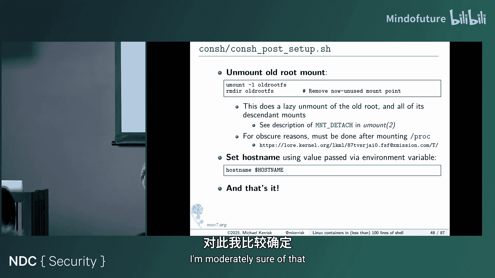

I'm， I'm not sure what they're doing there。 I'm sorry。Thank you。crisis to be able。I。

 I think not because the point is that inside a user name space and and a new mount name space。

 there's only certain kinds of mounts that you're allowed to create。 For instance。

 you can't mount block file systems from a non initial username space。

 And I think the same is true for overlay affairs as well。 okay， I mean。I'll research that myself。

Other questions， perhaps。1 okay， maybe maybe this's better be the last question， I guess。

You just briefly mentioned that the seccomp will not work inside of this。

But it's not that it will not work。 It's rather there is no shell command that I can use to set up set comp filtering。

 Oh， so that was the entire reason。 It doesn' have a shell。 Okay， you。

 you give me a standard shell command and I'll use it。 but there isn't one。A LD Prito。

 well Igitet is the person who talked about that。😊，ややでた。Yes， I know。

 I looked at your talk just last night， actually。😊，The yeah， you you， you。

 you can pull some tricks with LD preload， but those tricks are not bulletproof。

 and they it's not a complete solution I either。Okay。

See you if you want in whenever the next session starts。 is it 2 Oh，40 minutes from now。

 I still have 20 minutes， what。

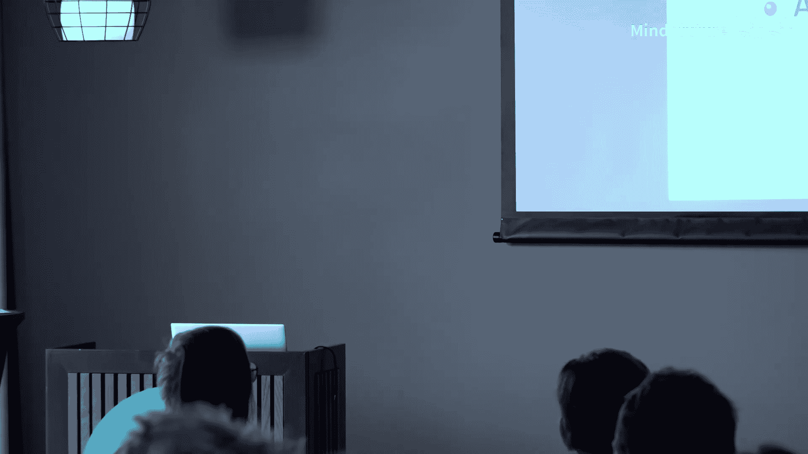

Oh， here I was thing I was supposed to be finished by now。 Wow， okay。Oh。Thanks for that。

Then I'll keep going。Let's launch our container。So。I'm going to do these steps。 Let's do a live demo。

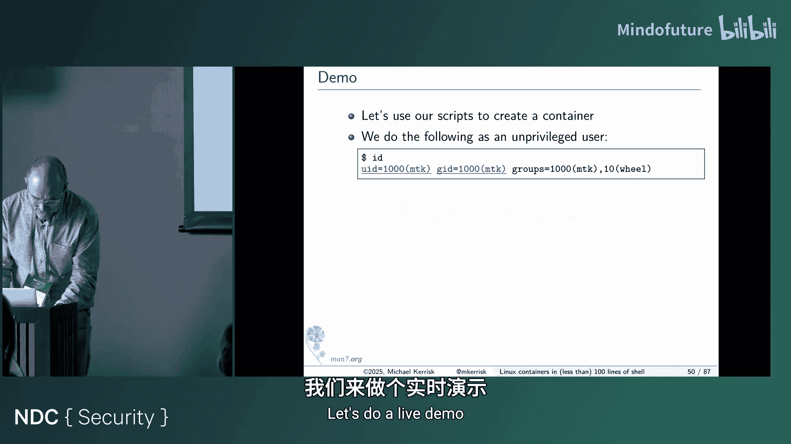

Live demos are the best because they can go wrong。Some of some people have already heard the joke。

 but many years ago， a training colleague said to me。

 never precede any live demonstration with a statement more predictive than， watch this。Okay。

All of the scripts， by the way， that I've shown you， they are all on my website。

 You can download the tar ball in the locations at the end of the slides。Okay， so。My scripts。

 what I'm going to first all do is make a directory。Let's call it demo。

And this is where I'm going to。Make my container file system。So I'll step into that directory。And。

I'll maybe I'll make the font size。 Is that font size still okay down the back。Yep， thank you。

And then， I'm going to use my。嗯。Scrt that creates the lower level layer of the file system and。后面呢。

Make that lower layer in a directory， called lowerer。Okay， it's done its thing。

 If I look inside that directory lower， you know， I've got a bunch of sub directories。

 reasonable sorts of things you'd expect to see in a root file system。

And then I'm going to run my next script。Whoops。咯。My next script， it takes as arguments。

 the name of a C group。Let's callless。CG1。And I should have said， by the way，I am doing all of this。

 Here's just to show these two shell。 It is an I'm doing this as an unpre user。嗯。And。Li。😔，Oh。

 and one other thing I want to show you over here。 This is the host name on my outer system。Okay。

 and。A。In my canan on a different host name， let's say。李岩。And then。My lower directory。

 which is just called lower。And then the place where I want the rest of the pieces to be created for the overlay mount。

 which is just the current directory。And when I do that， I'm going to ask for my password。Okay。

That is now my。Root shell inside the container。And。If I say echo dollar dollar。1。😮，If I say。

 show me my Is。Zm。Okay， U I D 0， G I D 0， If I say， what are I capable Now let's try something else。

 Let's try this。The processes that are in the container。 Well， theres the shell ends the P。 S。

 That's it。 If I said， you know， let's say P， S。Whoops， sorry P S， A， you list all the processes。

 There are just two。Okay。Then what else should we see？In the outside world。

 in the P I D name space in the art world， this process， this busy box shell has a different P I D。

 If I say P I D of busy box。I hope I've only got one of them running。 Oh， yes， good。

 You've got a different P I D。This process in a lower level P I D namespace in the container has two different P I D。

 A P ID in its in its P I D interface space， but also P ID in the upper level P ID namespace。

 You can actually see this in the pro file system。 I can say grip for a field called N S T G I D。

In the file， Proc slash 1，1，3，1，9，8 slash status。 This shows at this P I D this PI D name space level。

 What are the various P I Ds of that process。And。Two different P I Ds。没有。As well。

 if I look at that file。Using less。Remember here remember over here， the process has U I D 0。

 G I D is0， but。If I look from the outside world at the U I Ds and the G I Ds of that process in the outside world。

 it has U I D G I D 0，1000， I should say。Okay， in the outside world， this process is not privileged。

 but it this privileged in the inside world。Okay， and， of course。

 one of the things I did over here was， you know， the script said a host name there I'm seeing the host name B。

Over here， in the。Initial U T S name space。 I am still seeing the host name。Wana。If over here。

 I now change the host name。Langvit。And then just verify that change was made。 Okay。

 now a different host name there。 And over here。The host name is stool。Wana。Okay， now。

 any other demonstrations I should do。No， I think I've done that。 Let's move on。

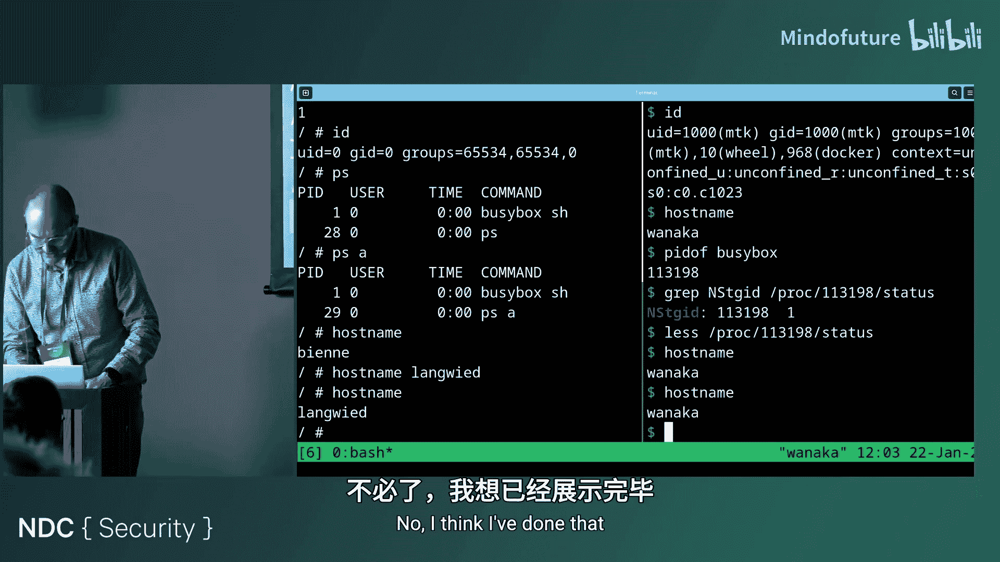

So these are the steps where I launched my container just on the slides。 Everything's on the slides。

 Yeah， So then the question is， you know， what about the namespaces inside my container， Well。

 we saw that Michel shell has PID 1 that's because of the new PID namespace。

 We saw that outside the process has a different PID。

 And the point here is that PID namespaces exist in a hierarchy。Each P Dspace has a parent P Dspace。

 which has a parent， which has a parent and so on all the way back to the very first P Dspace on the system。

 which doesn't have a parent。And a process that's in a lower layer。

P I D Na space has a P I D in that name space， but also in the first ancestor and then the next ancestor and then the next ancestor。

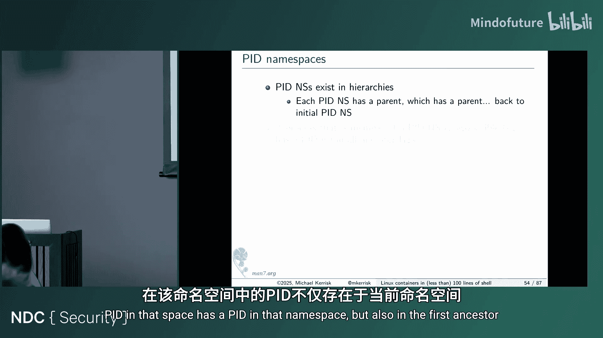

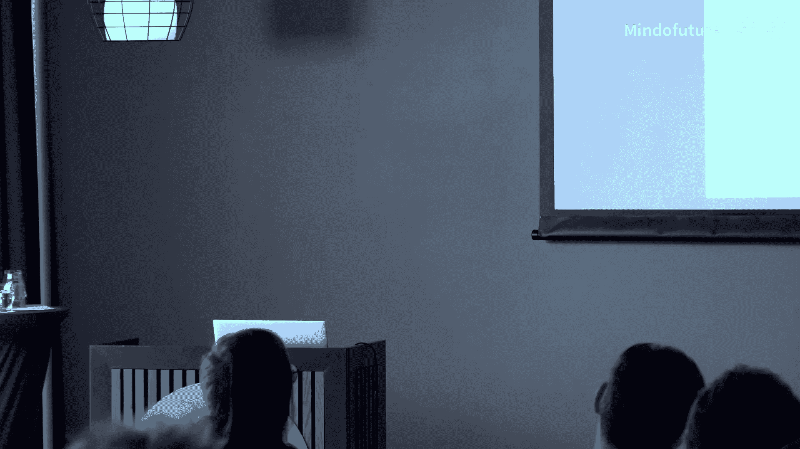

Probably the P ID is different in every name space， But the point is it has a PID in each namespace。

And。嗯。We've also then got the idea that the container， of course， has a file system。

 And so what I should really do is a live demo there。 again。

 my P ID of my busy box process that that number just， just here。

 Let's from the outside world do a find M and T dash O， sta O source。

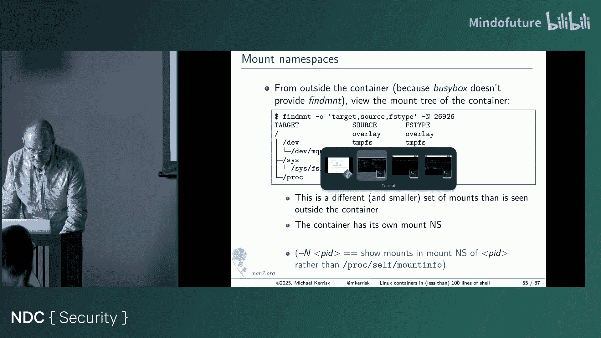

Target。 That'll target。And then， I think it's。哦。Dash tea， I think it is。

 That was what was on the sly， wasn't it， No dash in， D in。1，1，3，1，9，8。

 Show me the mounts that that process sees in its mountain land space。And。

I see a very small set of mounts， really compared to what you would normally see on your wider Linux system。

 where you probably see a boatload of mounts。 Okay， there is the root mount。 There's a proc mount。

 a cis mount， an M Q file system， some dev mounts。 Those were my various devices that got bind mounted。

 And， and that's it。

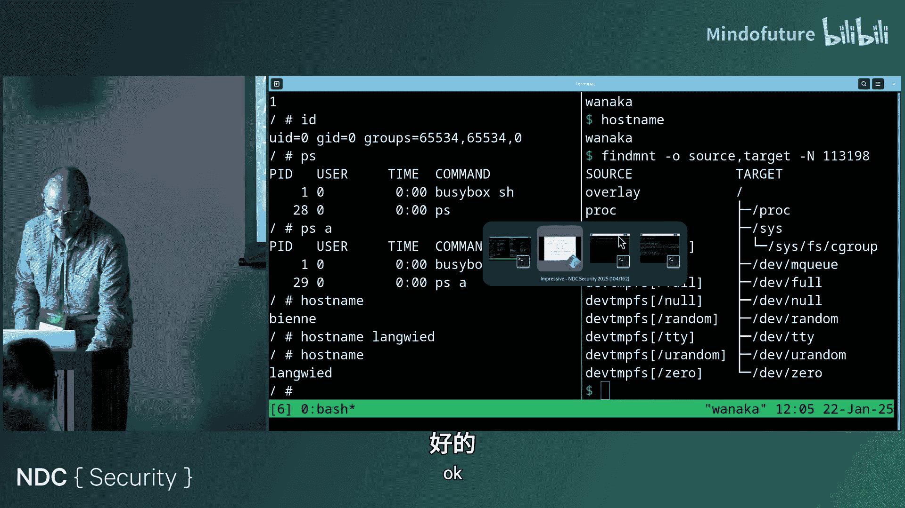

Ky。

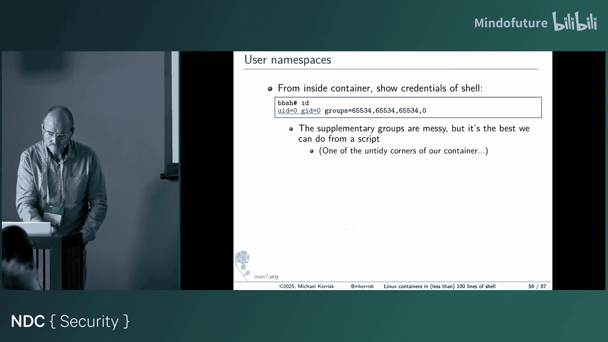

I've already showed you the credentials of the shell from inside and outside。 How did that happen。

 Why is it that this process here looks like it has U I D 0。But over in the outside world。

 looks it has U I D 1000。 It's because along the way， I created。

 I used an option with unchair saying map root user。

 what map route user did was create what's called a U I D map for the user name space and the U I D map says。

 what do I Ds in the outside world， map to in the inside world。

 And if I look at the U I D map for that process。i say。Cat slash proc， slash。UI map。

There's the mapping。It's saying inside the nano space is 0 maps to 1000 in the outside world。

 and the length of the mapping is one。 So only a single U I is being mapped。

 You can have mappings that are ranges of I by having a number that's bigger than one there at the end。

I've got a similar G ID map。Looks exactly the same。Mapping 0 to 1000 in the outside world。

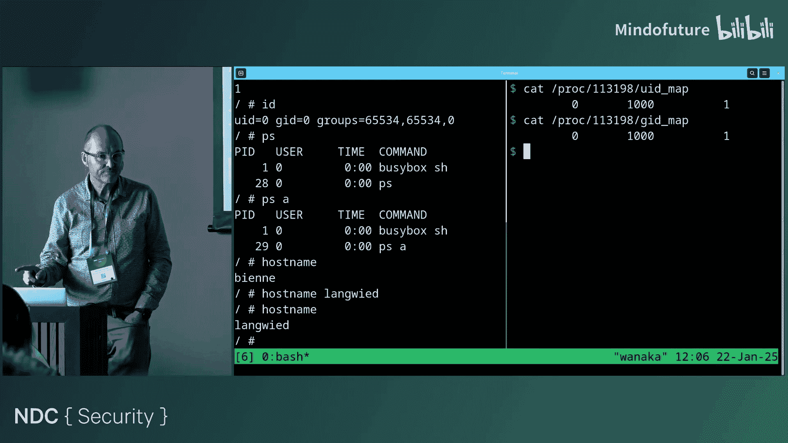

ok。I've already shown you the host name stuff。I've got five minutes。Oh， let's keep going。嗯。😊。

The question is， how。Do I get to be soup user inside the container。

And and how does being superus work， even as a concept inside the container。 And the point here is。

 it's all about namespaces and the relationship between username spaces and non username spaces。

 every non username space is owned by some particular username space and。

So when I say a non username space， a mount anl a UTS name space and so on。

 every one of those non username space is owned by some particular username space。

 and to be being super user means you have super user powers over the resources that are governed by the non- username spaces that are owned by your username space。

Now， what happened was that in my container， I think I've got a picture coming up。

 I I should say do we we， we can see that my shell has all capabilities because what I can do from the outside world is look in the proc pit status file and down below some lines here that whoops。

 Tell me about the capabilities that my this process has and the numbers you're seeing there。

 Those are hexal bit masks representing the capabilities and there are 41 bits that are on there representing all 41 capabilities that this。

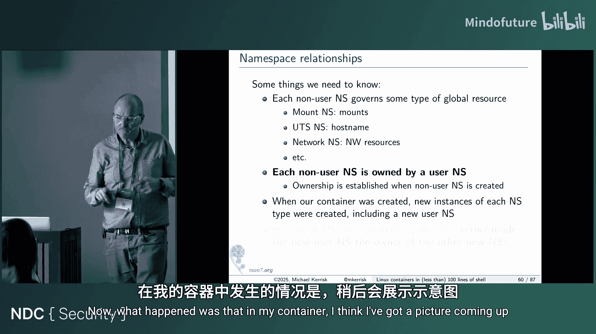

Shell has。The colonel just magically did that。 It said。

 you are the first processor in a new username space， and you shall have all capabilities。

 but those capabilities can only be exercised in the username space。😊。

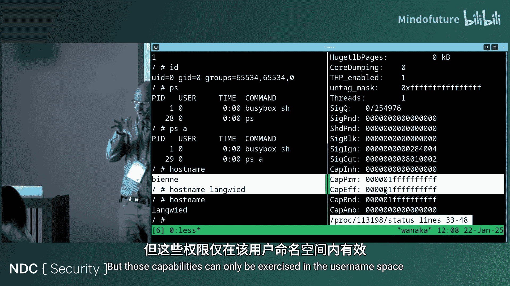

Okay。And there's the picture I wanted。Here's the setup we've ended up with。 Here's our container。

Like this， it's got a user name space。 And there's a number of other name spaces。

 a mountain name space， a time namespace served。UutTous namespace and so on that are all owned by that。

User namespace。 And our in it process is a member of all of those name spaces。

 I haven't shown all the name spaces because there't enough space on the slide。

 But that's the arrangement that we have。😊，And。I wondering you've got another。I thought I just。

 I need to check if I have another picture that might be useful。Not in the slide deck， okay。嗯。The。

 the point here is that， you know， suppose this process tries to， let's say， change the host name。

What the colonel says is host names are governed by UT S namespaces。 And then the colonel says， well。

 which UT S namespace is this process a member of， And the answer is this UTS namespace here。

And then the colonel says， well， which user name space owns that U T S name space。 And the answer is。

This username space。 And then the says， well， what capabilities does this process have。In that。

Usname space。 And these have a certain capability called capsis admin。 But the point is the process。

 this notation here is the notation has the process all capabilities。

 And it is a member of the username space。 Therefore， it's allowed to do that thing。But for instance。

 if there was some way that this process could see the initial UTS namespace。

Even if it could somehow see that namespace， it wouldn't be able to change the host name because it。

It's an， it's it has all capabilities in its own user interface space。

 has no capabilities up there in the initial user interface space。

And so this is how this concept of soupuser inside the container works without being subuser in the outside world。

There is a program you can do use little program of mind that we can use to do a bit of visualization of what's going on。

 See the shape of the name spaces， the。

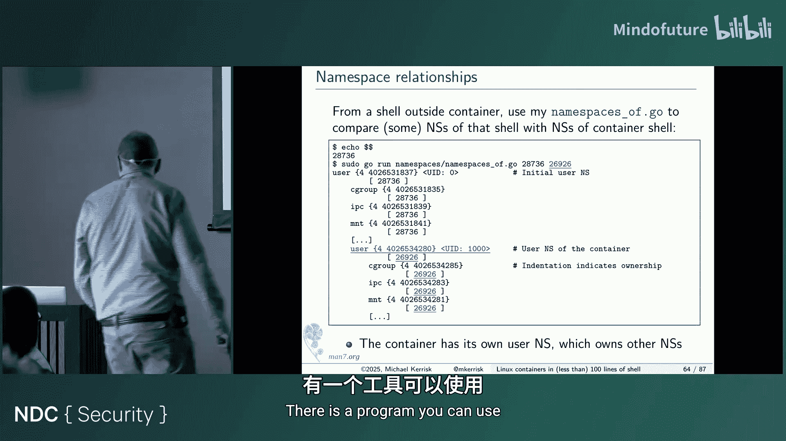

嗯。I can say Suu namespaces。 Oh， sorry， Suu go run。Ne spaces of dot go。

 If I just run the command like that， it's going show me all the processes in my system and all the name spaces。

 too much information。Let's just compare。The shell on the left here with another process that's in the inn of the nano space。

 So let's try that P I D。 That's the shell over here。 and P I D1 on my system。

Even that is's too much information because that's gonna show me 8 different types of namespaces。

 So I'm gonna just restrict the view a little bit。 I'm gonna say， well。

 don't show me all the name spaces。 Just show me a few of the namespaces。 And I'm gonna say。

 show me the user namespace。 Let's say the mount namespace。

 the P I Dspace and the U T S namespace memberships of those processes。😊，And。Okay。There。

 there's my view。 The hierarchy is represented through indentation。

 What you see there at the top is the initial username space。Which has P I D 1 in it below that。

 there's the new new user an that was created for my container。 And you can see there that it owns。

 That's what the indentation is telling is also about， is telling us about ownership。It owns some。

Some mountainspace the PIDspace and UTS NAspace and you can see the process there is a member of those naspaces。

 and then PI D1 on the other hand， is a member of the initial mountain Naspace。

 the initial PID Naspace， the initial UTS namespace。My program is very simplistic。

 There is a much nicer program floating around written by someone who lives not very far from me by chance called Alex K N。

 S。 and a you。😊，Curious， go and find out about that project。

 You can download it because you nice graphical visualizations of the name spaces on your system。嗯。

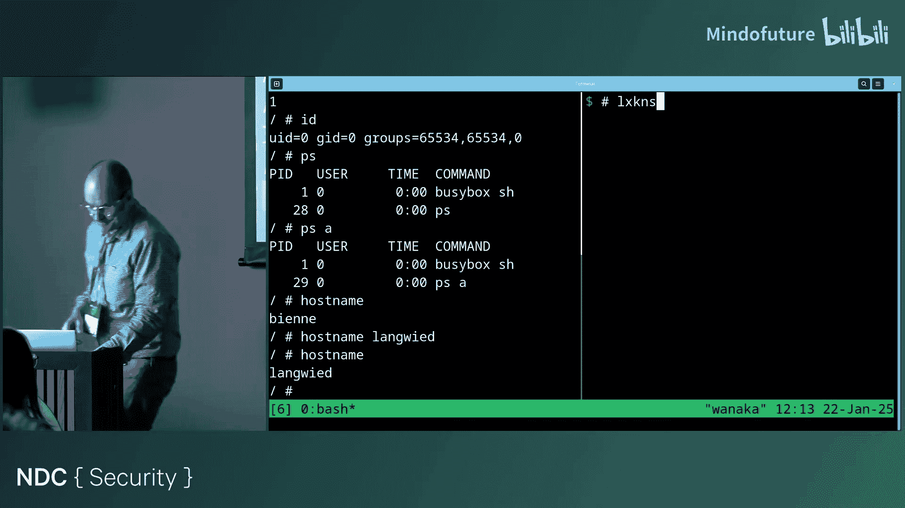

I'm supposed to finish at this hour。Embarrassingly。😊，I've almost finished the presentation。

What do we w wantan to do， Take a short break now， or I can go for another 15 minutes。

 and I'll probably just finish。Thank对对。Take the 5 yeah。If you leave， I won't hold it against you。

We'll keep going then。So then the question is。S groups inside the container。嗯。

My container was set up with a。C group for doing resource management。And we can see this。

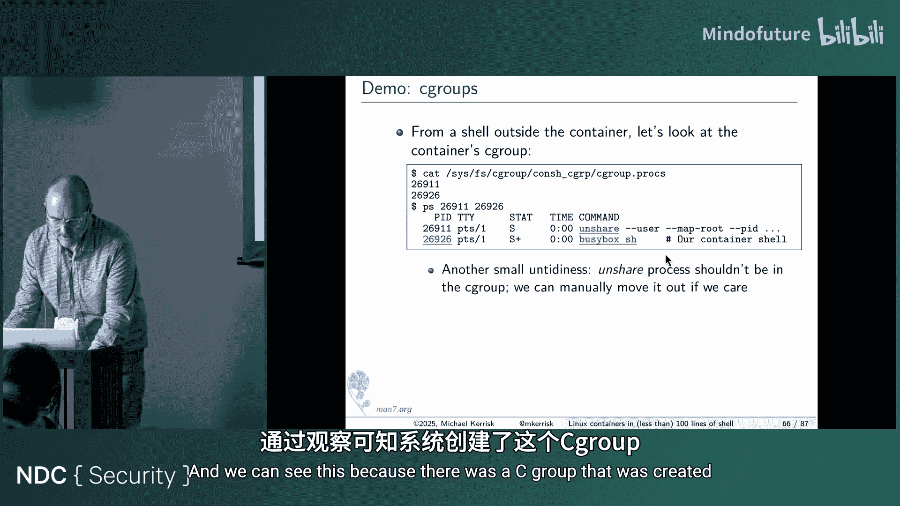

Because。There was a C group that was created event。

 I got what I can do is say cat slash pro slash my P I D of my shell on the left， slash C group。

There's the C group that was created。 And this， this is telling this process is a member of that C group。

Now。嗯。I can use cigarettegroups for doing resource limitation。

 What I'm going to do is step into another directory。Where I'm going to say。

Copy a little program that I created earlier on。What the firm does is just burn up CPU time and print out how much CPU time is getting each second。

And。I'm going copy that into my container。 So I'm going say copy into。Oh， hang on a second。

Which director I do I do。 And let's have a quick look， Als， Alices。To LSP。

C S H looks like I did it there， good。Okay， so I'm going copy that binary。CPU burner。

I did prepare this early， and I just wantan to mention in passing it is statically linked。

 And the reason is， I don't have any shared libraries in my container。

 So I need devasstatally linked binary。And so I'm gonna copy that into。Toed LSP， Con S。

 H and into the directory demo。 And then let's just copy it into the upper level file system。

 the upper level directory of the overlay mount。And hopefully， I've done things right now。

 there it is sitting there in the root directory of my container file system。

 And then I'm going to run that program。😊，And what it's doing is every second。

 printing out how much CPU time I got。嗯。That's remarkable。I think there something is。

 I think I wonder if my clock is a bit of skew。My clock， the， there's some。

 something strange going with the clock on my machine。 It's running 8% fast。

 So this is a magnificent program。 It gets a hundred and8% of time each CPU second。 Yeah， okay。

 ignore that little glitch。😊，Now， what I'm going do from the outside world is now I use that C group。

2。Limit the CPU time that this process can get。 I was going say it can get 50%。

 but it's going get 54%。 I think the right thing is going。 But really， it's 50%。 So to do that。

 what I do is say， pseudo do。S， H dash C， And I want to say echo。嗯。Oh do this different way。

 I'm gonna step into the Cs FS C group directory。And then give myself a root shell。😊，Okay。

 change that shell， prompt something shorter and then say echo。Two numbers。

These two numbers are essentially， expressing a fraction。And。What I'm saying is' 50%， half of a CPU。

And I'm going write that number into that。嗯。Hang on。Okay。Write that number。 Sorry about that。

Encho50000。100000。Yintu。😔，嗯。CGR1。Slash CPU dot max。And。There we go。

 it's sort of settled down now I now my clocks doing the right thing。Okay。

 so I'm getting 50% of the CPU time。Okay， so this is， you know。

 thiss an example of how C groups can be used to do resource limitation。

 You can also do things like limiting memory usage limiting network bandwidth。

 There's various resources that you can limit using C groups。

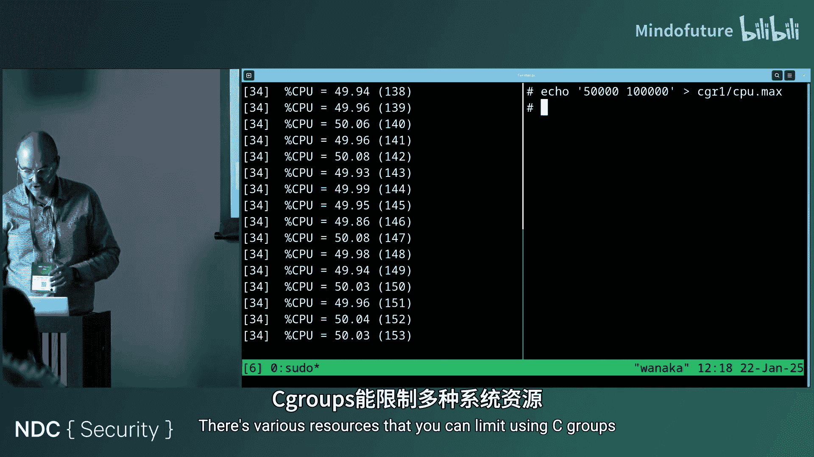

Okay。What else do I want to say， I've already done that demo。I'm not going try look， I。

 I'm gonna just go a little bit further and then call it a day。 Yes， sorry， It。50% of us CPU。有。Yes。

These numbers are always absolute。 So a lower a higher level percent is a cap for the lower level percent。

Yeah， there's another way of using the CPU controller where you can say。

 I want to actually do subdivision。But that's not the mode I'm demonstrating at the moment。Yeah。No。

 when I use the CPU controller in this mode， these are always absolute numbers。

 If I said 50% at the top level and， you know，40% or let's say，50% at the next level down。

 it's 50% absolutely in both places。 But there is another mode you can use where you can say these two groups I get half each。

 But then under this one， I create two child secreters。

 They get half each of what came from above and they would get quarter then。Okay。

 look I'm gonna skip the networking demo。 I'll just say you can do it， but。

I just wanna perhaps just finish off with one more thing。If this was a cool container。What would。

 what would be a cool container， I think。Or maybe just one inside another。Yeah。

It'd be a cool container。 I think， if I could have a container inside a container。啊。I can do it。Okay。

 one more thing that I should be able to do in a decent container， container inside a container。

Docker couldn't do that for years。I did it in days。😊，Okay， so there are a few challenges。

 One is busy box does have an unsha applet， but the unsha applelet doesn't know about all the namespaces yet。

 So it doesn't know about C group namespaces。 I didn't talk about C group name spaces。

 But point that just somebody doesn't do them。 doesn't have the option for doing a C group namespace。

 The way I'm gonna fix that problem is I'm gonna take the standard unsha program。 Copy it into my。

Ben directory。My cony S H setup script uses pseudo， but Bu box doesn't have a pseudo applet。

 That doesn't matter。 My shell inside my container has super powers anyway。

So what I'm going to do is edit my script just to remove the pseudou strings。And then one more thing。

 the upper layer of an overlay file system cannot itself be an overlay file system。

So the way I'm going solve that problem is I'm going mount to temp F。

And use that as the upper layer for the overlay file system used in the lower level container。

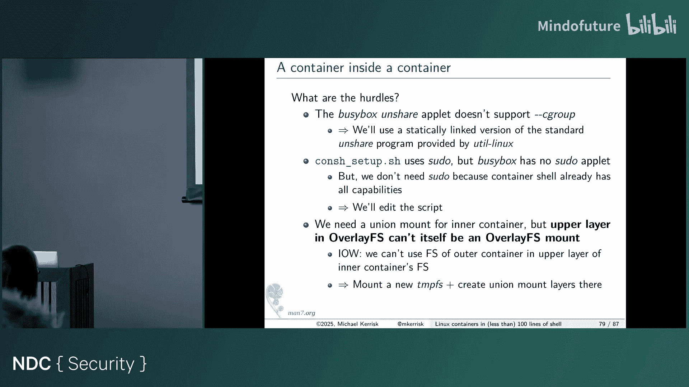

Okay， let's。It's always best when we do it live， isn't it， It'll go wrong now。Let's step back。

I've got my scripts here， and I want to put those into my container file system。

 So what I'm gonna to do is say， copy those script files into demo。Lower。And now， if I look。

 there are the scripts now in my container file system， then I want to。Edit the files。

 So the pseudou words are gone in those copies。So。Oops嗯。I'm cheating here a little bit。

 I prepared this command earlier。嗯。E and head in my history。

 And this is just the thing that edits out those pseudo words。Oh， what did I do wrong。Oh。

 wrong place。 Is it the wrong place， Yes， it's the wrong place， isn't it。No， hang on。Oh， did I。

 did I put them in lower， That was it。 Yeah， Of course， I didn't there。 you can see it there。

There we go。And I need a。Anun。So I need to， I'll say， R M out of demo。Lower。😔，Ben。

Remove the unshare link。Because I'm going to replace it with something else。And then。嗯。Again。

 I'm just grabbing this out of my history to save myself some time。

 This is my statically linked version of the standard Unshare command。

 And I'm copying that into demo lower bin Unshare。

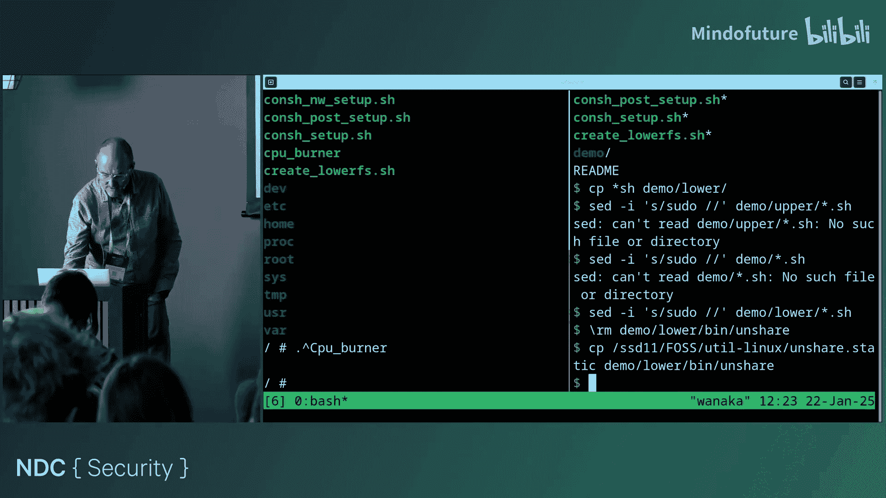

Have I not done all the steps that I need to do， I said， I need the unshare。 I need to do the in。

And oh， I need to do the amount of the Ter F file system， of course。

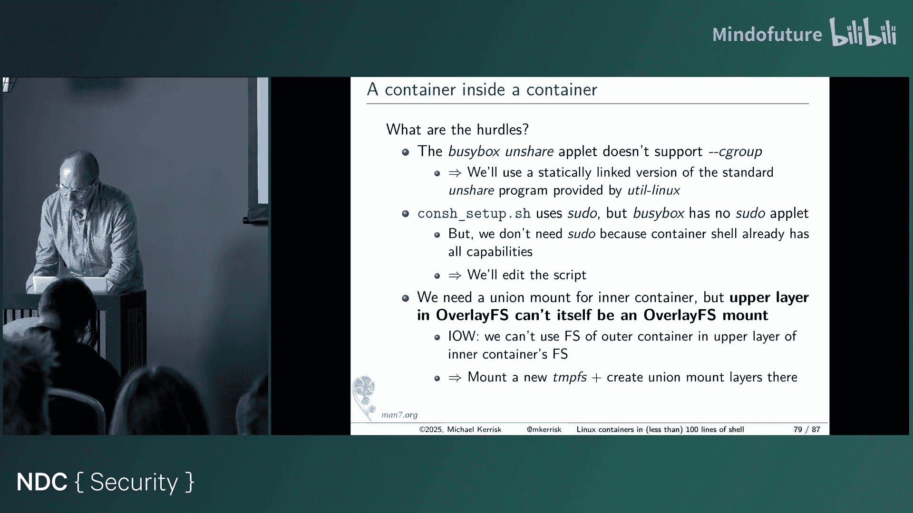

うん。Now， I to remind myself of what I need to do there。 Yeah， Yes， okay， so。

Those were the steps I needed to do outside the container。

But what I want to do now is some steps inside the container。

 where I will say I've got to remind us of one or two things here。Yeah， here's my。

 my outer container here。 I'm gonna make a sub directory called。Demo inner。And then。do amount。

Dash T T fist。T p。Demo in。And。Step into that directory。And then just to an L S dot， dot， yeah， so。

I've got all the pieces in place now， and I'm going to now run my。Create lower。

 If a script create the lower layer。File system for the inner container。In a directory and again。

 I'll just call the directory lower。And then。Create。Conius H。😔，Set up desk。C group group。

Let's call it C group。C group 2。Different host name。 Let's try。Langveed。 or let's try something else。

Pukkaki。And then。The director grew with my lower layer file system and where I want the file system to be set up。

 which is just the current directory。o no。It's a demo。 What did I do wrong。Sorry。Yes， but I've。

 why have I done this， How have I done this wrong。嗯。Interestingly， I've done something subtly wrong。

 but I have got a process with P I D1。 And I think that that's a different busy box。 Now。

 let's just say， I did something subtly wrong there， but let's just say P I D of busy box here。

There are two busy boxes。 That's my inner busy box。 I've just messed up something in the file system。

And。If I say， grip。NSTGID。In slash prox slash 1，1，4，2，4，4。 That's the second layer。Status。Three PiDs。

Because three levels of P I D namespace。 Okay， it's a nearly working container inside a container。

 I just did something subtly wrong。Okay。You， I think， if I over here。

 if I if I type commands like L S， yeah， I messed up。

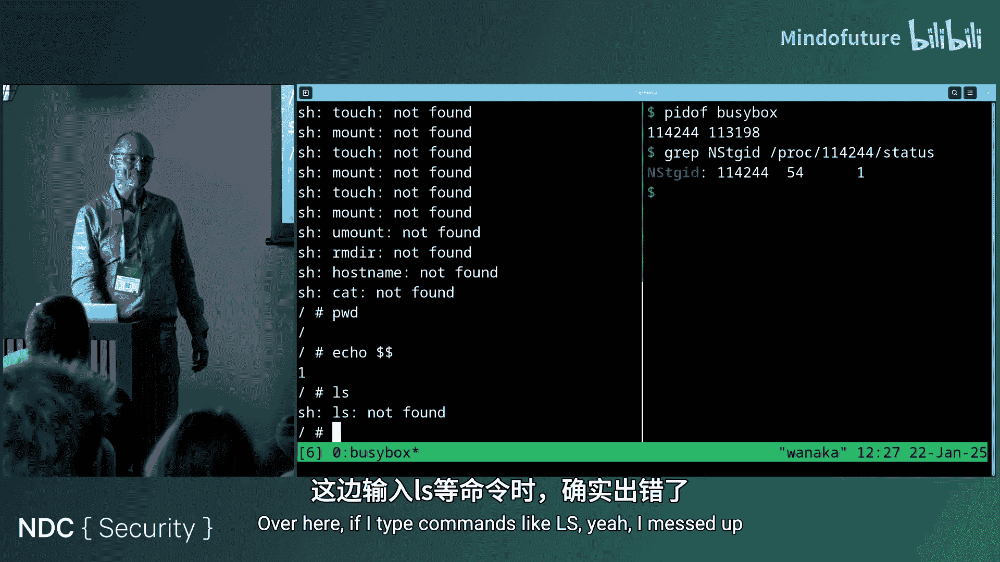

But y it。I did just do something subtle， subtle wrong。 I missed some step。So。I'm going to say。

I made a container in a container， but I just messed up a little bit on the way。

You can check my slides to see where I went wrong。Okay。

 best thing about live demos is they can go wrong。Okay， Ignite， of course， a question。😊，I could， but。

 you know， let's not compound my errors。Any other questions？😊，Okay。

 you got two talks for the price of one。 You've probably even sneak into another session now。Okay。

 I don't know why I went so fast getting too much practice。 I guess。 thank you， for your time。

 unless there's any more questions。

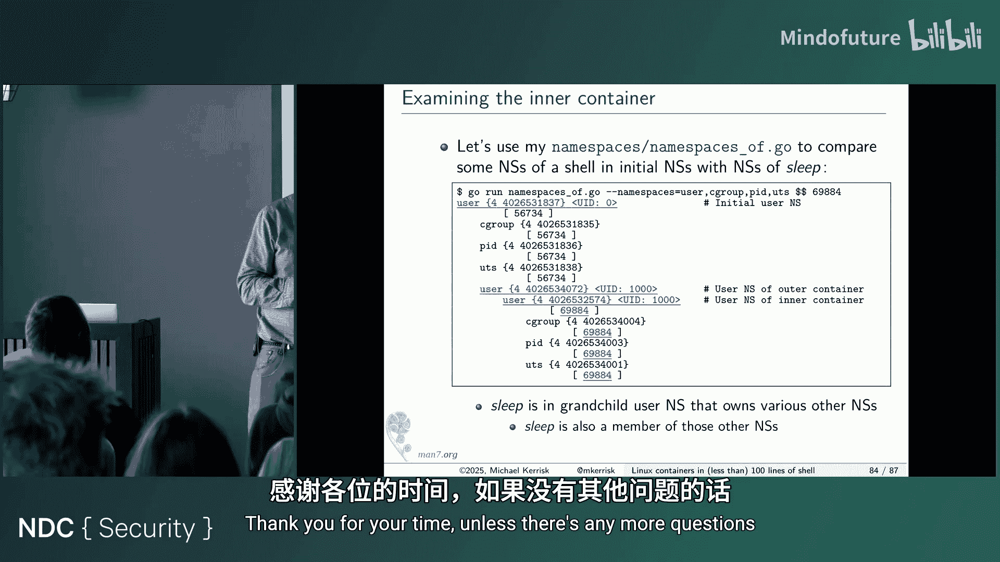

哦。