# NDC-Security-安全大会-2025-｜-AI工作流-｜-智能体-｜-网络安全-｜-Dapr框架-｜-开源工具-｜-LLM应用-｜-自动化安全-｜-黑客-p10-P10-Keynote---Maturing-Your-Application-Security-Program---Tanya-Janca--BV1ihgQzJE2h_p10-

Hi everyone， thank you so much for coming， thank you for setting your alarms。

 especially all of you with jet leg， I feel you。To date I'm going to talk about how to mature your application security program。

😊，And I made this talk because I've been so I've had many jobs。

 but one job I've done since 2018 is working with different AppPSEC teams。

 mostly across North America through a company called IanN's research。

 so I don't know if you've ever seen those TV game shows where you can phone a friend and ask the answer to the trivia question。

 so what they do is you can phone a nerd and I'm one of the nerds。And then we help you with your。

 in my case， your AppEC program， but some people， it's ransomware or whatever。

And so after working with almost 400 different AppSEC teams and then running my own Appec team a few times。

I came across。Different models。😊，That don't work very well that are really common and so the consulting advice that I give is often very similar so I went through a bunch of my notes and I was like you know I always see these three things and this is what I always do that works what if I just made a talk and I just shared all of that and so that's what this talk is about so what are we going to talk about today common security models for software so software security programs we're going to talk about bad ones and。

Basically why they fail。😊，And then we're going to talk about how we can all do better。

 and I'm aware that all of you。Don't have the same budget。

 so I have a bunch of things for if you have no budget or a smaller budget and then ones for if you have a bigger budget because how many of you are the only person on the AEC team？

Oh not okay some hands so I've been the whole appsEC team a whole bunch of times and so my budget was like really little and so I feel for all of you if you have a really big budget。

 I'm happy for you but we're not all there yet okay so how I conducted my research So meeting with different teams for about an hour a week depending upon the team so some teams like one team I met them two hours a week for like years other teams I would check in every quarter it kind of depends on the company and how much support that they wanted sometimes like three months would go by and they're like we're not ready yet honestly we haven't accomplished anything that we talked about we had an incident everything went out the window well call you in three more months I'm like that's cool。

😊，And then essentially me taking tons and tons of notes。😊。

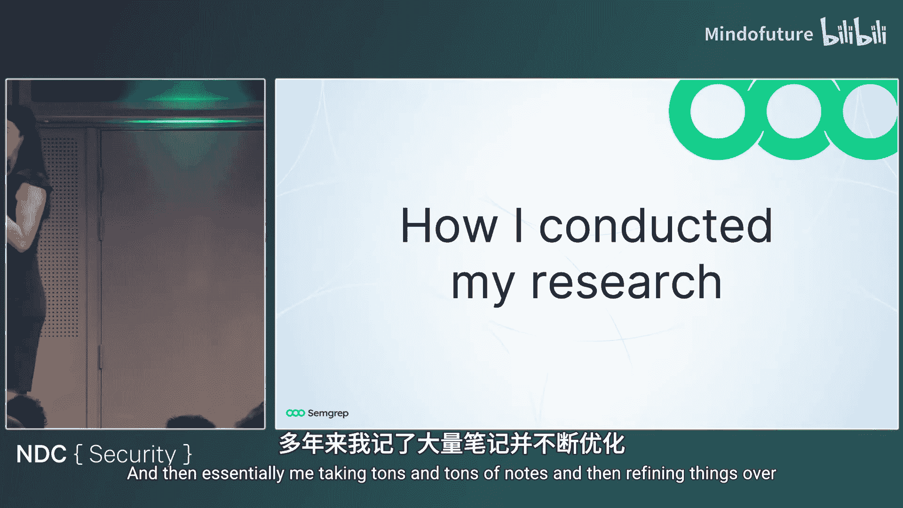

And then refining things over the years。 So who am I， So I'm Tanya Jenka。 I'm from Canada。

 At some point， I will say Abbo。 and I'll be like， no， I didn't。

I will deny it vehemently I do I'm a staff developer relations at SG， I'm known as XX purple。

 I really like purple I wrote some books and my next book comes out in two weeks and I'm very excited and I don't have any here I'm sorry they're still printing them I've worked in tech a long time I've started some things I give some advice and I do some research and hopefully you're like she seems tolerable I'm totally willing to stay。

😊，So let's talk maturity， so when when I work with clients I often I'm like。

 so are you doing a maturity model right now and most of them are like what's that and then some of them are like we look at a second let's look at some models so we look at OA Sam and someone's going to do I believe Seestians here is going to do a really amazing presentation about Oas Sam。

😊。

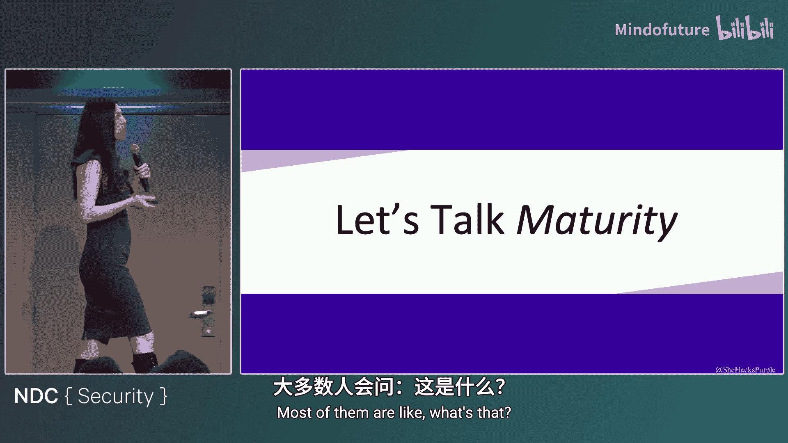

B NISist， there's also DOM now from OOP。These are models that you can measure yourself against and your program against and see how you're doing。

But I remember at Oas Global AppEC in 2023 I attended one of Sebasian's talks which was really good and he had surveyed all of his users who regularly meet up and use Sam and the average rating was 1。

1 out of three and I was like these are people who are very serious about Appec who are working their buns off and have been for years and they're a one out of three if I show my clients who are usually like my hairs on fire。

 I'm not sure what Appec stands for like when I meet them when I come into an engagement they're usually just like everything's on fire we don't know what we're doing。

 if I present something as thorough and comprehensive as Sam they look at me and their eyes water and they have the they're just like I can't。

 I can't even look at that so big and then BM you have to pay to do BM which is okay。

 you know we do work， we want money for work I get it and BM。

Is also quite extensive and quite huge as well。 And so as a result。

 when I show something like this to a client， they're completely overwhelmed and they're just like。

I don't even know where to start like even just looking at all the different categories is overwhelming me much less trying to pick some and then do them and so if you're there that's awesome but like if you want to do a good job of these you need seven figures most of the companies I work with their budget is six figures and some of them it's five figures and some of them it's literally zero they're like we hired you that's our entire budget to talk to you once every quarter for an hour I'm like great let's go and so these models are good just to be clear they're amazing but we're not all there yet and as an industry。

😊，So I work with a lot of companies， that aren't software companies。And I don't know if you know。

 but a lot of them prioritize the security of their software much lower。

 like if you work at Facebook or Microsoft or Netflix。

 that's amazing and you probably have enough money to do something like this in your budget but most of us aren't there so this is a talk for the rest of us okay so onto the models this is my favorite OSI model。

😊。

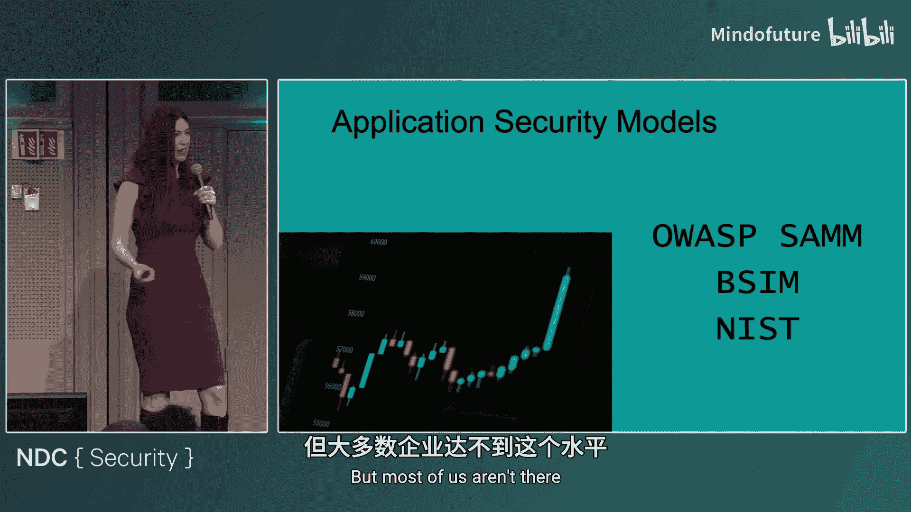

You have to have a certain number of cats， right？😊，I thought that was a rule oh also I used the AI。

 open AI to make these images and there is something very wrong with almost all of them。

 and it is okay to laugh very loudly when you're like， why does that person have so many arms？😊。

Why is that yeah there's some very special images in here so just so you know it's okay to laugh okay so first model is called just pen test the important stuff so I'm sure that some of you started here when I worked in the Canadian government we did this at a bunch of places so we would have like 80 apps and then there would be two that were like in the news that the public talked about that were mission critical to us and we'd have a penetration test once a year on those。

😊，And then we would fix the highs and then pretend the rest didn't happen and then do nothing for a year until you know the pen tester had to come back and the rest of them got nothing and a lot of companies have worked with this。

 they start here and that is okay like we all start somewhere right。

 but why like oh okay so this mall is extremely common。😊。

It's usually coupled with no formal system development lifecycl so everyone is kind of do in their own thing so they have a mixed tech stack and by that I mean that guy's doing Java。

 that lady's doing Ruby， that person over there is like I live and breathe no dot JS everyone's doing something different someone's like I have a Kubernetes cluster I'm doing agile I've got waterfall yeah that's really hard to secure。

😊，U。There's code everywhere， so I'm like， oh， where do you keep your code。

 they're like in a code repository I'm like is it all in the same repository， new。

 this one's Azure DevOs， that one's GitHub， that one's over here。

 someone is a rebel and they're using Soafe and they're1 thousand0 years old。😊。

And everyone's just doing their own thing。Why is this model bad you might be thinking， well， I mean。

 I hope that like looking at this slide you're like I know why it's bad， right。

 but the main reason that I feel this model's bad is because you're spending a bunch of money to hire an expert to come in once a year and there's no knowledge transfer。

😊，No knowledge， so like none of your teams getting better。

So they're coming and right at the end of the system development life cycle you're paying them a small fortune。

 you probably don't have quite enough time to fix everything and like the next time your team makes the same mistakes because no one taught them to do better there's no tools so that they could find those problems earlier like there's no support for your team at all a pen tester comes in and I remember because I as a pen tester for about a year and a half before I switched to application security and。

I remember like I'd come in and I'd be like peop peop pe pew and I would look super smart because no one had ever looked before me and it's not that I was amazing。

 it's that it was like fish in a barrel as the expression goes。

 I hope that makes sense in Europe okay so how do we mature this model so I'm going to start with oh wait。

 I'm going to start with the no budget plan？Okay so all these things there's a way to do them for free and then we're going to have it costs money plan and so the first one is secure coding training and at the end so for everyone that was early they got stickers there's piles of stickers over there where that gentleman is taking a photo for a second I thought he was like drinking coffee and I'm like that's really like casual to just be almost on the stage I'm like that's cool what's up。

あは。But I have a free academy with a free course so you can do that for free with your team so the no budget plan so first of all use cool free tools there's so many cool free tools thanks to so if anyone in here is an open source maintainer or developer thank you there's so many cool free tools so there's Bp and Zap so Bs almost free to me I consider $500 a year pretty much free there's some community there's breakakman there's bandit。

 there's fine bugs， there's so many cool free tools there's NPM audit like there's so many cool free tools and so you as the security nerd can go and look those tools you could give permission to your devs to use some of those tools I am a big fan that's where I started。

😊，You can create a secure coding guideline， so if you tell the devs what you want。

 you're significantly more likely to actually get it， and that is a winning strategy， in my opinion。

Create a list of security requirements so this is a document when you kick off a project so you're like oh you're building an API that's fantastic。

 I am glad APIs are awesome these are the security requirements that I'm going to have for you if you are building an open API right？

😊，So I find a lot of teams when I work with here， they're giving zero instructions。

 they're giving zero guidance， and so as a result they're getting wildly different products that they get to test and so if you give some guidance at the very beginning。

 you will get something way better at the end， especially if you answer questions。

So this is a hard one if you can consolidate your code to the same place so if everyone is using different repositories like different instances。

 but the same type of repository that's not ads bad but if you can get it all in the same place。

 life is really good because you can just point a bunch of tools at it and get it to automatically scan every week every time someone check something in。

 you can even scan it like just as it's checking it in so you can block the check in if you're like that's terrifying don't put that there。

 but if your code's everywhere then you have to set up a million tools and that's a lot more work for you so if you can convince them to consolidate it which again is hard but free。

嗯。So this is another hard but free one， so if everyone could do the same or at least very close system development lifecycle。

 so I know some of us are doing waterfall， some of us are doing agile， some of us are doing DevOps。

 some of us are saying we do agile because we have a three hour scrum meeting once a week。

I used to work somewhere and they would have an hour and a half scrum meeting every morning I'm like。

 that's not scrum meeting， that's just a meeting。😊，So whatever you're doing， if everyone could do。

 as close to the same thing as possible， this will make your lives a0 times better because then it's easy for you to weave yourself throughout。

 but if team A is over there doing something completely different than team B and you have 26 teams。

 that's really hard。Okay， so still no budget， if you can threat model like a simple threat model。

 not like a huge， huge， huge threat model， but a simple one。For your important apps。

 so remember the apps that you pen testeded before。

If you could also do a threat model on them a simple threat model this can really help you improve and so if you're like what's threat modeling I don't know where to start there's this so first of all there's some cool talks about threat modeling at this conference which I plan to be in the front row for but there's also I have this friend named Adam Shotack and he has this thing called the four question frame for Thr modeling and it's just four questions and I totally use it all the time and it's just。

😊，What are we doing？What could go wrong？What are we going to do about it and you talk through those questions and then at the end。

 the fourth question。Did we do a good job， which is a little bit like your mom being like， really。

 you didn't put your dishes in the dishwasher， really。And it's for if you've accepted every risk。

 just like I'm going to make you feel guilty and we're going to go through those questions again。

 which is sort of genius。😊，But you don't have to have like a consultant for a lot of money。

 you don't have to spend weeks doing it， it could be a one hour conversation and you can still get value okay this is a hard one sharing information on past security incidents that have to do with software so if you've had a big attack on one of your pieces of software。

 if you could talk about it with the software developers and say this is what happened this is what went wrong。

 this is how it went wrong， this is how we didn't catch it。

And this is why we need to work with you you know on these process changes or whatever it is that you're going to do to make sure that this doesn't ever happen again。

 I find that that brings software developers right to the front of their seats that's how I got so hooked on security is I asked if I could just take along and then there was all this code on the screen and it was an injection and I was like and theyll look at me there you can read that I'm like yeah it's just ask you yeah and then I was on the team and it changed everything like seeing how one security incident could cost more than like three engineers salary I was like oh this is way more important than fixing that bug I was going do this afternoon。

嗯。Scan your codeb for secrets， so if there are secrets in your code and if you haven't scanned before。

There probably are removing them and accessing them programmatically instead would be good。

 so there are paid and free tools that do that and the difference is basically like a paid tool costs money。

 but it's usually more accurate， a free tool is free but then you pay with your time and so you could totally do this for free。

 I've done it like with free tools quite often at various organizations。And then， okay。

 so let's say you have a really bad app， so you scan it。

And your scanner is just like a sea of like red and yellow， there's like no green。

 it looks like Christmas with all the red lights。And you're just like， oh gosh this is really bad。

 you could put a web app， firewall， a waf in front of it。

 and there's a free w from OOSP called Mod Security。😊。

And do I think a wF is a replacement for a secure coating no no no no no imagine you fall and you skin your knee and you have a wound。

 you put a bandage on a wound until it's better， that's how I view ws is that it's a temporary thing until you can make it acceptable and good enough to stand on its own。

 I don't view it as like a permanent solution to fixing problems。

And so then at the end of this no budget plan， you still pen test the important stuff。

But now the result and the report you get is not 200 pages and it's not humiliating and you don't have you know 30 critical bugs in your brand new app。

 it's actually a respectable report and because there's so many less bugs there's，There's fewer bugs。

 you have more time to fix those things， so you send something out the door that is way better than you did last year and also more importantly。

 your team has learned so much。Your team like you have found faster ways to do things。

 you've automated things， things are going a lot better at this point。

 so this is the no budget plan and so now we're going to move on to the see her she has budget she's like yeah that's right。

😀あはは。😊，So this is that I have some budget plan and so if I have budget the first thing I do is hire a person to do AppEC full time。

 lots of organizations that I work with， they're like。

 oh I'm the AppEC team but I'm also GRC and also the sock hi。😊，Oh my hair is gray and I'm 20。

I have this picture of a very elderly man and it's like being a developer is not stressful at all。

 John age 26， and so if you can hire a person with their whole job，😊。

Is only ensuring the software is secure and they know how to speak to developers and they know about code and they love this stuff this is your best in my opinion investment because they can do the whole part of the free plan for you right like they can do a lot with nothing that's how they got their job and then the next one is if you're gonna to buy a tool so bias alert。

 I work at a company that makes tools， we make one of these。

 we make a bunch of things whichever one you buy。😊。

The paid static analysis tools I find are the best bet compared to a secret scanner， an SC， a DAS。

 a wAF， like for me， it's the biggest step up personally because。

The free ones are just like false positives all day long。

If you hand a developer or report and you're like， hey， fix these bugs and there's 100 things。

 first of all that's discouraging， but second of all， when 90% of them are like nothing。

 then they look at you， they're like Tanya's stupid。😊，And that is not helpful， right。

 and so maybe you'll do that and then number three， I wouldn't pay for it。😊。

I would just use the free ones forever。And then four you still do all of step two so you still do all the free stuff like you don't necessarily need to spend a whole bunch of money to do a good AppAC program so this would be like a basic App stack program but it's super respectable。

 like you would be doing a pretty good job at this point。

 especially for your two or three really high priority apps， okay。Oh， we have tons of time。 go Tanya。

 sometimes I talk like a lot。And then because I was seeing like， never mind， anyway。😊，Okay。

 so model tool， model two， I call this tools， tools and even more tools， so this is where you have。😊。

Oh my gosh， I worked with one company and they had 11 tools in their CI。It took like， I don't know。

11 hours to run or something。 They had two sats， they had two das，I asked that they had everything。

 it just piles of things， so I'll work with companies where they're spending a lot of money on tools。

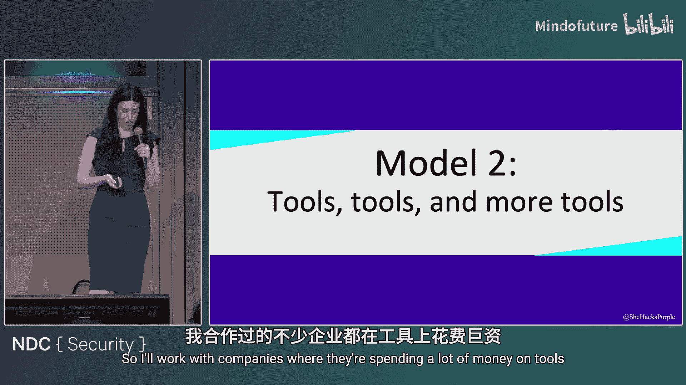

And so this is the most common one I've seen where they just focus on tools and the tools are often partially rolled out。

 so they're paying， I came into one company and they were paying $160，000 a year I'm like。

 you're not paying me that much。And I looked， and 9% of the developers had opened it that year。

And I was like， why am I need a race？Like if you're willing to waste money on this thing。

 then no one uses。What am I doing I work with a lot of companies where they're like， oh。

 we bought this， we bought that， you know we have 200 developers。

 so we bought 200 licenses and then 20 developers use it once in a blue moon。😊。

I like I don't like that。 I want all my money's worth。 There's lots and lots and lots of reports。

 So everyone's emailing bug reports to everyone。But basically nothing's getting fixed， yeah。😊。

The program's totally inconsistent， so imagine I'm going to stand on this side for a bit。

 imagine like one team， you know， they get a kickoff meeting with the security person。

 they have a threat model， they have all of like all the tools run on their thing。

 they're getting tons and tons of attention， the other teams are being totally ignored。

And it's not that there's this more high priority， maybe for whatever reason the Appec person likes them better or they talk to them more。

 but you are not releasing code that each time is the same level of security。

 you have good medium and bad happening all day long and as a result you don't know what you can count on like everything is completely different and that's a problem and they always have a static analysis tool and they always have a dynamic analysis tool as though。

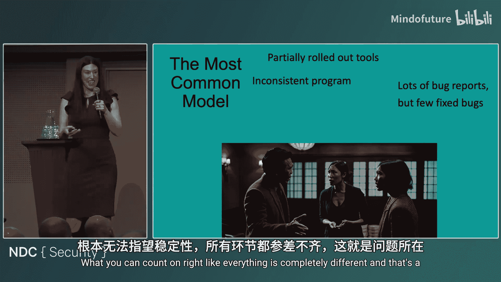

They'll like， I don't know why， but they just always have those two。

They usually have zero documentation， or if they do have documentation。

So I worked at this one place and the guy on the security team is like okay。

 I have I finally have our like our survey for the devs， it was 80 pages template。

 he's like it'll be like 160 to 200 pages when it's done I'm like that's more than there is of code。

😊，Like no， no， no one's filling out your thing， George go home zero people ever filled out George's thing and then me and my bud Eric made one that was six pages and we interviewed you so we would just meet with them and we chat with them and we'd answered as we chatted and then at the end we'd be like so this is what we filled out do you agree did we miss anything is this accurate。

 they'd say yes and then we would either have recommendations or stamp approval right and？😊。

People did the six page thing。But the main question is why won't the developers fix anything？😊。

And like I'll start the call and they'll explain lots of stuff and I'm like。

 but what do you really need help with and they'll say why won't the developers fix things and all I will say？

Did you ask any of the developers this question and they're like， well， no。

When was last time you spoke to a developer， oh， I sent them a report yesterday I'm like no but did you speak to them。

 I know you send them spam with PDFs attached of many bugs you would like them to fix。

 but did you speak to them。W， a few months ago， we， we did this。 Okay， I see the problem。 Let's go。

 Okay， so how， so why， why is this bad， This models bad because you're paying quite a bit and you're getting security and your security posture looks like this。

Because it's all over the place。😊，You're not getting your money's worth for the tools like the contracts you've signed。

 your staff's probably like not superbly happy， the devs are probably like not in love with you。

 like they probably don't have a hate club or anything but they're like there're just the opposite person that's just going to lecture me so it's like everything's kind of okay so there's some friction。

 it's not the end of the world but it's just you're not getting what you want and you're paying like a fair sum for okay security。

Buttons， there we go， so how do we mature model2？So I have a bunch of things that include silly AI pictures。

 obviously， so the first one。To hold the stuff from the previous model so this image is the funniest image because I asked it to take a little girl。

 take an image of a little girl that's 10 and then draw her growing up over time until she's an elderly woman and it gave me this I was like。

😊，I'll take it。My cyberpunk little girl for our presentation。😊，Also she's so not 10。

 but anyway it's fine it's fine so we want to do all the stuff we did before so let's do everything that is free that we can do。

 let's do things to build some bridges so we're going to try to centralize some stuff we're trying to get some things together right but more so if you have a budget at this point so'm we're gonna talk about a few things to save money but if you can hire another Appec person and it's really important when you go from one Appec person to two or more that you so I've had some people give me some crap about this so this is my opinion but in ApppsEC although there's many types of people we're all unique snowflakes there's really two appspsec types of people and one is the badass pen tester that will just do very very thorough testing that is in depth that they're very patient they're very determined I'm really glad they're on our side they're very very smart and they will test things all day long and do a great。

JoAnd then there's the person that does every other part of Appec。

 the cuddly Apppsec person that will pair a program that will threat model that will write a standard or a policy they'll automate tons of things in your C so they're still technical they do many technical tasks but they're like kind of okay at testing that's the type of Abec person I am you need one from each category you cannot have an app team that's all pen testers because then you actually have a pen testing team which is still cool but you're not getting the whole thing and if you don't have any pen testers at all。

 then that means you have to hire out all the time that's expensive and then also like when you have an in-house pen tester。

 they have all this amazing corporate memory so they know all these things about your organization。

 your business model and so then they can be really quite scary so you want to have one of each when you go from one Appec person to two so that's important in my opinion two or three number three not number two。

I like to reassess all my tools， so you have power。

 so if you can sign checks or you can convince your CISA to sign checks。

 you can have power over vendors。And many times I've looked at my tools and I'm like。

 oh none of the devs are using this one why and I'll ask them and if they're like I hate it。

 it makes me want to get a new job then I'm like okay maybe I need to get a different tool or they're like oh I didn't know we had that okay maybe I need to do some education and teach people how to use it or like oh it doesn't work with the tools we have I need a different tool or maybe there's a way to do it and we didn't know yet。

 so look at all the tools that you have I try to do this every two years so often vendors would really love for you to sign for three years or until you die we don't want to do that right so if you sign for maybe two years then every as you get close to your two-y mark。

Is this working for us， I this like meeting up to the promises that they said。

 do our devs want to use this because if not there's lots of different tools on the market and you might find a better one Also when you're renegotiating sometimes you can get a lower price or you can like jump from one vendor to another vendor and they'll give you a few months free so like use this chance to try to save some money。

And to more importantly， find a tool that everyone's actually willing to use So sometimes I reassess and like not's still awesome。

 that's the one I want right but quite often like if I have four or five tools and this one's gotta go and so try looking at that and you might save money Another one ensure your rollout is complete。

 So if you have paid for 129 licenses you should use at least 120 licenses you should be using almost all of them like maybe you have a couple devs that are just like you know I'm doing some weird thing that doesn't apply or I'm doing low code no code。

 it doesn't apply， that's fine but if you have 100 Java developers and you bought a sa for Java developers and only two of them turn it on like that's not the right tool for you right or it's not rolled out in a way where they can use it well And so figure out what's happening。

 talk to people ask them like don' don't just judge literally speak。To them。

Which I know not all of us like， and then find out and then decide like if we want to roll it out the rest of the way。

😊，This is the hardest one。😊，Provide advice and support。I bet all of you are very busy。

 I bet if all of you looked at your list of things to do， I bet there's at least 10。

 if not 20 or 30 things and you're like， I definitely have time for two。

I bet all of you have so much on the go because you work in security and that's why we have a lot of burnout in our industry。

 so this one's hard， I know this is hard， but if you can be a trusted resource where people feel comfortable coming to you and saying like hey Tanya。

So I found a thing and they know you're not going to yell at them。

And they know you're going to be like I'm going to put whatever I'm doing down and I'm going to come help。

 this is a huge thing that will change everything about the way people interact with you and your team and it's hard but once you start so like if you're introverted。

 I get it， you don't have to do public speaking， I realize that is a fate worse than death for some of us but you can talk one on one right and they need your advice。

Okay so number six start to manage incidents properly so when I went to work at Microsoft， oh wow。

 they're so smooth， they're so good， I would report an incident there'd be like thank you Tony we're actually already on it。

Anything else？Wow okay cool amazing so we want to create a way to report incidents easily so at Microsoft you just type if you're on the VPN you just type report it now and it just brings you to this thing and it walks you through holds your hand and it reports it for you it's so effortless we want to teach software developers was security incident looks like and I have a free training course on that in my academy so again free there's nothing in the academy that costs money just to be clear but we do put you on our newsletter so。

嗯。Hopefully you're like that's not the end of the world you can unsubscribe if you need to but basically like by telling them this is when an incident looks like this is what need to know means and it means don't tell everyone you know there's lots of things that that I was not aware of when I joined a security incident for the first time and then you want to have a process that everyone knows so everyone knows what their part is I've worked at a lot of places where only the security team knows what an incident looks like what they're supposed to do what their responsibility is and then when an incident happens。

 no one else follows it because they don't even know it exists and that is not good and so we want to make sure if someone has a responsibility。

 they're aware of it， they know what to do。😊，Okay， so number3。

 I call this the stranglehold giant spend。 And I have worked at this place a few times where。

If you want to- so I worked at one place。And we had to do a 21 step approval process every single time I ran one scan。

That sucked if we had a forum called the emergency scan For and it's still 21 steps but you could complete it with the two of us working very hard in about three weeks to run one scan yeah that sucked I had to have my boss's boss's boss approve the scan I'm like do you think she knows what DAS stands for。

 no she doesn't do you think like do you think that she has more important stuff to do than deal with me。

 yes she does she is not care。I don't even know if yeah， it was ridiculous。😊。

This place is made out of friction。 Everyone's miserable。 And so look at that dog。

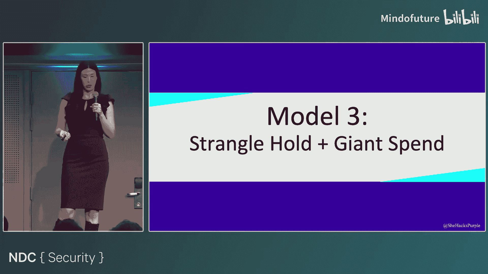

Whoa， he's got some problems。He's very upset。So they're spending so much money。

 they have like every single tool you've ever heard of， if it ends in AST， they own it。😊。

They have governance where you need a form if you want to breathe。

 it is so locked down that no one can do anything there's almost no innovation and there's constant friction I have little ones at home and my little boy's not very good with animals he likes them they don't like him and so like I'll see him petting a cat backwards so enthusiastically he's like Kity and the cats。

That's happening all day long at this place that's what's happening the security posture is not satisfying so youre paying a fortune like maybe you have a seven figure budget right like you're like spending a million or more and you are just not getting what you want at all and security and developers never speak or if they do it's not polite and professional I went to work in another place like this and I remember the first week。

😊，One of the security folks was saying look at this。

 look at this the developer CCed my boss and his boss and the client and he told me to F off I can't believe it that's like they're so out of line they're so unprofessional and then I read the whole thread and I was like that's our fault y I would definitely have said the F much earlier he was very restrained you were being awful we are awful okay I see we're the problem yeah so no one's happy no one is happy with this model and so you're like why is this model bad I feel like I just told you but I wanted a really big dragon in my slides so。

I think dragons are pretty cool， this models very bad because people will quit。

 people will literally quit I one of the places I tried and tried and tried for nine months。

 I couldn't get anywhere and I resigned in protests because I'm like I literally cannot do my job。

 I cannot secure this organization， the governance people are after me I can't do a scan。

 I can't do a test， I can't go talk to devs without having to get a permission slip which makes no sense。

 and so this model's bad because everyone's unhappy and you're not much more secure than the other models。

😊，So how do we mature this， we mature this with a bunch of things。

So you need to scale your program so you're not covering everything in a good way and we want to scale and we can scale in several ways。

 but the two ways I like the best are if you can hire another Ab person and you need a cuddly person that has some social skills so the social skills are really important on this one if they have experience with mediation or negotiations that would be even better if they have good persuasion skills that would be really great。

 there's someone that everyone feels comfortable speaking to plus they're very nerdy and technical which I know is hard to find or if you're not going to do that you could start a security champions program and I'm giving a talk tomorrow about security champions I'm a little obsessed with that but that is another way that you could try to scale your program。

And I'm checking my time and it is not too bad Yes。

 if you're not going to do a champions program you could do an advocacy program so a security champions program is where the AppEC team usually usually it's software developers and AppEC but it can be your whole workg but just for now let's just focus on developers so basically it means you have attracted or selected or gotten someone to volunteer from every single dev team to be the champion of the cause of security and they communicate on behalf of their team with you you teach them cool stuff they are the person on their team that makes sure that security stuff gets done and they will deliver messages。

 they help make sure your message land， they give you feedback like by the way everyone hates this tool yeah you should get the other one that we looked at they are so great or you could do advocacy so advocacy is where you do a whole program。

To try to improve the security culture where you work。

 because some people work at places where everyone hates the security team， I remember。

Not my proudest moment when I was a dev， I was the lead devb and I had been for like three years or so at this place。

 and I saw the head of security coming my way and I went like that。😊。

And then I look up and my boss saw and he's standing there and the look on his face， he's like。

Really， Jenka， really。 like， he's like， stand up， Bruce， she's here， Im like。あん。

You don't want that right and it got like that because all he ever did was say no。

 all he ever did was stop me， all he ever did was slow me down and never ever help me right and then eventually things changed。

 which is another story for tomorrow， but advocacy can really help。Make it a standard。

 so up until this point you have created guidelines of what you would like it if people could do。

 like it'd be so great if you know you can follow the secure coding guideline。😊。

But you can change these guidelines now because you've had them a while theoretically into standards。

 so it's like from now on， this is how we build software and it's not a stick for you to whack people with。

 it is a goal for everyone to aspire to and that you will help them reach right so I've had dev say。

 oh are we going to get fired， like no one is getting fired， please don't leave。

It's my job to work with you to get you there and in the next year I want us to try to get there or as close to there as we can get right and when it's a standard。

 then every new thing will meet that standard。If it's a guideline forever， your results might vary。

At someG， we have， you know how like companies will have values and it'll be like integrity and honesty and truth and then they do things like Enron one right that was on their wall with truth and integrity in their lobby so ours is make it go fast that is one of ours and we obsess over making things go as fast as possible like internally externally like that is our jam and so if you can make things go fast for devs。

 they will love it and they will love you and so if you can make things self-service so they don't even have to ask you you automate things you tune things so they go faster and faster and faster。

 they will really really like it and so take time to improve their daily work and they will notice。😊。

Examine your API， so at this point I feel like you should develop。

A slightly different approach for APIs and any other technology that you might be using so you should have specific advice for APIs。

 for serverless for web sockets for whatever it is they're doing， if some people are doing GraphQL。

 some people are doing open API and then there's some people that have to take care of your old sad soap apps。

 you should have guidance for them and maybe tooling for them to make sure they can do a good job right so we need to make sure our APIs are treated differently because they are different。

There we go I love threat modeling so I might be slightly biased here。

 but this is if you're spending a fortune there's probably something else you could consider cutting back on so you could do threat modeling threat modeling so a lot of the things that Appec people do are focused on code bugs and implementation but the other half of that is design so if you perfectly implement an insecure design you still have a bad day ahead of you right so we need to work on design and work on implementation and code and so threat modeling is just design that is the big part of it and so by doing threat modeling we can find flaws before malicious actors do and improve all the things that we build we can also make sure they're tougher they're rugged they delight our customers threat modeling really helps with this and like I said there's some cool talks about it。

So at this point as well you should consider having a company wide policy and like a plan for managing secrets so all the secrets should be in the same type of secret management tool but they should all have their own instance。

 so they all have a different vault even though it's like I don't know whatever you're using hashhi curbs cyber arc whatever you're using I don't care but in a secret management tool they all have separate vaults because if one gets。

😊，Compromise， the rest are' safe。😊，But the whole company should be working together on it。

 Everyone should know what to do if they find a secret。 We should have pre commitit hooks to stop。

 So if someone's like trying to check in a secret in their code。

 there should be something that stops them before it's spilled there's。

Like this is something that maybe earlier you could do， but by now you definitely need this。 Okay。

8 continuous scanning， So I asked the AI to make me a thing for continuous scanning and this is what it gave me and I'm like。

 that's creepy， but I like it。It's kind of creepy， right？😊，So when I say continuous scanning。

 I don't mean what。😊，Vendors probably tell you， I mean you have taken your tools of choice and you have set them up so that they automatically scan things that are in production maybe every week right so you could have a secret scanner scan your codeb every Sunday and it's like zero effort for you and then it sends you an email if it finds a secret that should not be there there's lots and lots of automation you could do and so basically this slide is automate all the things so you should not be doing manual things unless it's cool manual testing that's highly interesting for you because you have better stuff to do now you are way way past that training that doesn't suck and so。

I find a lot of companies， they do one type of training for all 1000 employees。

 and that doesn't always work。So if you have a big team， maybe some of them want textbooks。

 maybe some of them want audiobooks， maybe some of them need a video subscription。

 maybe a whole bunch of them are going to go to live training with a trainer。

 but then you follow it up with monthly lunch and learns。

It's really important that you consider accessibility and different learning styles。

 if you have a really big group of people you're trying to train。

 one type of training doesn't always work for everyone and you're going to lose people along the way if you just give them one option。

 even just like if you choose a book offering an ebook a physical book and an audiobook for different types of people。

 you'll get way better results。And it sounds weird。

 but like the people who need something different will feel valued because you asked。

 And so find training that does not suck。 I didn't know how to word that nicely。

Okay so if you sell a wff I'm sorry， so now you would want to take your wft thrown the garbage and get like a rasp because they're better or an intelligent w you don't want to have the freebie anymore if you have something that is super high priority something that is mission critical you might consider putting a shield in front of it you don't have to but if you do you would want to switch probably from like the basic generic w that is quite simple to something more advanced and I did a big shield I was like wow that' is really big when you look at how little the lady is but you want to make sure that your shield are quite tough and you also want to make sure you configure whatever shield you have so that it doesn't only protect on the way in it protects on the way back out so all of these types of tools can not only do like blocking of obvious attacks they can do virtual patches for if there's zero day being exploited in the wild but。

Can also stop exfiltration so you can say， oh if know in the past couple of months the biggest response size was only you know one meg。

 well then you can set a maximum response size of two megs if something's coming back and it's 10 megs and it's JSON that's like huge right it's like whats going on here you'd probably want to block that request right so make sure you've set it up so that you're getting the maximum value。

We want to handle AppEC incidents， so at this point you have an incident response team。

Ideally you've taught them what a software incident looks like because it looks really different I've had a lot of I've worked at a lot of places where I'm not on the incident response team but I am and they'll come up to me and they're like hey Tony you so this thing's happening it kind of looks like this I'm like oh cool like can I see the logs and we start looking and I'm like why is everything say three or four weeks ago like that's when we found it like why are you telling me now why didn't you telling me three or four weeks ago when you found it and then I could help and it wouldn't be this bad so they need to know what it looks like so either you trained them on what that looks like you have someone from the AppEC team that's like on the incident response team whatever way you want to do this you want to make sure that they're prepared to respond to software like custom software related incidents not just ransomware and viruses like malware all day long there's more to it than that。

And the last one data drivenri approach so this see how he's so happy I was like show me a picture of someone that is ecstatic about data and this is what I got and so you'd be surprised like almost all the companies I work with I'm like so have you used data to analyze your program to see where you're at and they're like no what do you mean？

😊，And so we'll look through past things and we'll see patterns and I'm like do you have any goals for your program and they're like what do you mean and so we'll set goals and then we measure against them and then we see if things we're doing or getting us to the goal because sometimes they don't and we need to switch things up and that could be goals towards building a security champions program it could be goals towards getting people to do threat modeling or getting people to fix bugs whatever your goals are。

 but like if you aren't setting things you want to achieve you're going achieve something but it might not be something you like and so it's really important that you gather metrics on everything you do and you use it to constantly inform your work and Im constantly surprised by how many large companies spend millions of dollars on their AppEC program and they have no discernible metrics or goals for their they're like well we're gonna to scan all the things I'm like cool you're doing that what's your next goal they're like more scanning no。

 we can do so much more come on okay。So， conclusion。So we learned three common AppEC program models。

We talked about how to identify the model so you can spot if you're like， oh。

 maybe we're doing a bit of this one。We talked about how to take those models and mature them so they're better so that your apps are more secure。

Your team， like your team that you work on and the developers are happier。

And you're usually saving money as well and we talked about how to build like a really good AppEC program。

 essentially like wherever you're at you can improve so things are better。

 it's very possible so I'm hoping if you took one thing away you're like it can get better and I can help and with that I have some free resources for you so the first one is my free a with the secure coding class。

 the In response class， everything I also have stickers with that on there in case you don't get the image quickly enough。

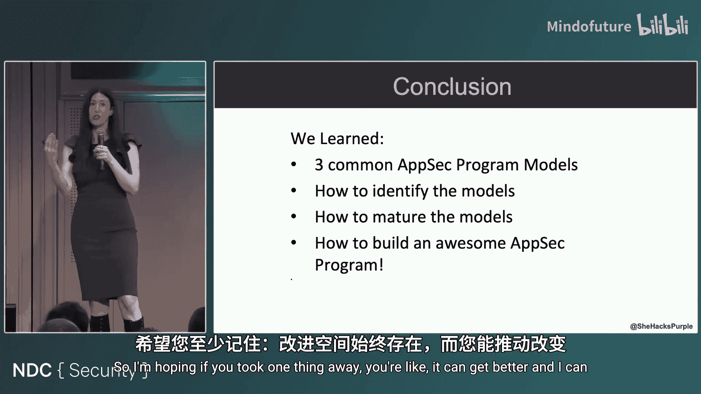

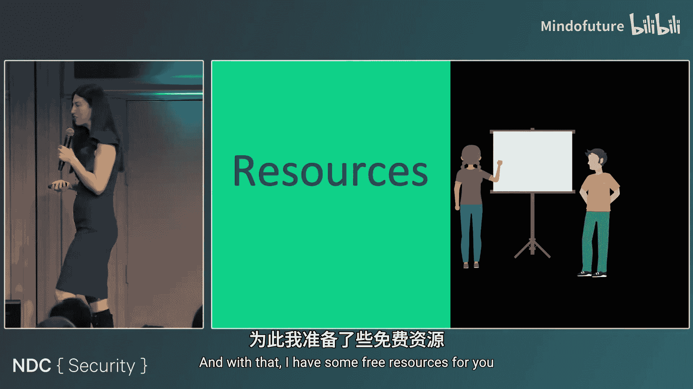

And the next thing is。

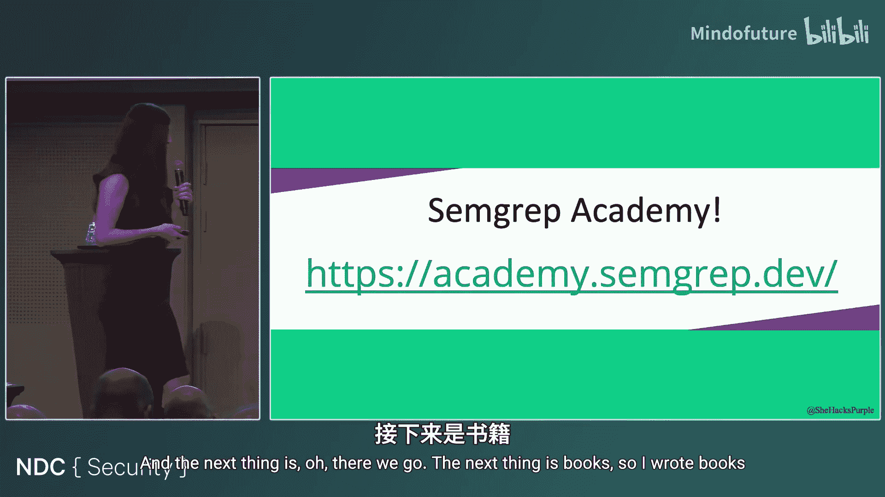

Oh there we go， the next thing is books so I wrote books and I am biased but me and my mom agree they're pretty good。

So the yellow one isn't out till February 5th but that's pretty close right and so maybe you will check these out cyber mentoring Monday so every Monday on Twitter blue sky mastodon and LinkedIn I use this hashtag to help people find professional mentors if you are looking to take your career to the next level a professional mentor can help but on top of that if you've been doing your job for two years or more you know enough to be a mentor and I'd like to encourage all of you to consider taking someone under your wing and helping them I assure you it feels amazing when you see them just like sore it feels really good。

😊。

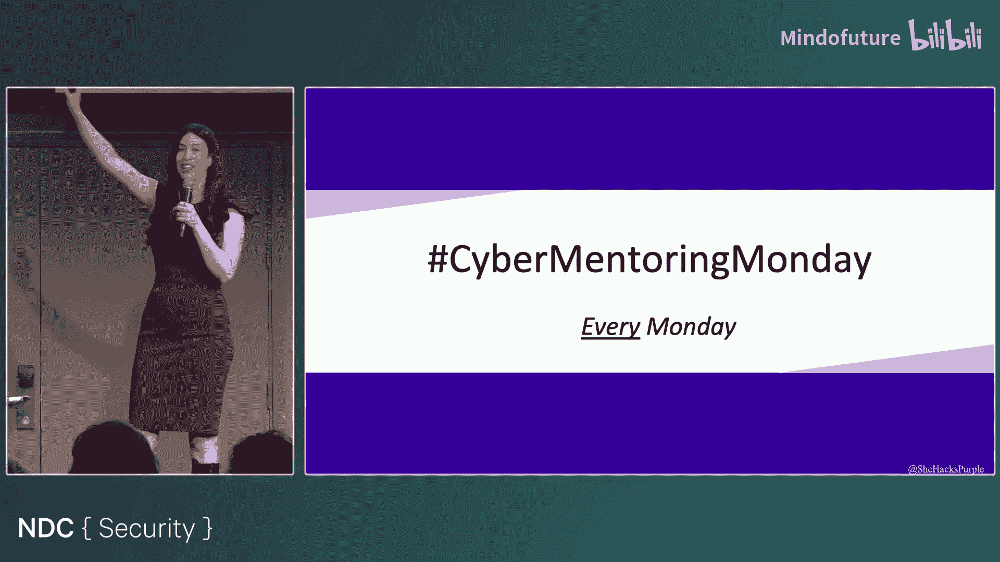

TLDRS， so my friend Clint has a newsletter， I think he has like 100，000 subscribes。😊，And it's free。

 and he summarizes。All the research that came out each week about security， so it's not the news。

 everyone does the news， he's just like this is the cool research and so then he summarizes lots of it and then you can double click on the stuff you like and so it makes me look smart。

Resource is me， so I'm XX purple on all the things， I actually don't have Instagram。

 that's a why now the marketing team made me make one and I deleted it。

I also don't have a Facebook account anymore because I got away with deleting them。

 but I do a lot of stuff and if you liked this there is literally endless more content for you that is free and with that I want to thank you for your time and attention today。

😊。

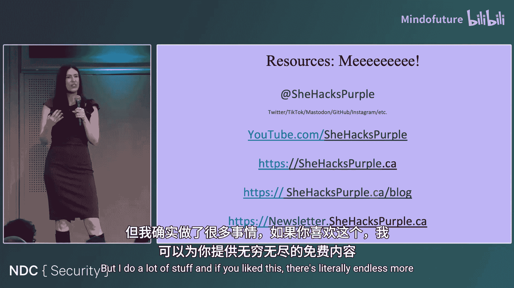

I think do we have any time for questions or are we done？Oh， thank you。

Thank you so much for this wonderful。Can I give you that？Because I think people， look。

 I got a sweater。呵。It's very cold that's such an appropriate speaker's gift。

That was brilliant do we have any questions in the audience and if you're shy。

 oh there's one over there right behind you， if you're shy like you can talk to me for the next two days。

 I want to hear you thank you for your talk I want to touch down on the like Aback person like the pen test versus the cuddly one。

😊，If you have budget for one， like， who should you hire first。That is like the best question ever。

So if you're spending tons and tons of money on pen testing。

 it might make sense that you hire the pen tester first because if that's the program you're doing and that's working like well enough for you。

 I might hire a full if you think you can keep them busy because you don't want them to be bored right but if you're just you know doing two pen tests a year and you're like everything else is a total mess I would get so I call them the cuddly upset person because I don't know what to call that person because sometimes people are like oh they're the not technical person I'm like that's not true。

 they do like code review they do all sorts of stuff they're just not。I don't know badass。

I consider myself one of them。But I'm biased because I'm one of them， so I would hire me first。

 but I find like if you're trying to build a secure system development life cycle， that person。

 if they're obsessed with that， that's the thing you can get right out of that person So does that answer your question sort of Yeah and I'm also biased like。

😊，From a developer perspective， one thing I hate is getting many， many reports。

From security folks saying like， oh。You have here like a buffer overflow and like。

 why are you not fixing it， Where is like， why are you ignoring me iss like。

Just send a pull request dude right I'll press the button in I totally agree I remember the first time I got a VA scan done and I got it and I read it like and he was like 2011 so it was a while ago and I remember searching online for crossite scripting and there were three sites that's it on the whole internet and I was like what does this crap me what do I do and one of them was oh Op？

😊，So I totally feel you， and then I asked the guy I'm like， so where's this and he's like。

 you should know？"，And then I learned later， it's like， because he has no idea。 He's like。

 I don't forget no。 I'll just pretend she should know。

 And then I'll just make her feel bad so she doesn't ask me anything ever again。Right， thank you。

 do we have any more questions？😊，There we go。I know I'm standing between you and we're caffeine。

 so I get it。Could you explain more in depth of the difference in between or like inferior inferiority of w against Ra。

'cause we seem pretty。Amant yeah， so there's next Gen wF， which is usually pretty intelligent。

 but the first generation wF is essentially a lot of regular expressions。

 so mod security way way better than nothing right and it will totally protect you against。

Like obvious attacks， right， which is very helpful。

But the more regular expressions you have and the more complex they have。

 the more latency you get right and the more chance of you blocking a legitimate business request。

 I used to work with a government that was not the Canadian government and I don't want to name them because then I'm naming them and they had six full-time engineers。

😊，Just to control their wF。That's very expensive， where RAsp is a technology where it's a binary。

 it's installed up inside of your application and it kind of defends it from the inside out。

I've just seen much better results， they usually cost more but like。

Generally I see that they're better defenders， but money I'd rather always secure coding first and like we do tests。

 we have good requirements， we have multiple layers of defense and then RAP or wF can be one of many layers does that help。

Awesome， thank you。 Do you have any other questions before I let you all have treats？

Thank you all so much， I really appreciate you。😊。