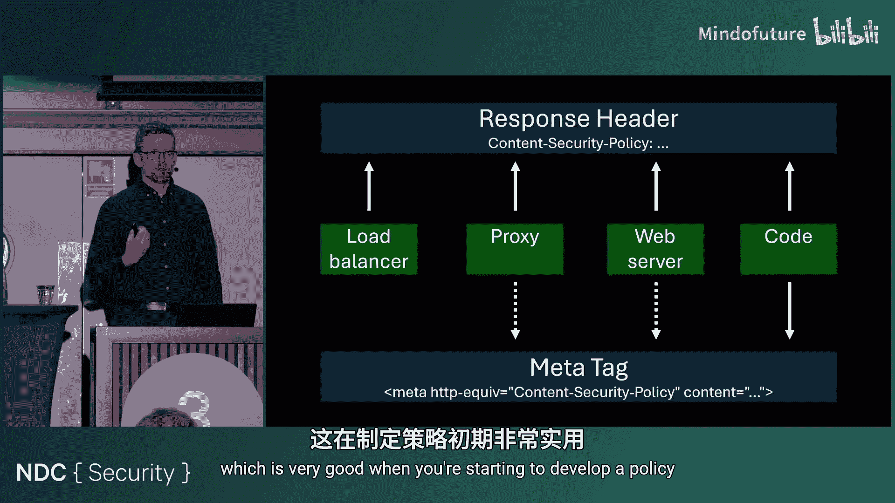
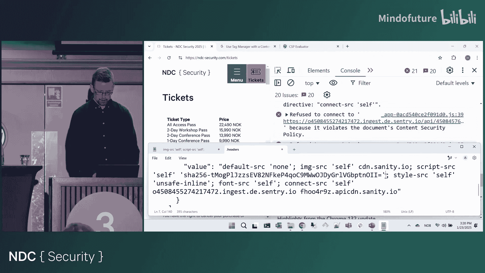
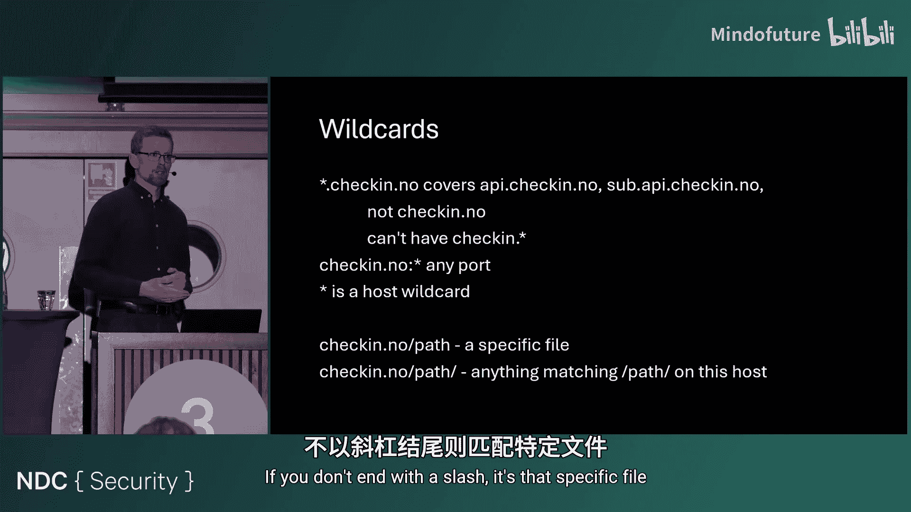
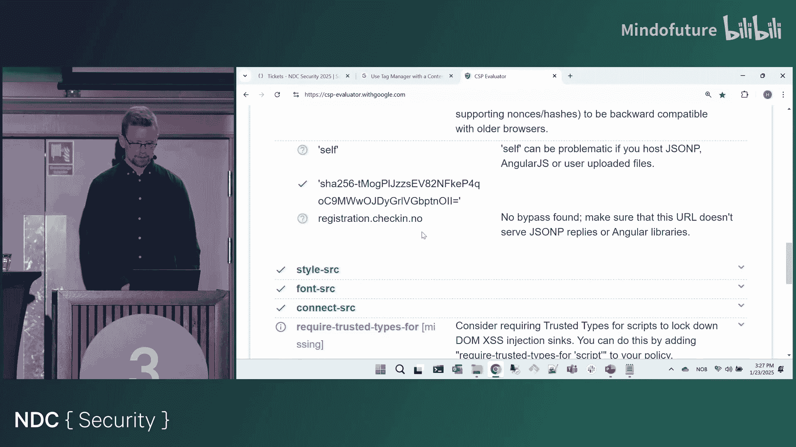
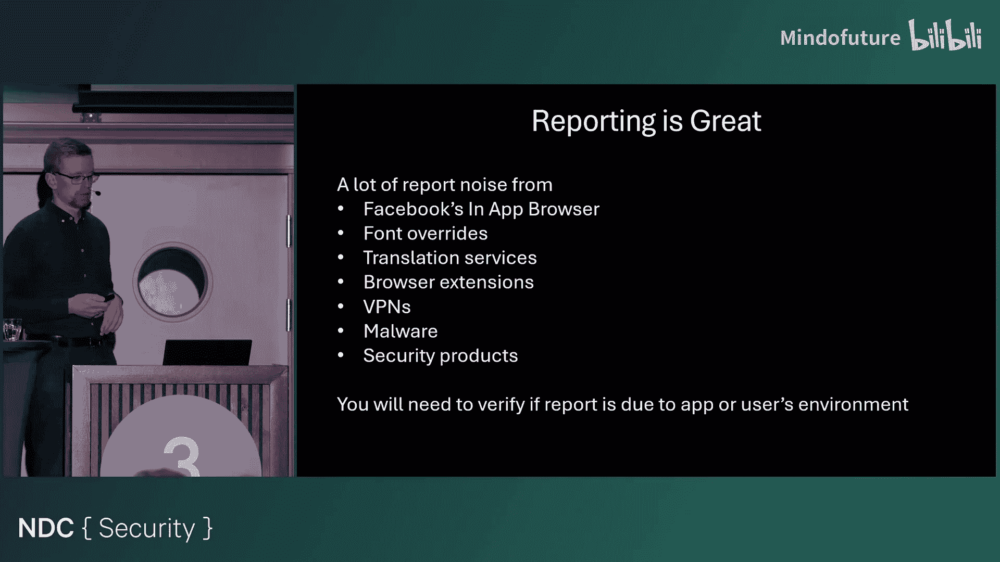
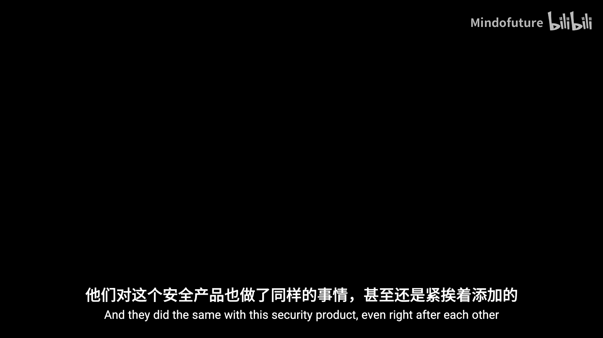
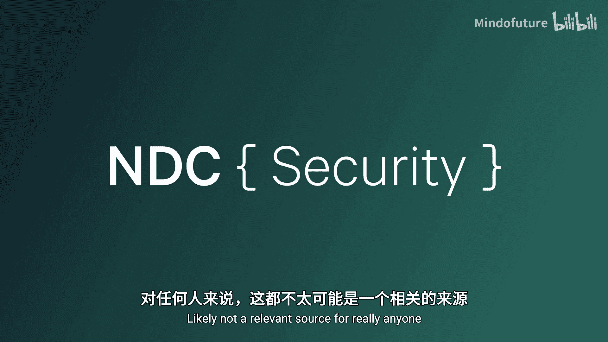
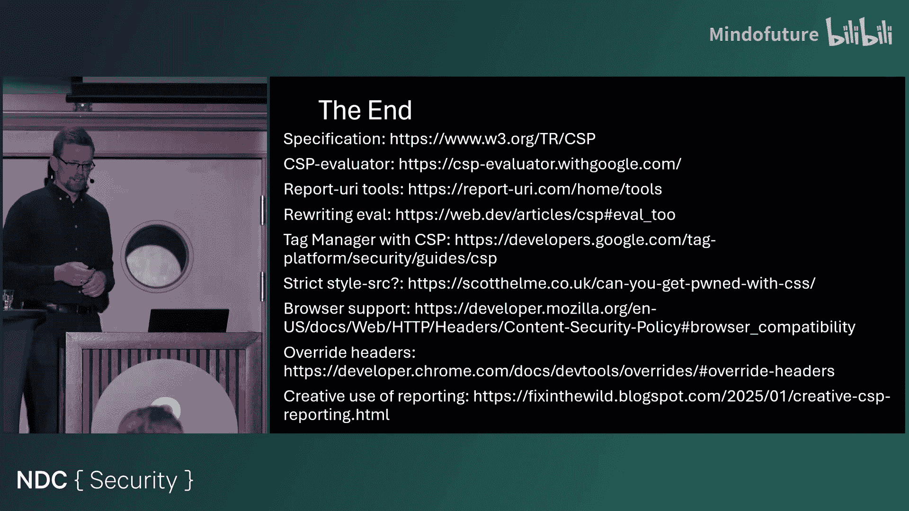

# NDC-Security-安全大会-2025-｜-AI工作流-｜-智能体-｜-网络安全-｜-Dapr框架-｜-开源工具-｜-LLM应用-｜-自动化安全-｜-黑客-p11-P11-Content-Security-Policy---From-newbie-to-advanced---Halvor-Sakshaug--BV1ihgQzJE2h_p11-

Welcome to content security policy， from newbie to advanced。😊。

I'm going to try to take you all the way to advanced in just one hour。 That's a challenge。

But let me just know where you are。On this scale。 So who had heard about content security policy before this week。

Okay， good。 Who has worked with the policy before。Who's like worked a lot building from the ground up or doing cool stuff with Comp security policy。

That's good to see。 It' got some advanced people here。 I'm sometimes gonna abbreviate it as CSP。

 because that's shorter。😊，This talk is going to be like， when I took this picture。

I don't do snorkeling because I like to dive， and I don't want that snorkkeel to be filled with with water。

 I'm also not a scuba diver。 So I swim down。 I swim up to breathe again。

 So we're gonna touch on something that' is a bit complicated。

 But if you have a background in Web technology。😊，Yeah。

It should be quite easy to reconnect when I'm up to breathe。 And that's gonna happen， like。

 quite frequently。So me， I'm good swimmer。 My name is Hol Vodes Ozog。

 I do application security at P G Forsta。😊，Of company you probably haven't heard about。

 Use to work for the Norweian softwareft company， confirmfi it。

 It was merged and merged and acquired。 So it changed names。

ESometimes I do some writing on on the blog， and I'm on blue sky。So， CP。

It's about protecting your app in the user's browser against a lot of threats。 And yeah。

 we'll get the details。Why do we want a content security policy。Number one。

 to protect against crite scripting。Exerus。That will be the main focus of the talk。

 And I think most people who are really into CSP will say that that's the main thing。

 But it's also really hard。But you can also use it to protect against framing。

 exfiltration and unwanted sources。Now， this is what the psychologist would call。

 would call the inner motivations。 We also have some outer motivations。Audits。

 pens and clients saying that， well， you should have a CSP。A lot of times。

 they just say you should have a CP header。They don't really know what should be in it。

 So that's up to you to decide a lot of times。I think I saw the first such requests。

 like 6 to 8 years ago。And ever since it's just been increasing every year。

 there is more and more and more。But they still haven't really advanced in。

Kin of what they expect or have been specific。Another reason coming this year。

 if you ever heard about PC I， D， S S， payments， card， industry standard。

There is a new version coming out or being enforced in April。1 of April， is not a joke。

 It pretty much says that you'll need S E SP or something similar if you are taking credit card payments on a page。

So from my doctor's office， I thought it was appropriate to put it here。So this talk。

 I'll start with more introduction to CSP。With terms and variations。

 because theres things we just need to know so we understand all the bits of it。

I'll give a live demo of how to develop a policy。 least the starting point of it。

I'll go into depth in how you prevent excess S。I've answered more than 300 questions on stack overflow on CSP。

 So I'll tell about， tell you about some of the gotchas。 There is a section for it。

 but there is also some of them sprinkled around in the presentation。😊。

Talk about reporting and finally， how not to make a policy。So。A CSP。

 we typically deliver as a response set。 So it's just a string。And it's something that。

 it's a policy that we set and deliver to the browser， and the browser will enforce it。And。

We define different directives， which control different things。

 So the directives have names in a lot of places， I'll put that in green so you can more easily see where the different directives start and end then what their names are。

And then most of the directives also take sources。Let's just imagine a web page。

 a very simple web page that we build， like your first homepage。Different classes of content。So。

 you put in some。Different URLs there。 In this case。

 relative URLs because you load from the same origin。And， of course。

The way H T L works and the browser works， if you reference some content， it's loaded。

Same thing with an external source。And if you have some inline styles and scripts。

If you have an image in the data URL， everything will load because that's how H T L works。

Then CP comes along。And then， let's just see if we're real strict。 and we said default source， none。

Which means pretty much like， yeah， I don't accept any sources on this page。So。

 everything changed from green to red because now these things won't load。So that's， of course。

 too strict。We can change that to self， which is pretty much like the same origin。Now， we see that。

All the relative URLs， which are loaded from the same server。 Now。

 they will load so they like the page will start coming alive。We can expand this policy。 Now。

 I added a host。 So everything that's on that host， it's a script and a style。 they will now load。

Okay， not everything we can do in the policy。 We don't need to let everything go to the default。

Sour directive。 We can implement a different directive。 In this case， style source。 that's styles。

 So now styles are kind singled out。And we set it to self。 So we don't get X， Y， C dot com anymore。

 because。It。Wons a style。The browser will check for style source， and it found style source。

 so it won't go further and check the default source。But then we can set unsafe in line。

 which will allow all the in line content for styles。So now it's allowed for styles。

 but not for scripts。And just to show you how it works， we'll remove default source。 Now。

 we're only restricting style source。 Everything else will just pass just like the regular H T L case or no CSP case。

CSP has three levels， which they could also have called versions。 I don't know why they didn't。

 Number 3 is still in draft mode， but it's been for a number of years until fairly recently。

 you would think about compliance with level 2。 You don't really need to anymore more because most of browsers have now now caught up。

 like Firefox is missing a few details， mostly about reporting。So you can safely， you know。

 only use level 3。Disposition。You can enforce the policy with content security policy， or you can。

Just do report only， like not enforced。With content security policy report only。

And why not make it visual。 I don't know if you know like how the conference web page looks like in and out。

I'm gonna use that as an example a lot here in this talk。 to the left， there's an enforced policy。

And if you， anyway the enforce policy is fund source， none， which means load， no funds whatsoever。

EAnd you might recognize this as a Chrome default font。

 because that's what it's showing when it's not allowed to load any other fonts。

So that's what happens。 Like stuff break breaks on your page。

 And there is also an error in the console when this happens。On the right side。

It's content security policy report， only。Also， fun store is none。

 but it looks just like we expect because。It's not enforced。 It's just the report only。Normally。

 you would also add a reporting directive here so you could actually get the report about this violation。

 But you can also see it in the console。 We get an error。Which isn't really an error。 But it's like。

 yeah， it would be an error if we had enforced it。That's why it says report only on the one beginning of the console area there says report only。

 It does not on this one。In CSP， there are a lot of directives and the directives go into different classes。

 except one that doesn't。Because there are also some things that are just thrown into CSP， because。

 yeah， why not？ We had tried to define something and didn't really take off。

 So we'll just put it into CSP。Upgraded insecure requests down there as one of them means。

If there is an insecure request like H GDP， make it secure， H GDPS S。Also， the Iframe sandbox thing。

 Sos also a directive in CSP。But the main thing here is the fetch directives。

 That's where we'll focus。 That's about the sources on the web page。

 And that's typically what we want to restrict。 But there is， of course。

 a lot of other cool stuff here。So I talked a bit about the fallbacks and what happened when we had default source and style source。

 So all the fallbacks。 Here they are。So if， for instance。

 if you don't implement worker source and in the other class， it will first go to child source。

 If that is isn't implemented， it will go to script source。 And if that isn't implemented either。

 it will go to default source。So like everything here that has。

 or or at least in the fetch that doesn't have isn't implemented。

 Itll eventually go to default source。Now， this isn't everything。 Of course。

 I've left some space here。 So its script source and style source。😊。

They can be split into elements and attributes。Actually， the specification says。

 don't do this if you don't have a like use case for it。But it's really useful in the。

 in the reports to see， is this an element or is an attribute or is another type of element。Now。

 you might wonder what this。Fall under the different directives。So， I。Put out up here。

 the blue are tags and orange are script constructs。So， yeah。I don't expect you to remember。

 there won't be a test on this。And if there is something new， something which isn't defined today。

Where would that go， Well， it would like， most likely be sending or receiving data。

 And that would be connect source。 So if there is something that isn't defined。

 it will default to connect source。 And if that connect source isn't implemented。

 it will go to default source。And also， experimental directives。

 There has been like few directives that have come and go in， in CP。

These aren't actually part of the draft specification， but they're implemented in chromium。

 They're quite cool， but I won't be covering them。Unfortunately， don't have time。

So that was the directives。 and now the sources。嗯。Yeah， sources for most of their directives。

So the most important ones， self and none， None is kind of easy。 It's like an explicit way of say。

 of making an empty list。Then you have self， which is almost the same origin。But， it's not。

It's the same origin， and upgrades。So it's if you're on H TP， it's also H T TPS， S。And also。

 if you're in a non default port， it includes the default port for that scheme。

And then you can take host sources。 So you can take a host， but you can also add the scheme。

 You can add the path or you can add the port， or you can add all of them or more of them。😊。

We also have scheme sources。 These are very broad。 So if you really want to restrict something with your CSP。

Maybe you should induce them。 But in some cases， yeah， its it makes sense to use these。

And then scripts and styles take some additional sources。

You see a lot of things that are called unsafe here。 And there's a reason for that。

 And I'll try to explain it a bit。嗯。There is something here in top right， report sample。

This will send the 41st characters of a script or style in violation report。

 which can be really any if you need to locate something。So I。

 I'll go into a bit more depth on all of these later。 So they are different keywords， hashes。

 nonsenses。And some other strict script keywords go， I'll come back to them。How。

If you read about CSP。It will seem like you can do this in two ways。

 You can set it as a response set or you can set it as a meta tag。Well。

 the meta tag is more restricted than the response set。

And setting setting it as a meta tag is pretty much like walking out in the street。

 so are slow today。Without winter shoes and proper clothing， you'll only do it for a short time。

 and you see very few other people doing it。So likely response set and。Yeah。

 there is different ways you can set the response set。So I listed like the most typical ones here。

And which one should you choose。Well， I think it depends on who's gonna update your header and how quickly does it need to be updated。

But， maybe， more importantly。Does your CSP need to be dynamic。That would call for going to the right。

And also， do you want your CP to be in your tests， in your dev and test environment。

 that I should also push it to the right。Now， these are the ways that you set a header。

 But now I'll show you a different way of setting a header。Which you may or may not know about。

 which is very good when you're starting to develop a policy。

So。Let's work with the NDC security web page， the tickets page。And。If you are in a chromium browser。

 which you need for this， there is something here might be hard to see the tool tip。

 but it says override header。And if you click this， oh。

 the very first time you might have to define the folder and accept that folder to be used， but。Yeah。

 you'll get through that。 Then you get this addd header。 You can modify one of these headers。

 or you can add another header。 So what I'll do here is I will。Start typing content security policy。

 And if I make any mistakes， just call it out immediately if you can。

 You need to spend time on debugging。 So I'll start with a very strict。嗯。C， SB， default source， none。

Now， we'll reload the page。And we get the 1996 feeling。Really killed our webage。Whi。It's too bad。So。

We'll need to allow a few more sources。 Now， when we started overriding headers。

 Chrome Chrome created this file。Inside a folder with host。 So it's this headers file。So first。

 I'll just make sure I have this cupied。And here is。

We can work in this file instead of having to go into the， the network tab and find the header。

 just work in this file。 It's so much easier。 You can just。Flip the windows back and forth。

 So now I say that in addition to default source， none， we accept the same origin for images， script。

 styles， fonts and connect， that like data sending and receiving。So we'll save that one。

And then we'll reload the page。 And did I tell you that you can kill your page with CP。

You can kill it。 Big time。So we need to save it， and。

My experience tells me that this is because some script is trying to access some style。

 which is blocked。Maybe you should even try to take a look at that。 Let's look at in in the console。

 Re to apply in line style。 I bet there could be more of those， yeah。Okay， I'll make this bigger。

 Reffuse to apply in line style， so。Let's add， where was I。Unsafe in line。

And let's see if something works better。 Oh， it's working a lot better。 That's good。😊。

So you can't buy tickets anymore。Because theres few more errors we need to resolve。

So let's now just walk through the console errors。 and you might have to do this。

 or we will have to do this iteratively， because once we， for instance， allow this script。Guess what。

 Another script will run。 And then another script maybe orll try to send data somewhere， so。

It's the browser is very kind。 It's telling us that there's an inline script。

 And here's a hash that will allow this script to run because it's a hash of that script。

So I will add that here。And here's another one。This is a rabbit hole。 I can add this one。

 Then I immediately Next round how to add four more hosts。And I don't know what this is for。

 And you should make the same， like ask the same question when you're working with this。 like。

 do we really need this， because this appeared on the page like  two or three weeks ago。

 I don't have no clue what it what is for。 So we'll skip it because it will take too much time。嗯。

Refused to load image。So just scroll down and see if they're all the same hosts。They are。

 So we'll just take the host， and we'll say。That for image source， which is here。

We allow all images from that host。And then， few more here。Using sentry。

 probably for some statistics or something。So， we'll allow。To connect to century。And。

They're connecting to sanity， which seems to be the C DN。

 That's for at least where all the images came from。So they probably one of their favorite services。

And another one， another script。 This is for the tickets， registration， check in no N。

So I will add that to script source。

And just to save some time， I will also add it to style source。

 because that will come on the next one if I don't do it now，So， that's faster。Okay。

 let's see what happens。First， Google T manager， I'll come back to that one in a minute。

The rabbit hole skippped that one refused to connect to static check in dot N O。Static check in N O。

 logging check in N O。I'm surprised。 not app checking N yet。 Okay， no。

 there is app that checking the N。So。3 different sub domainomains of check not N O。

I will do that in the simple way。 And doing the wild card。So well cards， let's talk about them。

So what I'm doing now， I'm using the asterisk。From checking noanno。

 that will allow any sub domainomain like API and logging。 And what was the other one。 Yeah。

 doesn't matter。 but it also allow any， like number of sub domainomains deep。

This will not allow Cze in no Denno。So the use of wildcard dot something。

 it will not do the main domain。And， of course， if you think about the security implications。

 we can't have check in dot wildcard。But we can use wildcard for porks。

And if you just used the wild card， you need to remember that it's， it is a host wild card。

 It's not a scheme wild card。 So some people will say that， well， if you want to allow anything。

 just insert the risk。有。Does not work that way。 And yeah， we might even see an example here soon。嗯。

It's a host。 So it's not all schemes。 So if there is something loaded on a different scheme。

 it won't load。For paths， because you can also specify we and specify a path。Like the。

 the wildcard character is really the slash。 So if you end with the slash。

 looks's like everything inside that folder。 If you don't end with a slash， it's that specific file。

So。Did we save， Let me check。 Yes， we said。Now。Does it load， it， It's loading。

 So we're getting somewhere。 But first， Google tag manager， this is very common。

 That's so I'll cover it a bit more。If you run into Google tag manager。You can refer to this page。

 And by the way， all the， the resource URLs will be on the final slide。

 So you don't need to take pictures if you don't want to along the way。This page is very useful。

 Do Google has documented it well， How you need to work with Google T manager in case you use Google Analytics or Google S or yeah。

 what they're all called。 For instance， how to insert the Nos。To work with that。 And further down。

 if you， yeah， let's see， if you're in preview mode。

 then you need to implement these four directives with these sources。If you use Google Analytics。

 there's three directives and some sources。 But if you use Google Analytics with Google S。

 then you need all of this。So， spit more。Then you have to note the last one here。The Google T LD。

And if you want to support this around the globe， youll need a lot of different Google domainins。

 Theyre actually listed here just for convenience， the supported domains。Let's make it a bit bigger。

I don't know where where you would need Google Catt。But it's 1 hundred87 different ones， so。

You might not want to add every single one。 Well， depending on like， if your。

 if your service is only in one country， you might only need that one。But also note。

 it's for image source， but it's also in connect source。

 So if you want to support it all over the place，304 hosts to put into your CS SP。

 It's gonna be huge。So。嗯。So if you see Google tag manager do it that way。 So this is not CSP related。

 it's good。 It not CP related。 Oh refused to load that CSP related。And here it iss the data URL。

So you should not use data URLs for scripts， but for images， it's not that big of a problem。呃。So。

 let's add it here。And if you wonder what it does。What we're missing， It's the plus and minus here。

That's coming from that data URL。Well。Rest seems to be okay。

 So now let's see if we get the plus and minus， I think then I think we're done。You can， of course。

 check that the scripts work。 Does the menu work， yes。Can we book tickets。Yes， we can book tickets。

So yeah。That's how we can build a policy。 And now let's take our policy。Take all of it。

 and we can go to the CSP evaluator， also from Google。Thiss actually one of the few， like。

 parsers that can actually。Yeah， parse it well and say something sensible about like。

 how good is this thing really。 So I just paste it in here and that will immediately get the results below。

 So it says for the different directives。That it's， yeah， most of them are good。 It says it's。

 it's missing， require trusted types for。 That's one of the experimental ones。So yeah。We。

 we didn't do anything about that。scriptcr source， we can expand。And。It's saying all good for the。

For the hash， which is like one specific script for the other ones。 It's like， I can't really know。

Because there could be bypassses。 There are some。Yeah， there are some bypasses。

 and it's mentioning them here。 It's like self。Can be problematic if you host JasonP。

 because JP endpoints can often reflect script back。 So it's like a way of just running script。

Old Angular J。 S libraries are known bypass。User uploaded files are， of course， bad。Or could be bad。

 or could suddenly change。Yeah， so it's pretty much the same on registration， Check in the No。

So used saw a hash。 I， I grabbed the hash from the console。 That was the hash of an inline script。

So sometimes it's really easy。 You can just grab it。

 but you shouldn't like have a lot of hashes because you'll probably forget which hash correlates to which script。

 And suddenly you'd like end up our， our scripts changed。

 And we don't know which hashes we can remove and which should be added。Oh， frustrating。So。

 but and sometimes the the scripts are dynamic。 and then you'll need to calculate it。

And this is how you do it。 in case you need it can be done in a few lines of code。

 Just take everything that's between the tags， including white space。Find U TF8 representation。

 hash it， base 64， encode it and put it into your policy。So that's the， the inline stuff。

 If there is a file。What you do， Well， most people will tell you。

 download the file and run some hashing tool。Or you can just be lazy。

You can set an integrity attribute， a dummy one on the script file that you're downloading or loading on your page。

And the browser will very kindly tell you what the right one is when you。

Presented with the wrong one。So this is one way that we can allow scripts and styles。

 Another way we can allow scripts and styles is a nounnce。So announce it's like just a random value。

 You add it to the relevant directive， like default source or ascriptor style directive。

And then you set that nonsense as an attribute for the styles and the scripts。

And these have their pros and cons。Let's dive into some more details for thenos。

 You need one for each page load。 So caching could cause some trouble here。For the hash。

 you'll need one for each distinct script。 So it could be a lot of them if that's the。

 the option you choose。 And for for NDC security， for all the inline styles。

 if you didn't want to rewrite them， I think it nus would be really good because otherwise you would had like 20 hashes for like。

 really。Small， likely， small inline styles。But the hash will need to be recalculated。

 if it's dynamic。Nounces only work for tags， not for attributes。

Hashs also only work for tags unless you add unsafe hashes。And why is that unsafe。Well。

 it's like an attribute could easily be run out of an expected order。

 like doing a transaction where you don't expect that transaction， stuff like that。

So what I show have shown you is like a host based way of allowing different sources。

Where we did the key self。We could do example dot com。 could you do do As you saw。

 we had different host names。 And that was how we built most of the directives。I didn't show none。

 but I talked about it， showed you a hash。So these are different ways you can do it。

 But then there is also。A totally different way of approaching this for scripts。

 This is scripts only。 And that's using the keyword， strict dynamic。If you add this。

 this keyword and it's CSP level 3 browser， which all of them are now。

It will disregard self and all the hosts and all the schemes and just work with nonsense and scripts。

And why would you do that？ Well， it could be that you don't really trust。Like the sources like hosts。

 because， you know， there is adjacent PM end point。 or， you know， there is like on the same host。

 we serve client scripts。Then you can say， well， only the scripts that we specifically allow with a nuuns or a hash should be loaded。

But the good thing here is that also all the scripts that they load themselves。Will also be allowed。

So if you do it in the correct way in green， like you create an element。

 set it to a script and append it to the dom。That script will be included。 It will be allowed。So。

 but don't write another script tag because that won't be allowed。So a bit of a recap here。

 different types of URLs and， and what's allowed。 So for most of the directives。

 except when we're working with scripts and styles。We're working with scheme source and host source。

 and mostly host source。And for a regular URL， like something on H TPS。You see。

 you can use all of these。We are applicable。When it comes to data URLls and blob Uls。

 it's a bit more restricted。We had some in line。Stuff， and what do you do about that。

The best thing to do is to move it to a file， rewrite it if necessary。

 and then move it out to a file。And not work with at least a lot of inline styles and scripts。

There is something you can do to see to the writer。 you can do unsafe in line。

And if there's a reason it's called unsafe。 And if you want to have a CP protecting you from crossite scripting。

 if you do unsafe in line， but also a data scheme。Then you won't have any protection， really。

Yes he's Scott back here。 He has written a blog post about， can you get pawned with C S S。

Where he's arguing that for， if， for styles。It's not the same threat。 There is like。

 there are some are some threats， but they are on a totally different level。 It's not like scripts。

 so。Avoid unsafe in line for scripts because， yeah， you're just wasting your time writing CSP。

 but allowing in line script。So if you set as a script directive。It will by default。

 block all in line style， but it will also block dynamic string evaluation。

 So if you have Eval new function， set time out， set interval， and the first parameter is a string。

It will try to evaluate that string and run it as code。And that is， of course， dangerous。So。

You should try to rewrite that code。But it'， of course， in some third party。 So it's really hard。

 So you could do unsafe evil， but yeah， don't do it。There's also another unsafe。Rellate to this。

 it's Western unsafe evil。 If you need to compile Webassembly。Now， won't go into detail on that。

So we want to prevent X S， but it turns out sometimes or actually a lot of times to be really hard。

Mostly due to in line scripts， because there could be legacy code or frameworks。There are inserting。

 even dynamic inline scripts。Could be a nightmare。And you have a lot of third party code。

 which is not CSP compliant。It could also be evilval in all of these types of code。

 You could have some really bad sources， just a sheer number or the trustworthiness。

And you can have client content。不支持。Yeah， do you want your clients to write arbitrary scripts？

 It's maybe not the best idea。And then you have your rep webage。

Typically done by the marketing department， They have some C M S， like Word， a ton of plugins。

 None of that stuff is really CSP compliant。 Top of that， they have， of course。

 like Google Analytics or some other analyticstic and trackers。 and yeah， whatnot。

And trying to make a strict CSP top of that。 I've tried a few times。It's just not possible。

 So I talked to these guys here from Tina C M S today。 wanted to check how， how their C M S is。

And it was pretty much the same experience as we saw with the NDC security webpage。

I think it's possible。 I think they even put it on the backlog。So， if you want security。

Go somewhere else than the marketing department because people say like， you can't like。

 you have to choose between usability and security。 I think it's really marketing or security。

Because like， they're never in their specifications to like， have secure products。Sometimes。

 but also， it can be easy。嗯。If you have a single page application。

 which isn't doing a lot of crazy stuff and it's built with a modern framework。

Then it can be really easy， but it can also be hard if through suddenly like some payment page or whatever。

 because you only have one CSP。 So we can't have like different CSP for different pages because it's a single page application。

 So it's like all the same thing， all the same CSP。

The other easy way is to have a content security policy from day 1。 I did this with the project。

 I was like， I was working with this， in this development team。

 It was really my only contribution because I was doing so much in securitycur instead。

And this was also security， of course。 But it's still， it's still there。 The developers。

 If you get the developers to respect your policy and work with it and not just tear it down once they run into some troubles with it。

 yeah。It might survive and actually save you from crossside scripting。

So I've been talking about the strict CSP and strict crossite scripting。

What else do we need to do to be strict in general？ Well， first of all。

 object source can run scripts。You will likely not doing it。 So just set it to none， for instance。

 or self if youre。If you don't use none yourself， like。

 get that script into some safe place and run it from there。

Style source already mentioned that it's similar to script source in a lot of ways。

 but it's less powerful。 So it's， it's like good to do it。Base UI。You're probably not using it。

 so why don't restrict it so that you can't load your relative URLs from some other hosts。

Default source， that's where everything falls back。

 So if you want to prevent exfiltration in general， better implement it。

 And you could do as I did start out with default source， none nor default source self。And then。

 also， the one。Like， that's， this is where people start。

 They implement frame ancestors to prevent clickjacking。Or restrict framing。

 as it can also be called。 This is the same thing as X frame options。Which you probably know。

 This one is just more flexible because you can add hosts。

 You can say that well it has a lot of sources that can actually frame this page。😊。

And now we're over in the Gocha section。So on the left， we see。Frame ancestors。 It's like。

 where can your page be embedded。So it's ancestors because that's the parent page。

 And this one has a fallback to X frame options。 So if you don't implement it。

It's ex X frame options， instead。If you have that， if you implement it， extreme options is ignored。

And， but people confuse frame ancestors and frame source。

 So frame source is about a source on your page。So something that you want to frame or want to block possibility to frame。

 And this one has a fall back to default source。C， SP sometimes gets confused with other headers。And。

Yeah， for framing。It's the same thing， pretty much just more flexible than CSP。To prevent X， S， S。

 just mentioned。Need to restrict script source and object source。Some people will say， yeah。

 but we use ex excess protection。Well， the problem with that one is it's dead in all relevant browsers。

 Like， yeah， I。e。 is not relevant anymore。EForcing H TPS， S。

 we can do that on the current page with upgrading secure requests。

 or we can do it on the current host or domain with strict transport security。

And we can also restrict data sharing。Also， on the current page。In the browser。

Or we can regulate it with core headers on the server。 So these are different。

 but they're kind same concept， but from different angles。Multiple policies is another。No gottcha。

 because there's a lot of people who want to enable a CSP。And in the process。

 they enable to default CS SP。And the one that they write themselves。 So let they have two policies。

And it's the Swiss cheese model。All the content or any content needs to pass every single policy。

 If it fails on one of them， it's blocked。So for those implementing the default policy。

 it's typically very strict。 And they try to like， do ads as many policies they can to allow something。

Still doesn't work。Needs to pass every single one。 There are use cases for multiple policies。

 and it's allowed and intended。 So it's not like the last policy in the， in the response。

 all of them will apply。Reporting。There are two reporting directives。 It's report U R I， where you。

YouSe it to a U RI or multiple U Rs。And then you have report 2。

 which is where you just mentioned report endpoint。Now， if you look at the state of these。

 it doesn't look too good。That they're deprecated or not supported everywhere。Yeah。

 if you want to be supported everywhere， you can do both of them because there is a fallback。

 So you'll only get one report。And， but youll probably be safe with report UI for a few more years。

 I would think。This is what a report looks like。 So this is the data you get。So， first of all。

 it's a document URL。 And this was like the original URL， not the one after all the redirects。

 In this case， NC security dot com， we get some info about loading that page。

No refer status code 200。And then we get the source file。

 This is very often the same as the document U I。But in this case。

 the violation of our policy came when Google T manager script was trying to do something。

And it was trying to send or receive some data from Google's syndication dot com。that's what's。

 was blocked。Then we can see the original policy。 That's also quite useful in case you have multiple policies。

 or in case you just updated your policy， you can see， is it the newer the old one。

 It still in the browser， Someone haven't reloaded。Then you get to know which directive in CS SP 3。

 these values are the same。 So there's like double information there。Thisis position。

 is it enforced or is it report only。And then you get some other neat information。

 line number and column number to try to find where did it happen。Well， in our case。

 we could just see in the browser error。 we could just click on the script。

But if you get this from a user， it's really useful。You can also， in relevant cases。

 get the script sample， the first 40 characters of the script or style。

 which lets you identify it quite easily。So I think reporting is great on my blog。

 I just put out a piece about abusing CSP reporting or being very creative。

 reportinging on stuff which isn't re related to CSP at all。😊，嗯。But when you， when you develop。

 you can get a lot of feedback。 I try to tell people you can， you could put your policy out there。

 You can get all get all the violation reports。 You can understand how your policy is doing if there is anything we've forgotten。

 It has no risk。 It's like， no， no， we can't do that。 but you can。

Only the users that open dev tools will see the errors。Nobody else will see anything。

 Everything will work just as before， but you will learn what happens when your policy is out there。

 You'll quickly learn about the problems if you monitor the reports。

 And same thing after you enforce the policy， you will know what's going on。Is there any problem。

 Do we need to fix anything。But， of course， process， process process。

 Who's going to monitor these reports And what will the process be for changing code or policy。

 if there is a real violation， who's gonna do that。So， yeah， I still think reporting is great。

 There are some downsides， not to reporting， but there are some things you'll be missing。There are。

Some some directives that don't report anything。And then if you implement frame ancestors to find out who's framing us。

 There is why my pitch is being framed somewhere。Sorry。Privacy reasons， not telling you。Sorry。嗯。

And then some questioning parameters are also removed。For privacy and security。

So you'll get a lot of good feedback from the real users on what's going wrong。

 You only get what's going wrong。When your app is there， but sometimes that's not your fault。

Or and actually， you got a lot of noise， sorry。So top one that I've seen is the Facebook inapp browser。

 So if someone is viewing it， you're viewing your web page or app inside the Facebook Facebook browser。

It's trying to load some scripts。And there are some people who don't like the font you chose。

 They don want to have their their font， apparently。

And you typically get like 20 of them at the same time。 Like someone tried to load the font。

 Fos aren't like super security critical。 but yeah。Sometimes you may not want to like。

 be flushed with。EFt source reports。Translation services。 I see them once in a while。

They a bit interesting because there might be users that want to translate your page。

And do you want to。Block that or not。Depends on your threat model。

 You might want to allow all the translation services that you see。

 because could be useful for the users。And the security trade off might be okay。

You also also see browser extensions。And you will see。Some sneaky stuff。

 People trying to modify your page， VPNs， malware and even security products will try to do this。

 They'll inject stuff。And this is really interesting， but it's like noise。

And some of the security products I've seen tried to modify the policy。

 which is not a very sneaky thing to do。So you'll get this noise， and you'll need to verify。

 is this due to the user and the users environment， because they have like。

Extension that they installed or they got some malware。 Or is it due to the app。

 So you might have to。To check it， the easy check is like， okay。

 is this like 1% of the users visiting that page。Or is it like all of them。

Also tells you a lot。So now I will show you how not to make a policy。 This is a real policy。

It's only two directives， It's default source and its script source。And if you wonder what it is。

The sixth line might give something away。 This is Zoom。From March 2020， if you remember。

 we all had to start working remote and we all needed， needed video conference services。

 So a lot of people started to use Zoom。And there were some security considerations that quickly came up and got a lot of attention。

It was not the CSP that was only for the very interested。

 but it was like the service in China and a few other things。But， someone。Looked at the CSP。

 and I was able to find it。Yeah， theres a bit of China here as well。 Zm US dot C， N。So。

Let's look at this policy， which is probably built。In the like the manner， make things work。 And， oh。

 were getting this violation reports。 people something is going wrong when our users are using our page。

 Let's fix that by amending the policy。And， okay， so if you look at the first， the default source。

What do they allow， And， this is like。All the fetch directives， except script source。Like images。

 media， styles， fonts。Yes， they allow H T， T，PS， S， Safari extension， blob， data and self。Now。

 what do they not allow。嗯，HDB。And web socket。Yeah， maybe a few other obscure things that's probably not relevant。

But then you have script source。So they start out really bad。

 They allow unsafe evil and unsafe inline。 And yeah， I don't know if blob， maybe。Not that bad。

 but unsafe， evil and unsafe in line。 Yeah， it's pretty much ineffective。

 They wouldn need to write all the others， all the other things here。 But let's look at it。So， they。

Have some Google services， likely because they're use seeing。Google tag manager。 yeah。

 so they need to add this。 is， this is perfectly normal。 if there's a public web page。

So there's a lot of things that are normal on public webage because， yeah， no marketing。 Yeah。

 they want to track everything。So I highlighted those that I think could be relevant to a public web page。

 like downright， you see YouTube。 They probably need to。

Low the script from YouTube to run the embedded YouTube video。Zendesk。

What else tracking dot Gtu crowdrow dot com。Probleably loading some scripts from JS Deliver and JQury。

Hot jar is a favorite one。Seen it a lot of times。Analytics services， trackers。

 So I don't know if all of these are on the page， but these are like normal。 I would say。

 like I've seen them another。Like marketing web pages。And then。Wildcard。For sub domainomas。

A lot of those。嗯。There are something called subdomain takeover。 There are risks with different。

 with allowing a lot of subdomains。Yeah， I would rather list a number of different sub domainomains in script source。

 I would be more lazy in like an image or font or something like that。 But for script。

 I would not do this。And then， you have CdNs。Now， do you have control over what's in a C DN。

 a public one。Like， who can upload a script to Dropbox and make it load。There is no security in this。

Okay， let's move on。 likely a browser extension。 I'm not totally sure， but I think so and forward。

To be sure they added it twice。And they did the same with this security product。

 even right after each other。

And then they have some other ones。Now what are these for？

I did some research into like similar reports at the same time。

And I classified all of these as malicious。😊，Like some of them， you can go and look up。

 like 50 million do club。对啊。Likely not a relevant source for really anyone。

嗯。There are some things you could。Look at that would tell you this ismonicious。

 You could try to download the script。That was in the， in the violation report。And sometimes。

You wouldn't be allowed to load it because they probably like s in some parameter or header or something。

That if you try to research this， you're not getting our script， sorry。嗯。Like。

 that was the first one。 Big red flag。Second one， you look at this script and you see they're trying to send data somewhere。

But it's really hard to figure out， because。It's obfuscated。

So you're obfuscating where you're trying to send data or like the whole thing is just totally obfuscated。

 Yeah， malicious。😊，Also tried with some of them to send them from one email provider to another one。

 That script was blocked on the way as an email， yeah。Likely malicious。Yeah。

 they typically share I Ps as well。 So if you classify one or two of them as malicious。

 a few others can also easily classified as malicious。So， the point here。

Is that when you're creating a CSP， it's not about taking your page and then adjusting your CSP until the point where it matches。

Your page。Like， everything is allowed， even though it might have looked like that in my demo。

When you're working with the CSP， the point is to make a strict CSP。And after that。

 what you need to might need to do is to make changes for your application or your website to work with that CS SP。

So that's the end。 This is where you can take a picture if you want any of resources。

And I can take questions。Yes。大捜査。So the question was。

 did you say that or you mentioned that you saw security products。Yes， yeah so。 yeah。

 So just for repeating your question。 So it will be on the tape so。So now I really got out of it。

Security products， did you say that they would also modify the CP， Wouldn't that defeat the purpose。

 So this is actually something set Scalr has done。 At least that's how I interpreted。

 because it seemed like it was actually。Changing it， because you get the the。

 the policy in the violation report， and it seemed like it had inserted set scalr into every single directive。

So， it's kind of sneaky。And it's， yeah， it defeats the purpose。 I don't know why they need to。

To do it that way。I don't really think you have security。That happens， because what if， we。

 what ifcal is hacked。And they start to inject whatever。Yes， back there。So the question is。

 do we know， do I know about any front end frameworks that like totally violates CSP。We have to like。

 allow and， pretty much anything。Well， I think a lot of especially old stuff。 actually。

 the backend things like dotnet， if' really old versions， maybe it was just something in our code。

 but it seemed like the old dotnet was just inserting some dynamics in line scripts。

 I could have been wrong there， but I， I don't know about any， but there are some that are just。

Doing a lot of stuff like injecting a lot of in line styles。

Which is like how a lot of people have done it， like style attributes。

 They could work with class class names。Instead， but they chose to like， yeah。

 just add and remove attributes。Yeah， I I have no more details。Yes是。That。そせ収。

So are there any performance issues with having a massive CSP。

I think I'll need to ask Scott about that one。Let think everyone。The size。Aably not。So as Scott said。

Yeah， it's the data transfer。So its probably doesn't take much longer in the browser。But， of course。

 like， what happens when your， when your header gets very long。

 I actually had a case where I was emailing an updated header for our public webpage。

And the guy in I T was updating it。 He or he or I accidentally cropped it。

So a lot of things stopped working。And after that， I always put report U R I at the。

 at the very beginning of the CSP， not at the end because it was also cropped off。

 So I I didn't get any violation reports。Which was， of course， stupid。 So， yeah。

 that's another put the reporting directives first。 So in in case that strange thing happens。

Other questions。O。I don't need to hold you here anymore。

