# NDC-Security-安全大会-2025-｜-AI工作流-｜-智能体-｜-网络安全-｜-Dapr框架-｜-开源工具-｜-LLM应用-｜-自动化安全-｜-黑客-p12-P12-Plants-vs-thieves---Automated-Tests-in-the-World-of-Web-Security---Ramona-Sc--BV1ihgQzJE2h_p12-

I guess now the mics turning on， I see people still coming in。 So let's wait for。

A small minute for people to come in。So take your time。 No rush。We got a whole hour to spare， so。

Anyway， I'm so glad to see you here。 And I do think that 1020 is still an early hour for me being not a morning person。

 So thank you so much for being here。😊，And no worries， no physical activity。

 no weird sportdiness to keep you awake。 I'm not awake， either， so。No worries about that。

So I see some more people coming in。Or not， I guess then we are about to start。 So official。

 good morning， everyone。😊，I'm so happy to have you here in my session for N security。

 especially as it combines testing and security， which are two really important topics。😊。

But maybe not the perfect topic for a morning after a party， coffine filled， field。

 whatever you want to call it。 Anyway， I'm so happy to have you with me to bring you on a little journey。

 But before I start， I want to ask you a small question。 please raise your hand if you're either。😊。

See the reference inside of my tick title and the style of it。 Or if you recognize this little fella。

 which will help me get through the journey。Oh， I see some hands raised。

 which makes me a little less nervous because I know I got fellow nerds with me。Who loved play games。

 Maybe did a mobile game， as I did， because this is a reference to plants where the zombies。

And this is a Tower defense game。 Actually， it filled my can now， I put it here。

 It filled my last ride to school with some joy。😊，Some cuteness， some nerdiness。

 It was basically a game published by the studio called Pop cap in 29， as far as I remember。

 So it what a pro problem game。😊，I don't know if it was a cross platform game from the start。 But I。

 as I played it on my mobile phone。 It is a tower defense for the people who don't know what plants re me is about。

 Tower defense means we try to protect something precious， obviously， sometimes a home base。

Against attackers， which might be an army， might be something might be zombies。 Yes。

 if you might have guessed from the title， it's trying to protect one own。

Against a zombie apocalypse。And we got wonderful weapons under our belt。

 loads of loads of loads of plants。😊，And yeah， I love playing it in my youth。

 And this is nice and all。 It's wonderful Nasalta for some people。

 and maybe interesting to know for others who are not into gaming。😊，But you might rightfully ask me。

What's it it， What does it have to do development， What does this has to do with NC security。

And this is a right fully whistle sell question。 Well， let me answer that。What have I told you。

 if it's a wonderful allegory on security because we want to protect something special。

 something precious to us， right。😊，And for me， being a developer advocate。

 But I've been a front end developer beforehand。 and before becoming a front end developer。

 I've been a test engineer。 I just love this allegory。 because it's wonderful for testing as well。

 See this little guy。 So this plusy is actually a character from the game。

 It's called potato mine because it should be a potato。 I guess with a lot of fantasy。

 you can see that。 And if you step onto it， it just think what mines always do like exploding。😊。

So if an attacker in our application steps to a test， it will be exploding。 And， of course。

 the test will not be destroyed of Cosmo。 But it， I guess it's a wonderful metaphor on a good messenger。

 right？ So a test will make you aware of issues。And it will make you aware of security issues。

To shed more light on the metaphor of penra zombies and web security。Let's put it like that。

 So the zombie actual。 It's a threat。 It wants to eat our brains。 We don't want to be eaten， right。

 or in terms of an implication。We don't want our application to be exploited。

 That had to be stolen in people accessing features。 They are not paying， stuff like that。

 So it's a wonderful allegory on threats。Same our plants like the Pe shoot here are all representative of all countermeasures like the pet mine。

 like this pe shooter shooting piece。It's all things we can use as a mitigation strategy。

 might be tests， might be tools， may it be best practices we implement into our application。So， yes。

 if we zoom a little out， we can see the playinging field。

 which is basically or our yard or four yard， or however it's called English。

 So our house here would be representative of the application we have or basically anything precious in it。

😊，As said， sensitive data protected features like that。

The whole playing field is the application and the gardens are our defenses。

 such in the game where you try to plant your plans inside of this garden。

 maybe a little bit more to the front， maybe closer to your house。 But every mitigation strategy。

 every defense。 you have to protect yourself against zombies or attackers。

 it's the same in this regard。Yeah， and automated test asset like this potato mine here can be a countermeasure of your garden。

And I want to present another point of view， because obviously。

 there are load of wonderful tools out there。 help you scan your application。

 help you get notified in case there are any issues。😊。

But did you consider using your vanilla testing frameworks。Like the tools you already have。

 a small question to the room。 How many people of you already write tests。Oh。

 this is a lot of people。 I'm so relieved to see that。😊。

How many people of you guys are writing front end tests。Oh， it's another bigger number of hands。

 I'm happy to see that。 So maybe it's a good idea to consider using your typical tools you already use for writing tests to capture security issues。

 right。😊，And generally。You just need to learn where to look to write the right or correct tests and get the correct message。

 They get the correct messenger in place。And， of course， this might spark a question。

 which is completely valid。If there are any security tools， external tools。

 why should rewrite our own tests Because those solutions are doing a wonderful job， right。Well。

This is a small teaser for the main question of this talk。 And after this hour。

 I hope I give a wonderful answer to you or at least guide you on how to get a wonderful answer for yourself。

😊，But just to give a small spoiler， it's not just the typical right test because it helps you save yours。

 Sorry for those worlds， but it's more on it。Okay， so before I say。

 why is a good idea to write vanilla tests for security issues。Let's take a look。

 what I actually want to do， right？ What's my game plan。

 How can I beat the zombie apocayle collapsese in plants versus the zombies， or in other words。

 how can I protect my application using vanilla test cases， milllit。

 testing security stuff and tools。Trying to counter the question like。

 what if I don't want to learn new external tools or I don't want to spend more money on external tools。

Or battle pun， basically， against zombies。So they will hopefully run away really fast。 and don't try。

Okay， first， in foremost。Which is basically general advice。

 I think you need to learn your application。 You try to get to know your risk。 the vectors。

 which might be interesting for your front end， May it be an injection， which might happen。

 May it be your infrastructure， which is not completely resilient yet。

 So try to learn your application。 Try to include the requirements the stakeholder have。

And try to learn where an attacker might enter， like here。Through the garden later from the street。

 stuff like that， so。I'm happy you already did the first step by visiting an security because it chills。

 you learn new things。 You learn new angles， You try to get better in building secure applications。

 So you already did the first part。😊，And for the rest， we're here。

 especially when it comes to the next next next starting question after like， what's a better plan。

Where do we start。And plants where the zombie， for example， is often those sunflower plants。

 which generate energy。So it's often the first thing to do。

 What does that mean for security testing using vanilla tools， Where do I start automating。

And this is a wonderful question because I can use my Q。

 I L Ls being a former test engineer and my de's perspective。😊，So at first。

 I tried to come up with a first graph of priorities， which says what needs to be covered first。

 And in this regard， I try to ask the question similar as I do when it comes to normal test automation。

 Like， okay， what are the most common used features， Where would be in there。

 which I would recognize pretty quickly。 And it would be bad if a customer is noticing it before I do。

 right。What would cause most damage when broken。And。

Then I will try to take a look at some knowledge out there being at conferences， for example。

 or in the Internet， which we cover later on。 But yes。

 I try to come up with a first sense of prioritization。

 And then I will refine it by like taking a look at risk level。It's basically a risk analysis。

 which I would love to do as a test engineer。 So trying to identify and analysis analysis of potential issues that could negatively impact key features or key things。

 Like， where's the law， which do I need to adhere。Again。

 what's the most damage or where do we cause the most damage when broken。

 And then I try to refine this priority。Next question。How much time and this。

 How much money would cost me to automate this thing。If I use my vanilla testing tools， my spoiler。

 it wouldn't cost me that much money because I already know my tools， right？

 And if I don't do testing。It's easy to learn because there are lots of resources out here。

 I did some talks on it as well。 If you're interested， I can show them later on。

 or at least refer you to the links。And yes， how difficult would it be and how much money would it cost me to automate or write those test cases。

And last but not least， consider business value。 Take the requirements of your stakeholders and basically adjust your priority if you need to a little bit。

 It shouldn't be the basis of your priorities， though。

In case of finding the first raft of priorities or accessing risk。

 there are resources to help us guide us。 And I guess you mostly know this logo of helps us for us to find the first test cases we need to cover。

Just to get us all on the same page， I will quickly repeat what U us is doesnn't take that much time。

 So no worries about that。It's a shorthand on open worldwide application security project。

 and their goal is to raise the security in rep。And they have lots of resources。

 lots of recommendation。 but also， they are。I'm a little fast。 sorry。

 They are releasing a ranking a few years。 And as far as I know last time I checked。

 they are a data collection。 at least they have been collecting data last month。

 So I guess they are not at the normalization stage yet。 So there's a new ranking upcoming。

 but I don't know when。 So for this talk， I will use the second up to date information。

 which is 2021。And there I will take a look at the top3， because from a front end lens。

 which I have as a former of friendly developer， These are the most important ones。

 And especially one is really important and pretty easy to cover with test animation。So， yes。

To rehearsse it pretty fast， it's top 3。 The first is pro broken access control。

 so all staff users can outside their given permissions。Cryptographic failure。

 So if your encryption fails because of， yeah， those requirements are not met and but not least the most important point for funding developers injections。

 A techer who can supply untrusted input to a program， and it will be compiled as our own。

Which is pretty bad， right。So。How knowing those causes， knowing those risks。

 having our own priorities implies。How do we get to execute them， How do we cover。Our garden。

 I like the word cover here because it refers to test coverage。

 which we try to achieve without like testing every little input field or every little route。

 especially as I want to use it particularly a way of testing。 I will show it to you later on。

 mimicking an attacker pretty good， however。It will take some execution time。

 So how do we invest in flowers and plants。In mitigation strategies from a test automation perspective。

 without。Being not that reasonable when it comes to time and money。So the plants。

 our plants is the same in web security and implant versus zombies are all lines of defense。

We want to have a great garden with a variety of flowers to have great coverage and use bare metal testing code。

😊，So not only those potato mines， right， if you have a mindfield it alone。

 you might have problems with zombies flying。 They are actually zombies flying with a balloon。 So。

 yes， we need to have diversity in it。And before to see what kinds of plants we need for a garden or application。

 let's take a look back to the playing field。The attackers will arrive from the street。

So where can we put our flowers or plants。Because different plants are strong in different parts of the garden。

 like the front facing one， which is obviously the front end。 The part of the application。

 which is first being visited by attackers， because like it's a big vector， people see。

 especially if they are doing scripts。The mid part， the API testing part。

 which is obviously interesting four integration test， but also inter end small spoiler。

Back facing one for backend， which I will not focus on that much as a front developer。

 But I guess theres loads of content here at the conference helping you guys。And last， but not least。

The house。The infrastructure。Your application itself and your inter infrastructure itself needs to be resilient as well in plants where the zombie homes。

 Is it made of bricks or wood。As a front and depth。

 we will go for basically API and front and layer here。And the first。

 and I guess most obvious answer on how to write security tests without using that many that party tools is writing conscious and intentional test cases。

Or logical test cases be， as some people would say， so。As our test is a messenger。

 we want to be notified if there's an issue。 And I went for this walnut plant。

 which is basically a plant in the game， trying to make it a little more difficult for a zombie to pass through them。

 So without us noticing them。It's not the perfect allegory for those tests。

 But I guess you got the point。 we want to be notified。 And to have a wonderful， realistic notifier。

 We will use enter end testing for this。 So I like to use this way because it tests your application from beginning to end。

 implying that we have the full text stack or application stack present。😊。

Which will give us more potential spot to search for issues。And a more natural way。

 because it mimics anteco， right。In this case， I will use Cyprus as an example， but please， please。

 please don't feel limited to that。 I'm using Cyyprus because it's well suited for presentations。

 You will see in a bit because of the test runner， But you can go for playwrights。

 Selenium if you're brave enough or for test cafe for whatever tool you use retest。

 There are loads of tools。I will try to be as agnostic as possible。

 even though it's not always possible， but I try my best。So。

Injection is most well suited to be covered by tests because it's easy to reproduce with entry N testing。

 Of course， well have a attack angle where people will inject code。

You can do this by using E to E tests pretty easily because you can basically make the test type stuff into your input fields。

When it comes to the kind of tests I want to write as an enter to end test。

 I will go for negative tests。 Negative tests are basically test Watch for expected error behavior。

 So basically going in variety， what happens if I。Basically。

 use invalid credentials inside of a login form。 I want to have an error message。

What do happen if I use like special characters， I want them to be escaped or filter it out。

 So those tests watching for intended behavior resulting in an error article。Negative tests。

 And I do think these are important and wonderful well suited to B our bare metal vanilla test cases for security issues。

And， of course， by writing them on our own， we will learn what other external testing tools are basically doing on the。

 For example， that Zap is doing exactly that。😊，So。Let's take our hand， get our hands on code。

 actually。I want to write those test cases together with you in a little bit。

 But just to get you some context， we will need to have a test basis。

 So we need to have a broken shop。And to not being embarrassed on the stage。

 I will not use my own broken shops。 And， of course。

 I don't want to rent to other people's applications。 So there's one。

 which is pretty good And relatively suited for demos and training and it's overss。 So， of course。

 the test we will write together will fail because this shop is broken by purpose。

There will be security issues， but I want to prove to you that those test cases we will write will be able to detect security issues。

 So I guess U use is a wonderful idea to use。 I will use the docker image to don't cause any harm anywhere else。

 and。And like many tests are at least referring to all challenges。

 So the ways on how to learn how to attack this shop are actually solving those challenges by doing those tests。

 So you can find those。On their page。 and you can see that you were able to solve the challenges by a test by visiting their schoolboard。

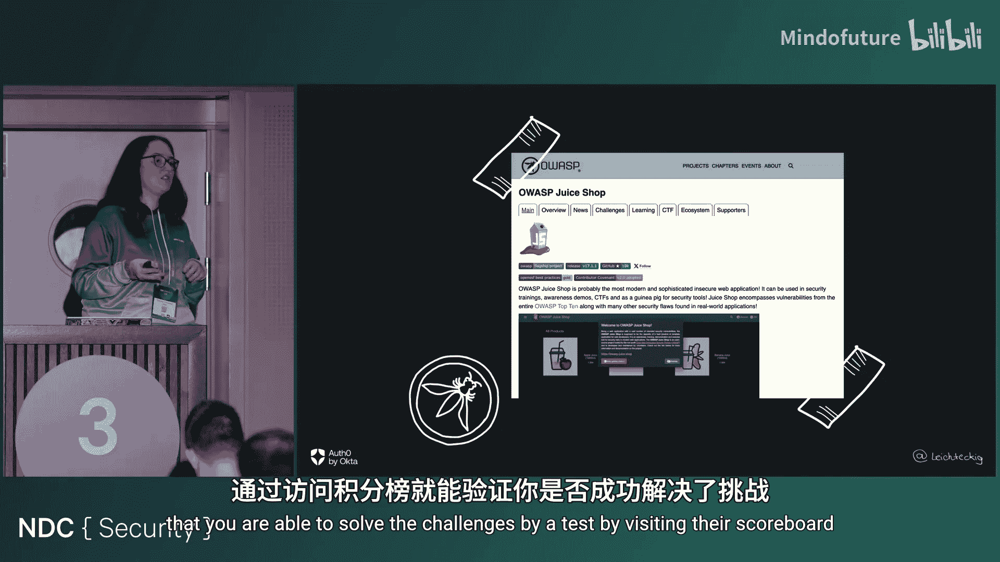

Okay， so let's get on tocode。 I used little folder standard stuff to create a project。

 And then I use NPM install to get Cypress running。

You can go for yarn PM PM or even download their zip file if it's more convenient for you。Yeah。

 let's wait for a little longer to download the Internet because N is doing NPM things。 Of course。

 I guess were ready to open Cyppress。 There are a couple of ways to interact with Cyprus。

 I'm going by N X because it's easy to display on a presentation， but you can have own scripts in it。

 You can do it helplessly。 I want to have the test runner。😊。

To showcase the test so we can actually see Cypress clicking through the application in a bit。

So for doing this， we will use the visit。 It will create all configuration we need and scfold the first example test。

 I call it in Scal injection。 Small spoiler。 This will be our first test。 We will write together。

And it's not this。 like we will do more than just going for the example patient don't worry。

In case you didn't work with Cyrus before a small rewin of how those tests look like。

 So you can see this describe block here。 and my laser is not working。 It is。

 So it's more custom synt。 So if you are familiar with just， for example， you already saw it。

 at some point， This describe function is the frame。 I like to call it frame。

 But it's basically the test you， which is there to organize your test。

 make it easier to interact with them by running them in a batch or using lifecycle hooks。

And this it part here is the test itself。So there， most of the magic will happen。

In this talk as well。Okay。If you want to refer back to my test， I will write in a bit。

 There's a sample repository。 I leave it open for a little minute， but don't be worried。

 I will post my slides later after this talk。 So if you don't get this K I code or K I code to other resources。

 you can basically refer back to it at any time。 or you visit me at the booth。

 So I can show it to you in person。Okay， so a demo that is inseccured by design。

 How does such a test look like， I will cover the Scal detection a little bit more in detail to let you see how to write those tests。

But the other one will be。Inside of a demo as well。 So let's write it。 First。

 we want to get to the log and form， right， So I want to get the menu， the menu item。

 Then let's select it to it so we can make Cypress click。

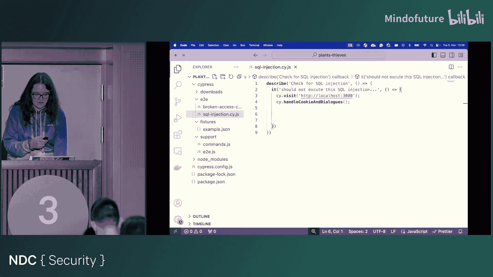

The tester will help us get this vector。 I will copy it here。

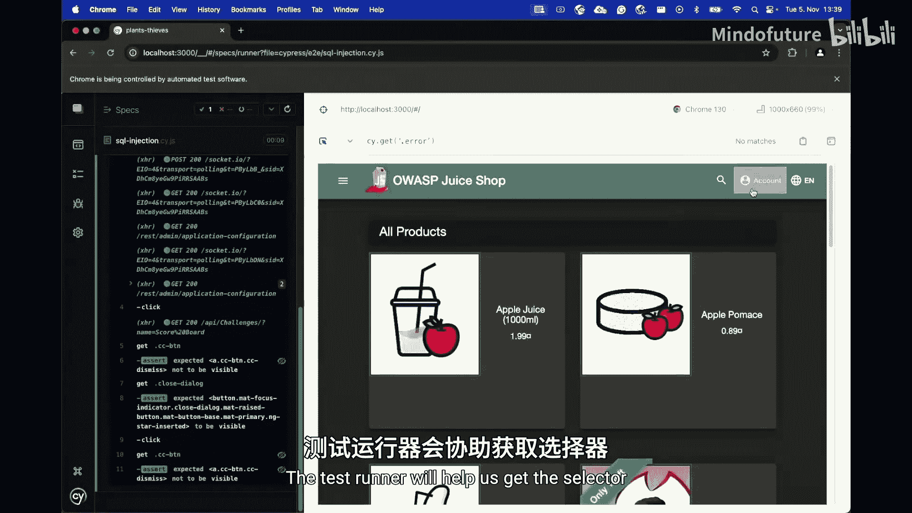

Get back and paste it because， yeah， this Cys test runana helps us with that。

I want to make sure it's rendered completely。 So we are able to interact with this button。

 It's really important to。Avoid flakiness because if it is not loaded， we cannot click it。

 So you will see this is visible version a lot。 After clicking， actually clicking the menu item。

 we want to have the log in menu item as well。 So we basically do the same as we did before。

Interestingly， the OS has many I， which makes it a little easier to have readable testing code which is great。

 So let's check if it's visible so we can interact with it。 It's rendered and then click it。😊。

And hopefully， we are getting to the lock form now in our test。

 that's validated because I was saving。 it was already reexed。 And we can see the lockin form。

 I will get the select of the log form to make sure it's loaded before we try to type into this form again。

 to avoid flakkinas。😊，Again， with our everyone's favorite decision should be visible。And then。

We should be able to finally type into those form input fields。

 and I will use the emailmail1 for a small S scale injection。

 This one should be giving us the first user from the database because it will be compile into a full blown query。

 but you can go by any S scale injection you want to try out。😊，Maybe this is to spot a little bit。

 a good angle to get some random media in later on。So let's go for this simple one。

And then it basically doesn't make any different What password we took for， as you already know。

 I guess， so。A， let's type the password forward input field。I should type a little faster， Anna'。

But we got， weve still got some time left。 So it's fine。

 So we will type whatever because it doesn't matter what passport we use。

And then we will need to submit the form。 I will refer back to the login form because I remember it was disabled before we entered password and username。

 So let's make sure it's enabled before we click it。 Otherwise， the test would fail。

So let's go there， say it should be enabled。And then we should be able to click。

 A good thing in Cyppress is it chains those commands。

 So it will wait for every command to be executed before going to the next。

 which helps us avoiding flakiness as well。So， yes。Well， let's take a look。Will you佢。And， hopefully。

Okay， I will still take a look what happens if we have invalid credential。

 because this is actually the expectation we have when it comes to a normal application。

 It shouldn't log in， right， So let's go for this error message。 Remember， negative test。

 and assert that this error message exists after trying to。Basically， invalidly login。

So the error should be visible， and the page should contain the error message we copied before。

Spoiler alert。 I have the feeling this test will fail。Possibly。Could be。Well， let's see let me type。

 and then let's see。

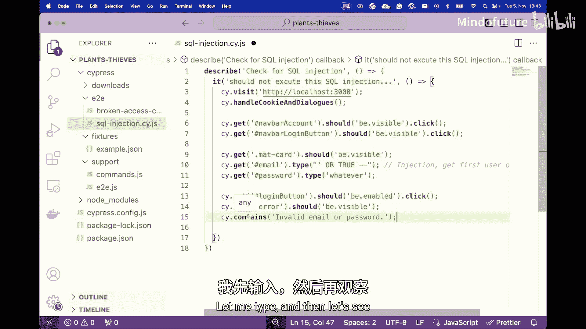

And。Oh， I have a typo in it。 I need to correct the typo。 Of course， its contains， not contains。

 obviously。Try it again。And yeah。Cyprus cannot find an error on this page because obviously。

 we are logged in。 Let's see if we really logged in。 And， yes， I can access the card of this user。

 and I can see a account settings。 So， okay， overes， you might have a problem， I guess。

This is a way you can cover most of ejection case is the same with the typical acrossite scripting as well。

I put it into a cold snippet because the test will be pretty similar to the one we have before。

Actually， I will try to go for the input field search field in this regard。 enter a small script。

 could be an iPhone， could be an almost script， whatever you want to。

And then try to find out if there's an alert， pop him up。 So basically。

 if the script I put in is executed and not escaped。

 I'm using a cpress sp because I can spy on functions that way， which means I can see if it's called。

 So this this surgeon here will help me to see if it's not called。You know， that's just。

 it would be cool。But you don't need to feel limited to crossside scripting and negative tests because Cyprus helps you do API testing as well。

 As far as I know， it's the same with playwright。 So ruless of enter test framework help you with that one。

And if I have API testing at my hands， it might be a good idea to check for CSP headers。 So CSP。

 what is like trusted sources for content allowed to load。

Might be a good idea to utilize our bay our metal testing formula for this as well。

 So let's take a look how I'm doing that。 So this is basically based on the first test we already wrote。

 So I will have some boiler p in pers。Same， I forgot to tell you about the same with the cookie command trying to handle all cookie information stuff in Europe before it gets onto our nerves。

So here we are using the Cyppress request command， which handles all API tests in cprus。

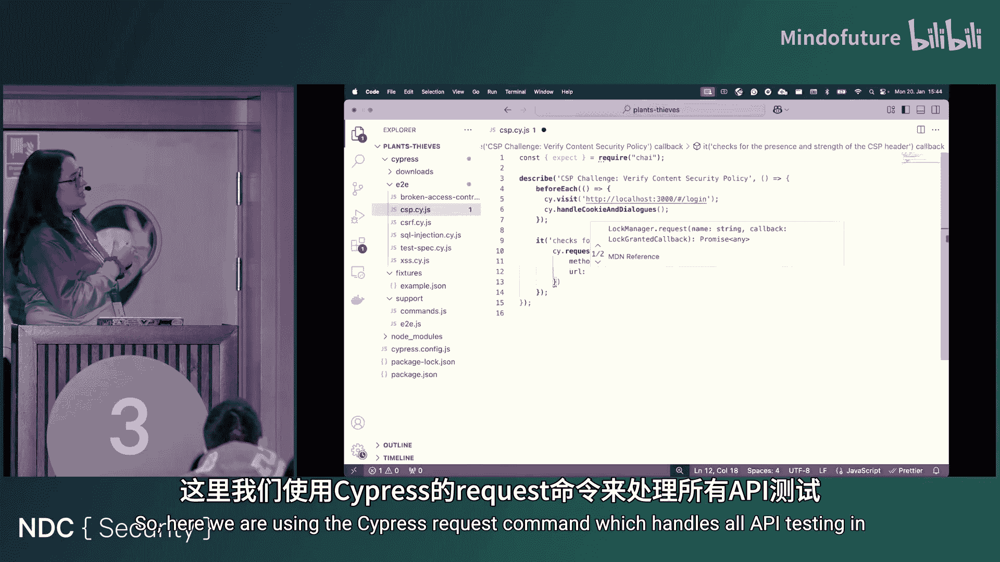

Because we're listening winning for headers， We will go for the homepage because we want to keep it simple。

And then。I want to work on the response by using the then of the cpress chain。

So we can basically work。 Having the cpress chain means we can work on the output of the command before so I can work on the request。

Before I assert on anything important， I want to do one assertion first。

 I want to make sure I have a CP header in place， because otherwise。

 why should I check for con cons and stuff if I'm not sure if I already have a header， right？

 So let's see if our headers have a content security policy in it。 so have the property。

And afterwards， I will say if they had there to have it a little more simple， readable。

 stuff like that。 and add some more config asserts surgeons to say it like that。

 So I want to see if the default storess itself because we are trusting the things we do， hopefully。

So we will check if it's included。Here， yes。So we go for expect the CP header to include。In a bit。

The default source。And afterwards， I want to look for things which should not be included just to make sure we don't screw up any conflictf when it comes to the CSP headers。

So let's go for the default source here。W should say， go to self。 This is okay。

But it's not okay to go for other things。 Let me at the knot to basically turn around the surgeons。

I want to have it not including any。 So the star。And some unsafe stuff like unsafe Eval or unsafe in line。

Okay， let's see if this test， which I theoretically wrote。

 is actually catching the things we want to， so。

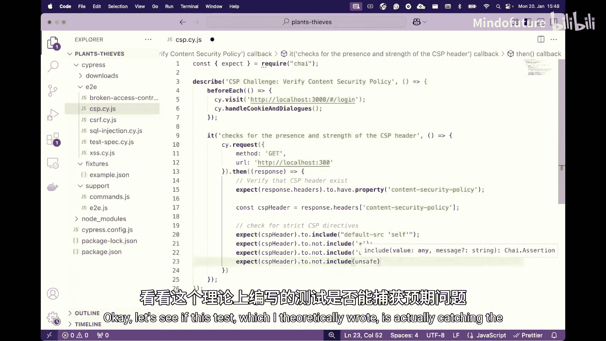

Does ovapos deliver or not， You might have guessed it。 But let's take a look。We will open the test。

And， yes， it fails because there's no header。 Let's see if there's really no header in it。

So I will pin the request part。 and this is cool at the test runner because it gives you all information you need inside of the console。

 Let's zoom in。😊，Take look at yielded and then the headers。 And I guess I cannot find it there。

 right。But I will filter just in case I overlooked anything。Content security。Policy。

I guess I should not fu in between US and German layout and keywords that often。

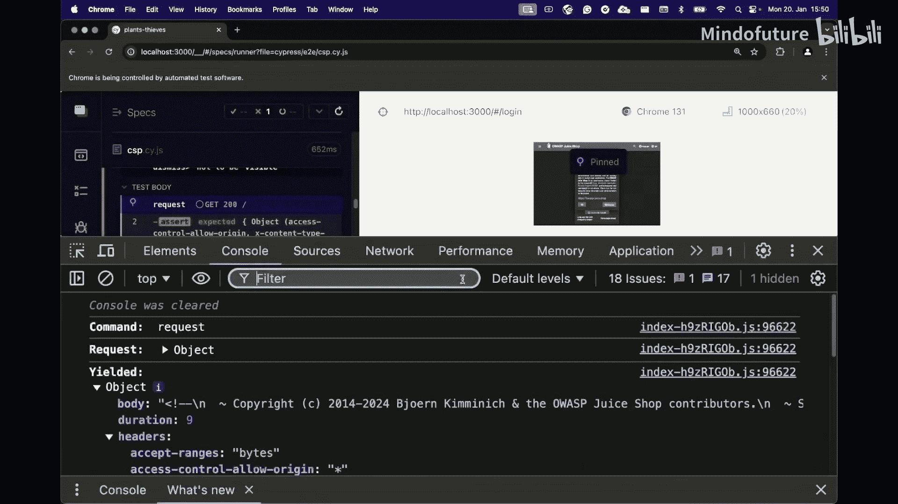

But， yes， I cannot find it here。 So I guess overhes let us hanging in this regard as well。

So far for injection， I want to take a look at broken access control as well。

 because it's the most important point in o vast ranking。

 I would say it will stay like that for the new iteration。 But was she。

And there's some stuff to do from a front Internet as well。 Even though it's often a backend topic。

 with front end desks can support backend developers as well。So。Again。

 going for a negative test is pretty easy。 We just want to cover test cases to mimic a user with insufficient permissions。

 trying to access things。 They shouldn't or try to do things。 They shouldn't。Yeah。

 and there's one challenge in Ot where you try to access the admin panel。

 And I guess this is a wonderful example to put into a test because it's fast。

 So let's take a look again， pretty much the same test as we had before。

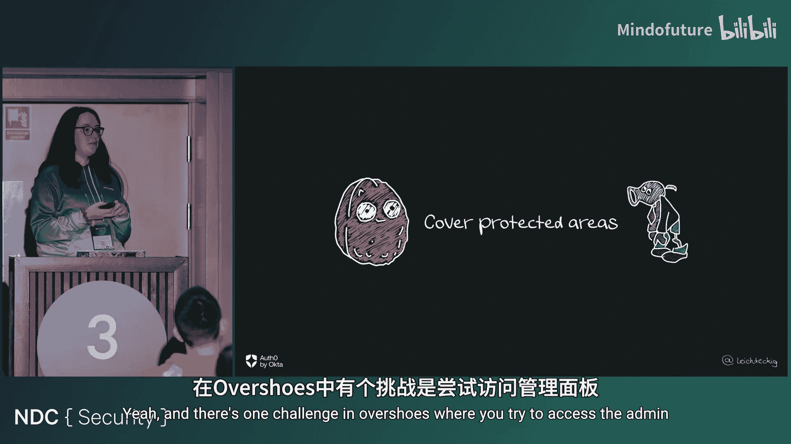

It's pretty simple。 And then we try to visit， so navigate to the amin panel。

And we guess it because it could be administration， but aer will guess URL such file。

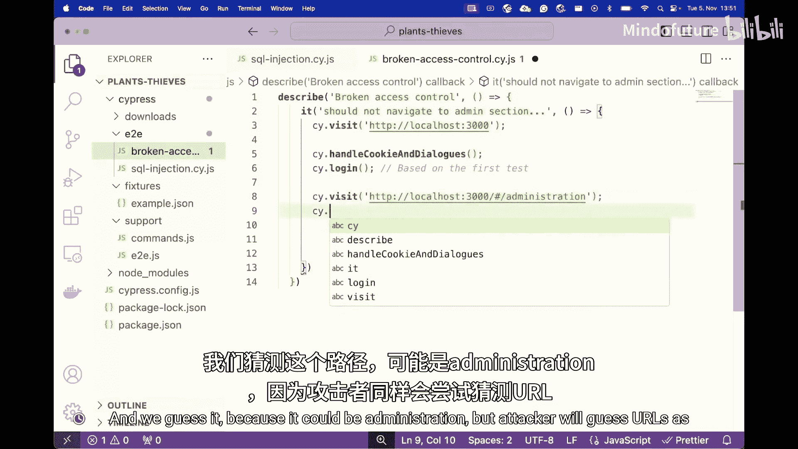

Maybe probably because I know the chance we are right， but yes。

 and then we try to see if something gets loaded。 so if the page exists and then hopefully we will get into any error message might be you're not allowed to access this page or of 403 error something。

 but I make sure it's actually the error message。 So let's take a look onto our local browser。

 And yeah there's the error message we will use。So let's end like。

 let's change that and run the test。Great， so let's go for B access control。

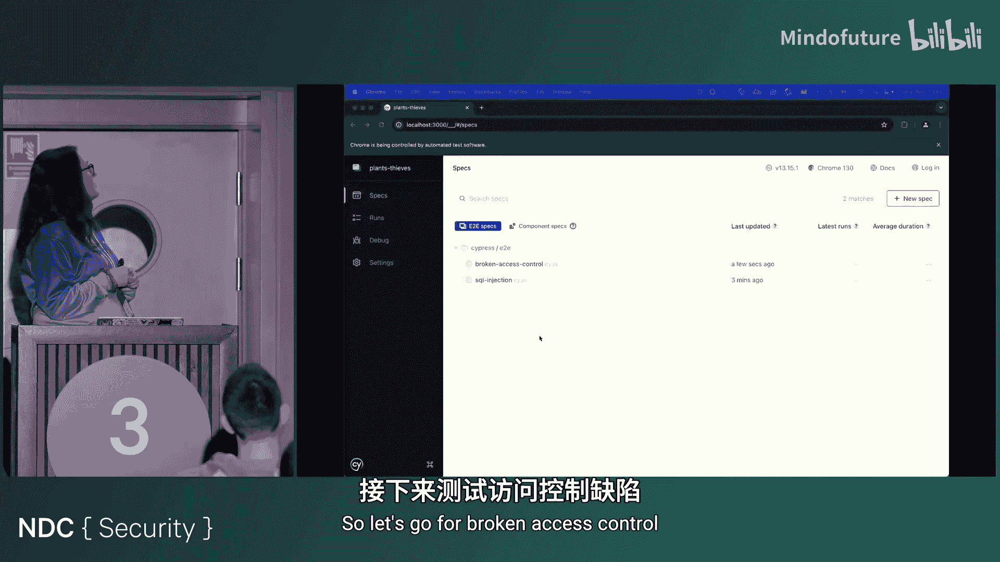

And we were able to access the Vietnam panel， whoops。😊。

So we basically solve the challenge by using a test。

 You can use this negative test to cover some roots in your application as well。But again。

 same with injection， you don't need to be limited to this simple part of testing to write negative test cases。

 You can utilize API testing as well。 For example， when it comes to CS SRF issues。So basically。

 we try to use the test to make a user do stuff from another origin without them knowing it。

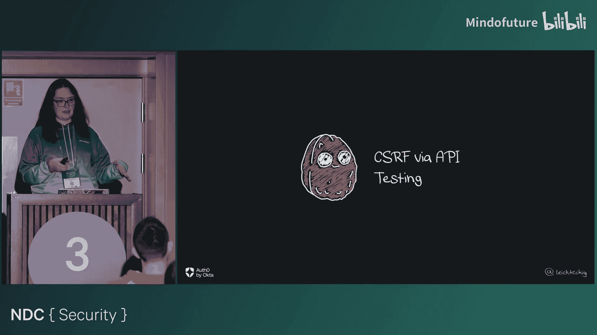

And there's a Cyppress command helping us with that。 It's called Cyppress originig。

 which I will type down it a bit。

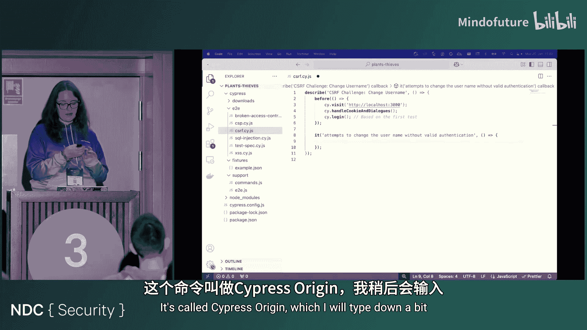

It was added， I guess，2 or three years before。 So it wasn't there from the start。

We could take a look at the do documentation as well inside of a bit， because beforehand。

 Cyprus only allowed you to work on one single origin。 So one single domain。

And this restriction was taken away。 So I can go for the example that condo domain just pretending to be on it。

 which is pretty cool。And， yes， there's the documentation of C Y origin case that we are not basically limited to this thing。

 It will bypass this limitation。 So it's wonderful to basically act like youre or can form another origin。

Let's get back to the test， then。There we go。I will use this new origin and use cpress request to file requests from this origin。

So we go for changing the username because it's easy to showcase an at hook。

When it comes to screen size and stuff。And let's go for post request。

 We will go for the profile route。And in the body， we will set the new username。

 which is totally not su。 Of course， not because we have best intentions。All the time。

So let's go for a malicious admin。And then afterwards。

 using the Z to work on the Cypress request result， basically。Beforehand。

 we should set fail on status quo to fold because we want to have a 400 error code， right？

 So we want it to fail。 It's okay to be basically continuing the test if it fails。

 So we need to turn that off beforehand。Okay， going to the then。

 I will add some log in in case we need to debug like the status code and the content of the。

Response。 And then。As soon as I am ready typing。I want to add an assertion。

 so I want to assert that by trying to change the user name， we would get the 400 arrow code back。

 May it be hopefully the 403 for permission denied or at least a bad request， if it's possible。

 right？ So， yeah， let's go。To basically1， I like the response status should be one of 403 or 400。

P don't be a 200 of a kind， right。Well， it's over。 We've gotta be dis disappointed here， so。

Let's take a little how the test will be。So， there we go。Let's run it。And， of course， there's a 200。

 Let's check if we have poor era handling and nothing's changed hopefully。

 because sometimes people tend to use 200 for everything。Let's take a look。

 So I'll go to the user administration to the profile page。

 And there's our malicious admin nuns has username， so。Dd。I guess that's bad。Okay。

 so we found out that we can cover a broken access control via tests as well。

 May it be negative tests or using API testing。But I guess when it comes to broken user control。

 access control， sorry。It's time for a wonderful shout for my friend Kaya。

 because she will dive into excess control later on as well this afternoon。

 So I'd be super happy if you visit her as well。😊，You will learn about Open FGA。

 which is an open source library to have access control。 It's。It's， I guess owned by this C， N C F。

 So that's pretty cool。 and inspired by Google San Ball。 Take a look at it。 Take a look at her talk。

 I hope to see you there。 Or if you got questions like throughout the day， Visit us at Al booth。😊。

Back to the show。 Back to testing， I will swiftly cover cryptographic failures， as well。

Just a little bit because it's more back an topic。 However， if you use bare metal testing frameworks。

 you already are covered when it comes to encryption。

 because Cypress will error any time your attempt to navigate back to an unencrypted page to an HP site。

 which is pretty cool， right， So Cyppress hazards covered as well an advert testing frameworks have some limitations helping you having failure test if you screw up this。

 Of course， if you are working locally， this is not that much of an issue。

 But if you write Cyppress test for H machine， for example， this is quite common handy。Okay。

 some general advice leaving the test case frame is。

I guess nobody of us likes to have test foods lasting for like a day to be executed， right。

I don't think it's a good idea to cover every single input field you have。

 every single rule using every query imagin a ball to have anscale injection， same with script。

 same with anything。 So we should take a look at randomization when it comes to our tests when it comes to our test data and the inputs we have。

😊，And yeah， we should try to not test all field。 There are a couple of things to support you in this regard。

 First， you could think about。Misusing the Cypress fee fixtures feature。Normally。

 it's like if I manage to have test data in place。 However， you can define Json files in it as well。

 So you could use it to store routes。 You could store it for。Single selectors of your input fields。

 You can use it for all kinds of things。 So maybe misuse it and work on the things the fixtures feature will return you inside of your test。

 so。Pick some random route。 Pick some random input fields。

Cypress fix feature might be already enough of that。 But if it's not enough。

 you could think about helpers or dear friend Mamoov。

 who's writing loads of content and plugins to support the Cypress ecosystem。

 has a wonderful guide on how to have like random elements， how to use random elements。

 inside of your test and some ideas on helpers。 So that might be a good idea to include inside of your test as well。

 Maybe as a custom command， actually。😊，Another thing by Bautov is the Cypress Mo pluginin。

 which will help you a lot。 If you don't want to write this logic on your own。

The Cyppress map plugin has an interesting command called Cyppress sample。

 And it's basically therefore a sample of a collection of elements。

 So we'll just return any element which helps you in randomizing the input fields you want to test inside of your application。

And last but not least， if you want to have some variety inside of your test data and try to recreate samples leading to issues。

 you might think about faker J S libraries or other fakers。 There。 A couple of those。

 So these are the easy ways on how to handle this。Another way。

 which needs a little more a deep dive into API testing。

 So I only touch upon that because we have a limited time frame today is using your API schema to extract all the rules and then trying to randomise what you pick for testing these API test cases。

There's a great learning path and a block article， is old bi Cyprus。

 So I guess it's best to take a look at their dogs because they will teach you all the basics。😊。

All right。These are loads of loads of information and advice being at the test level。

 at the coding level， things you can implement in your daily doing。 But however， I wonder。

 how well does it fit into our plans in zombie's life or in developer terms into a life cycle。

 So how do I integrate all those wonderful vanilla test cases into my daily doing。

Let's picture a simplify way of developing。 And， of course。

 I know that the development phase and the testing phase might be swap because it's TDD。

 I like TDD in some cases， but in some other cases， not。 So let's stay simple。

 Let's say we are developing a feature， implementing a fix stuff like that。 then testing it。

 putting it onto staging。😊，And then， to production。And if I want to integrate。

Some test steps in it while developing， it might be a good idea to dive into some tools。

 So I will phase tools in external tools here， too， But I don't want to be too fast right now， so。

Creating a precomit hook。To keep me away from like blatant， obvious syntax or security issue。

 So like having lingers in place。Saas tools might help me as well。

 like the static application security testing tools。When it comes to developing on my own。

The testing phase， obviously， this is the point where we at late test， right。

 or building in test cases。 So the wonderful。😊，A negative or API test， we got to know beforehand。And。

 of course， the dynamic application security testing tools or the interactive ones are well suited for this regard as well。

Like the black box testing or scans you have from dynamic tools or the basically companions you get when it comes to interactive tools。

And， of course， when it comes to the staging phase， you have few deployment gates and pen testing。

 as well as monitoring and production to get a good situation。

 a good view on the security status at hand of your application in run time。😊，Okay。

 this was really quick because of the time frame。 there's a wonderful guide by Ova diving into the complete world of Web security testing。

 not only tailored to test automation。 So if you're interested in learning more， there's a Qac。

 and of course， you can find all the things inside of my slides and inside of a code sample as well。

 So I add all those resources inside of the readmi。😊，Okay。

A point which I touched upon when it comes to testing framework selection。

 I want to stress here as well。 It's really important to know。

 even though I use enter to end testing as my prime example today。Due to the limited time frame。

 we don't want to sit here for like hours。 And， And to end testing is actually the part I have best expertise。

 And just because I've been a test engineer before。You don't need to feel limited to that。

 So please don't think just because I use enter end testing here。

 you should only use enter end testing as well。 There's wonderful ways on utilizing unit tests。

 integration tests component tests， contract tests， whatever tests you can think of。

 doing exactly the same things I did today or even more， so。😊，For example， API testing。

 if you don't need to complete application stack， Try to think about integrating an in integration test as well。

 especially as you might use them for API cases anyway， right？ So please don't feel limited to that。

 And especially considering one certain testing type。

 it would be even harmful to use enter to end testing because of the longer execution times。

I'm talking about property based testing。 And again， I can only touch briefly on this topic。

 If you're interested to see it in the talk， please let me know。

 because this is a really interesting topic， but a little too much for today。

Property based testing is basically defining a set of properties or rules， your system。

 And thus your input data input test， data input should always follow。

 So you basically generate input or test data by using property based testing。

Which fulfills these properties。 And it gives you whole whole test data set of randomized input。

 So if you are thinking about security related properties like injection related properties to use as a property for this input data。

 you might be able to get even more randomization into your test， which is pretty cool， right。😊。

And as said， I do think it's well suited for a unit， maybe a little integration testing。

 but especially as you get such a large set of randomized data。

It might be a really bad idea to use and try testing for that， right。

 You cannot wait a week for your execution， I think。

There are two tools you could take a look at the most recent one being fast check。

 But JS verify is a good idea as well。 But as far as I know， I guess it's a little older。

 And the last contribution werere a little bit in the past。 So maybe fast check is a better idea。

Alright， so I faced in some external security tools。

 despite this being a talk on vanilla testing frameworks， right。

 Because I guess it's still not a good idea to waive tool support。

We just need to be mindful when to use it and what not， because there are still。

 theres still one big。Danger we have。 It's a complete unknown security issue。

 And we cannot just spend all of our days talking C VE databases， right。

 So how do we handle the complete unknown threat。If we cannot have any ideas。And for testing。

 I love to go for security testing tools like。Am。I guess I'm a little fast yes。For， for that。

 So that attack proxy is a wonderful idea to integrate to given testing frameworks as well。😊。

There's a sample implementation of cppress and that。 However， again， it's。

 I guess it wasn't maintained for years or so so I'd be a little careful when it comes to directly implementing it。

 However， it serve as a wonderful example on how to implement that as a proxy in Cyppress。

 and it's open source。 So I try to limit myself to open source tool when it comes to recommendation today。

 check it out。 it's the prime example on how to implement it for playwright as well。

 And I guess there are more implementations， especially for selenium。 So this is a good idea to use。

😊，All of us themselves have recommendations and players as well， when it comes to open source tools。

 or at least when it comes to community edition， if there aren't any open source tools， For example。

 for Saas tools， which can happen inside of your I D E being Lys。

 you could take a look at everything Github or Gila is already providing you。 And personally。

 I had good experience when it comes to P HP stand or some。😊，That is our dust tool， obviously。

But it's a little difficult to find open source tools for I S tools as well。

 I guess there's one community edition by con contrast， which is recommended by O as well。

 But I guess we have a harder time finding interactive security testing tools for。Open source。

Not last but not least， it's a good idea to go for static cold quality analysis as well。

And I cannot stress that enough， keeping your dependencies up to date。

 There are a couple of easy come commands you can include in the test groups you write like an NPM audit。

 which will ask for a report of non vulabilities or NPM outdated checking for outdated packages。

 if they find somethingrrrisome。 You could write a script to let your pipeline fail， maybe。So。

Let's get back to the question we asked at the start。Why do I mind vanilla security test cases。

 Why don't I just directly use up or other tools and just let it that。Well。

There are a couple of ideas。 As said， tests are the wonderful minute messenger and a messenger you can get into your application pretty easily。

 It's not only saving money because you already got those tools in place。 It's， it's not only。😊。

A less of a learning curve， because you already got the knowledge。It's a great messenger。 But。

 of course， with being a great messenger， there's a caveat， I guess I don't need to tell you。

 but just to make it clear， it's only a messenger。 It's a wonderful messenger。 However。

 it will not fix your issues。 This is something you need to do on your own。

 It will only tell you that there's something to fix。😊。

I'm a big fan of having regression tests as well。 So if in security issue happened at some point。

 because a contractor or a team member wasn't that mindful when it comes to security。

 write a regression tests will will never happen again。

 You cannot just think that everyone knows exactly as much as you do。

 So this will prevent you from having the same issues popping up ever and ever and ever again。

 And thus building trust。 I think that tests are a wonderful way of building trust inside of your application。

 And especially enter end testing， mimic making a user， loads of trust。

 So try to think about it like that。I love to use the test runner itself because you saw it's pretty visual。

 You can use it to recreate the issues to help people reproducing。

 Or if you take a look at playwright， They have a trade which is basically a dump snapshot of of the like application at the point of failure。

 So this will help you a lot of writing your security ticket。

 help people recreate the issue you found。And last but not least。

I don't like using tools without knowing what they actually do。

 So writing those tests by yourself will help you learn that。

 And especially if it's like easy test cases， it will help you get a good grip on what tool is doing。

All right。 All of those measures combined。 I do think that tests are great。

 complement to keep your app secure。 They are the perfect messenger。

 And together with building your app in a secure way， adhering to best practices。

 having CV V E in mind and basically using everything you learn at NDC security。😊。

I think that it's really difficult for the zombies here to just jump over our tests or。Defenses。

 they have a hard dime， too。Exploit your application。

 And even if your app is just a little more resilient， little more hardened than others。

 Maybe our tech will take a look at other applications instead， right。

I just hope that our application looks like this in game term at some point。 Many different defenses。

 May it be your best practices， May it be your own skills， may it be tests， may it be external tools。

 having a diverse， different defenses garden， complete variety， keeping attackers at bay。

 and letting us sleep at night， a little comma。If， there are four things I want you to remember from this talk。

 It's those。Test automation is a wonderful compliment。 So you should always invest in it。

 And in this regard， it doesn't matter if you prefer tools or prefer vanilla ones。

 I prefer vanilla ones。 I hope I was able to bring you onto the journey when it comes to vanilla。

 but。😊。

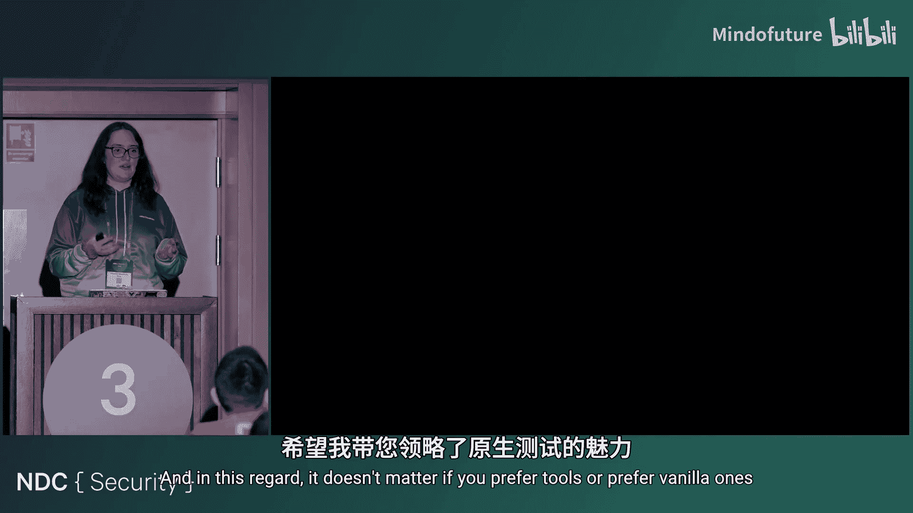

Consider your automation， in any case。Try to have intentional test cases， might be negative ones。

 maybe be II testing。As a little hanging fruit， because as we talked about the like cost of automation。

 it will not take you lots of time。 It will not take that much money because it won't take lots of time or learning curve。

It's a low hanging float you should utilize。 Why not。 It will not hurt。

Combine your own cas casess to the external tools at hand。 Because this way。

 you will cover both known angled， known vectors and unknown threats。And last but not least。

 utilize all testing types， including property based testing， to have good randomization。

 have good execution times without spending too much money on waiting。Okay。

 what's else left to say then。 Thank you so much more for being here。

 It was a wonderful journey together with you all。 My name is Ramuna Sang。

 I'm working as a developer advocate of Siro。 Meet me at the booth。

 If you got questions or just ask them here in the room。

 I am basically present on all important platforms in social media on the handle life e。 And yeah。😊。

Gett to know my favorite project。 business is not a component library。 Talk to me。 ask me questions。

 I am happy to talk with you here in Oslo。 Thank you so much。😊。

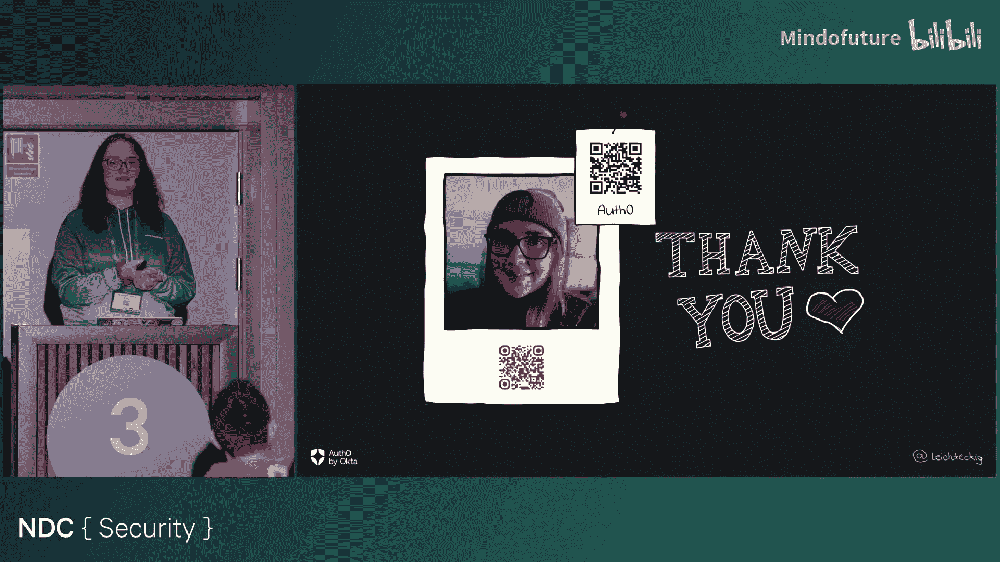