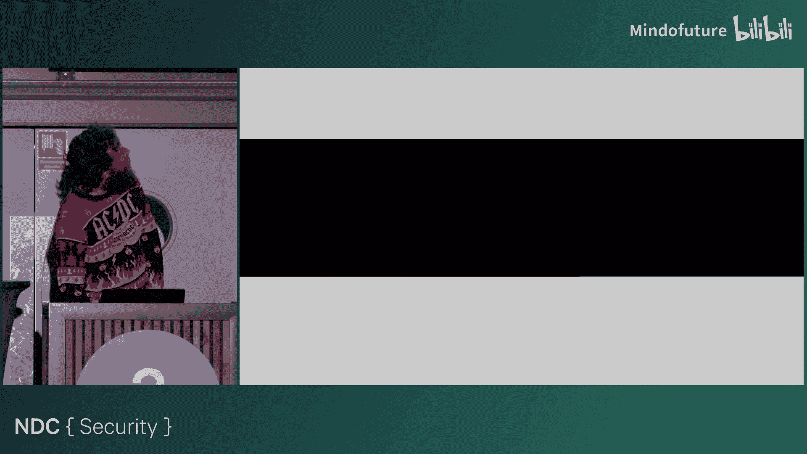
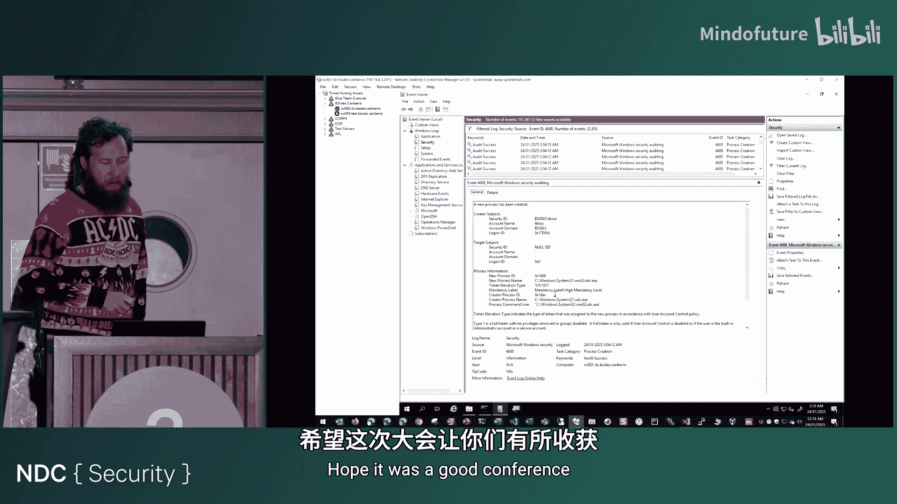

# NDC-Security-安全大会-2025-｜-AI工作流-｜-智能体-｜-网络安全-｜-Dapr框架-｜-开源工具-｜-LLM应用-｜-自动化安全-｜-黑客-p13-P13-Spoofing-Commands---Can-You-Trust-Process-Creation-Logs---Tristan-Bennett--BV1ihgQzJE2h_p13-

Okay， welcome， everyone。 thanks for jumping in。 I know it's the last session of the day。

 which was always a tough one to stay awake during。 Hopefully， the contents pretty interesting。

 though， and it's related to something called command lines boofing。 And， and really。

 the question is， can we trust the process creation logs in windows。 And the short answer is。

 not really。 But sometimes you can sometimes you can't。

 And it it is difficult to determine under which circumstances logs are true and which ones have been tampered with。

My name is Tristan Bennett。 I work at a company called seamlessless Intelligence。

 which I actually co-founded about eight years ago， and we operate out of Perth， Western Australia。

 So I flew across on Monday。 It was 44 degrees in Perth。 When I flew across Celsius。

 and then hit Oslo。 and it was bit chillier。 But yeah， it's really nice here。 we run a sock。

 We do one thing。 We do security operations。 And we attempted to do one thing and do it really well。

 And so I head up the a research team。 And so we're looking for new attacker techniques。

 new tools to play with Gitthub repositories that have code for us to go and play with those sorts of things。

😊，Throughout all of this testing， our main goal is to be able to understand and then detect whatever we have looked at new techniques。

 And we've actually had bug bounties from Crowstriike and from Microsoft for finding various things that get around either their tools or。

 or break stuff in windows that we've been assigned bug bounties for。

 And we've got three attributions into the Mire attack framework， which is pretty cool。

 And it's a really good sort of framework to assign things to。

 within the sort of techniques that attackers use。😊，What we're talking about， though。

 is actually a Github repository that's probably four years old now。 This techniques not brand new。

 which is part of the reason why it's so disappointing with the results we'll get at the end。

 And it came across because it's， it's a tool that can make our lives when we're looking at logs very difficult。

 and you'll see why。 So we started to look into it。 We compiled it。 We ran it。

 It does what it says it does。 And it makes it very。

 very difficult for our Sock analyst to understand if it's used exactly the commands that are run。😔。

So what it is， it is a novel technique to go and alter the logs in windows without having any sort of special permissions。

 And what it leads to and what it can lead to is an incorrect assessment on what has happened in an environment because you don't actually know what an attacker has run because you can't see the actual command line that was truly run。

 you only see the portion of the attacker wants you to see not what was run。

 And so the really difficult thing for us is when this gets paired up with brand new techniques and tools that hide this。

 it's very difficult to work back to understand exactly what happened。What it's not， though。

 is it's not any sort of privilege escalation technique。

 If you need a command to be run that requires local admin privilege。

 you'll need that privilege within your session。 You don't just magically get it through this tool。

 It doesn't hide all types of commands， which is a benefit for us。

 and it doesn't stop software like EDR like antivirus from looking at what the command is trying to do。

 or if it's interacting with memory or other processes。 It doesn't stop EDR seeing that。

So a process creation， very simple one at the top， which is just us telling Power Shell to run this Space 64 encoded command。

 and all it is is a who am I all， which lists out my domain user account。

 lists all of my groups and at lists the privileges in the current session and attackers do run this or their scripts do run it at the start because we can get all of our domain group memberships。

 We can see I'm a domain admin， but we can also see that I'm running in a low privilege or a normal user mandatory label。

 which medium there means I'm just a normal user。These privileges are quite interesting to an attacker as well。

 There's a couple of notorious ones within windows that allow you quite a high level of privilege。

 regardless of your groups that you're a member of。 so these commands are quite common。

 They're also quite common to be packaged up just running with power shell is an encoded command。

 because it's that level of obfuscation And every layer they， they add。

 they seem to think helps and helps and helps when that's kind of suspect on its own or normal user running and encoded command。

Generally， when people start an argument with the dictionary definition of something I sort of turn off。

 if if that's what you're relying on， then then you don't have much else。

 But it's really important in this case because I was under the assumption before all of this。

 this is what Windows runs。 This， this log that I get this process creation log is what Windows runs。

 That's simply not the case。 It is just the process being created。 It doesn't even need to start。

 There's， there's a structure which will go into， which says I've created a process。

 That's what gets logged at Windows。 And so it being a process creation。 is actually quite important。

 There is no logs in Windows for what runs as far as command line running， running programs。

This here is the X M L for a command process creation log up the top here in this is timestamps another important information for us。

 but it's stuff I've just carved out of all the examples。

 and what we're left with is the good stuff here where we can see our command line we can see the parent process and those sorts of things in there。

 So we can often follow the stream of what's happened in a set of commands by looking just at a process creation log。

 which has all of this， including the user。😊，It also shows here the mandatory label， which Windows。

 Microsoft。Do not have any sort of consistency across any of their products。 You'll see here， it's。

 it's a numeric in Ssmon。 See later on， it says high medium or system， which is far， far better。

But the command line is really cool。 So when we see something that's executed via command that then goes and calls power or the base 64 command or whatever arguments there there。

 we can go and pull those out。 and we can do things like just base 64 decode this really quickly to go and see what's happening。

😊，If you're using something like Sentinel or defender， which has K Q L or something like Splunk。

 you can do a lot more manipulation to your logs when you're looking at them。

 And so this K Q L here actually grabs this base 64 portion of the command line decodes and then shows us that in one simple search。

 So this for our analyst is， is pretty gold because we can just show them immediately what the base 64 decoded command is within Powerhell and show it to them one simple search。

This is a Ssmon log So Evid one in Ssmon Land is our process creation。

 and it's almost identical to a process creation log natively in Windows， which the other ones were。

 we just get a heap more information like we get the hash of the executable that was run。

 and here we get integrity level and we get the human reader。 So this was run as a medium。

 which is a normal user not not admin。 we also get things like original file name which descriptions and products which can often have the author's name。

 So Mimi Kas， which is a credential stealing tool that's been around for the best part of a decade。😊。

We so often see attackers will change。The X C name， but the original file name stays the same。

 and so does all the metada on the descriptions。 And so those can still be used outside of this technique to。

 to help detect things。This is the process creation， which is a device process event。

 So if your organisation are running Defer XDR that actually produces logs as well。

 these go up into the advanced hunting。 you can look through them there with K Ql and you can put those into Sinel。

 and they look like this。 So slightly different。 They have a lot more information about the event。

 such as if I IDped onto a server and then run the command， it would have my original workstation I。

 And so you could track that back in one log， which is really cool。 But unfortunately。

 all of them suffer from this technique。 And so ultimately this process command line can't be trusted when when it's spoofed in the way that we will show。

They're good， they're good for lots of things。 So within Windows。

 they're our primary log for detections。 Aentation stuff is all well and good for brute forcing and some initial access。

 but really， an authentication log doesn't have much context on it within within a Windows domain environment。

 You succeed。 You pass。 You generally still on the internal network。 You may be from a VPN。

 but it doesn't tell us a whole lot。Was when you go and start running things and performing actions。

 that's where we start to see Powerhell command logs。 We start to see what someone is doing。

 And it's， it's it's a lot。 The detections there are much higher confidence than simply being able to log in to a server。

 our brute forcing and passwords braing those things。 Theyre completely different。

 They're great indicators But one user logging into a server as a one off is not。

 is not the greatest of indicators。Tol called Ruus。 This is a it interacts with Kibos。

 It's the Swiss Army knife of abusing Kbos in Windows。

 And what we often find is attackers will go and change executable names'ca that's easy。

 They may change metadata and recompile， but we've just seen time and time again。

 if there's a releases page on Github。 They'll grab that X and run it。

 They may even pull it down with Powershe directly from Github。

And then we have this command line argument， Kiber roastt， which will go off。

 And curbu roasting is a pretty cool attack that's still relevant。 Once again。

 it's probably the best part of a decade old。Where if an account in a domain has a service principal name and where're a domain user。

 we can basically get the password hash。 It's as simple as that if the password is quite bad。

 brute force that and youve got the hash for a service account or something like that。

So we see K roasting used a lot。But this is where it becomes really useful。

 The amount of information that generally attack tools allow you to put under the command line in the form of parameters is huge。

 And so this is still rubbius。 I just change it to nobus。

 So if we had a detection just looking for Ruus on the command line。

 which we do as insurance because wed look like idiots if we missed it it won't fire。

 So what we do is we test。 And we go and say this this is going to abuse a silver ticket in Kiboss。

 and it's going to give me hopefully when I run it admin access using the builtin administrator account on a server。

 So that user of Tbos has a certain level of privileges。

 we run this command and we use this flag here， P T T to pass a token into the current session。

 we can then use it。So all of these are really good indicators because they're not command line parameters that are normal and seen a lot from normal users and even admins。

And then what you can do in Sinel is something like， alright， well。

 I'll list out silver cred user curb encryption type。And then I'll say。

 if I see three of them on a command line， let me know about it at at a quite high priority。

 So we can get a lot of information about attack tools from what's on the command line。

The other thing we have going for us is there's really only one way to execute PowersShell remotely using P S remoteing。

 but there are many ways to execute things via command。

 So very often we'll see Power Shell package up and run via command。

 which means we get all of these logs。Or not if we use command line briefing。

So the process creation itself starts with the process environment block。

 I wish everything in computers actually looked like all of this。

 but the process environment block and being a dev conference， this might look better。

 That's what it looks like。 So this is a structure that windows builds whenever you go and execute anything in command。

 you open windcal， it will create one of these。😊，The important things to note。

 and it's really only the first one。 The rest spawn off that is that it's a user mode structure。

 So the user that executes the process can then write those memory locations。

 There's no restrictions on that。 once again， it doesn't give you any preveck。

 But it means any user on a Windows system can do this and play with security logs， basically。

 which previous to this technique were're only accessible if you had local admin。

The memory locations can be overwritten directly， and it's the contents are initialised by the N T createate user process。

 So it's all in New Zealandland。 There's no kernel。 There's no nothing there。

 It's all in user Zealandland。And what it boils down to。

 this is the source code for the original command line spofa。

 is that we will package our a malicious command for that one。 It's a Phell Empire beacon。

 And that's all we need to get a C2 link back to our command and control server to then go and execute whatever we want in that user context。

And so that's all it is， really。 And then what we do is we have our spoofed command。

 And you'll notice here， we just take the malicious command。😊，Commans length， sorry。

 and we just pad it with spaces。So this boof command must be shorter initially than your malicious command。

 And we're just gonna pat it out。 And The reason that it gets paded is within that process environment block。

When we set the memory for it， we can't then change that。

 Whatever we override it with has to be exactly the same size。

 which is why we need to do this padding。Which I thought was gonna be an awesome detection。Avenue。

 it turned out it wasn't。U。So then in Windows， we can create processes suspended。 Now， I。

 I don't know why， and I don't know how prevalent this is because it's not logged。 And I。

 I can't tell， but I don't know。Why this would be used over suspending it within code。 This is win。

 this is telling Windows， start my process， but don't start it。 Just create it。 And so I。

 I just don't know the legitimate use for doing it at the O S level versus doing it within code。

 There must be a reason。 Probably being Microsoft backwards compability legacy something。

 But it is there。 So this gets created， suspended。And we'll see here what it looks like when we run。

 I added a few break points in the code just to see if I could see in Windows any logs that would allow me to see the malicious command。

 And， and there wasn't for， for many of these examples。So that was it running the Who am I。

 We can hide that powerhe。 All， all the demos are really simple things。

 but you can hide that powerhell。 So the user would never see it and all that sort of stuff。

And so what we can see here is its that's the spoofed command。

 All the spaces are there and it gets gets added into the process environment block or process Yeah。

 environment block。 And then most of the code and command line spofer is just looking for memory addresses。

 So we get the process P。 We go and get its pe。 We go and find within the pe where the command line is specified the memory location。

 And then we go and overrite our new。😊，Command， and then we say， resume thread。

And so what happens is。If we look at the execution flow， we have process created。

 and it's suspended with the spoofed command。We then read the pe here。

 and we find the command line part of the P E， B。We then write the memory directly。

 and we can see here we overrite it with the malicious command and just pop that into the P， E， B。

And then we just call resume thread。And that actually executes what's in the P， E， B。

 because the process doesn't even start here。 only gets created。So from a logging point of view。

 where I would like it logged。It's probably here。Where Windows logs it is here。

AndThis is where the problem lies。 It logs the spoof command with all the padded spaces or whatever character you want here。

But then we change it before it actually executes it。And we don't get a log there。

 We don't get a log there， and we don't get a log there。 There's nothing。And so really。

 Windows could log at can log。 What's in the pe， What's in the P E， B there in that structure。

 But the process memory looks completely different when we execute it， but it logs that one， oops。

It logs that one and not the bottom one。 And so that's the， the whole technique summed up。

 That's what it does。 And so it's pretty cool because any user can do it。 And as we'll see。

 there are some commands and windows that are perfect for using this technique。

 And there are some that are terrible。 So we're hoping the attackers don't really understand which ones are good and bad。

 They think it will hide everything。😊，So when we go and tell Power She to run a hoemia。

 It's very simple。 we get thousands， thousands of lines in process monitor。

 which is another cis internals tool。 And we can see here when I've highlighted it。

 all the spaces are there。 they're just not really visible unless you know what you're looking for or they pat it out with a different character。

 And we can see here that further down here。Powelhe has then gone and created the Who am I process with the who am I all out there。

 And so this is an example of a composite command， which we'll go into。

 But composite commands are detectable because we're jumping through too many hoops because we're telling power She to create another process。

 And that one hasn't been spoofed。 And so we get the log there。But parent process wise。

 we never see that that was initially executed by an encoded string forced into powerhell。

So I thought， this is easy。 I will just look for。That' say 10 trailing spaces。

 And at least there's a threat to porn。 It's not the greatest detection in the world。

 but the vast majority of the catch attackers and pen testers aren't the best detections in the world。

 So I thought， y， it's way easy。 We can see here we get parent。 We get no other real metadata。

 So this was all I really had to work on。😊，Or we could wait and hope that they do a composite command where we can see power shell now calling something else。

 And we would have a detection for that。 This isn't a great option。 It's， it's still okay。

 There's still all of these detections for weird command lines out of power shell。 But as we'll see。

 if we use certain tools， then we wouldn't get any detections。So I thought， yep， the spaces。

 this is how I'll get them。 That's how it comes in the X M L data。

 So I initially thought Windows was truncating the trailing spaces to save space or something like that from the 80s where every byte counted。

 But then I actually Googled it looks like。 and I haven't I haven't delved into X， M L standards。

 If anyone's an X M L guru， Let me know， I'm pretty sure what's just an X M L thing where it just kills off the trailing spaces because why would they be important。

 This is probably the only case where they are important。 and it's taken away。

 And almost all monitoring platforms from Windows are gonna take the X M L log out because it's the easiest to process。

So， then。We began looking at what other tools might be using it。 And this is where。

 because it's a four year old repository。 This is why it came back on our radar。

 This one multi dump came up。 We love when researchers or attackers or panestis release code to dump Lsas and things that are quite old。

 but still really， really useful can get away with them and something like a crowd strike defend Palo Alto cortex are going to pretty much kill any attempt to dump Ls memory really。

 really quickly。😊，And so we love it when it it will dump it discreetly without triggering defender alert。

 It's almost never the case。 What we find is these guys will test with the home version。

 not the pro version。 and they are named the same。 and they couldn't be。

 They couldn't be more dissimilar。 The enterprise version has so much more to it。

 So we ran all of this and it didn't really work。 But what piqued our interest was looking at the source code。

 We saw that it created the thread in a suspended state。 And we're like， we've seen this before。No。

 no window either on this mum。And then as we're looking further。

 we see dummy arguments that are going to be passed in before it does the real stuff。

 And so what our fear was being a four year old technique that most EDR didn't get and Microsoft wont fix was that it would become prevalent our bigger fear is that they code it in to do every command dynamically with this technique。

 So right now， I compile executables and run one thing at a time。

 because I'm just looking at it and researching。 But I think to weaponise this to the next level。

 people use powerhell， or they'll actually dynamically generate their commands into this technique every time。

So other tools using it， they're using it in this somewhat static way。 I'm going to run one command。

 but I'm going to spoof this one here。And the big problem with this is。Apologies for the size。

 But this is what defender looks like。 So you get a nice processed tree。

 But you only get this when you get a detection for something。

 And as you'll see on the second run through， Defer didn't detect anything。 So we never got this。

 But you'll also see here， if we go back one。Our dummy command is saying， and it's all。

 it's all just trash。 It's not real。 doesn't work。 It's not a real command， but it looks good enough。

 So we're gonna optimize startup and who doesn't want to optimize startup and optimize control panel。

 None of it exists。But here it is， in the defender log。

And this was the trigger for us to raise this to Microsoft when the security products within their ecosystem。

Excuse me。 We're vulnerable to this technique and giving wrong information in a detection。

 And so it's all too easy then for an analyst or someone who's potentially looking at too many of theseca defend is pretty false positive heavy R as are most E Rs to go。

 R K now that the la looks fine or。Wor fault， the Windows error reporting process Windows will dump Els if a server crashes in a certain way。

 and we have a lot of alerts for were fault dumping Las。 So that's what I would choose to， to spo as。

And so it gets run here with its dummy command。what it's hiding is a really common technique to use this built in D L L to create a mini dump of the L Sa process。

What defender reports it did is here。 and all the logging reports this sofed come out here。

 which can can send an analyst down a rabbit hole or can lead to someone triaging that out as a false positive It just defender again。

 It's unknown sign。 Like a lot of it just doesn't add up to being something of a critical severity。

And defender does throw out a fair few low and mediums throughout throughout our customer base。

So then we went on to do some more testing to see exactly which commands we couldn't see and which ones we could。

AndSo we've got our composite commands。 These are where command to Powerhell to do something else。

 We've got Powerhell， where it will just be Powershell using commandlets to run a script just in line。

 So it'll never leave Powerhell。 And then we have built in tools to Windows where command just calls a tool to do something。

 and then doesn't call Powerhell or anything else like that。So then what we decided to do as well。

 just to test our analysts is put something that was legitimate。 So I've got the advantage。

 I don't know， attackers can't necessarily do this。

 But these are the top command lines for my environment of all of my Windows workstations。

 And so if I was going to choose one。Its probablyably gonna be corn hostt。

 which gets generated once every 5 seconds or something。 But we chose something down here。 And。

 in fact， I think for the demo， I even made something up。

But it's attack you just go and get common service， command line arguments。

 put those in or make something up。 I don't think it's gonna make a real big difference unless it's one of these exactly。

 which I doubt they're gonna match。And so our composite command， we have。 once again。

 that's just our homewi in our base 64 encoding。And I just did some teams update。

 something that you'd like， yeah， Team is updating again， even though it never updates through Power。

 And then we just pad it with spaces。 You can pad with any character。 And one thing to note is。😊。

Your malicious and spoof command。It's right。Your malicious and spoof commands have to right now with with the pre concept code have to have the same process name because if you change the command line argument without changing the you won't change the process name。

 it will bug out But one of our one of the people we work with who was a student。

 which I'll go through later， is actually looking to be able to change the process completely。

 which if it works。 So he's coding and see if it works will be even more dangerous because now we won't even necessarily know what they use。

 So right now， if we use Powershell， we match it up。 And I know they're probably use Power Shell。

 I don't know exactly what it is。 But with his new code。

 we're going be able to change the process name as well as the command line。

Just just another layer of annoyance。So for this one， as we discussed before。

 because it jumps between and it needs to create a new process at the very end。

 which isn't obfuscate or spoofed。 We get a command line logging detection。 We can do it there。

 We can also do it in powerShe module logging， but we still don't get that initial process creation with our base 64 string。

Now， command line， with all the logging as well。 This is where it gets really fun。

 So command line logging， as， as we've been looking at， has so much detail if it's turned on。😊。

If it's in a default state， that's what it looks like。So it's not on by default。

 And this is Microsoft's wording。Basically， if you haven't turned it on， you won't get anything。

 And the default to this day is not configured。So there are still organisations out there that have process creation logging on without the command line logging component because it's two settings。

 And so without it， we often come in。 And as soon as we， we search for a 4，6。

 A date or well not needed one， but a 46 a8。If we don't see command line logging， we've got。

 we've got a visibility gap， and we need to， we need to turn that on pretty quickly。

 I can't believe it's still not on by default。Phell commands。

 These are where we're gonna use command alerts。 So for this example。

 we're gonna add an exclusion for aes for all a's on the system。

 And these MP preference type command alerts are all related to interacting with Windows defender。

Depending on setup， they may not work。 But what we found with rants wear gang scripts。

 So'll try all this， even if defenders not there。 don't。

 they don't care and they don't have time to look at a system and understand exactly the privileges exactly are。

 they'll run their script that tries to stop crowd strikeike silence。

 carbon black and they'll do it all in sequence。 And you go through and you look at the logs and they're all there in sequence。

 Stop this service， Stop this， Stop this， Stop this。 Stop this because ultimately。

 if they get detected， probably wasn't a place they could progress any further。

 And if their script runs without anyone knowing， they're probably a good target。

And so we do see this all the time on environments without Defer that you'll have set MP pref and try and disable real time monitoring。

 and you'll have ad exclusions and folders and things like that。And so once again。

 just spoofy teams update， type command。And this is what we get。We now get。

The spoof command only coming off our initial executable。

 and we don't see anything elseca Powerhell never jumps out to create another process that does everything within Powerhell。

So we can't detect the use of these commandlets through process creation or command loan logging at all。

We can， with Powerhell module logging。And what Powerhell module logging allows us to do。

 This is an 800。 There are a few different ways to log in Powerhell。 There is module logging。

 which produces an 800。 There is script block logging， which produces massive， enormous logs。

 But these ones are， are a bit better。But the really cool thing with the 80s is because Powerhells a scripting language。

 It actually will show you exactly what was executed at the end of the chain。 So if you， if you run。

 I'll show one later。 But if you run an encoded command。

 we'll get the decod command in the logs as well，ca that's what Powerhell runs。

 It decodes it before running it。😊，And so you can see here within the 800 in the module logging。

 we get powerhe at MP P exclusion。 Cool， so we can detect it。😊，The problem is。

 it's not on by default。 And it's not even part of Windows security logging。 It's not part of Cs one。

 And you don't get it with device logs。 It's a specific set of Powershe logging。

 which is isn't available on Powershell core。 So we've gone from Powershell。

 having no logging to Powershell having some amazing logging back to where core deployed Powershell having no logging again。

😊，And so we， we were relying on Powerhell quite heavily for lots of things。

 And a lot of attack tools now have just gone to dotnet。 So yeah， even harder to detect。

 But power shells not there by default。And as I said。

 some of these encoded commands can be really large and， and。

I understand it's completely understandable why people use it to get around syntax errors and things like that。

 And it， it just makes it really nice and easy to use。 But this command here。

We would have to grab it， put it through Ba 64 decoder。

 all that sort of stuff to understand what it was。 But in an 800。

 it decocodedes it because that's what it's going to run。So this is me。

 I stripped out the Kiber roastasing module from the Empire framework。

 cut it down to the lines I needed， and I can now run this attack against any account that I know has an SPN。

 and I don't trigger any of the current EDRs or defendifier identity or anything like that because we're very clear in which ticket we want。

 Itt。 It doesn't produce any detections， but we can see the full power shell there if we've got module logging turned on。

落地服咧。And you need to specify the modules。 So we star the modules and just say log everything。

 which fortunately， is valid。So then we have our built in tools。 And these are things like that S。

 H for manipulating the Windows firewall。 And there's a heap of other ones that I've got in a a little table in the end。

 But so for this one， we're gonna add a firewall rule inbound on port 8，3，3，8， but really for I DP。

 it would be， itll be 3，3，8，9。Months again， we'll do a bit of a longer。Pated out spoof command。

 And once again， you'll see I've had to match the X's up。

 But I'm hoping to get around this limitation。 So you'd know someone using it S H。

 You wouldn't know what they did。 But that's if you even discover this and track back as well。

 And that's the other thing with using these built in commands。

 You don't see the final result to get a detection anyway。

And so all we ever see here is teams update， register， embedding， bh， blah， bh。

Nothing logs the true command here。 So these are the ones that that sort of are worrying。

 and there's a lot you can do with built in Windows commands。 So process creation， we don't get it。

 command line doesn't do anything。 And this never hits Powerhell。

 So running these sorts of commands through our testing through EDR and logging。

 we just do not get the log whatsoever。And so what would'd be looking at if I was an attacker of built in tools to use would be net S。

 H， but。It's not， it's not even that usefulca a lot of organisation just turn off the Windows firewall。

So at YouTube， though， certificates in Windows have been a problem for about two years now。

 There is a really simple escalation from domain user to but domain admin through incorrectly configured certificate templates and。

Almost every organization with has a C， A running on Windows has at least one certificate template vulnerable to this escalation。

 which you'd be able to find and do most of the attack using Cer U。

 And then the last few things are different attack tact all。M S Bill is pretty cool。

 Just pass it a project file。 It can compile and run in line。 So it's not just。

 it doesn't just need to compile the Ay。 M Bill can it too。

 so we could completely hide what is run through M S build， which could be。

Could be anything dot net wise。VS S admin， this will allow us to abuse volume shadow copies。 General。

 this is done when Taki gets to a domain controller， But it is useful on other servers。

 If you've taken control of a domain control， it's， it's game over anyway。

 But you can create a shadow for C and take the ND S file。

 And then you've got all the passwords for the domain hash， of course。 But yeah。

 you could crack them。And then Reg， the amount of register keys still in windows that allow for a degrading of security is huge。

 This is a classic1 we look for。 W digest。 If you change this registry key， wait for a reboot。

 So theyd just wait for patching or reboot a server。

Lsas now has plain text passwords cached in there。 So despite everything Microsoft's done in the last sort of 5 to 10 years to protect LS specifically。

 this one registry key will override it。 Now you do need to be local admin to write that key。

 but that's not extremely difficult。And you could hide it， No one would ever know。

So I added in the logging locations， mostly if if anyone was to read this afterwards。

 But these are the group policy locations for each of these logging types。 And we， for。

 for our customers within our monitoring， we do turn them all on with module logging set to star。But。

 of course， there's always caveats。 Ssmon is really good， but it。

 it is more difficult to maintain long term because you do need to install on every endpoint。

 and you need to provide it with a configuration file。

Which needs to be updated because each time Csmon comes out with a new piece of functionality。

 you'll need to basically reinst Ssmon with a different config file。

 And so across fleets of thousands of servers， that can become quite a task just to keep Ss1 up to date。

And then you've got your device process events。 So if you are running Defender XDR。You'll get those。

 but there's currently no power shell logging。The only way you see power shell is if there is power shell within that processed tree for a detection。

Which is， it's common enough。 but with this technique， it sometimes doesn't trigger。

So then we thought E， DR will be the savior。 It's often the first line of defence and the last line of defence。

 And in the middle is where the good stuff is。Unfortunately， E DR was pretty well It was a hit miss。

 so。50% of the， these are enterprise grade EDRs。 They are all different。 We had customers。

 and we were able to get six different EDRs， and they're configured for the organisation。

 Most have a high level of blocking configured， but these are real world configurations。

 not turn absolutely everything on。 These are actually usable。😊。

And so this one was the Hmai encoded command。 And the first three， nothing got the file right。

 which I'm not surprised by EDRs not there to detect every single file upon being written。

 that's just too much。 whereas what they all claim is once the executable is run。

 we detect the the activity or what happens， which， which I kind of agree with。

 And so half of them got the execution， even just of a hom。

 And we wouldn't ever get a detection if we just ran Homai。

 So we were pretty confident they were detecting the technique。 The other three， not a beep。

 and we were able to execute all day every day on those three。So then to make the test a bit fairer。

 we did the VS S admin create the volume shadow copy for all of C drive。

 which would be generally flagged information or a low。 You'd want to know about it。

 but it's not necessarily the end of the world。 and we had exactly the same set of detections。

 So we were pretty confident here that these three were detecting the technique rather than what we were executing。

 which is what we wanted。 The technique is the thing we cared about here。

 Although the detections all had really generic names。

 that doesn't matter so much with the way they work these days， But it sort of got defender later。

 as we'll see。So I mentioned we had so we have a program where we take university students who are in their last year。

 We take them for their final semester， and they work with us on projects。

 I ran through this presentation with the team a few months ago。

 And one of the theyre called will students work integrated learning。

 One of the will students saw that it was run in dotnet saw that we needed the same processes and saw that it was being detected by a number of VDs and they rewrote it in C over a weekend。

 it a smart kid。 So the Github repository is up there as well。 It's up to V 4。 Now。

 I think as he sort of iterates and just adds more functionality and。😊，It's basically， it's。

 it's the same technique， but it's written in C。 So it's done slightly different way。

The outcome war has not what I expected。 So now one of the EDR's got it on file， right。

 There must be something in there。 There must be a string or a function call that that EDR says is just not usually inexecutable。

 So we never even got an execution on， on that EDR。 But EDR number 2。

 we could execute things all day every day。AndThis is really common。

 It's surprising how often we'll grab source code。 We just compile it run it and see what happens in EDR land and they detect it。

 But if we take it and we get rid of all comments， Any silly function names。

 Then strings that and get rid of anything else we can see。

 It's not0 the amount of times we bypass EDR with that。

 And that that LED to the Krack bug bounty was us just recompiling with most comments gone。

 So I have no doubt EDs are just doing strings pass。

 there are certain strings that they will just say nope， not allowed to see that in an executable。

 And then there is once it executes behaviors。😊，But this one now is exactly the same encoded command using a similar technique just in a different language。

 And we bypass an E DR on a weekend's worth of work。So。

Not great for us being able to not detect it even more now。

 but a pretty cool project for someone in there last year of university。😊。

And so this is what it looked like。 Command line Spofer was detected by Windowss Defer Xdr。

 And it was the Rosna Malware。 And that's where I sort of thought this is a very generic detection。

 I don't think there's a lot to it。 And I think then when we ran in Vi run。

 it was different enough that defender just。Didn't detect it anymore。 And to this day。

 we can still run V2 on Defer。 I just tell it not to submit it to Microsoft。

So we can keep running it。 But yeah， it wasn't a very strong detection in the first place。 and then。

Awaken is worth a work and wear're around it。So then we thought maybe logging。

 we can get some fixes on the logging side。 And so Mark Rossonovvich。

 who is now one of the quite high V P at Microsoft。 He actually authored Ssmon。

 He coded it in the early days， and Microsoft bought the Ss internals tool set the the suite completely。

And so I added him on， on Twitter， gave him some examples and said， could we get the process flags。

 because I'm sure something is deep down as Cione could just tell us that the thread was started in a suspended state。

And he got back to me。 I was really， really， really surprised。

 But he said process tampering will work。 And we had played with process tampering before。

Unfortunately， Evi 25 is a process tampering log， and it actually doesn't work。 So I spent。

Hs trying to formulate a response that didn't make me look like a dick saying， hey。

 man you're actually wrong。 And so I came up with this。 And it just didn't work。

 And then he ghosted me， never got back to me after this interaction。

 But we still don't have something in Ssmon or windows where we can see that flag。

 And I think it would be really useful。 But I've had these thoughts in the past。

 And I think if we got this flag， wed， we'd see so much start suspended because that's just usually how windows works。

 You think you have a good idea。 You look under the hood。 and it's not a good idea。

On the monitoring side。So then we submitted it to M SRC。 And this is what we submitted。

 If you've ever submitted a bug to Microsoft。 You don't actually need that much。

 You just need to tell them exactly what it is and how to reproduce it。 And I said， hey。

 I'm running this stuff that's three years old from Github reos and altering security logs。

And I got the classic， classic back。Does not meet M SRC's current bar for servicing。

 which is their way of saying nah， but they report it as valid， which I was happy with。

 And then they hit me with the defined security boundaries。 So if you ever see on， on Twitter or X。

 whatever iss gonna to be called tomorrow。 people， when they get rejected by Microsoft。

 it's almost always， it didn't cross the security boundary。I did this talk earlier last year。 No。

 later last year， and there was a representative from Microsoft in the audience。

 and they came up after and and asked for the case number and then an escalator I't heard anything back。

 So we'll see， I， I'm not sure how easy it is to actually fix for them。

 I'd be happy enough that we could log and detect when this technique is used。😊。

So where we're at today is E，DR coverage is pretty poor，50% and their enterprise EDRrs。

Log detections。 It's just not there。 I can't detect built in tools whatsoever。

 Power shell and composite commands。 We have a thread to pull on， but。

Still has a chance that an analyst is， is gonna go back so far and then think it's a false positive。

Attacking mistakes is going to be something that we do see。

 And we have seen in some of their scripts where they'll do things that simply don't work。

 but still produce a logging artifact。And if they try and hide power shell or composite commands。

 as we've seen， we'll still get the detections。 We just may then go back and not discover the initial actual command that was run。

And lucky last a fix from Microsoft， which two years now， I think when was this， this was。Yeah。

 Fb 24。 So it's a year It still could be there for Microsoft to fix。

 but I don't have a lot of hope that it will be fixed for Microsoft。So what to'll do is jump into。

My trusty V M， all the way back in Perth。do we get the RDP session up on the screen。

Are we able to get the my screen up。's a different could be different screen。

Okay， cool。So don't crify me from my I D E。 I just use whatever simplest。

 So it's V S code or or this。 This is command line spofa。 As you can see。

 I have commented out various different test commands that we've done。

 But you can see our Powerhell bypass。 We've got our run DLL 32 executable in there that runs some cool stuff that we just pulled from the Internet。

😊，Another encoded command， which is huge。 And that's our kber roasting。Add MP pref。

 and then our our filewall changes。 And basically， all you need to do is change those。

 Make sure they're longer than your spoofed command compiler， and you're good to go。

 It'll put out an E， X， E。And so then what we can do is。

I've just named them as all my different commands。 And what I'll do is I'll just run the built into one first。

 And so what we can do is just quickly。 So I tested this just before。Is。

So just looking for any of the firewall that allow remote desktop hacks wall and no rules match that on our firewall。

 And so what we'll do now is。C S underscore N D C。Bing tools。These are the debug versions， too。

 So realistically attackers， you're not gonna see any of this。 There'll be no window。

 There'll be no output。 I'm just outputting it so I can remember what I've done。So。

 that then has run。For some reason， we need to press enter。And we'll have a look now。

So our rule is in there now， as expected。 So it worked。

 And I do have this one as a local admin prompt。And so I will quickly refresh these。

TheQuickest way to get at them。 You can search through these using Powerhell， but the output is not。

Not really human readable。 And so we can see。Here。😔，Command line， we have our show the rule。

 So that's cool。 So if we work our way backwards。As I said， conhost， it's all day every day。 Weve。

 we've actually excluded it from a customer。 We're saving them a terabyte of sentinel space every year。

 just by carving those out。It's crazy。How much and this one C script， those two together。

 We're carving outter year savings。 Yeah， there's another one。 So here we go。Now， S H， Teams update。

 register column bar b bar embedding。 So that's me running it。 There'll be one more。

 which is here because NDC built in tall tools calls it， but I can name this anything。

Call it wind cow， call it whatever you want。 And so if we go back one more。

 this should be me showing it initially。 And so we can see there。 there was me showing it two logs。

 both， both attacker controlled command line parameters， basically。

 And then me showing the rule again。 So it's just not there。 It does not get logged at all。

 And then this comes across。And then if we go very quickly to this one。A friendly view。

I can highlight this。Sorry， we've got to do it in general。 Not even friendly view shows it。

There's my padding。So， the paddock。Did it show it。Aku， yeah， so the paddings there。

And then as soon as we go into the X M L side， it's， it's stripped away even on the local host。

 So it's not as though it gets stripped to be sent up to a monitoring platform。

 It's gone completely from the details section here， Even in the friendly view， It's not there。

 So when， when I stumbled across that， I knew that we kind of stuff for some commands。

 because we just weren't gonna get anything out out of the logs。And so then what we can do is。

One more， where。We'll use run DL L。 So C， L S。In DC C 25。On D L demo。So this is really cool。

 And say all it does is pop cow， but。😊，What we do here is。

Run D L L actually executes via the built in jascript interpreter。

 whatever I pull down using Powerhell。 So you can see how this jumps around。

 But attackers use this because they don't want to necessarily always put files on a system。

 I can host a seamless intelligence test run D L Powerhell c。 And it just tells。😊，Tlls me what to do。

 which is pop cc。 But it's using， it's even dotnet in there。 So jascript dotnet， it's everything。

 It's almost everything in Windows and。When we go and look at the logs。

But it's a common way for attackers to do things。Con hosts。Sa script。So， yeah。

 Cc produces two logscause Cc actually calls win 32 cc as well。 So just。Another quirk in windows。

 But there's power shell calling Calc。 So let's say that actually had malicious commands or suspicious command line parameters。

 We would get that one。We then get this would have a detection。

 not for execution of bypass necessarily more for Ie X。

 So Microsoft don't consider bypassing execution policy or security boundary once again。

 it's really there to stop you breaking a server。 if there is an execution policy。 But I。e X says。

Execute whatever I pass into。 And all we passed in was CAc， but we can pass anything。

 So we can see that。 So the use of I E X is suspicious。Conhost。But it's really this one。

 This is where we would get our main detection of Powerhe specifying TL S types with an Ie X from a website。

 So basically here， our detection would be a combination of powerhe。

 H TDP or TD P S downloadstream Ie X， those sorts of things all on one line for a normal user， very。

 very uncommon。 unless you run something like service now。

 which just does all sorts of stuff on server。 It's all legitimate。

 Just takes some time to fine tune and go through what program software like that is doing。

 So as you can see， we got a lot of。😊，Logging artifacts there。 And there's our very first one。

 So we still don't see exactly what it did on the command line because we get this sofed command。

 But everything after that， because of how that works being a composite command is detectable。

 Just makes a little bit， you may。Skip past this log because it doesn't look like it's related。

So more than happy to show any of those afterwards。😊，But。Are there any questions。

Related to any of that。Yep。1 to C。There are lots at what。This can。嗯哼。Tracking the suspension。That's。

 that's the struggle for us。 So if I go back into here。Try and get one that is related。

Even this one here， we don't get that data about the thread state at all ever in a Windows log。

 So there's nothing here。 All it's saying， basically， is Calc， the process is being created。 then 9。

99 million times out of 100 million， it'll run what's in there。 the problem is that we can change it。

 And we just can't see it。 So there's just even in system log， we don't get that state。 which its。

 if Microsoft just did that as a fix is gave us the state of the。The process， when it was created。

 I think I could detect it far， far better， but I'm still never gonna know what they change it to because it's a direct memory。

 right。Yep。Nowing。Nope， not at all。How come。You do see the white spaces。Myい。OD。In theワイ？Yeah。

 so on this view。I don't know where that's stored。 I don't know。 So when， when。When， when。

 so the the E V T X files themselves are binary files， too， you can't just grab an E V T X file。

 open it in noteppa and scroll through it。 There are powerhe commandlets。

 And when you interrogate the security logs with Powershell， you get these back yet the X， M L。

 I don't know And even friendly， friendly， still X M L， It's just。😊，I know， I。

 I don't find it friendly。 to be honest， I don't think either of them are friendly。

 but that's what you get when you  query it with Powerhell。Where。This one exists， Microsoft now。Yeah。

 I don't know where that one is。 Haven't been able to query yet， yet。Nothing else。Alright。 well。

 thank you very much for jumping in last session of the day。 Hope it was a good conference。😊。

