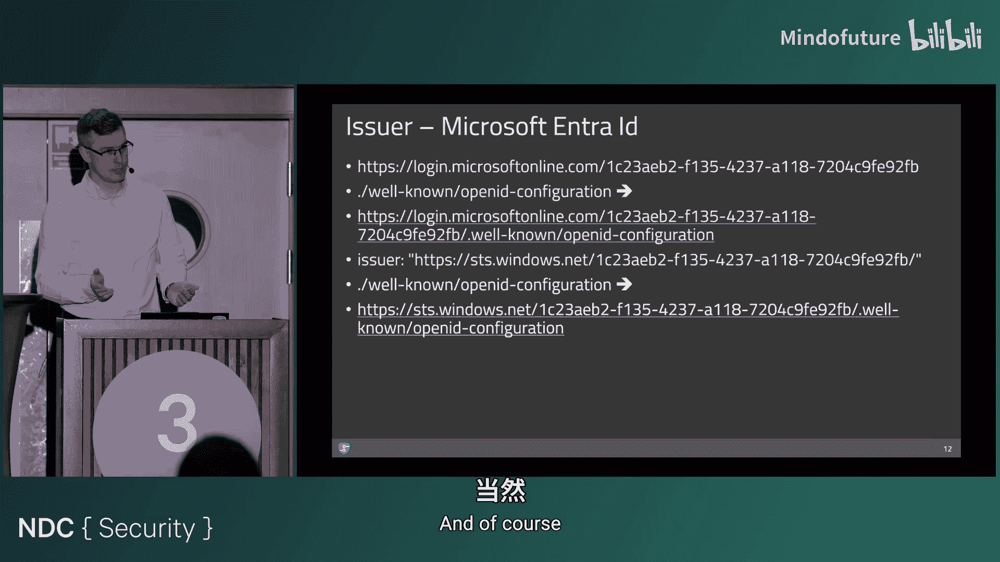
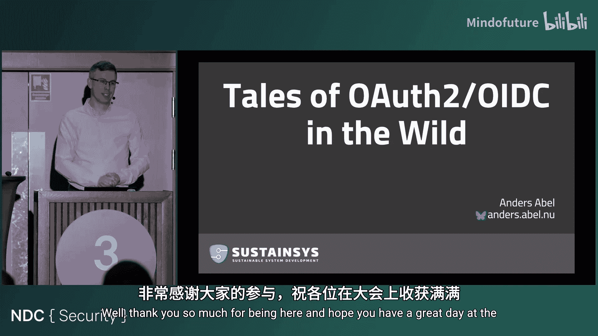

# NDC-Security-安全大会-2025-｜-AI工作流-｜-智能体-｜-网络安全-｜-Dapr框架-｜-开源工具-｜-LLM应用-｜-自动化安全-｜-黑客-p14-P14-Tales-of-OAuth2-OIDC-in-the-wild---Anders-Abel--BV1ihgQzJE2h_p14-

So， welcome。And good morning。Time for some stories from the wild and looking at underneath the hood。

 why things sometimes doesn't work。So I'm And Shall， Sw consultant。

 and I work a lot with Dand identity server。And do consulting a train if for。

 But I also do other things， and。See other providers and see some comparisons。And。

Different providers have different strengths。And we assist。So， we'll look at that。1st of all。

 I want to look bit of specification because this is a space that is extremely spec driven。

And the original spec is RF C 67，49， ow 2。嗯。if you want to upset someone working with a wealth2 an Open connect。

 give ask them， what about login using using a2 for login。Because the thing is that Earth。

 who is all about getting an access token to call API is on behalf of the user。Well。

2 has no idea about a session。And logging in means establishing a session。 And eventually。

 as we will talk about later， we probably also will single log out to tear down that session where we are done with it。

That's not part of W， too。So open a was added as a layer on top of the oath 2。

And Open E Connectect provides secure session establishment and session management and session T down in the logout phase。

Going to the openerconnect page， it turns out that， well。Oh B connect is not just one spec。

 but a bunch of specs。To keep track of。 And some of them are published by separate working groups。

For reasons， I guess。So looking here， it looks simple。 I mean， RC 67，49 is just one spec， isn't it。

Well。I through is like， hey， hold it for me。I have have companions。

I think this is the current list of。With two specs。Most of these are。

Extensions with new functionality， adding higher security profiles or adapting for different kind of applications。

 things like that。 But a couple of them are actually crucial security fixes to。The。

 the original flow that， and these are things that everyone actually implements。Or should implement。

 at least。Is the RC66，76，36 prooffiy code exchange that fixes risk for code substitution attacks。

 especially in mobile devices。And RFC 920，7 authorisation server issue identification that it also fixes a kind of。

sububstitution attack。But this means it's not that simple for an implementer to keep up。

So let's look at one， one thing that matters。 Token's eyes， so。I've done con bit of conference talks。

 This was N O last year。 Dominic Mayers saw this picture and said， hey。

 that looks like a phing story。 Are you talking the token was this big。And I hope not。

 because tokens should probably not be big。 So I found this picture of。Someone else。

 he has a better grip of the token size。 obviously。 So why do tokens。

If we look at a typical example of a web application that wants to authenticate with an upstream provider。

We want to log in。 When we do that， we get an access token and 90 token back in open I connect。

Then typically sell some cookies on the client application to establish a session。

Then we might want to call an API。 and to be able to call an API， we need。

To send the access to along。 So we need to keep the access token。On the client application。

And it turns out we also need to keep the I D tokenken。Because to prevent。

Cros sight to request 40 attacks on logout。 There used to be something called logout spam。

 where you went to page watching a picture of kittens or something。And in hiddenden eyeframe。

 they just rendered log out endpoint for a bunch of providers of popular sites on the Internet。

 So after you had been there， you were suddenly logged out everywhere。It could be seen as a prank。

But it actually， actually， is also。Can be part of an attack。So， for example。

 if you have an attack you that。They have found an attack to a way to attack you in the login face。

Then being able to log users out means they have to log in， and then they can execute their attack。

So since we need to keep the tokens around for the duration of the session to be able to look out and call APIIs。

 we want them small。This is Hoken coming from Microsoft， Android I D。It's an abridged。

 somewhat abridge version， but it's an a real， you know， we talkingken it。What we can see here。

Is the groups。 In this case， I have four groups。 That's not many。

But one of the features with Ant I D is that you can nest groups in each other。

 So you can groups that are members that are members of other groups that are member of or more groups。

 There is no way to express that with nested groups here。

So Microsoft Dont just expands the list before it dumps it the idea token。In a large corporation。

 it's not unusual to have people where the expanded list of groups is in the hundreds。

And having hundreds of those， yeah。That turned out to be a problem。

And Entredi actually realized that。To ensure that the token's size doesn't exceed the HTP head size limits。

The number of what is that it can。It includes in the group's claim is limited。 good。

 They put a limit to it，200。For jade， some Web token， I think the 200 objects I。

Then the token is probably already a bit on the large side。So what to do about that。 Well。

 there is a mechanism in openconn called the user room for endpoint。

The idea idea is that you send in the access token and you get actual payload information about the user back。

The good thing with this is that we can now reduce the ID token to be just pro the protocol details that and security measures that need to pro is needed to prove the identity of the user。

 And in the end， we just have the subject I D in there。 And all the given name， thermal the name。

 name， display name， group membership， all of that goes。😊。

It has to be fetched over the user in findpoint。Another good thing with usering Fpoint is that you can actually query whenever you need。

So。The I D token is something you just receive on session in initialisation。

 for a long running session， if things are updated， you cannot update unless you log in again。

 While if you use user for endpoint， you can update whenever you want。

So the user room for endpoint is。Critical mechanic thing in or a critical feature in opencon to make token sizes manageable and avoid all sorts of issues。

So let's look at the Microsoft of on just reinforce for a response。

This is an example they have from the docs。And then it says the claims shown in the response are all those that user info endpoint can return。

 These values are the same values included in an I token。Okay， hell along。

 So they have the useringpoint， but they still put everything in the I D token。Okay。

But we could at least update from it。Well， nursinging caveats on the user view endpoint。

 you can't add to or customise the in information returned by the user info endpoint to customise the information returned by the identity platform。

 use claims mapping and optional plane to modify security， toking configuration。

I feel that the user endpoint implementation by Microsoft Android ID is one of those that we had to do it according to respect。

And they did the the minimum thing。What been a bit more is that。

This all the text that it limitsments the number of tokens。

 but it indicates to the application to query the Microsoft graph APII to retrieve the users' group memberships。

 and obviously server side。 they have all the data they even provide。

An end point or a feature to query that through the Microsoft graph。

 But why didn't they just hook up the user input to that。No idea。Guesses are welcome。

So let's live closer at the Token science that logout。

If we have a Web application with the logout button。

And then redirect the user to the end session endpoint of the provider。Ident server will。

 when an identr will respond this。 Would you like to look out of identity server， yes。

And then the reason for this is of because a cross crossside re request for the risk。

The logout ban point is a get request， and we need to somehow。 anyone could redirect the use of that。

So we need this。 this is a form post that prevents that pro it contains proper anti forgery。

To is to p prevent crossite to request forgery。And。Yeah。To get。

 but it's an no awkward user interface。 I mean， I H。

 I press log out that but should also have proper crossite request for their protection。So somehow。

 if we could authenticate the user。 and that's where the I D token comes in。

 If the I D token is sent along with the logout request or lookout redirect。

 then I so will no longer show this。 and it also enables I to know what client implication initiate to logout because the client I D is in the I D token in the audience parameter。

So that allows Izo to reiterate back。 And now we get a decent userary experience。

Hitting logout means redirects and some screen flickering maybe。 But in the end。

 you can in the application where you click log out。This is how we should be done。A't ready。Well。

They always show this。 pick an account。 Which account do you want to log out of。

 even if you supply an ID D token hand to log out， they still pick show this one。

And know what I mean？The client application sends in an I D token。

 which contains the identifier of the user and what client application was requesting layout。

The identifier of the user is there。 And on Friday says， hey， which I。

 I don't understand which one do you look out， What will log out from。And actually。

 it doesn't matter。 It's the same experience， regardless if you're sending the anti token hint or not。

So what you went out and tested， What about redirect back to the client app。

What if we have two applications in the session。Turns out that。

 there's no connection between the application where I initiated log out and what accepted it where accepts redirect。

 So one application can easily redirect to another one on logout。And the protocol spec prevents this。

 The protocol。Well， if you follow the pro the call back closely。

 the post log at redirect your should be pre re registered per client application。嗯。

So let's talk about another thing about issuer。So this is just an example from identity server。呃。

The spec contains a mandatory requirement that open ID provider supporting discovery must make adjacent document available at the path formed by concatenating the string slash do well known slash open I configuration to the issuer。

this is a brilliant thing in Open A Connect， because it means if we take a token。

 we have the issue in there。Then we could go get the discovery document。

 get the from the discovery the document， get the public keys used to verify the token。

So just having a token， if everything is spec compliant， we can use that。

To get the information we need to be able to validate it properly。If we， for example。

 take demodoendus software dot com ads slash well known open configuration。 We get this link。

And if I click that one。m。We will get a discovery document。Well， for example， the jokes your eye。

Where we'll have the public part of the signing key。And we can see the issuer。In there。

 because there's also a requirement that the issue id here for the open I D provider。

 which is typically of 10 discovery， must exactly match the value of the I S S。Claim。

This is when validating token。 So there's a very strict requirement that these things should。All。

all be consistent with the channel。Doesn't look too hard to get right， does it。

Do you think anyone could ever get this wrong。系。Welcome to ontroy。So if we have this。

 login myself online dot com。With a tenant specify。 So this is my test tenant I A。

 I added the well an open configuration。 I get this one。 Let's， let's go there see。

So what we would expect now is the issue should be log in Microsoft online dot com slash1， C 2，3。

Et cetera。And if we go here。They don't put the issue on top。

 I think that can want to hide it somewhere。 is's here。S， T， S Windows dot net。This is， actually。

Okay， according to the spec， because。the initial URL here login Microsoft online dot com is just an authority URL that they supply。

 They say that。There's nothing that says that you cannot serve the discovery document on more locations。

But the interesting question here is， obviously， that。

We found this issue if we append well known open de configurationfiration to be spec compliant。

 we should have the discovery document on this URL， because this is the one that we would go read。

Yeah。We have Disc document。And actually， the issuer this time matches。

But I was a bit surprise to find this even in the single tendency mode。嗯。

But then we have a bit more complex things， so。When using Microsoft Android I D a supply an application typically not。

 or often not only authentic gets to one instance of Android I D。 but to many。

 this is if you're a software service provider。You would have your own Android tenant。

 but you also want to be able to federate with your customers provider。And， of course。

 you can have your client application be registered as an app registration in every single ont I D of all your customers。

Then you need to talk to them， get the reader write your eyes right， get a client's secret right。

 update the client's secret on locational intervals， things like that。

And Microsoft， they're all about simple onboarding。 I mean。

 An ID is sometimes used by small organisation。 They don't have the resources。

 They just need a simple way to get onboarded。 and they have this concept where you can publish an application in your tenant and make it available to others。

 And then all the configuration data remains in your you。

 If you want to change the reader at your eye。 You can just do it in your settings。

 and it will they will not have to update on their side because they are essentially using your app。

So instead of having your application communicating with all of these。Logical ups and then provider。

 Why not。Add a new one。 And that is exactly when mark so dead。They added new， kind of virtual。In。

 that can authenticate to all of the， all of the others。 How do they do that。

They have a separate authority。 Lo in myself online dot com， slash common。If you use this authority。

 it means that， hey， I want to be able to access any or。

 this application is allowed to be accessed by anyone in any Android lie tenantnant。

We'll do the same well in our bananaard configuration。 Let's it see what we have here。

The issue is also definitely the ha hidden。bit further down。 So what's this。

Looks like a template string。There's no such thing as templating in the spec。

 The spec says it must be an exact match， right。Okay， yeah。

 and we have this same thing with S T S tenant I D。 So， so let's try this then。

You should be able to take the issue and do slash dot wellknow， right。Invald tenant。

 Ten Ten I D was not found。Obviously， no。It doesn't work that way。

 And it's more and more obvious that tenant I D in this square braces is a template。

So let's go back and try。 let's just put in common here and not attend idea see what happens。

We got something。And now， again， we have the issue being the template。So yeah。

 while I went ahead and created a multi an application using multi tenantanted， I logged on。

 and this is the resulting I D token I get back。 And as you can know。

 I don't read encoded I D tokens either。 This is the decoded I D token。

We had to tip just the normal header。 and then we have the payload。

And what we can see here is that even though the authority has started with what this common end point or where it said the tenant I D。

The issue of the token is the actual tenant I D of my account。

They also supply the tenant idea as a claim。I have no idea why。

Because we have it both in this antenna。So to summarize a bit。We go and fetch the discoveryover doc。

We find the issuer with this template string。The spec says that issue identifier for the open energy provider。

 which is typically obtained during discovery that is read from the discovery doc。

 must exactly match the value of the E I S S claim。 We get this I S S claim back。

So we can't be spec compliant if we want to work with Montra D multi tenly。 we have to remove this。

And then we give the ten D as a separate claim。 So I went to an actual production application I have access to and check that I know use multi ten on Friday and check。

 how do they do this。Well， this is actual production code。 Valid issue or false。

Which is perceived probably not unseecure because it is it relies on the fact that the signing keys are only are owned by Mark Microsoftronde。

 and they have the same signing keys for everyone。So essentially。

 we just fetch the sign keys from one1 and， and then。We can use that those through Val tokens。

 regardless of what tenanture they are issued by。Still not what I would prefer。 So let's see what。

 what would I have done Because I've gained， when some thought this。

T that so if we look back at our graphical representation， the problem is that。

We are initiating the signing into this virtual common in open I D provider。

 But then the response is coming directly from the actual providers。

This is would be a much better thing。We're got to have a virtual provider， where。

Our client application would interact with the same one。 And the issue would be the this one。

 And then we could just have the tenant I as a claim。And or why even have this virtual one。 I mean。

 one of these is our home tenant。 This is where the app registration is created。

 Why not let this one just。Connect to the rest of the I logical instances。

And if we rearrange it and add a couple of more client applications。

 this is the federation gateateway pattern。That is an architectural pattern that I often recommend for。

Yeah when working with the open and connect。This would also solve another problem， probably why。

It's not possible to use onreadD guest account in the setup。 But I think it would be possible here。

Okay， so。Let's take another example。Of issuesrs。Because unfortunately。

 this is not the only time Microsoft has done interesting things to issues。This is AF。 S。

 I once had a project why for。Reasons。They wanted to use Microsoft AF first together with my Azure APII management。

 I mean， two Microsoft products， right。It's just that one is from the。

 from the on premise legacy era。T1 is a modern cloud product。And obviously。

 Azure APII management is designed to work with Azure A or Android D。I actually met one of the。

AI managements developers on a conference。 and he， and ex told him about this story。 And he was like。

 why would anyone do that， Why would anyone use AFS with APII management， But yeah， for reasons。

We have the issuer here， AF example， AFS example dot org， slash AFS。

I think they created this URL as the issuer to allow the discovery document to follow the pattern of other paths in A Fs。

But then we have another one， access token issue sure。

So it's actually using different issuesrs for the access token and for the I D token。

And if you have a normal client， A library and AI in an APII that downloads the discovery document。

It will go and check the shore。So you would have to f to do that。 There is a way to fix this， though。

 because I have no idea where this comes from。 But this is the federation service identifier。

And the fedederation service identifier is possible to configure so you can change the Federation service identifier to be the same as the top one。

Just one drawback。 that is kind of the global identifier of the AF S instance。So typically。

 if you want to， if you have the AF S and want to add open a connect it。

 is typically because you have had a ton of legacy applications already using AF S where the double Federation or Sam 2。

And now， Open E connect requires you to change the Feration service idifier。

 which will break all of the existing client applications。If you set up a new one， Yeah。

 it's an easy thing to just make sure this match。But still not exactly what I would prefer。

One thing that An I D can handle those who have seen is log out。 We could do log out。

Let's talk about logout a bit more。 So if we have a session in an application。

That we've created here。 we have。sessionession represented by cookies。

 we typically have cookies on both sides。So we have one session in the W client application。

 We have one session in the identity provider。If we hit log out and simply remove the local cookies。

And the user then tries to access a protected resource， typically。

A single as an offflow will be initiated or any like an on on to a dentist server。

And it will just get the cookies back。I mean， I would love this to be in the cookie jar at home because my kids eat the cookies。

So what if the cookies could just reappear， wouldn't that be good。Now。

 this is I when I started working with。singleing sign on。

 This was an actual bug report we had in the production system， Health care in Sweden。

Where the I D IDP login was， there was a session， and there was also a smart card involved that which meant that as long as the user had the smart card in the terminal single on on woodwork。

And if they removed it， the session， the session cookie could remain， in some cases。

We had implemented single log logout in our application， but single logout was not implemented。

Which meant that we just clear around our own cookie。

And then we had one year healthcare care professionals， you know。They are people that really。

Take this seriously and make sure that if when they are logged out。

 she went to click the link just to see， can I still like this patient record。And this happened。

So if we have single sign on， we need single sign out always。Without single log out。

There is no re log out because you can just be relogged in。If we look at a discovery doc from。

Ident the server， we will see that there is an end session endpoint。

 That is when we redirect the user。There is another platform that is fairly popular。

Anyone heard about Google。They have a discovery document， which is actually F fairly short。

 If I just to collapse these， I think we might。Even。Get to the。 Yeah， it's short。

And we'll see the on session endpoint。Let's search。No。No answer endpoint。Well。

 you can log out to your Google account。But you have to go to accounts Google dot com and initiate it manually。

Google obviously do not want to use this to look out。

And I think this makes sense on my personal phone， my personal device。

 I just stay logged in to my Google account。 That's fine。But of， if。

 what if I borrowed your device to do some urgent work and hand it back。Ill think that I。

 I press logged out before I had the computer Mac。I mean， everyone in this room。

 we know that if we borrow a computer for someone and log in。

 I would do it in an incognito window to ensure that I can close it and be sure that everything is really gone afterwards。

But a normal user wouldn't do that。A normal use of wood。Probably just log in。

 hit log out and think it's secure， so。To me， this is a， a security issue。That is the same。嗯。Okay。

 let's talk a bit more about liking features。And there now we are moving from protocol level and spec level things more too。

Architectural concepts that we might need。This is the architecture from a company。 It was a start。

 I think the， it was 15 years ago， since a long time ago。Only only 15 years ago， they started。

 and they get this， there is a program for Microsoft where starts can get cool infrastructure and even some consulting help from Microsoft。

Microsoftof consultant。To get the architecture right。Azure AB to C was new at the time。

 so they decided that they wanted to use Azure AB to C because F from a trust perspective。

 it's a good idea to say that no， we don't have credentials of any users。 We， we use Microsoft。

They are an established company， and they had a lot of passwords。 We don't do that ourselves。

They also had to support other providers。 So this is a combination of。

Consumer accounts and business to business federation accounts in this application。

So the Microsoft consultant that was obviously paid to plug Microsoft products said that you。

 we should use H B， to B to see it's new and it's good。But then。We have the client application。

 We need to issue access tokens and use access tokens to call APIIs。

 And S rate the BTC can't really do that。 So let's use identity server。In between。

My question here is why S really B to C at all。Aure AB to C also has a few more works with。

 They have something called a policy where you can have a sign in policy or a sign up flow policy。

 and they are defined by starting at different endpoint and that heighty is actually reflected in the token produced。

 So depending if the user is signed up， recover the password or just signed in。

 you will get different issues from the token when it comes back。um。嗯。

And we saw what to the us about token issues。Another one that is interesting。

This is something I've seen a lot。 In this customer case， it wasocta。

 but I've seen it with other providers。 I've seen it with on ID。 I've seen it with all the 0。

 the nonoccta， or the0 as well。 and AW's Kognito seen the same。万。

We have something that on the surface looks like a good architecture。

Where we have two client applications using a shared API， they use octa a single signon。

 octa fed rate with multiple upstream providers。But then， on the architectural drawing。

That this customer applied。 There was something more。There was the I D translation layer。

 which was an internal service that used to translate whatever came fromocta to their internal identities。

And in typical architecture。If we look at the F fedederation gateway architecture。

We had to previously hair。Let's get back to it。If we look at the Federation Gateway architecture。

The role of the federation Gateway is to shield the client applications from all of that。

So the client application should get a unified internal definition of the identity from the federation gateway。

 And then it's up to the Feration gateway to interact with the upstream providers and translate。

It turns out that Ota， in this case， couldn't。Really accommodate to all the requirements they had。

 So they had to insert another one。 And this is something I've seen every now and then with various cloudown providers that they cannot accommodate M flexibleex enough A ID definitely。

 too。But I haven't an even worse story about。Something like this。

 This was a client customer using AWS coognito。For the Web app。 And they or actually。

 my customer was this web app， then the customer's customer。Had this set up。

So I was working on that web app and the end end customer came and said that， hey。

 will you want to migrate AW Kognito。 So we need to be able to use that。And we w。

 we'll connect our AW Sgator instance to our CRM system with the idea that。

Users would be able to use Google or Facebook to sign on。

 but there was also connection to the CRRM system saying that only users that actually existed in CRM system and were ex had an existing relationship with this organization。

Would be allowed to。呃， to login。They essentially wanted this that if you try to log in and you're not in the CR around system。

 you would be redirecting and stuck on the CR RM system on the re registration page。

 where you could request registration and then be let in。It turns out that AOW is Knet。

 they could get it to pick up the identifier from the CRM system and  query the CRM system for it。

 but they couldn't make it to alter the flow。So in the end， we ended up with this。

Where we had to implement code on our side in the client application all the way down。

 where we checked， do we have a C or MI D claim on the user coming in And if not。

 we had to block them and read or them back to the CR RM， But they already had an established system。

So once more， the cloud providers。They are excellent at what they do。But if you want anything more。

 than exactly what they do。It often results in the quite awkward hacks。

And they used to say that for on Android， for example， if you want， if you need a square box。

 Android I is a perfectly well polished square box。 same goes for author0， for example。

 it's a well polished square box。 But if you want to change anything， I mean。On I is like the t for。

 It comes in black period or the0。 Yeah， I can probably change colour of it。

But if you want to really adjust it， it's not possible。 You need another solution。

So I've been bashtting so far products。And telling some about some incompatibilities that I've met。

But as a final thing， I have。Actually， something from the spec。So even though I like the specs。

 the specs are not perfect。I with to basic off。 Let's start with RFC。7617。

 which is just a clarification or R C 26，17， basic authentication for HP。

It's that that get the user idea and password from the user。

Con strike the use surpass by concatenating the user I， a single colon character and the password。

 Now， the colons are not。Allowed in the user name， thanks to the scheme。 there can be the password。

 though。Encode the user password into anocted sequence， and typical UDF A。

Obtain the basic current by decoing this O sequence using base 64。So it's just U TF8。

 basically for done。In a flow where a client needs to authenticate on the back channel to。

 for example， the token endpoint on。On able to authorisation server。They。

 the client can use basic authentication。And it's even described a bit in the RF C 67，49。

It was two basic off。Well this， the client id is encoded using the applications slash X W W W form URL encoded and coding algorithm。

The client password is accounted using the same algorithm and used as the password。

We recently had this as a bug。 someone saying that， hey。

Why don't par client secrets that containss a plus character do not work。With identity cyber。

The reason was that。This customer used basic authentication as as it was a standard defining the standard。

Ident service supports the full one。 and plus has a special meaning and is actually encode in ex U depth form URL encoded。

 plus is actually encoding for the space can character。😊，So， it doesn't work。And I'm like， but why。

Why does Open do O to have their own definition， it， they don't really make it easy for us， right。

So that's actually all the stories I had prepared。And we have some time。 If you have questions or。

If anyone has more horror stories to share， I would be happy to hear them。😊，Everyone。

 you just use spec compliant providers do you。They just work。Well。

 thank you so much for being here and hope you have a great day at the conference。😊。

