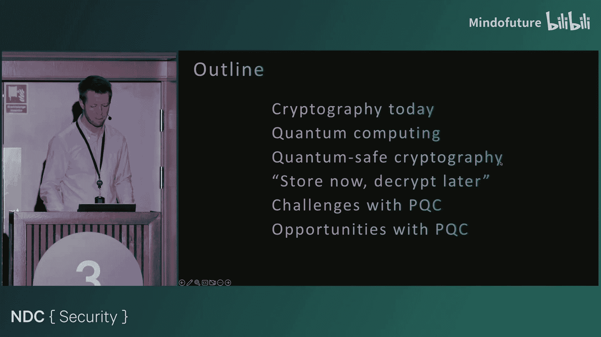
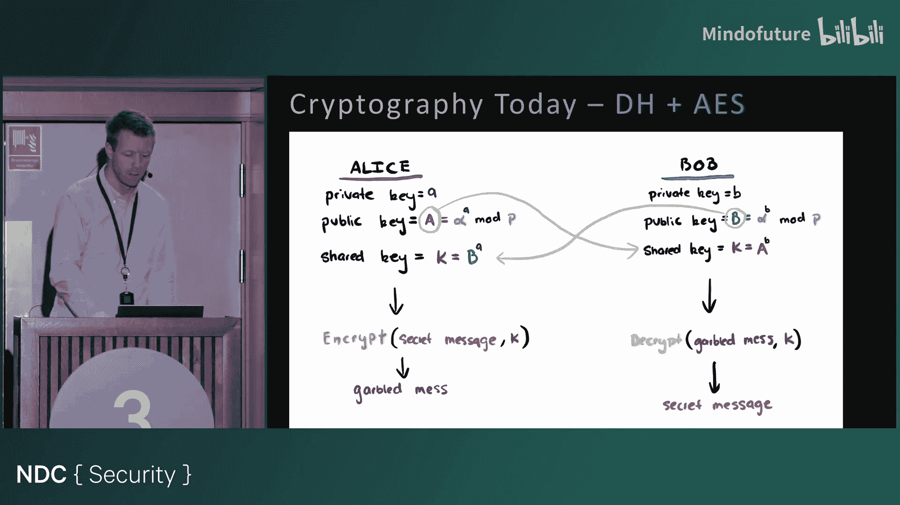
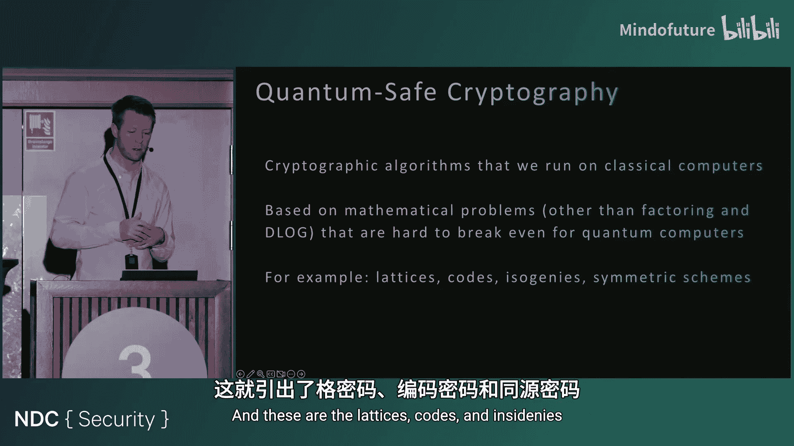
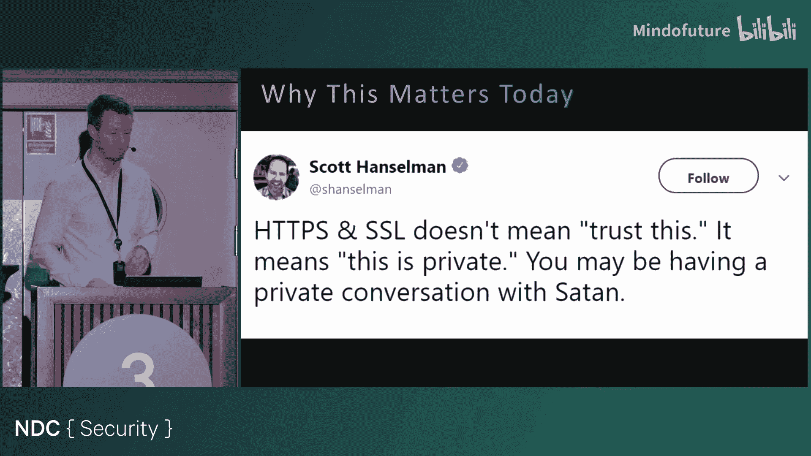
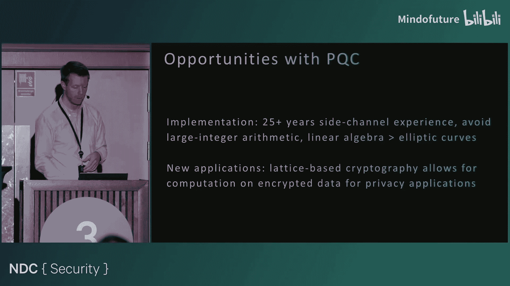
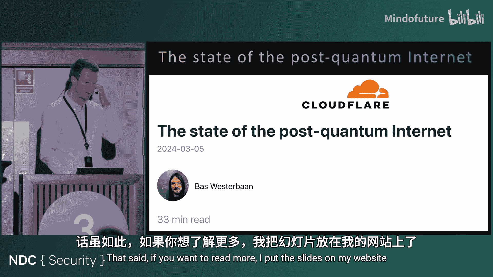
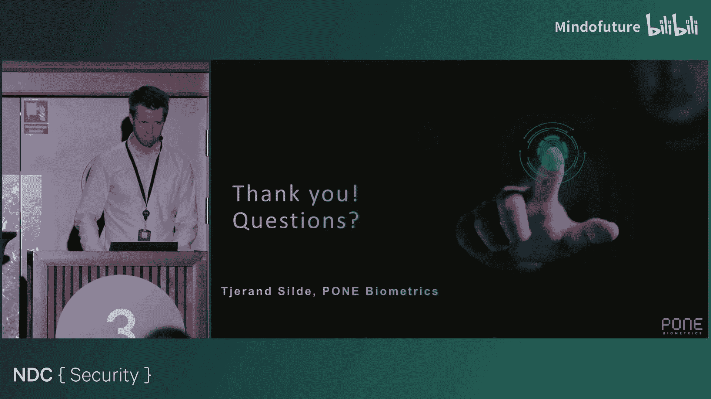

# NDC-Security-安全大会-2025-｜-AI工作流-｜-智能体-｜-网络安全-｜-Dapr框架-｜-开源工具-｜-LLM应用-｜-自动化安全-｜-黑客-p15-P15-Challenges-and-Opportunities-from-Quantum-Safe-Cryptography---Tjerand-Silde--BV1ihgQzJE2h_p15-

Okay， let's get started。So welcome to this session about quantum safe cryptography or post quantum cryptography。

This is quite new， I guess， too many。 It's kind of a effort that had been ongoing for roughly 10 years and kind of converged against some new schemes that will now be standardized in different countries and and be used in different protocols。

 And in this talk， I'll go a bit into。What' this new post quantumum cryptography is and。

 and some of the upcoming challenges and also some。Opportunities coming from this field。

So just two words about myself at first。 So I'm a security cryptography expert at Po Bmetrics startup here in Oslo。

 working on secure authentic and have an offpad card for pass keys。

 so you can log in digital services。And we're working with， yeah。

 how to implement cryptlography on embeddedbed devices and how you。

 how to use biometrics to authenticate yourself and recently looked into how to embed quantum safe cryptography into this framework。

But most of my time， I'm a associate professor in Cptology at Antonu in Tngheim。

And I'm working on quantum safe crypto。 So kind of what I'm gonna talk about today is what I spent my last。

 I guess，7 years of my life working on， and try to convey to you in a， in an accessible manner。

And I'm also teaching there。 So I'm teaching secure cryptographic limitations。

 And it's really fun to see kind of how to use these algorithms in practice。

 What kind of challenges you face， how to solve them and so forth。😊。

And I'm currently supervising several masters and Ph D students in this topic。

 And this is kind of knowledge gathered through different projects over the years。嗯。So my。

 my high level overview for this talk is， I'll talk a bit about crylography today to start grid because quantum computing。

 that will be the next topic kind of affects the schemes that we use today in different ways based on kind of the underlying primitives and how we use them。

 So it's not equal for all of them。Then I'll talk slightly about quantum computing。 Just why。

 what is this， What， why does this help us or why is this scary for cryptography。

Look into quantum safe cryptography。 And this is the only section I would say that is also slightly technical。

 So I have a few slides on what kind of cryptography we will actually start using。 But otherwise。

 it will be somewhat high level。We look at the store now the equipped later attack and kind of how to mitigate that。

And end with some conclusions， both on the challenges that we face and what you kind of will face in the coming years。

 if you are on the side where you need to implement a use post quantumum cryor in some way。And also。

 some opportunities here。Maybe mostly as a community。

 but also like for individual companies and and people。So that's kind of what I'll， I'll go through。

。So just to recap slightly。 and， and for some of you， maybe you attended a talk on crypto yesterday。

 So this will be similar。 but just so that we're all on the same page。

 Like we have different ways of using cryptography， different kind of primitives。

 different kind of properties of cryptography。 But in general。

 we divide them into public and and symmetric key crypto。And for public key crypto。

 we have public key encryption， right， so you have some message。 You want to encrypt it。

 Anyone can do that with a public key of the recipient。 You get a cipher textex。

 So both the public key and the Cypher textext might be public， and anyone can see it。

 But only the party with the secret key is able to decrypt and and read the text。Okay， furthermore。

 we have digital signatures。Again， you have a public key。

 but it's kind of what you do is kind of the opposite。 So you have some kind of message。

 This can be arbitrary large， like files of megabytes or gigabytes doesn't matter。What you do。

 you hh it。 So you get the fixed size message。 That is kind of the fingerprint of the file。

And you can sign it with a private key so that anyone holding the public key can verify that you signed it。

Okay， so these are kind of wellknow primitives used basically everywhere today。And furthermore。

 we have symmetric key crypto。 So in this setting， the two parties then have a shared key already。

 So in the other setting in public key crypto， you only know the public key of other people。

 But here you have a shared key already set up with the party you want to communicate with。

And then you can encrypt using that key， and you can decrypt using that key。 And there's no like。

Public information， except what the cyberphertext might be sent between the two parties。

So one example and， and it is kind of what happens whenever you connect to a website and you want to communicate securely。

 you do a key exchange nowadays， mostly with a di helmet protocol。嗯。

And this is based on the discrete logarm problem。 So this is kind of the mathematical foundation that ensures security of this protocol。

So if you look at it briefly。The green values here are public。

 So you have some kind of what we call a generator， But it's like a public element。You say， a number。

And you take it to a secret exponent。 And then you do a modular reduction from a big prime。

 which means whatever number you did to get when you took this public element to your secret exponent。

 you reduce it so that you only keep the part that was smaller than the prime。Okay。

 it's like when we do calculate the time of the day， right， if， if it goes over to the next day。

 you only care about the time of the day。Okay， it's the same concept。So you do that。

 and then you send this result to the other party。 They do the same thing。 And whatever you receive。

 you take to your secret exponent again。And then by， by combining them。

 you didn't end up with the same value in the end。And you can use this to， as a secret key in A S。

 for example， to encrypt messages back and forth。So this is one way to do。

 do a key change and then encrypt information。 And the security of this protocol is that given the。

 the common element that everyone knows and the prime and the result。

It's hard to find the secret exponent that you chose。

So this is what we call the the discrete logarm problem to， to break this scheme。

If that problem is hard to compute， then this protocol gives you security。Okay。

 and you have a similar setup with R A， which is quite commonly used as well。

 where prime factorization is the hard underlying problem that as long as no one can factorize large by primes。

 So a product of two primes。Then the protocol itself is secure， and you can communicate secure。Okay。

 so this is kind of the underlying problems that need to be hard for this to give us security。

So if we look a bit at the problems or the algorithms we have today。We use RA。

 which is based on factoring， both for encryption and for signatures。

We have two versions of the other protocols。 We have this kind of exponent modular prime that I showed you。

 and we have an elliptic curve version of that。Where instead of computing on numbers。

 you're computing on points on a curve。And they have like both of them reduced to this discrete log problem that I。

 I mentioned。So here you have Day Heman， you have digital signature algorithm。

 and you have egamal encryption， both based on。Elliptic curves and modular arithmetic modular prime。

You also have pairings， which is also based on the same problems。This doesn't come up so often。

 but maybe you've seen sea knowledge proofs， in different blockchain in applications and so forth。

 based on the same underlying hardness problem。Okay， so again。

 we need these mathematical problems to be hard。 Otherwise， we have no security at all。

And as far as we know， if we look at the best ways to compute these things So to break these problems。

 these are exponential in the size of the prime numbers that are used。Okay， if we want。

 we often talk about bit security and a protocol。 So if we want 128 B of security。

That means that an attacker should not be able to break your protocol doing less than 2 to the 1。

28 operations。Okay， so we need to make sure that when we choose parameter for these schemes。

The best algorithms runs in more than 2 to the 1，28 operations to find a solution to the problem。

Okay， so this is kind of how we estimate security。 Like， we cannot prove that something is is secure。

 We can prove that something is as hard as not a problem。 And if we don't know how to break that。

 well， that then indicates that the scheme is secure。

So it's like a reduction that you might have seen in， in an algorithm course or something。

And what's interesting about public key encryption is that all of these schemes rely on a specific underlying。

 say， number theory or algebra problem， like factoring and discrete log。But symmetric schemes。

 where you already have， you know， a shared key or something。

 These are more like scrambling algorithms。 that just mess things up。

 There is no reduction to number theory or algebra below， and they cannot behave differently。

 So it's a bit more like。We designed the A S symmetric encryption scheme so that the best known attack is brute force。

We don't know how to do better。But with factoring， it's like we do know how to find primes easier than it is to try all numbers。

So like this， this makes a difference that you can potentially speed up the text。

 and you need different kind of parameters。So this is why we use， for example。

 R A 3072 in TL S and other applications， because the attacks are much faster than breed force。

 because otherwise， it would have been a 1，28 B prime number instead。Okay。

 and the similar things with the hash functions and， and Mac schemes。

 So these are kind of two different families。 and they have underlying。

 like the public key ones have underlying problems that we want to prove security based on some algebra。

 But the other ones are cannot scaubling things up。Okay。And we use these like everywhere。

 So this is just some example， not an exhaustive list。

 But like whenever you want to communicate with， you know， friends， family， whoever。

 you might use signal or Whatsapp or eye message to send messages that you want to keep private。

 and they also are encrypted。You use T L， S， for example， to connect the websites。

 You have some kind of digital authentication scheme based on where you live。

 to connect to government services and so forth。And we all have， you know。

 several payment applications on our phones that we use every day to， to pay for it， whatever we buy。

And all of these are based on these cryptographic algorithms and usually a combination of the the categories。

 you often use publicly equipto to establish a connection or maybe to ensure that someone are who they claim to be。

But you use symmetric key schemes when that connection is established for the communication going forward。

 And I think there is a question。that's a good question。

 It's about why it's not telegram listed as a secure messaging app here。 So again。

 I just want to emphasize this is not exhaustive list。 So like。

 there are many applications not listed here that are still secure。For your specific example。

 as far as I know， Telegram is very similar to signal on Whatsapp。

 but it's not end to an encrypted by default。 You need to turn on secret chat。

Potentially less secure。 Yes， you and also， you can not not have an to an encryption for group chats。

 which is possible in the other applications。And they also using their own cryptographic schemes。

So this is maybe the biggest one， like biggest red flag for telegram。

 But if you care about it as a social media， it's， you know， great as a broadcast channel。

 But I wouldn't maybe use it for， you know， private communication。Yeah， good question， thanks。

Maybe I should have said at that front， like。Yellow talks at the conference usually have questions at the end。

 but feel free to ask questions during the talk， I'm probably gonna switch between a few topics。

 And it's good to just take it when we have a slide up front。Okay， so then the question is， like。

 we have these amazing applications today。 like， you know， problem solved。

 we can communicate securely。😊，And then the question is， will these protocols and。

 and schemes that we discussed， will they be secure in the future。

And then the problem is a potential challenge that we will face in the coming years。

Is the development of quantum computers。So it's been invested。 I would say， billions of dollars。

 a lot of talent been working on this for， for many， many years。

 We have seen some recent results indicating that like quantum computers are becoming like。You know。

 feasible， like in Terry， it works。Okay， so we already and well see that we have some results that。

 in theory breaks all or most of the cryptography that we use today。Okay， but then the question is。

 like， are we getting there ever， right？ And， and this is kind of hard to say。

 These machines are like。Very special in that they need to be kind of isolating atoms for computing on atoms。

And。The it's a kind of engineering problem。 so to speak。

 that you can you even build these machines and they get really like impacted from the environment around them。

 So even temperature change in the room would kind of affect computation。

 So it's really sensitive in that sense。 And it's kind of something that people are working on to solve。

 Can we do this。So just let， let's look two seconds for what， what quantum computing does。

 But question first。I idea。 Yeah， yeah。 So this is the common one like in my drawing as well。um。

I think it's just， you know， the way people find out how to really like make these isolated atoms。

 But don't， don't ask me about， yeah， the machine itself。But， but yeah， it's， it's funny， right。

 This looked like I know something from the future。Anyway。

 so like we all kind of used to classical computing。 So that's what I'm gonna use。

 Class computing is how you work on bits， right？ And they can have one out of two value， you know。

 power on power off。 and you can manipulate them。 and you can have many of them。

 and they can depend on each other。 and you do computation that kind of yeah， we learn about。

 you know， Turing machines。 And like what's possible to compute and not and how do you manipulate these。

 And we have formalized this in programming languages。

 And we know kind of how to compute functions using bits and， and high level abstractions。

So qubits are a bit different。嗯。So here， you don't really have。A certain value of the bit。 Like。

 think of it as a bit thin memory。 It's not 0，1。 Its you don't know。 It could be one of them。

 but you don't know before you look。Okay， and if you want to do computation on it。

You need to do the computation on it before you look， cause otherwise。

 this quantum state collapses and the value is kind of fixed。

So this is not like a super accurate of description of the physics。

 but it's kind of how I like to think about it from a computational perspective。Okay， so again。

 you can have one bit。 You can have many bits。You can have like a vector of this。

 And you want to compute some function on this vector。And you cannot。

Before the end of the competition， actually have a look at the result。

And one kind of misconception here is that people think quantum computers can compute anything at once in parallel universe。

Okay， so this is quite inaccurate。What is true is that you。

 you have a probability distribution of what kind of value the bit has。Okay。

 so you can compute on it by manipulating this probability to give you some。

 with some probability the result that you want in the end。Okay。

 so you want to kind of impact and do computation on these bits so that it gives you something useful in the end。

 but it only gives you one answer， and it gives you the answer according to this probability distribution。

 So you don't get， you know， all possible answers。 You don't get， you know， all prime factors。

 You might get。When you're trying to break R A， you might get some information that is useful and related to factoring。

 but you don't get like one solution guaranteed。So we need to kind of be a bit careful when。

 when computing and when designing algorithms for， for， for qubits。Is that you don't really， like。

 you can't really enforce。The answer you like， you can just kind of impact the computation so that it's likely to give you what you want。

Okay。And what you also have with qubits， that is not something you can do with normal bits is what's called entalment。

So usually with bits， you want to compute them them， and they're kind of behaving。

 You can do something here and something there。 And this kind of doesn't impact each other。

But with qubits， you can kind of link them together so that if you do some computation on one bit。

 this might impact the other bit as well， even though you didn't do a computation on the other one explicitly yourself。

And this allows to do something else。 So this is kind of my main point here。

 It's a different way of of computing。 It's not necessarily a better way of computing。 Actually。

 I would say in 99% of the settings， it's not better。 It's worse。

's much much more worse because it's so difficult。 It's so expensive。

 We don't know how to do it with more than just a handful of bits。Or qubits。 So this is like really。

 like， in most cases， this is not useful at all。And recently。

 I think it was Google actually announced a $5 million competition to come up with useful applications of quantum computing。

 right， So we invested like billions into this。 And now we're trying to think what we can actually do with this。

 Is it useful in any way。😊，But one， one use case that we know of is actually like breaking cryptography。

Okay， but can we do something more proactive， right， That's kind of the question。And so。

 so I want to emphasizee this point。 It's just a different way of computation in very specific settings。

 We might be able to compute something in a faster and better way than we can with classical computing。

 But in general， we cannot。So let's move on。 So there is basically two algorithms in quantum computing that kind of impact cryptography。

One of them is Showar's algorithmm from Peter Shore， published in the 90s。

And this algorithm is very efficient。Is a quantum algorithm。

And you can find the periododicity of a function。So like how when a function repeats itself。

And this can be applied by thinking of the RA encryption algorithm as a function or the Dhelman key exchange algorithm as a function。

 And this can be used to factor or to compute discrete log。So it's kind of by coincidence。

 like the one really efficient quantum algorithm we know of， by accident。

 is very efficient to break the cryptography that we use。

And we haven't really found many other interesting applications of it。So like， what's the chance。

 right。So， this is really efficient。In theory， to， to implement on a quantum computer to break public key encryption schemes。

We also have another algorithm that is interesting。 that's Gover's algorithm。And。This is。

 it doesn't give us the same efficiency that shorts algorithm。

But it does help us to speed up computation。 And in general。

 to do search or solve just brute for search problems， Basically。

 we can speed up this kind of computation。So， for example， if we want to break A S。

 I mentioned that A S is designed so that the best attack that exists， or at least as we know of。

 is brute for brute for a search of the key。Okay， and this argument will then help us。

Making this brute force more efficient。In practice， as I didn't put it in the slide， but it G。

 it does give us a square root speed up， which means that if we have a。128 B key。

 We can brutefor it in2 to the 64 operations。 So half the bits。And similar speed up supply to。

Finding coals for has functions。This is also some kind of brute forest problem。

So if we then summarize based on the cryptography that we use today。

 then we see that all the public key schemes that I mentioned are just dead。

 If such a quantum computer of large enough size is built。

Then we have algorithms that we could implement on these computers， and they would break them。

And in theory， breaking them is as efficient as using them。Right， it doesn't give us anything。

But for A S and hash functions like shot 2 and 3 and， and H Macac and so forth。

We potentially can breathe force faster。There is still some discussion on ongoing on this because it requires so much effort and memory and so forth that it might actually not in practice。

 give us any speed up。 But at least， in theory， we would have to double the bit size to to preserve the security that we have today。

But this is actually not really a problem。So for A S， we often use 128 bit keys。

We already have a S 2，56 standardized。 This is available today。

For Sha 2 and Sha 3 and the hash functions， those usually give outputs of 256 Bs。

Collliitions takes 1，2 to the 1，28 to compute。But we already have hash functions today with outputs that are either 3。

84 B or 5，12 B， already standardized。 You can use it today。 Proble kind of solved。

 You might need to do some changes， right， but it's already here。 It's already standardized。

 There's really still a big gap between using and breaking。Like an exponential gap。

 not as big as today。 but it still something that gives us security。Okay。

 this is just gone for public key encryption and signatures。

So then we need to replace this with something。And that's quantum safe copography or post quantum copyography。

 P， Q C。And。This is cryptlography that we still run on our computers that we use today。 Okay。

 and this does not mean。That everyone need a quantum computer in their pocket to send private messages。

 This means that we replace the cryptography we have today。On our classical laptops and phones。

And we use this， instead。But theyre build on， we build these schemes on other mathematical problems。

Dhan factoring in discrete log， which we know how to break in theory。On with the quantum computer。

With other problems that we believe our hide。Again， even against quantum computers。Of course。

 as I mentioned earlier， we cannot really。Prove something is hard。Like for。

 for everyone in computer science， we know that， we don't have a solution to P versus N P。

 We cannot prove that something is like always gonna be hard to break。

So how we ensure security of cryptography is that we build a protocol。For say， public encryption。

Based on a mathematical problem， saying that if you can break the protocol。

 you can break the underlying problem。So then we need to analyze how hard is it to break this problem。

And then we look at the best possible attacks with classical or quantum computers。Okay。

 and what is the running time of the best attacks that we know of。

 And then we ensure that the parameters we set makes these algorithms infeasible to run in practice。

So during 2 to the 1，28 operations。Relative to the computing power we have in the world today。

 this would takes every computer in the world running to break one。Key。

 until the end of the universe。So that's kind of how we set security。 Like。

 it should be infeasible for all future。You know， except if this quantum computer comes up。

 So then we study quantum algorithms， like， how do they potentially speed up the attacks on these new problems。

 if at all， And then we try to understand them well enough so that we can set parameters for these new mathematical assumptions。

And there is a few families or problems that are kind of people have been looking at and that we're about to。

 or have or is about to standardise。These are lattices， codes， isogeneies。

 and also symmetric schemes。 So I mentioned like A S， potentially you need to double the key size。

 but otherwise， you're fine。And we can actually design signature schemes only based on A S。

 like symmetric key schemes and hash functions。So like， we know how to， at least。

Design a new scheme there for signatures that would be secure。For public key encryption。

 we don't know how to do it from symmetric parameter。 So we need something else。

 Some kind of mathematical number algebra problem。And these are the lattices， codes and inserts。

 And we're gonna look a bit on lattices。 So this will be my three technical slides。

And we have an underlying problem here， called learning with hours。

This problem is actually coming from machine learning。

 Like you have a lot of noisy data and you want to kind of。Design an algorithm to kind of say。

 give you some output so that you can represent all of this noisy data in an accurate way。

 And then there is a lot of noise that you want to get rid of。

 And this is how people came off with this problem。 actually。

 they wanted to show that this was possible to compute。They couldn't。 And then they said， well。

 what if it's so hard that we can build cryptography on top of it instead。And then we did， did that。

So now we need to recall what we learned in the linear algebraberg class in in undergrad。

 So learning with hours and lattice based cryptography is based on matrices and vectors。Okay。

 so this blue big box。 This is a matrix with elements。And。This is gonna be public。

And what we know from undergrad is that， well， if we compute a matrix which is public times a secret vector and get。

 then we get a new vector。And if this one is public。

 then we can use gaussian elimination to find a solution to the Seline system。Okay， so if we as for。

 for a second， we just ignore the yellow vector and we say that we know the blue， we know the brown。

 and we want to try to try to find the orange  one。

We have algorithms to do this like you could hire any 20 year old from， from a technical university。

 and he will be able to， to solve this problem for you。

And then what we do is we add some noise to it。 A tiny bit of noise。

 Just change the equation slightly。And。嗯。These orange and the yellow vectors。

 they had to have short values。So think of R A， for example， Okay。

 the module I we're working over is the product of two primes of the size 3072 B。

These values here are also working in this kind of modular arithmetic。

 So whenever you get the number that is， is too big。

 you kind of chop it off and only keep the part that is smaller than your modular。

But for these numbers， the modular is more like 20 B。 So like 2 to the 20， roughly。

But all of these numbers are of that size， uniform elements in the blue matrix modular this 2 to the 20 modular。

But the orange and the yellow 1， those are binary orterernary。 So only like 1，0-1 values。

 very small changes。So given the blue1 and given the brown one。

 the problem is to find the orange and yellow 1。 And they had to be short。 So youre given some bound。

 You need to find a vector that satisfied this equation。

 but all of the coefficients need to be binary， for example。And this is a high problem。

 even for quantum computers。Essentially， it's exponentially high in the dimension of the W matrix。

So the larger matrix you have， the more security you get。And if this， again。

 if it wasn't for these noisy equations， we， we know how to compute or break this or solve this system for even millions of of equations。

But for cryptography。Because of this， this smallness requirement and that everything is。

 is modular some prime of 20 B。嗯。If this blue matrix is of size 500 or 1000。

This gives you 128 B security against a quantum computer。Prooughly speaking。

So here we have this underlying problem。 You're probably gonna face this a lot in the coming years。

 learning with Earth。 And it's based on finding these secret vectors of short coefficients。

So this is the second technical slide。 So how can we use this problem to build cryptography。Well。

 so the public key in your system is gonna be this public matrix， the blue 1 and。

 which and the purple one on this slide。So the blue one is kind of public parameters。

 and the purple one is the public key of you specifically。

While the orange and the yellow ones are your short secret key。Okay， so if this problem is hard。

 then no one can find your secret key。And then we use the same thing to encrypt the message。

So what you do is you have。This red message。And you use your public key。And again。

 you multiply it with a short vector。And you add another short vector to it。Okay。

 so then you have another of these learning with our samples。You。

 you create a fresh one based on your public key， and you add a message to it。

So if it was hard to break in the first place， if this。

A result of the learning with errors problem was uniform。

You can tell the difference if it's uniform or if it' uniform plus a specific message。

 They have the same distribution。So this is how we then encrypt the message。

And if we have the secret key， then we can multiply the Cypher textext with the secret key。

 take the difference and the message。Pps out。And one thing to notice here is that you have an approximate sign there。

 It's not equal because of these noisier equations。Okay， so the more noise， the harder to break。

 but you might mess up the message。So when we set parameters for these schemes。

 we need to make sure that it's enough noise to give you security。

But not too much to break correctness of your scheme。 So you kind need to balance this out。

So you need some kind of decoding mechanism。 But because you get roughly the message back。

 we do know how to kind of error correct and get the actual message back。

This is kind of built into these schemes。But essentially。

 your public key is a learning with our sample and your cipher text is to learning with our sample。

 And then you can do some combination to reconstruct the message using the secret key。

So this is whats happening。 And this is what is now being implemented and standardised as the kber scheme。

So for signature choice， it's a。Bit similar， but also a bit different。So the public key， again。

Is a learning with error sample。Okay， so if this， again， if this problem is hard。

 then the public key is secure。And what we're gonna do next is a bit similar to what we do for the eipt curve signatures。

Okay， so the high level structure is a bit similar， but the concrete details of， of course。

 very different。But in Schnoer' signies， or ECD SA signatories。

What you do first is you sample a random element。You take， you know。

 multiply this with an elliptic curl point that is public to get some kind of fresh nons value。

And then you hash that together with a message。 and then you give a solution to a specific equation。

Based on the secret key。So that's what we're gonna do here。 as well。 we have the public key。

Is the blue one。And a purple one。And the secret key in practice， you know。

 just orange1 and the yellow。So what we can do we， we come sample some fresh sy to ans。

This is the the orange， or sorry， the red and the green one。

And we again produce learning with our sample。Just like we did for encryption and for public。

So we do another sample。Then we take your our message。 In this case。

 Mio together with the sample and hush it。And then we compute the solution in the end。

 which is the orange  one。That that's the secret key。Times the challenge。Plus， a mask。

 which was the fresh randomness used for the signature onces。

So the red one is hiding the orange one to not leak your secret key。And。

 and similar for the second part of the signature， you take the yellow 1。

 which is a part of your secret key。Times the challenge and mask it with a green value， again。

 from your。Learning whatever sample to begin with。And that's gonna be your signature。

 The these two masked values and the challenge。Okay， so this is similar to。

 to elliptic cursing choice。 You get some random mask。

 You hush something based on distant public information。

 And then you use your secret key to answer some equation。And then verifyifier can check this later。

So here， the verifier， I didn't include this in the slide， but you take these two values。

 You check some linear combination with the public key and that the hash was correct。

 and then you accept。But again， it's， you see that it' many of these learning with error samples happening。

And this is the security of the， of both the schemes。Okay， so let's move on。

So if we look at the timeline here， we knew about quantum computers since a long time。

 and we knew about quantum algorithms for breaking cryptography since the 90s。

And we also have La space cryptography， like。So what we're standardising today was like the starting point of this field actually were also in the 90s。

So we have results from the 90s， both from 96 and also from early 2000 from 2005。

 saying that this is learning with ours problem。Iacure。Like。

 you have kind of reductions based on hardness that these problems kind of gives us a strong indication that this is secure。

So， we have。In practice， we have a reduction for these problems to something that is N complete。If。

 you know， MP P is not equal to， to P， then this gives us some kind of。

Confidence that this is a secure problem to build cryptography on top1。

And then there's been a lot of research on lattice space cryptography。 And in 2016。

 the National Institute of Standards and Technology in the US N decided to have an open competition to standardise post quantum crypto。

So this is a bit similar to A S。 you know，20 years earlier。

 when we wanted to have a symmetric key scheme that everyone could use。

And we had an open competition where people where where two researchers from Belgium1。

 And that's what we call a S today。And they wanted to have the same thing。

 So anyone from the world could submit their own quantum secure key exchange or signature scheme for evaluation。

And there was 69 schemes in 2017 that was published that we will standardise some of these。

And everyone in the world could then look at it and study and try to break it and。

 and break many of them and see kind of what is the security of these schemes so that we get international consensus that we trust some of the schemes。

 And then we standardise those for usage in the future。And last year or two years ago。

 they were defining four schemes that they wanted to standardise。

 and the standardization documents were published last fall。So I'm gonna mention two of these four。

 because there's two of them that is kind of。General purpose schemes that they want people to use for key exchange and signatures。

 And then they additionally standardized to signature schemes。

 and there are ongoing processes of standardizing more key exchange schemes and signature schemes。

But these are kind of the two that。They expect people to， to use in general， for most applications。

So one of them is。The candidate that was submitted was called Crystal Skyber。

And the standard will be module lattice based key encapsulation mechanism or M L Chem。

 So this is gonna be the acronym that you will， you will see going forward， M L Chem。

And this is essentially like this encryption scheme that I showed you on a previous slide。嗯。So。

 this is coming， so。How does performance look like？ So I included only sizes here。

But what we can see immediately。If we think of R A 3000 B， that's roughly， say，400 B。嗯。

And here we see that the smallest parameter set for Kber or for El M M Km gives you a 800 B。Ki。

That's for in public encryption， essentially， for decapsulation， it's twice the size。

 You have a size attached， which is also， you know。

 roughly 800 B to get a shared secret that is 32 B。

So here we see that this is at least twice the size of R。And if you compare to。

2 elliptic curve schemes， which are all roughly 32 B for both public key encryption。

 like the public key， the secret key， the Cypher text。 everything is just 32 B。It is， you know。

 an order of magnitude larger， at least like a factor 20， roughly in size。And， of course。

 this will impact a lot of use cases。 for example， in T， L， S， where you have packet sizes that are。

Not below this， but at least below， you know。And the larger parameter sets。 And also for signatures。

 that's gonna be， be a problem。 We actually need to send several packets to include one key。

Or one signature。So， so we have to pay something for this， like in size to get to quantum security。

I didn't have benchmarks here， but in general， linear algebra and a computer is super fast。

 So these schemes are usually actually faster than than the schemes that we use today。 in particular。

 elliptic curve cryptography is quite complicated to compute。 So it's often much。

 much faster using lattices than elliptic curves。 So you cannot have this trade off。

Between something that is faster， but larger。嗯。The second one is deliium。

 crystalry deliium or M L DSSA， which will be the new acronym there。Again。

 this is essentially the signature scheme that I showed you on the slide。Looking at sizes again。

 the situation is actually worse。 So here， the， the private key and the public keys are even。

 even larger than for， for M L Km。In this scheme， you actually do have some。

Flexibility when they designed it。 So not in the standard， but when they designed it。

This masking process that I mentioned。What you have is something called rejection sampling。

 because if you output the signature， it might leak information about the secret key， sometimes。

And you want to avoid that。 So sometimes you need to just throw away the result and。

 and restart your computation until you get something that doesn't leak information。

 and you can output it。So there you can do it this trade off。You can。

Set parameter so that you often reject。But when you don't， you get a small signature。

Or you can enlarge the parameters so that you more rarely reject。So then you do less competition。

 but you get a larger signature。And for the listen。

 I think what they chose was that you expect roughly 10 trials。

Before you succeed to produce a signature and output it。Because it's so fast but bigger。

 So you want to kind of compress the signature as much as you can while still still having a performance scheme。

Yeah， so these are， these are the sizes for Dhi film and， and again。

 there's a lot of challenges that are coming to， to integrate us。So how do we integrate it well。

Let's see。Ns have a report giving recommendations for how to do it。 But this is very fresh。 Like。

 I think people I just started looking at how， how do we do this， because as I mentioned。

 the standard was published in the fall。But I think one of the key points here is， is crypto agility。

 which was one of the main points of the， the T library talk yesterday that you need to have a library where you can replace algorithms easily so that you can。

 you can kind of continue working with it and use it and that you have some kind of flexibility when you swap in and swap out algorithms that are either secure should be post quantumum secure。

So I think that's one of the key points。 But we'll kind of this is just in a starting point。

 And a lot of companies are now looking into what， what to do。But this matters actually today。

 Like I mentioned quantum computers。 They're like really difficult to make。

 And we just have a few qubits。ENow possible， like for computation。So it's not really a threat。Today。

But we still need to care about it today。And the reason why is we encrypt a lot of information today that has value in the future。

So we're sending cyber textext over the Internet。And we know for a fact that nation states across the world does store information being sent on the Internet today。

So if you have valuable information。Then this might be available to an aary in the future when a quantum computer is built。

Of course， this depends a lot between people and companies and so forth。

 But like nations have a lot of secrets。 They want to， to keep。 And often things are， are stamped。

 You know， for 50 years， this should be secret and so forth。You know。

What I'm sending on as a message today might not matter too much。 but if it's health data。Like。

 I'm still me 50 years from now， right， So this might still like be important to me And things I want to keep private。

 And， and so forth， I think everyone have， you know， something that we send today that still is like。

 I want to keep it private in the future。Another example is electronic votinging。 right。

 So this is not something that we actively do in Norway。

 But if you go to Switzerland or Estonia and Australia and France and then other countries like。We。

 they do use electronic systems for votinging based on cryptography。 that is not quantum secure。

And in a modern democracy， we want to keep votes。Private， even in the future。

So what we need to think about is， is kind of this inequality。

 like what How long time does it take to transition to quantum safe cryptography。

And how long do you want the data that you encrypt today to be secure。

And when do you think that classicallography will be broken。Right。

 and then you have this kind of equation like。Is your data safe or not based on you believe when this will be possible。

And， you know， some experts says it's gonna happen in， in 10 to 15 years。

 Some others said it's gonna happen in 20 years。 and I've said it for 20 years。 And like。

 we don't know， like， I don't think anyone knows。 I don't think we have it today。

But it might be that we won't know the day it happens。

Because a lot of these investments happens by nation states。

 And if they succeed to build one that can break cryptography。

 they might not want to tell us at first。Alright， so we need to prepare already today because we have a lot of valuable information that we will stand and store in the coming years that we want to be able to protect us in the future。

And I found this lovely tweet。 I think it's。From 2018 or something， you know， when。

 when Twitter was still fun。嗯。That， like who you talk to online， like。You。

 you might have a private conversation， but if your signature scheme is broken。

That gives only me only means that you have a private conversation with adversary， right。So。

 it really matters like。For both signature schemes， we。There's no like future insecurity。

 but we need to be ready the day off。Or rather the day before， right？ But for encryption。

 there's a lot of information flowing around today that we also need to protect for the future。

 So there both of them matters。 maybe encryption more on signature right now， but it。

 it has to be in place。Before it's there。Think getting an update to your laptop。If the， the。

 the signature for that update is broken， then someone can put the back door into all laptops in the world。

Right， so it really matters that this is ready before。

So for the US， they do have a timeline。 So this is essentially NS SA saying that everyone who wants to work with the US government need to update certain aspects of the。

 the。The portfolio with quantum safe cryptography， either by 2030 or 2033。

And that's not many years from now， like。That's， that's almost tomorrow。

So this is like really happening right now。 This is a mandate。

 This is like what they require from people。 As soon as the standards is already。

 you need to start working on it because you only have a handful of years before this must be in place。

And actually say you need to offer it earlier。 and you only。

 they only accept post quantum cryp to after the deadline。So in the US。

 theyre really like switch to post quantum crypto。 This is already approved。 You can use it today。

 You can weappve you for only using this today and， and forward。

You European agencies are a bit more on defense。Like these lattice space algorithms。 Yes。

 we've been working on it for a while， But like， are I really secure。

 Can we mess it up and so forth and。And they want to have hybrid so that you can of combine the new ones with the old ones and that they。

 at， as long as at least one of them is secure。You have security。Okay。

 so maybe the classical one can be broken， but the post quantum 1 give you a security， or there。

 maybe there is a flaw in the post quantum one that we didn't know of。

 At least you have not less security than you already had。

So they want to kind of combine this that when you do a key exchange， you do it with two algorithms。

 and then you combine them in some way to encrypt with A S afterwards。Or if you have a signature。

 you want to sign two messages。 sorry， produce two signatures。

 and you check both of them for the same message。To verify。

And we have some examples in practice already。 So signal that I mentioned earlier actually have some post quantum security today。

 So when you establish a connection the first time。Then it's both classical and post quantum。

 using Kber。But only when you establish the connection。

 and then you have a lot of underlying mechanisms to kind of evolve the key over time and so forth。

But this artist give you a security from day one。 But with the long term。Post quantum key。So。

 if that's broken。At some point later， because they hack your phone or something。

And then they break the classical schemes。Then0 they might break everything。 But this is kind of。

 it does add on for the security。App took it a step further。

 So they also do continuous key agreement， both classically and postcon。

But because the key for post quantumum is bigger。And they don't do it for every message。

 like they do with a classical one， but they do it for every， you know， every 30 minutes or。

 you know， every X number of messages。Just so that they cannot spread out the information that they need to send on top of their messages。

But so that's a step further。 Like even there， you only， like， if you break one post quantum key。

 you only get messages for one small epoch， not for the whole conversation。

 like you would do for signal。 if you can break everything。嗯。If you look at E， L， S。

 this is already postconscriptors already available。

 If you run I in chromium chromium on and connect to Cloudflare servers or servers hosted by Cloudflare。

And this is a graph for how many percentage of the Internet now is postconum secure。

 And if you see all the to the right in the graph， this is today。

 So roughly 30 something percent of Internet is already running post quantumum secure key exchange。

It's kind of happening under the hood， right， You don't really notice。 It's still fast enough。

 so people don't care。 And then it's more about all the servers out there to kind of upgrade so that they support it as well。

 because the browser already does。And that's the first choice。 if you， if you pick you know。

 algorithm suite when you connect to a server。Question。Okay， so the question is about Norway and。

 and， you know， public services and their setup。 I don't know any particular things。 If they host it。

 say at Cloudflare。Then they might get it already。You can go into Cloudflare website and， and their。

 their overview where I found a screenshot and check for countries and so forth。

 But for specific companies， organizations， I， I don't know。But I think if they do。

 it's probably not because they intended to do it， but because they got it offered automatically。

But this is my guess。Yeah。But it's very interesting。

 And I think we will see more of this in a way coming forward。

 because NSM published cryptographic recommendations this fall。

 saying that you should prepare for a post quantumum transition。I don't know specifics。

 except for like， you know， companies like Tas and Kongsburg and so forth。

 I know that they are working on it for， for their own services， but I don't know for any others， no。

Okay。fewew more minutes。 So you can do the same thing with Fido。 And this is kind where。

 where our company worked on this for how to do signatures in a Fido framework。

 giving you post quantum security。And we saw that using passkis like these self pads。

 we can add post quantum signatures to the photo port。

 and you can verify the signatures like both of them on the message in the。

 and it kind of works into the framework， as is。Of course， we needed our own kind of。

Handpicked codes to allow for this kind of what kind of algorithms you pick。

 But this is easy to set up。 and it's kind of already there。

 So you can basically just add another signature scheme on your pass key。

It goes through the protocol。 You just encode it， as you would normally。

 And you need the server that then checks both。So， of course， we'd tested it locally。

 but any company could set this up， have a server code that checks two signatures instead of one。

 given pass key that would offer that。 So I think this is kind of。Somewhat easy。

 And I know that the Fido alliancei is already working on adding quantum secure signatures to the framework。

 So that will probably happen something there。 if it's gonna be hybrid or if it's gonna be only post quantum。

 It's not decided yet。 But at least we wanted to test Like， is this something we can do。 Does it run。

 Does it fit in the already kind existing framework。 or do we need to do a lot of adjustments。

 And essentially， we just needed to do small changes on the server side to verify to。 and， of course。

 add signature schemes on the device itself。 But this is something that we controlled。

 So that was kind of easy。So this is already possible。 And I know a lot of people are。

 are working on similar things。So， let's conclude。So there are some challenges。

 One of the big ones is the size of cphert and public keys and signatures， and I。

In like it small amount of data。 If you think of like， you know。

 connecting to Netflix and you're watching a movie。This is only for the setup connection。Right。

 it doesn't matter。But it does matter for the underlying protocols that might have restrictions for how much data can send in certain。

 you know， protocols like T， L， S and S S H and， and so forth。

So it's something that you often need to take care of on a， on a protocol level。

 but doesn't really matter much for the application。

Same problem with with memory that there is a lot of data you need to keep in memory and a lot of data that you need to compute on。

And while it's。Mostly faster。 So all the liice based ones are really fast。

 But there's other alternatives that are also standardizing that might be slower。

And then in that case， that's also something you need to consider。

Another challenge is the foundations like discrete log and factoring。 That's something that we。

 we worked on since the 70s。Lats， we started on in the 90s， but really the last 10 years。

So it's kind of new assumptions。 The models with quantum computers when you want to improve security is a bit different。

And the analysis for security is also different。 So it's kind of。Things that we face and how do we。

 you know， fit these schemes into。Applications and protocols and， and so forth。

 There is a lot of M migration work and。Kind of analysis of where it fits and。

 what kind of security you have that still need to be done。And you have a lot of variations。

 I think we're been quite lucky so far， like the diffy Heman discrete log elliptic curve things。

 They just work。😊，And， and there there's。Like， it might seem complex。

 but if you compare it to post quantum crypto， it's simple。They just fit in。 it， it's very small。

 It's very fast。 You can do whatever you want with it。 And usually you have security anyway。

 But it is very like sensitive when you're looking at the post quantumum schemes。

 and they might fail in different ways than what we used to。

And so there's a lot of different use cases。 You need to think about different。 Yeah。

 how you use them， how you combine them， There might be different standards in different countries。

So like European countries in the US might standardise different schemes。

It seems like all of them are doing kibo and deliium or M， L Kmen M L， DSA。

But additional schemes of differ a lot。And they also recommend， you know。

 different key sizes and parameters and so forth based on applications。 So I'm really。

 I'm a bit worried and also curious to see like how we align， you know， for example。

 NATO countries and so forth， when， when we communicate across continents and。

 and different standards。Some of the opportunities， like。Post quantum cryto is is coming。

 whether you want it or not and whether you believe in quantum computers or not。

So this is an opportunity to also be in the front of this field and start today to kind of brand yourself and market yourself and。

 and， and kind of take opinion in this space and， which might give you a lot of extra customers because you kind of you know what's coming and you already tested it and you're ready and。

 and lot of people have requirements， law lower requirements that is coming and the need to satisfy these and being in the front can give you an advantage。

It's also an opportunity to clean up。So， we have。A lot of old callbography that we want to。

Get rid of。 And now you have to。 So why not do it properly。Finally。

 we do have a lot of experience with implementation。 So side channel attacks and。

 and how to protect against those is something that we didn't know when we standardized C field that we use today。

 But now we do and can make it right from day  one。

Linear algebra is in general easier and faster and。

 and something people know more about than elliptic curves。So actually， when you get used to it。

 I think people will have a better understanding of the future cryptography than ellipical cryptography that we use today。

And also， this allow for some special applications in the future for privacy pering competition。

This is a whole new topic。 So that would be its own talk。 But at least now you。

 you can do computational on encrypted data。 so you don't leak secrets。

 even though you share data across applications and want to be able to analyze private data without someone else looking at it。

So that's an opportunity that is coming。 That is really interesting。

That said， if you want to read more， I put slides on my， on my website。

 there's a really nice blog post that is about this topic。

Yesterday， it was mentioned Bruce Schneer's book on applied callptography。

 That was the golden standard 25 years ago。 Nowadays， I would recommend one of these two books。

Either real world cryptography by David Wong or serious cryptography by Sean Philip Amazon。

These are the books I use in my course。My company have a white paper about post quantumum crypto with also some more information。

 So that's worth checking out on our website， if you're interested。And were already over time。

 So thank you。 And I'm happy to take questions offline。😊。

