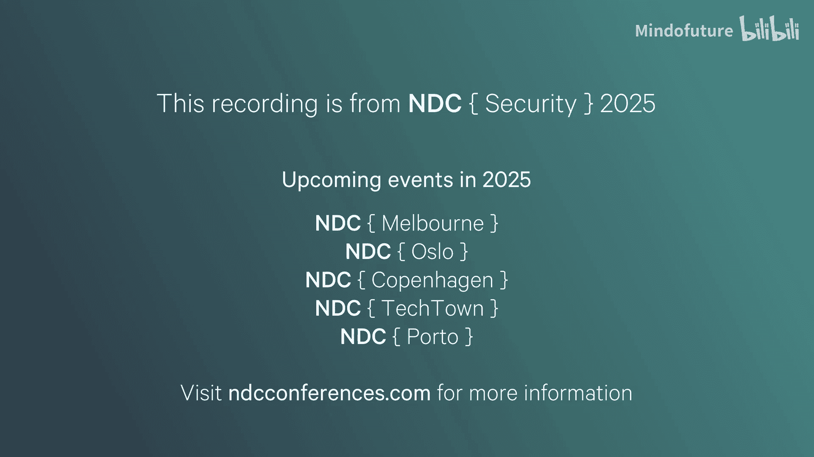
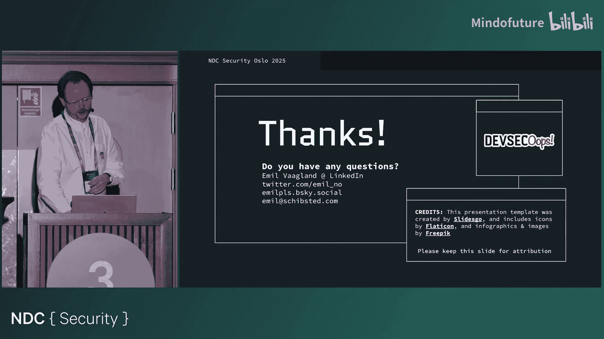

# NDC-Security-安全大会-2025-｜-AI工作流-｜-智能体-｜-网络安全-｜-Dapr框架-｜-开源工具-｜-LLM应用-｜-自动化安全-｜-黑客-p16-P16-From-DevSecOops-to-Security-Success---The-Bug-Bounty-Effect-at-FINN.no---Emi--BV1ihgQzJE2h_p16-

Alright， thank you for coming to my talk。 So sure about me。 My name is Emil。

 I'm the head of Po security and Finnotno slash ships and marketplaces and ships and marketplaces is an entity that owns like several similar marketplaces like Finn in the Nordics。

😊，So today， I'm going to talk about from Devick oops to security success and the big the effect at Fin。

And I realized that there are some people in audience that don't know what Finn。 So in Norway。

 everybody knows what fitness because it's the most popular marketplace。

And it's basically a simple web page where you can buy and sell almost everything。 your house， car。

 shoes， small phones， etc cea。So it's basically a simple web page like this。

And this web page basically consist of about 1100 applications， doing marriage stuff。

I think we have over 250 Englishgress endpoints in Kubers。

 And then we have way more exposed API threat。And back then day， we still like 200 developers。

 But after everyg， the Nor this Nordic reorg， we are more like 500 developers。

 So that is sort of the scope of the whole organization， but it's not only thin。

And these developers are quite。Effective， I would say， so they can choose。

Any language and any framework they， they like when they build applications。 And that， of course。

 has a bunch of security implications When they try to roll out code scanning， for example。

 So hard to find tools that。Fit。Yeah， and they can basically choose whatever language you like as long as they can package it as a container and then。

The deploy it in the platform。And， of course， that gives you a very nice attackos。

 And there' is also a high chance of having vulnerilities in， in production， right。

So this is the Devops life cycle。 This has been the I don't know。

 the defect facto thing for about a decade。 Everybody is following this now。

So it's basically the premise is that the developers should be able to deploy their applications and not only build them and call them。

 So they deploy them themselves， and then they monitor them and operate them in production。And。

 of course， the security community wanted to join this movement。

 So we created something called Devec ups。 And I guess my definition of that is just sprinkle some security activities across the different faces。

 and then it gets more secure。😊，And， of course， some of these activities are not specifically tied of face。

 For example， treadmuling can be done at any time， whereas pen testing and bo band programs are more usually done when things are in pro。

And thats like， oops is what you get when you try to do this at some scale。

 And you just realize that you are drowning in false positive alerts。

 just spaming your developers with yeah noise basically。

 And you're just doing busy work and not actually reducing your risk。And in Fin。

 we have a bunch of vability sources。 So for code， we have advanced static code analysis with code gel。

 We also check for dependencies and secrets on the dynamic set of things。

 We have a Web app scanner detectify， which cancels scans us 24，7。

And that also does some attack surface monitoring， finding， so domains， etctera。

And then we have a bunch of cloud security tools on the manual set of things we have a traditional pen test and also built to programs。

 And the last box is basically any internal filing。

 So that can be a source from a developer or a security team doing， for example。

 treading pen testing or just code review。 So we try to track these different sources to benchmark them against each other。

And some of these sources， they produce a lot of findings。

Butut the findings speaker about are basically those that are verified to be exploitable in production。

 So a verified vulnerability。And as you all know， like these automated tools， scanners。

 they produce a lot of false positives， noise， and also findings that might be technical， correct。

 but not exploitable when they are in production。So we try to focus on fixing what is actually exploitable to reduce the risk。

These are some numbers from the number of verified vulnerilities we found in 2019。

 So we had a detectify found about 16 cross scripting。 So E C， low hanging fruits。

We also had three different pen testing engagement with three different vendors。

 They found about 19 vulnerabilities， so not that much。And then the internal findings。

 basically a million and a few developers， just doing addoc testing found about 20。9 vulnerabilities。

 And then we launched a private buildband program in September。

And that activity almost found more vulnerilities than all the other activities combined。

So that was quite impactful。And the one activity we' havem doing for all the years is basically pen testing。

 And back in the days， way before the Devopps and rapid releases。

 we basically just released quarterly or once or twice a year。

 And then we add something called a release test， which， of course， makes a lot of sense。

 You test everything before you push it out to pro。😊。

But when it started to move more rapidly to release， I know， several times a week，하늘 탐 week。

Then that doesn't really scale。 So we cannot have a pen test for all your push to prototype。

So from 2014，18， we had something whether monthly or we had two larger app penists every year。

 which was basically maybe two persons for one and a half week， two times a year。

and that doesn't really scale with thousands of deployments per week。

 So the Buability forecast is basically it's quite foggy。

 And it's a high chance that we have undiscovered Buabilityismrov because we' are not really testing all the changes that goes out of production all the time。

This is basically what I found that when I started in Finnin in 2019。

 So that I tried to calculate the average exposure time of all the vulnerabilities we found。

 And that was 800 days on average， meaning like almost three years before they were discovered and fixed。

And the oldest finding， which is big oops， was almost 11 years in production。

 And that's almost like having a teenager vulnerability。

 And that's not something you would like to have。 You would like to have like baby vulnerability。

 That is like a Mont all or something。Let me look at the discovery。 So the。

 these are numbers from the two panthers per year we had from 2014。

 They found about 15 findings on average， and the cost filing was quite high。

And when we look at the types of vulnerilities you found in that time period， most of it was。

 of course， cross the scripting。 And then we had like six other type of vulnerabilities。

So where are the the prosecutions， and where are the service are requestquest for risk。

 I'm sure we can produce those vulnerabilities as as well， right， because they are in the O top 10。

 etca。So after we launched Boband program， we got what I call Bogu to effect。

So we basically got way more diversity in the findings。

 And the simple reason for that is now we had a lot of people looking at the site every week instead of once or twice per year。

 So we get more ice on a target。And yeah， what's the big one program。

 I like to think of it as crowd source security testing。So we host it on a platform。

 and then the hackers get invited there。 They can read the scope， and then they can start hacking us。

And when they submit a report， we pay for the findings that we deem value that we want to fix。

And we set of severity based on the impact it has， basically。

And programs are usually public or private。 We have been private all the time to try to keep the report quality up。

And it's also you， as a company that will set the scope and the behavior of the hackers。So。

 for example， we have most things in scope， but we have some rules that they should not send messages to end users because that is noisy。

 right， And they are also not allowed to click that button to trigger an invoice for a random company in Norway。

 because that happenedpered several times。And， of course。

 the benefits includes that you get more continuous like testing。 You get more findings in total。

 but also more diverse in the findings。 So you get。All the vulnerable days you would like to find。

And for us， we test only in prod。 So it's good for testing any end user facing a service。

But you cannot't really test like the bank I D verification verification flows or back office and admin interfaces。

 So for those use cases， we still do the occasional pen test。 So， yeah。

 they both have their valid use cases， I would say。A question I get a lot is， how much do we pay so。

We pay hack based on the severity and the business impact。 So basically。

 any of the classical es injection， remote constitution， data like stuff is， of course， critical。

But for the marketplace， it's quite important that we don't have any fraud there。

 So anything that can leak， for example， user emails， disclose close phone numbers。

 Or if you can do account takeovers， that's very important。 So those are critical for us。

And it started at $100 to $3000。 And now we are at max $6000。 It might seem lot in。

 in a Norwegian context。But if you look at the bigger pictures， the big tech companies。

 they pay like way more for the critical bounty。 So like Shop5 and Google have like hundreds of thousands of dollars as their maximum bounty。

 And we have， in total， only paid $200000 in 5，6 years。We。

 we also see that the medium Bounty is about 200 to 400 for the last few years。

 So it's quite effective。But since we cannot really compete with big tech companies on。The baties。

 we can compete on other factors。And a wise man once said it's nice to be important。

 but it's more important to be nice。 And that's basically what we're trying to do in a program to attract Bur to hunters。

So by being nice， I mean， that we are friendly and respectful in the messages。

 They are also quite lackx in the scope definition， so。

If you submit something that is out of scope or not listening in scope at all。

We will accept it if it has impact and then add it to the scope。

Whereas other programs might not accept it and then go and fix it。

 And that's a very bad practice because we're basically stealing from the researchers and not paying them。

We also try to pay failing。 So we work with hackers to determine the maximum impact instead of trying to limit the impact all the time。

So that has happened many times that we increase the severity。 And then， of course。

 the hackers get happy。We also have cases where they submit reports that are not really critical。

 and then we can lower them， but it goes both both ways， basically。And the。

 I think the most effective thing is basically to be fast on the response time。 So back in the day。

 when we were at Haer Ron， we were faster than the top 20 programs on hacker Ron。

And the reason we could do that was basically， we didn't get 00 reports per day。

 like we got maybe a few every week， right or some every day。

 So it's not that easy Oh it's very easy to keep up with。

And that can be very motivating for because some programs。

 they basically they have very long time to verify the reports。 So the hackers in the report。

 they might wait a week， a month before they get the final decision。

 Whereas if they get the response within the same hour， they get happy like this。So this guy。

 he got very motivated and wanted to look more on the program。

 And that resolved to him that he was the top1 hacker for us that year。 So he earned a lot of money。

 and we got a lot of nice buggs。😊，So nice coloration there。If you dig into the response times。

 So in the beginning， it was。Quite slow，21 hours on average and 2 hours on median。

 And the main reason to for that is when you start the program， this will be new for you。

 So it takes more time to figure out what what you， what you should pay and what is the real impact。

And of course， this graph is a number of submissions per quarter。But for the whole year for 202020。

 we had over 208 reports。 and the time they we each day was like 4 and a half hours and 18 hours a medium。

 that's insanely fast， but that also kept them motivated to work on the program。

This is a story of critical fix on a Saturday night。

 Some of you might know Springbo and the actuator endpoints。

 which basically can give you a lot of juicy information。And we had this H， H T P trace endpoint。

 which will basically show you other end users requests。

And that means that they can basically create stealy cookies and do account takeover。

 So if the fraudsterers had found this endpoint， they could probably create an account takeover as a service because they could automate it。

 It was in Jason， right， So quite nice vulability。😊，And this came in at， a bit of 9。

 I this was a Saturday。 I was watching TV L Ling on a sofa， so it didn't really react immediately。

 But eventually， I did。 And I verified the report quite quickly。And now we have this。Dlemma。

 should I， Who should I talk to， And like， how can I reach out to some people outside of working hours。

I was quite lucky because one of the principal engineers or I guess all the developers in。

 they have access to this platform， and they can opt in to get notifications。😊。

And and a lot of these， the think it's quite interesting to follow along。

 So he was actually deploying this fix while I was verifying vability。

 So it's almost a race condition there。😊，And then it got the we closer the report。

 And then we got the happy hacker。So this is the same graph as before， only zoomed out for per year。

 This is the number of submissions。 So we can see its classical roller coaster。

 The first year was quite a busy。😊，So yeah， we got a lot a lot of reports。

 But those are not the valid reports。 That number is， of course， a bit lower。

But as you can see in the beginning， in the beginning， almost all the reports were valid。

 Then they had a bigger gap in 2020。 But for the rest of the year， it has been very closely。

 except last year。And speaking about money， the first year， we paid about 15 K for 24 valid vilities。

That's cheaper than app penice， but way Mo abilities than got for rep penice the first year。

 So quite effective。And then the the， the other ears， also not that expensive。

So what are the other types of reports we are getting， Well we are。

The ones that we are not accepting for various reasons， it can be that they are have no impact。

 And there's stuff that we don't want to fix， then they are not accepted。

And that has also been quite low， but in 2024。We basically had very low activity in the program。

 So only 44 reports the year before。 So we started to invite more hackers at random。

 So we are public we are a private program。So we started to invite 100 hackers per week。

 And then we saw a good increase in the number of reports。But the quality was not improved。呃。

AndI think that we are also seeing the same from the other tools we have。 So the scanners。

 they are also fighting less vulnerabilities。 So I think we're sort of a hard target at the moment。

 but still。When you add100 random hackers per week， it gets more like a public program， I would say。

 in report quality。And speaking of report quality， running a private program helps。

 But if you invite random hackers， then you get less quality reports。

 And I would say closing bad reports is not a big time sink。 Sometimes it can be fun。 For example。

 this one。 So cross that scripting through the dev tools or the web browser console。

So the just paste this jascript in the console and then get pop up。So。

 like I guess some people believe this。 but this is more self side scripting， I would say。

And like I would say， there is three degrees of local reporters。

 You have the one we just saw where we say， okay， no bounty。 and they accept it。

Then you have the guys that are that do not accept it。 and they start to argue with you。

So they beg for a bounty or a positive close status。

 And that means that they don't get negative reputation points on the platform。And then you are。

 and then you have the guys that don't really accept it at all。

 So they start to send a threats instead by were gonna disclose this publicly， etc cea。

 And that has only happened to us once。 And I will show you that in a minute。But first。

 we need to talk about the Nile of Ts attack。So the platform we are on right now。

 we have usually about 10 K in the bound pool because average bound is about 400， right。

And they will also suspend the program if the boundaryunty pool is depleted。

And they also reserve the bounce amount when a report is received。 So before it's verified。

So let's say somebody sends you three critical goals that are just spam。

 Then they will close the program。 And that's issue if that happens on Saturday。

And guess what happened。 So we got three high severity reports on a Saturday。

The program was auto suspended。 I had to do something。And when I looked at those。

 two of them had almost the same title。 They had the same content， but different order。

 So that was kind of strange。 And and they were also reported with different severity。

It was the exact same dimension of the lister。And that had basically no impact whatsoever。

 So he basically found some old domains on our Github that didn't even exist in DN S。

 So there was like， there was nothing there。So this was closed as not applicable just to get this out of the way。

 And this is a close that we rarely use because we tried to be a nice rat。 But this was just spam。

 So yeah， let's close it as not applicable。And then he got back to us。

 So he basically threatened to go public on Twitter so that we will know the opinions of the other people that my decision was wrong。

And， of course， since this was Saturday， I didn't want to sit on Twitter and argue with Bur Bti mafia。

AndSo I just closed this as not accepted instead。 we could just get it out of the way。

But so this has only happened once。 So this is not something we deal with a lot。

 But sometimes we also get reports in funny formats。 So one time we got a report。But just。

 like in just meme pictures。 And as you can see on these pictures， it's， it's quite dated format。

 So it's basically from 2019。So this was by our finish guy called T K 0。And he liked the program。

 and we had had a lot of fun in the。😊，Comment。 So this book was basically that。

You could screenshot the app if， if it was sent to the background from other apps because we didn't blank it out。

So not high severity， but he got a bonus for the， for the effort。

So the impact for us has been that we have found and fixed a lot of all vils。

 And now we're also finding vils much faster。 So there is no more 800 days in pro。

 It's more like weeks， months instead。And that's very good。

 We also see that the number of findings are decreasing。That。

Might be because the program is have various research now。

 But if you compare to to the other tooling， they are also finding less of。 So I like to think that。

This is because it's we are more hard than now than before。And， of course。

 it's more effective in terms of money。And a factor is that out of the 360 reports。

 only two were caused by a so calledled woodenable dependency， open source dependency。

And the first one was random course scripting， which was found independently of figuring printing in the application and figuring out if it had any renewable app。

And the other one was of force log 4 shell。So I think this says something about the importance of always this focusing on having zero renewable dependencies because they are very rarely exploitable in my experience。

 Of course， it's。Best practice。 But it's like， I think it's better to focus on fixing the bug in your like the bugs in your own code because they are also there。

 right， but they are not really surfaced。Another nice side effect of this Burband program has been that it has been basically the key ingredient in our appsec program。

 So when， when all the developers got access to the platform。

They were basically able to follow along on the report。 They talked about it in office。

 and that LED to some security vulnerability awareness that we didn't have before， right。

 that was nice side effect。And also with this merch data， we can also use that to spare our efforts。

 for example， we have a lot of excess Then we should focus on fixing that problem。

But we have not had a es injection since 2014。 So that means that we shouldn't probably train the developers a lot in that because for us。

 it's a sole problem。And the reason for that is that we didn't have any security people working here in 2014 either。

 So this basically happened organically。 And the main。

 and the main reason is that the main programming languages we used like JVM stuff。

 They have for years used secure defaults。When like。

 they build database libraries and rappers and that basically mean that they automatically encode any input so that the developers do't need to manually remember to do it。

 because if that's the case， then you will always forget it。 like， not always。

 but people will forget it。And once say that， we haven't looked close enough。

 but 10 years of pen testing， five years of bugty， a lot of other tooling。

Has never found or at least in the last 10 years。 We also did a bobti promotion campaign。

 So we basically paid double amount for escal injections， but still no findings。

So I would say that secure defaults are so called certified deficit groups。

 So you remove the book class instead of finding individual bug after they are created。

 So code scanninging， all these scanning tools。They'll find the bug after they are created。

 if they find them。Yeah， so that's the。Most effective thing， we can do I thing。

We also are weaponizing the vulnerability data， meaning we are using it to create training or CF challenges。

So a couple of years ago， we created about 35 challenges and had the CT TF and those challenges challenges were based on the findings we had in the Bob on program。

 So for us， it was quite fun and also very engaging for the developers。

 And our strategy was basically to re to release a few challenges per week until the main event。😊。

And that kept them very engaged because if you solve a challenge first， you'll get more points。

So quite fun exercise。But even though Bobandi。By far。

 has's been the most effective thing we have done in terms of spending。

 but also in terms of number of uil。We still do all the other stuff。 like， we still do code sing。

 We still do dynamic sing。And a bunch of other stuff。

 And the reason for that is these tools find different types of vilities。 So there is no overlap。

 or there is a lot of overlap， but they all find specific things。So all in all。

 this will give us better assurance， I would say。And a found factors is that out of the 20 critical gold bugs we have had in the program since 2019。

 only five of those could have been found with code scanning。

And that basically means that if we had had H0 percent coverage with code scanning everywhere。

 we still wouldn't have found those 15 other critical vulneril。But when we have both。

 we find in total， more bugs。So now it's time to compare apples to oranges。

 It's not a fair comparison， but it's a fun one。 So I have a lot of experience with rolling out cold Q L。

😊，And that requires you to basically build your application if you have compile languages like Java。

 C sharpp， C， etc cetera。And that requires you to basically， you have to run it in CCD。 and then。

 and then you have to edit those files。 And then there's a chance that you might break the build if there's a bug there。

 right， So it。For us， it took a lot of engineering effort to roll this out without pissing the developers off。

And then when， when you get findings， these findings lack context。 So even though it's a technical。

 correct。Vnerability。 It might not necessarily be expable。

 so it can be a bit noisy and stuff that you don't want to prioritize。And of course。

 high cost and no guarantee for finding all the things。Then they have the Billbon program。

 It's basically scope bonds and hacks everywhere。 You get a lot of real findings。

 And for the developers， they only interface with the real findings。 So for them。

 they have more trust to that because they know that if it's coming from the from the Burbon program。

 they know that this is externally exploitable。😊，So that traditional advice has been that before you launch up big1 program。

 you should do all the things you should do treadmill link called scanning， dynamic scanning， etca。

 But if you have a quite large organization。This will take years to do it properly。

 So my spicy advice is basically， don't do that。 Just launch a private bargain program and do some real risk reduction。

The only requirements is that you need to be able to receive reports。

 and then you need to be able to fix them within a reasonable amount of time。

 So you don't drown in duplicates。And， I think you will see it effect quite immediately when it launch a program。

Another phone comparison is basically security dot T X T versus bug onete。

 also not a fair comparison， as you can see。 And security dot T X T is basically a text file you put on your web page where you have some information about。

How they can test aside， but also how they can report bugs。And over the years。

 we have had very few findings。 Most of it is just spam， but we also get very few emails there。

And then the Billbank program has given us a lot of reports， as you see。

But the fun thing here is that I've actually gotten more real findings through LinkedIn than to security dot T XC。

So LinkedIn for the win。But that's not really the pointer。

 The point is that all companies of a certain size should have a broken program。

 because that is where your real books are going now。Com。

 and there is a lot of Norian companies that don't have Bbon program。

 but they do have security dot T C。 And I think that's the same thing。 And that's not the same thing。

So pay your hackers， and then you get more funding。

So now I'll try to sell bunty for a while and the effects of that。

 So I'm gonna show you how to launch one。 And it's quite easy。 Just get some money。

 and then you find a platform。And I would recommend you to just test different platforms。

 see if the features are okay。 They will also try to sell you managed triage services。

 But if you buy that， you'll be as slow as everybody else。

 So I recommend doing natural yourself self， because then you will have happy hackers。

You will also need to set your boundariesties based on your business business impact。 But your， yeah。

 sub upstairs basically get inspired by other programs。ETo align， basically。

And then when you are gonna scope it， start small and then expand as you mature the program。

Some people recommend doing pen test before launching。 We did three。 And for the year after。

 we found over 1 hundred17 new abilities。But we did。

 I guess we did find something in a peninterest that wasn't discovered in Burmon's program。 So， yeah。

 doing them all is， of course， better。Then we， of course， do 24。

7 scanning to catch low hanging fruits and also to compare the defense security tooling against。

Against each other。So whenever we get close de scripting reported to the Burbon program。

 we go and check， is this app scanned by code scanningtting and why wasn't it found。Yeah。

Because then we can benchmark， basically， if the tools are doing a job。And then the last part。

 you need to inform your org about it。 There will be a lot of scan noise。

 and you need to give access to the platform to the developers， etca。

 And then you can build some security culture for free。I'm gonna talk about some platform musts。 And。

 of course， S final， I'm not saying that because it's the best practice and it's secure。

 I'm saying it because it's very annoying to manually give access to users。

 And you want the developers to have access to the platform seamlessly。

 And so platform will tell you that you can import it to Gira instead。😊，But as you all know。

 viewing a duability report， quite long one with request itself stuff。 It's quite painful in Gira。

 So then you will get the Gira headache。 And that's not something you would like。 So， yeah。

 that's a must have that you should be able to easily give access。

The second one is to have a good API and by good API。 I mean。

 it shouldn't be painful to use no silly rate limiting or auto methods。

 You need to be able to import reports because when you find stuff with your other security tooling。

 you would like to import them So we don't get duplicates。

 or we can close them as duplicates when the hackers find them。

It's also nice to be able to export a data。 If you have a third part system or you have all。

 all your vulnerability data。 And also， it's nice to crunch geosymmetric yourself sometime because。😊。

This platform often doesn't have the numbers you are looking for。And then， of course。

 you can also automate the missing things。So， so one of the things that we can do。

 but we haven't done yet is to basically be able to auto assign our incoming report to the correct team。

 because we have tagged all the Kubernet test deployments with the team and the repo。

 so we can basically programmatically look up the URL and then figure out who owns this。

 And that can help you basically scale the alerting and stuff。

And the last one is the report disclosure。 And report disclosure basically means that you can internally or publicly disclose a report that has been reported and fixed。

That is very good for， yeah。 So some makes like to brag about their skills， of course。

 but it's also very nice for knowledge sharing， and it's also build some sort of community around your program。

😊，We used this for showing fair treatment。 So we pay the same for the same amount of for the same type of reports。

 So then I can actually see that we pay the same for the same crystal scripting， for example。

But the biggest impact is basically bypasses because these hackers will will go in。

 And then they will see look at old reports and then try to bypass fixes。And that happens a lot。

So as you know， rex is pronounced regrets because it's quite hard to get right。

And we had this special case of rex， which was basically blocking external access to internal backstage or the pad_ slash。

And the US case there was that the team， that teams used to。

Hide endpoints like metrics health and actuator behind there。

 so we do do not really accidentally expose them。So I would say that wouldn forecast there is cloudy。

 and high chance of ra X bypass。So seven days after we launched the bookmat program。

 we got the bypass for internal backstage and the dangerous character here was semilon， right。

 So very advanced payload。 And then they got access to the slash ending。

 which then disclosed secrets。Then this report was disclosed。 And then in January， the year after。

 we got two new bypasses。 So this time， we also had the dangerous character of semilon。

 but also a pen random string and then dolash in。 So yeah， very advanced payloads again。

And then the summer after， we got a new bypass of the hacker 21 again。So yeah。

 and this was only done because of the report disclosure。

So lessons learned here is that rex is hard and report disclosure is quite effective。

And one interesting factor is that this bug had been in production for three years。

 We had done a lot of scanning both code and dynamic and also had a lot of pen test。

 none of these activities found this bug。 But the Beunde program found it after seven days and kept rediscovering it for a year。

😊，So that's quite impactful， I would say。So this is the last example。

 It's about the pan confusion fuion。 And this is。At that was popized by Bill Gra called Alex Pitzel in 2021。

And I think it's very nice when they submit research。

 which basically explains the attack with a meme。😊，So in this case。

 the attacker will find the name of an internal package。

And then try to take that package scope on the public N PMM or other package systems。

 and then publish version number with a higher version number。And when that happened， for example。

 artfactor will get confused， and it will download the hacker package instead。 And then you do that。

 The hacker can basically run code on wherever this is executed。 So develop look machines。

 build systems， they might even modify the library to run in production。So， of course。

 we had a nice secret central security team at the time。 So they were very on top of things， so。

After88 taste， I mitigated this across all the different package systems。 And we have all of them。

 So it was big effort。They were the even so proud of the book that they created a nice blog post on how to mitigate this called how we。

Protectctor ourselves against the dependency， Con attack。 So they basically， step past steps。

On how you can protect yourself。 So quite nice。 They even released a open source tool called Archho。

 So nice work play there on artfactory and that that stuff。 And also， we have a logo。😊。

So you can see that this timeline is not finished yet。 So guess what happened。

So one and a half years later， we got remote Co remote prosecution to NP PMM。

And that's kind of strange because we have b about it。 We know how to。Fix this stuff。

 And also the tool that can automatically scan stuff。So what happened that we blocked it， built it。

 but we forgot to use it。So this tool was run in a adult fashion， and we didn't run it automatically。

So then we got this report。But the funny thing about this report was that he actually referenced our blog post in the report。

 So this is how we can fix this。 So he used that blog post as a reference。😊，So， yeah。

 that was quite a burn。 And after that， we have， we， of course， started to run this tool 24，7。So。

 yeah， sometimes blogging is better than creating tooling， I would say。So yeah。

 the Bill bounty effect at F is I， it has basically been price for us。

 So the most effective activity of the mall been a good ingredient in the abstract program， right。

 So we know what， what to focus on。 We still do all the other stuff because we want to catch the long tail of vulnerilities。

😊，But we also believe that maybe focusing on rolling out secure defaults for different vulnerability classes could be more effective than。

 for example， trying to push code scanning everywhere。 because I think the effort is kind of similar。

And then launching a program is easy and impactful。 and every large company should have one。

 So if you work in a company， launch one。If it。If it fits， of course。

 And then the key to big success without paying top dollar is basically just be nice and then be fast。

That's all that。 Thank you for listening。

