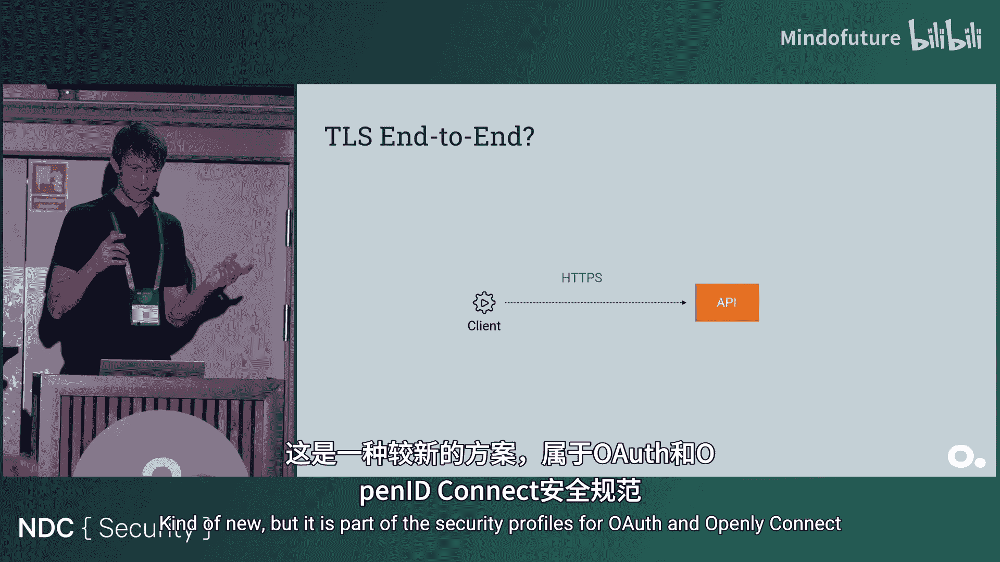
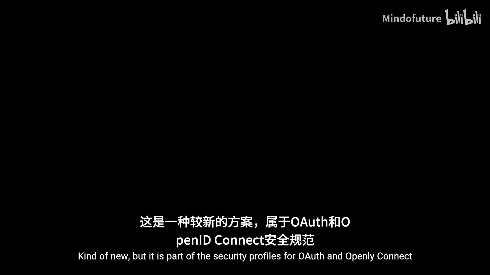
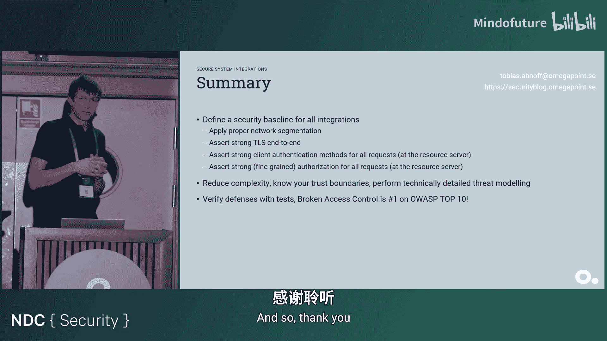

# NDC-Security-安全大会-2025-｜-AI工作流-｜-智能体-｜-网络安全-｜-Dapr框架-｜-开源工具-｜-LLM应用-｜-自动化安全-｜-黑客-p20-P20-Secure-System-Integrations---Tobias-Ahnoff--BV1ihgQzJE2h_p20-

Hello。So I think it's time to start。Yeah。是。Some are my beying， but I will。AndI'm start now， so。

Welcome， and today this talk， this is talk is about perhaps one of the most common security challenges we face as members of Devops teams or some kind of architect or security adviser and。

At its core， it looks like this。And it's simple。 We just， we have a server。

 and we have some server resources that we want the client to access in a secure way。

 And a typical example of this is an API。 and we will start focusing on， on that。

 And so let's say you have a business partner that want to integrate with you with you。

 And they suggest to use to use HPS S and an API key。And you get the question， is this secure enough。

Then what would your answer be， And if that is not secure enough， what should you use instead。So。

 and before we dive into that。My name is Tobi us。 And if you search for me online。

 you might find this。 that's my LinkedIn profile。 And I've been at omega point for some years。 now。

 I'm doing penetration testing and security reviews and have had the benefit of seeing system integrations at different environment or different kinds from both the offensive and defensive side。

 But， as we all know， LinkedIn that just marketing。

 So you might use some AI to dig out the truth about me。 And then you might get this。 And yeah well。

 it looks valid to me。 So enough about that。 And we go back to API security and。

The basic defenses that we have can be grouped into two infrastructure layer security and application layer security。

 And we will go through those defenses here， and we will start with the with the basics and add more defenses as we go along and see what motivates more complex thing things like Oworthth and send the constrained access tokens。

So we start with the basics， the infrastructure protections and。I know。

Classic I based security might be boring for us as a more than a cloud native Devops organization。

 But before you sort of zone out for this slide， remember this。Atters will find you on the Internet。

 so。Only expose APIs publicly if you need to do that and use private networking to avoid a lot of those sort of garbage requests that will hit public endpoints。

But if you do apply that， remember that network defences is your the first layer of the defence。

 And you should never assume that the， that all clients on on the network are， are trusted。

So we need to add more， more security and， and more defenses。

 So we had transport and application layer defenses。 And so we next， we look at。

Transport layer security， and。That it's vital to have strong transport layer security for the applications。

 layer defense that we had later on。 And so， so we。

 it's important to use end to end strong transport layer security for all requests。

 And that will provide us with the confidentiality and integrity for the request we send and。

For system integrations today， it's quite possible that you can require TLS 1 dot 3 only。

 And if you do need to support 1 dot 2 for legacy reasons。 I mean， it's quite common。

 then it's need to be hardened and。There are good guides for that。 and for system integrations。

 where no humans are involved， just machine machine， its can be restricted to。Just for ciphers。

 And there's more to say about hardening transport layer security。 And we won't go into details。

 And there are good tools you can use for scanning and evaluating your transport layer security。

 And one such tool that we use during penetration testing is from SSL apps that you can use for public endpoints。

So it's that seems pretty easy to just doing strong transport layer security。

 And so one issue here that we have is it， is the end to end aspect and。If we have like this。

 we have the client and and the API here the server。 and we have good HPS S end to end。

 But then also remember the infrastructure protections and。

 and using firewalls and stuff is also important。 So we， we， of course， apply that。

 We should always have something in front of our， our service that we build。 So we add that and。

To use good security features with those kind of pro products。

 it is to use inspection and maybe have a v and things like that。

 Then we need to terminate transport layer security and do the inspection。 And if we just。

Continue inbound using HP。 that was quite common to。

 to do perhaps early on to have a firewall and have clear text traffic on on the Internet。

 on the Internet。And yeah， that might be fine if it's small like here， it's just one API。 But。

 but in reality， it often。I's a lot of more things on the inside。

 So then we get quite big un unsure Internet where it's clear text traffic。

 And if an attacker gets foottoed within the the network。

 it can read it and and modify the clear text traffic， so。So， so we， of course。

 need to address this and。A solution to this is to。Yeah。

Is to do like this to re encryptry inbound traffic。

 And so and that we would regard you couldide use pass through or re encrypt。

 and we regard that as good end twin end， even if it's not true and to end perhaps given that we protect the node that does the re encryptryion properly。

 So no one can get foot there。 But thats that's assume。 So So this is end to end。

 and we also have the benefit of using the security features in the firewall or gateway product with inspection and sort of things。

 So and yeah， and one more thing you could think maybe that sounds a little bit old to have an internet with the HTP。

 and a more modern version of this is a Kubernetes cluster with growth over time where you put more and more stuff in。

 And because the of default behavior there is to terminate TLS at the ingress controller。

 And then you sort of get the more。Moern version of the problem。 So be careful with that。走。Moving on。

 that was end to end。 Now， but how about authentication。 So we have two parties。

 the server and the client。 And do we get server authentication with the transport layer security。

 Yes， that's by default。 And that's what， we usually see in the Web browser using HP。

 And but here it's machine to machine。 And we also want to authenticate the client in a secure way。

 So do we get that。😊，Well， not by default， but the。

 the protocol has support for mutual transport layer security or M T S for short。

 but we need to configure that and give the client， a client certificate the certificate， which is D。

 it can use。So。we， we do that。 And this is great。 for number， not we have。

We have end to end confidentiality and integrity of of the request。

 We have strong server client authentication， and。If we do it like this with the firewall。

 we also have defense in depth and and sort of the problem is solved。

 We have a secure system integration。 So why don't we do this all the time for everything we do all some issues there。

 Well， we talked about the end to end aspect and how that and that could be trouble depending on how the network is and implementation details So you need to understand where TL S is terminated then so but that we have addressed。

 And then the mutual TL S is is really good。 but it's。

 it's not for everyone in a large organization where you don't have built up or invested in publicly key infrastructure managing a large number of client certificates can be quite expensive and and time consuming。

 So so it's not that commonly used。 But if you are an organization that have all that it might。

Easy to just start using mutual tailors。And then also， we have only done authentication。 we。

 we really don't have any good support for fine grained authorisation， we。

 which we usually need for A S because there are a lot of A S。

 and we want to restrict access more fine grained than just based on the client I D。

So we need to do this， and we will now address different client authentication methods。

And then we have some weak ones and some strong ones。 the， the， the， the old ones。

 APII key and basic o which we do in the application layer they are regarded as weak since it's a shared a shared key or shared secret and。

The strong ones are asymmetric。 and there we have mutual T less。 But as we said。

 that's not for everyone。 So is there an alternative for us。

 if we want to do asymmetric client authentication and。There is one。 There is。Kind of new。

 but it is part of the security profiles for W and openly connected。

 And it's so it is regarded as a secure industry standard method。

 And that's called private key dot and。

It it without having public key infrastructure， the client just generates a private public keeper。

 and then it creates a yacht where the subject is the client I D。

 And then the server can authenticate the client by validating thatt using the client's public key。

 So so it's quite quite similar， but it all happens in the application layer。

 So there needs to be some work done in the applications。 but it's good。 But， of course。

 you also need to distribute that client public key and register that。

 So you need to build some kind of infrastructure around that。 Of course。 So it。

 it doesn't come for free。 but but it's there。 and it's possible to use。 So we have good， strong。

 two strong， good methods to use。 and now we can sort of say that we have solve the client authentication problem because we have good。

 good ways to do that。 So we moving on to client to the authorization part。 and。😊。

We have not addressed authorization yet。 But before we do that， I just w to say if。

 if it's just as simple as it， this， we just have one APII endpoint and one client then we don't really have to do any authorization because if we have authenticated a client。

 it is access to that endpoint。 and we sort of done with authorization。

 We don't have a complex access model that we need to do any fine authorarization。

 But often reality is much more complex than that。 And we need something that can handle this in in a good way。

 and。So， so， and， and， and you could also， of course。

 argue that you could do more fine grain things with APII keys and building around that。 But。

 but if you do that， and you should， and you should support least privilege and and key rotation。

 then you might build sort of a poor man worth client credentials anyway。

 So so we will look at client credentials and that's industry standard for dealing with authorization。

 And it looks like this。So we introduced the authorization server。

 And so we have the API and the client just as before， and we introduced the authorization server。

 And now the client authenticates with the authorization server using a strong method preferably。

 like mutual T S or private keyiot or maybe basic author。

 And then it gets a token back and then it can use that token to access API and server resources。

 So it attaches the token with every request。 very simple flow and and and standard for。

 for machine to machine。😊，And it's good that we don't have to deal with these complex redirect flows that we have when users are involved。

 today， Everything is simple。 So that's good。 But， So， so let's say that we。

We have had a system with APII case and basic offf and we have refactored to a off to increase the level of security and。

Then we look at the requests from our resource server point of view from the API。

 and the API gets the the two on the top is sort of the old one with basic o and the API key。

 And then the yeah third one is the new one， the more secure one， the old old one。

 And if we strip away everything， it'， it's look like it is， is a head there with a secure string。

 And and we have implemented all this correctly。 So they， they are cryptographically secure。 So。

 so then you might wonder。Which is most secure。 What， what， what's the difference there。 They look。

 it look pretty like the same。 And， and it is because if you have that string。

 you can just use it and make a call to that API endpoint from another client and that will work perfectly fine。

 So so this is sort of the， the bearer S scheme here is that you， if you have the the token。

 then you can just use it。 Its not tied to the client in anyway。 or the request。

 So so that is a a weakness。 So。What have've actually gained by introducing Oworth in this solution that we had。

Well， there are some all features。 And the first point I mentioned is that we now have an sort of industry standard solution that are RF F and specifications and official threat models。

 when you implement these， there was a good supporting chain framework。

 So you don't have to do everything yourself。 So that's really good。

And we also have support for fine grain authorization since access token。

 they can contain metadata and， and like over scopes。

 And we have more information to base or access control decisions on。

 and access tokens can also made it short lived So So we follow the principle or these privilege and so and。

Having an authorisation server and Tokyen also helps us having support for client secret rotation without down time and。

 and because it's not dependent on the reason server has no dependency to decline secrets。

 we can rotate it， given that the authorization server supports a good way for us to rotate client secret。

 perhaps automate it or or do it easily by just manually。So， but， but， but if we don't use the the。

 these features。 And， and， then it， it's， it's quite similar to having an API key that's so。

 so if we have tokens that's just valid for all As and don't use the scope part。 then it， it。

 we haven't really gained that much。 perhaps。 So， so it's important to understand that we must also use the good award features that we now have access to。

And then。This is a course nothing new the， the， the， the barrierer issue that that I showed you。

 it's。Oh， sorry。 I' forgot one。 The most important one。 We。

 we also have support for something called proof of possession token。

 which is a stronger way to deal with tokens。 So we will talk more about that later。

 so we don't use this bear approach because the bear issue， it was recognised from the beginning。

 you know， of this blog post is maybe hard to find now， but you can dig it and and find it。

 And one of the so it was part of the initiative doing or to he left that project because he thought there was a lot of security concerns with it。

 and。Even if Barittoians is not the road to hell， perhaps at least not yet。 So， so。

 it's fair to say that the concerns here are are valid。 and if you。The last part here is， is。

 is a good read。 So a wolf in the hand of developer with the understanding of Web is likely to result in a secure implementation。

 But in the hand， some most developer is likely to。Produce an insecure implementation。

 And so it's obvious here that we need to hardarden a wh。 We need security best practices。

 and we need security profiles。 And one of the most vi one the most commonly used and most well known is perhaps。

F P2。 And that's for financial grade APIs。 But that's just financial grade。

 So it's valid for any domain that has high security requirements like healthcare care and and so。

 And if we look at the。Requirements are data 4，5 and， and 6。 We can， we can see that the。

Shall only issues send the constrain access tokens。 So we will look into that。

 We have also talked about mutual tail and， and， and， and then there's this new term here。

 demonstrating proof of possession that we will talk about。 So。

 and we should only authenticate using those assymmetric methods。 So。

 so this is well defined how we do secure oath。 So， of course， we should apply this in。

if we have a system that requires high security。It and。Mentioned。

 send the constraint access tokens a lot。 And now we will look into that。

 And there are two ways to do this mutual ts or demonstrating proof of possession。

 So we start with mutual dieles and。It looks like this。 It's still client credentials flow。

 So nothing much has really changed。The， the difference here now is that we， since it's mutual tail。

 we are restricted to use mutual tails for client authentication。 And when we do that。

 then the authorisation server might specification will add the client certificate thumbprint in the CNF claim in and then sign the access token。

And then the， the client is now required to also do mutual TL S authenticating to the resource server。

 And then the resource server can。Can compare the the client certificate thumbprint that produced for the client authentication with the hash in the access token。

 And by doing this， if someone steals that access token that。

 that secure string that were talking about then and try to replay that without having access to the client。

P public private keeper than that will fail。 So this is a much stronger solution。

 And how the to token can't be used by anyone。 It， it's con standard constrained to the particular client that has access to the private key。

So that is good。 But as I， as we said previouslyly， not everybody can use mutual T less。

 And so the alternative is this。 And this is China new。

 And there are products like the undied server。 and and then some some other solutions that has started implementing this。

 But maybe it will more， be more standard in， in more sal products in in a year or so。

 So it's called demonstrating proof of possession。And it's still client credentials， so。

The request flow is the same。And it's similar to the mutual TLS that we just saw。 But since we。Now。

 we don't to do it in the transport layer。 So we need to do more work。

 We do with in the application layer。 So this means that。

The client generates a public private keeper， and then it creates a jot。 And within that yacht， it。

 it sort of it ties that to that token request and。

Then the authorization server will validate that and now embed the hash of the client's public key in the same claim as was in the mutual tele less flow。

 So， so it's， it's quite similar。 And then using the same keyer。

 the client can now create a new deep up proof。 But now it's tied to the request to the resource server。

 And it also embeds the hash of the access token。In that and。

 and then it sends both those yachts to the resource server， both the access token。

 which is a just normal access token with the CNNF claim and then also the deep proof。

And then the resource server needs to validate both。

 So it validates the deeper proof and the access token。

 And now it's tied to that particular deeper proof。

 So nobody without having access to the private key can use that that token from from someone else。

So so we don't have to， we gonna want to go into more details here。 There are more details。

 It is to get an understanding that there are。 there is an alternative to the mutual TS thing。

 but there are good resources to read about this。 And， and I find those useful。

 And so you can read more about it there。 And。Goodder， that was send a constraint access token。

 So there's a lot of security that we can start using by introducing O of。and。

So we have now both zero trust， defense in depth endless privilege we we that we're using to limit the scope for for for each token that we use。

 And so so we have this， we have network segmentation， if we can use that， some。

 some API articles meant to be public。 So we can but， but， but if， if， we have done that properly。

 And then we have the end to end T S properly configured with strong strong cipher and so。

 And we have， we are using mutual t S and pro possession tokens。

 and we have the fine grained authorization。 So it's。Pretty strong solution。

And I just want to indicate with the B， the blue border had that we， it's。

 it's important that we also evaluateval， evaluate and authenticate the request at the resource server。

 So we D， we don't terminate that in a gateway and then。

Because it done we have might have a misconfiguration issue or or something like that。

 So it's a strong solution all the way and。It's time to。

 we do a little summary of the HTB API's integration that we looked at。

 and then we will look at some other kind of integrations。 But so if we summarise this。We。

Apply proper network segmentation。Strong tailers。And we have strong methods， and。Also。

 the fine grain authorization that we talked about， so。So， so we， we have all this， and。

That's a lot of stuff， right？ So you might starting to think， oh。

 should we always use everything all the time for every integration that we have， that's， I mean。

 there's a lot of stuff。 And different some are banking and some are just some retail。 And we。

 we can't just should we have everything。Of course， it depends。 So that's the obvious answer。

 And and the， it depends on the， the sort of the， the threat model。

 what you're trying to protect and and， and and， and but yet and perhaps compliance and regulations and。

 and things like that。 So， but it's important to understand what you have。

 the tools we have to secure this。 And then if you choose not to use any of it， it's。

 it's you're aware of that and the risk and， and it's sort of an accepted risk for you。 so， and。

So if we look at it in a little bit more general way was before we move on to other kind of integrations。

 So we can form a security baseline for system integrations。

 So we always should think of these  four key aspects we， the network segmentation， the。

 the transport layer security and the client authentication methods and。

How fine grade we need to do the authorization to， to not leaking data between customers and things like that。

 So， so with this knowledge， we will now say look into three more other kinds of integrations。

so we have sort of done HTP APIs。 And next， we will look into file transfers or or Sha sharing files and also messaging。

 putting events on on a message box。 And， but instead， let's just client into server， so。We had this。

 the baseline here， those four protections。 So we， let's say we are in a financial grade environment where it's worth investing in mutual t S and proof of possession token。

 So that's our security level that we want to have in every integration that we do。 So。

 and that's secure。 But then we get a feature request that we need to serve files and。

It doesn't really fit that well in the API。 perhaps。 So we， we want to use some good file storage。

 perhaps an S3 bucket in or Azure blob storage or whatever。

 So then I common solution is perhaps that the APII serves a secure link to that file。

 And then the client can download it and。If we just do it like that， then。Outto the box。

 we usually around those server only have a transport layer security and the secure link。

 And if someone has the link， they have access to the file。

 And then it's really not that send the constraint anymore because it's more of a bearer tokenken API key thing。

 So we have weak path to the data here and the filer might be contain a lot of sensitive data。

 So it's worth protecting just as good as the API endpoints。 And the obvious solution here is。

 of course， that rule like this。 you have serve everything through the API。

 And then you know that you have the same security and make that storage internal on on the on the private network。

And but maybe that's not an option for you。 perhaps for security reasons or or performance reasons or something else。

 So we need that。 And then we need to work with that and meet to the risk So we so we sort of have the same level of security。

 Perhaps we could add the same kind of networking protection。

 And we could also work a little bit more with this secure link making it perhaps one time or or unasing that it's only valid for this particular item so we don't have any issues there。

 and perhaps the gate where here in front of us could require mutual t us because we know that the client has a client certificate to do mutual t us with the authorization server。

 And then it could also when it should access files and and then， of course。

 we don't maybe we cant do the send constraining properly。

 but that's a risk we might we can accept given all this。 So we feel confident that we。

Have the same level of security in both those integrations， now。And then。

But then not everything is a perfect fit for HP， right。

 So we know that in a large enough organization， there will be FTP and XML somewhere。

 some integration we use that。 And， and the way to secure that is to use secure FTP。 of course。

 So and we need to think in the same way here with the network protection and using good quality SFTP and having。

 of course， least privileged configuration for the accounts that we use and also using the client certificate authentication methods。

 even if it's supports use an imp password So so with that。

 we sort of get the same level of security here。 And we can feel confident that there's no sort of weak way into our sensitive data。

 And then we have the message bars。 and。😊，We can do what we can there in the same way with the network segmentation。

 We have good transport layer security， and we try to do strong client authentication。

 we can use that。 And then we need to do least privilege configuration for the topics and queuees in the same way as we had worked with the scopes or FTP accounts or file access。

 and maybe also we need to consider message signing because if there's a lot of people putting messages on the same queuees and topics。

 how can we know which client put which message， right， So we might need to do some more work there。

 But and， and when we starting to see this map we realize that。Securing one of these paths I is。

 is not that hard， perhaps， but securing all paths all the time forever and ever。 That is hard。

 And you're starting to realize that。The complexity is really the enemy of security。

 And it was stated and put very well by Bruce Schneer in 1999。 And， and the， the headline there is。

 you can't secure what you don't understand。 And can really recommend reading this。 And a way to。

But because that's one of the problems with integrations in large solutions is that you sort of lose track of them。

 And you， maybe you don't after a few years， you don't have a full understanding on how the system works and all the ways you can access the data and you have some weak ways that you don't that you're not aware of。

 And one way to keep that understanding is to work with good pictures of the system。

 Just the classic。So system diagram or and， and that shows the the sort of important security aspects。

 And so so we get an understanding of what it is。 what's hosting our API here is Azure icons。

 So for those knowing Azure， it's quite obvious what what this is that it's an app service。

 it's not a Kubernetes cluster。 And and we have some private networking going on。

 we don't have to go into details there on the the blue soon soon is to show that here we have network protection and the yellow。

 we don't have it。 it it's it's public Yeah and as you can see the the message bus is publicly as accessible。

 And that's perhaps budget reasons because it's expensive to do private networking for in uszure for message bus or it's misconfiguration。

 and we're not aware of that so。This is the strong solution that we talked about with mutual di and。

 and， and all that。 And then we get a feature request。

 So we feel pretty confident here because the managed end there。 that's a strong way to authenticate。

 So it's， it's hard to， even if it's public， it's hard to get access to the bus。

 And then we get a request that the this client should have access and。It's quite easy to solve that。

 Its just give it a key a connection string or source key to that service。 And we're done。 So。

 and then all of a sudden done， we have this strong solution。

 and we have this weak way into our perhaps most sensitive part of the system。

 the message bus where you can maybe control everything that happens。 So。😊，And。

 and when we analyse this as an attacker， we see that we have those two ways in。

 and one is protected by that client certificate， which is really hard to get。

 And Soky may not be that hard to get。 It might be checked into repos and and things like that。

 certificates are sort of easier to treat in a good way。 And and， and if we。

Add this attacker perspective。 This is called threat modelling as well。 And。

 and that's usually the way you， perhaps you， you do before a penetration test or in the。

 in the beginning to understand the system， to understand the weak spots。 And then so。

 so that's really， really good to to do as a team and。

 and keep updated as you add the new integrations。 So you understand all the communication partss and how strong your solution is。

So the solution here is， of course， or you could do like it。 or once again， go through the API。

 And and that's the way you access the message bus and done。 So you mitigate the risk better。 So。

 and then you will have this attacker model。 It's easy to analyse and easy to understand。Yeah。

 another way to look at to get an understanding of the security。 the。

 this was sort of from the architecture's perspective and and a little bit of networking。

 But maybe from a developer point of view， that's building the API。

 this is a way to understand the system where we should， with zero trust。

 we should have APIs that are secure， even if we don't have any infrastructure protection。 So。

We don't have that in the picture。 So we， but the all the protections that we build for API。

 the talking validation and， and things like that， we put that as early as possible in our application layer。

 So we。Dy requests early。 That's， that's good。 And that's commonly built that way。 And so。

If we take a look at， we have an endpoint in this example， we have a get product by I D endpoint。

 the code in the application layer。 it looks like this， and。As we can see here。

 we have this is dotnet and C sharpp， but in other language， it looks quite similar。

 So it's just example code here。 but we have some sort of functional level access control with some attribute in Java that will be a pre authorised tag。

 And then we have input validation。 That's good。😊，And we have object level authorization。

 That's something that a lot of people miss。 That's why either or Google have broken Ob level authorization is number one on the overtop 1 list for Apis。

 But we have it， we， we know how to do it is good。 And then so that's the application layer。

 And then we sort of do the domain logic and accessing storage or the message bus that we do in the service layer。

 But we， we really don't do any security that that that's just business logic and and getting data efficient。

 So this is our solution。 And if we look at that， then our trust boundary boundary will be like this。

 if we have just had the storage。 And that might be fine if it's just an internal storage that we are the only ones that use。

But。Then we add this message bus。And then not trust boundary grows because the message par listener。

 they it just used the domain logic and the service layer。 It doesn't go through the API。

 the application layer。 So， so we so that's included in trust boundary as well。

 And in larger organisation。There can be a lot of clients putting messages on the bus so。

 so that this might simply be too weak for us。 We can't have this big trust boundary。

 It's starting to grow like the insecure Internet that we sort of left about early on or the big Kubernetes cluster。

 So we need to mitigate this risk。 And then we。Can do some refactoring in the code。

 We still have the functional level。authororization。

 and we have the input validation for early return。

 but we have moved the object level authorization because that's often tightly related to domain logic and and。

 and things like that。 And now we have put。Authorization and validations in the service layer as well。

 So if we look into the service layer。Then it does the same data access as before。

 Nothing has changed really radar， but we have added。Functional level authorization。

We have input Vals since we using strongly typed domain objects and entering this function。

 We don't allow any strings that's unrestricted。 And then we。

Have the object level authorization as well。 We， So with， with this code。

 we always know that we will do proper authorization。

 even if this code is triggered from a service bus message message or if it's triggered from an API call。

 So with that。We get this blue border and we get a much smaller trust boundary once more。

 And that's that's good to understand what's within your trust boundary。 And one thing to note there。

 we should， of course， have the infrastructure protections and the firewall and gateway。

 even if we build a strong solution like this。 It's defense in depth， you can see the layers here。

 multiple layers of security。 And that means we actually。

 we're doing the functional level authorization twice within the API or perhaps even a third time。

 if we in the gateway validate the tokenen and route based on scopes。

 a web application firewall might do some input validation that we also do。😊。

In the application layer and also in the service layer。 And that is usually not a problem。

 sometimes you might need to work on performance for for certain applications， but。

 but often it's not a problem。 it's a strong solution。 And but once again。

 it depends on your context， your threat model。 If it's worth investing in multiple layers of security。

 But for high security applications， it's， it's definitely worth have a strong solution。Yeah， so。

Yeah， so that was。E trust boundaries and。We have now a really strong solution where we enforce this for every type of integration path we have。

 and we have strong patterns that so， so we can feel pretty sure that that happens。

 So what can go wrong now。 we have a really good design here for secure integrations。

 So the thing that can go wrong is， of course， implementation that we do some mistakes and we do some bugs。

 So。A really， really important thing for secure system integration is to verify that this works as expected。

 So when we start penetration tests， we， we often ask the client what they sort of fear and。

 and a lot of clients they say that our， we， we don't we don't really that we leak data between users or customers or to third party integrations。

 and then。we， we look for what kind of testing do you do to verify that this won't happen。

 And a lot of time， those kind of tests， the test categories here that's from U the Web security testing guide there they're really missing。

 So so I want to show a good example of one kind of test that it's easy to do。Is this。

The so called negative test case that we should return forbidden if we don't have the correct scope。

 And， and and that's penetration test test， that's， of course， something that we will try。

 And and sometimes we succeed and done it feels a little bit unfortunate if if the team building the API haven't bothered haven't done these candle test to realise that it's not that perhaps that much work to to do。

 So so don't wait for a pen test to find those authorization bugs。And。Yeahep。

 and other good resources for verifying security that we often refer to is say controls。

 which sort of is forgetting the full picture of security because it covers things like service provider management。

 account management， the the the life cycle of an integration that you onboard it in a good way that you monitor it during usage and that you decommission it when once you don't usually don't forget about it。

 because that's also a common mistake that a old service and in integration endpoints， they， they。

They just stay there forever even if they not used。

 and then you have an unnecessaryarily large tax surface。 So， but， but C S control， it's good。

 And it has also good guidance for how to hardard an infrastructure and things like that。

 But it doesn't say really that much on how to build secure application or application security for。

 for that， we often refer to O A SVS。 And if we're using Oath。

 then we have the best current practices R FCs and the4 pay security profile that I showed you earlier。

And with all this， we， we， will have a really good security baseline on and guidance， and we。

 of course， need to apply the parts that are relevant for the integration that we are building or the context that we're in。

 And this is also a good way working with security I is in this structured way is also a good way to to meet compliance requirements and。

 and you're able to show that your solution is also compliance because that might also be an important requirements that affects your security that you must use certain authentication methods and and cryptos and things like that。

😊，So，Yeah。With with all this， we have a design that is both secure and compliant sort of。

 and given that all tests are green that you can see here， we。

 we have done this want to point out not we have talked a lot about confidentiality and integrity and。

 and but the the lost test category load test and performance availability is' also an important aspect of security and for some integrations that might be the sort of the maybe the most important part that is that the integration works and the service respond fast。

 And so you have tests that that shows that， you know not easy to be have denial of service attacks and that the scale at works and that the D protections is in place and and and things like that。

 so but， but let's say we have done all this， then it's fair to say that we have integrations at all。

Secuure and compliant by design， and。That's pretty good， so。It is time to summarize。So。Yeah。

 to define a security baseline。 And I think these are the four key aspects that are valid for an integration to sort of think of。

 can we restrict something with network segmentation， sometimes you can sometimes you， you can't。

 but， but but a lot of times maybe you don't need to expose integration end points for everybody on the Internet just for your integration partners and assert strong transport layer security understand where it's terminated and。

 and where it's re encrypted and， and how strong transport layer security you actually have all the way from the client to the server。

And also strong client authentication methods for all requests。 that's， that's of course， really。

 really important。 And and even if you don't have high security requirements。 So you。

 you can't use mutual T S or this new privately thing。

 then you could sort of hard on the basic authentication thing by by using random good secrets and rotating that that might and properly key management。

 So there's a lot of work that you can do that to to mitigate risks even if you can't use asymmetric methods。

 but because if you use those， you still have to rotate those certificates。

 So that problem don't go away。 And then also use finegrain authorization for all request and have this close to the application core at the resource server so you don't assume that other things have done important security validations for you。

 apply both zero trust。And defense in depth。And then。Then we also， the importance of and。

With integrations， one is easy to manage， but in a large organization， there are maybe hundreds。

 So if you can reduce complexity or keep complexity under control。

 have good architectural diagrams and threat models that you， so you understand the。

 the whole system and how integrations works。 and know your trust boundaries and do those technically detailed threat models。

And。The last thing here。Vify that it works with tests。

 Don't wait for a penetration test to find misconfigurations and and bugs。

 There's a lot of security focused testing that you can do。

 do by yourself by looking into those security frameworks like say and Ova A S V S there are。

 of course， a lot of frameworks that can help you。 But those are good examples。 And so。

Thank you。