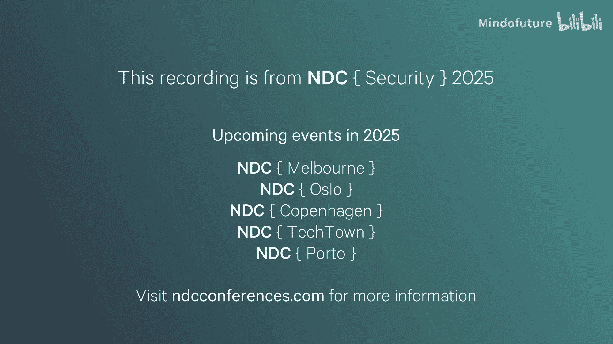
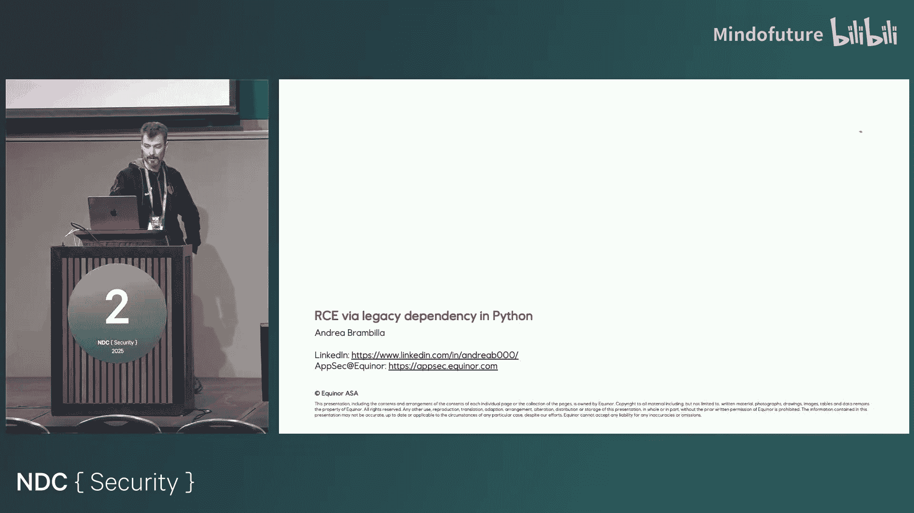

# NDC-Security-安全大会-2025-｜-AI工作流-｜-智能体-｜-网络安全-｜-Dapr框架-｜-开源工具-｜-LLM应用-｜-自动化安全-｜-黑客-p21-P21-RCE-via-legacy-dependency-in-Python---Andrea-Brambilla--BV1ihgQzJE2h_p21-

All right， let's get started。 Hello， everyone。My name is Andrea， and today。

 I'm going to talk about the risk of remote code execution in legacy applications in Python。

Or better I'm going to talk about how you can tell your developers that working with legacy applications is dangerous。

So。I work for Repnor， and I'm part of an enabling team dedicated to application security。

And our purpose is to reduce cybersecurity risk in the Equinor So development life cycle。

EThe team will be three years old next week。And we are9 people spread across Tdme。

 Stavanger and Bergen。And we are an enabling team， as defined by the Team top book。

Meaning that we have no power whatsoever。 We don't own。Any code。

 except the one we write sell for our internal tasks。

But our role is to enable and empower the development team across EpNor to do the right thing。

 to write secure code， to not expose EpNor to needless risks。We do this in many ways。

 We maintain a set of security tools， and we help developers setting up these tools and use them。

We run workshops， like on authentication authorization， S scanning， reorganize events。

And we try to do as many things as possible as open source。 So if you go to this website。

 you can also access most of our material。And among other things。

 we maintain a network of security champions。 We have about 250 people in there now。

And this presentation actually comes from request from the Security Champion Network。嗯。

We try to get one person from every development team。

 We're not even close because we have about 700 development teams estimated。

And we asked these security champions to like， make their teams aware of the risk that comes with writing bad code。

 They told us that they have a bit of a hard time， because when you talk about security。

It's a bit about religion。 If you don't understand it。

 you just have to believe what the experts tell you。 And that's not always easy。

So this is a reusable presentation。 It's very easy to adapt to your context。

 And the is that these security champions could take this presentation， run it for their team。

 run it for their managers， department， line， whatever。

Product owners and make them aware that there are risks in the staff we're doing。

The things I'm showing is a to example。 and if you are in security。

 you will notice some obvious blunders。But it's realistic enough that we've seen developers reacting to it。

 So we think it works pretty well。So the starting point is an assembled problem。

EAssume that there is a reservoir simulator software。Let's configure with Yaml files。

And this simulator has been used for like many， many years in the company。It works。

 It gives pretty good results， but it's old， and it's hard to maintain。On top of that。

 this might use some data that is restricted。 I don't know， like seismic data scans。

 data about on your installations or。Pipelines， et cea， cetera。

 So everything must happen in a confined environment that to reduce the risk that these data is leaked。

What we know is that simulations can run for maybe even for a couple of weeks。

 But then if the file is misconfigured， the simulation can crash right before finishing or like midway through。

 and we won't avoid that。 So as developers， we are tasked to create a small tool that can check this configuration before running the simulation。

This has to be done using a library that is provided together with the simulator。

Meaning that our application will also run have to run in the same environment where the binaries from the simulator are placed。

 And the problem is that in this environment， only Python 3。

4 is available and nobody dare to touch it to for fear of breaking something。

 I say that this is a to example。But we have situations that are pretty close to this。

So how hard can be。'Been developing for a few years。 So this shouldn't be too difficult。Luckily， Nno。

 we have this amazing thing called AI。 We even have internal instance。

 so we make sure we don't disclose any any data externally。Lovely。

 I have some prompt already prepared。And yeah， I know I can create a web application using Flask， so。

I'm just going to ask chargeGBT to create a simple application based on the requirements of using Python 3。

4， and I want to have the server using flask， is it large enough？

It doesn't matter I'm going to comment on it anyway。So this goes and this suggests some code。

S template plates。Some basic points， how to run it， and where to find it， okay， awesome。

And now I want to ask， okay， how can I handle Yama files？And it suggests you can use Payaml。

 you just install it using PP install， and then you just use it like this。You load your string。

You check it， you do stuff with it and then you print it back Asome， okay。

 so I've done a bit of prework， I have already put all of these into a file。

EAggregating the inputs I got from GDPgPT， so。好。I have a simple flask application。

 and I have just one endpoint that tracks with both getth and post method。 And if it's a get。

It directly returnss the template。If it's a post。It gets the text it that is sent in their request。

 You print it out just for the bugging purposes， because I'm trying this out。

 I want to see everything that happens。Then it throws the ML code。

It calls this check config method that comes from the simulator。And then， of course。

 if it's not valid， just returns an error。 otherwise it tries to print it in a more or less standardized way。

And since it's a web application， I want to make sure it never crashes。

 I just catch all the exception， and I show them to the user code。 like。

 at least the user knows what to do if something doesn't work。 Yeah， don't do this。 This is bad。

And yeah， good。 This should be trivial。 Let's try to run it。 Of course。

 I don't have a server running Python 34。 So I just put everything into Docker container with some script。

 sorry。So all of this stuff is available on Gi if you want to run it with all the scripts and everything。

Yes， so my app is in my app， obviously。And I just try to run it Python up by。

And it complains cause there is no Yaml modeling in here。 Okay， fair enough。

 I've installed the pens of。As a developer， I would like to do it in a pipeline。

 But for the sake of the presentation， I'm doing it manually， so。Let's install flask。

there is some yellow stuff。 I don't care。 It's yellow。Let's install。By羊。And O。

 I'm getting some red stuff。It's telling me that payam milk pretty much requires a Python version that is more recent than Python 34。

 which is the only thing I have。However， as I say I've been writing code for several years。

 I know that payyama has been around for quite some time。

 So there must be some older version of payyama that can work for my case。 So what I do。

 I just go to PP。I look for p Yal。It's here it's at version 6 okay that's probably too recent。

 if I go back to my error message here， I see that it's trying to install Python 5。3。

1 so maybe if I get a version older than that it might fly。So I got to release history。

 scroll down a bit， it was 5。3。1。 Let's try to get version 4 then。

Ver from4 are only beta processes that is nothing， so okay， I'll give it try with。By Ya 3。13。嗯。ちっとさて。

Yes。Awesome， let's give it a try。And it works。So I just go to my local host。And yeah， there it is。

 That's my web application。Of course I'm a thorough developer so I want to test it as well and luckily I have some strings that I've already created to test this。

 I can try with mud for my yal just to make sure doesnt it fails on this。Yeah， I get an error。

 That's fine。 I shouldn't run my simulator with that string。嗯。

I can get something that let's assume is a potentially valid configuration for my reservoir。

 What tell this。I forgot to bring my mouse with me and doing this with the touch but is a pain。

So I try this and yeah， awesome， it works， it's valid and it gives me back the configuration I want to pass to my simulator。

Perfect。So， I'm done。要做 easy。Then okay， let's deploy this and call off my colleagues。

 have a daymo show them how to use this and add an achievement to whatever your HR department is using。

 make sure you get a nice salary increase the next round and take a selfie， post it on LinkedIn。

 be proud of your work， then go out and celebrate。😊，Also。You out， celebrate， you go home。

 maybe a bit dizzy。 You wake up the next morning。 You go to the office。

 All happy to keep working on your new project coming in。 and your monitor looks like this。😊，So。哦他本着。

It turns out that， by young Mel。Has a feature that allows。对对。Python code to be executed on load。

And this is a feature。So。It's expected to act like that。 but of course， in a way， in my case。

 I should have disabled that。So what an attacker could do？Or a malicious user。

 call it whatever you want。It can try to pass in strings like this。

 which is the way that Bayama execute patting code。Starting from files or strings。And。

If I try to do this。O， I get an error。 This doesn't seem to work。

 But since I get back in a pretty thorough error message。

 I can see that some Ya code was interpreted。And the string capacity that was supposed to run some pattern code is not there。

 So maybe something has happened。 And if the developer， the developer was not out parting。

 it would have seen this thing popping up on his console。So again， as an attacker。

 I can try different things， so maybe I can try to print out variables， environment variables。

 there is all juicy stuff in there。Run again， same results。

 the Yaml code that it's the same Yaml I've。Pu in input， that was nothing just at the execution。

 but I get an error， and maybe it run。What I would like to do next as an attacker is to try to see if something is actually happening。

 And one possibility is。Okay， let's see if from that machine， I can reach out to the Internet。

So I can go to a website called Webbook dot site。But you can just create Ive friend this before。

 So it's showing differently。 But yeah， it gives you an URL。

With a very long string of characters that you can use。

 and this website will notify you whenever this URL is hit by a request。So what I do。

 I pretty much just。Brite the code here that would execute a get request towards the web book I just set up。

Go here。And when I run this， I go back。Here， and yeah， I got a new request， just arrived。So。

 as an attacker。Now， I know that that server， where that python code is running。

 can reach out to the Internet。 So at this point， I can start doing all sort of nasty stuff。I can。

 for instance， try to download something from there。

 I can try to send information from the service somewhere。

 But I guess the most juicy part is to set up a reverse shell and just get direct access to the server。

So what to do？I just need my IP address。Cause I'm gonna host。Again。A listener here。

 like I'm going to use another docker to pretend。To simulate the machine of the tuer。Yeah。

And I made a script here just because I'm lazy， but this is just a call to N C。

 It's like one line of code。 So this thing is listening now on port 10000。

 And I need to know the A of my machine in order to。嗯。Try to connect to it。Wch is this。

 and I've been running this presentation inside the corporatepo network。

 and that's the reason why I'm using rocker containers and doing everything locally because some of these things might trigger some alarms if you do it on the actual network and also。

 know some of the websites I'm using like， for instance， the webbook thingy。

It would not work on an internal network that is protected by farwall， for example。So done that。

 here is my attack string。I just paste in my IP and grab everything， copy。

I am putting in the application。Just submit。Same results here。Ha something happens on those machines。

 well。We can see this string again in on the developer machine。

 because there was some debu information。 if there was some monitoring on the activity here。

 maybe this would have raised some warning。 But of course。

 the developer was too busy to deploy this thing。 was too too much fun。 And in the tackle machine。

 I see that actually， something has happened。 So let's start having a look around where I am。😊，Okay。

This is the tacker machine。 and yeah it's directly connected to the server where everything is host。

 So if I start looking around， I can see that there is a folder called confidential。

And let's have look at it。 Yeah， there are for instance quarterly results in there。

I can print out environment variables。 And as see you all， I have some keys。 I have some。

Database admin's password and where the database is hosted。

 there are some keys to a keyboard teenager and all sorts of useful stuff。And at this point。

 the attack in and it could just pull anything from the Web。 So I just。Yeah。

 it can pull stuff on the Internet， so it could pull， for instance， Me p or pull malware。

 a ransomware and just launch it。 And we're done。So oops。Is it？

 Was there anything better we could have done here。Obviously， yes。嗯。Normally。

 in the version you find on Github， I just jumped straight to static analysis and。

Softer composition analysis。EJust for the sake of exploring this a bit further。

 I've asked a couple of colleagues that have never seen this presentation to review the code and see what the results were。

I got one here。And。No。Of course， this code is bad。 So they started finding a lot of stuff in here。

And among others， there was this obvious， can this not use Sa load。 Okay， fair enough。 got it。诶。

It's however， interesting that that was obviously the most dangerous thing in there。

 but it's kind of lost in this。Flaod off comments。Still， it works。

 You had a senior developer looking at this， it could spot that。 There was error there。

 and that gets fixed。And I have another example， which is more like straight to the point。I think。

Yeah， this comment here。Log。Load is unsafe。 Yeah， this is spot。 Okay， you know， it's unsafe。

 You should not use it。 Don't。I also tried doing a small threat modeling session by myself。

 of course， was easy because。I knew the problem。And， of course， if you look at it here。

 you clearly see that there is stuff coming from outside your trust boundary。

Going into your simulation machine that you want to protect。 And that's an obvious warning。

Funly enough。The first time I tried it。I didn't entirely correct。

 I didn't get properly how to model that P P coming in。

 And that's because I really didn't have a C ICD pipeline。 So again， easy， this is a toy example。

So it might be difficult because a lot of these species I to imagine them。 But yeah。

 if you do threat modeling properly， you should detect it。

 there is still a is that developers are not well versed in threat modelling。

 So they might miss some things。 It's beneficial anyway， they will find other stuff。

 but be aware that this is not foolproof。Yes。Oh， and one thing I forgot， the code for the。

The river shell。It looks a bit complex。And most developers react saying like， yeah， mean。

 but that's super complex。 Only very advanced attackers could understand how to write that。

 And they' probably be right。 But the thing is， I didn't understand that at all。

 I just went to a website called Reff shells dot com， scrolled down to Python。

And just copied whatever text working。 Like， there are three versions。 I tried the three of them。

 and I picked the first one that was working。Easy。The other thing that would be the best solution for this kind of problem is to run depend scanning and static analysis。

 So in Equinor， we use SCC， but I'm pretty sure that this would work with whatever scanner you have。

And yeah， I've imported it already， but I guess you can imagine how this works。

You just connect to Github。Ts a while。All my stuff。 Let's see if the search field work here。

I think we have too many things。Yeah。The at repositories。And yeah， it's running。

 it will import in the end， it will look something like this。

Hopefully I am running on my phone connection so it might be a bit slow。Yeah。

 it detects a lockcker file， but that's just some infrastructure needed for the example。

 the interesting part is， of course the requirements do Tt file。

And here it attacks it actually picks a wrong pyth version， which is interesting， but nonetheless。

It picks up that there is a Pa Yael has an arbitrary code execution， vulnerability。

And it's introduced。 Well， it's because I'm using Paamma 3。13。

 and it can be fixed by updating just to 4。2。 So I could have used that instead。嗯。

One thing I find is funny。 And I always asked to to explain this inqui because we are using snake。

 here it says，s no known exploit。W's not obviously true because I've just showed that it is exploitable。

 The thing is， this is our example。 and this vulnerability is so trivial that by now。

 nobody is exploiting it anymore。 So in a real context， in a real scenario。It's a bad thing。

It's kind of unlikely that these would be discovered。

 But then you don't have to tell these to the developers。

 Just tell them that this is super dangerous。Yes。Also。

 this could have been detected by static analysis because， again。

 the ability to run Python code when loading Yamal is a feature of Pay Yamal。

And there are ways to do， to just loading files more safely， the problem。Is the way I loaded that。

 that stream。 So if I go back to my code here， and I enable。Pnic extension。

 which just ran static code analysis in my I。Let's go back here， and。Let's see if it's running。Yeah。

 okay。 Yeah， I get these nice red speak lines that tell me， yeah， youre deerilizing un trusted data。

And。I think you can even ask it to try to fix it。诶。Let's see if this works。No， it didn't。No。

 I didn't fix it， but okay。😊，It's probably one of the others。

 But the suggestion here would be to use Sa load， which specifically disables the the ability to load to run Python code and execution。

 I mean， this is still， there is still a problem because I am decalizing data without validating it first。

 So that also an issue。 And there are a bunch of other issues Like I'm printing out untrusted data to the。

To the user， which could lead to cross set scripting。 So I mean， this bad code。

 And by running a study analysis tool in your I D would help you identify those issues before you commit or even deploy them。

All right。Key takeaways。Do good reviews。They' are not foolproof， but they help。Do threat modeling。

 They don't detect everything， but they help。When you're writing code run static analysis， I mean。

 again， it doesn't detect everything， but it helps。

 and it helps you thinking and it points to the parts of the code that you need to think a bit more about。

And of course， when you use third party libraries， don't trust them blindly。

Users of the compositionizes to check if the and depend penencies have non vulnerabilities。 I mean。

 even。Widely used libraries like Payyael can have serious vulnerabilities。And on top of that。

 as a bonus， whenever you deploy code， make sure you start monitoring your deployment for vulnerabilities because this the vulnerability can be discovered in the future。

 I can deploy something now using Yamal 6。1。 I can remember what was the most recent version。

 and tomorrow。Some of you might find the vulnerability in P 6。1。

 and they want to be alerted by that because I need to admit it。 I need to fix it。

 I need to make sure this doesn't have any serious implication。And if possible。

 establish routines for updating your libraries regularly。

 don't just trust that the latest is speak whenever you deploy things。

 And I've used the requirements dot T X T file with no version specified。

 and the amount of people that actually do that is huge。 and that's bad。Last but not least。

We are responsible for the code we write。 It doesn't matter if use compile。

 It doesn't matter if ChagBT。 We can't blame Microsoft because ChagBT or compile suggests suggested something wrong。

If we commit that code， if we deploy it， we take responsibility for that code。

And this is something that we have to reiterate over and over and over， because there are。

Many people in various companies that would really appreciate if。

AI could replace some of the costly developers that we have around all the place。

 It's important to know who is responsible for that code and who has checked the code and made sure that that code is safe。

There is just one last piece。That we haven't covered。 And that is。

 how did the Tucker figure out that I had just deployed a dangerous service。 Well。

 it turns out that this is the selffiI post LinkedIn。And if you look closely。

 you can see that it's visible。 I'm using Yaml and Flask， and the URL is visible。

 So maybe if the network was not properly protected。

This could have LEDed to the Tuer to figure out how to duck this。

That's it。Hope you enjoy that。We have plenty of time for questions。If not。

 I'll still be around for a while。 So just feel free to approach me。 And again。

 this is available on Github， just look there Equinor and look for appsack and you find it there。

Thank you。