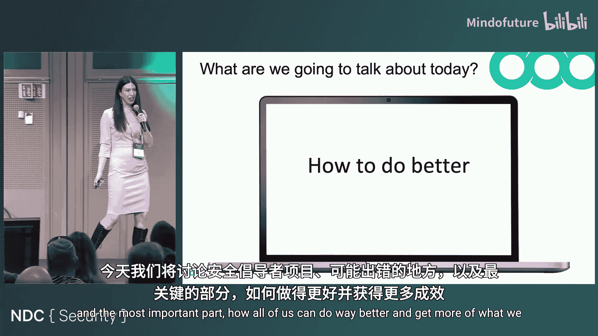
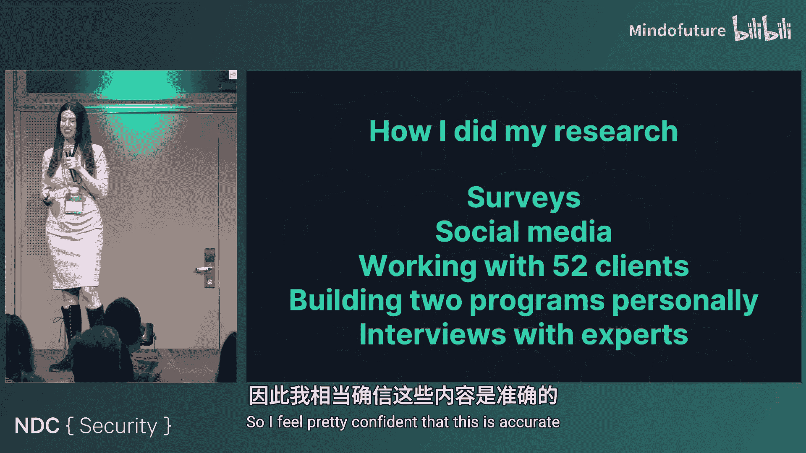
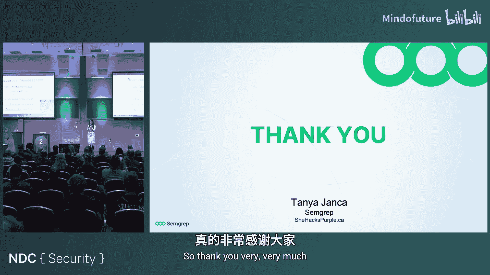

# NDC-Security-安全大会-2025-｜-AI工作流-｜-智能体-｜-网络安全-｜-Dapr框架-｜-开源工具-｜-LLM应用-｜-自动化安全-｜-黑客-p22-P22-Security-Champion-Worst-Practices---Tanya-Janca--BV1ihgQzJE2h_p22-

I came here last year and it was so amazing， it's so amazing to see this beautiful country and I'm trying to arrange to come back in the summer this year so I could see more of it in a warmer situation I'm told that it's so beautiful I watched a big documentary before I came here on Netflix all about it and I was like I can't wait to go so thank you for having me again and I was thinking I should probably do my talk now so this talk is called Security Champs Wors Praes and。

😊，So a security champion。It's basically it's a program that you run as part of your security program where from every single developer team。

 you have one person that's sort of the representative that handles all the security stuff and so they champion the cause of security which is awesome。

 they usually are the person you teach， the person you call the person you ask favors for you ask feedback from them this person is like your best friend on that team。

 and I did a talk at RSA about this in maybe 2019 or maybe 2020， something like that。

 and I remember there was such a huge response。So many people started writing me and I had run two of my own programs and then I had worked with like a couple of clients suddenly every call was about that and since then I've worked with 52 companies on their programs which is I feel very grateful to be able to help and like work on things that I really care about and so so a lot of my talks are because my clients ask something very smart and they're like why should we watch out for what goes wrong can you help us avoid those things and it's like。

Why are you all smarter than me， and so I went through all my notes from all my programs and I came up with a tentative list。

But then I had a bunch of people on a webinar with me and I interviewed all of them and I asked their opinions。

And then， well， then I did a survey， then I asked on my social media and I just kept asking until the same answers just kept repeating over and over。

 because I wanted to make sure it wasn't this is what happens to Tanya。

 this is what happens across the board， and so these things are things that happen over and over to many companies。

The other reason I made this talk is because over half of champion programs fail。

 and so I talk about them like with such a delight and I have a blog series and posts and all sorts of stuff about this and it's like this is what has worked for me。

But people keep telling me like they'll hire me because they didn't work right and so I want all of you to succeed at this and so let's go So we're going to talk about security championions programs today。

What can go wrong and the most important part， how all of us can do way better and get more of what we want。

And so spoiler alert。Security Chaions programs are all the rage。

 like so many people are talking about them， but they're actually a lot of work。

And so it's not like a button you press or an email you send and then everything's just great。

 it's a lot of work that you're going to be getting into。But I have a thesis for you。

 and so the thesis is is that most people start a program because they want to reduce friction。

 so they want everyone to get along better。They want to scale their program so they have you know one or two or three Appsec people they wish they could have 10 they can't there's no budget so like how do we scale how do we do better and the championions programs help with that and then the last thing is they're like oh I wish we could improve our culture。

 I wish we could improve our communication with the developers I wish we could talk to them more。

And that's why we start these programs。 And I have a bit more information and the rest of the talk about this。

 But yesterday， two gentlemen came up to me and they're like， we're developers。

 The security team never speaks to us。They send our manager an email with a report from an automated tool。

 our manager sends it to us and I'm like what's the priority。

 how important is this they know it' going to take forever to do like what do I have to fix the managers likem？

RightAnd and so we need to improve this， the developers were saying like。

 I wish they would talk to us， I wish we knew what was going on。

 And so this is why I lot of us start these programs。

But security teams rarely give realistic direction and clear direction。 And then they don't。

They don't achieve their goals。I'll meet with companies and I'll say， okay， great。

 So what are the specific goals of your， of your program， What do you trying to achieve。

 And they're like， what do you mean， We're doing a champions program， And I'm like， yes。

 But what are you trying to achieve， Each program tries to achieve different things。

 And they're like， I don't know champions， I'm like， okay。

 so what is it the responsibility of each champion。 What are they like， I don't know。

I see why it's not working。 It seems obvious when I'm explaining it to you。

 but literally like at least 80% of them。 that's the response。 So let's go。 So who am I。

 So you met me yesterday So I'm still the same as it turns out so I still do Dell at somegra。

 I still called Ghax purple I still have all these things but hopefully from yesterday you're thinking she seems tolerable So that's what I'm hoping you're like she seems fine I'm willing to subject myself to her again So hopefully you're like that's enough of Tanya So how did I do this research。

 So first of all， I did a survey so I have a newsletter with like 5000 people on it and I sent it to them and lots of them answered and I was like oh okay this is good info then I asked on social media and I got a lot of answers and that was interesting too and I shovedhove all that information together then I was working with like over the years 52 clients plus I ran two of my own programs and then yeah building。

😊，Programs myself and then I interviewed a bunch of experts about this because I just wanted to know more and since then since I wrote this up and then applied to the conference I also like I've been on a bunch more panels talk to a bunch more people and then I always find a way to ask so what do you see goes wrong and then they say the things on this list so I feel pretty confident that this is accurate。

😊。

So a bunch of my images are AI and they're gonna to be weird they're gonna to be super weird and so you can spot the creepy things。

 There are so many weird things that are in the images and I can go use photographs I can do lots of things but it makes me laugh and amuses me so hopefully you don't mind okay so our agenda for today so we're going talk about briefly why do people do champions programs and I'm gonna to be a bit more specific than I was at the beginning and then almost the entire presentation is you know this is what could go wrong and then here's many。

 many things we can do to avoid that and that's gonna be almost the entire presentation and then a brief conclusion with the exact same resources as yesterday except two extra ones just about champions So hope you like them Okay so why champions we want to reduce friction。

😊，We want to reduce friction so bad， I remember I met my friend Brandon Shears and all he has done for many。

 many years is championions programs and he's like no matter what anyone says that's the real answer。

 they just want to make it so everyone gets along people are happier etc cea he's like that's what every client is actually saying and I agree but let's be slightly more specific so a lot of us want an improvement in our culture。

😊，RightAnd we want to have a more positive attitude about security and like everyone wants that。

 right， I want that， you want that。Quite frankly， the developers probably also would like to feel more positively about the security team。

 They'd like to get along better if they feel negatively about the security teams。

 probably because we were not。Great with them at some point。

 or our predecessors weren't the people that did our jobs before us。

I would love it and lots of you probably feel the same if we could be more proactive with fixing bugs。

 with responding to security issues， like if we could get our software developers where they jump on it。

 that'd be awesome。We want them to report security incidents to us so like them noticing， oh。

 that's an incident。I should call Tanya， that's very valuable for us。

This is the creepiest of all the images， oh my gosh。😀ふふ。😊。

We want to build trust and we want to have friendly relationships between the two teams。

 and this is like particularly important because if they don't trust us。

 they're not going to tell us things right like would you want to volunteer and be vulnerable with someone that you've made a grave error。

If last week they yelled at you or said something that made you feel very small， no， you wouldn't。

 I wouldn't either， so trust is quite important， which is something I had to learn about when I switched to security。

Ideally we could just avoid security incidents， so this will start happening later in your program if you're a success so they'll tell you。

 oh so I remember the first time I had this happen and I wear my heart on my sleeve。

 I'm not good at hiding my feelings and so the dev's like so there's this thing and'm like okay you can tell me and he's like this other team is writing their own cryptography but they're just base 64 encoding it twice and I'm like I thought that was just a thing and captured the flag contest I didn't think that was real。

"，And so I was like。Okay， and he's like， so I need you to go find it and not tell them I told you because then everyone will be angry with me。

 so I had to kind of I like figured out a way to get myself invited to a meeting and then they happened to be reviewing architecture and then that happened to come up and then I was like。

 oh， actually a more secure way would be never doing that。

And instead doing what everyone else here does， which is called encryption。

And so we avoided a potential giant security mistake。Now I give secure coding training all the time。

 and this happens a lot in trainings where Dev's like， oh， so you say we're not supposed to do that。

So about that， we might be doing this thing。 What do you think， And sometimes it's good。

 and sometimes it's like， okay， so that's not as secure as it could be。

 What if we did this or this or this。This is a big one that a lot of us don't think about。

 but the best hire that you could ever make to the AppEC team is from the dev team。

 like from a security champion so this person knows all the things you want from them。

 all the devs super respect this person because they are one of their peers when I went to the security team that's how I went I was the lead of one of the dev teams and had been for a long time they all knew me well。

I switched to the security team and we got along great and then the next place I went to。

 I was Tanya from the security team， not Tanya who you see lunch with you， and it was very different。

 welcome to learn a lot about building trust。And then， yeah。

 I had this creepy thing twice because it's just so creepy。

We want to have security questions come to us instead of stack overflow。

 and to be clear I love stack overflow， it's extremely helpful， I use it all the time。

 even though I'm banned right now， but that's a long story for later。

I tried to answer every someGp question and one day and they didn't like it and some of my answers they didn't like。

 how do I suppress this result in someGp， don't suppress it， you have cross by scripting。

 here's your fix， down vote down vote you suck anyway so that aside we want them to come to us not an online forum we want them to trust us with advice and if they are coming to us with questions all the time this is a great great sign。

😊，And then lastly， a thing you might not be aware of， so when I was a developer。

So my second last developer job， I ran a community of practice， who knows what that is。

Okay so not lots of hand so a community of practice is sort of like a community in the place where you work for devs where we all teach each other cool stuff and so we have events and we all get together and maybe it's lunchtime maybe it's not and you might have a workshop you might have a trainer but you get to know each other you learn and it really helps you get promoted later and I remember HR called me after about a year and they're like we just did the employee survey what have you been doing Im like what do you mean and she's likeYour team。

And all your devs used to have like two out of five satisfaction and we had high absenteeism。

 so people missing work a lot， we had a lot of turnover and in the past year now you're at five you're like 4。

8 that's like the highest score in the entire company what did you do and I told them about my community of practice and then they actually gave me a budget。

I know right and so then I switched over into security and I just kept doing that and I just kept speaking and well I actually didn't speak at first because that was terrifying to me still then。

 but I had all my friends come and speak， I made security friends。

 they came to speak and it turns out when people are champions they usually miss less work。

 they're usually happier they usually want to stay longer。

 they often will get promoted into the security team and stay and so this is even just for this。

 it's good if you get people to miss less work， that's a big win。Okay。

 so now we're hopefully you're like， I think a championmps program might be worth doing this interests me。

 It does not sound terrible。Okay and so now the good part。

 what goes wrong and how can we all do better and this is the important part Okay so I asked the AI to make an image of what could go wrong and it made this look at that that is a chainsaw with two chainsaw sides like which how do you use this chainsaw just like no matter what I found this very amusing and it feels like I was like draw what like everything going wrong and it feels a lot of chainsaws are involved。

Okay， so anyway， just note for self。😊，Oh I'll go back to it for you， but I found this funny。

 but what can go wrong， a lot of things can go wrong so I'm just going to briefly go over a list。

 but then we're going to dig into each one。😊，Having a pace for your program that's just not maintainable。

 So we're going too fast。responsibilitiesspon for the champions and the security team that just aren't clear people don't know what's expected of them。

Unvoluntary volunteers， so we forced people to be champions。Failures and recruitment。

 So you can't get people to become a champion。 And so then that's usually why we force people。

 but I don't think that's the answer。 we'll hear about that。

 responsibilities that are completely unrealistic。 So the security teams like。

 if you could just do my whole job， that'd be great， thanks。No support from the top。

 so upper management is just like， oh look what Taa's doing， what a waste of time。Lack of metrics。

 So if we're not collecting any data， we can't do as well。 Who here saw Laura Bell's talk yesterday。

Okay， well， she talked all about super cool metrics we could get and she loves data too。

Poor educational planning that I have a lot of thoughts on this one， champions that arent motivated。

So you have a bunch of champions， but they do nothing。And then lastly。

 poor social settings and I'm actually is there one more I can't remember I have a story about I have a story about everything actually that's yeah oh and then lastly high turnover so this is。

If you have to train a new champion constantly like this is not the way to go right and clearly your program's not going well if everyone's quitting all the time right and so this is sort of the summary slide of all the things。

 but let's dig into them and figure out how to not do those things So the first one is the security team sets a pace that is completely unmaintainable and I have seen this a lot and I used to have a podcast。

 I speak a lot。 I do blogs I do things and I have had many people come to me for guidance and mentorship and a lot of them are like I'm going stream every day I'm gonna release a blog post like three times a week and I'm gonna do this in this and I'm like and you're gonna to burn out in one month you're gonna to fall apart。

 Let's set a pace that will not put you in an early grave。

 you can still be very influential and still help lots of people but also get sleep and have time to eat and maybe even have friends and so the security team is like。

We're going to send them on a two week intensive training。

 and then we're going to do a lunch and learn every day or every week。

 and then we're going to like publish these things and we're going to do that and they set this pace。

Where just second， and so do I have， okay， no， and so what happens is they dropped the ball。

 a security incident happens。And。They have to go do the security incident and they can't do both because they did not plan for that。

 And then the security incident's over after like2，3， four weeks and they're like， oh where where we。

 Oh God， I'm so exhausted。 I have to catch up on everything else。

 And so then they call me and it's been six months And they're like， okay。

 tell me about your program and they're like for six weeks， we were amazing。

And then we haven't spoken to them since。 and now it's been so long we feel a bit embarrassed and we just don't know how to breathe life back into this。

 I'm like， don't worry， we've got this。 okay， we've got this。 And so what do we do？So first of all。

 we start slow。And so I suggest one event per month， maximum。

 these people have another full-time job， all the developers， they have so much to do。

 they can't give you like two or three days worth of time per month。

 they have lots of things to do so start slow like I said， one event per month。

 you can do other things like you can have a newsletter once a month or you can send them an email with a podcast that you think they might like。

But if we're trying to expect them to show up， especially physically somewhere once a month。

 I try to plan out my program six months in advance。

 So it's like this month's cross I scripting that month's security headers。 this month's injection。

 This month is whatever， whatever， whatever。 And doing that is so helpful。

 I remember I made a content schedule for somewhere。 And I was doing developer relations。

 And I was like， oh， I made like a 12 month content schedule。 And they're just like。

But then I knew what to do every week I knew what to do， I was all set up。

 they always knew what blog posts was coming， and like I hadn't written them yet。

 but I had a plan and it was super helpful。If you have resources for the program。

That you've designed Oh do you have enough resources for the program and have a security incident。

 so I don't think it's reasonable to pretend we're not going to have incidents ever again like even if I've had a very good security program I've still had incidents that happen even if the incident is more like an event that appeared like an incident and it wasn't we still have to look into it。

 it's still time you know there's pressure etc ce， So you need to make sure you have enough people to do both and if you don't have enough。

 it's not like you're going not do an incident right and so it's important to make sure you have resources。

And then so once you have this plan of the things that you'd like to do。

I'd like to pass it by a colleague so I have lots of friends that do this。

 but you there's consultants that do stuff like this， but for free。

 just talk to someone that works on another security team and just say listen。

 like I'm thinking of doing this does this seem like a reasonable pace to you because often we are heard on ourselves。

 did anyone see SiS D yesterday he spoke about Oas Sam and how people that mark themselves are so brutal on themselves。

 but if they have a third party come， they get almost double the mark？yeah。

 so apparently security people are hard on ourselves okay so the next one is no responsibilities or goals are set out like it's not clear it's implied and no one knows what's implied and then the champions have no idea what's expected of them。

😊，I don't know about you， but it's really hard to read minds。

 I'm still not good at that after all these years。And if you don't tell them what you want。

 it's really hard to obtain a goal， right， So what do we do about this。Like。

 I think it's obvious we set clear goals， and then we tell everyone， but what should those goals be。

 because that that's the big question。So， so many companies。

They have nothing that they have told explicitly to the developers that is expected of them。

 They have told them nothing。 They're just like， you're a champion and they're like， cool。

 they're like， you're going to be our guy。Great， you're gonna to do stuff and things。

 And like none of that is clear。 So what should we tell them to do。

 So I'm going to give you a list of many things， and you can choose like one or two or three。

 Like one of my clients， I do training with them。😊。

And all of their developers just do threat models or all of their champions just do threat models that's the only thing they're in charge of and they have 3000 developers and they only have three AppEC people and they've managed it's the fourth year of their program now and they have every single new big change threat modeled and documented in the way that they do threat modeling and they have removed tons and tons and tons of business logic flaws and it's really。

 really truly amazing and all of their champions are like engaged and interested and it's pretty incredible program they've built but they're like they just do one thing they kick the crap out of that thing and it's great and we don't ask for more and whatever you choose is okay but you just have to be specific so it could be we're going to train you and then we expect you to give security advice to your peers so that we have fewer questions so you become the trusted advisor as often as possible。

And we just support you so whatever doesn't get like you can't answer then it gets promoted to us this can save you a zillion hours a week right and if you trust the advice that your champions are giving。

 this is golden Im creating and maintaining a more positive security culture on the devs team So when I push companies a lot of them say this and I'm like what does this mean can we be more specific about this like yes。

 more positive is good， but can we be even more specific and so this is something where I'd want to drill down。

Like what would be a sign that this is working so I can measure it？

Treat modeling we talked about that one adding security checkpoints to the system development lifecycl so let's say there's supposed to be a pen test here and there's supposed to be an architecture review thing here and that there so the security champion it's their job to just say okay so you know the design's almost ready so we should invite the security nerd over so we can do that whiteboarding thing we're supposed to do they just make sure those little checks happen that's super valuable in my opinion。

Treaging scanner results so I see this a lot， so it's like we have a SAS。

 we have a DAST and by the way yesterday I'm so sorry I didn't explain my acronyms and I'm going to do better today so SAS does static analysis so where you're reviewing like you have a tool that reviews the written code and then dynamic analysis DAS is where your app's running and something's interacting with your app as it's working。

😊，It could be just reviewing those results， triaging what are true positives。

 what are false positives， and then saying to the team， okay， so I think we need to fix these three。

 these four are going to go in the backlog for like you know two sprints from now and the rest。

Right like this is very valuable that'll save you 10 years of your life。

 building security tools and security features， so this is like the coolest thing that in my opinion that a security champion would get to do。

 having them help you automate things having them help you because a lot so I coded so I was a dev for about 17 years before I switch to security。

 so I still have more experience with that than security。😊，But most， well， not most。

 a lot of Appec folks don't know how to code。 and so they can't just script something themselves。

 And so this is great。 Like you're really working together。Being a liaison。

 And so I have a friend named Ray。 and he has， well， he used to have a blog。

 He hasn't written in two years。 So I feel he used to have a cool blog， but he writes about。

The idea of like I'm just going to do a check in with every champion per month and just say what are you working on what's coming next and how can I help and he's like those questions just bring me to everything it builds trust。

 I help them， we get along， I know exactly what's going on on all the teams and like it could just be that that's all they do is just have this check in with you once a month。

Ini initiating security fixes， so kind of hounding people to do fixes。😊。

Influence and inform the security team as to what's to come。Because if。

If they're choosing a new technology， I'd really love to steer them in the most secure way， I really。

 really， really want to be a part of that conversation if I can。

 but if I don't know what's happening， how do I do it more helping to implement security tooling or automating it。

Soalizing appsEC projects and new tools so let's say so I remember doing this I brought in a stack analysis tool and basically I met with my favorite devs。

 the ones that totally tolerated me and I was like hey can we play with this together and we're using it and we're hanging out about two hours and at the end they're like。

Can we keep it， We really like it。 We talked and we'd like to keep it。 like。

And so they helped me choose the tool and then it went really well where the previous tool。

 everyone was not willing to use it。 and so that's great。I've seen this quite a bit。

 so you have the champions take the secure coding training。

And then they know how to do good review of code and like pull requests and such。

 they learn a bunch of the lessons then they help advise everyone else and they sort of proliferate that knowledge because often training is like per person for seats。

 and so this is a way where you could kind of make your spending go a lot further。Okay。

 so if anyone wants to take a shot of that I'm just going to give you a second because I saw some cameras go down and like sad faces and I don't want any sad faces sorry I wasn't very fast there or I was too fast okay so next champions are forced they're in Canada will sayvolunold which is slang。

 which means you do not want to do it like when your boss asks you if you'll go do something yeah they're telling you they're just very polite what it means is Taa go do that。

And then they underperform they're resentful they're like I have to be here and I don't want to that's the crappiiest champion you're ever gonna have。

 that's not what you want and so I like to recruit and attract champions and I'm gonna have a bunch of slides about that and so the first one is attract it like we want to draw them to us so we ask for volunteers。

 we don't force people but a thing that I do is like once I have a champion or two I let them see everything I let them help me decide everything I get feedback on like I'm gonna to do a secure coding guideline I'm gonna do this I'm their fingers are literally everything I do and so they are heard and listen to and they get to help me adjust things we don't always agree like I'm like no you cannot turn off all the web filtering and just go wherever you want and no you can't install random things from Docker hub into production but we do get along on lots。

T right， I ask them for feedback and I listen to them。

 So you listening to them and hearing them and adjusting that is huge to making them feel engaged and wanted。

 So I like to have events。 So when I started。😊，Doing public speaking。

 it was at work and I had hosted things forever， and I had played music forever。

 but the idea of like doing a talk where my audience is sober instead and I didn't have like a guitar or some drums to like hide behind seemed terrifying to me but now clearly like I've gotten over that quite a bit。

 but I like to hold events。 you don't have to speak。 You can have someone else come speak。

 you can play a talk that you watched that was really cool from a conference like this。

 So there's lots of things you can do where you don't speak， but you still have an event。

 that's very， very doable。 you just have to be good at sending emails I invite them to a security community event so where I used to live in Ottawa we had an OAs chapter I was one of the leaders and I would just bring my champions literally physically with me So we had finish work。

 we'd all go have dinner。 We'd go to the Oas thing and we'd go have drinks after and it was awesome and it was great。

For team building and it made other people be like。

" I heard being a champions pretty fun and what about that？You could start a newsletter。

 I've done this at one organization， not every organization is cool with me emailing everyone。

 but you can definitely have one within your champions and then when you see it getting forwarded。

 your heart just gets really warm， I like to share appropriate secrets。

 so I did not used to like this I thought this was a terrible idea at first and I was wrong。

 but my boss Phil was telling me you know there's this team they won't do any well I was telling him there's this team they won't do anything。

Literally， I remember walking over to go talk to one of the devs and their boss came up and stood in front of me and said。

F off。And just like point， he's like， get out of here。 You are wasting our time。

 You don't have time for your crap。Okay I guess no pen test for you right like I'm not gonna have that like I don't there's lots of other work to do right and so we held a meeting with them we made them raise their right hand and promised be to tell no one and then we told them about three security incidents and the first one was I don't remember but the second one was a key logger got onto to six computers and one of the people was a grandma and she had done banking that day and so I was helping her change all her banking passwords and her email passwords and everything that she did on her computer and then she started crying and so then I'm hugging this old lady and my boss is like when Tanya fails grandma's cry。

And so then the third incident was this giant SQL injection that we'd had where they'd stolen our data。

 and then we had to tell the privacy commissioner and then they were trying to ransom us and they we're like how how jokes on you our data sucks。

 we don't want it and all this crap happened。😊，And then they're like， oh my God， that's terrible。

 Whose app was that。 And we're like， yours is the one you wouldn't let Tanya test。

 I the one she was really concerned about。 She kept emailing you about。

 and you kept deleting her emails。And it cost us more than the house that I live in to respond to that incident and we're not even done yet。

 it's been weeks of work and you wouldn't let her scan your app， we need you so bad。

 and so if you can share things like this with them it really they became my biggest advocates from then on。

 the manager no longer used the F word at me just that computers， you still swo a lot。

 let's be clear， but everything changed from that moment so if you can share secrets。

 this is like magic more send them cool podcast， like if you know theyre a Java devev and you hear like a podcast you think is really cool。

 send it to them。Meet with them one on one and ask them if they need help， have coffees with them。

 get to know them， hold team building events so they know each other I didn't really think of that before because I would have these events and then they would all hang out and talk after and I was likeCo whatever then later I saw a bunch of them having lunch together and I was like oh and they're like。

 oh yeah， I can't wait for the next one because I see all my friends so that's a magic way to get people hooked okay an inability to get anyone to join your champion thing at all like you can't get anyone to join。

So you've told people they have to join and no one wants to。 What do you do， Oh， sorry。

 do you want a picture of like this， Yeah， everything's varies。 That lady's arm's amazing。是。Okay。

I don't。 So I try to recruit， but I try to attract them。

 So I try to get make attention and do things where people are curious and they want to know more。

 And so holding events is like a good way to start。 But you can also。

Tell the champions why it's good to be a champion。 I have a talk called becoming a security champion that I give for Devs and it's like this is gonna to look great on your resume。

 This is one of your first steps to being a senior dev This is like if you want to move into security。

 this is like a clear path towards it。 you're helping protect your customers。

 your colleagues yourself。 like there's so many cool things that are in it for them a lot of times the security teams like well it's good for our team and they only talk about how it's good for the security team and they forget there's two sides to this equation and it should be good for both sides announce that you're looking for champions literally constantly be so annoying I end I would go to the big dev meetings and then at the end we could bring something up I'm like I'm still looking for champions I need two more。

D me， And then， you know， someone would message me。 I added it to my email signature。

 I'm looking for champions。 Is this you ask me how， And I found two champions that way。

 And I had a lot of people email and be like， what are you talking about。

Arrange security training for everyone that hopefully they enjoy and then get the trainer to tell them。

 oh yeah， they're looking for champions， champions are the best of all the das， let me tell you。

 so then it's a third party telling them why it's good， right？I have more。

Invite people that you think might be interested one on one， so imagine。

Imagine like you have this really big meeting。 And then after everyone's leaving。 and you're like。

 hey， Jen， could you stop for a minute， I'm doing this program you might have heard。

 I think you'd be perfect。 Here's why I think you'd be perfect。😊。

I've put a sign on the fridge in the kitchen。People are like， they came to me holding the sign。

 what's this？I put stickers on it too， I hold open office hours and I'm virtual so it'll just be like here's a zoom and I just put it in slack and I tell them like。

 hey， just so you know， I'm just going to be hanging out and doing this like does anyone want to shadow me and see what I'm doing and people would just come and hang out with me。

嗯。Only email everyone once， don't be spammy， you don't want to email all of IT over and over。

 so let's say there's like a monthly newsletter， put it in there once。

 don't email everyone all the time。Another thing that is important is that you constantly assure them you don't need to know anything。

 I will teach you everything you need to know if you are a software developer。

 you are for sure smart enough to be a security champion easily you would be an ex softwareware developer if you weren't smart enough to do this job because a lot of them are like oh I don't know all the things so you don't want me I'm like no you're perfect I want you to know all the security right and so the last one is ask managers if they know someone that they think would be good but stress that they are not to force anyone because some managers they're like I check every box and that guy was late to a meeting and now he's gonna to be a security champion that's not the way to win so make sure it's very clear that it is optional and voluntary okay。

Unrealistic expectations。 I have till 2，40。 I probably better get going。 Okay。

 so this is where the security team。Expects the champions to perform pretty much all of their work。

So I've seen this twice no three times now that I think of it where they're like yeah。

 they're going to install all the tools， they're going to take care of all the tools。

 they're going to pay for it out of their budget， they're going to fix all the vulnerabilities themselves。

 they're going to respond to security incidents and I remember saying what are you going to do and they're like oh we'll find something to do and I'm like well if I was your boss I'd be like so I can let you go now I don't need you and they had to run the championmpions program themselves as well wow it is impossible for the developers to do their full-time job and do your job right and I remember one of them they're like we're only asking for 20 to 25 hours per week I don't think that's unreasonable。

Yeah yeah so if you are considering something like this。

 we want to ask ourselves is this realistic right， think about what you actually really truly need the most help with and what they can do with one to two hours a week because that's how much you're actually gonna to get you want to be fair like if the ruless were reversed。

 would you be like this is cool or would you be like this is a rip off I'm doing two jobs and getting one paycheck this sucks。

You also want to just to repeat， you want to be very specific with what you expect so the developers know what they're getting into so they have enough time to do what you asked。

 if you say I need one hour a week and then you're assigning them 20 hours a week of work。

 it's not going to fly。Oh sorry there we go Okay no support from the top so this guy's very sad as you can see so when I say no support。

 I mean verbal support， I mean financial support， I mean resources staffing processes policies all of those things if your thing is completely grassroots it's really hard to run a good program and one of the places that I worked at full time that's how it started and it was really hard to get lots of people going like I had some of them but lots of devs weren't participating and upper management was not giving them time for this and。

It showed in my results。And so the solution for this is。

Make a presentation to management about why it's so awesome and get approval。

 So I did that with my first program。 I remember I was talking to the chief electoral officer。

 So I ran the security for the election in Canada in 2015。 I was the CO。 And we're talking。

 And I was like just a minute。 and I like run across。 And I was like， Stepan， you passed your skin。

 And then we high5 in the air。 and like， cool。 And then I run back。 and he's like。

 where are you doing。 I'm like， Appec。😊，I'm just， that's that's what you get。 if you pass your scan。

 you get a high five， like it's the best。 And then Stepfan like we're in an open office where everyone could see each other。

 He stood up， he's like，Right， because he was like proud。 He's like。

 he just got a very visible approval from the security team， like， your app's awesome。😊。

And so if you can show them return on investment， it's very different。

 I created a project plan that I could formally present that certainly helped oops， oh wait。

 no I have more I tried to explain the potential return on investment like every security incident you avoid is huge。

If you aren't sure bring in a consultant that will ensure you succeed。

 there are people where they've done this their whole lives and that's what they do and like I know people that do this and that's all they do。

 not me now， but I know lots of people that are good。

You want to show examples of other programs that have worked。

 and so there's lots of conference talks like there's this dude from Datadog named Chuck and he talked about his program。

 First of all， I'm jealous of Chuck。 He was like this huge budget。 He's like， we buy them hoodies。

 I'm like， you have enough money for hoodies。But show them things that have worked and what could happen and don't assume that everyone knows what a program is or what they're capable of this is the biggest one is like most people don't know what this is so you have to explain it to upper management if you want support okay number six no metrics are recorded。

And that means it's not clear what kind of return on investment you're getting。

 So you run a program a year， maybe two years。 and they're like， what's the ROI on this？

 And you're like， stuff's better。That's really hard to get a budget if you're not clear。

 which I had to learn at the beginning。So I could show fewer security incidents。

 but that was the only thing I had tracked at first。 and I learned a hard lesson。 So solution。

 we take metrics and we tell everyone， but what metrics do we take So I could talk about this for a very long time。

 but I only have so many minutes。 So one thing I'll do is a built systems。 you know。

 like karate has different belts， like yellow belt， etc ce。 This is very common for these programs。

 And so someone starts weight belt， yellow belt probably orange。😊。

And they've achieved certain things， so then you can show like we have this many greenbels。

 that means that they've done this many things， we have this。

 we have that and it's all kept track in a spreadsheet somewhere。

You could get a learning platform and then see how many people have completed how many things。

 you can track participation， meeting attendance， you can track so many more things if there's no metrics。

 oh， there are no metrics gathered for so I put 50%， but the number was much higher。😊。

But I want to be encouraging， so I said 50。A lot of companies they're like， well。

 we know who attended meetings is that metric， I'm like technically。But a lot of them。

 they just really don't gather this stuff。 How many champions do you have。

 like does every dev team have one or do only half of them have one。

 How are those teams doing on their security versus others。

Are they answering security questionnaires， Are there fewer instances of phish？

 Do they seem more engaged at work， Are they showing up to work more often。

If you have goals for your program。Are you reaching those goals that's the number one thing like if every single new scan supposed to be triaged is it are things getting fixed by your SLA。

 etc ce， so you measure the champion's responsibilities and see if they're doing well。

Poorly planned education so the security team doesn't know what to teach them they're like I'm not a teacher why would I know this and then they run out of things to do with champions I've had many。

 many companies come to me and say like can you like do this giant hacking workshop we want all our devs to learn all these exploits and hacking and I'm like oh are you gonna hire them all those pen testers like no and why would you want to teach them that that's not their job and so I've lost many contracts because I don't teach that and then next year they hire me because their' devs complained they're like I don't remember anything from the training。

 I never got to do any of it at work why did you waste so much time and then we do secure coding and things are better and so I feel it's really important you teach them how to do the things that you need them to do and that's it because these are busy busy people so solution play recordings of really awesome talks that you liked this conference had some really good talks。

You might want to show them Jimmenico's talk， like there's just I'll go on and on and on right so go through。

 find the things you think that matter， sit down with them and play it with them and serve pizza that's very helpful。

You can outsource this， so there are what I used to do is just invite friends to come speak。

 you could hire someone， but there's lots of people that would like to speak for free that want a chance。

 so one day they could be standing right here。Bring in trainers， trainers train， that's what they do。

 there's more a security training platform might be helpful。😊。

Hiring a company that runs security Chaions programs， they are very， very good at this。

Ask permission to present the work of others， so several of my talks， I've put in my GitthHub repo。

 and so you can grab them with a lesson on how to present that talk and I do that so that I can spread the word。

Hire a company to do a tabletop exercise， there lots， there's just so much you can do。

Unmotivated champions。They won't do anything。 I know I'm very， oh。II have 14 minutes， right。

 for a second。 I was like 20 after。 No it's 40 after。 O， I don't have to rush too bad。

 unmotivated champions。 So you have tons of champions。 They do nothing for you。

What's the point of that， right？So how do we fix this， I clarify my goals and their responsibilities。

 So at the beginning， they know what their responsibilities are。 It's like， you agreed to this。

 Do you not want to do it anymore。Maybe I'll have a meeting with all of them and repeat what their responsibilities are and be like does anyone have questions。

 does anyone have objections， can we talk about this because I'm not seeing action here？

I like to create reward systems so if people are doing well， they get gifts， they get high fives。

 they get all sorts of things。If a champion， like youve。

 you've done a lot of things with them and they're just not performing， replace them。 right， Like。

 it's not like they're getting fired。 They're just like not a champion anymore。

 There's probably someone else that would love to have a shot at that。

I like to share metrics with them so they can see so some of you are doing not a lot。

 but some of you are doing this and this and like this guy's awesome and that lady did this and all sorts of greatness over here and I try to like really praise the ones that are very。

 very much so doing well rather than shaming ones that aren't doing well in the hopes that I encourage them to behave like that。

And。You still are doing older the engagement things from before you keep doing that。

Poor social settings， so not all of us are great with social skills and I focused in okay。

 so lack of social skills and hosting skills from the security team leads to awkward meetings so who here has worked with people that are very awkward yeah。

 it can be really hard。😊，To get。People to want to hang out with someone that is a little weird。

 And so I specifically centered on her because I well， I have a few friends that wear the hijab。

 But one of them， shes telling me she started this new job And a man kind of ushered her into this little tiny meeting room and closed the door behind her。

 which to be clear， is just weird， right， period that's weird。 And then he's like， you're a Muslim。

 And she's like， yeah， glad you noticed， right And he's like， well， if I do anappate things。

 I need you to tell me。 and she's like， like what you're doing right now。 And he's like， no。

 not this， this is fine。 she's like。😊，And eventually she convinced him to go away， but she's like。

 how do I handle this dude and I'd had runins with that dude， so we had quite a talk。

 don't be that dude。So okay so how do we fix this so communication team communication training for the security team so hopefully you're like Tanya seems like a decent communicator because I' have taken many communication classes and read many many books。

 there's a book that's very popular right now called Super commmununicators I highly recommend it。

 I read books on this all the time， I'm very interested in this。😊。

There is no shame in becoming a better communicator and working to improve your skills。

Bring in consultants that are good at this so that you win' for sure right like if you're like speaking in front of an audience as a fate worse than death。

 maybe it's not for you if you are able to hire someone community managers are so good at this they're so so good at all of this。

 they're not going to give the talk but they'll make sure the room is full and everyone is engaged and excited。

And then just realize no one's perfect， sometimes we're weird， right， as long as we're respectful。

 which I don't feel that dude was being with the whole shoving her in the room and yeah。

 he's special， but like if we're respectful but we're awkward， that's fine lots of us are weird。

 I'm weird and it's okay， right？Number 10， high turnover。So the Champions leave。

And then you have to train a new one， train a new one， train a new one。 This is less common。

 that's why it's number 10。It's very expensive to constantly have to train people。So solution。

 so we do all the engagement steps that we talked about right so you should still be having events。

 you should still be talking to them， all those things， but on top of that。

Make the value of what they do clear to them， not just upper management。

 tell them we've avoided three security incidents because of all of you reporting things to us this month。

 we are security postures this high because of blah， blah， blah。

 like praise them because they deserve praise probably make your expectations clear so I say this a lot because almost no one's doing it。

 we want to make it very clear what we want from them and say like if you're not up for it。

 that's okay， but then maybe this isn't for you。I like to ask for feedback。

 so I do something called feedback loops with my staff where every month I have a one on- one with them and we talk about their career。

 their satisfaction with their current job， if they're missing anything they need。

 where they want to be in a year， five years， whatever they can predict for themselves and we make a plan for them to go there and I change things and I go yell at people and I do whatever is needed so that my staff want to work for me forever。

 I'm like this is my evil trick， Amanda you'll never leave me because I'm gonna make you so happy and pay you lots of money she's like oh threats。

But if if you can do these loops with them where you literally ask like what's it like to be a champion。

 like are you liking it， like what could be better， what's great， what should I do more of。

 what should I do less of， like I know that asking for feedback can be a little nerveracking。

 but you will find very good information like yesterday。

 three people told me you didn't explain your acronyms and so today guess what I'm doing explaining all the acronyms because I want to do a great job。

Okay， look so now。We have discovered why we want champions。

 we have discovered what can go wrong and now we're doing a conclusion， and so this is cyber kitty。

 Cy kitty is not important， but very cute， so we learned champion programs fail。

If we're not specific and intentional。We learned how programs fail and why we talked about tons of ways that we can do better and more importantly。

 how to build a really amazing champions program。And so I'm gonna give you a couple free resources once I see all of the phones go down and everyone's got like a picture of the slide。

 I don't know how to distribute the slides。 I'm super happy to share。 if you email me。

 I'll send them to you。 I just don't know how NDC does that。

 but I will do whatever they ask to so you know okay so resources。 So first of all， some Gr Academy。

 sorry sorry too fast。 Sgra Academy。 So this is where I have a bunch of free courses in here。

 And maybe your champions could do one of them right you have some free training。

 Another thing is I did a very like 8，9，10 blogs post series on champions。

 And so a lot of my learnings are in that as well。 And it might be helpful。

 And then there's a video of my other talk there。 I wrote books and I think they're pretty good。

 My mom mostly agrees。😊，And then on top of that the security championion success Guide so I didn't make this my friend Dustin did but I think it's really good and if you see other people's talks and you see their references they almost always reference Dustin Dustin like lives and breathes this all day he's really awesome so you might want to read that and then resources me and I want to thank all of you for coming on the second day after all the delicious food and there's so many other talks you could be at and you chose mine so thank you very very much。

Do we have any questions and if so are you okay with going to the mic， if not。

 you can yell and I'll just repeat it into the mic。 It's totally up to you。And would we prefer that。

No。Any questions at all， Okay， how about this？Who's thinking of starting a champions program。Okay。

 more than zero hands good question from you。Yeah， maybe it's more on them。

QuestSo I'm just thinking yesterday you talked about app that there are two kinds of people。

The technical person， there the。We calleded could leave。Yeah。

 like the pen tester and then the person that does all the other parts of AppEC。

 which I called the cuddley person， I'm open to other names。Fer talks。

 you kind of alert to it quite a few times， but my question is。Become a more。呃。A better。

You have some structure either resources or approach， you mentioned the book。

If you have something else chat to it because like at least in my mind。

 I want to do my technical things， but then people start asking me and I become irritated。Yeah。No。

 it's super reasonable。Yeah， but actually you would bring more value by helping people rather than just like。

 oh no， no， just let me do my thing。Great question。 So for the camera recording。

 the question was basically， how can I come become a better communicating engineer？

And so I was a software developer and I was very forward and very blunt， like very， very blunt。

 like we're in a meeting once and the director kept insisting we use a certain consulting company and we didn't have a vehicle to hire them through procurement and they didn't really meet the requirements and like I didn't think they had the experience we needed and so in the meeting I was like the only reason I think you're pushing this like you must be getting some sort of financial kickback or something and then he'd turned bright red。

And then I'm like， oh so you are， so do we still have to choose them。

 And like it didn't occur to me that was wildly inappropriate。

And so I had to learn to be a bit more well behaved。

 and so I became a supervisor and they sent me on 18 management courses。

And one was different communication styles。 So for instance， I had Ed one very。

 very aggressive assertive person on the team at the time and three extremely quiet， gentle。

 docile people on the team and so I remember I talking to them and I would lower my voice and I'd have like softer body language and I'd be like。

 okay guys， how's it going and blah， blah， blah， and they responded really strongly and then I went to the other engineers room and I was like。

 hey Laura， how's it going and her response was， why are you talking to me like a baby。

And I was like， oh， I didn't readjust for her。And so they taught me about like readjusting and so this was a program through the Canadian government。

 but since then I've read a lot of books about personalities about why people make the types of decisions they do about cognitive behavioral therapy and about communication so like I took a course through Coursera called having good conversations and then I made my father take it because I love him。

 I love him but he is not good at get like he'll talk to me for two hours and then at the end he's like by the way my best friend digestigester I'm kind of sad click。

You literally did that like two months ago， and I was like， oh dad。

RightAnd so learning how to communicate， I found so valuable and it really changed my whole career and so being extraordinarily forward and blunt is not very popular in Canada。

 they really like to kind of like dance around something for at least 10 minutes before they say it and so I've learned how to do that and I get better responses and so for me books online courses and like if you can take an actual communications course that be great like they exist。

 I don't teach one probably don't want that but there are people that are really good at this there's also this lady named Dr Jessica Barker and she used to be in the UK but she moved to Vegas。

 why would you move to Vegas I hate Vegas it's like crazy all the time but anyway she's brilliant she has a couple books about the idea of the psychology of security because she has a PhD and smartness and social behavior or something and like she's super awesome so I read and follow her stuff。

I hope that helps。Thats a great question， Does anyone else have a question？

Any advice for when we have。Actually some people。That others should we try to。ちょっと待って。Oh。

 that's such a good question so when they host meetups。

 there's often like one person or two people that do all the talking and then everyone else is kind of quiet and like。

If you could do icebreakers so I used to think icebreakers were really stupid and they are stupid but they make people talk and then that helps a thing that I did recently so I made a card game。

 I don't know if any of you have played either apples to apples or cards against humanity and so my game was called cards against Appec until they wrote me a letter about how much they're gonna to sue me and now it's named Appec antics and so Samrep has those and you can write them and if you are willing to sit through a sales pitch you could totally have one they're like 250 cards or something that breaks the ice really fast so like you have the beginning of a sentence so like why is the Cso crying and then the answer is like are worthless wF et ce like and all the answers are making fun of security not humans and so you can like make fun of everything but without hurting feelings so if you could get like a game or something to start that's really good another thing that。

Instituted when I was at O OP is at the beginning of every meetup。OfIf you saw someone come in。

 so we would watch the door if the person kind of like looked around like that and they're just kind of looking around and。

And then they would spot someone。 They'd go off and they'd join them great。

 But if they just kind of looked around and then went and stood by themselves。

 one of us would go and talk to them。 And we'd say， hey， hi， welcome。 We're so happy you're here。

 are you interested in meeting new people。 or would you prefer to be like， are you a little shy。

 would you rather have some space。 And so sometimes people would say， I'd rather have some space。

 But like 99% of the time。 They're like， I really want to meet people。 I'm like great。

 And so we're the volunteers。 We know everyone。 So we'd bring them around。 I'm like， hey， blah， blah。

 blah， meet this person， they' do this。 This person does that。 And then before we knew it。

 they'd be talking and laughing。 And that changed our chapter from。😊。

A bunch of old white dude that didn't talk to each other to many ages， many types of racism。

 religions， many types of professionals。 So we'd never used to have developers and it。

Like I remember a year and a half after that seeing people embracing and like men don't embrace each other a lot in North America。

 it's stupid。 Everyone should get hugs and so like watching like men walk up and like just bear hug each other。

 Im just like we have succeeded Yes， yes， yes So those are some things that have worked for me。

 A question Thank you I think I'm supposed to let all of you go back to the rest of the conference So thank you so much I'll just be hanging out outside。

