# NDC-Security-安全大会-2025-｜-AI工作流-｜-智能体-｜-网络安全-｜-Dapr框架-｜-开源工具-｜-LLM应用-｜-自动化安全-｜-黑客-p24-P24-Breaking-and-securing-OAuth-2.0-in-frontends-at-NDC-Security---Philippe-De-R--BV1ihgQzJE2h_p24-

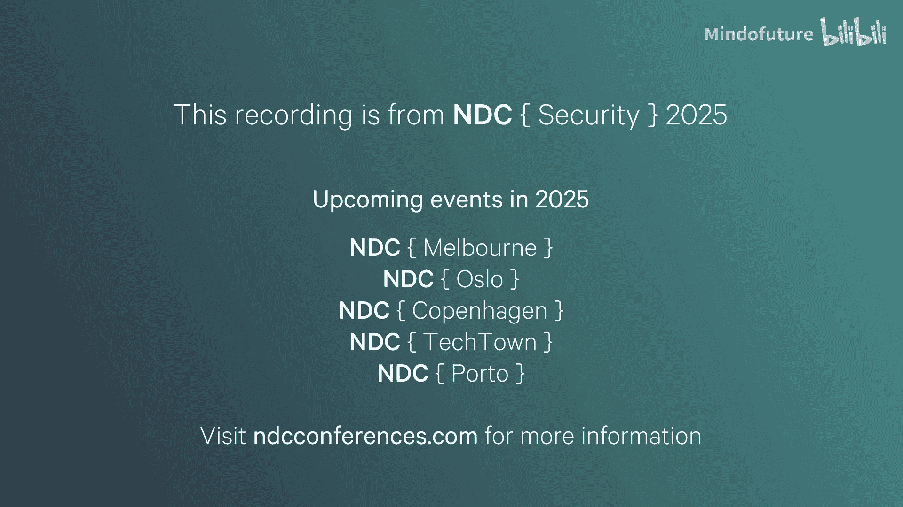

All right。My timer has started running， so it's time for me to start talking just to make sure I can fit everything in in this one hour slot。

 So good morning， welcome if you saw my previous talk。

 welcome back I'm doing back to back dos this one is in a bigger room。

 it's hopefully a more's a more advanced topic for sure。 previous one was about API security。

 we saw some really crappy examples and how to fix it now we're gonna talk about something completely else we're still gonna break stuff and fix stuff but we're gonna to talk about frontend security now if there is such a thing'll talk about that in a second and specifically for OO So what we're gonna talk about here is basically OO just a very quick recap so that everybody is on board without going into too much details here but OO and openid are kind of everywhere these days a lot of systems using them and I always use this trianglebased setup to explain the relationship So Openid Connect is about user authentication right it's co-ops and OO flow under the hood but。

😊，In essence， the question with openly connect that we're answering is authenticate the user for me。

 So we're uploading authentication， not doing it in app， but we're uploading it to a third party。

 an identity provider。 It will handle authentication and gives us information about who the user user is。

 And that's openly connect。😊，OA solves a completely different problem。

 OA is not about user authentication。 OO is about accessing resources in terminology of the specs is going to be a resource server。

 but in most applications that we're dealing with today。 It's going to be an API。

 So I choose to use APIs。 it makes things a little bit easier to talk about instead of saying resource server 15000 times throughout a talk。

 That question is OA and OA this single arrow is like 13 steps or something to complete and an actual OAflow because it can get pretty complicated with the back and forth and redirect the user authentication and so on。

 But in the end， what we get is an access token。 and the access token allows clients applications on the left bottom corner to access APIs。

 And that's also part of the OA ecosystem the ability to access a resource server and API with an access token which can do its authorization logic and so on and so on。

😊，On the right side， it's a triangle。 So we need a third leg。

 and the right side is the API making authorization decisions that involves the authorization server either very explicitly with token introspection or implicitly with signature verification on adjacent web token and so on。

 And that is essentially the ecosystem for Oat。 Allright。😊，In all out， the original spec。

 if you really want to feel old， the original spec is 13 years old，2012。

 and it had like a couple of flows to use in practice， like the authorization code flow。

 the implicit flow flow we shouldn't talk about because it's like super deprecated and a client credentials flow。

 And these things have evolved over time because as you can imagine 13 years ago。

 there were no mobile apps， there were maybe something but not as we know today。

 and there were no single page applications with angler and react view running in the front and all of that didn't exist。

 We had some interactions but there were somewhat limited and the focus was heavily on backend applications。

 All right， So as these things evolved， we added security features to the flows and so on and so on。

 And we ended up with settling on a best practice for about five years now of using the authorization code flow for user involved scenarios。

 So forget about all the other ones。 If you have a user involved， It's gonna be an。😊。

code flow al right， and on this slide， I'm gonna explain like the concept of an authorization codeflow。

 I'm gonna skip over a halfft the amount of details by design because otherwise I would have to keep you hostage till somewhere after lunch which would probably not be appreciated by you by the organizers and by the police maybe so let's talk about the essence here。

 So in the essence the user is signaling through the application。 like yeah。

 I would like to allow you to access an API on my behalf。

 That's the question that OA is trying to solve。 whatever that scenario is we're gonna leave that completely in the middle。

 So the front end， the client front end here is O client O client is like yeah， sure。

 let's start an OOflow with all the parameters in there like response type and client and redirect U and all of that stuff and it basically takes the browser through the authorization server to ask for an access token right and the browser will follow that。

 That's a navigation。 The browser will navigate there。

 and it will ask the authorization server to basically honor that request。😊。

These application should be able to act on my behalf。 Can you make that happen， please。

 and so on so on。 And the authorization server will ask the users like， who are you。

 Please authenticate if theres of course， if there's an active session。

 which the user has authenticated before this question will not be there。

 But the first time the authorization server will be like， who are you。

 And I'm going to authenticate with my username， Philip and my password。

 fluffy Doox 17 exclamation mark。😊，That's my default， slide password， not my real password。

 It looks very secure， but it really isn't。 So please do not try to hack my accounts with that password。

 Trust me， it's not real。Alright， so when that happens， the authorization server is happy。

 It knows that I'm Philip。 It knows that the client is allowed to access something on my behalf。

 Everything checks out， so it will return an authorization code。

 a temporary artifact to send through the front channel。 This is the front channel。

 Where's my highlighter here。😊。

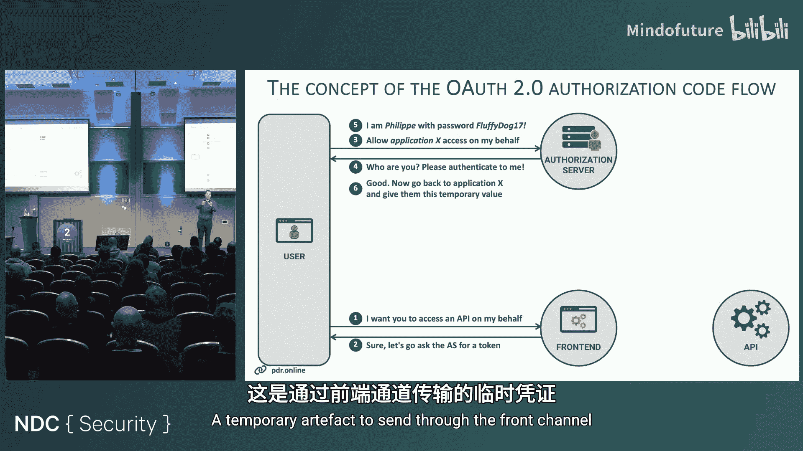

Somewhere stuck on my screen。 There we go。 The highlighter here， This is a front channel。

 So this is kind of untrusted。 So we use a temporary artifact， the authorization code to handle that。

 The authorization code ends back up at the client a front end application and the front ends with this temporary artifact count too much except one thing it can go back to the authorization server and exchange that code for tokens All right the authorization code is exchanged for tokens。

 and it obtains an access token and maybe a refresh token and so on and with that access token。

 it can now access the API。 So we have accomplished our mission in this conceptual view sorry in this conceptual view。

 we eliminated a 13 to9 steps in reality， there's gonna be a lot more involved。

 You have to use something called Pixie and so on on the flow is a lot more complicated。

 Allright But for our basic understanding of what we're gonna talk about in this session。

 this is enough。😊。

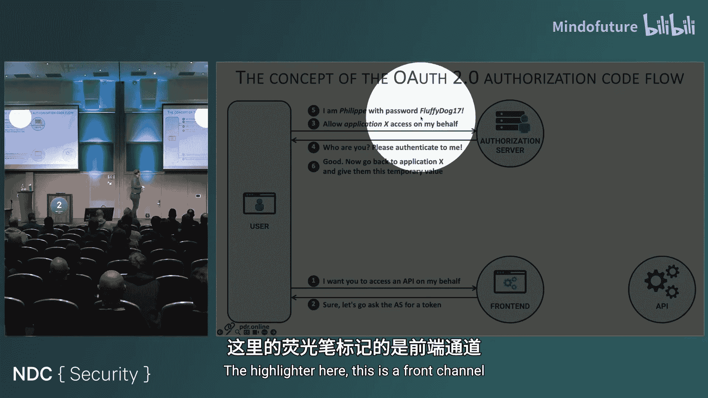

All right， in this。Conceptalization in this。Implementation pattern。

 a front end has a couple of responsibilities， right our front and client or angler app or a U app or react app has to do a couple of things。

 First of all， it has to act as an OO client。 So it runs the OO flows。

 It has typically a client library to run that for you。

 You don't have to implement the dirty details yourself。 The library will handle them for you。

 and you are good to go。😊，It receives tokens so it also responsible for token management right The front end is supposed to handle token management keeping track of the access token the refresh token using the refresh token when necessary and so on。

 And then actually I have some items to highlight that and then finally we have the responsibility of calling the API So whenever we make a request to the API we include the access token typically in the authorization header type bare we send the token and that's how the API can make authorization decisions and this is how OA in front ends is very often implemented。

 All right。😊，Now。What happens when things go wrong？That's a very important question。

What happens when malicious jascript runs in your application That's in front end in front end world。

 malicious jascript is one of the biggest threats， right How can that happen well if you went to Scottstock earlier。

 if some vendor gets compromised and their ja file is modified and you pull it in all of a sudden you're now running untrusted code that might control your application。

 it can do crypto stuff or it can attack OA， which is also possible。

 a second way that this can happen is with cross that scripting cross that scripting is basically a vulnerability where data for the user from the user ends up in the application and gets executed as code。

 It's a mistake It's a coding mistake， but it basically allows an attacker to provide malicious data which will eventually execute in the users in a victim's browser inside the application。

 the exact details are out of scope， not relevant， but what matters is that crossat scripting results in malicious ja running in the victim's browser within the application。

 All right So what can that do。😊，Steel tokens。Right。

That's essentially the component token management gets attacked。 The malicious code is like。

 it's an O app。 awesome。 There's some tokens there。 Y， it steals the tokens。 It ships them off。

 and it basically attacks the application。 That's here's what in the tax scenario would look like。

 The application is running。 Rle great。 It's a restaurant review application。

 It might go to training app。😊，Because I like great restaurants and application security。

 So you can put them together in a restaurant review app。 More importantly。

 everybody understands how it works。 So I don't have to spend half an hour explaining the training application to dive into that。

 So this is pretty understandable。 What happens here。 Well， we have some storage areas。

 We have some the application running and all of a sudden， we have malicious code。

 That's the red part。 red is always bad here。 malicious code running。

 and that malicious code can do whatever it wants。 And of course。

 it's gonna steal the information right we read the data from local storage。

 and we send a request to a server control by the attacker。 Our server。

 My evil domain is malicious food co just to stay in the team。

 So we send a request to malicious food com， and it will include the data from local storage there and the server now has the access token or the refresh token。

 and they can abuse that token by calling an API。 Well access token， not a refresh token。

 They can use the refresh token。 They get a new access token and then abuse the API。 All right。

 that's essentially what the。😊。

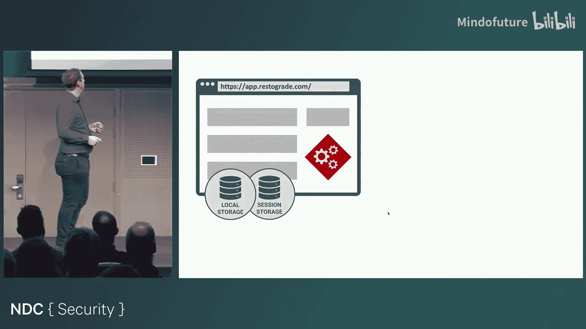

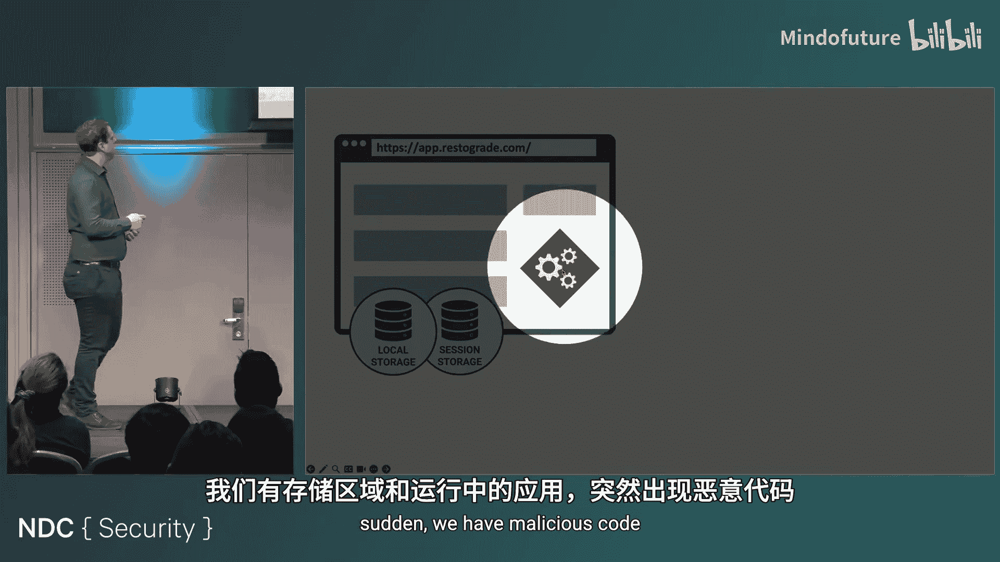

Treread scenario is for O art and single page applications。 This is not good。

But also not earth chattering。 This is not like new insights。 This is pretty well known。

This also means that。There are some countermeasures for this。 For example。

 one of the recommended best practicess is to use shortlift access tokens。

 If your access tokens are only valid for five minutes。 If somebody steals them， they can abuse。

 I'm sure， but at most for five minutes。 So that might be a good solution。 Keep them shortlift。

 Then you have the refresh token， which allows the attacker to get fresh access tokens。

 And the the guidance there is like， yeah， you can use refresh token rotation。😊。

A refresh token rotation basically means I'll explain it in a second that a refresh token cannot be used by both the attacker and the application。

 can only use it once。 and if somebody uses it a second time， things will break。

 and that's what the recommendations would be in this particular scenario。

 This pattern is highly common。😊，But it's absolutely horribly insecure。

So I've wasted a lot of time talking about the stuff you're not supposed to do。

 If you're at this point， you're probably like experiencing someja dejafu if you've been here two years ago。

 I talked about the exact same issue back then。 All right， this is not a glitch in matrix。

 This is kind of by design。 So what's going on here is。😊，This has been a problem for a long time。

 And what I discussed so far used to be the recommendations in the spec for Oat for browser based apps like this' is a separate spec for this。

 And it used to say like， yeah， there's some risk of ex。

 but you can use maybe thislift tokens and refresh toker rotation。

 And it's kind of make things better。 And oh yeah there's like this other pattern that you might want to use whatever。

 That's in a nutshell。 the old version of the spec used to say。

 And as a security expert and working a lot with front ends， this always triggered me a bit。

 like this doesn't make sense like you can evade these issues。 right。

 you can evade things like refresh token rotation。 And I wrote like a lengthy message on the mailing list。

 the Oat mailing list and people are like， yeah。😊，That was kind of it。 So I was like。

 that's not very efficient。 So I decided， like， you know what， let's， let's do a talk about that。

 Let's tell people that the advice in the spec is really bad。 And if this is probably better。

And that's what I did here at Ny Security。 And the feedback from that talk two years ago was like overwhelming。

 People were like， holy language， holy crap。I was going to say something else but Holyly crapab。

That's like not good。 And they saw the line and they were like， yeah， this was really insightful。

 and this was really great。 And yeah， we actually should think differently about security off frontance。

😊，I did the same dog that year at the OO security workshop。

 And that's basically where the people riding the specs are all together in like a friendly environment。

 And I did the same demos in their face。 Like， here's how I can how you easily circumvent these things and they're like。

😊，Yeah， that's。Yeah， that's not good now we understand seeing something is apparently a lot different than writing it out in a mailing list because people have to make the connection to actually see it being done instead of hearing someone like。

 yeah， I can circumvent that and showing that was actually kind of very important。

And what the result was from that is like we talked a lot about security。 And， of course。

 it's a large security workshop and some other things and。In talking with the main spec address like。

 we probably need to rephrase the advice a bit and change this a bit。

 And this eventually resulted in me becoming a co-author of the spec and becoming a co-author is coded language for rewriting the whole thing。

That's eventually what happened。 You'll find like a major di somewhere in around number 15， I think。

 rewriting the whole thing and expanding the spec a lot。 It went from like。Faake discussions like me。

 something like this to like a very concrete document。

 And that's what I want to talk about here today。 Some stuff will overlap with the thing I talked about two years ago。

 but I'm gonna add a lot of new stuff of what's in the spec。

 And the main contribution here is basically a fully featured or fully detailed threat model。

 Like what can the attacker do when they have cross scripting access to the application。 Allright。

 And then we talk about implementation patterns。 And the old pattern that I talked about before。

 which is really crappy is still in there。 if it were me， I would have deleted it。

 but apparently you're not really supposed to do that that strict spec。

 So people might want to use it。 So what we did is we added like a threat analysis to that pattern。

 like， hey you remember these threats we had here。 Like here's how this course against all of these threats like doesn't cover this doesn't cover this。

 So this is a problem。 This is a problem basically doesn't do anything in security wise。

 That's basically the conclusion of that pattern。 Now， of course。

 we have the other recommended patterns like using a BF and it can cover a whole bunch of these threat。

😊，And that's what I'm going to talk about here in this session。You saw my name the spec。

 the P stands for Philip， which is very confusing。 thank you， French people for that。

 The name is the French spelling by the way， which is not very international and whatever。

 So who am I am a security expert， I did a PhD in Web security。 And since my PhD。

 which is like ages ago， I've been helping developers understand security。😊。

I do that through conference talks like this one to trainings， conference workshops。

 I did one here on API security， but also through very specialized consulting。

 helping them understand a lot， understand the tradeoffs， understand what to do。

 how to do it and so on and so on。 So that's essentially how I spend my time。

 I also volunteer for Se up de， which is a nonprofit organization which runs a yearly apps course in Belgium。

 So if you ever need a reason to visit Belgium for a whole week and your employer pays for that。

 Se up de is the perfect opportunity。 So that's how you sell it to you。

 don't tell your manager that I set that， of course， you have to packages a bit。

 But what we do there is we bring experts from around the world to live into Belgium to teach about application security for a whole week。

 we sit together for a whole week。 it's very immersive。 It's a small group。

 It's a super fun experience。 and it's very， very great to learn about application security。😊。

Allright。😊，Enough about me。Almost start talking about OA again。

 if you want to grab a copy of the slides that saves you having to take pictures all the time。

 which you can do of course， if you want me to post for a picture you can ask it as well。

 I'll do that but if you want to grab a PDF copy you can find it here it's also on my website on my socials you can easily find that if you get my name right then I'm very easy to find if you forgot how to write it it might be a bit more challenging but the OA spec would be a good starting point like you can go there and then you can at least get half of my name right and then take it from there。

😊，Good。Let's talk about JavaScriptscript。Everyone's favorite topic。

 Let's talk about malicious jascript。 That's what it's really about。

 It's malicious javascript running in a browser。 That's the problem here， right。

 We have a browser based application。 H and jascript。 and all of a sudden。

 through some mechanism which we can leave out of scope here， The attacker succeeds in executing ja。

 And one of the ways that can happen is cross side scripting。

 right Cross that scripting is a major vulnerability。 Actually， I found some stats from hacker 1。

 a bug bounty platform。 And X S is like the big bright yellow chunk on top 23% of their vulnerabilities are cross side scripting。

 And if you search like a vulnerability database for X S。

 The results just keep coming and coming and coming。 It's everywhere。

 It's very hard to prevent crossside scripting。😊，And when it happens。

 the consequences are devastating。And it's been a problem for a long time。

 It's basically been a problem since I think the early 2000s when somebody first discovered his attack。

 and that's when things went down to shitter basically。

 and across the scripting started popping up everywhere。You may be thinking like，hu， but。

Single page applications didn't exist back then。 So even then。

 when you're building like these old traditional web applications。

 some of you may recognize yourself in this image。 My apologies for that。

 You can beat me up after the talk in the corridor。 That's fine。 No。

 we do not approve physical violence。😊，Old web applications had the same problem right building server side web applications。

 Java server pages， PhP stuff， pararole app， whatever you're doing， they had the same problem。

 we had a backend and we had a browser and we had HTML and requests and responses and we used cookies back then right sessionession cookies because why not and cookies are cool I like cookies and in essence。

😊，We had cross as scripting back then as well。 and cross as scripting back then。 Sorry。

 Cross S scripting back then resulted in an attack called sessionession hijacking， right。

 malicious jascript executing。 And what would it do， it would steal your cookie。

 Shi it off to a server control by a attacker。 and the attacker can now use that cookie to present to pretend to be you as a victim。

 Session hijacking。😊，Sounds familiar。Token stealing， cookie stealing， same thing。 different data。

 How to power of。My television is gonna switch off in。55 seconds。

 So we'll have to deal with that as we go along。That's a to the people in the back， by the way。😊。

What's the solution here， The solution back then was like， yeah， you know what。

 we can mark the cookies HP only。Because that prevents the cookie from being accessed from Javascript。

 it allows。The use of the cookie on a network， but you can't read it from jascript。

 And that's essentially the solution that was pitched back then。

 and people believe that this would solve their crossat scripting problems。 and it really doesn't。

 There was even a misbelief at that point。 Look at me， not at him。 Look at me。

 There was a misbelief back then that HTp only fixes cross that scripting。

 You can find blog posts saying like Htp only cookies are a great way to prevent crossat scripting。

 which is like what no， it solves like one symptom of the attack， like one potential consequence。

 but the attacker is still running code in the front end。😊，In your browser。

 the attacker can do anything that a legitimate application can do。 and it can basically。

 for example， send requests to the backend。 building like a serverside banking app。

 What can I do it can send a request like add a new transaction to the list。

 It can modify the dump to high， the transaction in your list of monthly payments or weekly payments。

 And then when you pay it， of course， the transaction will be there。

 and the attacker will steal all your monies。😊，Something like that。Has always been a problem。

 Thank you， by the way， has always been a problem。

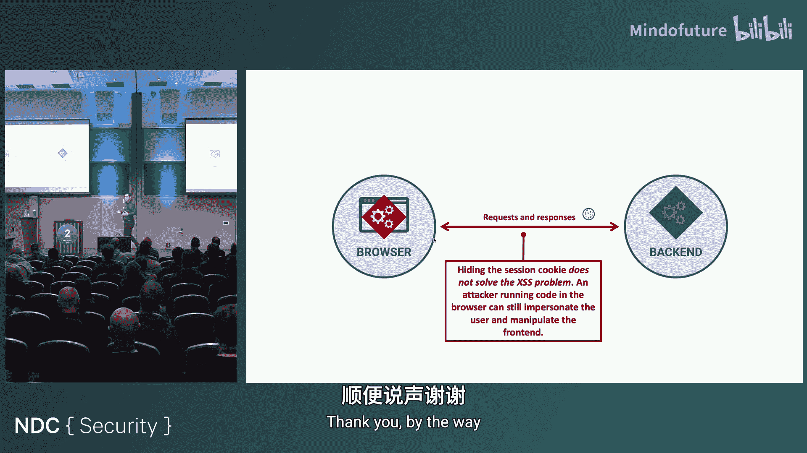

And it we only also never fixed the issue。So what does this mean。

 this means that we kind of underestimate as a general node for the community。

 we tend to underestimate a real power of cross that scripting。

Because we focus on this one super obvious attack。It'sLike if you think about somebody burglarizing your house。

 you think about they might steal my cold jewels while the attacker was just there to drink your boos。

 for example， and for some people， the bos might be worth more than the gold jewels。

 but that's again a different story。 but the real story here cross that scripting is about a lot more than just stealing data。

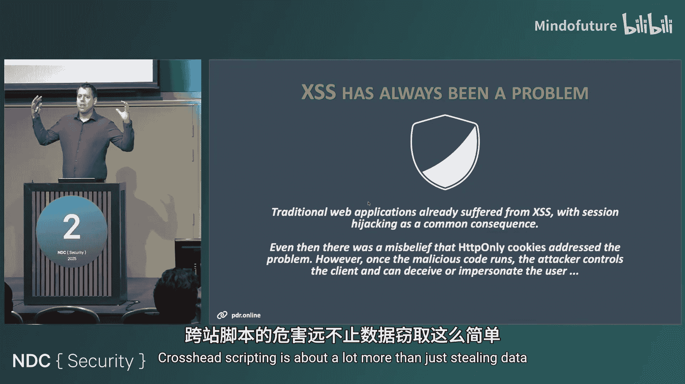

And that brings us back to our front end story。And the frontland story here。

Is that the attack can do a lot more。 So we had this scenario。

 This is what I call the 12 year old scriptp Kity approach。😊，Like my first ex like， oh， I mean。

 I'm going to steal stuff and abuse stuff， but a real attacker， they will think what they're doing。

 they will probably not be a script kidty。 hopefully， well I'm not sure if that hopeful is correct。

 but they will think about ways to compromise the application without running into these things like refresh Co rotation。

So what is refreshed token rotation all about。 Let me tell you why it doesn't work。

 Refresh token rotation The concept is that the refresh token changes every time you use it。

 And if you use an old one twice， everything blows up。😊，So to speak， everything will stop working。

 That's maybe a less dramatic way of saying things。 So in a legitimate scenario。

 the front end or the client， you can use it for other clients， but you shouldn't。

 But the client basically has an access token and a refresh token。

 And when the access token is gonna expire。 we use the refresh token to get a new access token and a new refresh token。

 And then when the the second access token expires， we get a new set of tokens。 token3。

 when three expires。 We get token at4， and this keeps going until the authorization service is like yeah no this this is no longer valid it's enough。

 You have reach the absolute lifetime of this chain。 Ref token rotation。 Ped as a solution。 Why。

 because the idea is that the authorization server will detect reuse。 So at some point。

 the attacker will still refresh token2。 Remember script kitty going in and abuse that。

 And the attacker is like I can use a refresh token。 I'm so cool。

 And we now have access token tree and refresh token tree。

 And the attacker can use access token tree to access the API on behalf of the user and Co mayhem。😊。

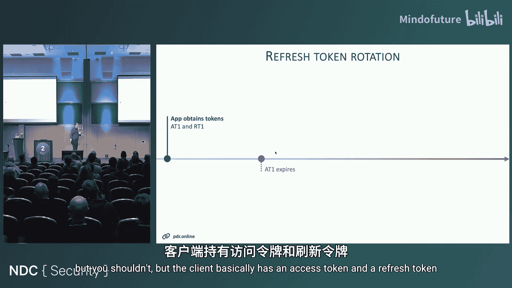

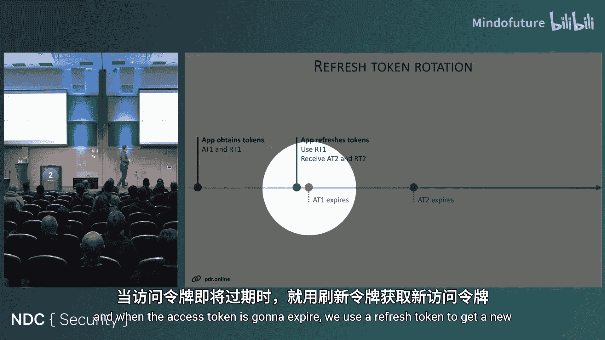

However， when the。Application is， of course， unaware that this happened。

 There's no X S exfiltration monitor tool。 It just doesn't know that this happened。 So at some point。

 the applications will be like， hey I'm gonna to use refresh token 2 And as the authorization service like no。

 no， no， no， no， no， alarm bells go off like security alert in the locks。

 and it basically detects the reuse。 and it assumes。😊。

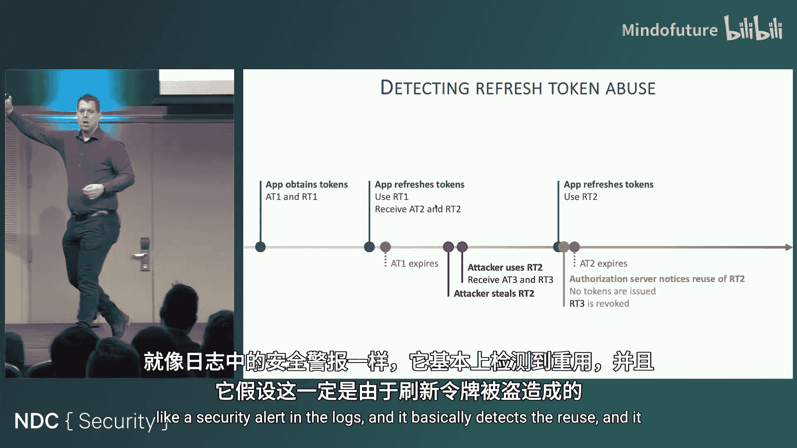

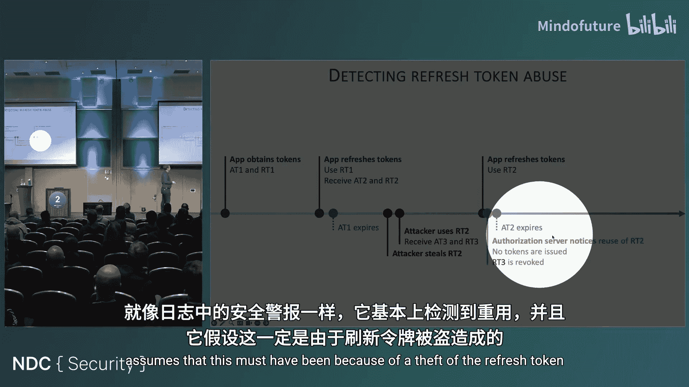

That this must have been because of a theft of the refresh token。

 And it basically revokes existing tokens。 Like it doesn't give the application new tokens。

 It also revokes any descendment of refresh token 3。 So  2， So refresh token，3，4，5，6。

 whatever are now revoked。😊。

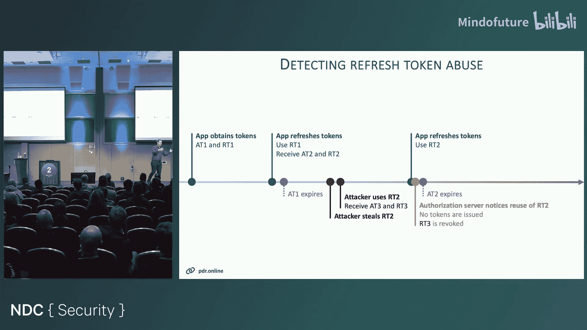

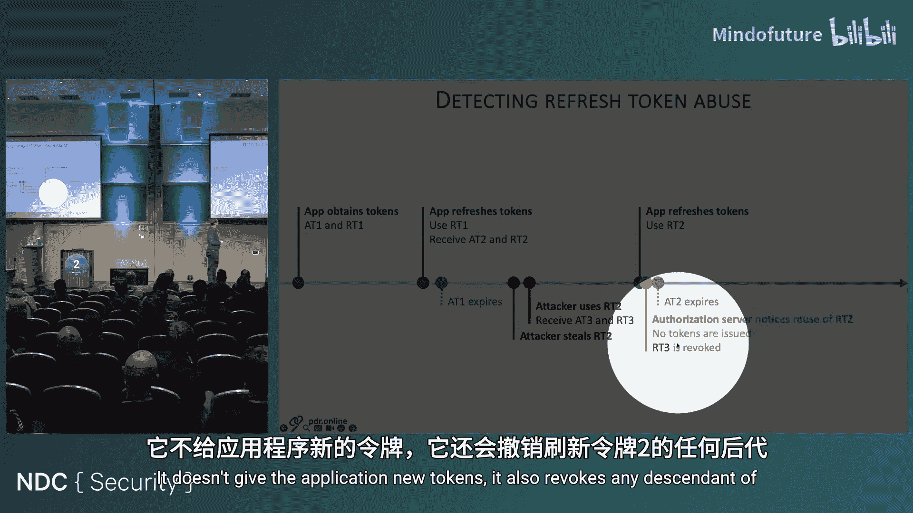

And that is how refresh token rotation is supposed to protect you。And this pattern takes。

Or fails to take into account that the attacker can maybe be a little bit smart than a youngwing can of abuse。

For example， what if the attacker waits until the application goes offline before using the refreshed token。

In that case， this happens。 The red part happens， but the blue part never happens。

 So the green part never happens。Ohoops。And that's one of the demos that I illustrated or use to illustrate that refresh token rotation is not a security measure。

 It's just annoying in a nutshell。 it seems secure。 if you take these very strict parameters。

 But in essence， it doesn't really add much Sure it makes it a little bit more complicated and maybe some really simplistic scenarios no longer work。

 But in essence， a smart attacker can easily circumvent it。

 So what does the attacker do They steal data。 and they keep stealing data。 They don't use it。

 they just extract data on and on on on on on。 And then they detect until the application goes offline。

 and then the abuse the refresh token。 and the application will not use the latest refresh token。

 The attacker does， and they can keep that chain alive for as long as this works。 All。

 other ways would be the attacker can steal the refresh token and then delete it from the client if possible。

 And then the client can also not use it anymore。 It will fail like whoops， something fail。

 but the attacker can keep going with the latest refresh token。

 And you can think of a thousand variations of this specific form of attack。😊，あ。So。

The focus on token exfiltration， as the original spec used to do。

 it really underrepresents the capabilities of malicious jascript。Alright。

 so let's do a quick demo of sidestep refresh token rotations。

 So you get to experience that in your face of why this does not work very well。

 What I have here in the demo is we have a demo application。 We have。😊。

A simple application using OA and access tokens。 It doesn't do much except for using OA。 Basically。

 we can search for things like we can search for test。And search。

 And then it says like we found zero results because it actually doesn't search。 Its just like， yeah。

 I couldn't find something。 Basically like children。 like， have you search， I couldn't find it。

 And then you go look， it's like it's right there。 Oh yeah， look at that。

 So this is basically a child version of a web app。 What does this mean。

 This means that if we search something。 It ends up in the page。

 It also has a cross as scripting problem， Just a tiny one。 we can search for， for example， test。

 I source is non， this image doesn't exist。 So what do we do if it doesn't exist Well， Al word one。

 would be a good idea。 And we search for this and bo。 Now we have cross that scripting。😊，Of course。

 cross that scripting on your machine doesn't get you paid as a bug bounty hunter。

 Everybody can do that。 That's very easy。 You can just use type Al1 in the dev tools and oh。

 look at that。😊，The trick is， if you want to get paid as a bug bond00 for X S is me doing something on my machine that will trigger X S on your machine。

 But if you look closely， a search feature is like notoriously vulnerable for this。

 This search term is also in the URL。 So you can link to this。 And if you send it to your friends。

 They can also see the results。 And if you would load this URL in the browser。

 let's actually do that， let's hit enter here。 if you hit enter here。

 you can see that the code also executes。 If I send you this link and you open this in your browser。

😊，Its will pop up the jascript alert。 The alert is the proof of concept， right。

 If I can pop up an alert， I can do anything I want。

 just takes a little bit more effort in typing alert1。

 but a little bit more effort is going to pay off if I can execute that payload。

 So how do we attack this。 Well， first， let's log in。😊，This is OAAT。

 this is the whole authorization code flow it takes us to an authorization server。

 or you have to log in with a username and a password。😊。

Very uninteresting and now we're logged in as for the deck and we have an access token and you'll see that I've configured the application with very aggressive refresh token rotation。

 so it should start rotating refresh tokens in a second there we go。

 and it keeps doing that very often So we see this an action in reality you would not do that every 10 seconds or something that you kind of get the idea。

😊，Allright， so how are we going to attack the application？ Well， let's take a look here。

 I have prepared a payload。 This is what we'll search for。 We'll search for test。

 and then let me make this a bit bigger。😊，There we go。 And then we include an SG。

 and the SVG is hidden， of course。 And then we have an onload like， oh yeah。

 if you load this SVG image， which doesn't really do anything。

 but whatever then we include a piece of code from malicious com s dos。

 And that's how an attacker will come after you。 That's all they need to launch this。

 What this attack do Gs do。 It basically steals your session storage and ships it off to a server control by the attacker。

 It steals your tokens。 That's it。 That's all you need。

 You can even write this as a single line if you really want to。😊，And we do it every X seconds。

 and then we detect later if the application goes offline and we abuse that。

 So how do we do that while we go here。I can now search for this link。My server is on the left。

And can see that we have stolen the refreshed token， alright。And on the right。

 we are refreshing our tokens。 And on the left， we're stealing the refresh token。

 and everything still works。 And you see the heartbeat。 Like client application is still alive。

 That's something that will eventually detect like hm， it's not there anymore。 And off we go。

 So that's essentially what's going on。 We can have to be careful with the timing here。

 Otherwise the demo breaks。 So let's see。😊，The latest refresh， there's the latest refresh token。

 And then let's see when the， yes， the server knows about it。 So let's navigate away。

 kill the application。 All right， the application is not there。😊，And on the left。

 we will detect that the application is not there getting ready to abuse tokens and there we go。

 And we can keep the refresh token chain alive。 And that's why refresh token rotation is not a security measure。

 It's mostly an annoyance。 It's a false sense of security。

 but it doesn't really help you because an attacker。

 That's at least as smart as I am can write an attack like this。 It's super easy。

 super simple to get this done in practice。 All right。

 I'm gonna to kill this before the Azure guys kick me off for abuse。 And we should be good。

 All right， So that's one。😊，AndThis is kind of obvious。

 and this still has the issue of people saying like， yeah， but what if we can fix the refresh token。

 maybe we can hide it in a web worker and un refreshed token isn't accessible and you wouldn't be able to do this And we salt security。

 And of course， if you think about it is the attacker can do anything they want right So what else can we attack here。

😊，Well， what if we attack the OA client？The front end is requesting or doing an OA flow with an authorization code and ex that code for tokens。

 What if we do the same as the attacker。There's no limit on how many artization codes code flows you can run because the front end。

 typically modern front ends， the libraries that you use run a flow like this when they bootstrap。

 they don't store stuff permanently。 They just bootstrap empty， run a silent flow， obtain tokens。

 and now they're authenticated。 And that's exactly what we're going to do right here in a second demo。

 We're going run a new flow。 We basically set up a handler to receive the artization code。

 We're going to use a hidden eyeframe to run the flow。 We extract the artization code。

 and we basically exchange that。 Well， we run a new flow。😊。

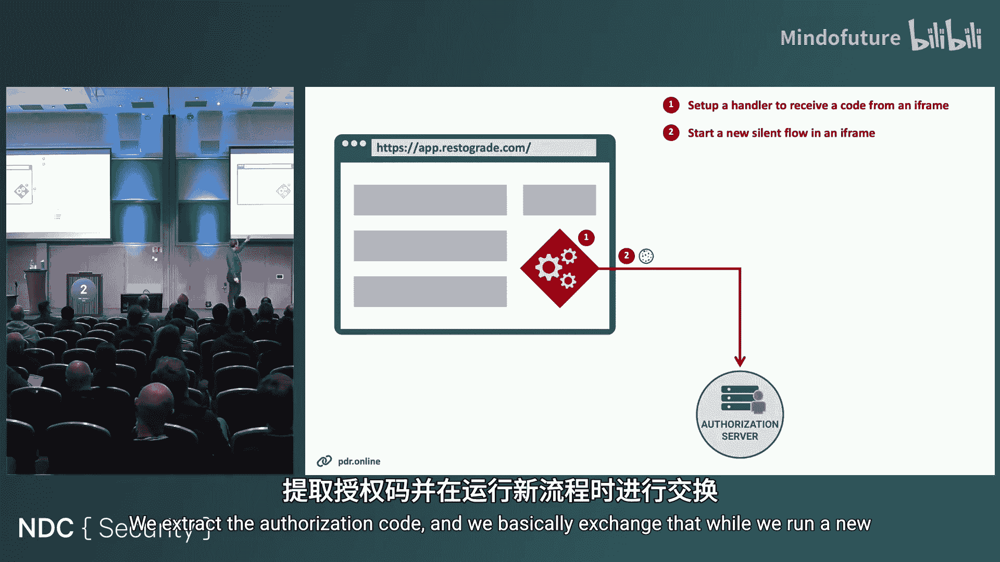

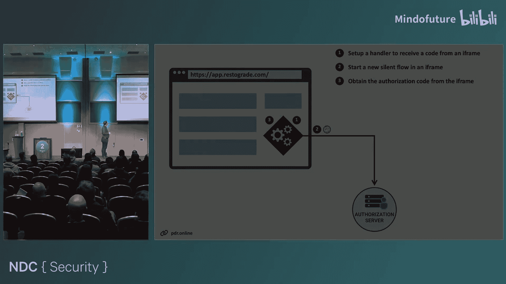

There's a highlighter。

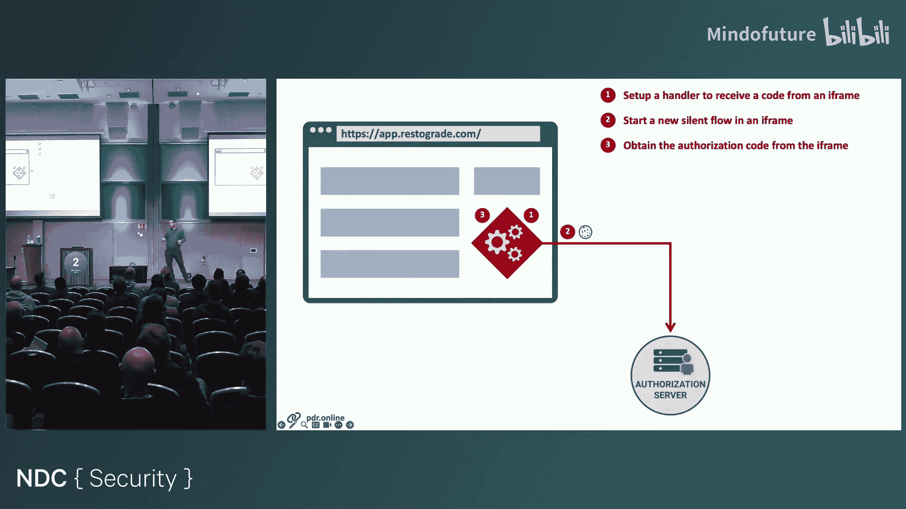

Great， where's my ty。 Yes， here。 Where's the other screen there at the bottom。 Alright。

 we basically run this code。 This code will run a silent flow using the existing session of the user with the authorization server。

 It returns an authorization code。 We extract that code and exchange that code for tokens。

 This set of tokens will be independent from the application。

 So the application is working and our code is working。 Two sets of tokens。 no overlap。

 no refresh token reuse and a massive massive problem in practice。 Alright。

 let's see that one in action。😊。

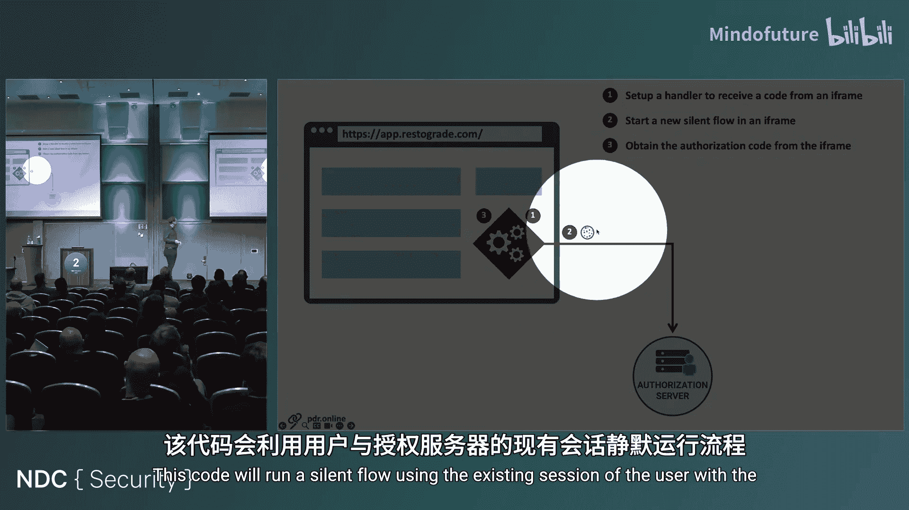

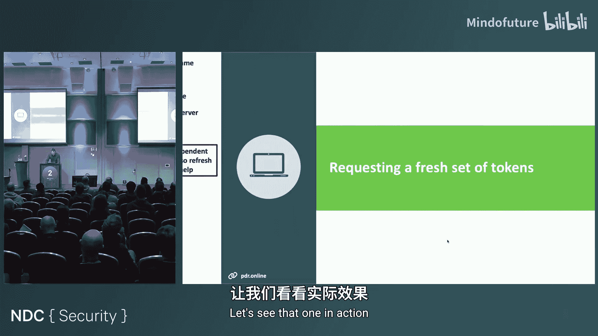

Same application， same setup， except that we need a new malicious server。There we go。

What has changed。 Well， the attack code has changed。 So this is my new malicious server。

 The attack code is now a bit more elaborate。 There's two， two ways to execute this。

 You can basically steal it using web messaging or you can steal it from the URL。 Both work。 Let's。😊。

R the first one because why not？We basically wait five seconds to launch this attack。

 It will run a new flow in an iframe。 You can see here we create an iframe。

 we navigate it through the URL to launch the silent flow and we then handle the alterization code and send it off to our server。

 All right， let's take a look at our server here。 that's running。 That's good。😊。

We can go here to the。App do recipe gum。 That's good。 Let's log out for good measure。

 and log in again。Otherwise， it uses the old refresh token and it still has lying around。

 And that one has been revoked so it fails。Just so you know， I'm not cheating here。 All right。

 so the app is running。 We have our new tokens in a second。 In the meantime， I'm going copy。

 There we go。 The payloads。😊，Is the same as before？Except that we now have modified a types copy。

And let's paste this one in here， boom。And there we go。5 seconds。 And on the left， you should see。

The authorization code coming in。 There was the authorization code on the top line。

 We exchanged that code for tokens。 I've screwed something up on the right because it doesn't work。

 so。The nature of life demo most my apologies。

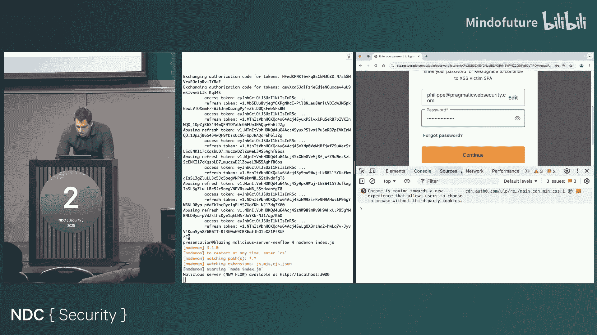

All right， let's see if this one is better。Otherwise。

 I'm just going to abandon the demo and you assume that it works。Yes， now it works。

Something with a refreshed token， Not sure what。 But in essence。

 we have refreshed tokens in the client and refreshed tokens on our attackers side。

 and they both work independently as we go on。 And this is basically a problem that we can't recover from。

😊，Because you can focus all you want on protecting your tokens in the application。

 I should kill this and protect the tokens in your application。

 but this shows you that there's no point in doing so。

 because even if you manage to fully hide the tokens in your application，😊。

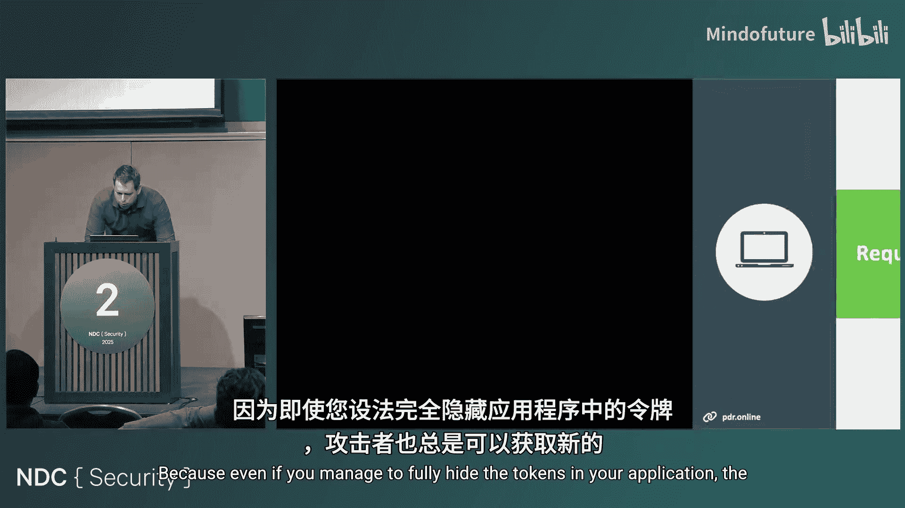

The attacker can always get fresh ones， even if you build like a fortress like the super most securest application ever。

 where you can never exfiltrate any token， The attacker just runs an iframe。

 extracts the authorization code and runs off。 It doesn't give a crap about your application。

 It doesn't hinder the attacker in any way。 and that is a very， very big problem。

 and you can try additional security measures like Deep up and so on and so on。

 It's not going to work because the attacker can do all of the same things。😊。

And that's a very important thing to remember。 malicious javascript code can do anything。

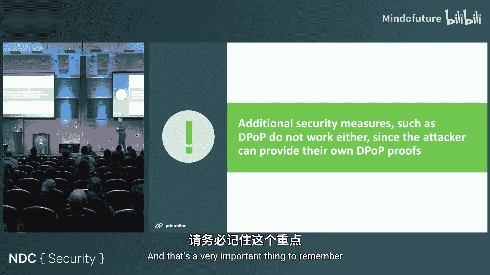

That you， as a front on developer can do。 if you're building a front and you're like。

 I can do this super smart thing。 Your attacker can do the same thing。Alright。

 and the conclusion here is， and that's a conclusion that's very unpopular with front and developers is telling them that they account securities。

 Trust me， since I've became a co-auor， there's a lot of emails coming in like yeah。

 but you can solve it with this。 It's like no because of this reason。

 and there's like this whole back of for going on about why that magical solution is unfortunately not going to solve things and that's。

😊，A very， very unfortunate and unconvenient route。Trust me， I've told a lot of developers like， yeah。

 you can't do this。 And the first reaction is like， yeah。

 but and then it takes a lot of convincing to get to the point like， oh yeah， okay， maybe you can't。

😊。

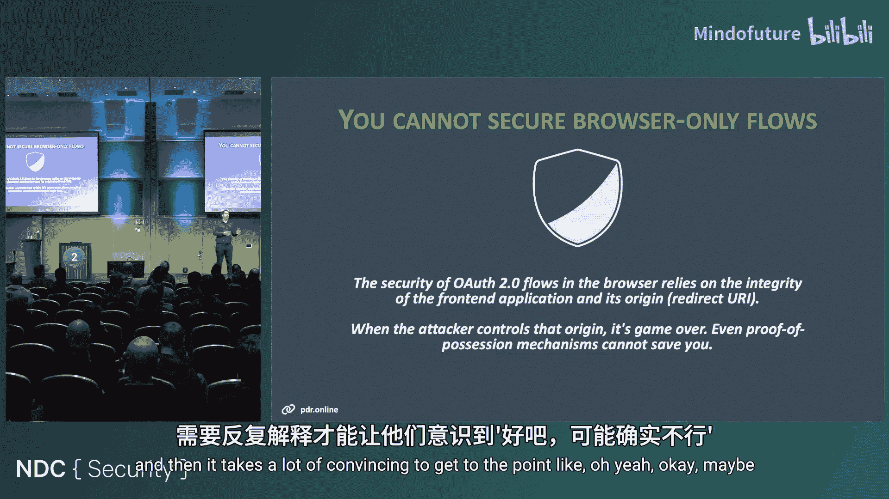

So what does this mean concretely， This means that there's a couple of threats to front and O clients。

 and that's new stuff from the spec。 First threat。Is stealing tokens， right。

 single execution token theft。 that's that translated to the 12 year old script kidty。

 like going in stealing tokens and moving out and doing something with those tokens。 All right。

 it can happen with accent tokens can happen as refreshed tokens and you can limit the duration of the attack a bit and so on and so on。

 That's a very simple threat scenario， but it used to be the main one in that spec。

 What else do you have continuous token theft or persistent token theft。 Basically。

 the attacker stealing tokens and always stealing the latest version of the tokens。😊。

Which is already a problem， because even if the attacker wouldn't be able to obtain a refreshed token。

 if they can always steal the latest version of your access token， you're still in trouble。Right？

Which basically means that the attacker， as long as your online can steal your latest access token Avenue use that token。

 That's not good。Dirt attack factor。Application acquisition and extraction of new tokens。

 that's basically running the new flow。And obtaining those tokens and using them because that basically circumvents a lot of the security measures that are in place or are recommended for frontend clients。

 And then the fourth one is a nasty one proxy requests via the user' browser。

 This is basically client hijacking right， The malicious code in the front end can send any request from within user browser。

 It can call the API with an access token。 It can do anything we want。 And that one。😊。

Brings us back to the image with the dinosaur iss the same one we had with our old server side applications。

 right， We can hide a cookie There。 It actually does work。😊。

But the attacker can still send requests that will use that same cookie to the backend and can do whatever they want。

 client hijacking， to be honest that's the baseline we can never solve client hijacking。

 That's just the nature of crossha scripting。 that's the nature of the beast。Now， this。Slide here。

 if you go look at the spec， the pattern for doing OA directly in the front end has all of these listed as relevant threats。

What we've basically done here。Very dramatic image。 Thank you， Cha CBT。

 What we've basically done here is we've made the situation worse by using OA。😊。

ThatThat's not good by the way， We had our front end。

And if we would have used a session cookie with the API， things would have been okay。

Still a risk of cross scripting。 But by adding OA into it， we made it worse。

 We turned an online attack into an offline attack with a lot more privileges。 And that's not good。

 And that's really not good。And that's the last of the depressing stuff，We've reached the bottom。

 Rock bottom here。 Rock bottom is this slide。 hence the， the very dramatic， like， oh my God。

 why that's rock bottom。 So let's， let's move out。 Let's， I have 20 minutes。

 I think to dig myself out of this hole。 So let's let's do that。 Allright。😊。

Traditional web apps are more secure than all the front ends。Okay。What about OA in backends， right？

 Remember that when I said that the original Oar spec is doing or is heavily focused on OA in backend clients。

 Well， if we look at OA and backend clients。These risks are not there。Which is like， whats well。

Single execution token theft or persistent token theft from the browser。

 I'm not talking about somebody compromising the backend and stealing your stuff there That's out of scope。

 We're talking about front and clients from the browser。

 There's no way to access serverside store data。You can't execute Javascript in a browser and magically get access to an access token or a refresh token stored on a backend server。

 Well， if that's possible， you have other issues。 you shouldn shouldn't be focused on this one。

 but focused on solving that issue because that is a bit more important But backend OA clients。

 they don't leak tokens to the insecure front channel through the browser。 there's no way to do that。

😊，There's also no way to run a new flow。And impersonate the backend client to obtain tokens。

 because in one of the steps， the backend client is a confidential client has to authenticate。😊。

At some point， when the backend O client goes back to the authorization server like， hey。

 can you exchange this code for tokens， the authorization service like only if you authenticate。

 fellow， what's your client I D and client secret or keybased authentication？

 And only then will the code be exchanged。 So the effect can still steal the authorization code。😊。

And the seconder would still be able to steal the artization code。

 but they would not be able to exchange it for tokens because they can't authenticate as the backend client。

Al right， what about the last one， Well， we already know the answer to that one。

 That was the baseline。 We can't fix that one and we can't fix that one here。

 The attacker controlling pages in the browser can still sent requests to the backend can still make the backend do things in name of the browser。

 That's client high checkingcking and we can't really solve that problem。😊。

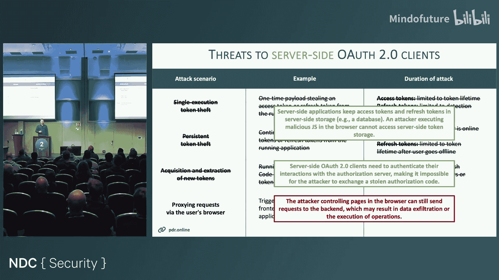

Alright， so based on this slide， we can conclude that OA and frontends increases the attack surface。

😊，By moving O out into our single page application， which seemed convenient。😊。

We have increased the attack service。 We have made the security significantly worse。

That's how you sell what I'm going to talk about next to your boss， by the way。

We made it worse by doing this。 Well， the other guys made it worse by doing this。

 That's how you really sell this。 Not me。 No， the other guys made it worse by doing this。

 I told them nothing。 nobody listens to me。 now now you have some proof。 Philip said so。

 you can use that as an argument， by the way， I fully approve that。 Philip said so。

 That would be perfectly fine。 idealde， your boss says like， yeah。

 let's bring him in and see if he really says that。 And then we both win。 So that would be good。

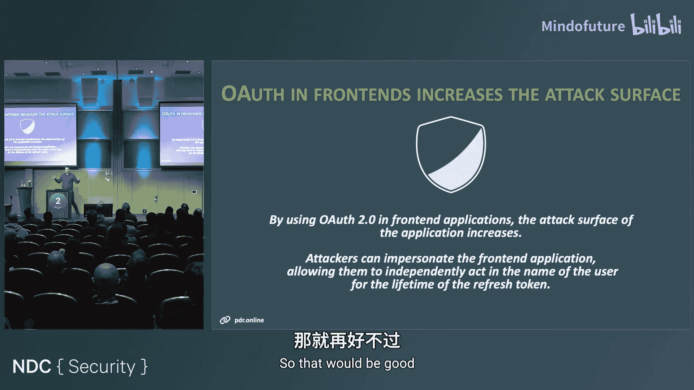

So the question becomes， can we have the security of back and O our clients in our front end， Yes。

 we can。😊，That's the whole point of the talk and the spec we can by building a backend forefront end。

By extending our front end with a backend， this is a message that goes really well with front end developers。

 like， you need a backend。No， we don't。 Yes， you do。 No， we don't。 And then， but yeah。

 you need a backend。 So what's the previous scenario。

 It's the front end talking direct to the authortization server。

 There's no client authentication here。 I'm gonna to stop doing that。

 There's no client authentication here。 That's the whole issue because if the attacker steals an authorization code。

 they can abuse it。 Allright。What are we going to do， We're going to extend this pattern with a B。

 FF。 A B， FF is a super dumb backend component。 You don't think about this as a backend。

 You just think about this as a module of the front end that happens to run on a backend。

 That would be a better way of looking at this。 It's not an API。 It's not a backend system。

 There's no logic in there， except for some very generic things。😊，And it'll be a F。

Well run O out with the authorization server。 That's what the BFF does。Alright。

 it's a confidential client。 Let's see if I can get my highlighter here。

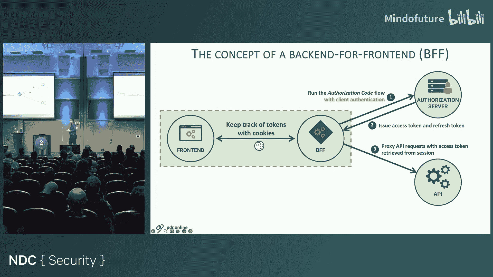

Yes， here。 This is a confidential client。

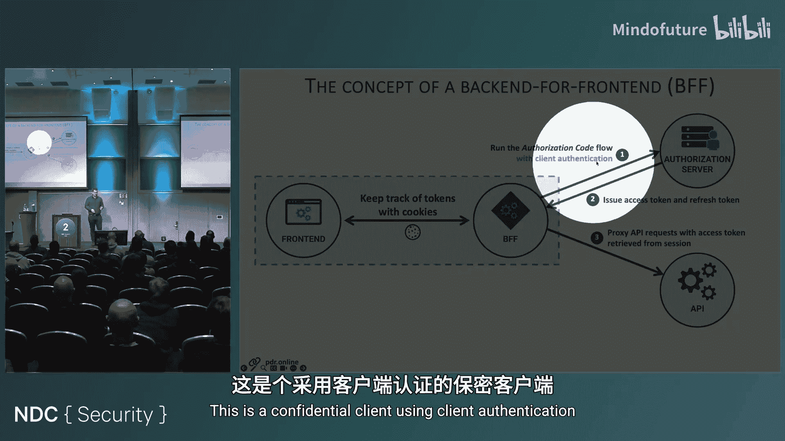

Using client authentic and so on to talk with authorization server。

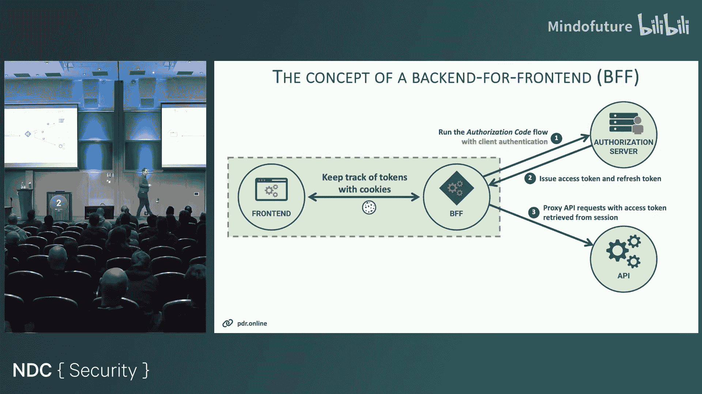

Token management is now a beckend responsibility。 with the front end， we use cookies。

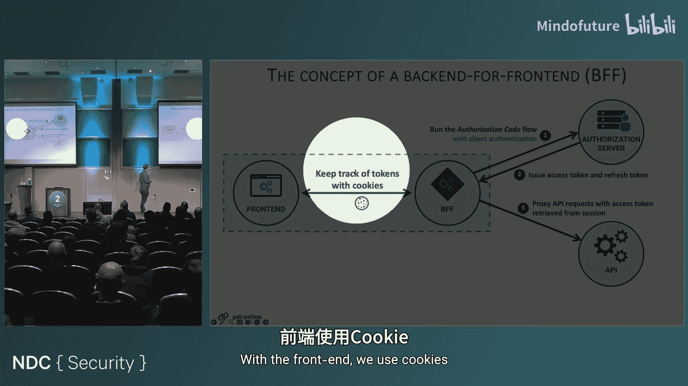

Cookies have a very bad reputation。 but in this case。

 cookies are the perfect way to keep track of state between a browser and API。

 works like a charm designed to work with a web And if you apply the right security properties。

 which I'll talk about in a minute， these are actually good。😊。

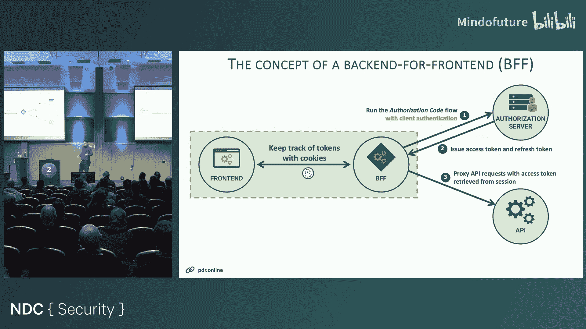

And what do we do when we call an API， Well， the front end doesn't call APIs anymore。

 The front end calls APIs on the BFF like slash BFF reviews and the BFF is like the reviews endpoint。

 Of course， yeah I know about that。 It's gonna take your cookie。

 use your cookie to fetch your tokens， attach an access token to that request and send it to the actual API handling reviews。

😊。

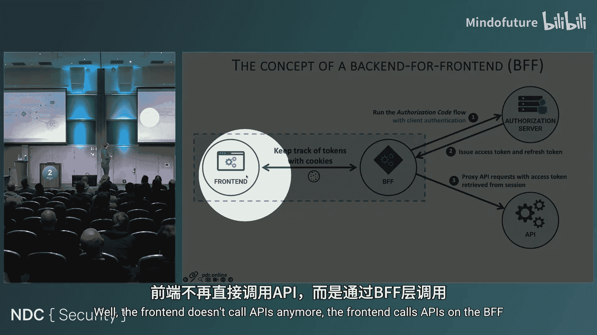

And that's how BFF works。 All of these building blocks of the BFF are super generic。😊。

And super simple。All right， so what does that look like？In the elaborate flow， well。

 the flow still goes through the front end， the user wants to log in or do something。

 And the front end will basically tell the BFF。 The front end no longer starts a flow。

 but to B FF does。 So we have to tell the BFF， there's a login endpoint。 We tell the BFF like。

 please start an Oatt flow。😊。

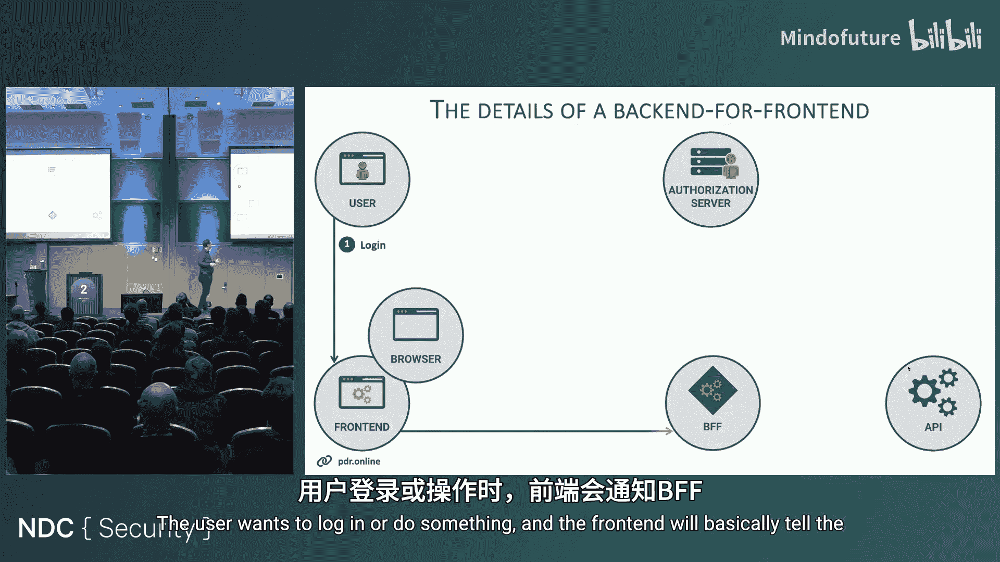

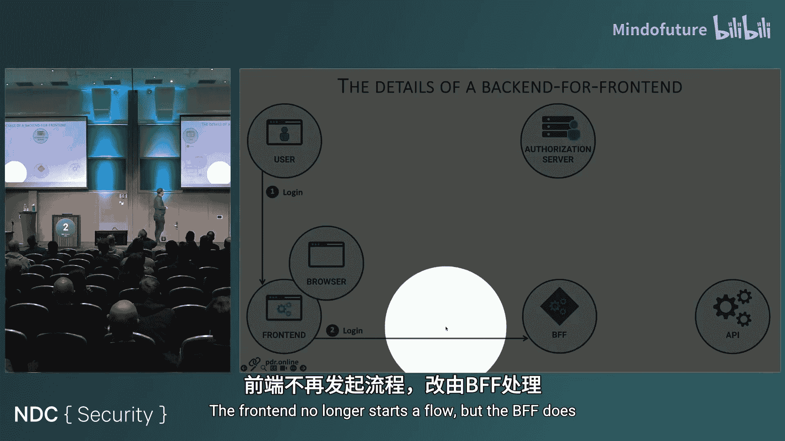

Or O lot plus O Y D C， whatever。 And the B is like， yeah， I can do that。

 And it's gonna be a redirect。 It's gonna redirect the browserss' like， yeah。

 I need you to go to the authorization server， please。 And the browserss will follow that。

 That point from then is no longer in the loop。😊，Just a browser and a user authentics and all of that stuff。

 And in the end， we get an authorization code， which goes free at a browser to the B，FF。

 There's an endpoint on the BFF。😊，Redirect or callbe or whatever。

 And that's the authorization code in step 7。 D BFF extract the authorization code from the URL。

And will now exchange that code for tokens。 And it will go to the alterization server with client authentication and be like。

 hey， I got the temporary value of the alterization code。 What does it mean。

 And the alterization server is like， oh yeah that's for Philip is an access token or refresh token and whatever you need。

😊，Maybe an anti token， whatever。The BFF。Can part of the identity token。

 there's no authentication because there's no user database。 There's nothing there。

 It's just an empty shell。 So what it typically does is it stores the tokens。

Or associates the tokens with the session。And then it tells the from and like， he。

 everything is good。And the frontland at that point will bootstrap again。 The frontland will reload。

 The cookie is set。 The frontland girls at BFF like， hey， do we have an active session。 And's like。

 yes， we do。😊，Because of the cookie， and it looks up the user's info。

 and it returns the user info to the front end， allowing the front to say， welcome， Philip。😊，Awesome。

That's what a BF does when we call an API， the frontline will call an endpoint on the BF with the cookie。

 the BF will use the cookie lookup like， oh yeah， this is for this user， we have an access token。

 take the access to and forward to call to the API in 14 and the API will process the request just like before and a response goes back and everybody's happy。

😊，That's what a BFF does。All right。If you look at our components， right， what has changed here， Well。

 for the front end developer， actually， I had this conversation like a couple of weeks ago。

And in front， the developer was like， yeah，' we implemented a B ofF。Man， my life got a lot easier。

 he said， why， because you can rip out O out from the fronttain like this OO library。

 take it throw it away， no longer need it。Awesome。😊，Next， token management， there's no tokens。

 The discussion， oh， where do we store to tokens if we use local storage or session storage or maybe a web worker。

Go away。 We don't care。 Cookies， H P only， and so on aa。 cookies， dumb。Calling APIs。 Well。

 that component is kind of replaced with calling the BFF。 So you still call something。

 You don't have to add custom headers。 The browser will add a cookie for you。

 but you still still call， of course， API endpoints on the BF OO has moved to the BF Oat client。

 We also do token management on the BF and session management。

 and every proxy requests from the front end to the actual APIs。

 All of these building blocks from the BFF are core building blocks of the web。😊，Oat clients。

 There's like 15000 and1 libraries out there that handle that for you。 Just use one of them。

 and they will handle the whole OATflow Token managements， the library typically handles it as well。

 sessionession management， you can find plenty of session management libraries like setting a cookie and so on。

 perfectly available and then proxy calls。 there's middleware enough for all languages to implement some proxy type activity right You have your and net。

 and you have proxy middleware and O TS。 and you have something in Java and something in Python and something got no what forgotten those language。

 but it's gonna be there at some point。 All right。😊，Sounds great， right？From a security perspective。

 it's like， yeah， B， F Fs。 But does it require a lot of changes。 No， actually， it doesn't。So。

 in practice。The API doesn't change。 Why your API receive a call with an Ex token。 Gu what。

 Your API receives a call with an ex token，0 changes to the API。 Awesome authorization server。

 configuration change， like you transform your client from a public client with no secret to a confidential client with a secret。

 and that's it。😊，Standard functionality support by any authorization server out there。The front end。

 rip out a lot stuff， and you're good。Okay， now， you have to call one additional endpoint on bootstrap like check session。

 It's a simple API call with a response。 You can deal with that in 10 minutes。 Allright。

 you can even ask your GT to generate that code for you， it should probably do a good job。

 Always be careful。 Probably is the keyword here。 And then the BF F， yes， the BFF is a new component。

 it's something you have to deploy and configure。 However， if you want to use a BFF。

 and you want to build your own because good stuff is built in house。😊，That's a sarcastic go。

 by the way， it can be， but it doesn't have to be， but if you want to build your own。

 you can build a BFF once。And everything else is configurable， you give it a client ID。

 a client secret， the issuer， UI of your authorization server， and a mapping of endpoints here。

 API endpoints here to APIs that's all you need， Everything else is configurable。😊。

So once you build it， once you've put all building blocks together， glued them together。

 you can reuse that BFF across your entire organization for all your front ends。

 You can even have one BFF serving multiple front ends， Why not。😊。

You should be careful because that's a discussion I've had as well。

To understand that the BFF belongs to the front end。

You cannot move the BFF towards the API by putting that in API gateway because that's going to create confusion。

 The BFF is not an API level component。 It's a front end level component， meaning that per front end。

 you have a BFF。 If you're building like a suite of applications。

 you have a calendar and you have a notes app and you have an email app and you have a forum app and so on。

 Each of these would have a different client I D on the authorization server。

 So each of these would have a BFF。😊，Of course， you can configure one giant。

 if you have like the super BFF， you can configure it to support for different clients with four different configurations。

 Sure， but that's how you keep the thing straight。 It's not per API。 It's per front end。

 Every front end that would have a client I would have a BFF configured with those client I D and secret as well。

 Allright。Good。The cookie。It's used to keep track of the user's tokens。

Cookies have this really bad reputation， which is used to be true for a long time ago。 but today。

 cookies are actually not that bad。And for all the people thinking like， yeah， man， I hate cookies。

 I'm using tokens because yeah， that's what we do， we use tokens on an altization header。

Guess what the authorization server uses with the browser to keep track of food users to do things on cookies。

 So cookies are always there。 It's the only thing that works really well on the Web。 by the way。

 In this case， we use a cookie to keep track of the userss session。😊。

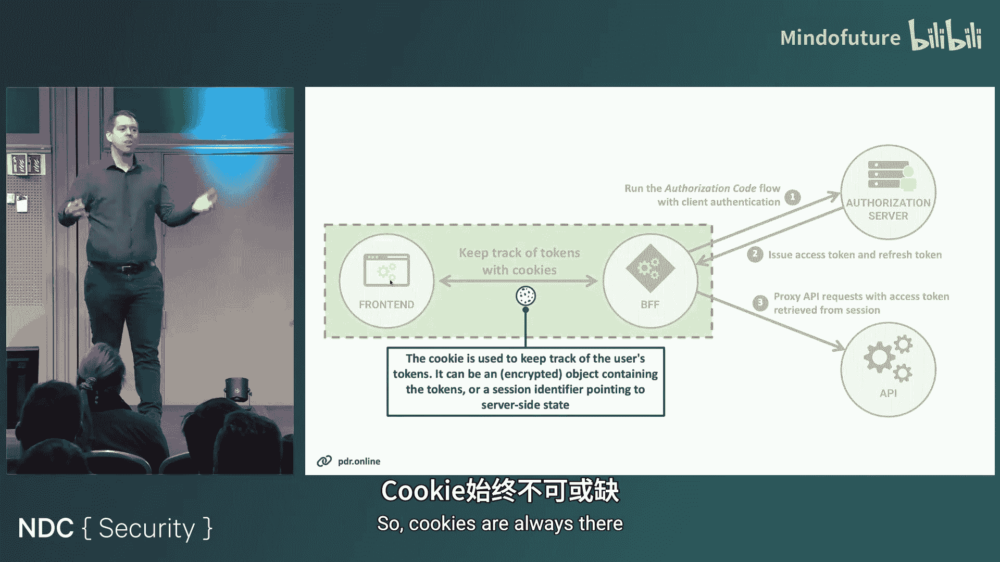

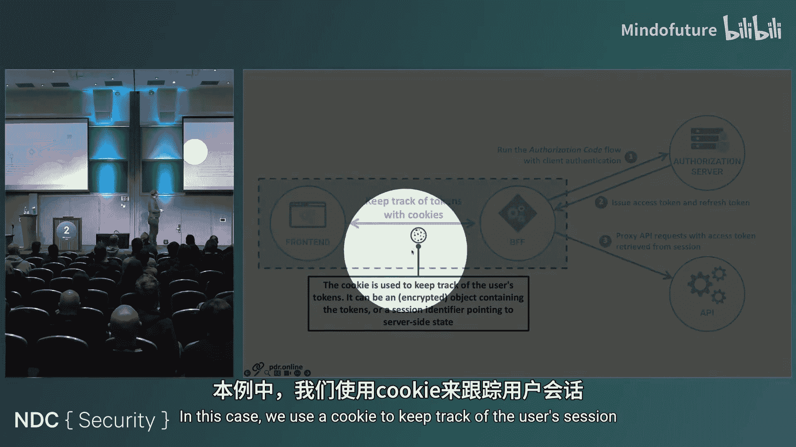

That can be a client side session or a server side session。

 It can keep states on a server like traditional Java sessions or PhP sessions， Why not？

Or you can choose to push all of the state to the client。

 You can put all of the token stuff in a cookie。Preferably。Wow。Here're slacking off next door。

 I mean， it's early yeah， let's stop here or maybe they leave time for questions， which I don't do。

 but whatever。😊，With me， you just get more of me， and we can talk later if you have questions。

 What we're talking about here is you can put all the data in the cookie and ship it to the browser as what one big cookie。

😊，In that case， it's recommended to encrypt that cookie。 It's not mandatory。

 It doesn't really improve the properties of the BFF。 the BFF stay secure。

 but it prevents infoteing malware from going through hard disk and stealing cookies from the browser and shipping them off。

 that would stop some sort of attack there。 That's what I wanted to say here。

 How do you configure that cookie。 Well， you add a whole bunch of flags and attributes there。

 You add the secure flag。 It's the only flag， the same size strict flag。

 And you add the host prefix as well。 Al right， I'm not going talk about what this means。

 they're listed in the spec。 if you want to read That's a good way to get you to the spec or you can follow one of my security workshops and I'll talk about the meaning of these things as well。

😊，Allright， so where do we get that B F F， Well， you can build one。 So it's a fun exercise。😊。

Until you get to the dirty details And it's like， why did we try to build this ourselves。

 You can also use vendor supplied BFs or proof of concepts。 Here's a proof of concept innet using Yp。

 It's from Manford Styre。 if you know him。 He build Ar stuff。

 This is a good starting point to get some ideas。 I don't think it's production ready。

 But what the hell。 You can also find some other implementation patterns like token handler。

 It's basically a BF without the name BF。 or you can talk to the guys outside in the Doende But because they actually have a full featuredature BF。

 They're one of the first to do this right， because I've been talking to Dominic quite a bit about this issue as well。

 And they've been doing this for a long time as well。 A lot of our customers use BF。

 I'm not associated with them。 So just go talk to them and see if you can use their BFF library for your applications as well。

 Allright。😊，You'll find BFs out there。 There it's becoming a bit more popular。

 I think the spec has helped。 awareness has helped。

 So you'll no doubt see a lot more BFs pop up in practice as well。 All right。

 if you want to build your own， I strongly recommend to stroll through the videos of previous conferences because there has been talks about how BFFs make things insecure as well。

 because if you do it wrong， there might be problems with BFF and open redirects and stuff like that。

 So you definitely want to look into those as well。😊，Brings us back to the threats。

To front lines with the B， F F。And this slide looks a lot better。

 What we have gained here is we have made our BFF is now a confidential backend O client。

 meaning that。😊，The attacks go away。 There's no token theft。

 The attacker cannot read a cookie with the tokens。

 The attacker cannot read tokens they were stored on the server。

 and the attacker cannot abuse them in that way。 That's good。We can also avoid the new flow stuff。

 as in the attacker can maybe steal an authorization code if they control the front end。

 that's still possible， but the attacker cannot。Exchange the authorization code for tokens without the client credentials of the B FF。

 If the attacker gets those。You're screwed。 It's dumb。 You messed up。

 That's basically the conclusion。Allright， the bottom one， client hijacking。Still there。

We can't fix that。 It's been there since 2003 if I'm not mistaken when crosss scripting was invented and it's still there today because there's simply nothing we can do to stop it。

 except get rid of malicious ja， which is the ultimate goal， of course， like get rid of malicious ja。

 but it's going to be a very， very hard and long road。

 And I'm fairly confident that if we keep the same model of mixing HTMLL and ja and data together that we'll still have crossside scripting in 10 years。

 even with all our best efforts。 It's going to be a lot better， hopefully。

 but it's never going go away， it's inherent to how we build that applications。😊，All right。

With that said。The BFF does make things better。Because before the attacker had an access token and they could use that access token on every API endpoint that would accept it。

Now， the attacker can send requests through our BFF。 And that means that we can kind of。

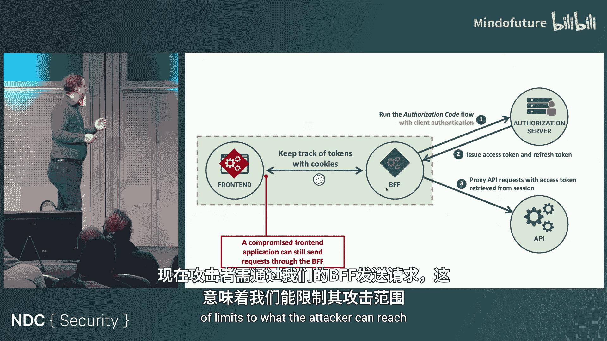

Limits to what the the attacker can reach。 So even if this API has 17 endpoints that would accept the access token。

 but the front that only needs 7， that means we can hide 10 endpoints， make 10 endpoints unreachable。

 That means we can very specifically expose the endpoints at the front that needs and reduce the attack surface for the attacker。

 That's good。😊。

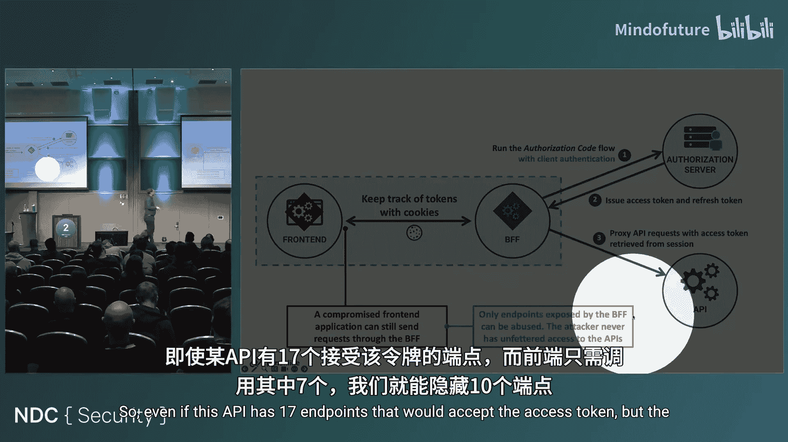

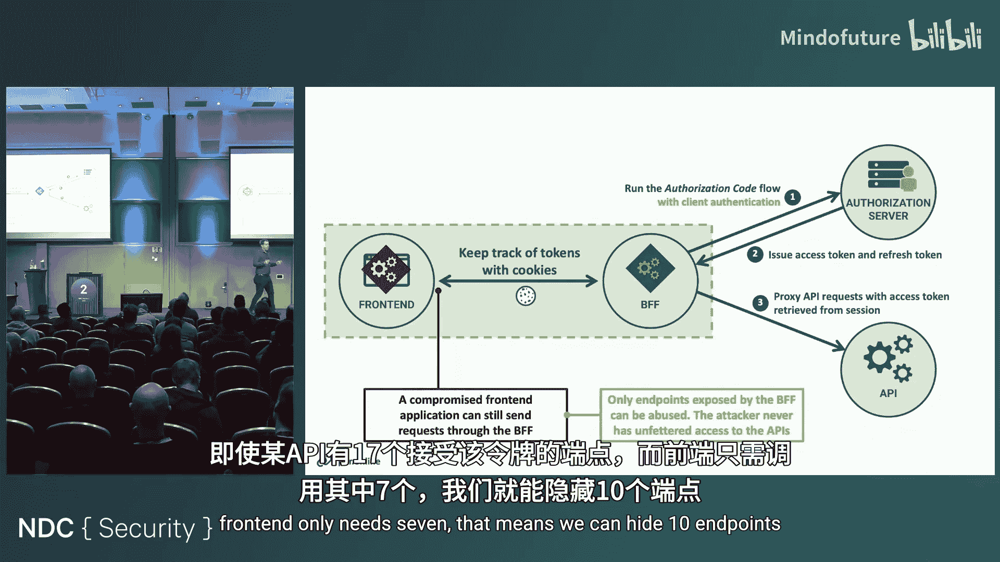

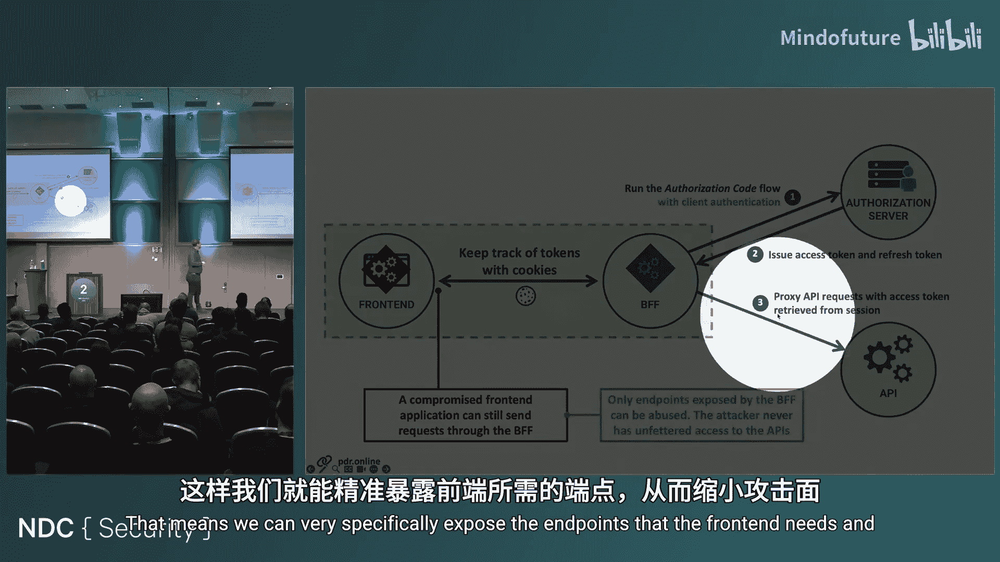

You don't have to do this as a B， F， F， but you can。 It's a good practice。Additionally。

 also optional， but additional， the BFF sees all of the traffic from front ends。

 the BFF could be a good place to implement things like rate limiting or anomaly detection。

 If a front end sends you like maybe 10 requests per minute to read documents。

 Maybe you should block something like 1 thousand0 requests per minute， like， yeah。

 maybe you're another legitimate front end， like maybe you go away and you block that or you raise alerts or so on and so on。

😊，Presure。 I'm almost done。 so I'm no worries。You're thinking like， oh， no。

 the coffee line is going be so long。 And My apologies for that。

 So the BFF puts itself in a position where you can actually implement additional security。

 but it's completely optional。 In that case， your BFF becomes very front and specific。

 very use case specific。 A normal regular B，FF is as。Dumb as a bag of rock if you want to call that。

 it's basically a very simple component without any logic it， to OA stuff。

 session management and proxy。😊。

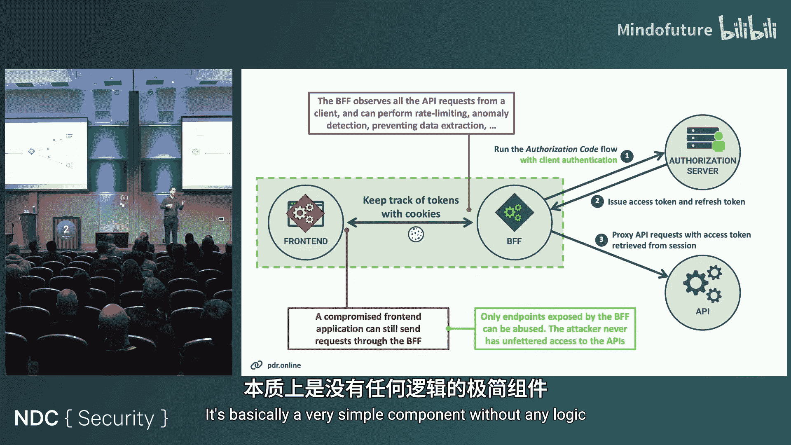

All right。BF Fs significantly increase security。To be honest。

 it's the only valid adoption for anything security sensitive。

I don't care if you think your code is object of cross that scripting。 it may now。

 maybe you did a very good job， but it's not history teachers it's not going to stay that way。

 History shows us that at some point， there's gonna be a problem。

A BF eliminates a whole range of these issues。 It gives you security。 It makes things a lot better。

And I strongly recommend or urge you to adopt the BFF pattern for your applications。

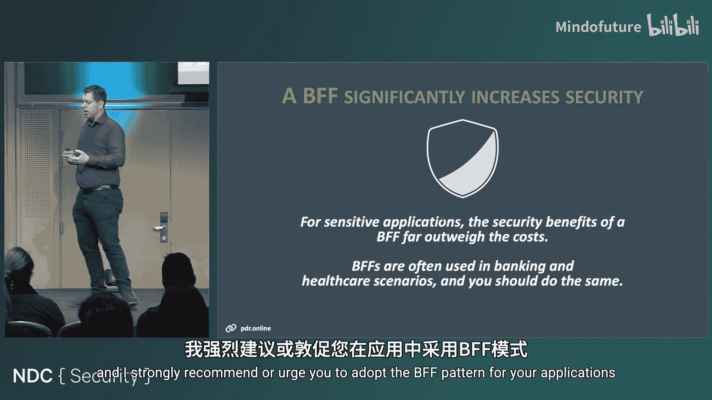

I also invite you to read a spec。I spend a lot of effort on it。Not that that's a good reason。

 but sure。I think it's a really good document。Other people have acknowledged that as well。

 So it's not just my opinion。it's all hearsay， but still， but it。

 it gives you a clear overview of the threats。If you're not convinced。Good for you。 If You're like。

 yeah， dude what。 No， come on。 whatever I'm going to do odd in the front end， be my guest。

I don't recommend it。But who am I to prevent you from doing that spec gives you a clear overview of the risks in doing so。

If you consider these risks to be acceptable， if you're like me， whatever， then sure， why not？

It's just that you can now make an informed decision instead of having to read through the lines or behind the lines and find the actual complex it's all in there。

 I strongly recommend you read it。 it's almost finalized by rate。

 This is like a draft from a couple of days ago to fix on minor issues It's seemed like the final last call stages at the ITF I have no idea what that means because it's my first time so probably in three to four months or something we will have an actual finalized RFC which will be really cool to see as well alright。

😊，Good。Key takeaways。Using OAs directly in a browser increases the attack surface。

You can find this inconvenient。 You can try to argue that it's not that important。

 but it is the truth。 So you have to accept it。 If you want to accept it and consider this to be acceptable for your specific use case。

 then okay， good。 But at least you know what it entails。

 You should use a BFF to simplify the front end。And optimize its security。 A P。

 F F makes the front end actually easier to implement。And maintain no more O client libraries。

 no more O stuff to update and so on and so on。 It's actually a benefit to use a B，FF。

 apart from the fact that you have to deploy the B，FF， of course。And after third takeaways。

 you should。Heavily invest in secure coding techniques to avoid crossside scripting。

Because the last effect factor never goes of away。Once cross that scripting happens， yes。

 we have not made it worse than it was 15 years ago。

 but it's still as bad as it was 15 years ago as well。

So don't mistake these things as solutions for cross that scripting because it's very much a dangerous problem。

 And you should apply secure coding practices to your front end as well。

 You should use defense and depth tools like CSP， and you should use technologies like trusted types to avoid mistakes during development and so on and so on。

 That remains incredibly important。😊。

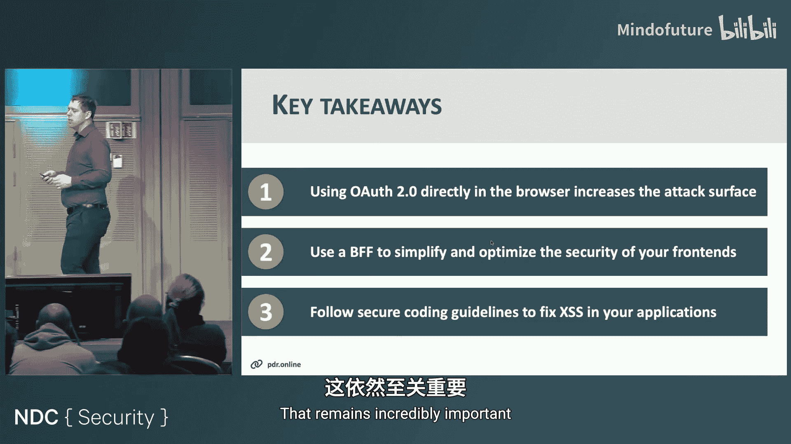

All right。Final shameless plug。 I'm doing an OA online OA course。

 If you really want to know a lot more about OO。 That would be a very good place to do so。

 It's two days。 It's after four mornings， but it's a two day curriculum where we dive deep into all aspects of OA。

 including front then security， BF's API security and so on and so on。

 So if you're interested in that。 take a look if you can join there。

 It runs in February somewhere I' it's in my calendar。 That's important。

 but I think it's 9 or 1 the9 or the 10 that it starts。 but I would have to check Alright， with that。

 I want to thank you for being here。 I hope you enjoyed the rest of the conference。

 If you have any questions。 We have exactly 10 seconds。 No you can talk to me afterwards。

 I'm gonna be here in the morning as well。 So just grab me and we'll talk。 Allright。

 thank you very much and enjoy。😊。

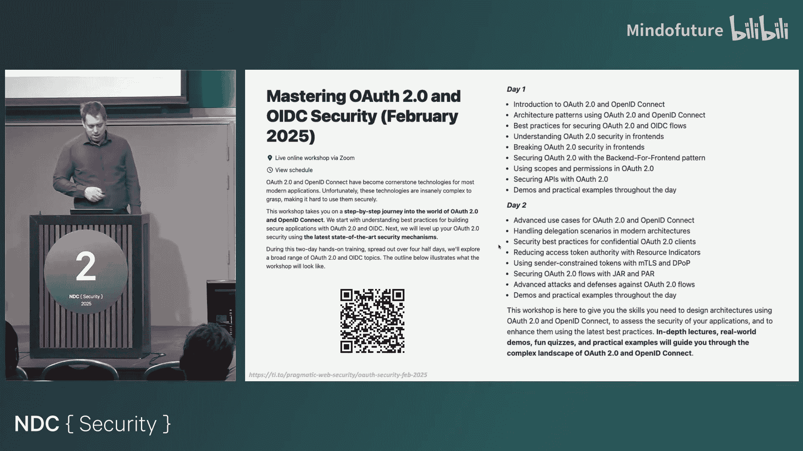

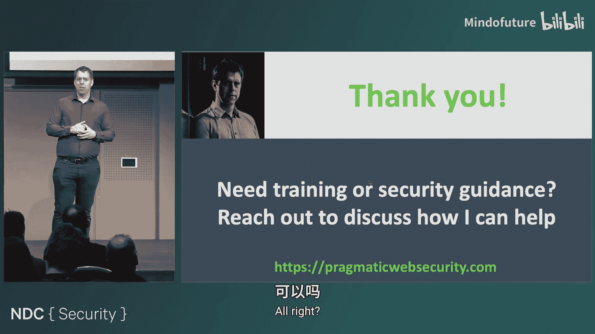