# 【Net-Ninja】Git入门教程-p01-P01_Git_Crash_Course_#1-简介_设置--BV1fkvtBcERR_p1-

Okay to my friends so I've just released a big Gitgitthub masterclass course on the Neingja。

 devev site and I wanted to release a free preview of that so I've packaged up the first two and half chapters and I'm going to release those as a Gicraash course here on YouTube for free and then if you like the course and you want to take it further learn more about Git and Gitthub and other things as well like incorporating AI with Git andgitthub then feel free to go and grab the full course on the Neingin。

 devev site the link to that course is gonna be down below the video and you can use a promo code which is Git40 to get 40% off the 10 price Otherwise my friends I really hope you enjoy this crash course。

All right then gang welcome to this complete Git and GitHub masterclass which I've been planning for a little while now and I've eventually got around to making and I know what some of you might be thinking do I really need to learn Git and GitHub can't just get on with coding without all this extra stuff on the side and trust me I do get it because I used to think exactly the same thing so before we dive into any of the technical bits about Git I want to tell you a little story about my very early coding days and why learning version control is going save you from some proper headaches down the line。

😊。

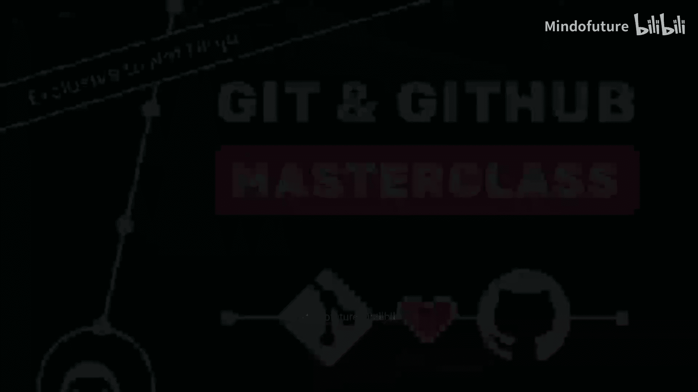

So about 15 years ago， I just started out as a freelance web developer making websites for small clients like cafes。

 window cleaners， musicians， that kind of thing， and at the time I considered myself to be a fairly competent cor。

😊，But I never heard of version control or Git or any of that stuff。

And one particular client I was working for was incredibly picky。

 And some might go as far as to say he was a pain in the us。

 but he wanted round after round of changes and then more changes。

 And then he wanted to go back to previous revisions I made。

 So every time I made changes to the project already some new feature that he wanted。

 I'd save a completely new copy of the entire project to my computer。

 and my folder structure looked something like this project V1 project V2， V3 V4， V5 and so on。

 until eventually when I thought it was done maybe I would have something like project final。 But。

 of course， the client wanted one more tiny change。 So then I had project final 2。

 And then project final final。 and then project actual final。

 and my personal favorite project final for reels on wheels。 And at one point。

 I must have had about 20 different versions of the same project scattered across my hard drive。

 And the worst part was， I could never remember which version。😊，Which changes。

 so I would spend ages opening different folders， trying to figure out which one actually had the navbar fix or the contact form that worked properly。

 etc。😊，It was like playing some kind of twisted game of high and seek with my own code and that was not fun at all。

😊，Now， fast forward a few months。 and I discover this tool called Git from a video on a learning website。

 And I'm thinking at the time what the hell is git It sounds like some kind of insult I'd throw it someone。

 But this video explains that git is actually something called a version control system。

 And basically that means it's like having a magical time machine for your code Well， almost anyway。

 so that instead of making 20 different project folders for my different revisions。

 I can just keep one project folder and then Git keeps track of every single change that you make in that folder。

 So in really simple terms， if you want to go back to how your naFbar looked three weeks ago。

 you can just tell Git to show you that old revision No more digging through folders with ridiculous names and Git doesn't just remember what changed。

 it remembers exactly what changed when it changed and why you changed it because every time you save a new revision called a commit you write a little message explaining what you did。

 So instead of trying to remember which folder had。Working contact form。

 you can just look through your commit history and find the one that says fix contact form validation or something。

😊，And the best part is that your project folder stays nice and clean with just a current version of your files。

 All the history and previous versions are tucked away safely by Git。

 but you can access them whenever you need them So it really is like a time machine for your code。

 but that's just the beginning because there's also much more to get than just making commits with Git you can also work on new features in your project in isolation using something called branches which like the name suggests branch away from your main code And then when you're happy with that feature you can merge the branch back into your main code base that's really useful if you completely mess the feature up because then you can just delete the branch without ever affecting your main code。

😊。

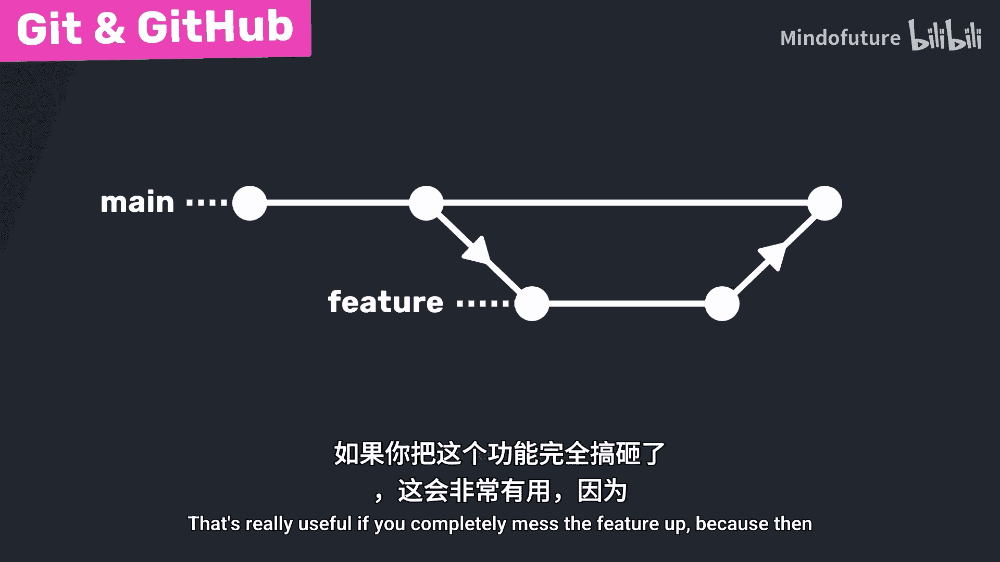

There's also something called GitHub， which is like online multiplayer mode for coding project where you can share a central code base with colleagues and friends and then you can all work on the project together adding new features without stepping on each other's toes and on top of that you can also review each other's code editions。

 flag any issues with the project and assign each other tasks or bugs to work on it basically turns coding into a form of social activity and you can invite anyone from around the world into your project so they can contribute to it but it's not just for personal project。

😊。

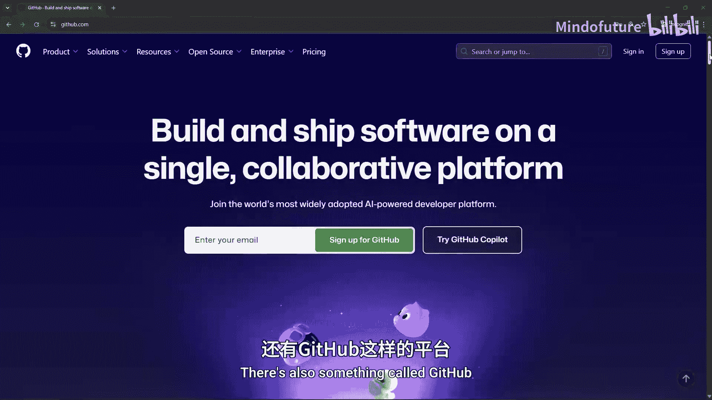

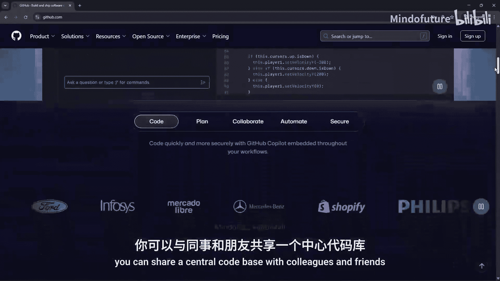

Pretty much every serious development company or department within a company uses Git and GitHub so if you want to work as a web developer in any of these companies。

 then you're probably going to need to be comfortable with these tools it's not just a nice skill to have anymore it's a fundamental one like knowing how to use a browser and a lot of the time it's just expected from companies。

😊，And I think now in the age of AI powered coding agents。

 it's going to be more important than ever because if you're not writing some of the code yourself and you can't be certain of the results。

 then you're entering into a world of pain if you're not using Git or some form of version control so learning Git and GitHub isn't just about making your own coding life easier though it definitely will do it's about being able to join any development team and actually contribute on day one。

😊。

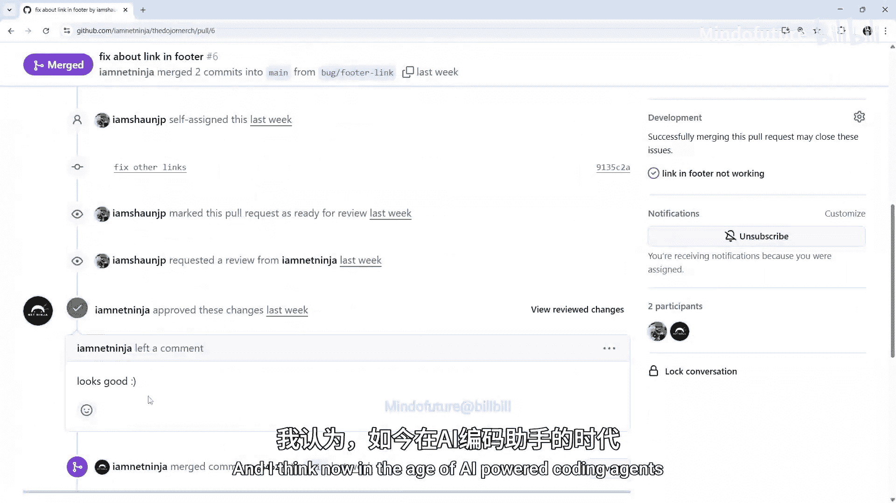

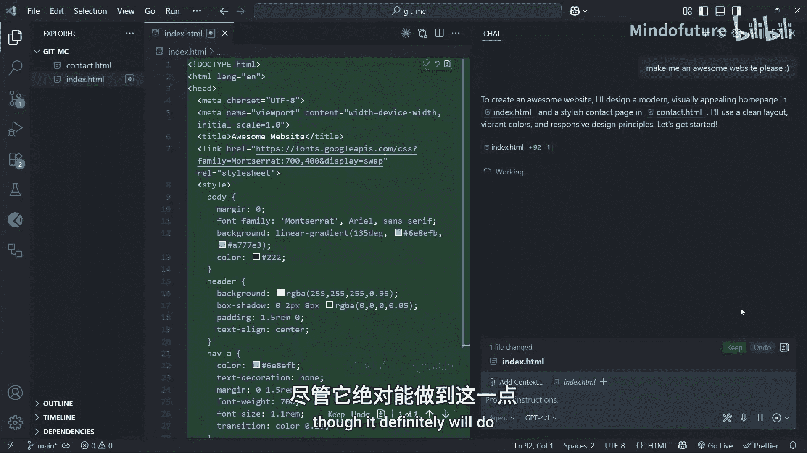

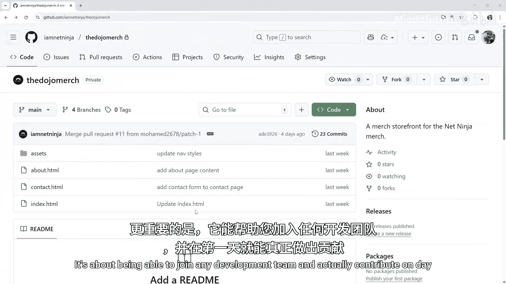

Now if you're anything like I was at all， you'll be thinking this all sounds rather complicated and it would be much simpler to put your fingers in your ears and just carry on it without kit and I'm not going to lie to you throughout parts of using Git and Gitthub which can be a little bit complicated when you first start out but we're gonna take this step by step and I promise you it's not as scary as you might think it will be and once you get the hang of it it becomes second nature and you won't be able to imagine how you ever coded without it so in this course we're going to start with the absolute basics and gradually build up your confidence First we're going to get everything installed and set up properly on your computer then we'll learn the core Git concepts with simple practical examples we're gonna to master branching emerging which is where Git really starts to shine and then after that we'll dive into Gitthub and learn how to collaborate with other developers at the end we'll leave a look at some of the newer AI power tools that can make your Git workflow even smoother。

😊。

Throughout all of this we'll be working on a couple of dummy projects that I've created which fittingly I've uploaded to GitHub so I'll show you how to access and download those later and also don't worry if you're not comfortable with the command line yet we'll be covering all the essentials you need to know Plus I'm going to be showing you some visual tools that can make life easier while you're learning The goal is to get you confident and competent with Git and Gitthub not to make you feel overwhelmed and we're going to start in the next lesson by installing Gi and making sure you've got all the tools you need to follow along。

😊。

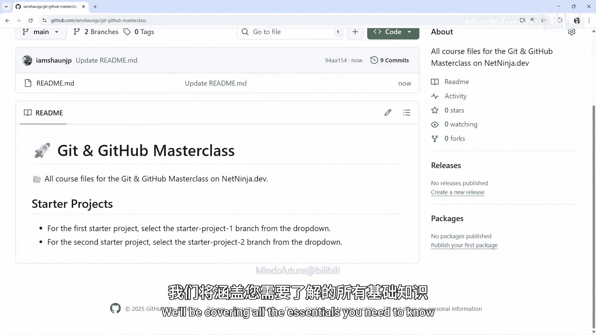

Allright。 then So now you're hopefully convinced about why Git is going to change your coding life for the better。

 Let's actually get it installed and set up on our computer。 So first。

 we're gonna install Git on whatever operating system you're using Windows Mac or Linux。

 then we're going configure gi with your personal details So it knows who's making all these commits with it。

 And finally， we'll test everything to make sure it's all working correctly so let's start with installing Git itself。

 And the installation process is gonna to be slightly different depending on whether you're on Windows Mac or Linux。

 But either way， the first thing you want to do is head over to Git hyphen SCm do co that's the official Git website。

 And right on the home page you're gonna to see a big download button that should automatically detect your operating system if you're on Windows then it's going say Windows you're gonna get the Windows install and download that。

😊，This is actually a really nice package for Windows that includes not just Git。

 but also something called Git bash and baash is a shell which gives you a unique like command line experience on Windows。

 again， lots of terminology here， don't get bogged down by the hell right now。

 we're gonna talk about terminals and shells later Anyway。

 download the windows installer if you're on Windows and then run it。😊。

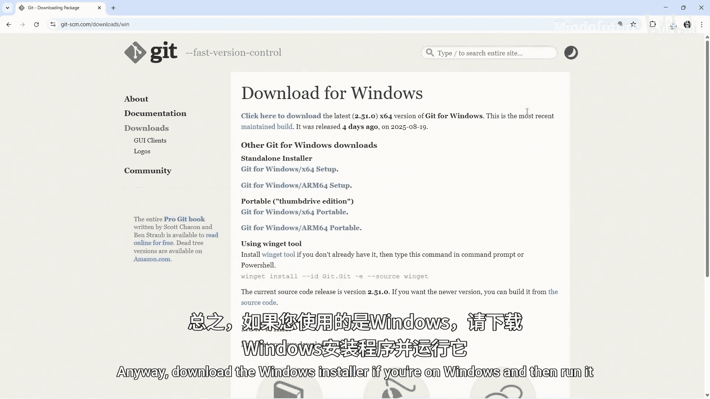

Okay so once you open that， it's gonna start up the installer。

 we can click on next to go to the next screen。 And for most of these screens， by the way。

 we're just gonna accept the default options because they will do Now some of those default options are right here and this first one is to add Windows Exp integration And what that means is we can use these two tools from the desktop or in any folder by rightcling and choosing to open Gitbash or open the Gitgii right here。

 So we'll learn more about that later on but keep those selected for now we're gonna go to the next screen Now this is one which I would suggest changing because I actually think the default is normally Vim。

 which is up here and that can be a little bit off putting to new Git users and new web developers I would advise changing that to either noteppa plus plus if you have it or just generally Noteepad down here or visual studio code which is what I've got then click on next and we've got two options here for the initial branch for new reos。

 Now we don't know what branches are yet or even。What our repository is yet so I don't want to go into too much depth。

 but a lot of the time a few years ago we would choose master to be the main branch。

 the initial branch for new repositories， but these days most companies and most developers use main so I would suggest selecting this option and naming the default branch main I'm going to click on next。

😊，And then right here， we can adjust your path environment。

 So this option that is selected in the middle is the recommended one。

 and that adds some git wrappers to your path variable。

 And that means you can use Git from within the command prompt or Windows Powerhe， etc。

 We're going to be using git bash when we use a dedicated terminal。

 but I would recommend choosing this option right here。 then you can go to next。

 we're gonna to keep most of the rest as their defaults。

 So just look at my options choose the same ones and keep on clicking next。 we can use minted。

 That's a terminal。 we'll see that later fast forwardward merge。

 Y we're going click on next just click on install at the end and that's gonna install Git now on Windows for you Now if you're on a Mac。

 you've got a few options。 the easiest is probably to install Git using Homebrew。

 which is a package manager for Mac。 So if you've got Homebrew installed。

 you can just run brew install Git in your terminal。 Now if you've not got Homebrew installed。

 you can just go to brew do S。😊。

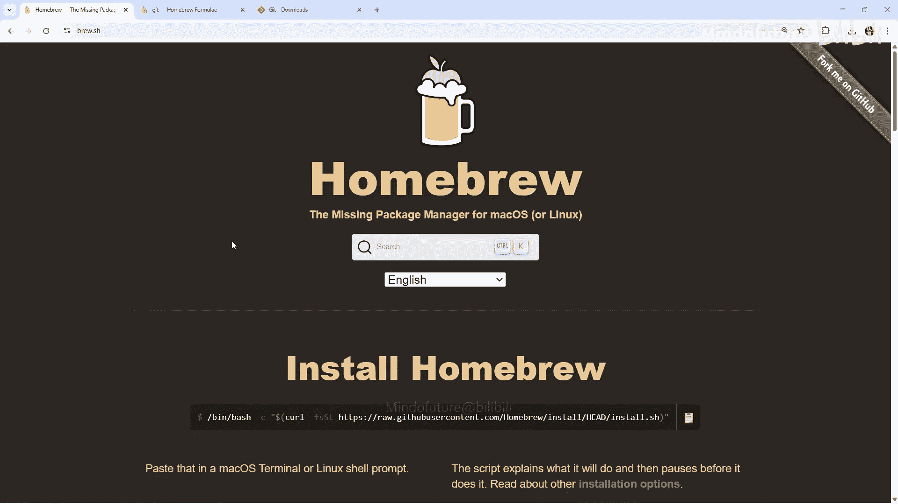

Follow the installation instructions。Or you can download the installer from the Git website just like we did for Windows。

 Now， somems also come with Git preinst， but it might not be the latest version。

 so you can update it this way too。 And if you're on Linux， well。

 you probably already know how to install packages on your system if you're using Linux。

 but depending on your distribution， you'll install it any of these different ways。

 The key thing is to make sure you're getting a reasonably recent version。

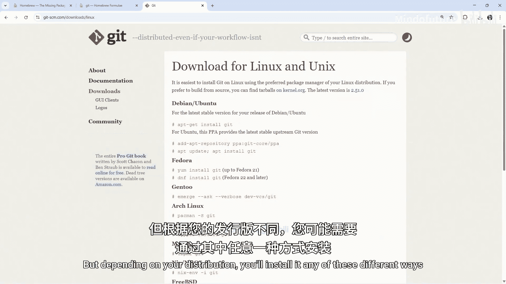

And you can find out your current installation version by opening a terminal and just typing in Git version and hitting enter。

Now， if you're on Windows， you could use the standard Windows terminal if you added Git to the path variable during installation。

 but I would recommend using Gitbsh for this course。

 which is a shell that gets installed along with Git automatically。

 and bash allows us to run Git commands as well as the same Uni style commands that we can run on a Mac。

 So to use Gitbsh， you can right click anywhere on your desktop or in a folder and then you can go down to show more options and click on that and then choose the option open Git bash here。

 So that's gonna to open a terminal looking like this， or it might not look like this。

 it might look a little bit different。 I've customized this but we can now run Git commanded here because this is running the bash shell Now on a Mac。

 you can just use your regular terminal which does allow you to run Git and Uni commands inside it。

 But anyway， now just type Git version or lowercase。

 hit enter and you should see the version right here installed on your computer。 Now。

 since we're talking about terminals and shells and some other jargon as well。 I just wanted to take。

😊，A quick aside to explain what those things are because I know it can be confusing at first。

 So a terminal is just the window we use to type commands into and a shell is the program running inside the terminal that actually reads and executes those commands。

 For example， on Windows 11， the terminal is called Windows terminal and the default shell running inside it is Powerhell。

On a Mac， the terminal is just called terminal and the default shell inside it these days is Z shellll。

😊，Now， when I opened Git baash a moment ago， the terminal it used was called Minty and the shell inside it was bash and baash stands for B again Shell。

 Now the reason I'm using bash instead of Powerhell is because baash allows us to run Uniix style commands and Git commands out of the box just like Zed Shell does on a Mac but Powerhell doesn't and we'd have to go through some extra setup to use all the same commands。

 So if you're using Windows terminal with Powerhell some of the commands I use in this lesson might not work out of the box for you。

 and that's why I recommend using Git bash for this course。Okay so once you've got Git installed。

 the next thing we need to do is tell Git who you are because remember Git tracks who makes each commit so it needs to know your name and email address。

 and this is really important because this information gets baked into every commit or change if you like that you make and if you're working with other people on the project they're going to see this information when they look at the project history so they can see who made what changes so let's set this something we need to open a terminal and we're going type a Git command which starts with Git or Git commands start with Git and by the way。

 don't worry too much about the command that we're writing right now we're going to talk about how we use the command line in a later tutorial and we're also gonna see loads of different Git commands so don't worry too much about how this command is being written for now just kind of copy what I'm doing to set up these different properties。

😊，So we say git config， and then we're going to use what's known as a flag by typing double dash and then global。

 and this is basically saying we're going to set a certain property from the config globally on our computer。

😊，The property we're gonna set is the user dot name， so type out that next。

 and then we need to add quotes and put in whatever your name is。 So for me。

 the whole thing is gonna be git config double global user do name and then I'm going type Sean P for my name All right and then press enter and that sets the username global it on our computer All right so next we're gonna to set an email address。

 So this time we'll type git config again then we'll use the flag global so double global and then we're gonna say user do email this time And again we're going use quotes and this time add your email address。

 I'm just gonna add in a double1 this doesn't exist。 so don't try emailing it。

 So these are two git commands we' just run here right and they both start with that word git and that's gonna be a common theme because whenever we run a git command we need to start it with the word git and you might be wondering about that global bit like I just said this is a flag and in this case it just say set these settings。

Globally for all repositories that we make on our computer， okay？😡。

So you can actually override these settings on a per project basis if you need to。

 but for most people， global settings are going to work just fine once you've set these up。

 you can check their correct by running another command which is Git config and then we're going to use that global flag against or double global and then after that we're going use another flag which is list double list and then press enter and that is gonna show you all of your global Git settings and you should see your name and email address in there that you just added if you need to you can change them later just run the same commands again with new values Allright then so hopefully you've now got Git installed and working on your computer and in the next lesson we're going to set up visual studio code which is the editor will be using throughout the course。

😊。

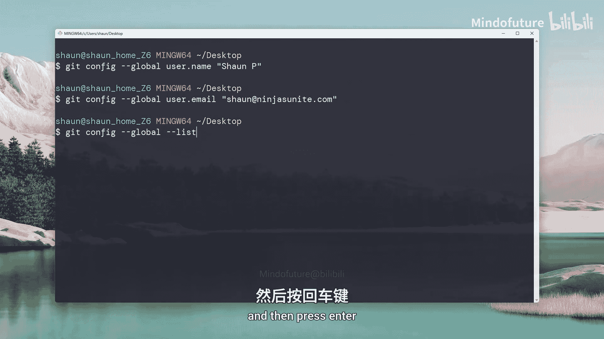

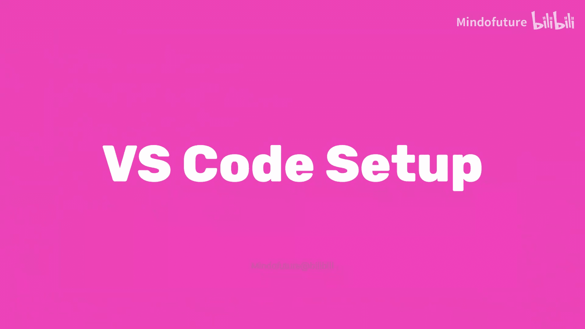

Okay， then my friends。 So we've got Git installed and configured now。 And in this lesson。

 we're gonna set up visual Studio code as our main development environment。

 Now you don't have to use VS code if you'd prefer to use something else you can use whatever editor you like But VS code gives us a nice visual representation of what's happening with the Git repository you can see which files are changed what those changes are you can stage and commit changes without ever touching the command line if that's what you want to do Now we're gonna be using the command line a lot because I think that's really important to learn。

 but having the visual layout on top makes everything so much easier to understand。

 especially when you're starting out and even to be honest when you're experienced and you just want to make a few quick changes or see what's been changed at a glance。

 anyway， to install Vs code just head to code visualualstudio do co and click on the download button It's going auto detect which operating system you're on and you'll be able to download the appropriate version。

 Once you've downloaded and installed VS code， you can open it up and you should be greeted with this。

😊，Welcome tap And from here， you can open a project folder by clicking on this open folder link right here or you can do the same thing by going to file and then open folder。

 So I'm gonna to open up the8 bit dev folder， which is the dumy project that we're going be working on for most of this series Now if you want to work on the same project as me。

 you can download it from Github on this page right here and I will leave a link to the page down below the video So this is your first4ay into Github。

 but the only thing we need to do is download this data project。

 which is really simple to do first make sure you select the start project from this drop down list over here。

 this is called a branch we're gonna learn about branches later for now just select where it says start project one and second。

 click on the code button and then choose to download a zip of this project that's gonna download a zip folder with the project on your computer。

 once you've downloaded it， you need to unzip the folder first of all and then you can open up the project inside it within VS code just like I showed you。

😊。

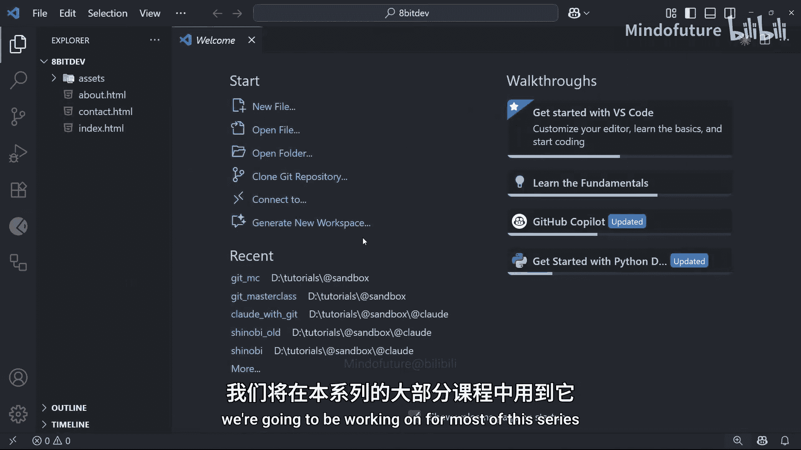

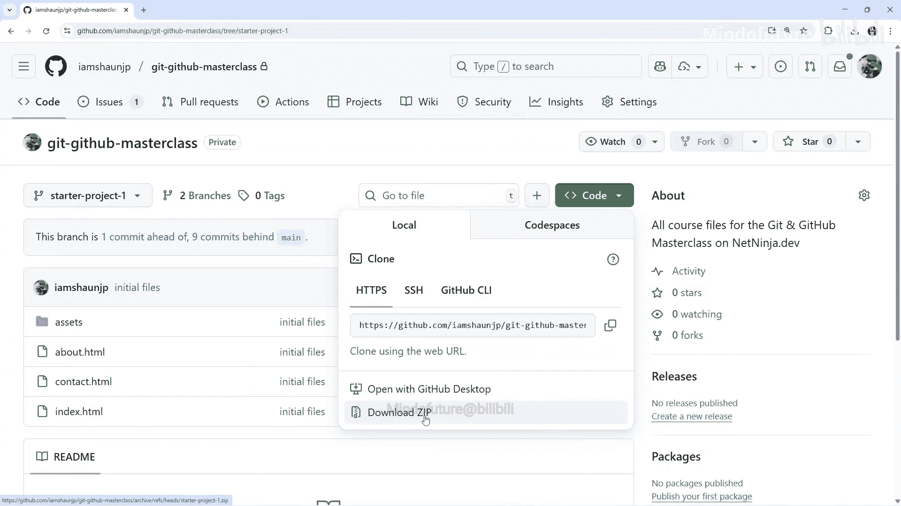

So then once you've got a folder open， we can start using git to track changes in the project。

Now we'll do that in the next chapter， but for now， I just want to show you a couple of things。

 First， VS code comes with an integrated terminal， which you can open by going to the terminal up here and then going to new menu。

 Now when you select that option， the terminal should open at the bottom and it should already be in your project directory。

 So later any Git commands we run are gonna be from this terminal integrated into VS code。

 you can also toggle this terminal panel by coming to the panel icon in the top right and clicking it the keyboard shortcut for that is control plus J I think or command and J on a Mac。

 And then second， you should be able to see a bunch of icons on the left over here。

 this one here is for the builtin Git tools that come with VS code If you click on it now。

 you might not see much but will later have a look around this and see what it can do。😊，And finally。

 we can open the extensions panel by clicking on this icon of four little squares right here。

 And from here， we can install any extensions that we want。 Now。

 I'm not going to suggest installing any particular Git extensions just yet。

 But I think later on in the course we'll be installing a couple of different things to superchange of V S code with some additional Git functionality and those extensions are most likely going be Git graph and Git lens。

 So we'll see both of those later on next up， though， before we do any work with Git。

 I want to spend a few minutes getting you up to speed with the command line。

 nothing crazy or complicated。 So don't worry， just the basics and enough to get started。😊。

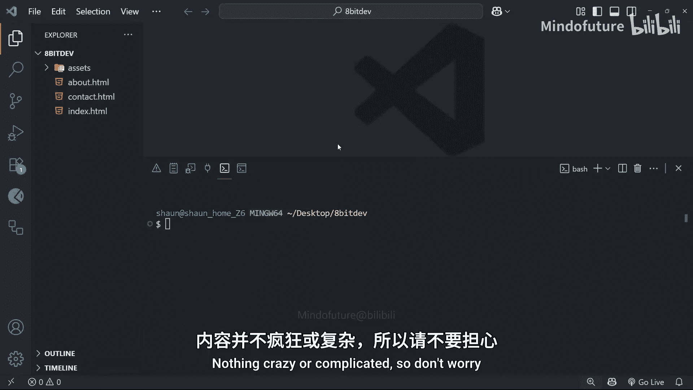