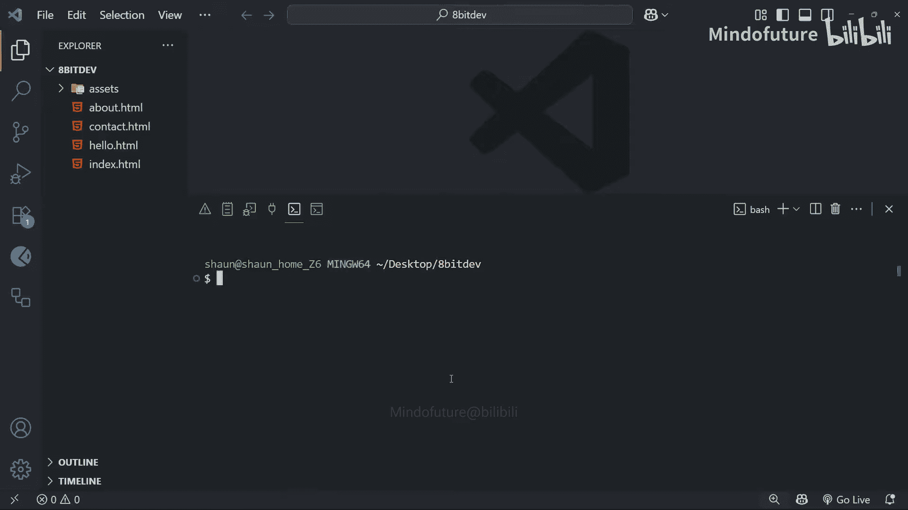

# 【Net-Ninja】Git入门教程-p02-P02_Git_Crash_Course_#2-命令行基础--BV1fkvtBcERR_p2-

All I d。 So before we get stuck into learning Git， I want to talk about something that makes a lot of new and even some more experienced developers a little bit nervous。

 And that is the command line。 And I truly get it。 I felt the same way at first。

 because it can look a little bit intimidating just a black screen with a blinking cursor waiting for you to type something。

 but honestly， the command line is your friend。 And once you know the basics。

 the rest isn't so daunting。 And it's absolutely essential for working with Git effectively because Git was initially designed as a command line tool。

 Yeah， there is skuies that you can use to work with Git， but to truly master it。

 then I would advise Gi familiar with your terminal。

 Plus command line skills transfer everywhere whether you're on another computer or using different tool。

 So it's a really good skill to invest in。😊。

Now the goal of this lesson isn't to make you into a command line ninja overnight。

 but hopefully will give you the essential navigation and file management skills that you might need when you start using Git commands So we're going to start with the basics and then we'll just build up your confidence step by step and if you're already comfortable with the command line by the way feel free to skip ahead to the next lesson for the rest of us let's get started now even though I said we'll be using VS code and the terminal inside VS code to with Git and the command line in general I wanted to use Gitbash directly in a dedicated terminal for this lesson because there's less distractions that way and we can just focus on the commands that we're running but at the end of this lesson I will also run a couple of commands within the VS code terminal as well to show you how that works and to show you how to get up and running with it and remember to open Gitbash just right click on your desktop or within any folder in your Expr choose more options and then just select open Git bash and again if you're on a Mac。

😊，Ft terminal is fine。 Right then。 So let's start with the most fundamental concept when it comes to the command line。

 which is where you currently are in your file system。 So when you open a terminal。

 you're always somewhere on your computer。 You're being dropped into a location within some folder。

 And this location where you are in the terminal at any given time is known as your current working directory。

 And from there， you can navigate to different folders。 Now。

 your current working directory is going to be different depending on where you opened your terminal or gibash。

 So you can see in my terminal， I' am dropped into this folder right here。

 Now you can confirm that by typing your first command Pw D。

 which stands for print working directory and then just hitting enter。

 and you'll see a full path to this current folder printed back in the terminal。😊，Now。

 this might seem obvious when you're looking at it right now like this。

 but when you're deep in a project with lots of subfolds。

 knowing exactly where you are might be important。 But anyway， now we know where we are。

 how do we then navigate to different folders on the computer and how do we even know what folders are inside this current working directory that we can navigate to。

 Well， to find that out， we can use a different command Ls， which stands for list。

 and that's going to list all of the subfolds and files in this current directory。

 The folders are the ones with a slash after them。 Now， when we use commands like this。

 we can also a lot of the time add what's known as flags and flags are a little bit like options that we can tack onto the command to make them behave a little bit differently。

 Now， flags start with either a single or double dash。

 So you will see both of them when you're looking up commands generally a single dash is for short options normally denoted by a single letter and double dashes are normally long options and use a full word。

 for example with。we can use the flag double dash and then all which is the long option format because it uses the full word all right and when we use this flag we're saying we want to list all of the files and folders including the hidden ones because by default they've not been listed。

😊，So by adding this flag， we've kind of changed how this command works a little bit， right？

Now the short option version of this flag is just to add a single dash and then a so this time just a single letter but it's going to do the same thing So the long option format is more human readable I guess but the short option is quicker and sometimes also lets us to combine multiple options in one go for example。

 another flag is the L flag which I can use by saying hyphen L。

And this flag says we want to see the long listing of all the files and folders with extra information。

 like maybe the file sizes。 And when the file was last modified。 So if I hit enter。

 we can see all that information。 And now I might want to use both flags at once a and L。

 and I can do that by saying Ls again and then a dash and then L and a to combine the flags。

 and by the way， to see a list of all the flags that we can use for different commands like Ls we can type the command and then use the help flags or double help。

 and if you press enter， then you're gonna to see a list of flags available for this Ls command。

 you're also going to notice that all of them or rather some of them have the short version using just a single letter and some of them have the long。

 more human readable version。 So sometimes there might not be a long version of a flag that you can use anyway。

 that's how we use flags and I'm sure we'll be using more of them as we go forwards in the course。

 and when we start using gi。 for now let's move。😊，So the next command I want to show you is the clear command。

 and if we type that in hit En just close the terminal screen gives us a blank slate to work with and I like to do this after a while to give myself just more empty space it feels cleaner so we've seen how to list what's in the current working directory but then how do we navigate two different folders well to do that we can use the Cd command which stands for change directory So let's say I know there's a folder in my current working directory called docs and Im to navigate into that folder Well I can just type C then a space then that folder name which is docs and when I press enter I'm going to end up in that folder and I can prove that by typing pwd again and hitting En which shows me a full path to this current directory Now if the folder on navig to have spaces within it then you'll either need to escape the spaces or wrap the folder within double quote for example if I type Ls and press enter I can see another folder in here called Pd files which contains a space so I can navigate into that folder by。

tyyping CD， then a space followed by the folder name PDF files。

 but this time I'm going to put it in double quotes because there's a space and when I hit En I'm going to get dropped into that folder。

😊，Okay， so that's navigating into folders。 But what about going back up to a parent folder。 Well。

 in this case， I might want to navigate up to the docs folder right and to do that。

 I can type Cd and then a space And then this time double dot and this double dot means go back up to the previous directorate。

 So when I hit enter， I'm going to go back up to the docs folder if I are on the same command again。

 Cd and then double dot， I'm going go back up to the previous folder All right cool So what if I want to go directly into the Pdf files folder from here in one single command。

 How do we do that Well we start again by saying Cd and then we can put the full relative path to that folder next And again。

 if there's any spaces in the path you either need to escape them or the whole thing should be in double quotes in our case I'm going to use double quotes and it's going be the docs folder then forwardlash Pf files。

😊，And when I press enter， I'm going to go directly now into that PDF files folder。😊。

Now you can do a similar thing traveling back up through folders so I could navigate all the way back up through two parent directories by typing CD。

 then a space， and then double dot forward flashlash。

 then another double dot because we're going back up through two folders and that's going to take me back up through both parent folders to the original location again。

😊，Alright， so now we know how to move around a little bit。

 Let's learn how to actually create and manage files and folders from the command line as well。

 I'm going to start by making a new directory within this working directory and I can do that using the Mk DR command which stands for make directory。

 So type make do and then a space and then the folder name that you want to make， for example test。

 and that's going to make the folder when we hit enter。

 Now I can prove that by typing Ls and hitting enter， and we should see the new test folder。

 So now we could navigate into that folder by typing C， then test and inside this folder。

 we might want to make a new file， which we can do by using the touch command。

 So type touch then a space and then the name of file that you want to make。 for example。

 I'll make one called hello dot Txt。 and then I'm going to hit enter。😊。

And that's going to create a file for us， which I can demo again by  tapping Ls and then pressing enter to see that file in this folder。

😊，I can also open this file on Windows by specifying the program I want to open it with like notepad follow by the file name hellello dotxt and then hitting enter on a Mac you'd use the command open follow by the file name instead but anyway with that open you could edit and save the file and then close it down again Alright so now I could delete a file by using the RM command which stands for remove follow by the file name which in this case is hello doTxt and then hitting enter that's going remove the file for us and if we type L we won't see that file anymore because it's been deleted。

😊，So then let's head back up out of this folder using the Cd command followed by two dots and say now we want to delete that test folder Well we can do that by using the RMDr command remove directory followed by the folder name but this will only remove the folder if it's empty if it's not empty this won't work but anyway if we hit enter now then it's gonna remove that folder for us so that's some of the very basics of the command line and it's certainly enough to get us started and I will explain every new command that we use in the rest of the course when we come across them but just very quickly one more tip you can cycle through previous commands that you've run using the up and down arrow keys and this is something I do frequently when I'm working with Git because I found myself running certain commands over and over again multiple times in quick succession。

😊，But anyway， now you know that let's head to VS code and we're just going to do a final couple of examples in the integrated terminal to maybe interact with the start project。

😊，Alright， then So remember to toggle the terminal panel in VS code。

 we can hit this icon right here of the bottom panel。 When we do that。

 it's going to open it up and put us in a new terminal session in the route of this project folder。

 Now just really quickly for Windows users by default when we open a new terminal in VS code here。

 It's going to use powerhe。 But for this course， we want to use git bash。

 So we can start a new terminal session using bash by coming to this little arrow next to the plus sign and choosing to start a new terminal running bash instead。

 When you do that， you'll be put into that session automatically and you can switch back to the other terminal sessions by using these little icons on the right。

 The little line next to this one shows the current terminal that you're in the active one。😊，Now。

 if you don't want to have to manually do that every time you stop V code and toggle the terminal panel。

 you can set bash to be the default shell to do that。

 open the command prompt by using the shortcut control shift and P and then start typing terminal profile。

 you're gonna see this option right here， select default profile。

 So click on that and then choose Git bash to be the default profile。

 Now if we kill both of the open terminals by clicking on this trash icon for each one。

 then the terminal panel closes and if we then toggle the panel again。

 it's going to automatically start is up using bash instead of power shellll by default。

 All right then so inside this terminal Now we can use all the same commands we did before。

 for example， I'm going to use PwD to print the current working directory。

 which by default should be the project directory we have open in VS code。

We could use the LS command to list all of the files and folders and we can see all those here and we could also create a new file by typing touch and then the file name。

 for example， hellello dot HTML and when we do that we should see that new file in the file tree over here Okay so finally I am just going to clear my terminal by typing clear and then hitting enter。

😊，Okay， so hopefully now you feel a little bit more comfortable in the terminal and like I said。

 when you start using it more， which we will be doing throughout this course a lot。

 it's going to quickly become second nature to you Next up then we're going to actually start working with Git。

😊。

