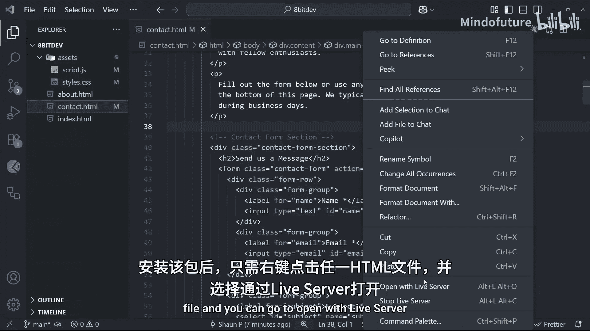
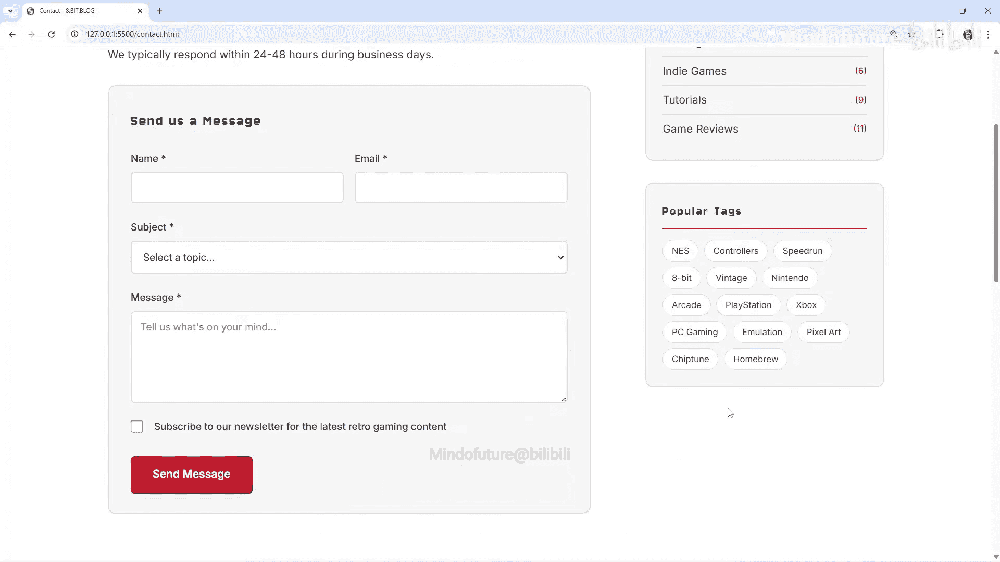
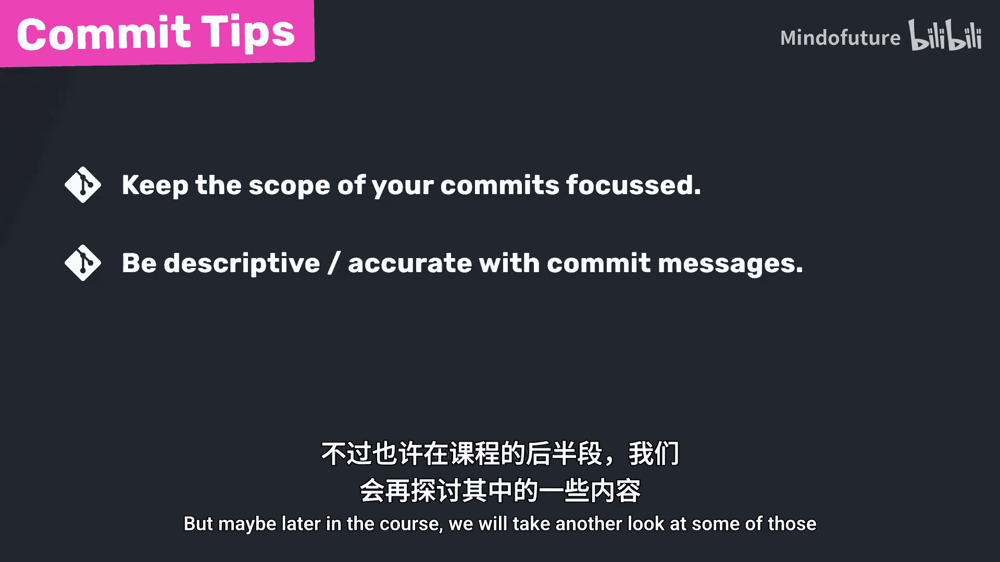

# 【Net-Ninja】Git入门教程-p05-P05_Git_Crash_Course_#5-首次提交--BV1fkvtBcERR_p5-

Okay then my friends now that we understand how to stage new files or changes in the staging area the next step is to make a commit to commit these stage changes to the repo history and that's what we're going to be doing in this lesson so then making commits is really at the heart of using Git effectively and each commit we make essentially represents a snapshot of your project at a specific point in time so we could make an initial commit to represent the base starting point of the project right the first version of it to be stored in the history and that would be like a snapshot of the project in that initial state the state it team right now。

Then later， maybe once we've added some changes to make a new feature or something。

 we could stage those changes and make another commit。

 so then we're essentially saving a snapshot of the project in that moment in time as well。

 and then we could make more changes， stage those changes and then make another commit and at this point we'd have three commits in the history with the most recent commit being on top。

So these would represent the three different versions of the project we've made so far or the three different snapshots of the project so then in our project we've added all the new files to the staging area and now we need to make a commit to commit them to history so if I run git status I can see we've still got all the files added to the staging area and we know that because they're all green and now we can make commit to commit these changes to the history so then to make a commit we use the command git commit。

And when we do this， we're telling it to take everything from the staging area and save them to the commit history。

 So it's almost like taking a snapshot of this project right now in its current state and saving that。

 Now， before we run this command， we should also add a message to the commit and the commit message is really important because it explains what this snapshot or commit represents。

 So， for example， what changes were made to the project and why now there's different styles for commit messages。

 But right now， I want to keep it clear and descriptive。

 So for this first commit something like add initial website structure and pages would be fine right that would make sense。

😊，So let's add that message to this commit by adding a flag after commit which is hyphen M and that stands for message and then after that we use double quotes to wrap the message which in my case is going to be that one we just said which is add initial website structure and pages okay and once you've created that created that message you can hit enter。

😊，And that's it。 we've made our first proper commit in this repo。 If I now run git status。

 you can see our working directory is clean again。 There's no files on tracked and nothing in the sta and area because we've committed them to history。

 All our files are now tracked and committed to the repository Also notice that all the green files on the left in the file tree the back to white again。

 whereas before， new untraed files that weren't committed were green and that color， by the way。

 that VS code highlights new un trackracked files with can change depending on what themes currently active in VS code。

 So in your editor it might be slightly different color。😊，Okay。

 so now let's look at what we've created by running a git lock。

 which is another command that we can use that shows us the history of the project。

 and right now you can see that we've got one commit and for this commit。

 we can see a few different things。 This long string of letters and numbers is called the commit hash。

 which is a unique identifier for the commit。😊，We see the author of the commit me。

 the date and time the commit was made。 and finally， the commit message。

 So this commit is now stored in the commit history and is to use the analogy again。

 like a snapshot that represents the project at this moment in time。 Anyway。

 let's try making some more changes now and adding another commit。😊。

So first let's add some actual content to the currently empty script dojs file inside the assets folder Now I'm going to paste in a bit of code to add some mod functionality for when the form on the contact page gets submitted and the code here isn't really important We're not here to learn about ja or any other language The important part is that we're making changes to the project inside the working directory right now。

But anyway， we need to also add the styles for the model so I'm going to open up the styles css file and I want to put paste in a bunch of styles as well just to make it look nice and then I'm going to save the file and notice as I'm making changes to the files VS code is changing the color of them in the file tree So this time for my theme the blue and for me that represents changes to existing tracked files in the working directory before they were green and that represents newly created files which hadn't yet been tracked before but now the blue meaning they've been tracked in the past and they have some changes since the last commits。

Anyway， we need to do one more thing and that is add the Mo HTML to the contact page and then link to the script file as well so I am about to do that and I'm going to speed this up but then once I've done it we'll have a quick preview in the browser。

😊，Now to preview this in a browser， by the way， I'm using a package called Live server。

 which if you go to your extensions， you can search for over here。

 live server and press enter when you do that， you're going to see this package right here called live server。

 this is the one I've got installed and when you install that package all you have to do is right click on any HTML file and you can go to open with live server。

 and that's going to open this up in a browser for you。😊。

Okay， then so this is the starter project。 And I realized I think this is the first time we've actually viewed it in a browser。

 So let's just have a little look as well。 So it's a very simple project with a few different areas that we can make changes to throughout this course。

 It's got three pages that was the homep page This is the about page and then we have the contact page which is what we just added the model too and the change I made was to make it so that when we fill out this form and click on send we get a little pop-up to say thank you for your message basically。

 So let me just try filling this out Im just going put anything in here for now does it really matter and I'll say hello and why not let's subscribe and'm gonna send the message then we should see that little model pop up right here。

 So y looks like everything is working we can close the model as well and this is something that I would be happy with。

 So I want to commit it。😊。

Okay so I'm happy with those changes that I made to the project and at this point because I've just completed a new feature it feels like a good time to make another commit。

 another save point or snapshot if you like， so in total I edited three files the script file。

 the Sta file and the contact HTML file。😊，And if we use the Git status command。

 then we should see those three files listed in red under the changes not staged heading。

 So now we need to add all those changed files to the staging area before they get committed。

 So this is the three step process we follow。 remember， Step 1。

 we make the changes in the working directory， which we have just done Step 2。

 we stage whatever changes we want to commit in the staging area。 and then step 3。

 we make you commit to commit those staged changes to the history。So again。

 I am going to use the Git add command to add those changes to the staging area and I could add all three files manually by typing out their paths and file names or I could just use at which tells Git to grab all the added or changed files and add them to the staging area so let's do that and run it and then we can run Git status again to see if those changes were added to the staging area which we can see they now are。

Alright awesome。 So now we've staged the changes we can go ahead and make another commit by using the git commit command along with the hyphen M flag to add a commit message And this time in quotes I'm going to use the message add model to contact form which is just a simple descriptive message right and then I'm going to hit enter So once we've done that we can run the git log command again to see both commits that we've made in this re so far the initial one。

😊，And now the model one at the top。 Allright， cool。 So now I want to do one more example。

 but this time showing you the benefit of having a staging area to split multiple changes into separate commits。

 So I'm going to make some edits to the CSS file now to update the look of the Nabar a little bit。

 And I'm going to speed the video up while I do this。 But then once I'm done。

 it will regroup and make another commit。😊，Allright then so I made that change to the CSS file to update how the Navbar looks a little bit。

 and I'm happy with that change， but I also got sidetracked and I made a completely unrelated change on the homepage to update the welcome text。

 So I want to make a new commit， but I'm not sure that these two changes belong in the same commit together because they're completely unrelated ideally I'd like to make a single commit for the Navbar style change and then another single commit for the content change on the homeage So how would we go about this now because we've made both changes to the working directory at once。

 But this is where having a staging area comes into play because it's only the changes added to the staging area that get committed when we run the commit command so。

😊，Instead of adding both file changes to the staging area now I'm just going to add the styles want by saying git add and then the path to the CSS file。

 which is assets forward slash styles do css and then once we've done that if we then run git status we should see that only that styles file was added to the staging area and the change to the index file still hasn't been staged for commit So then now we can run Git commit and we're going to use the hyphen M flag to add a message inside quotes and that can be something like。

😊，Update Nabar styles and then once you've done that hit enter to make that commit。

And now when we run Gitlog again， we should see that third commit， awesome。

So then if we run git status again， we can see the index change is still not even changed stage rather Never mind committed。

 So what we just did is we added only one of the changes to the staging area and then when we made the commit only that one change was committed so that commit or that snapshot wouldn't actually include the most recent change to the index page that we've made but we're now going to make another commit for that change first like always。

 we need to add the file to the staging area and this time I can just say git add and then at to say add all the unstd changes。

And I know there's only one， but dot is quicker than writing out the full file name。

 which I could have done as well。 and if we run Git status again after we've done that。

 we should see that now the index file is in the staging area and now we can run another commit by saying Git commit followed by the Mflag to add a commit message again in quotes which is going to say something like update homep page title and then once we've done that we can hit enter。

😊，And when we do that， we've now committed this change to the history。

 which we can verify by using the Gitlog command again and seeing that most recent commit at the top。

😊，So that's one of the benefits of having a staging area so that we can make multiple commits one at a time grouping relevant changes together。

 and there are other benefits as well which I'm sure we'll run into at some point later。😊。

So that now we've seen how to initialize a new repo。

 add files to the staging area and make commits to commit those changes to the history。

 and this is one of the most fundamental workflows you'll need to master when you're working with Git。

😊，Now we will get plenty of practice doing this throughout the rest of the course。

 but just before we finish this video I want to go through a few final tips when it comes to making commits Firstly be very careful about the scope of your commits try and keep any changes you make quite focused and precise where the changes all relate to each other for example。

 if you're fixing three different bug and the changes to fix those books span over different files then you're probably better fixing each one as a separate commit instead of grouping them altogether in a single commit。

😊，Secondly， try to be accurate in your commit messages。

 so instead of writing something like fixedix off which most of us are guilty of。

 try to write something more descriptive likeF a bug on the contact form preventing submissions。😊。

Now there is a whole subtopic we could explore when it comes to commit messages。

 but for now I don't want to dive into that because it just completely takes the focus away from other things which I think are more important at the moment。

 but maybe later in the course we will take another look at some of those。😊。

