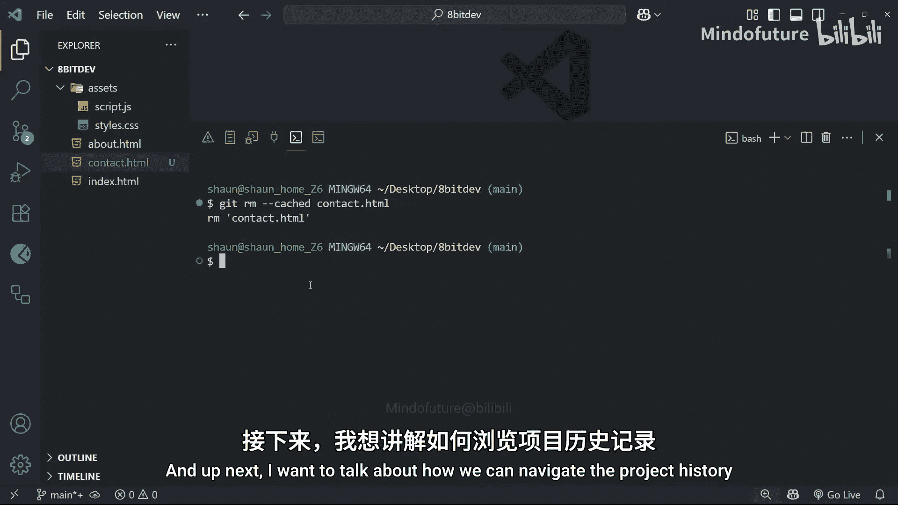

# 【Net-Ninja】Git入门教程-p06-P06_Git_Crash_Course_#6-删除未跟踪文件--BV1fkvtBcERR_p6-

Alright， so now we know how to add new files， make changes to the code。

 stage those changes and then finally make a commit to commit those changes。

 but sometimes when you're working on a project you want to delete files as well so how does that work when it comes to Gi。

Well， it works pretty much the same way。 You can see over here I've already added a new HTML file called gallery dot Ht。

 and I actually made a commit for that new file off screen before this lesson。

 and you can see that commit inside the git log which I've already run But if I now decide I don't want that file and I want to delete it what do I do Well I can do it I can just right click and delete the file as normal first of all。

 And then if you run a git status， you're gonna see that deleted file under the change is not staged So we still need to stage the change even though we deleted it。

 but how do we do that Well it doesn't really matter if we deleted it or updated it。

 we still add the change in the same way。 So that's by saying Gitad and then either whatever the path and file name was which was gallery do HTMLt or using the dot instead to say add all changes in the working director it to the staging carrier。

 which at the moment is just that delete So let's do that then and if we run Git status。😊，Again。

 we should see that delete change move to the staging area。😊。

Then we can make the commit as we normally would by running a git commit followed by the M flagag to add a commit message and that could say something like deletelete gallery page and then once that's done if you run the command。

 it's going to make that commit。😊，Now we can check that by running the Git log command again to view the commit history where we should see the one that we just made at the top。

 So then that's how we commit deleted files exactly the same way as we commit new or changed files Okay so something else she might want to do at some point is onst files from the staging area if you didn't mean to add them So say for example。

 we make a simple edit in one of the HTMLl pages is and it really doesn't matter which one or what the edit is we just need a change that we can add to the staging area。

So let's do this， save the file and then we're gonna run git a follow by dot and press enterer to Add to staging and now if we run git status。

 we should see that that change is now staged so we can now onstage the change by running the git restore command with the staged flag to Tgi we're restoring the file from the staging area followed by whatever file we want it on stage so let's do that now let's run the command git restore。

Follow by the double dash staged flagk and then the file name and once we've done that。

 if we press enter， it's going remove it from the staging area and put the change back in the working directory Now we can verify that by running the git status command and we'll see that change is no longer staged another useful thing we can do with Git restorestore is restore changes from the working directory to their previous state from the last commit before any changes we made to the file for example。

 I made a change to this file a moment ago right but imagine now I want to discard that change。 Well。

 I can do that by running the Git restore command again this time without the staged flag and then the name of the file and when we run this。

 it's going to restore the file to its previous state like I said from that last commit we made again。

 we can verify this by running Git status again which should tell us there is no changes in the working tree so there's one more thing I want to talk about in this lesson and that is how to completely untrack files in your repository so。

We know that when we first make a file within a repo although Git is aware of that file it doesn't track it by default we have to stage and commit the file before Git tracks any future changes to it right so then what if we have a file in this project that we don't want Git to track anymore Well in a lot of cases you might just delete that file manually and commit the change problem solved however sometimes you might want to keep the file in your working directory but also tell Git not to track it。

And this could be a file that you accidentally committed in previous commits for example and now you want to tellgate that going forward you don't want to track this file anymore so the way we can do this is by using the command gitrM which stands for remove so for example I could decide that for whatever reason I don't want the contact page to be tracked in this repo anymore so I could type gitrM then a flag which is double cacheed then the file name which in this case could be contact HTML。

Now this cached flag tells Git that even though you want to stop tracking the file。

 I want you to keep it around in my project and now if I run this。

 Git will stop tracking the file completely and you can see in my editor that it's gone green again which is the color of new untraracked files for me。

😊，Now just be aware that if you added this file to staging again and committed it。

 then Git would start tracking the file again， and by the way， if we didn't add the cached flag。

 Git would completely remove the file from the working director。

It would be the same pretty much as manually deleting the file and staging that change。

 but anyway I think't that's enough about deleting and on tracking files for now and up next I want to talk about how we can navigate the project history and all the commits that we've been making so far。

😊。

