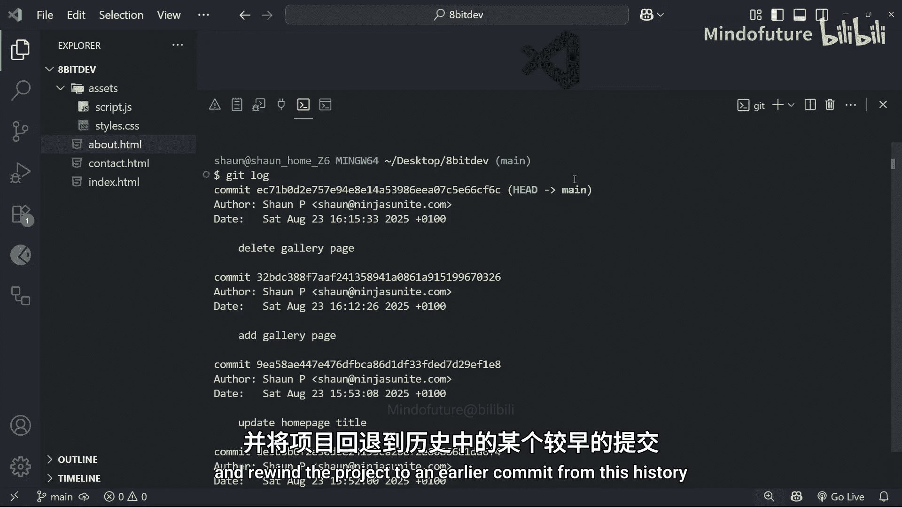

# 【Net-Ninja】Git入门教程-p07-P07_Git_Crash_Course_#7-查看项目历史--BV1fkvtBcERR_p7-

Okay then my friends， in this lesson， we're going to take a closer look at the project history that we've been building through the commits we've been making and we're going navigate through a commit history。

 which is really important because you might often need to look back and dig into the details of what's changed and when especially if you need to revert back to an older commit or version or even track down a bug which might have been introduced at some point。

 So we already know how to view the project history using the command Git log And if we run that now we're going to see all the commits we've made in this repo with the most recent commit being on top and the oldest at the bottom So these are all listed in chronological order。

😊。

And each commit has a commit hash， which is like a unique fingerprint or ID for each commit。

 and each one also has the date and time the commit was made。

 as well as the person who made the commit and the commit message。 Now。

 you can also get a condensed log of the history by running the command with a flag。

 which is double dash one line。And when we use this flag。

 we're telling Git to print each commit on just a single line in the terminal。 And in this case。

 we're only going to get the first few characters of the hash this bit in parentheses right here。

 And in this case， we only get the first few characters of the hash。 we get this bit in parentheses。

 which I'll talk about later。 And then the commit message。

 So this time it's not included the author and the date。

 but this is still really useful if you want to quickly scan through all your history because it's much more compact。

 Now say we're looking through this history of commits And we think a。

 that's one I'd like to see more details about。 Well。

 we can get more details about any commit using the git show command followed by the hash of the commit that you want to see。

😊，Now， commit hashes are really long， but you only need the first two characters and what you see here is long enough。

😊，So then I'm going to run Git show followed by one of the commit hashs， and once I've done that。

 I'm going to press enter to see the details of that commit。And when we do that。

 we're going get all those details about the commit。

 including the author me and the date and time of the commit。

 the commit message and also something called a di。

 Now the di in get is just a list of changes made in a particular commit， the differences。

 if you like So which lines were added， which lines were removed and in which files that happened Now we're going to talk more about dis later。

 but just very quickly within a di you'll see a plus sign at the start of every line which was added as a part of the commit。

😊，And a minus sign at the start of every line of code removed。 And this would be the case。

 even for empty lines， if they were added or removed。 Also， in my terminal。

 it colors every additional line green and every removed line red。

 yours might be different depending on your theme。 But generally， that's what color you will see。

 Anyway， when you see this diff in a terminal， it's normally displayed through a pager。

 meaning that you can keep pressing enter to view more lines。 when you want to exit the pager。

 you can just press Q to quit。 So this show command is good for when you want to dig a little more into the weeds and see exactly what was changed in any given commit。

 Another way that you can view more details about commits is by using the git log command again。

 But this time， we're going add the sta flag on the end or double dash stat。😊。

And this shows a log of all the commits， along with some extra details for each one。

 such as what files were changed in that commit and how many lines of code were added or removed。

 Again， we'll most likely get this log delivered in a pager where we can just press enter to go down more lines and press Q to quit。

 You'll generally know if you're viewing something in a pager because of the little colon lot at the end down here。

Also， you can hit space to go down a full page in the page rather than just hitting En to go down one line at a time。

 Anyway， there are other ways to view the commit history。

 but I don't want to dive into those just yet because I feel like too much information at once can be overwhelming。

 but I will explain as and when we use those other methods in the future。 Okay。

 so now Id like to show you another useful git command， which is the diff command。 Now。

 I already mentioned before that a diff and git is basically all the changes made or the differences between two different commands。

 So before we run this command， I want to run the git log command again using the one line flag to show them all in one line。

 And I've done this so that we can plot two commit hashs that we can use for viewing the diffs between。

 So then I can run the git diff command followed by the first commit hash that I'm going to use。

 And then after that space and then the second commit hash。😊。

Once we've done that and when we run that， we should see the diff between those two commits again。

 most likely this gets packed to a pager where you can press space or enter to go down the content and when you've seen it off you can press queue to quit and go back to the command line。

😊，Alright， so I think I'd like to talk about one more thing and to do this we're going to run the gitlog command again this time without any flags and when we do that we'll see a log of all the commits made right and each hash is completely unique for each single commit but next to the hashhes we also see this thing in parentheses which says head in capital letters and also an arrow pointing to main next to it。

😊，So in simple terms， the head is basically saying this is where you are right now。

 Okay and it does that by normally pointing to the branch you're currently on。

 in which in this case is the main branch。 And in turn。

 the branch points to the latest commit on that branch。 Now we've not talked about branches yet。

 So don't worry when I keep saying branch。 But I don't want to delve too deep into this right now。

 I just wanted to address this head thing that we see in the gitlog。

 And for now it's enough to know that it represents kind of where you are right now。

 which is on this main branch on the latest commit that you've made。

 And as we make more commits on the branch， that head will effectively be pointing on the main branch to those latest commit as we make them。

 So I think that's enough now about navigating through the commit history。 And in the next lesson。

 we'll see how to go back in time and rewind the project to an earlier commit from this history。

