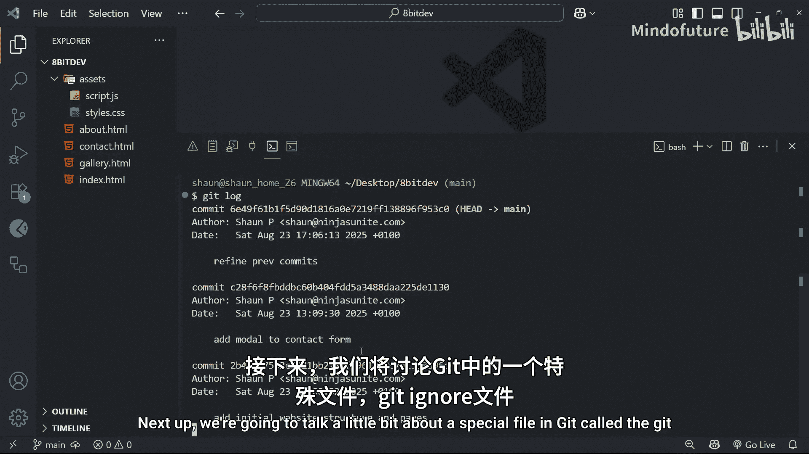

# 【Net-Ninja】Git入门教程-p08-P08_Git_Crash_Course_#8-撤销更改--BV1fkvtBcERR_p8-

Okay， then gang， Now that we've built up a little commit history for the project。

 and we've also seen how to navigate that history a little bit。

 I want to talk about two commands that let you undo changes and essentially rewind time in your project and those two commands and gi revert and gi reset。

 Now， gi revert undoes a previous commit by making a new commit on top of your history。

 So if you imagine it looks at the changes you made in the commit that you want to undo and then it removes all those changes in a brand new commit Okay。

 and Git reset moves your project back to a previous commit。

 As if you're traveling back in time inside your project。😊。

So gett revert even though undoing previous changes actually adds to your commit history and Git reset rewinds to another point in your history。

 so let's try both of them out now。😊，The first thing I'm going to do is look at the project history by using the Git log command with the one line flag to get each commit on a single line and let's just imagine I want to undo the changes I made in this latest commit right here。

 Well I can do that by using the revert command， so we'll say git revert followed by the hash of the commit that we want to undo which is going to be this one right here。

And when we press enter Git is going to try to undo those changes from the last commit by making a new commit to undo them。

😊，Now when it does this， it's going to most likely open a commit message file which you can edit to provide your own commit message for this new commit that it's making and when you're happy。

 you can just close the file once you've done that Git makes the new commit to undo the previous commits changes and we're just going to verify that by running a git log again with the one line flag。

And when we do that， we should see the new commit on top。

 which reverted the changes of the previous commit。 and notice the old commit is still there。

 We didn't delete it。 We just made a new commit to revert the changes that the previous commit made。

 it just kind of reverses it if you like。 So if you imagine this previous commit added several lines to the CSS file。

 for example， then this new commit ondo that by deleting those same lines。

So that's get revert and you have to be careful when you play around with this because if you revert commits further back in the history on which later commits depend on then it can cause something called a conflict now we've not looked at conflicts yet but they essentially happen when we tried to undo or apply changes that clash with edits made in later commits for example let's say one commit added a new CSS rule that made all the buttons on the site blue then in a later commit you changed that same rule to make the buttons green。

Now， if you try to revert the blue buttons commit， Git gets a little bit confused。

 Should the buttons stay green， according to your more recent commit。

 or should it remove the rule entirely when it tries to undo the blue buttons commit。 Well。

 that is an example of a conflict。 and you have to resolve the conflict yourself before Git goes ahead with anything else。

 anyway， we are going explore conflicts properly later on。

 But for now the important thing to know is that Git revert is a way to undo a commit by making a new commit on top of the history。

 All right， so that's git revert， Now let's look at Git reset。

 which essentially allows us to travel back in time to an earlier commit within the project。

 So if we look at the history of commits。 we have the two latest commits， which are pretty useless。

 right one commit makes a change。 The next one undoes the change rather。

 So I might want the history to be a little bit cleaner by just rewinding back to the commit just before we start making those changes this one。

 or another example might be that we've been working on the project and adding several commit。

for certain features and we don't like them anymore so we want to go back in time to an earlier commit and start again from there。

 We can do all of this kind of thing using the git reset command All we need is the hash of the commit we want to re rewind back to。

😊，So let's say we want to rewind back to this commit right here。

 all we need to do is say get or reset and then we'd use the hard flag or double dash hard。

And this will do what's known as a hard reset， completely resetting your working directory back to what it was at the time of this commit that we choose。

 And then finally， we need to add the commit hash at the end to tell Git which commit to reset to So add that on and once you've done that。

 you can run the command Now then when we do this it's going to move the branch pointer back to that commit。

 which in other words means it's taken us right back to that point in time in the project we can take a look at the gitlog now using the one line flag and we should see that we've went back to that earlier commit and all the later commits have gone and every change we made after this point in time that we've gone back to is gone including anything that you had in your working directory or staging area prior to running the reset command So you need to be really careful before you run this to make sure that it's exactly what you want to do。

Now there is one safety net in case you did this by accident and that is to look at the Reflog which is like a little notebook of all the changes you make in the project now we can view the reflog by using the git Reflog command and hitting EnSM and from there we should see the commits that we had before we used the reset command so although those later commits had gone from the standard Git log they stay around in the Reflog however Git prunes this file occasionally to stop it getting too big so they're not going to hang around here forever。

Anyway， all we need to do now to reverse this is run the git reset command again。

 but this time we're gonna reset back to the original commit that we were on。

 So let's get let's say git reset and then we're going use the hard flag again followed by the git hash of the original commit and then we can hit enter when we do that we should be back where we started Allright so just now we did a hard reset by using the hard flag right and that's old git look when you do this reset rewind completely back to the commit including removing every change from the staging area and the working directory to take us back to that point but we can also do a git reset without the hard flag and it behaves slightly differently the difference being that it removes all the commits in the history after the point we rewind to that's the same but it doesn't change your working directory So what that means is you end up with all the code from the removed commits。

In your project as un staged changes so let me quickly demo this by first of all。

 running a gitlog with the one line flag and choosing a commit to reset to。

Then I am going run the git reset command again This time we're going to leave off the hard flag and we're going tack on the commit hash at the end and this is the commit we want to reset to and when I run that you're going to notice hopefully after moment that a lot of my files are colored again。

 meaning we've got ons staged changes so the files themselves and the content inside hasn't changed at all when I ran this reset but all the changes to the code that happened to the project after the commit we've reset2 have now become onstd changes。

 I hope that makes sense Now I can show you this by running Git status and when we do that we're going to see all the unstd changes right here in the terminal so now I could make additional changes I went to the files and then add them to the sta in area make a commit。

😊，I'm just going to add all the changes by saying Git add and then a dot。

 and I will use the M flag to add a commit message which says something like I don't know。

 refine previous commits。Now this is an example of a bad commit message because it's not very detailed。

 but for the sake of this lesson it's going to do。 and for the rest of this course。

 you might see we make some more bad commit messages。

 but that's only so we're not spending a lot of time trying to write them and taking focus away from what we're actually learning Okay so then now we're essentially back to square1 again All right then so that is git reset which we can use to rewind back to a previous commit next up we're going to talk a little bit about a special file in git called the Git ignore file。

😊。

