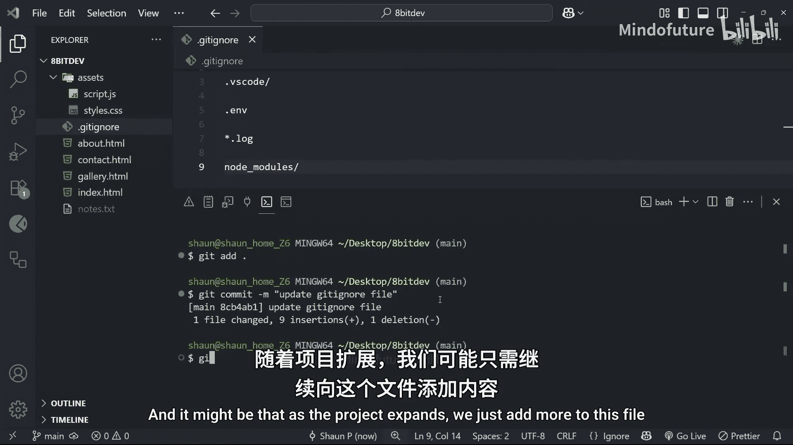
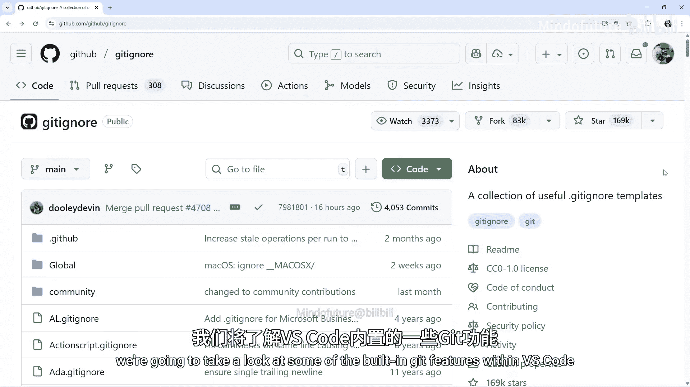

# 【Net-Ninja】Git入门教程-p09-P09_Git_Crash_Course_#9-.gitignore文件--BV1fkvtBcERR_p9-

Okay， then gang so far we've been making commits and tracking our project files。

 but there's going to come a time when we don't want Git to track something in our project folder right and that's where the dot getting all files come into play。

😊。

So then what exactly is a gitting nor file well imagine you're working on a project and you're using a code editor like VS code which creates its own dot VS code folder with your personal settings Now these files aren't really a part of your actual project they're just clutter that gets generated automatically by VS code and if Git tracks them then you're going to end up with commits that are full of irrelevant files and that's pretty annoying for anyone else working on the project and yourself the same would be true for something like a node modules folder we don't want git to be tracking folders like that because it's just clutter。

Even worse you could accidentally commit sensitive information like API keys or passwords or database credentials from within a dot env file and then if you ever publish this repository online using something like Gitthub you would be exposing those things so there are cases when you don't want Git to track certain things and we' write those things inside a Git ignore file and that's all a gitign file is it's a special file that Git can read and it tells Git which files and folders to completely ignore so let's first of all add a new file called notes do Txt inside the project and let's imagine these are just going be some notes that I make about the project and I don't really want this file to be tracked by Git is just for me so currently if we now run Gis statusus you should see that Git detects the file but as of yet it's not been tracked however if we were making changes to the project and then run the Git add command with a dot that would include all the changes and new file。

To the staging area， including the one that we just created the notes one。😊，But like I just said。

 I don't want gi to track that file， so let's create a dot git ignore file in the root of this project and we're going to use it to tell git not to track that file and notice it starts with a dot。

 don't forget that。😊，Okay so now I'm going to run Gis statusus again and we'll see two new on tracked files waiting to be staged。

 however in the Gitign file I'm now going to add the notes。

txt file just like this and save it and then once we've done that you're going to notice that the file isn't highlighted in the file tree anymore and also if we run Git statusus again you can see it's been completely removed from the list and now we just see the git ignore file that we just made。

😊，So then now I'm going to run GitAd and then a dot to add all the changes to the staging area。

Once I've done that， I'm going run git status again just to make sure only the git ignore file got added and not the notes file。

 A。 Alright， so finally， I'll make a commit for this change by running git commit。

 and we're going to use the M flag to add on a message。 and that message can be something like。

 I don't know， add Git ignore file。😊，Allright， awesome so now we're committing this Git ignore file to history which itself tells Gi to completely ignore the notes file So any changes ever made to this file now they're not going to be tracked Okay so we can add many different file paths to the git ignore file and we can also add folders so for example。

 say we want to ignore the whole dot vS code folder which sometimes gets generated by VS code to store certain settings and this isn't something that needs to be committed to the project historytories just clutter so we could add that folder to the git ignore file by saying dot VS code then a forward flash at the end to say this is a folder and everything inside it should be ignored。

😊，You could also add dot Ev to this file which we don't actually have but just in case we did then Git wouldn't track that either now or common files you might not want to track dot log files so anything ending with a dot log extension so we could tell Git to ignore those by adding an asterisk first of all then dot log and the asterisk is essentially a wildcard that matches any file name so long as it has this dot log extension at the end。

😊，So now every file which ends with dot logg would be ignored too。

You could add package folders like a node modules one if you wanted plus other things as well。

Alright so now we've added some of these， let's make a commit in the project history first we're going to stage the file by saying git add and we could write out the file name dot get ignore but I generally use a dot because it's much quicker to write and then I'm going to hit Ener。

😊，Next， we want to make a commit by running the Git commitmit command with the M flag to add a message and that can say something like updated。

 gett ignore file。All right， cool， so now we've got a gited nor file for this project and it might be that as the project expands。

 we just add more to this file。😊。

Now you can actually find Gitign templates for a bunch of different kinds of projects online on personal science coding sites and also on Github itself。

 So this list right here was created by Github themselves。

 and you can see they've got a ton of different templates。 For example。

 you can scroll down to see they've made a flutter template down here somewhere。

 which if you click on you're gonna to see and that file contains all the things you probably wouldn't want to add to your project history when you're making commit。

 So you would just basically copy this Gitign file and paste it into your own。 Also。

 when you use some kind of CI tool to scaffold a new project using a framework like flutter or view or next。

 a lot of the time it auto generate a prepopulated Gitign file for you。 not always。

 but sometimes it does。 and then you can just add to it as you go along。 anyway。

 now hopefully you understand what this file is for。😊，And in the next lesson。

 we're gonna take a look at some of the built in Git features within V S code itself。

 which can make our a Git workflow a little bit smoother。

