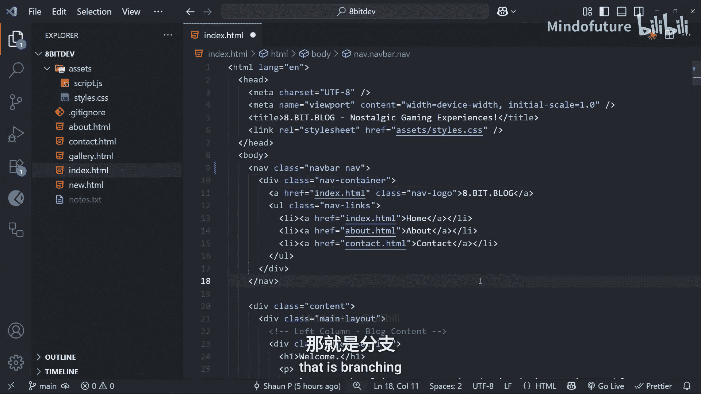

# 【Net-Ninja】Git入门教程-p10-P10_Git_Crash_Course_#10-VS_Code中的Git功能--BV1fkvtBcERR_p10-

Or I than gang so far， we've been doing all of our Git work in the terminal using commands like Git out。

 Git commit and so forth。 And that's really good for understanding how to work with Git。

 But VS code also has some really nice visual Git features that can make our workflow a little bit smoother。

😊。

And since a lot of us are going to be spending a fair amount of time， I guess， in Vs code。

 it makes sense to know how these tools work。 So in this lesson。

 we're going to focus on three main areas of Vs codes Git integration。 First。

 we're going to have a quick look at the file tree highlighting that shows us which files have changes。

 Then we're going to dive into the Git panel where we can stage files and make commits visually。

And then finally， we're going to take a little look at how VS code shows us exactly what's changed within our files in the working directory。

😊，Now I've mentioned the file tree highlighting files briefly in previous lessons。

 but I just want to quickly go over again now， so right now I've got no unstd changes and no staged changes either。

 which I can demo by running the Git statusus command。😊。

Now when this is the case and nothing is in the working director way it's changed since the last commit。

 all of the files and the folders are the standard white color now I'm going to make a change to one of the files。

 for example inside the index file I can just change a letter or something in the document title and once I save that file you're going to notice that the file name in the file Explorer over here turns a different colour。

😊，Now depending on what VS code theme you're using that color might be different for my theme when I make changes to existing files。

 that file name turns a blue color， so these are onstd changes。

 but I know that in a lot of themes it could be an orange or yellow color okay so also if I create a brand new file in this project for example I'm going to make one called new。

 HTML that's going to show up in green for me indicating it's un tracked by git。

Now if I run git add in the terminal， followed by a dot to add both of the new files or rather the one new file and the changed file to the staging area by pressenter。

 notice that the blue turns to a faint orange and this indicates that we've got a changed file and it's been added to staging but the new file always stay green。

Now， if I run Git commit with the M flagag to add some kind of commit message which can say I don't know add new page and then I hit enter。

 you should see all of those colors go back to normal。

So that's a nice little visual indicator in the file tree and a way that we can see what's going on without having to run Gi status all the time Okay so next let's have a little look at the source control panel by clicking this icon which looks a little bit like a subway route with three little circles on it and inside this panel there's a few different things at the top it lists the name of the repository along with whatever branch we're currently on main in our case then below that we've got a changes section which lists any unstaged changes in the working directory currently there's none but if I add a little change to the index HTML file and then look again it should eventually show that file here because it's been changed and if I was to change more files then those changes would show here as well。

So this is a little bit like running Git status right and seeing all of the unstd changes in your working directory Now if you hover over one of these files here。

 you're gonna to see a little plus icon And if you click on that。

 it's going add the file to the staging area So this would be like running the command Git addd to add this single file and up here there's another plus icon which is adding all changes to the staging area in case we have multiple changes listed here So that would be like saying Git add and then the dot So I'm going to click on this to stage the changes and when we do that we're going to see the file now under the staged changes heading Now you can remove files from staging by clicking on the minus icon。

 but we're not going to do that instead we're going now make a commit for this change by coming up here to this text input and typing in a commit message like change homeage content or something。

😊，Once we've done that， we can just click on the commit button to make that commit and again this would be like running the Git commit command。

 so Git commit with the M flag to add this message。😊，And then finally， just quickly down here。

 we have this section called Graph which shows you a list of all the commits that we made in order。

 including the one that we just made and if you hover over each one， it shows you the commit hash。

 the author message and other details as well So that's the source control panel which is really nice and I tend to use it sometimes for viewing changes and making commits and that kind of thing but for this course。

 90% of the time we're going to be using the command line because I feel like using visual tools like this can sometimes abstract away from how Git works too much and especially for when you're first learning it。

 I think practicing with the command line is going to give you a much better understanding。

 saying that we will be dipping into this occasionally especially in later chapters。😊，Alright。

 so now let's have a look at one more feature， which is one of my favorites。

 And that is how Vis code shows us the changes within files。

 So if I open up a file and start modifying it， notice on the left。

 we get this blue highlight in the gutter。 Now these bars shows us exactly which lines have been changed。

 So any blue line for me is an edited line of code。

 Any green line is a completely new line of code that's been added。

 And if I was to remove completely a line of code， then we should see a little red triangle to indicate that as well。

 Then if you click on any of these things， it's going show you in a popup box exactly what was changed。

 added or deleted。 So this is really useful when you're reviewing your own changes， I guess。

 before committing something because you can quickly scan through the file and see all the modifications。

 another nice touch is that you're gonna see all these little lines in the scrubber over here as well。

 So you can see at a glance where all the changes are in the file。😊，Now。

 when we commit these changes， the highlighting does go away so this stuff only shows when you're working on uncommitted changes。

😊，Anyway they were just a few visual tools that VS code gives to us when we're working with Git and they're there if you want them。

 I find myself using the Git panel for simple commits and whatnot and then heading back to the command line for more complex tasks and I also really like this colour highlighting as well。

😊，Anyway， next up， we're going to talk about one of Git's most powerful features and that is branching。

😊。

